# SPARK Night 2026: the adaptive care challenge, told as one story

**What this is.** The working document for the Beyond Next Ventures challenge at SPARK Night (13-14 Nov 2026, Ashoka University), rewritten on 14 November so that it reads in one line from start to finish. It is the same research as the 13 November edition, in a new order. No fact was changed. Repeated passages were removed, and each topic now sits in one place. One thing is new: a biology deep dive researched on 14 November, marked "new research" wherever it appears (chapter 2.7, one section of chapter 4, and Appendix I). Internal to the team.

**Status.** The research was completed on 13 Nov 2026 at about 11:10 PM. Three claims checks re-opened the sources of about 183 load-bearing facts, and their corrections are applied throughout. The biology round of 14 Nov added 284 facts, of which three more claims checks re-opened 183. One of those checks corrected a 13 November fact (the GRAND study's sample, chapter 1.4). Chapter 7 says what was not checked and what was not found.

**The challenge, as set by the fund.**

> We need ways to manage chronic disease burden at scale despite limited access to resources, specialists and irregular clinical follow-ups. Patients need treatment methods that responds to their specific condition, and will remain adaptive to patient needs between appointments. How can digital therapeutics use rapid feedback from medical devices or biomarkers to continuously personalise care, thereby bringing measurable improvements in health outcomes to patients who cannot access frequent specialist support? The opportunity is to extend effective treatment into everyday life, beyond monitoring and reminders.

### How the document is laid out

The story comes first, in the order the argument builds. The answer comes at the end of the story, not at the start. The appendix holds the full detail behind each chapter, each topic in one place.

| Chapter | The question it answers | Full detail in |
|---|---|---|
| 1. The problem | What is the fund asking, who is it about, why does care break down between visits, and why has the market not fixed it | Appendix A |
| 2. What the research found | What actually improves outcomes, how care has been scaled without specialists, what the technology can do, who else is doing this, where the money is, what the rules say, and the biology underneath (new research) | Appendices B, C, D, E and I |
| 3. Analysis: what it all means | Where to play, how to win, which of the options to build and why | Appendix F |
| 4. The product we can build | What the home blood-pressure step loop is and how it works for the patient and the doctor | Appendix G |
| 5. The MVP | What gets built tonight, what can honestly be shown at noon, and what comes after | Appendix G |
| 6. Recommendation, risks and open questions | What to do, how to pitch it, its weak spots, and what the team still has to decide (the old part L) | Appendix H |
| 7. Method and limits | How this was made and how far to trust it (the old part M) | Appendix J (the claim register) |

### Which part to read

| If you are | Read |
|---|---|
| Anyone on the team, first time | Chapters 1 to 6, in order |
| Building the engine and screens | Chapters 4 and 5, then Appendix G, then Appendix C |
| Building the hardware | Chapter 5, then Appendix G (parts and the hardware test), then Appendix C (sensing and reading quality) |
| The biology student | Chapters 2.1, 2.2 and 2.7, then Appendix I (the biology deep dive), then Appendix B, then Appendix G (the protocol file and the test cases) |
| Leading the pitch | Chapters 1 to 6, then Appendix H (the mentor) and Appendix F (strategy and options) |
| Writing the one-page thesis | Appendix G (the draft), chapter 1 (the argument), Appendix A (the numbers) |
| Asked "who else is doing this" | Chapter 2.4, then Appendix D |
| Asked "how big is it" or "is it legal" | Chapters 2.5 and 2.6, then Appendix E |

### How to trust a number here

- **Every fact carries an ID that links to its source**, for example [D1-01-F02](https://pubmed.ncbi.nlm.nih.gov/25157723/). Appendix J is the register: what each research note recorded, the link, whether the page was opened or only seen in a search summary, and the verdict of the claims check where one was run. Numbers were read at source by one research agent; the load-bearing ones were then re-checked by a second.
- **"Search summary only"** marks a fact seen only in a search result, not on the page itself.
- **Some statements are ours, and marked so:** OUR VIEW (a judgement), OUR ARITHMETIC or OUR ESTIMATE (a sum or a guess from stated inputs), ASSUMPTION (an input we chose), OUR DESIGN (a design choice of ours), THEIR CLAIM (a company about itself), EXAMPLE (mock-up data). The option scores, the market model, the simulation and the price are all ours.
- **Mock-up screens show example data.** Every name and reading in them is invented.
- **What was not done:** no customer interviews; no measured split of public and private treatment; no current specialist counts; no Indian trial of home readings driving dose steps was found. Each appendix ends with what it could not find.
- **It is not medical or legal advice.** The legal sections say what the texts say and list the questions for a lawyer.

**Contents**

- [1. The problem](#1-the-problem)
- [2. What the research found](#2-what-the-research-found)
- [3. Analysis: what it all means](#3-analysis-what-it-all-means)
- [4. The product we can build](#4-the-product-we-can-build)
- [5. The MVP](#5-the-mvp)
- [6. Recommendation, risks and open questions](#6-recommendation-risks-and-open-questions)
- [7. Method and limits](#7-method-and-limits)
- [Appendix A. The challenge, the burden and the voices in detail](#appendix-a-the-challenge-the-burden-and-the-voices-in-detail)
- [Appendix B. The clinical evidence in detail](#appendix-b-the-clinical-evidence-in-detail)
- [Appendix C. The technology in detail](#appendix-c-the-technology-in-detail)
- [Appendix D. Every player in detail](#appendix-d-every-player-in-detail)
- [Appendix E. Money and rules in detail](#appendix-e-money-and-rules-in-detail)
- [Appendix F. Strategy and the options in detail](#appendix-f-strategy-and-the-options-in-detail)
- [Appendix G. The build pack in detail](#appendix-g-the-build-pack-in-detail)
- [Appendix H. The mentor and the fund in detail](#appendix-h-the-mentor-and-the-fund-in-detail)
- [Appendix I. Biology deep dive (new research, 14 Nov)](#appendix-i-biology-deep-dive-new-research-14-nov)
- [Appendix J. The claim register](#appendix-j-the-claim-register)

## 1. The problem

This chapter tells the problem as a story, before any answer: what the fund asked for, who it is about, why their care breaks down between visits, what patients and doctors say, and why the market has not fixed it.

### 1.1 Who set the challenge and what it really asks

The challenge was set for SPARK Night (13-14 Nov 2026, Ashoka University) by Beyond Next Ventures, a fund that backs founders solving social issues with deep science and deep tech, and that works across Japan and India ([D2-07-F8](https://beyondnextventures.com/team/karthik-varada/)). The event poster names as challenge mentor Karthik Varada, Senior Associate in the fund's India investment group, based in Bengaluru ([D2-07-F1](https://beyondnextventures.com/team/karthik-varada/), [D2-07-F2](https://www.linkedin.com/in/karthikvarada/), [D2-07-F3](https://www.linkedin.com/in/karthikvarada/details/experience/)). The fund's words:

> We need ways to manage chronic disease burden at scale despite limited access to resources, specialists and irregular clinical follow-ups. Patients need treatment methods that responds to their specific condition, and will remain adaptive to patient needs between appointments. How can digital therapeutics use rapid feedback from medical devices or biomarkers to continuously personalise care, thereby bringing measurable improvements in health outcomes to patients who cannot access frequent specialist support? The opportunity is to extend effective treatment into everyday life, beyond monitoring and reminders.

Read phrase by phrase, the challenge sets six requirements (our reading, with where the evidence is).

| The fund's words | What a product must do (OUR VIEW) | Evidence |
|---|---|---|
| "rapid feedback from medical devices or biomarkers" | Use a signal that moves within days of a treatment change and is cheap and correct to measure at home. | Chapter 2.3 |
| "continuously personalise care" | Recompute the treatment from this patient's readings: the protocol step (a protocol is a written step-by-step treatment plan), the response to the last step, whether the medicine was taken, and what is unsafe. | Chapter 2.3 |
| "adaptive to patient needs between appointments" | Change the treatment without waiting for the next visit. | Chapter 1.3 |
| "measurable improvements in health outcomes" | Move one endpoint (the result a trial is judged on) within 90 days, past an accepted threshold for "clinically meaningful". | Chapter 2.1 |
| "patients who cannot access frequent specialist support" | Move the routine decision to a general doctor, nurse or health worker under a written protocol. The specialist owns the protocol and sees the exceptions. | Chapter 1.3 |
| "beyond monitoring and reminders" | Reach adaptive depth 4: the therapy itself changes. | Below, and chapter 2.1 |

#### What "beyond monitoring and reminders" rules in and out

This document sorts every product on an "adaptive depth" scale from 0 to 4: how far the product changes treatment. The fund names levels 1 and 2 and asks to go beyond them. OUR VIEW: it is asking for level 4.

| Level | What it means | Examples in the notes |
|---|---|---|
| 0 | Uses no patient data | The Nerivio migraine wearable, switched on by the patient, rated 0-1 ([D1-02-F12](https://pubmed.ncbi.nlm.nih.gov/31074005/)) |
| 1 | Shows data | Pocket ECGs in India (search summary only) ([D1-04-F32](https://www.entrepreneur.com/en-in/news-and-trends/portable-ecg-maker-agatsa-raises-inr-125-million/427643)); Omron VitalSight abroad ([D1-01-F39](https://www.phti.org/wp-content/uploads/2024/10/PHTI-Digital-Hypertension-Mgmt-Executive-Summary.pdf)) |
| 2 | Sends reminders or generic content | India's government Simple app, with overdue lists and reminder messages ([D3-05-F03](https://pmc.ncbi.nlm.nih.gov/articles/PMC10959138/)); the Medisafe reminder app abroad |
| 3 | Coaches from the person's own data | Sugar.fit, BeatO and Fitterfly in India ([D1-04-F04](https://home.sugarfit.com/), [D1-04-F06](https://www.beatoapp.com), [D1-04-F07](https://www.fitterfly.com/)); CureApp HT in Japan |
| 4 | Changes the therapy: a dose, a protocol step, an exercise prescription | In India, only Sanofi's My Dose Coach was found, its Indian results unconfirmed ([D1-04-F09](https://katalog.lib.cas.cz/KNAV/EdsRecord/edsair,edsair.doi...........9f3e0f42ebdebabac03f1b12680223bf)); abroad, d-Nav and insulin pumps ([D1-05-F41](https://www.sec.gov/Archives/edgar/data/1145197/000114519726000192/podd-20260930.htm)) |

The line between 3 and 4 matters most: level 3 changes the advice (what to eat, how to exercise), level 4 changes the prescription (a new dose or protocol step). A clinician approving each change keeps a product at level 4. The test: after the software runs, the prescription is different. OUR VIEW: level 4 is the entry condition, however good the sensor.

#### The loop: sense, decide, confirm, act, learn

A product at level 4 runs a loop of five stages. Monitoring products stop after the first.

- **Sense.** A home device gives a number, valid only if it was taken correctly. Level 1 products stop here.
- **Decide.** Software applies a written protocol to this patient's readings and proposes the next step. Coaching apps decide advice, not doses (chapter 1.5).
- **Confirm.** A doctor, nurse or health worker approves each change; unsafe cases go to a specialist.
- **Act.** The patient gets the new dose, medicine or exercise level.
- **Learn.** The next readings show whether it worked, and the loop runs again.

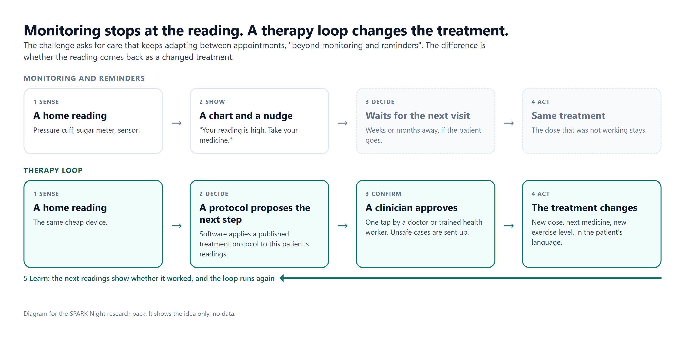

*Diagram: monitoring stops at the reading; a therapy loop sends the reading back as a changed treatment.*

OUR VIEW: the fund asks for a routine treatment decision between visits, from a home reading, by someone the patient can reach. The rest of this chapter shows who needs that decision and why it does not happen today.

### 1.2 Who it is about and how big it is

In India, chronic disease "at scale" means high blood pressure and diabetes first. The surveys disagree because they count different ages, use different blood-pressure rules or survey bases, and ran in different years, so each figure is given with its source and none is picked over the others.

| Condition | Figure | Year of data | Who was counted |
|---|---|---|---|
| High blood pressure | 35.5% | 2008-2020 | ICMR-INDIAB survey, adults 20+, blood pressure measured, 113,043 people in 31 states and union territories ([D1-03-F01](https://www.ebi.ac.uk/europepmc/webservices/rest/search?query=EXT_ID:37301218&resultType=core&format=json)) |
| High blood pressure | 315 million people, a 2021 projection by the survey's investigators, not a count in the paper | Projected to 2021 | Same study ([D1-03-F02](https://gulfnews.com/world/asia/india/india-study-estimates-11-of-population-or-101-million-is-diabetic-1.96302385)) |
| High blood pressure | 22.6%; 24% of men, 21% of women (search summary only) | 2019-21 | NFHS-5 (National Family Health Survey), ages 15+ ([D1-03-F03](https://www.deccanherald.com/india/24-men-21-women-have-hypertension-survey-1108227.html), [D1-03-F04](https://bmcpublichealth.biomedcentral.com/counter/pdf/10.1186/s12889-024-20097-5.pdf)) |
| High blood pressure | 45.9% | 2017-19 | LASI (Longitudinal Ageing Study in India), adults 45+, 72,262 people ([D1-03-F25](https://econpapers.repec.org/RePEc:plo:pmed00:1003855)) |
| Diabetes | 11.4%; prediabetes 15.3% | 2008-2020 | ICMR-INDIAB, adults 20+ ([D1-03-F01](https://www.ebi.ac.uk/europepmc/webservices/rest/search?query=EXT_ID:37301218&resultType=core&format=json)) |
| Diabetes | 101 million; prediabetes 136 million, 2021 projections by the survey's investigators, not counts in the paper | Projected to 2021 | Same study ([D1-03-F02](https://gulfnews.com/world/asia/india/india-study-estimates-11-of-population-or-101-million-is-diabetic-1.96302385)) |
| Diabetes | 89.8 million (age-standardised 10.5%); 156.7 million projected for 2050 | 2024 | IDF Diabetes Atlas, adults 20-79 ([D1-03-F28](https://medicaldialogues.in/diabetes-endocrinology/news/international-diabetes-federation-releases-diabetes-atlas-11th-edition-2025-top-10-key-takeaways-from-india-146394)) |
| Heart failure | 1.3-4.6 million cases, or about 8-10 million (about 1% of the population; search summary only); no national survey | 2010; 2016 | Reviews built from local and disease-specific data ([D3-07-F24](https://pmc.ncbi.nlm.nih.gov/articles/PMC11322948/), [D3-07-F25](https://doaj.org/article/29a22414f54d4c9090017c30fb14bcff)) |

Other long-term conditions are large too. COPD (chronic lung disease) and asthma had 55.3 million and 37.9 million cases in 2016 (search summary only) ([D1-03-F36](https://www.healthdata.org/research-article/burden-chronic-respiratory-diseases-and-their-heterogeneity-across-states-india)). The Global Burden of Disease study put India's stroke cases at 9.4 million in 2021, up from 4.4 million in 1990 (press report quoting the authors) ([D3-07-F26](https://www.downtoearth.org.in/health/global-stroke-rates-climb-india-faces-51-spike-in-cases-over-30-years-lancet)). Heart failure has no national count, but its registries show a treatment gap: in the National Heart Failure Registry (10,851 acute patients, 53 hospitals, 21 states), 47.5% of eligible patients received guideline drugs, and 1-year death was 22.1% ([D1-01-F47](https://pubmed.ncbi.nlm.nih.gov/36214477/), [D1-01-F48](https://pubmed.ncbi.nlm.nih.gov/41985986/)).

OUR VIEW: on any count, blood pressure is the largest pool.

#### Knowing, treated, controlled

A care cascade follows people with a condition through four steps: has it, knows it, is treated, is controlled. India's government hypertension programme, the India Hypertension Control Initiative (IHCI), surveyed the same nine districts twice, with no comparison districts.

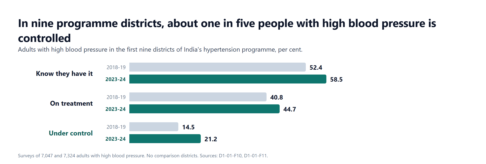

*Chart: in the first nine districts of India's hypertension programme, 21.2% of adults with high blood pressure were under control in 2023-24, up from 14.5% in 2018-19 ([D1-01-F10](https://pubmed.ncbi.nlm.nih.gov/40121324/), [D1-01-F11](https://pubmed.ncbi.nlm.nih.gov/42827825/)).*

In the same surveys, awareness rose from 52.4% to 58.5% and treatment from 40.8% to 44.7%, among 7,047 and then 7,324 people with hypertension ([D1-01-F10](https://pubmed.ncbi.nlm.nih.gov/40121324/), [D1-03-F12](https://www.ebi.ac.uk/europepmc/webservices/rest/search?query=EXT_ID:42827825&resultType=core&format=json)). In two districts control was under 5% at the start ([D1-01-F10](https://pubmed.ncbi.nlm.nih.gov/40121324/)). Nationally, a preprint on the 2019-21 family health survey (1.69 million adults) counts 36.7% of all people with hypertension as aware, 17.7% as treated and 9.1% (about 1 in 11) as controlled ([D1-03-F07](https://medrxiv.org/content/medrxiv/early/2023/06/05/2023.06.02.23290909.full.pdf)). Counted only among people aged 15-49 who are already on drugs, the same survey gives 73.7% controlled ([D1-03-F06](https://pubmed.ncbi.nlm.nih.gov/36994270/)); the ages and the denominators (the group a percentage is taken of) differ, so the two figures do not compare. For diabetes, 43% of cases, about 38.6 million, were undiagnosed in 2024 ([D1-03-F28](https://medicaldialogues.in/diabetes-endocrinology/news/international-diabetes-federation-releases-diabetes-atlas-11th-edition-2025-top-10-key-takeaways-from-india-146394)).

#### Treatment is not control

Getting people onto medicine is not enough. Tamil Nadu's doorstep programme, Makkalai Thedi Maruthuvam, was surveyed in 6,856 adults aged 30 and over across all 38 districts (paper abstract, 2025; a news report gives 6,809). Screening reached 79.4% for diabetes and 82.6% for hypertension, and over 95% of diagnosed people were on treatment. Yet control rates were 9.8% for diabetes and 35.4% for hypertension; the abstract does not say whether these are shares of everyone with the disease, of the diagnosed or of the treated ([D1-03-F09](https://www.ebi.ac.uk/europepmc/webservices/rest/search?query=EXT_ID:41398228&resultType=core&format=json)).

OUR VIEW: two steps leak, diagnosis and control. The step from "treated" to "controlled" depends on the dose being raised and the medicine being taken.

#### The world and Japan

Low control is a world problem. About 1.4 billion people aged 30-79 have hypertension; 44% do not know it, 23% are controlled, and two-thirds live in low- and middle-income countries (2024) ([D1-03-F32](https://www.who.int/news-room/fact-sheets/detail/hypertension)). There are 830 million adults with diabetes, and 59% of those aged 30 and over are not on diabetes medicine (2022) ([D1-03-F33](https://www.who.int/news-room/fact-sheets/detail/diabetes)). Japan, the fund's home, has about 43 million people with hypertension, about 31 million (73%) of them poorly controlled (2010 base, cited for 2017; search summary only) ([D1-03-F47](https://www.nature.com/articles/hr20144)), and 29.4% of its people were aged 65 or over in September 2025 (search summary only) ([D1-03-F48](https://thestar.com.my/aseanplus/aseanplus-news/2025/09/14/japan039s-share-of-population-aged-65-or-older-hits-record-high-of-294-per-cent)). OUR VIEW: "treated but not controlled" is the gap in Japan too, so the problem is not only Indian.

### 1.3 Why care breaks down between visits

India does not lack programmes. It already screens and treats at large scale through free public programmes. The breakdown comes after the first prescription, in the weeks between visits.

#### A large system that sees people once

| Programme | Scale (date) |
|---|---|
| National NCD (non-communicable disease) screening | 41.5 crore people screened for hypertension and 41.3 crore for diabetes (cumulative, Aug 2026) ([D1-03-F20](https://static.pib.gov.in/WriteReadData/specificdocs/documents/2026/aug/doc2026812952101.pdf)) |
| "75 by 25" (75 million on standard care by 2025) | 42.01 million hypertension patients put on standard care by the public programme as of 5 Mar 2025, and 25.27 million diabetes patients (search summary only; three outlets agree) ([D1-03-F14](https://rsdebate.nic.in/bitstream/123456789/759008/1/PQ_267_11032025_U1383_p385_p386.pdf)) |
| Ayushman Arogya Mandirs (12 free services) | Over 1.86 lakh functional (Aug 2026) ([D1-03-F19](https://static.pib.gov.in/WriteReadData/specificdocs/documents/2026/aug/doc2026812952101.pdf)) |
| NCD clinics | 770 district clinics and 6,410 at community health centres (2026) ([D1-03-F20](https://static.pib.gov.in/WriteReadData/specificdocs/documents/2026/aug/doc2026812952101.pdf)) |
| eSanjeevani teleconsultation | Over 49 crore consultations by Aug 2026 ([D1-03-F19](https://static.pib.gov.in/WriteReadData/specificdocs/documents/2026/aug/doc2026812952101.pdf)) |
| Jan Aushadhi Kendras (generic medicine shops) | 18,646 (Feb 2026), priced 50-80% below branded medicines ([D1-03-F20](https://static.pib.gov.in/WriteReadData/specificdocs/documents/2026/aug/doc2026812952101.pdf)) |

#### The return visit that half never make

IHCI runs a fixed drug protocol. Its cohort registered 21,895 patients at 24 sites in Punjab, Madhya Pradesh, Maharashtra and Telangana (Jan 2018-Jun 2019) and followed them up in Jul-Sep 2019, with no comparison group. Only 11,274 (51%) came back. Among those who did, control rose from 26.3% to 59.8% ([D1-03-F10](https://pmc.ncbi.nlm.nih.gov/articles/PMC8678731/)). A second cohort, 281,209 patients started in Punjab and Maharashtra in 2018-2021, found 36% with no visit in Jan-Mar 2022; the two cohorts differ in sites, years and the definition of loss ([D3-05-F04](https://pmc.ncbi.nlm.nih.gov/articles/PMC10959138/)). Another count found about 27% of registered IHCI patients did not return in Jan-Mar 2021 (search summary only) ([D1-03-F13](https://theprint.in/health/indias-hypertension-initiative-substantially-improved-bp-control-in-4-states-study-finds/575856)).

The visit matters because the dose waits for it. A doctor dispenses the first medicine. Trained paramedical staff dispense the monthly refill only when pressure is controlled; uncontrolled patients are sent to a doctor for a dose change ([D3-05-F08](https://pmc.ncbi.nlm.nih.gov/articles/PMC8678807)). A patient who does not go back stays on the same dose. Some also stop taking it: pooled Indian non-adherence (adherence means taking the medicine as prescribed) to blood-pressure drugs is 48%, with a prediction interval of 9-90% (search summary only) ([D1-03-F44](https://www.benthamscience.com/article/150468)).

#### Few specialists, two minutes

In March 2023, 79.9% of the required posts in four specialities (surgeon, physician, paediatrician, obstetrician-gynaecologist) at rural community health centres were unfilled ([D1-03-F16](https://theprint.in/health/rural-india-has-an-80-shortfall-of-specialist-doctors-mp-gujarat-tamil-nadu-worst-off/2259874)), and the shortfall has stayed near 17,500 posts since 2014-15 ([D1-03-F17](https://theprint.in/health/rural-india-has-an-80-shortfall-of-specialist-doctors-mp-gujarat-tamil-nadu-worst-off/2259874)). The only specialist counts are from a 2017 parliamentary committee (search summary only): about 4,000 cardiologists, 1,200 nephrologists and 650 endocrinologists, against the committee's estimated needs of 88,000, 40,000 and 28,000 ([D1-03-F18](https://www.deccanherald.com/archives/india-has-shortage-specialist-doctors-2039485)). The government told Parliament it does not hold speciality-wise doctor data (news report of the reply, 13 Apr 2025) ([D3-07-F22](https://medicaldialogues.in/news/health/doctors/speciality-wise-data-of-doctors-not-available-health-minister-tells-parliament-146512)). Where patients do see a doctor, the visit is short: Indian primary-care visits lasted about 2.3 minutes (2013, stopwatch, 412 visits) and 2 minutes (2015), against 10.2 minutes in Japan (2012) ([D1-03-F24](https://pmc.ncbi.nlm.nih.gov/articles/PMC5695512/)).

#### Cost

Families pay a large share of the bill. Out-of-pocket spending was 39.4% of total health expenditure in 2021-22 and 43.41% in 2022-23 (National Health Accounts released 27 May 2026, via a news report); in 2022-23 household spending rose by ₹26,375 crore while government spending fell by nearly ₹49,000 crore ([D1-03-F23](https://thesouthfirst.com/health/as-public-health-spending-fell-in-2022-23-indians-paid-6-4-more-from-their-own-pockets/)). No figure was found for the household cost of a chronic-care visit, travel or lost wages, loss to follow-up outside IHCI, or how long a dose change is delayed.

#### Phones and who is left out

Most Indians have a mobile connection, but the patient is not always the one who holds it.

| Measure | Figure | Year |
|---|---|---|
| Smartphone owners | Over 622 million (industry estimate) ([D1-03-F41](https://marketingmind.in/india-crosses-nine-hundred-and-fifteen-million-internet-users-as-focus-shifts-from-access-to-engagement-nielsen/)) | 2025 |
| Women 15-49 owning a phone | 63.6%; rural 57.4% (search summary only) ([D1-03-F42](https://www.thenewsminute.com/news/womens-internet-use-nearly-doubles-but-access-gaps-remain)) | 2023-24 |
| Women 15-49 owning the phone they use (another note) | 54%; rural 46.6% ([D3-04-F23](https://www.downtoearth.org.in/economy/what-does-nfhs-5-data-tell-us-about-state-of-women-empowerment-in-india-80920)) | Not stated |
| Phone ownership, ages 15+ | Men 83.9%, women 56.2% (search summary only) ([D1-03-F42](https://www.thenewsminute.com/news/womens-internet-use-nearly-doubles-but-access-gaps-remain)) | 2025 |
| Rural older adults near Mysore (150 people) | 50% owned a phone, few a smartphone; digital literacy 11% ([D3-04-F56](https://europepmc.org/article/MED/35314600)) | Not stated |
| People who spoke English | About 10.6% ([D3-04-F57](https://en.wikipedia.org/wiki/Multilingualism_in_India)) | 2011 |

About four in ten rural women do not own a phone (OUR ARITHMETIC: 100 - 57.4 = 42.6%). OUR VIEW: anything that reaches patients between visits must work on a shared phone, through a health worker, and by voice.

OUR VIEW: a two-minute visit has no time to read two weeks of home readings, and the visit itself is the step that about half the patients skip.

### 1.4 What patients and doctors say in public

The numbers show where care breaks. The voices show why. The team has done no interviews, so this section reports published interview studies and surveys (PUBLISHED STUDY), public app reviews (PUBLIC REVIEW) and posts (FORUM POST). None of it is customer evidence gathered by the team; reviews are self-selected, and the studies were read as abstracts only.

#### Why patients miss follow-up and stop medicines

Eight Indian interview studies (PUBLISHED STUDY) name the same causes: feeling well, cost, family duties, fear of long-term drugs and traditional medicine ([D3-04-F01](https://europepmc.org/article/MED/42945358), [D3-04-F02](https://europepmc.org/article/MED/42778240), [D3-04-F03](https://europepmc.org/article/MED/41426819), [D3-04-F04](https://europepmc.org/article/MED/41930620), [D3-04-F05](https://europepmc.org/article/MED/41832485), [D3-04-F12](https://europepmc.org/article/MED/41933310), [D3-04-F13](https://europepmc.org/article/MED/38330094), [D3-04-F14](https://europepmc.org/article/MED/37767450)). In coastal Karnataka, 32 patients lost to follow-up described "symptom-driven healthcare seeking", work duties, wage loss and rushed consultations, and suggested reminders and digital records ([D3-04-F01](https://europepmc.org/article/MED/42945358)). In rural Tamil Nadu, stopping was structural, unintentional (work, travel, caregiving) or intentional, and family could both help and hinder ([D3-04-F02](https://europepmc.org/article/MED/42778240)). In Ludhiana, "about 50% patients were adherent" among 40 people with diabetes ([D3-04-F14](https://europepmc.org/article/MED/37767450)). In Chennai, caregivers enable access for older adults and devices are shared ([D3-04-F05](https://europepmc.org/article/MED/41832485)). A FORUM POST by an adult child says the father's pressure stayed controlled on Ayurvedic treatment, then rose, and he went back to some medication ([D3-04-F52](https://www.doctorspring.com/question/risks-significance-of-fluctuating-blood-pressure-with-nebicard)).

One small survey puts numbers on it. In Bathinda (Punjab), 157 people who had missed visits for over 3 months were phoned (a small convenience sample): 24.8% had no sense of being ill, 22.2% named distance, 15.2% had no guidance or reminder and 8.2% had an acute illness ([D3-05-F07](https://pmc.ncbi.nlm.nih.gov/articles/PMC8678807)).

OUR VIEW: feeling well recurs as a reason to stop, and a home reading is one thing that can contradict it.

#### Home monitors in Indian homes

Few patients use a home cuff, most taught themselves, and home readings show that many "controlled" patients are not.

- **Who has one.** Of 2,588 clinic-attending people with hypertension and caregivers in North India, 18.1% used a home monitor (urban 20.5%, rural 8.5%); 75.2% learned by themselves, and technique was excellent in 15.9% of patients and 5.9% of caregivers ([D3-04-F06](https://europepmc.org/article/MED/39579976)). No household survey figure was found. Omron says household penetration is "below 5%" (2026 article) or "just 2%" (2024 article) (THEIR CLAIM) ([D3-07-F14](https://india.entrepreneur.com/business-news/omron-opens-first-india-factory-targets-3-mn-monitors-a-year), [D3-07-F15](https://www.digitalhealthnews.com/omron-targets-a-20-penetration-rate-by-2030-in-the-indian-blood-pressure-monitor-market)); another report gives 6% (search summary only) ([D2-05-F29](https://www.nexdigm.com/market-research/report-store/india-blood-pressure-monitors-market-research-report/)); a web claim of under 5% cites no source ([D3-04-F22](https://www.omnicuris.com/medshots/daily_updates/home-blood-pressure-monitoring-india-clinical-insights_30-Oct-26_16-21)).
- **What doctors do with them.** About 88% of 832 Indian doctors recommend home monitoring but estimate that only 30.4% of patients measure, and about 30% give no instructions ([D3-04-F07](https://europepmc.org/article/MED/37088141)). Only 15.1% knew the correct home thresholds ([D3-04-F18](https://pubmed.ncbi.nlm.nih.gov/37088141/)).
- **What home readings reveal.** In the GRAND study (18 centres, 12 states; 1,920 treated patients who attend regularly were enrolled and 1,578 with valid clinic and home readings were analysed; 7 days of home readings), 77.7% of those analysed looked controlled by clinic pressure but only 55.9% by clinic plus home; 21.8% had masked uncontrolled pressure (high at home, normal in clinic) ([D3-04-F09](https://europepmc.org/article/MED/42995223), [D4-03-F40](https://pubmed.ncbi.nlm.nih.gov/42995223/)). The 13 November edition attached these shares to the 1,920; the claims check of 14 November found they are shares of the 1,578.

#### What doctors and health workers say

Doctors describe heavy workloads, and many private doctors do not follow the state protocol. In Kolar, Karnataka: "Doctors face very high workloads, especially in the public sector" ([D3-04-F16](https://europepmc.org/article/MED/30658641)). Of 30 private doctors in Bhopal, 19 did not follow the state protocol, citing fear of losing patients if pressure did not come down at once, or of causing drug side effects, and a preference for fixed-dose combinations (two drugs in one tablet) ([D3-04-F15](https://europepmc.org/article/MED/33289944)). Two programme people wrote on LinkedIn (paraphrased; read 13 Nov 2026): a national NCD consultant at UNICEF India (about Apr 2026) blamed blood-pressure machines left uncalibrated for months and mid-month drug stock-outs, and a doctor and WHO consultant (about Oct 2026) said counting visits is not enough, citing an Indian trial, mWellcare (chapter 2.1), as showing that a digital system does not guarantee results. No Indian doctor, nurse or health worker was found speaking about dose steps from home readings. OUR VIEW: a doctor's approval cannot be assumed.

#### What users say about existing programmes

The latest 100 Apple App Store India reviews of each of three diabetes programmes, BeatO, Sugar.fit and Fitterfly, were read on 13 Nov 2026. One-star reviews numbered 55, 76 and 9 (count from the research note's method section); Fitterfly's 5-star profile looks prompted (the note's inference). The complaints fall into a few themes (PUBLIC REVIEW).

| Theme | What reviewers describe |
|---|---|
| Unwanted calls | Repeated recorded calls and WhatsApp messages about classes and webinars never signed up for (Sugar.fit, Jul and Oct 2026) (D3-04-F27, D3-04-F28) |
| No reachable person | No doctor slot for days; no support line that answers (Sugar.fit, Sep and Oct 2026) (D3-04-F29, D3-04-F30) |
| Coaching runs dry | "by the third month, there is hardly anything new to discuss" (Sugar.fit, 26 Sep 2026) (D3-04-F33); no follow-up after a month (D3-04-F34) |
| Device and data | A sensor whose data never synced; five readings in five minutes that differed by over 50 (BeatO, Sep and Mar 2026) (D3-04-F36, D3-04-F37) |
| Money and medicine | ₹18,990 paid for a 4-month programme with, the reviewer says, only one month's medicine delivered; a refund still pending after about 20 days (Sugar.fit, Oct 2026; BeatO, Jul 2026) (D3-04-F40, D3-04-F42) |
| Praise for a named coach | Credit to a personal coach; one reviewer reports HbA1c (a blood test of average sugar over about three months) down to 6.1 and medicine halved (Fitterfly, 2025 and 2024) (D3-04-F43, D3-04-F44) |

None of the 300 reviews mentions language or voice, and none describes a dose change from a home reading (count from the research note's method section).

#### Reminders and messages

Reminders alone did not bring people back. In a Punjab trial at two public hospitals, 388 patients with uncontrolled pressure got two myth-busting WhatsApp reminders before their visit, or none; attendance was 21.8% against 19.6%, a null result, and beliefs did not change ([D3-04-F50](https://europepmc.org/article/MED/39245777)). A Delhi study of 110 patients (counselling, voice calls, SMS) reported control rising from 14.7% to 52.9%, but with no control group ([D3-04-F51](https://europepmc.org/article/MED/40524849)).

OUR VIEW: patients stop when they feel well, few use a cuff well, doctors are stretched and wary of the protocol, and a message works only if it reaches the person who holds the phone and leads to a decision.

### 1.5 The market issues: why the market has not fixed this

The gap is clear; this section explains why companies have not filled it. Three answers recur in the notes: what has been sold stops before the dose, the companies that sold apps on their own ran out of money, and nobody yet pays for the step that is missing.

#### What has been sold so far

India's private chronic-care programmes sell a glucose sensor or meter plus a doctor and a coach. None of their pages says glucose data changes a drug dose by algorithm, so on what is published they sit at adaptive depth 3 ([D1-04-F02](https://ind.twinhealth.com/), [D1-04-F04](https://home.sugarfit.com/), [D1-04-F06](https://www.beatoapp.com), [D1-04-F07](https://www.fitterfly.com/)). Their outcome figures are their own averages with no comparison group (THEIR CLAIM) ([D1-04-F06](https://www.beatoapp.com), [D1-04-F07](https://www.fitterfly.com/)). The patient pays: Sugar.fit charges ₹29,990 for 12 months or ₹15,990 for 4 months (13 Nov 2026) ([D1-04-F04](https://home.sugarfit.com/)), and HealthifyRx charged ₹48,000 for 3 months (May 2025) ([D1-04-F26](https://inc42.com/?p=515015)).

The government's tools stop at the same place. IHCI's Simple app keeps a registry, flags overdue patients and sends reminders ([D1-04-F19](https://pmc.ncbi.nlm.nih.gov/articles/PMC10959138/)). The app's protocol model stores a drug list and follow-up days, and no step logic was found in it ([D1-06-F40](https://github.com/simpledotorg/simple-server/tree/master/app/models)). So the nurse records the reading, but the step-up decision still waits for a visit.

#### Why companies died

Abroad, several companies sold digital therapeutics (software that changes one patient's treatment) or sensors, some with good trials, and failed. India's best-funded chronic-care app did too.

| Company | What it sold | What happened |
|---|---|---|
| Pear Therapeutics (US) | Prescription apps for addiction and insomnia, with randomised trials ([D1-02-F17](https://pubmed.ncbi.nlm.nih.gov/24700332/)) | Bankrupt April 2023; assets sold for just over $6M against $130M of liabilities ([D1-05-F20](https://medtech.citeline.com/MT147939/Pear-Bankruptcy-Filing-Highlights-Difficult-Challenges-Facing-Digital-Therapeutics), [D1-02-F42](https://foleyhoag.com/news-and-insights/news/2024/may/foley-hoag-advises-pear-therapeutics-through-confirmation-of-chapter-11-liquidating-plan/)). A panel said it tried to change care and payment at once ([D1-05-F21](https://medcitynews.com/2023/10/digital-medicines-sector-draws-lessons-from-pear-therapeutics-demise/)) |
| Akili (US) | A game for ADHD in children | $523,000 of prescription revenue in 2023, net loss $59.5M; sale agreed for about $34M in May 2024 ([D1-02-F44](https://www.medtechdive.com/news/akili-sell-34m-virtual-therapeutics-digital/717570/)) |
| Better Therapeutics (US) | A diabetes app: HbA1c 0.39 points lower than a control app (669 patients, 90 days) ([D1-02-F21](https://pubmed.ncbi.nlm.nih.gov/36181554/)) | Expected no revenue in 2023 (revenue not reported), deficit $134.3M; weighed winding down in March 2024 ([D1-02-F46](https://www.medtechdive.com/news/better-therapeutics-lay-offs/710402/)) |
| Teva Digihaler | Sensor inhalers and app | US distribution and app support stopped 1 June 2024; the US notice gave no reason and a UK recall cited "commercial reasons" ([D1-02-F41](https://aafa.org/digihaler-discontinuation-may-cause-another-disruption-in-care-for-people-with-asthma/)) |
| PhableCare (India) | Blood-pressure and glucose devices, consultations (depth 2) | Raised ₹187 crore in Apr 2022; stopped work in Feb 2023; staff fell from about 2,000 to 200, many unpaid. Former staff said there were no funds; the founders blamed staff misconduct ([D1-04-F14](https://www.biospectrumindia.com/news/20/21035/chronic-disease-management-startup-phablecare-raises-rs-187-cr.html), [D1-04-F23](https://www.thenewsminute.com/karnataka/bengaluru-based-start-phablecare-goes-grid-hundreds-employees-unpaid-181934)) |

The common causes, as the notes give them:

- No one paid for the app alone ([D1-05-F20](https://medtech.citeline.com/MT147939/Pear-Bankruptcy-Filing-Highlights-Difficult-Challenges-Facing-Digital-Therapeutics), [D1-02-F44](https://www.medtechdive.com/news/akili-sell-34m-virtual-therapeutics-digital/717570/), [D1-05-F23](https://managedhealthcareexecutive.com/view/what-does-pear-therapeutics-bankruptcy-mean-for-pdts-)).
- Too few prescribers, and trials that payers did not accept as outcome proof ([D1-05-F21](https://medcitynews.com/2023/10/digital-medicines-sector-draws-lessons-from-pear-therapeutics-demise/)).
- Sensors with no therapy change ([D1-02-F41](https://aafa.org/digihaler-discontinuation-may-cause-another-disruption-in-care-for-people-with-asthma/), [D1-02-F02](https://pubmed.ncbi.nlm.nih.gov/38040117/)).
- Valuations ahead of revenue, then no cash ([D1-05-F55](https://www.statnews.com/2023/09/27/health-tech-2021-ipo-spac-bankruptcy/), [D1-04-F23](https://www.thenewsminute.com/karnataka/bengaluru-based-start-phablecare-goes-grid-hundreds-employees-unpaid-181934)).
- Users leave fast: across 93 mental-health apps, the median app kept 3.3% of its users at day 30 ([D1-02-F26](https://pubmed.ncbi.nlm.nih.gov/31573916/)).

#### Who pays today

In India, the patient pays for private programmes, as above, and the state pays for public care, where treatment "could be as low as Rs 200 per patient per year", a modelled drug cost that leaves out staff (WHO, 2022; SOURCE ESTIMATE) ([D2-01-F12](https://www.who.int/india/news/detail/02-06-2022-india-hypertension-control-initiative--a-high-impact-and-low-cost-solution), [D2-05-F18](https://www.who.int/india/news/detail/02-06-2022-india-hypertension-control-initiative--a-high-impact-and-low-cost-solution), [D3-05-F09](https://www.who.int/india/news/detail/02-06-2022-india-hypertension-control-initiative--a-high-impact-and-low-cost-solution)). The notes found no Indian payer, public or private, that pays for remote blood-pressure monitoring or a digital therapeutic as a line item ([D2-04-F47](https://rsdebate.nic.in/bitstream/123456789/757667/1/PQ_267_04022025_S26_p78_p81.pdf)). Insurance barely touches outpatient care: outpatient cover is below 0.1% of a US$37.7 billion outpatient market (industry-sponsored, search summary only) ([D2-05-F10](https://www.theweek.in/wire-updates/business/2025/07/01/dcm88-health-and-india-insurtech-association.html)).

Abroad, the firms that reached scale are paid by someone other than the patient. Employers and insurers pay for clinician-led programmes: Hinge Health, paid "primarily" by employers, had revenue of $234.97M in the third quarter of 2026 ([D1-05-F15](https://www.sec.gov/Archives/edgar/data/1673743/000162828026072251/hnge-20260930.htm), [D1-05-F16](https://www.sec.gov/Archives/edgar/data/1673743/000162828026072251/hnge-20260930.htm)). Or the company sells a device that delivers the therapy: Insulet, a closed-loop insulin pump maker, had revenue of $842.0M in the same quarter ([D1-05-F41](https://www.sec.gov/Archives/edgar/data/1145197/000114519726000192/podd-20260930.htm)).

#### No dose change found

No Indian service was found that turns home blood-pressure or glucose readings into a medicine change between visits ([D1-04-F09](https://katalog.lib.cas.cz/KNAV/EdsRecord/edsair,edsair.doi...........9f3e0f42ebdebabac03f1b12680223bf), [D1-04-F19](https://pmc.ncbi.nlm.nih.gov/articles/PMC10959138/)). This was one agent's limited search on 13 Nov 2026, a search result and not proof of absence; chapter 2.4 lists the searches and the nearest products abroad.

OUR VIEW: India's best-funded chronic-care app ran out of money within a year of its largest round. Money raised is not proof that anyone will pay. The doctor controls the prescription and the payer controls the money; a product that leaves either out has no user or no buyer.

### 1.6 The problem in one paragraph

OUR VIEW. Hundreds of millions of Indians have high blood pressure or diabetes, many are on medicine, and few are controlled. India already screens and enrols them at crore scale, and its programme has a protocol and free drugs. What it lacks between visits is the decision, the confirmation and the action. The scarce thing is the prescriber's decision, which waits for a visit that about half the patients do not make, and the visits that do happen were found to last about two minutes. The products sold so far show readings, send reminders or coach, and stop before the dose; companies that sold an app on its own, even with good trials, failed for lack of a payer.

Full detail: Appendix A (the challenge, the burden and the voices), with Appendix D for the companies and Appendix E for who pays.

The problem is now clear: a large, treatable population, a system that loses half of it between visits, and a market that watches and reminds but does not change the treatment. The next chapter asks what the research says actually works, and whether anyone has made it work without specialists.

## 2. What the research found

Chapter 1 showed a large, treatable population, a system that loses half of it between visits, and a market that stops before the dose. This chapter condenses what the research found, in plain words. It starts with the clinical evidence on what actually improves outcomes, then turns to how others have scaled care without specialists, what the technology can and cannot do, who is already doing this, where the money is and what the rules allow.

### 2.1 What actually improves outcomes

> **In short.**
> - Outcomes improved when a home reading led to a changed treatment, and mostly did not when the reading was only shown or turned into a reminder.
> - Who was allowed to change the dose mattered more than the electronics.
> - Raising adherence on its own did not move outcomes.
> - The same pattern holds in diabetes, heart failure, warfarin and asthma, and the known harms of dose stepping can be met with stop rules.

The trials sort into five rules. OUR VIEW: the sorting is ours; the numbers are from the notes.

**Rule 1. The reading must change the treatment.** Across 15 pooled trials (7,138 people, 12 months), self-monitoring of blood pressure alone lowered systolic pressure (the upper number, in mmHg, millimetres of mercury) by 1.0 mmHg against usual care: no effect. With intensive support (dose changes by doctors, pharmacists or patients, plus education or counselling), not dose changes alone, it fell 6.1 mmHg ([D1-01-F05](https://pubmed.ncbi.nlm.nih.gov/28926573/)). Where the dose itself moved, the falls were larger. In the UK trial TASMIN-SR (552 high-risk patients, randomised, meaning people got each treatment by chance), patients stepping their own dose by an agreed plan had systolic pressure 9.2 mmHg lower than under usual care at 12 months ([D1-01-F02](https://pubmed.ncbi.nlm.nih.gov/25157723/)). In the US trial HyperLink (450 patients, 16 clinics randomised as clusters, meaning whole clinics rather than single patients), pharmacists adjusting drugs from home readings got 57.2% controlled against 30.0% with usual care ([D1-01-F04](https://pubmed.ncbi.nlm.nih.gov/23821088/)). An independent US review by the Peterson Health Technology Institute (PHTI, October 2024) rated monitoring-only programmes "not clinically meaningful" and programmes where care teams adjust drugs "clinically meaningful and more rapid", against a threshold of a 5 mmHg fall in systolic pressure ([D1-01-F39](https://www.phti.org/wp-content/uploads/2024/10/PHTI-Digital-Hypertension-Mgmt-Executive-Summary.pdf)).

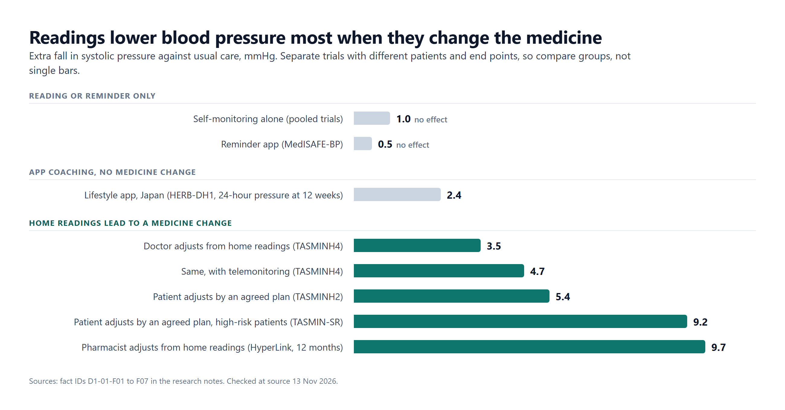

*Chart: separate trials with different patients and end points, so compare the groups, not single bars ([D1-01-F01](https://pubmed.ncbi.nlm.nih.gov/20619448/), [D1-01-F02](https://pubmed.ncbi.nlm.nih.gov/25157723/), [D1-01-F03](https://pubmed.ncbi.nlm.nih.gov/29499873/), [D1-01-F04](https://pubmed.ncbi.nlm.nih.gov/23821088/), [D1-01-F05](https://pubmed.ncbi.nlm.nih.gov/28926573/), [D1-01-F06](https://pubmed.ncbi.nlm.nih.gov/29710289/), [D1-01-F07](https://pubmed.ncbi.nlm.nih.gov/34455443/)).*

**Rule 2. Who is allowed to decide matters more than the electronics.** In the UK trial TASMINH4 (1,182 patients, 12 months), the family doctor adjusted doses in every arm, and sending home readings electronically instead of on paper added 1.2 mmHg, not significant (small enough to be chance) ([D1-01-F03](https://pubmed.ncbi.nlm.nih.gov/29499873/)). In rural China, the China Rural Hypertension Control Project (CRHCP: 326 villages, 33,995 people aged 40 and over) let village doctors start and step drugs by a standard protocol under physician supervision. At 18 months, 57.0% were under 130/80 against 19.9% with enhanced usual care ([D1-01-F09](https://pubmed.ncbi.nlm.nih.gov/35500594/)). After a median of 4 years, cardiovascular events were lower, with a hazard ratio (a risk ratio over time; below 1 means fewer events) of 0.75 at age 60 and over and 0.64 under 60. The programme also gave free or discounted drugs and paid village doctors incentives tied to control rates, so the effect cannot be credited to the protocol alone ([D1-01-F38](https://pubmed.ncbi.nlm.nih.gov/38888905/)).

India has the null result that belongs here. mWellcare (40 community health centres, 3,698 people with hypertension, diabetes or both, 12 months, randomised by centre) gave nurses and doctors an app that prompted treatment steps during visits. Against enhanced usual care the systolic difference was 0.98 mmHg, not significant; both arms fell by about 13 mmHg ([D1-01-F46](https://pubmed.ncbi.nlm.nih.gov/30586732/)). OUR VIEW: it shows that a prompt at a visit adds nothing to a well-run protocol programme. It does not show that dose changes between visits fail: the app did not act on home readings or reach patients who never came back, and no Indian randomised trial of home readings driving a dose protocol was found (D1-01, NOT FOUND list).

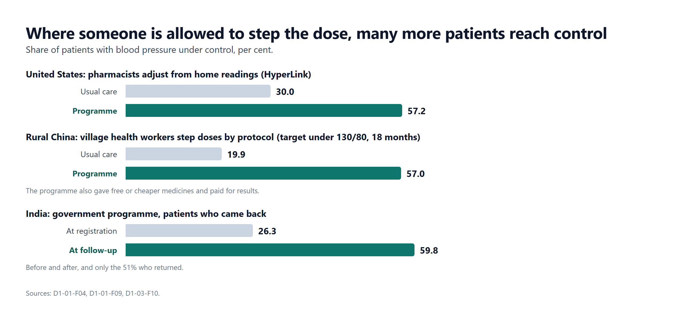

*Chart: three settings where someone other than a specialist was allowed to step the dose. The China programme also gave free or cheaper medicines and paid for results; the India figures are before and after among the 51% who returned, with no comparison group ([D1-01-F04](https://pubmed.ncbi.nlm.nih.gov/23821088/), [D1-01-F09](https://pubmed.ncbi.nlm.nih.gov/35500594/), [D1-03-F10](https://pmc.ncbi.nlm.nih.gov/articles/PMC8678731/)).*

**Rule 3. Adherence technology alone does not move outcomes.** Smart pillboxes or medication labels for tuberculosis (ASCENT, 23,483 patients, four countries) did not reduce poor outcomes against standard care ([D1-02-F59](https://pubmed.ncbi.nlm.nih.gov/40086457/)). Inhaler reminders for 220 New Zealand children raised adherence to 84% against 30% over 6 months, with no difference in school absence ([D1-02-F01](https://pubmed.ncbi.nlm.nih.gov/25617215/)). A blood-pressure reminder app (MedISAFE-BP, 411 US adults, 12 weeks) moved systolic pressure by 0.5 mmHg, not significant ([D1-01-F06](https://pubmed.ncbi.nlm.nih.gov/29710289/)). OUR VIEW: raising a dose that is not being taken is unsafe, so adherence is an input to the dose decision, not a product.

**Rule 4. Someone must pay for the outcome.** Chapter 1.5 told this side: apps and sensors sold on their own failed, while the firms that lasted are paid by employers and insurers, or sell a device that delivers the therapy.

**Rule 5. People stay when their own clinician is in it.** In eight remote US studies (over 1,00,000 participants), median retention was 5.5 days; referral by a clinician added 40 days, and payment 22 days (one study) ([D1-02-F27](https://pubmed.ncbi.nlm.nih.gov/32128451/)). OUR VIEW: a consumer app is the wrong shape.

#### What the loop changes, by kind

| What the loop changes | Home signal | Proof | Who decides |
|---|---|---|---|
| 1. Drug dose or protocol step | Cuff, fasting sugar, INR (a blood test of clotting time), weight | Strong | Patient on an agreed plan, pharmacist, nurse or health worker |
| 2. Food and behaviour | Glucose sensor, step count | Mixed | App, coach |
| 3. Exercise as the dose | Camera, pulse, effort rating | Matches in-person care | Therapist or app |
| 4. Therapy delivered by the device (closed-loop insulin pump) | Glucose sensor | Strong | Algorithm, within limits a clinician sets ([D1-05-F41](https://www.sec.gov/Archives/edgar/data/1145197/000114519726000192/podd-20260930.htm)) |
| 5. Biofeedback (a body signal shown back to the patient) | Breathing or pulse sensor | Weak | Patient |

OUR VIEW: proof is strongest in kinds 1 and 4, where a drug dose with a known effect is changed and the signal is cheap, valid and fast. Kind 4 needs expensive hardware; kind 1 needs almost none.

#### The evidence by condition

| Condition | What works (headline) | Main caution |
|---|---|---|
| Blood pressure | Dose stepping from home readings by the patient, a pharmacist or a village doctor (rules 1 and 2); strongest proof, up to hard outcomes at 4 years | Leg swelling 32% against 22% with self-titration in TASMINH2 ([D1-01-F01](https://pubmed.ncbi.nlm.nih.gov/20619448/)); the China gain came with free drugs and incentives |
| Type 2 diabetes | A device computing the next insulin dose (d-Nav, 181 US adults, 6 months, against clinician support alone): HbA1c down 1.0 point against 0.3, with equal low-sugar events; several authors were maker-linked ([D1-01-F13](https://pubmed.ncbi.nlm.nih.gov/30808512/)) | Low blood sugar. PHTI (March 2024) found US type 2 tools without a continuous glucose monitor "do not deliver clinically meaningful benefits" ([D1-01-F40](https://phti.org/wp-content/uploads/sites/3/2024/03/PHTI-Digital-Diabetes-Mgmt-Overview-for-Policymakers-v1.0.pdf)) |
| Heart failure | Fast dose stepping after discharge (STRONG-HF, 1,078 patients, 14 countries, against usual care): readmission or death at 180 days an adjusted 15.2% against 23.3% ([D1-01-F27](https://pubmed.ncbi.nlm.nih.gov/36356631/)) | More side effects (41% against 29%), four visits in two months, lab tests. Telemonitoring without a mandated dose protocol was null in two US trials (1,653 and 1,437 patients) ([D1-01-F32](https://pubmed.ncbi.nlm.nih.gov/21080835/), [D1-01-F33](https://pubmed.ncbi.nlm.nih.gov/26857383/)) |
| Warfarin (a blood thinner) | Testing INR at home and setting one's own dose: clots risk ratio (risk with treatment divided by risk without) 0.47 and deaths 0.55 against usual care; leaving the dose to the clinic gave no fewer deaths (0.94) ([D1-02-F05](https://pubmed.ncbi.nlm.nih.gov/27378324/)) | The two approaches were not compared head to head |
| Asthma | Each reliever puff also raises the steroid dose (SMART): flare-ups risk ratio 0.68 (16 trials, 22,748 people), with no sensor ([D1-02-F37](https://pubmed.ncbi.nlm.nih.gov/29554195/)) | A sensor inhaler system's benefit interval crossed 1 ([D1-02-F02](https://pubmed.ncbi.nlm.nih.gov/38040117/)) |

Other areas repeat the pattern. Nurses stepping gout drugs to a target worked with no software at all ([D1-02-F06](https://pubmed.ncbi.nlm.nih.gov/30343856/)); tele-rehabilitation matches in-person care but does not beat usual care ([D1-02-F03](https://pubmed.ncbi.nlm.nih.gov/33511633/), [D1-02-F07](https://pubmed.ncbi.nlm.nih.gov/32002991/)); and guided breathing for blood pressure showed no effect once maker-linked trials were removed ([D1-02-F11](https://pubmed.ncbi.nlm.nih.gov/22495126/)).

**Prescription apps and safety.** Software sold as a prescribed treatment has passed trials, yet most of the companies behind it failed (chapter 1.5), and none of the prescription apps in the research note changes a drug dose. The closest, Japan's CureApp HT, coaches lifestyle: in 390 untreated adults over 12 weeks it lowered 24-hour systolic pressure 2.4 mmHg more than lifestyle advice alone ([D1-01-F07](https://pubmed.ncbi.nlm.nih.gov/34455443/)). OUR VIEW: dose stepping by protocol has a good safety record when the protocol has stop rules. At 4 years in rural China, injurious falls, symptomatic low blood pressure, fainting and kidney outcomes did not differ between groups ([D1-01-F38](https://pubmed.ncbi.nlm.nih.gov/38888905/)), and insulin-dose proposals in TeleDiab-2 (191 adults, 4 months) caused no severe low blood sugar ([D1-01-F14](https://pubmed.ncbi.nlm.nih.gov/31173451/)). The known costs, more minor side effects, leg swelling and low blood sugar, each need their own safety branch.

### 2.2 How care has been scaled without specialists

> **In short.**
> - India's programme already has a protocol, free drugs, a record and an overdue list; the dose step still waits for a doctor's visit.
> - Patients who keep attending do well on the protocol; the loss is among those who stop coming.
> - Abroad, the largest gains came where a non-doctor could step the dose, with free drugs or one pill.
> - Software was part of every working programme and the whole of none.

Chapter 2.1 showed that changing the dose works. This section asks how it has been delivered at scale without specialists.

#### India's hypertension programme in practice

IHCI runs a state protocol of 3 to 4 steps, amlodipine first (chapter 4.1 gives one state's steps); Punjab and Maharashtra order the steps differently at the second step ([D3-05-F01](https://pmc.ncbi.nlm.nih.gov/articles/PMC10959138/), [D1-06-F01](https://pmc.ncbi.nlm.nih.gov/articles/PMC10959138/), [D1-06-F02](https://pmc.ncbi.nlm.nih.gov/articles/PMC10959138/)). Drugs are free, as 30-day refills at every facility level from health and wellness centres to district hospitals ([D3-05-F02](https://pmc.ncbi.nlm.nih.gov/articles/PMC10959138/)). The open-source Simple app takes about 80 seconds to register a patient and 15 seconds for a follow-up, lists overdue patients with high-risk ones first, and offers one-click nurse calls and automated reminders ([D3-05-F03](https://pmc.ncbi.nlm.nih.gov/articles/PMC10959138/)). Medical officers start amlodipine and review at 30 days; nurses register patients and record follow-up ([D3-05-F06](https://pmc.ncbi.nlm.nih.gov/articles/PMC10959138/)).

For patients who keep coming, the protocol works: in Punjab and Maharashtra, 70% and 76% of patients seen again were controlled on amlodipine 5 mg alone, and 75% and 81% after step 2 ([D3-05-F04](https://pmc.ncbi.nlm.nih.gov/articles/PMC10959138/)). Across 159,292 patients who returned and stayed on protocol, control on clinic readings plateaued at 77% and 82%; about 43% of starters are missing from that count ([D1-06-F04](https://pmc.ncbi.nlm.nih.gov/articles/PMC10959138/)). The drugs are cheap: amlodipine for the first two steps cut drug cost about 20%, from US$2.50 to US$2.05 per patient per year, not counting staff ([D3-05-F05](https://pmc.ncbi.nlm.nih.gov/articles/PMC10959138/)).

OUR VIEW: IHCI already has the protocol, free drugs, a record and an overdue list. It lacks a dose decision for the uncontrolled patient who does not go back to the doctor (chapter 1.3).

**Who changes the dose in practice.** Besides the refill rule in chapter 1.3, search summaries (only) say that state protocol text has the medical officer start and raise the dose, while the ANM (auxiliary nurse midwife) gives a month's medicines once pressure is controlled (D3-05-F31), and that a CHO (community health officer) screens, refers and follows up ([D3-05-F30](https://qps.nhsrcindia.org/sites/default/files/2024-10/2.%20Aspirational%20Block%20Programme.pdf), D3-05-F13). Whether a nurse or health officer may change a dose in law is open (chapter 2.6). OUR VIEW: design for a doctor approving every dose change.

**Tamil Nadu's doorstep scheme.** Makkalai Thedi Maruthuvam, launched in August 2021, reported 1,86,13,872 beneficiaries by August 2024, with 92,59,821 people with hypertension given medicines (government figures, not audited; THEIR CLAIM) ([D3-05-F14](https://www.dtnext.in/amp/story/news/tamilnadu/186-crore-people-benefitted-from-makkalai-thedi-maruthuvam-in-last-4-years-in-tamil-nadu-798235)). It refills; it does not step: no source says the dose is changed at the door ([D3-05-F15](https://spc.tn.gov.in/makkalai-thedi-maruthuvam/)). OUR VIEW: high treatment with low control (chapter 1.2) is the gap a dose step addresses.

#### Programmes outside India

| Programme, size | Who steps the dose | Also in the package | Result |
|---|---|---|---|
| China rural project (CRHCP) | Village doctors by protocol, physician-supervised | Free or discounted drugs; pay on control rate; audit; free home cuffs (search summary only) (D3-05-F21) | Chapter 2.1 |
| Lesotho; 103 villages, 547 people | Lay village health workers, by app | One fixed-dose pill | Under 140/90 at 12 months 58% against 48% (cluster trial against facility referral) ([D3-05-F24](https://doi.org/10.1038/s41591-026-04208-w)) |
| IMPACT-BP, South Africa; 774 people | Nurses, remotely by app (not stated explicitly) | Health worker collects readings at home and delivers medicine | Systolic 7.9-9.1 mmHg lower at 6 months against standard care ([D3-05-F27](https://www.acc.org/latest-in-cardiology/articles/2025/08/26/11/47/mon-321am-international-esc-2025)) |
| Nigeria; 60 centres, 21,922 people | Health workers under standing orders (search summary only) | Free drugs, then a US$1.60 co-pay a month; single pills; steady stock | Control 21.7% to 55.9% (2020-2023), no comparison group ([D3-05-F22](https://pmc.ncbi.nlm.nih.gov/articles/PMC12763998/), D3-05-F23) |
| COBRA-BPS, Bangladesh, Pakistan, Sri Lanka; 2,645 people | Trained physicians; health workers monitored and referred | Home visits, counselling | Systolic 5.2 mmHg lower at 24 months (cluster trial) ([D1-01-F37](https://pubmed.ncbi.nlm.nih.gov/32074419/)) |
| CARRS, India and Pakistan; 1,146 people with diabetes | Physicians, with software prompts | Care coordinators calling monthly | Combined target 18.2% against 8.7% at 28 months ([D3-05-F18](https://pmc.ncbi.nlm.nih.gov/articles/PMC6561084)) (another note gives 8.1% for the comparison arm ([D2-03-F14](https://pubmed.ncbi.nlm.nih.gov/27398874/))); the chance of improving HbA1c, blood pressure and LDL cholesterol together doubled, risk ratio 2.1 at 12 months ([D1-01-F23](https://pubmed.ncbi.nlm.nih.gov/31479537/)) |

OUR VIEW: the largest gains in control came where a non-doctor could step the dose, with free drugs or one pill; monitoring, counselling or prompts gained less or nothing. What these programmes changed, and software alone could not, was drug stock, authority for a non-doctor to change drugs (the PAHO HEARTS roadmap across 33 countries names nurse dose adjustment ([D3-05-F28](https://www.paho.org/en/news/15-12-2025-paho-launches-roadmap-improve-high-blood-pressure-control-and-save-lives))), a person carrying medicine home, pay linked to control, and a person who phones and books visits. Software was part of every working programme and the whole of none.

### 2.3 What the technology can and cannot do

> **In short.**
> - A home reading can be several mmHg wrong for reasons unrelated to the cuff, such as posture; trusting it is the hard engineering.
> - Every working dose algorithm caps its actions and falls back to a standing plan when data is missing.
> - Language models make dose errors even when told to follow a protocol; they can read and speak, but should not decide.
> - Learning each patient's response is later work: no open data or simulator exists for blood-pressure drugs.

If changing the treatment is what works, the technology questions narrow to two: can a home reading be trusted, and can a decision be kept within safe bounds. OUR VIEW: the hard engineering is in trusting the home reading and in bounding the decision, not in the model that makes it.

#### Trusting a home reading

The American and European hypertension societies publish rules for home readings: how long to rest, how many readings, over how many days, and a lower threshold at home than in clinic; chapter 4.3 applies them ([D2-02-F10](https://pmc.ncbi.nlm.nih.gov/articles/PMC11409525/), [D2-02-F11](https://pmc.ncbi.nlm.nih.gov/articles/PMC11409525/), [D2-01-F1](https://pmc.ncbi.nlm.nih.gov/articles/PMC9904446/)). Small mistakes move the number:

| Mistake | Effect, systolic / diastolic (mmHg) |
|---|---|
| Arm on the lap instead of on a desk | +3.9 / +4.0 (randomised crossover trial, 133 people, Baltimore) ([D2-02-F16](https://pubmed.ncbi.nlm.nih.gov/39373998/)) |
| Arm hanging at the side | +6.5 / +4.4 (same trial) |
| Back not supported; legs crossed | +5 to +15 / +6; +5 to +8 / +3 to +5 (American Heart Association) ([D2-02-F18](https://pubmed.ncbi.nlm.nih.gov/17106314/)) |
| Regular cuff on an arm that needs a large or an extra-large one | +4.8 or +19.5 systolic (randomised crossover trial, 195 people) ([D2-02-F19](https://pubmed.ncbi.nlm.nih.gov/37548984/)) |

Noise has already hurt an Indian trial. SMARThealth India (a stepped-wedge cluster trial, in which groups of patients start the programme one after another; 18 clusters, rural Andhra Pradesh) found no blood-pressure effect, partly because "fluctuating BP values" made risk scores disagree, so only 37.2% of the cohort was exposed ([D2-03-F17](https://pubmed.ncbi.nlm.nih.gov/30913216/)).

Getting the number in is also hard. No cuff sold in India was confirmed to use the standard Bluetooth blood-pressure service (D2-02-F3). A purpose-trained reader of cuff-screen photos reached mean errors of 1.2/0.8 mmHg on 776 US images, but 82% of 7,205 images in a Guatemalan set were poor quality, and only Omron screens were tested ([D2-02-F4](https://doi.org/10.5281/zenodo.4383306)). No published test of a general vision-language model on these screens was found (D2-02-F8). A Bluetooth home cuff, the Omron HEM-7156T, costs about ₹2,600 (2026 listings ₹2,593-3,500; search summary only) ([D1-06-F31](https://www.flipkart.com/omron-hem-7156t-bp-monitor/p/itm05cef77f987c5)). Cuffless blood pressure is not ready: the FDA cleared one cuffless monitor in July 2025 ([D2-02-F23](https://api.fda.gov/device/510k.json?search=applicant:aktiia)), but the European Society of Hypertension says there are "no generally accepted protocols" for validating such devices ([D2-02-F25](https://pubmed.ncbi.nlm.nih.gov/37303198/)).

OUR VIEW: blood pressure is the one signal a household can measure with a validated, cheap device. Cuffless error is about the size of a dose step, so dose decisions stay on cuff readings, and every photo read must be shown back to the patient to confirm.

#### Algorithms that set a dose

Every dose algorithm in use is bounded. The do-it-yourself insulin system OpenAPS writes its safety rules down: it acts only through temporary basal rates, so if it stops, the pump returns to the normal plan; the rate is capped by the lowest of several limits, including "4x the current scheduled basal rate"; and missing or conflicting data sends it back to the pre-set plan ([D2-03-F46](https://openaps.org/reference-design/)). The American Diabetes Association's 2025 insulin rule steps the dose every 3 days towards a fasting target and lowers it 10-20% after an unexplained low ([D1-06-F16](https://diabetesed.net/wp-content/uploads/2024/12/ADA-2025-Instensifying-Injectable-Therapy_v2.pdf)); India's ICMR workflow gives targets but no titration schedule ([D1-06-F17](https://icmr.gov.in/icmrobject/uploads/STWs/1726567245_diabetes_mellitus_type_2.pdf)). Blood-pressure ladders use fixed steps with a 30-day review, lab and pregnancy guards and referral at the end (chapter 4.1) ([D1-06-F14](https://resolvetosavelives.org/wp-content/uploads/2025/02/759_CVH_HEARTS-in-India_Fact-Sheet_0225_Rev-A_v10.pdf)).

People do differ. PHYSIC (randomised, double-blind, repeated crossover, 280 people, Sweden) found real between-person differences in drug response, worth about 4.4 mmHg if the drug were chosen per person ([D2-03-F12](https://pubmed.ncbi.nlm.nih.gov/37039792/)), while a one-time "responder" label did not predict 12-month response in 608 Chinese patients ([D2-03-F13](https://pubmed.ncbi.nlm.nih.gov/41263071/)). OUR VIEW: every working dose algorithm caps its actions and falls back to a standing plan when data is missing; a ladder is the simplest case, and PHYSIC is the honest reason a later learning layer could add value.

#### A protocol as data, and decision support in India

A protocol written as data, not code, can be read by a clinician, tested branch by branch and swapped without changing the engine. No ready standard fits: WHO SMART Guidelines have no general hypertension kit ([D2-03-F50](https://www.who.int/teams/digital-health-and-innovation/smart-guidelines)). Testing is the hard part: when the US VA re-encoded its hypertension decision support (ATHENA-HTN), 26 decision points gave 3,120 possible outputs, and 100 test cases covered "only 1% of the possible output combinations" ([D2-03-F55](https://pubmed.ncbi.nlm.nih.gov/27570678/)).

Indian trials of decision support for clinicians are mixed. CARRS (chapter 2.2) was positive with care coordinators; mWellcare (chapter 2.1) ([D2-03-F15](https://pubmed.ncbi.nlm.nih.gov/30586732/)) and SMARThealth (above) were null. IMPACT Diabetes (cluster randomised, 418 people, 9 months) gave ASHAs (village health workers) a tablet tool under physician supervision: HbA1c fell by 0.5 or more in 21.8% against 10.3% with usual care ([D2-03-F18](https://pubmed.ncbi.nlm.nih.gov/41120559/), [D3-04-F17](https://europepmc.org/article/MED/41120559)). OUR VIEW: decision support alone did not beat a well-run programme in two Indian trials, so an engine must act between visits, not prompt during them, and ATHENA's 1% says to test on generated cases and replayed data, not only hand-written ones.

#### What language models may and may not do with doses

GPT-4, prompted with a hospital tacrolimus protocol on 300 simulated cases, made 13.9% "sentinel errors" in its first version; with stronger constraints and output checks the rate fell to 1.0%, and 13.3% of runs were not reproducible (OUR ARITHMETIC: 100 - 86.7) ([D2-03-F38](https://pubmed.ncbi.nlm.nih.gov/42253298/)). No completed randomised trial of a language-model coach with a blood-pressure or HbA1c outcome was found; two are registered (D2-03-F44). Of the health models the large labs have built, only MedGemma, PaPaGei and HealthBench can be downloaded, and none sets doses ([D2-03-F32](https://pubmed.ncbi.nlm.nih.gov/42310463/), D2-03-F28, [D2-03-F33](https://pubmed.ncbi.nlm.nih.gov/42310463/)).

OUR VIEW, following ([D2-03-F38](https://pubmed.ncbi.nlm.nih.gov/42253298/), [D2-03-F40](https://pubmed.ncbi.nlm.nih.gov/40997804/), [D2-03-F46](https://openaps.org/reference-design/)): the model handles language only (reading the cuff photo, translation, speech); a fixed, tested engine makes every decision from the protocol file; code checks every output against the protocol; and a clinician approves every change.

#### Later work

Adaptive nudging, which learns when and what to send each person, has one head-to-head win, on steps, not on a clinical measure (DIAMANTE, 168 people, US) ([D2-03-F10](https://pubmed.ncbi.nlm.nih.gov/42862923/)). A "digital twin" (a model of one person that predicts their response) is further off for blood-pressure drugs. No open model of that response, no titration simulator, no open type 2 diabetes simulator and no large open dataset of home readings with medicine changes was found ([D1-06-F42](https://data.mendeley.com/datasets/pjcv33hpp7/1), [D1-06-F43](https://gitlab.sirius-web.org/virtual-patient/antihypertensive-treatment-modeling), [D1-06-F30](https://www.research.unipd.it/retrieve/9cda7029-eabf-4dfe-88dc-09bf105f0092/Tailoring_the_Padova_Type_2_Diabetes_Simulator_for_Treatment_Guidance_in_Target_Populations.pdf)). What can be tested on now is the programme's control-by-step figures ([D1-06-F04](https://pmc.ncbi.nlm.nih.gov/articles/PMC10959138/)) and open home blood-pressure series (the R `bp` package, GPL-3) ([D2-03-F61](https://cran.r-project.org/web/packages/bp/readme/README.html)). OUR VIEW: each approved step in a loop gives one labelled example, readings before and 30 days after, which is the dataset a response model would need.

### 2.4 Who is already doing this

> **In short.**
> - In India, many programmes coach around a sensor; the one product found that changes a dose is a drug maker's insulin app of unknown status.
> - Abroad, lasting businesses are paid by employers, insurers or health systems, or sell a device that delivers the dose.
> - The nearest relatives of a home dose loop are a US company whose software is in a regulator's pilot, a UK company now wound up, and a Japanese cuff maker's UK tool.
> - Most money abroad goes to products that show data or coach; no funded home blood-pressure dose-step service was found.

Chapter 1.5 told why the market has not fixed the gap. This section maps who is in it, by adaptive depth.

#### India

Deepest first, as found on 13 Nov 2026. Traction figures are THEIR CLAIM.

| Player | Depth | What it changes | Status |
|---|---|---|---|
| Sanofi My Dose Coach | 4 | Basal insulin dose from a clinician-set plan; given free | India status unknown in 2026 ([D1-04-F09](https://katalog.lib.cas.cz/KNAV/EdsRecord/edsair,edsair.doi...........9f3e0f42ebdebabac03f1b12680223bf)) |
| Tracky | 3 (claims to support titration; no algorithm shown) | Supports clinician titration of GLP-1 medicines (weight-loss injections) | Launched 23 Mar 2026 ([D1-04-F27](https://biospectrumindia.com/news/16/27536/tracky-unveils-new-platform-to-track-patient-outcomes-for-glp-1-therapies.html)) |
| Twin Health, Sugar.fit, BeatO, Fitterfly, HealthifyRx | 3 | Food and activity plans; HealthifyRx a doctor-set tirzepatide dose; BeatO doctor-led diabetes and GLP-1 programmes | Alive; BeatO claims "2 million+ patients" ([D1-04-F01](https://inc42.com/buzz/healthtech-startup-twin-health-raises-140-mn-series-c), [D1-04-F04](https://home.sugarfit.com/), [D1-04-F05](https://www.outlookbusiness.com/sector/e-commerce/sugar-fit-raises-11-million-in-series-a-funding-round-led-by-massmutual-ventures-news-9761), [D1-04-F06](https://www.beatoapp.com), [D1-04-F07](https://www.fitterfly.com/), [D1-04-F26](https://inc42.com/?p=515015)) |
| Lupin Lyfe | 3 | Home cardiac rehabilitation; remote drug change not stated | Says it holds a CDSCO Class C licence, Apr 2024 (THEIR CLAIM) ([D1-04-F15](https://medicaldialogues.in/news/industry/pharma/lupin-digital-healths-lyfe-platform-gets-class-c-medical-device-license-from-cdsco-127687), [D1-04-F16](https://medicaldialogues.in/news/industry/pharma/lupin-digital-health-unveils-digital-heart-failure-clinic-in-india-115497)) |
| IHCI with the Simple app; Lupin Adhero, Cipla Spirofy, Dr Reddy's Nerivio | 2 | Fixed protocol and reminders; inhaler and migraine reminders and alerts, no dose change | Alive ([D1-04-F19](https://pmc.ncbi.nlm.nih.gov/articles/PMC10959138/), [D1-04-F25](https://business.medicaldialogues.in/first-lupin-launches-adhero-smart-device-to-support-treatment-of-respiratory-disease-in-india), [D1-04-F12](https://www.business-standard.com/amp/companies/news/cipla-launches-cipair-asthma-screening-app-125010600550_1.html), [D1-04-F18](https://medicaldialogues.in/news/industry/pharma/conduct-post-marketing-clinical-study-to-generate-safety-data-of-nerivio-cdsco-panel-tells-dr-reddys-lab-121259)) |
| Libre, Ultrahuman, Dozee, Swaasa, Neodocs, Agatsa, Sunfox | 1 | Reading or screening only | Alive ([D1-04-F33](https://www.biospectrumindia.com/public/news/16/26560/abbott-launches-next-gen-freestyle-libre-2-plus-in-india.html), [D1-04-F20](https://yourstory.com/2023/04/dozee-raises-6-million-in-series-a2-funding-round), [D1-04-F29](https://www.tatatrusts.org/media/press-releases/on-world-tuberculosis-day-india-health-fund-and-act-for-health-come-together-to-support-swaasa), [D1-04-F31](https://yourstory.com/2024/02/neodocs-secures-2m-seed-funding-from-omidyar-yc)) |

Shut or sold, besides PhableCare (chapter 1.5): Wellthy Therapeutics (coaching, depth 3), whose "additional financing" in June 2023 was led by Beyond Next Ventures ([D3-06-F01](https://www.prnewswire.com/in/news-releases/wellthy-therapeutics-adds-beyond-next-ventures-as-an-investor-expands-into-japan-301851599.html)), was bought by TruDoc on 13 Feb 2024, price undisclosed ([D1-04-F21](https://prnewswire.com/in/news-releases/from-insight-to-impact-trudoc-acquires-wellthy-therapeutics-to-deliver-premier-digital-health-services-in-the-gcc-and-expand-to-india-302060283.html), [D2-05-F14](https://enterpriseam.com/uae/2024/02/14/healthtech-firm-trudoc-acquires-mumbais-wellthy-therapeutics/)). Fitterfly was bought by PB Health, an insurance-linked firm, in Nov 2025, price undisclosed ([D2-05-F35](https://www.digitalhealthnews.com/pb-fintech-s-health-arm-acquires-fitterfly-to-strengthen-ai-led-healthcare-model-with-218-mn-boost)).

Searches for remote blood-pressure titration found only Phable (shut) and two trial records ([D1-04-F23](https://www.thenewsminute.com/karnataka/bengaluru-based-start-phablecare-goes-grid-hundreds-employees-unpaid-181934)); searches for licensed digital therapeutics found only Lyfe and Huma, with the CDSCO register itself not searched ([D1-04-F30](https://www.huma.com/newsroom/huma-secures-clearance-for-class-c-medical-device-certification-in-india)). Searches for insulin titration found only My Dose Coach, and searches for inhaler plans, home heart-failure and kidney care, WhatsApp dose changes and GLP-1 dose companions found none that changes the dose. This was one agent's limited search, not proof of absence.

#### Abroad

Scaled companies abroad are paid by employers, insurers or health systems, or sell a device that delivers the therapy (chapter 1.5 gave Hinge Health and Insulet). Omada (US), paid by employers, plans and health systems, had revenue of $91.3M from 1,134,000 members in the quarter to 30 Sep 2026 and is listed and profitable ([D1-05-F12](https://www.sec.gov/Archives/edgar/data/1611115/000162828026071654/omda-20260930.htm), [D1-05-F13](https://www.sec.gov/Archives/edgar/data/1611115/000162828026071654/omda-20260930.htm)). Virta (US), where clinicians cut medicines, says its revenue is above $160M a year (THEIR CLAIM, Sep 2025) ([D1-05-F18](https://www.virtahealth.com/press/virta-health-surpasses-160m-in-annualized-revenue)).

#### The nearest relatives

No funded startup of 2025 or 2026 was found whose funding page describes home blood-pressure dose steps by protocol. The nearest are these.

- **Cadence (US).** Remote vital signs for older adults; supervised AI agents support medicine changes under the partner medical group's protocols, and health systems pay; how far the AI decides alone is not stated. It raised a $100M Series C in June 2026 ([D2-06-F1](https://pulse2.com/cadence-raises-100-million-series-c-to-automate-chronic-care/amp/)) and reports 100,000+ active patients and blood-pressure control up 70% relative (THEIR CLAIM) ([D2-06-F2](https://pulse2.com/cadence-raises-100-million-series-c-to-automate-chronic-care/amp/)). On 13 Aug 2026 it said its HypertensionOS, protocol-bound titration software for blood-pressure medicines, was selected for the FDA's TEMPO pilot, which "does not constitute FDA approval or clearance" (THEIR CLAIM) ([D3-06-F31](https://www.cadence.care/post/cadences-hypertensionos-software-selected-for-fdas-tempo-to-advance-hypertension-care)). PHTI had named Cadence among the programmes where a team adjusts medicine ([D1-05-F1](https://phti.org/wp-content/uploads/sites/3/2024/10/PHTI-Digital-Hypertension-Mgmt-Executive-Summary.pdf)).
- **Closed Loop Medicine (UK).** Its one blood-pressure trial (published 2024, company and university authors) adjusted amlodipine through an app in 205 adults over 14 weeks, with no comparison group; systolic fell 11 mmHg ([D3-06-F09](https://eutils.ncbi.nlm.nih.gov/entrez/eutils/efetch.fcgi?db=pubmed&id=38323513&retmode=xml)). It also launched GLP-1 dose options for clinicians in the US (WeDosify, 18 Sep 2025) ([D2-06-F24](https://www.cambridgenetwork.co.uk/news/closed-loop-medicine-launches-first-personalized-glp-1-dosing-platform-us)). The company has been in members' voluntary liquidation (a solvent winding-up by shareholders) since 28 Apr 2026 ([D3-06-F07](https://find-and-update.company-information.service.gov.uk/company/10584642/insolvency)).
- **Omron (Japan), in the UK.** The cuff maker's Hypertension Plus collates home readings and drafts a medication plan that the clinician accepts or modifies (search summary only; THEIR CLAIM) ([D3-06-F35](https://www.biospectrumasia.com/news/90/18007/omron-hypertension-plus-enables-remote-patient-monitoring-in-the-uk.html)).

#### Prescribed apps and funded companies abroad

Germany is the one country with years of numbers on apps that doctors prescribe and public insurers pay for (called DiGA): about 1.9 million prescriptions in 2020-2025 ([D1-05-F27](https://www.pharmazeutische-zeitung.de/finanzkommission-will-diga-preisfreiheit-streichen-164339/seite/2/)), about EUR 400M paid by insurers in five years ([D1-05-F28](https://www.pharmazeutische-zeitung.de/finanzkommission-will-diga-preisfreiheit-streichen-164339/seite/2/)), and an average negotiated price of EUR 227 across 40 apps ([D1-05-F29](https://www.pharmazeutische-zeitung.de/finanzkommission-will-diga-preisfreiheit-streichen-164339/seite/2/)); 18 of 81 listed apps were removed for lack of proven benefit (Sep 2026) ([D1-05-F25](https://www.aok.de/pp/gg/daten-und-analysen/digitale-gesundheitsanwendungen/)). Japan insures CureApp HT (chapter 2.6), but its prescription counts were NOT FOUND (D1-05-F36). OUR VIEW: public payers will pay for prescribed apps, but increasingly for results.

Among 32 companies funded or launched abroad, the largest rounds went to Function ($298M), Hippocratic AI ($126M), Cadence and Nourish ($100M each), and only Cadence describes medicine changes ([D2-06-F42](https://pulse2.com/function-health-298-million-series-b/), [D2-06-F20](https://siliconangle.com/2025/11/03/hippocratic-ais-valuation-soars-3-5b-raising-126m-new-funding/), [D2-06-F5](https://femtechinsider.com/nourish-raises-100m-series-c-for-ai-native-metabolic-health-clinic-with-glp-1-integration/)). Blood-pressure money buys sensors, not decisions: Biobeat, Aktiia and Vital Signals raised $50M, $42M and $15M+ for products that only show readings ([D2-06-F36](https://pulse2.com/biobeat-50-million-series-b-secured-to-expand-u-s-commercialization-of-cuff-less-24-hour-blood-pressure-monitoring/), [D2-06-F37](https://hlth.com/insights/news/aktiia-gets-fda-clearance-for-otc-cuffless-blood-pressure-monitor-2025-07-08), [D2-06-F38](https://briefglance.com/articles/vital-signals-15m-bid-to-tame-the-silent-killer-blood-pressure)). Only three of the 32 are clearly at depth 4 (Cadence, Twin Health and WeDosify). The frontier AI labs' consumer health features of 2026, such as ChatGPT Health (7 Jan) and Claude's health connectors (11 Jan), read phone health data and change no treatment ([D2-06-F15](https://fortune.com/2026/01/07/openai-launches-chatgpt-health-in-a-push-to-become-a-hub-for-personal-health-data/), [D2-06-F16](https://www.anthropic.com/news/healthcare-life-sciences)). None of the Y Combinator and a16z lines read mentions dose titration by rule ([D2-06-F47](https://www.ycombinator.com/rfs?year=2026), [D2-06-F49](https://a16z.com/infinite-healthcare-whats-it-worth/), [D2-06-F50](https://a16z.com/the-state-of-longevity/)).

OUR VIEW, the gap: abroad the pattern exists inside broad virtual clinics paid by US payers and for weight-loss medicines, and the low-income-country programmes found are protocol care, not device-linked dose loops ([D1-05-F65](https://fic.nih.gov/News/GlobalHealthMatters/march-april-2025/Pages/sean-duffy-hypertension-control-guatemala.aspx)). Nobody funded sells a blood-pressure dose loop for a public programme run by health workers. These are one night's search results: a hospital, drug maker or state may run something unpublished.

### 2.5 The money

> **In short.**
> - Most money in blood-pressure care goes to medicines; a service priced near a pill would double the patient's bill, so usually someone else must pay.
> - No Indian payer was found for remote monitoring or digital therapy; our view is that a private clinic or hospital chain is the likeliest first payer.
> - On our own arithmetic the reachable Indian market is real but small for a venture fund, and the US$100 million-a-year test fails on India alone.
> - Indian chronic-care firms in the notes lose money; the profitable foreign ones are paid by employers and plans.

Chapter 1.5 showed who pays today. This section follows the rupee further.

#### What is spent today

India's retail medicine market was ₹2,45,943 crore in the year to March 2026 ([D2-05-F02](https://medicaldialogues.in/news/industry/pharma/indian-pharma-market-grows-101-to-rs-20012-cr-in-march-report-168487)). Blood-pressure medicines sold about ₹16,371 crore at retail chemists in the year to December 2025 (not hospital tenders or Jan Aushadhi; the page does not label the period explicitly) ([D2-05-F01](https://biospectrumindia.com/news/73/27190/cardiac-therapy-emerges-as-the-strongest-growth-driver-of-ipm-in-mat-december-2025-pharmarack.html)). One amlodipine plus telmisartan 5/40 pill a day had a median price of ₹10.7 a tablet for a private brand, ₹1.5 for a Jan Aushadhi generic and ₹0.59 in the public programme (2019-20 prices). The private brand comes to about ₹3,906 a year, about ₹325 a month (OUR ARITHMETIC: ₹10.7 x 365); that is the cost of one brand pill, not a measured patient spend, and the paper's private range is about ₹2,500-5,100 a year ([D2-05-F17](https://pmc.ncbi.nlm.nih.gov/articles/PMC10471490)). No measured public-private split of treatment was found; a 2021 letter assumed 30% public ([D2-05-F30](https://www.ncbi.nlm.nih.gov/pmc/articles/PMC8064298/)). OUR VIEW: a service near the price of one combination pill doubles the bill, so usually someone else must pay.

#### Who could pay in India

| Payer | What the notes have | Would they pay (OUR VIEW) |
|---|---|---|
| Patients | Chapter 1.5 | Some urban patients will; a monthly fee on top of medicines is hard for most |
| Clinics and hospital chains | The private sector gives about 70% of all outpatient care (authors' statement, 2021) ([D3-07-F03](https://pmc.ncbi.nlm.nih.gov/articles/PMC8064298/)) | Yes, if the loop keeps patients and refills inside their system |
| Medicine makers | Patient-support budgets NOT FOUND ([D2-05-F40](https://plumhq.com/corporate-health-report-2023)) | Possible, but a maker that sells the drug being stepped up has a conflict |
| Insurers | IRDAI's 2024 master circular says insurers should offer chronic and outpatient cover but does not mandate it ([D2-04-F33](https://mail.caalley.com/irda24/Master_Circular_on_Health_Insurance_Business_29052024.pdf)) | Not yet: almost no outpatient cover |
| Employers | Could not be confirmed | Possible, with a slow sales cycle |
| States | Chapters 1.3 and 1.5; AB-PMJAY pays for hospital care only (search summary only) ([D2-04-F47](https://rsdebate.nic.in/bitstream/123456789/757667/1/PQ_267_04022025_S26_p78_p81.pdf)) | Largest pool, lowest price; only for proven results |

OUR VIEW: the first payer is a private clinic or hospital chain. Insurers become a payer only after outcome data exist.

#### Market size, counted two ways

All figures here are OUR ARITHMETIC from our market model, in rupees a year, at ₹149 a patient a month, ₹1,788 a year (ASSUMPTION, from the build plan). Each level is counted top-down and bottom-up, and the lower figure is used so the case does not rest on the kinder count.

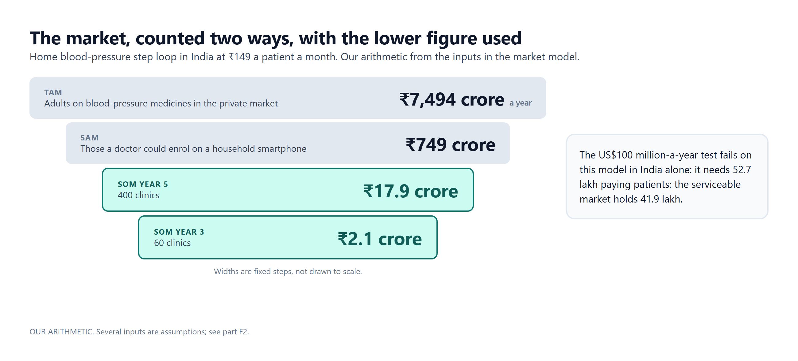

*Chart: the levels used after counting each two ways. OUR ARITHMETIC; several inputs are assumptions.*

| Level | Top-down | Bottom-up | Used (the lower) |
|---|---|---|---|
| TAM (total market): Indian adults on blood-pressure medicines | ₹7,494 crore (419.1 lakh private retail patients) | ₹9,969 crore (557.5 lakh treated adults, low case) | **₹7,494 crore** |
| SAM (the part we could serve): private patients a doctor could enrol on a household smartphone | ₹1,668 crore (93.3 lakh patients through 3.1 lakh doctors) | ₹749 crore (41.9 lakh patients) | **₹749 crore** |
| SOM (the part we could win), year 3 | ₹3.7 crore (0.5% of SAM) | ₹2.1 crore (60 clinics x 200 patients) | **₹2.1 crore** |
| SOM, year 5 | ₹22.5 crore (3% of SAM) | ₹17.9 crore (400 clinics x 250 patients) | **₹17.9 crore** |

The TAM used divides retail blood-pressure medicine sales by a private patient's yearly spend on one brand pill, giving 419.1 lakh patients. The SAM used takes 50% of them as reachable on a household smartphone and 20% as having a doctor who could enrol them (both ASSUMPTION), giving 41.9 lakh. Those two shares are the weakest inputs; the 50% is in line with smartphone access of 57.9% at ages 50-59 and 44.7% at 60-69 (2025 national survey, quoted second-hand) ([D3-07-F11](https://theprint.in/opinion/from-aadhaar-to-upi-how-indias-digital-rails-can-include-not-exclude-older-adults/3053392/)). The model leaves out public-system patients, other conditions, device sales and every country outside India.

#### The US$100 million-a-year test

US$100 million a year is ₹942 crore at ₹94.25 to the dollar (rate on 13 Nov 2026). At ₹1,788 a patient a year that needs 52.7 lakh paying patients, more than the SAM holds. **On this model the test fails in India alone**: it needs 1.3 times the SAM (all OUR ARITHMETIC). Price moves the result as much as clinic count: at ₹99 a month the SAM used is ₹498 crore and 79.3 lakh patients are needed; at ₹299 it is ₹1,504 crore and 26.3 lakh; at Omada's revenue of about US$24.5 a member a month, 3,40,136 patients would do ([D2-05-F23](https://www.fiercehealthcare.com/finance/omada-health-hikes-2026-outlook-after-strongest-quarter-ever-q3)). A public tier, shown apart, at ₹15 a month (ASSUMPTION) for the public programme's hypertension patients (chapter 1.3) would come to ₹756 crore a year (OUR ARITHMETIC), but a state would pay it only for results. OUR VIEW: blood pressure in India is the entry, not the whole company; the rest must come from more protocols on the same loop, a paid public tier, other countries or a higher price paid by an insurer, employer or medicine maker.

#### Unit economics, per patient a month

Every line is an ASSUMPTION from the build note. The clinic pays ₹149 (below Sugar.fit's ₹2,499 a month; OUR ARITHMETIC: ₹29,990 / 12). Costs are messages ₹15, cloud ₹5, reading cuff photos ₹2, and a health-worker call to silent patients ₹30, so the gross margin is ₹149 - 52 = ₹97, about 65% (OUR ARITHMETIC). Doctor time comes to about 4 minutes per 100 patients a month (6.5-8.5 proposals at 30 seconds each; OUR SIMULATION and ASSUMPTION), not costed. OUR VIEW: the health-worker call is the largest cost, and the margin holds only if doctors approve proposals without being paid per approval.

#### Comparable companies and the funding climate

Indian chronic-care firms in the notes lose money: Sugar.fit had revenue of ₹66.5 crore in FY25 and a loss of ₹42 crore ([D2-05-F19](https://entrackr.com/fintrackr/sugarfit-posts-77-revenue-growth-in-fy25-narrows-losses-11002610)); Healthify had revenue of ₹228.76 crore in FY23 and a loss of ₹142 crore (aggregators) ([D2-05-F22](https://dealroom.launchvic.org/companies/healthifyme)). Abroad, Omada's revenue per member is US$294 a year (the monthly figure used above; OUR ARITHMETIC: 294 / 12), at a 76% gross margin ([D2-05-F23](https://www.fiercehealthcare.com/finance/omada-health-hikes-2026-outlook-after-strongest-quarter-ever-q3)), and no US medicine-adjusting programme publishes a price per member a month. US digital health raised US$7.4 billion in H1 2026 ([D2-05-F16](https://rockhealth.com/insights/h1-2026-funding-and-market-overview/)); Indian health-tech raised US$310 million (headline only, tracker not named) ([D2-05-F11](https://www.digitalhealthnews.com/h1-2026-healthtech-funding-recap-how-310-mn-reshaped-the-future-of-healthcare-delivery-in-india)).

OUR VIEW: Omada's level of revenue a member is reached abroad only with employer and insurer payers. Indian comparables are small and loss-making.

### 2.6 The rules

> **In short.**
> - India's July 2026 guidance treats software that guides treatment as a medical device; a doctor-approved dose proposal could fall in Class A, B or C, which the regulator confirms.
> - In telemedicine, only a registered doctor may prescribe, and must deliver the prescription directly.
> - A study on patients needs permission and ethics approval first.
> - Abroad, each country pays through a clinician, and Germany ties part of the price to results.

These are readings of the texts; open points remain questions for a lawyer and for CDSCO, India's medical-device regulator.

#### Software as a medical device

CDSCO issued its "Guidance Document on Medical Device Software" on 21 Jul 2026 ([D2-04-F01](https://www.cdsco.gov.in/opencms/export/sites/CDSCO_WEB/Pdf-documents/Guidance-document-on-Medical-Device-Software-under-MDR-2017.pdf)). India has four risk classes, A lowest and D highest, and the class follows the intended use stated in the label, website and promotion ([D2-04-F02](https://www.cdsco.gov.in/opencms/export/sites/CDSCO_WEB/Pdf-documents/Guidance-document-on-Medical-Device-Software-under-MDR-2017.pdf)). The grid for standalone software ([D2-04-F03](https://www.cdsco.gov.in/opencms/export/sites/CDSCO_WEB/Pdf-documents/Guidance-document-on-Medical-Device-Software-under-MDR-2017.pdf)):

| Situation | Treatment or diagnosis | Drive clinical management | Inform clinical management |
|---|---|---|---|
| Critical | D | C | B |
| Serious | C | B | A |
| Non-serious | B | A | A |

"Drive clinical management" covers information "to guide next diagnostics or next treatment interventions" (D2-04-F04). A dose proposal that a doctor approves reads most naturally as "drive": Class B if hypertension is "serious", Class A if "non-serious", Class C if CDSCO reads it as "treatment" (D2-04-F06, [D2-04-F49](https://abdm.gov.in:8081/uploads/HIP_HIU_Guidelines_f85df336ec.pdf)). The guidance does not say where hypertension sits (D2-04-F05), and a patient-facing tool used without a professional can be moved up to "critical". CDSCO names a hypertension digital-therapeutics platform as medical device software (D2-04-F07), and India has no exemption for tools only a clinician sees (D2-04-F10). OUR VIEW: clinician sign-off lowers the class; it does not take the software out of the device rules.

#### Testing on patients

A test licence (Form MD-13) covers making small quantities "for the purpose of Clinical Investigations or Test or Evaluation or Demonstration" ([D2-04-F13](https://cdscomdonline.gov.in/NewMedDev/ListOfApprovedRiskDevice)). A clinical investigation on patients needs CDSCO permission (MD-22/MD-23) ([D2-04-F14](https://cdscomdonline.gov.in/NewMedDev/ListOfApprovedRiskDevice)), which the flowchart says is not mandatory for Class A ([D2-04-F39](https://cdsco.gov.in/opencms/export/sites/CDSCO_WEB/Pdf-documents/medical-device/RegulatoryMDR-2017.pdf)). Whether a pilot in which software drafts and a doctor decides counts as one is a question for counsel ([D2-04-F50](https://abdm.gov.in:8081/uploads/HIP_HIU_Guidelines_f85df336ec.pdf)). Trials must be registered on CTRI before the first patient, with ethics approval uploaded; whether a pilot in which the clinician decides needs this was NOT FOUND (search summary only) (D2-04-F45). Fees and processing days were NOT FOUND (D2-04-F16).

#### Who may prescribe and change a dose

The Telemedicine Practice Guidelines (25 Mar 2020), clause 5.4, say platforms based on artificial intelligence or machine learning "are not allowed to counsel the patients or prescribe any medicines"; they may "assist and support" the doctor, but only a registered doctor may counsel or prescribe, and "the final prescription or counseling has to be directly delivered by the RMP" (registered medical practitioner) ([D2-04-F17](https://conventuslaw.com/report/india-note-on-telemedicine-practice-guidelines/)). Whether later rules changed this in 2026 was not checked. In the national hypertension programme, community health officers delivered refills "based on the patient's prior prescription", and no law, rule or ministry order was found that lets a nurse, health officer or pharmacist change a dose under a standing order ([D2-04-F18](https://pmc.ncbi.nlm.nih.gov/articles/PMC8663742)). The Drugs and Magic Remedies Act 1954 bans advertisements suggesting a drug treats "High or low blood pressure", among other listed conditions; whether software counts as a "drug" under it is untested ([D2-04-F31](https://www.indiacode.nic.in/indiacode/bitstream/123456789/1412/1/A1954-21.pdf)).

OUR VIEW, for tonight's prototype: it is for test and demonstration, not a device on sale and not tested on patients; it uses open data, simulated patients or teammates' readings; a clinician approves every change and delivers the prescription, while the software only drafts; and it makes no claim that it treats or controls high blood pressure.

#### Rules and payment abroad

| Country | Device rule | How it is paid |
|---|---|---|
| United States | Insulin-titration software is a Class II device cleared by 510(k), for example My Dose Coach and d-Nav ([D2-04-F24](https://www.fda.gov/regulatory-information/search-fda-guidance-documents/clinical-decision-support-software)); whether clinician-facing software that uses home cuff readings is a device at all is a question for counsel ([D2-04-F22](https://www.cov.com/en/news-and-insights/insights/2026/01/5-key-takeaways-from-fdas-revised-clinical-decision-support-cds-software-guidance), [D2-04-F23](https://www.fda.gov/regulatory-information/search-fda-guidance-documents/clinical-decision-support-software)) | Medicare remote monitoring needs a face-to-face initiating visit from 1 Jan 2027 ([D2-04-F26](https://www.nixonpeabody.com/-/media/files/alerts/2026/11/cms_finalizes_2027_medicare_rpm_rtm_changes.pdf)) |
| Germany | The DiGA route requires a positive care effect, with a decision in 3 months ([D2-04-F28](https://www.gesetze-im-internet.de/sgb_5/__139e.html)) | From 1 Jan 2026 at least 20% of the price must depend on measured outcomes ([D2-04-F29](https://www.gesetze-im-internet.de/sgb_5/__134.html), [D1-05-F31](https://www.covingtonblogs.com/2026/02/03/germany-changes-rules-for-digital-health-applications/)) |
| Japan | CureApp HT, approved in April 2022 (search summary only), has been insured since 1 Sep 2022 as an add-on app that coaches lifestyle, not a dose change ([D3-06-F19](https://insurancenewsnet.com/oarticle/cureapp-digital-therapeutic-app-for-hypertension-receives-insurance-coverage-sales-of-the-service-to-medical-institutions-across-japan-launch-on-september-1), [D2-04-F37](https://www.carenet.com/news/general/carenet/55001)) | From 1 Jun 2026, 90 points a month in person or 78 online, plus 7,010 yen for the app (company release and a news report); the patient pays 30% (search summary only) ([D2-04-F43](https://prtimes.jp/main/html/rd/p/000000271.000015777.html), [D3-06-F20](https://www.carenet.com/news/general/carenet/62965)). Older figures differ: 7,010 yen (Jan 2024) or about 2,490 yen a month at a 30% patient share (2022), on different bases, unreconciled ([D1-05-F33](https://www.mhlw.go.jp/content/12404000/001223886.pdf)); about 8,000 yen (search summary only) ([D1-01-F57](https://insurancenewsnet.com/oarticle/cureapp-digital-therapeutic-app-for-hypertension-receives-insurance-coverage-sales-of-the-service-to-medical-institutions-across-japan-launch-on-september-1)) |

OUR VIEW: all three pay through a clinician, and Germany now ties part of the price to outcomes.

### 2.7 The biology underneath (new research, 14 Nov)

> **In short.**
> - Each protocol drug pulls a different lever, so adding a drug does far more than raising a dose, and step 4 adds almost nothing.
> - Every drug is at a steady level well before the day 24-30 readings, so the 30-day step fits the biology.
> - A step moves pressure less than the natural noise between two monthly means, so the loop must judge where the mean sits, with enough days, not how far it moved.
> - Each safety check has a mechanism and a time window; the body gives no cheap sign that amlodipine or telmisartan was taken.

Sections 2.1 to 2.6 rest on trial results and policy texts. This section, researched on 14 November after the rest of the document, adds the physiology underneath: why a step works, how fast, how much readings move on their own, why each safety check exists, and how to tell whether a medicine was taken. It is new research, and its main facts were re-checked by a second agent.

**Three levers.** Amlodipine relaxes the muscle of the smallest arteries ([D4-01-F17](https://dailymed.nlm.nih.gov/dailymed/drugInfo.cfm?setid=03fe9ad2-3a1a-78db-e063-6294a90a2ed3)). Telmisartan blocks angiotensin II, the hormone that tightens them and drives aldosterone ([D4-01-F20](https://dailymed.nlm.nih.gov/dailymed/drugInfo.cfm?setid=09d31eee-cd22-4918-a889-3eb4d2969525)). Chlorthalidone makes the kidney pass more salt and water ([D4-01-F23](https://dailymed.nlm.nih.gov/dailymed/drugInfo.cfm?setid=3f0f3ee0-f5a6-4bda-8160-a77744e9fa46)). The families add up, and partly cancel each other's counter-reactions: a thiazide raises renin and aldosterone, a counter-response that the ARB (angiotensin receptor blocker) blocks ([D4-01-F22](https://dailymed.nlm.nih.gov/dailymed/drugInfo.cfm?setid=41aaea48-6c1b-42c8-a96f-5923d49dc934)). So doubling a dose gives only about one fifth of the extra fall that adding a second family gives ([D4-01-F09](https://pubmed.ncbi.nlm.nih.gov/19272490/)). Priced along the Gujarat ladder from the US combination label (1,461 patients, 8 weeks), step 2 adds about 5.3 mmHg systolic, step 3 about 4.0 and step 4 only 1.7 (OUR ARITHMETIC) ([D4-01-F49](https://dailymed.nlm.nih.gov/dailymed/drugInfo.cfm?setid=14f9b590-4c43-439c-a647-9fc2b0fd4d7f)); in 947 patients not controlled on amlodipine 10 mg, telmisartan 80 mg did 0.2 mmHg better than 40 mg ([D4-01-F50](https://dailymed.nlm.nih.gov/dailymed/drugInfo.cfm?setid=14f9b590-4c43-439c-a647-9fc2b0fd4d7f)). Step 2 has a cost: ankle swelling rises from 3.0% at 5 mg to 10.8% at 10 mg ([D4-01-F19](https://dailymed.nlm.nih.gov/dailymed/drugInfo.cfm?setid=03fe9ad2-3a1a-78db-e063-6294a90a2ed3)), and adding telmisartan to amlodipine 5 mg instead lowered pressure more, with swelling in 4.3% against 27.2% ([D4-01-F51](https://dailymed.nlm.nih.gov/dailymed/drugInfo.cfm?setid=14f9b590-4c43-439c-a647-9fc2b0fd4d7f)).

**Who responds to what.** People do differ, but mainly between two groups: a renin-angiotensin blocker on one side, amlodipine or a thiazide on the other (chapter 2.3 gave PHYSIC's size) ([D4-01-F02](https://pubmed.ncbi.nlm.nih.gov/37039792/), [D4-01-F04](https://pubmed.ncbi.nlm.nih.gov/10376615/)). Salt shifts the odds: a salty diet blunts renin-angiotensin blockers more than calcium blockers ([D4-01-F13](https://pubmed.ncbi.nlm.nih.gov/9576119/)), and in north-east India 47.6% of people with high pressure were salt-sensitive ([D4-01-F47](https://pubmed.ncbi.nlm.nih.gov/31044759/)). For South Asians, 16 small trials, mostly Indian, found no difference between families ([D4-01-F11](https://pmc.ncbi.nlm.nih.gov/articles/PMC4820501/)). Gene tests are not usable: the best single variant moves response by about 3 mmHg, and polygenic scores predict nothing ([D4-01-F35](https://pmc.ncbi.nlm.nih.gov/articles/PMC3360116/), [D4-01-F34](https://pmc.ncbi.nlm.nih.gov/articles/PMC7371738/)). And one patient's change after one step is mostly noise: in 28,281 trial patients only 3% of the apparent spread in response was real ([D4-03-F55](https://pubmed.ncbi.nlm.nih.gov/20625081/)).

**How fast a step works.** Amlodipine reaches a steady blood level in 7-8 days ([D4-02-F01](https://dailymed.nlm.nih.gov/dailymed/drugInfo.cfm?setid=7367289c-b0b0-466a-83e2-558e2985c29f)), telmisartan in about 4-5 and chlorthalidone in about 7-12 (OUR ARITHMETIC from their half-lives) ([D4-02-F05](https://dailymed.nlm.nih.gov/dailymed/drugInfo.cfm?setid=20a60231-64f0-4751-aa81-6c0e64334179), [D4-02-F08](https://dailymed.nlm.nih.gov/dailymed/drugInfo.cfm?setid=01065eda-7515-46bc-b858-a062c3aa35bd)). Across 18 trials, half of a first drug's full effect arrived in about a week ([D4-02-F36](https://www.ebi.ac.uk/europepmc/webservices/rest/search?query=EXT_ID:21586424&format=json&resultType=core)). On an assumed curve shape, readings on days 24-30 see about 80-96% of the full effect, and a 14-day step would see only 48-78% (OUR ARITHMETIC; the paper's equation could not be checked) ([D4-02-F37](https://www.ebi.ac.uk/europepmc/webservices/rest/search?query=EXT_ID:21586424&format=json&resultType=core)). Telmisartan's labels disagree on the maximum, about 4 weeks in the US and 4-8 weeks in a European text ([D4-02-F06](https://dailymed.nlm.nih.gov/dailymed/drugInfo.cfm?setid=20a60231-64f0-4751-aa81-6c0e64334179), [D4-02-F43](https://docetp.mpa.se/LMF/Elicator%20tablet%20ENG%20SmPC_09001bee807af83e.pdf)), and in a small Indian trial chlorthalidone's 24-hour effect was still growing at 12 weeks ([D4-02-F44](https://www.healio.com/news/cardiology/20160308/lowdose-chlorthalidone-superior-to-lowdose-hydrochlorothiazide-for-sustained-bp-lowering)). Punjab's sheet already allows 15-day steps "if required" ([D4-02-F15](https://resolvetosavelives.org/wp-content/uploads/2023/09/punjab-a1-hypertension-protocol.pdf)); Madhya Pradesh's does not ([D4-02-F16](https://resolvetosavelives.org/wp-content/uploads/2023/09/mp-a1-hypertension-protocol.pdf)). Faster stepping has mostly observational support ([D4-02-F25](https://www.ebi.ac.uk/europepmc/webservices/rest/PMC3752696/fullTextXML)), and in the one trial with side-effect numbers (Nigeria, 300 adults) the faster arm had more early kidney-function falls and low potassium (corrected in the claims check) ([D4-02-F34](https://www.ebi.ac.uk/europepmc/webservices/rest/search?query=EXT_ID:39215620&format=json&resultType=core)). OUR VIEW: 30 days is right for the Gujarat steps; a shorter step is defensible only for amlodipine 5 to 10 mg.

**How much readings move on their own.** A single home reading in treated patients varies with an SD (standard deviation) of 11.8 mmHg within a week ([D4-03-F10](https://europepmc.org/article/PMC/PMC12237135)). Averaging helps: between two weekly means in untreated adults, a real change must be about 12.5 mmHg for 3-day means and 8.5 mmHg for 7-day means (OUR ARITHMETIC) ([D4-03-F34](https://europepmc.org/article/PMC/PMC6474964)), and treated older patients vary more (claims check). A step's 2-6 mmHg is smaller than this, so the loop should judge where the mean sits against 135/85, with 7 days when it is near the line ([D4-03-F02](https://pubmed.ncbi.nlm.nih.gov/30668627/)), not how far it moved. UK self-titration trials changed a drug only after two consecutive months above target ([D4-03-F13](https://europepmc.org/article/PMC/PMC3623796), [D4-03-F56](https://europepmc.org/article/PMC/PMC7814507)). Indian winter readings ran 9-11 mmHg above summer, though these were readings by nurses or investigators, not home cuffs ([D4-03-F31](https://europepmc.org/article/PMC/PMC6034019), [D4-03-F32](https://pubmed.ncbi.nlm.nih.gov/20032043/)), and patients picked for a high reading drift down on their own (regression to the mean) ([D4-03-F26](https://pubmed.ncbi.nlm.nih.gov/32634288/)).

**Why each safety check exists.** Telmisartan relaxes the vessel leaving each kidney filter, so filtration pressure falls and creatinine rises a little, mostly in the first 2 weeks ([D4-04-F26](https://kdigo.org/wp-content/uploads/2016/10/KDIGO-2021-BP-GL.pdf), [D4-04-F27](https://kdigo.org/wp-content/uploads/2016/10/KDIGO-2021-BP-GL.pdf)). The UK Kidney Association rechecks creatinine and potassium 1-2 weeks after every ARB start or dose rise ([D4-04-F34](https://www.ukkidney.org/sites/default/files/documents/FINAL%20VERSION%20-%20UKKA%20CLINICAL%20PRACTICE%20GUIDELINE%20-%20MANAGEMENT%20OF%20HYPERKALAEMIA%20IN%20ADULTS%20-%20UPDATED%20JULY%202026_0.pdf)); the Indian state sheets opened ask for no recheck ([D4-04-F57](https://resolvetosavelives.org/wp-content/uploads/2023/05/telangana-a4-letter-hypertension-protocol_04092018-1.pdf)). Even rises under 30% went with higher death rates in UK records, though they may mark sicker patients ([D4-04-F22](https://www.ebi.ac.uk/europepmc/webservices/rest/search?query=EXT_ID:28279964&format=json&resultType=core)). High potassium can stop the heart, and the ECG can look normal ([D4-04-F35](https://www.ukkidney.org/sites/default/files/documents/FINAL%20VERSION%20-%20UKKA%20CLINICAL%20PRACTICE%20GUIDELINE%20-%20MANAGEMENT%20OF%20HYPERKALAEMIA%20IN%20ADULTS%20-%20UPDATED%20JULY%202026_0.pdf)). In pregnancy an ARB stops the fetus making urine in the second and third trimesters, so the amniotic fluid drains and the lungs cannot grow ([D4-04-F02](https://dailymed.nlm.nih.gov/dailymed/drugInfo.cfm?setid=56a72ddf-c2a2-45ce-91b1-1fcfbff52c10), [D4-04-F56](https://www.ebi.ac.uk/europepmc/webservices/rest/search?query=EXT_ID:9199840&format=json&resultType=core)); NICE says stop within 2 working days and switch ([D4-04-F29](https://www.nice.org.uk/guidance/ng133/chapter/Recommendations)). Thiazides cause low sodium most often in the first 30 days and in older, lighter people ([D4-04-F58](https://www.ebi.ac.uk/europepmc/webservices/rest/search?query=DOI:%2210.7326/m23-1989%22&format=json&resultType=core), [D4-04-F61](https://www.ebi.ac.uk/europepmc/webservices/rest/search?query=EXT_ID:14631057&format=json&resultType=core)). Among people over 60, 22.2% have a pressure drop on standing ([D4-04-F39](https://www.ebi.ac.uk/europepmc/webservices/rest/search?query=EXT_ID:30169579&format=json&resultType=core)), and hip fractures rise in the 45 days after starting any blood-pressure drug ([D4-04-F48](https://www.ebi.ac.uk/europepmc/webservices/rest/search?query=EXT_ID:23165923&format=json&resultType=core)). A reading of 180/110 without symptoms is urgency, not emergency, which means organ damage ([D4-04-F70](https://www.ebi.ac.uk/europepmc/webservices/rest/search?query=EXT_ID:30165588&format=json&resultType=core)): patients sent home had no major heart events in 7 days ([D4-04-F68](https://www.ebi.ac.uk/europepmc/webservices/rest/search?query=EXT_ID:27294333&format=json&resultType=core)), and long-standing high pressure resets the brain's protection of its blood flow to higher pressures ([D4-04-F72](https://www.ebi.ac.uk/europepmc/webservices/rest/search?query=EXT_ID:8538822&format=json&resultType=core)) (OUR VIEW: an argument against lowering it fast at home).

**Lab tests and signs of intake.** The tests that move within a 30-day cycle are creatinine and potassium, plus sodium at the thiazide step; HbA1c moves over 2-3 months, and NT-proBNP is a district-hospital test for suspected heart failure ([D4-05-F37](https://pmc.ncbi.nlm.nih.gov/articles/PMC12690178/), [D4-05-F35](https://www.icmr.gov.in/icmrobject/uploads/Report/1752588650_nedl2ndedition.pdf)). A primary health centre runs creatinine, urea and uric acid, but sends potassium and urine albumin to a hub ([D4-05-F39](https://www.icmr.gov.in/icmrobject/uploads/Report/1752588650_nedl2ndedition.pdf)). On adherence, drug assays abroad found about 1 in 3 patients with resistant hypertension not taking their drugs (31.2% pooled) ([D4-05-F01](https://europepmc.org/article/MED/28777133)), and a Brazilian clinic found 90.1% adherent by questionnaire against 32.4% by urine test ([D4-05-F07](https://europepmc.org/article/MED/42564271)). No Indian assay study was found ([D4-05-F15](https://europepmc.org/article/MED/34861979)). Amlodipine and telmisartan leave no mark on the pulse ([D4-05-F16](https://dailymed.nlm.nih.gov/dailymed/lookup.cfm?setid=abd6a2ca-40c2-485c-bc53-db1c652505ed), [D4-05-F18](https://dailymed.nlm.nih.gov/dailymed/lookup.cfm?setid=3bb7bc69-7752-4c16-9c60-e61eb5355a4d)); only the thiazide leaves a weak chemical trace, lower potassium and higher uric acid ([D4-05-F22](https://europepmc.org/article/MED/22547443)). Cheap reminder devices did nothing for 53,480 US patients ([D4-05-F24](https://europepmc.org/article/MED/28241271)), while blister packs raised pills taken by 11% ([D4-05-F46](https://europepmc.org/article/MED/21901694)).

OUR VIEW: the biology fits the loop's shape and points to five additions: expected effects per step, profile fields, adherence checks beyond self-report, a reading rule sized to the noise, and a safety window after each step. Chapter 4.9 lists them as product features, and Appendix I holds the full detail.

Full detail: Appendix B (the clinical evidence and the programmes), Appendix C (the technology), Appendix D (every player), Appendix E (money and rules) and Appendix I (the biology, new research).

OUR VIEW: the research points one way. The treatment change, made by someone allowed to make it, is what works. India's programme has everything for it except a decision between visits. The technology to trust a home reading and bound a decision exists in open parts. No Indian service was found that does it, and no payer was found for it. The next chapter puts these findings together and weighs what to build.

## 3. Analysis: what it all means

Chapters 1 and 2 set out the problem and what the research found. This chapter puts them together. It states the thesis in a few paragraphs, tests it as a strategy partner and an investor would, and then weighs every option the team considered, so that the choice of what to build comes out of the evidence rather than before it.

### 3.1 The thesis

OUR VIEW throughout this section.

**What works is the treatment change.** The active ingredient is the treatment change, not the sensor and not the nudge. A product that stops at showing a reading sits with the trials whose results are mostly null (chapter 2.1). The authority to change the dose between visits, and someone acting on it, is what worked; electronics added little once a clinician was stepping the dose.

**India's gap sits in one place.** India's programme already has the protocol, free drugs, a record and an overdue list (chapter 2.2). It lacks a dose decision for the uncontrolled patient who does not go back to the doctor: India lacks decide, confirm and act between visits. The Indian null trial, mWellcare, shows where value cannot come from: a prompt at a visit that was happening anyway adds nothing. So the value must come from changing the dose between visits and reaching the half who never return (chapter 1.3).

**The hard engineering is narrow.** It is in trusting the home reading and in bounding the decision, not in the model that makes it (chapter 2.3). Language models can read and speak; a tested engine and a clinician decide.

**The business is the open question.** Lasting businesses are paid for an outcome a payer counts, or for hardware that delivers the dose (chapter 2.4). In India no payer was found for this, and on our own arithmetic the reachable market is small for a venture fund (chapter 2.5).

Put together, the opportunity is the routine treatment decision between visits that the fund asked for (chapter 1.1), made from a trustworthy home reading, approved by someone allowed to approve it, inside programmes India already runs, and paid for by someone other than the patient. The rest of this chapter tests that idea against strategy and against the other options.

### 3.2 Where to play and how to win

This section tests the idea the way a strategy partner and an early-stage deep-tech investor would. Chapter 2 found the deepest evidence and the largest pool in blood pressure, so the questions use blood pressure as the working case; section 3.3 checks that choice against six other options.

#### The question tree

The governing question is whether a medicine-adjusting loop that starts with blood pressure can become a business that improves outcomes for people far from a specialist. Six sub-questions follow, each graded on what the research supports.

| Sub-question | What the research supports | Grade |
|---|---|---|
| 1. Whether the loop works | Abroad, yes, in randomised trials (HyperLink, chapter 2.1; Lesotho, chapter 2.2). India's nearest trial, mWellcare, was null, and no Indian randomised trial of the home loop was found | Strong abroad; missing in India |
| 2. Whether the gap is real in India | Yes on size: about half of programme patients did not return (chapter 1.3). Less clear on cause: in Bathinda, feeling well and distance led (chapter 1.4) | Strong on size; partial on cause |
| 3. Whether it can be delivered safely and legally | Safety: no more falls, low pressure or kidney harm in rural China (chapter 2.1). Law: it is device software under India's July 2026 guidance, with class and pilot permit open; only a registered doctor may prescribe; no order lets a nurse change a dose (chapter 2.6) | Partial |
| 4. Whether anyone will pay | No Indian payer was found (chapter 1.5); our monthly price is an ASSUMPTION (chapter 2.5) | Missing |
| 5. Whether it can be defended | Not yet: the protocol is public, and the government's open-source Simple app, whose protocol model has no step ladder, could add one (chapter 1.5) | Missing |
| 6. Whether this team can start it | The prototype, yes: the protocols and open home readings exist (chapter 2.3). A pilot needs a supervising doctor, an ethics committee and prior registration (chapter 2.6); the team has none yet | Partial |

OUR VIEW: the medicine is settled; payment and defence are not.

#### Where to play

| Choice | Our choice (OUR VIEW) | Why |
|---|---|---|
| Disease | Blood pressure first, insulin second (section 3.3) | The largest pool (chapter 1.2). Insulin adds a low-sugar hazard, and the US clears its dose software as a regulated device (chapter 2.6) |
| Customer | Private clinics and chains first, on a protocol their doctors sign; states later, paid on results | Public medicines cost very little (chapter 1.5), so a state will not pay app prices. Caution: most of the Bhopal private doctors interviewed did not follow the state protocol (chapter 1.4) |
| Channel | Doctor-enrolled chat on a family phone; voice later | Clinician referral added 40 days of retention (chapter 2.1); phones are often shared and many older adults lack a smartphone (chapters 1.3, 2.5) |
| Geography | One state at a time; abroad later | State protocols differ at the second step (chapter 2.2) |

OUR VIEW: the first payer is an urban private clinic, not the rural patient the challenge names.

#### How to win

The business must be best at four things (OUR VIEW). None of them is the rules engine.

| Must be best at | Why it decides the result | "Better" is measured by |
|---|---|---|
| Trusting a home reading from any cuff | Posture alone moves a reading by several mmHg (chapter 2.3) | Share of patients completing a valid 3-day block each cycle; photo-reading error |
| A safe decision in seconds of doctor time | A primary-care consultation lasted about two minutes (chapter 1.3) | Median seconds per approval; share decided within 7 days |
| Keeping patients sending readings | WhatsApp reminders did not raise return visits (chapter 1.4) | Share sending blocks at 3 and 6 months; lapsed patients brought back |
| Proof a payer accepts | Pear had randomised trials yet won too few payers and prescribers, a trade-press review said (chapter 1.5) | Gain in the share under 140/90 at 90 days against comparison clinics |

**Where the money is today.** Medicines are the largest pool; devices are small and one-time; consultations have no checked figure; programmes are diabetes-only and loss-making (chapter 2.5). OUR VIEW: a loop can draw on what a clinic or hospital earns by keeping a patient, or on a medicine maker's patient-support budget (size NOT FOUND). The reachable market is under 5% of the pill pool (OUR ARITHMETIC: the SAM divided by retail blood-pressure medicine sales, chapter 2.5). A doctor paid per visit may see a home loop as lost visits, so the thing to sell is kept patients.

#### Five forces and three futures

Five forces decide who keeps the profit (readings are OUR VIEW).

| Force | Reading | The fact behind it |
|---|---|---|
| Rivalry | Low today | No private home-titration service was found in India (chapter 2.4) |
| New entrants | High | Simple is open source and its programme holds the patients; Lupin's Lyfe and Huma's platform announce Class C licences (THEIR CLAIM) ([D1-04-F15](https://medicaldialogues.in/news/industry/pharma/lupin-digital-healths-lyfe-platform-gets-class-c-medical-device-license-from-cdsco-127687), [D1-04-F30](https://www.huma.com/newsroom/huma-secures-clearance-for-class-c-medical-device-certification-in-india)); any hospital software team can code a public sheet; the AI labs' health assistants read phone data but change no therapy (chapter 2.4) |
| Substitutes | High | The free public visit: most patients who keep attending are controlled on the first pill, on clinic readings (chapter 2.2) |
| Buyer power | High | No payer buys this today |
| Supplier power | Moderate | Omron already sells a plan-drafting tool for clinicians in the UK (chapter 2.4); the scarcest input is the approving doctor's time |

OUR VIEW: entry is easy and buyers are few.

The next three years turn on two things the team does not control: how strictly CDSCO applies its 2026 guidance, and whether anyone but the patient pays (OUR VIEW).

| Future | What it means | Early sign to watch |
|---|---|---|
| A. Light class, a payer appears | CDSCO confirms Class A or B for a doctor-approved proposal, licensed by the state ([D2-04-F12](https://cdscomdonline.gov.in/NewMedDev/ListOfApprovedRiskDevice)) | A class reply through CDSCO's portal ([D2-04-F11](https://cdscomdonline.gov.in/NewMedDev/ListOfApprovedRiskDevice)); a first paid contract |
| B. Strict class, a payer appears | Read as "treatment", or as patient-facing without professional support, the tool moves to Class C, licensed centrally, and a pilot becomes a clinical investigation. Slower, but the licence then keeps others out | CDSCO's risk list puts dose-proposing software in Class C ([D2-04-F11](https://cdscomdonline.gov.in/NewMedDev/ListOfApprovedRiskDevice)) |
| C. No payer, either class | The patient is the only buyer; the loop survives as a free feature of the public programme | Pilot clinics decline to pay after the free period; outpatient insurance stays negligible (chapter 1.5) |

OUR VIEW: the payer decides whether this is a company or a feature.

#### The risks that matter

Six risks could end the project. The stop lines are OUR VIEW, to be agreed before any pilot.

| Risk | Stop if |
|---|---|
| Doctors leave proposals unanswered, as mWellcare's prompts added nothing (chapter 2.1) | Most proposals outlast the 30-day cycle after two months |
| No cuff at home: few clinic attenders measure at home (chapter 1.4) | Under half complete a block even with a lent cuff |
| A wrong step from a bad reading; the Gujarat sheet has no low-pressure rule | Serious harm traced to an approved proposal: halt and review |
| A clinical investigation is required before any pilot (chapter 2.6) | Class C and no partner to sponsor it |
| Nobody pays | A positive pilot and no buyer above our monthly cost per patient (ASSUMPTION, chapter 2.5) |
| No gain over a well-run clinic | Under 5 mmHg and no gain in the share controlled |

#### The investor's lens

A deep-tech fund that reports impact and works across Japan and India would test four things; the readings are ours, not the mentor's (OUR VIEW).

- **Hard to copy.** Not today. What could become hard to copy is a record of home readings with medicine changes, since no open dataset of that kind was found (chapter 2.3); but learning is about 15% of the build (OUR ESTIMATE), and nothing built tonight is hard to copy.
- **Prototype to licensed product.** A test licence, a clinical-investigation permit if required, then a manufacturing licence from the state (Class A or B) or the centre (Class C or D) ([D2-04-F12](https://cdscomdonline.gov.in/NewMedDev/ListOfApprovedRiskDevice)). The class is unknown, fees were NOT FOUND, and the team has no doctor or sponsor yet.
- **Proof that changes the valuation.** A controlled 90-day pilot with one clinic paying. Uncontrolled results are not enough: Closed Loop Medicine had only an uncontrolled trial, and its shareholders wound it up (chapter 2.4).
- **Where Japan fits.** As precedent and supplier, not customer. Japan's insurance pays for a lifestyle-only blood-pressure app (chapter 2.6), and Omron, the cuff maker, is based in Kyoto ([D2-02-F34](https://healthcare.omron.com/press-releases/omron-healthcare-exceeds-400m-blood-pressure-monitors-sold)); the notes show no Japanese partner, payer rule or regulator route.

The fund has backed digital therapy twice: CureApp, its first fund's first investment in 2015 by its chief executive's account ([D3-06-F26](https://beyondnextventures.com/insight/invested-in-cureapp)), and India's Wellthy (chapter 2.4). Its partner says investors like to enter between an alpha prototype and a customer pilot (LinkedIn, read 13 Nov 2026). OUR VIEW: a prototype alone is not fundable; a signed pilot customer is the next proof.

#### Three questions a partner would press

1. **Dose product or follow-up product.** On clinic data, mostly follow-up: among programme patients who kept attending, later steps added 6-7 points of control to what the first pill achieved (OUR ARITHMETIC from chapter 2.2: 77 - 70; 82 - 76) ([D1-06-F04](https://pmc.ncbi.nlm.nih.gov/articles/PMC10959138/)). Home data may show more, because many treated patients who look controlled in clinic are not controlled at home (chapter 1.4). Settled by: a pilot that counts patients brought back separately from doses changed.
2. **Who pays, and whether that buyer serves the patient the challenge names.** Nobody yet. Our assumed yearly price adds about 46% to one private-brand pill's yearly cost (OUR ARITHMETIC: 1,788 ÷ 3,906, chapter 2.5) ([D2-05-F17](https://pmc.ncbi.nlm.nih.gov/articles/PMC10471490)); the rural patient sits in the public tier, at the lower price assumed in chapter 2.5. Settled by: two clinics signing at a stated price, and one state naming the result it would pay for.
3. **What stops Simple, a hospital or a medicine maker from copying it.** Nothing today. Later: outcome data, a licence, clinic contracts. Settled by: whether logged step responses improve decisions, which takes months of patients.

OUR VIEW: no answer to question 2 within 90 days means a public-good tool, not a company.

### 3.3 The options weighed

The strategy questions used blood pressure as the working case. This section checks that choice. The team sorted every kind of feedback loop from chapter 2.1 and scored seven options, labelled A to G.

#### The option tree

1. **A drug dose or a protocol step.** A: blood pressure, from a home cuff. B: insulin dose in type 2 diabetes, from fasting sugar. G: heart-failure medicines, from weight, pressure, pulse and lab values. C: a breathing plan for asthma and COPD, from an inhaler sensor, peak flow (how hard a person can blow out) and air quality. F: warfarin, from a home INR test. E: weight-loss injection dose, from weight and side effects. Gout was not scored: the one trial found had nurses stepping the dose, with no device or software (chapter 2.1).
2. **Food and behaviour.** Not scored: meals guided by a glucose sensor are already sold in India with a doctor and a coach (chapter 1.5); a lifestyle-coaching app for blood pressure changes no medicine; and activity nudges faded in a 6-week trial of 44 US adults ([D1-02-F31](https://pubmed.ncbi.nlm.nih.gov/30192907/), [D2-03-F02](https://pubmed.ncbi.nlm.nih.gov/30192907/)).
3. **Exercise as the dose.** D: rehabilitation at home, guided by camera and pulse sensor.
4. **Therapy delivered by the device.** Not scored: closed-loop insulin pumps need costly hardware; wearable migraine stimulation is triggered by the patient with no sensor loop; auto-adjusting breathing machines were NOT RESEARCHED.
5. **Biofeedback.** Not scored: guided slow breathing lost its effect without the maker's trials (chapter 2.1), and a pooled result for heart-rhythm feedback (18 studies, 1,352 people) showed no fall in stress ([D1-02-F15](https://pubmed.ncbi.nlm.nih.gov/41310318/)).

OUR VIEW: as chapter 2.1 found, proof is strongest where the loop changes a drug dose or the device delivers the therapy, and the device route needs expensive hardware, so a student team, and a low-resource country, should start with group 1.

#### Two gates, six tests

Each option had to pass two gates. First, it changes the therapy itself from device or biomarker feedback. Second, it can be built honestly tonight: kit or phone parts, a clinician or health worker confirming every change, and a test on open data, a simulator or teammates. All seven pass the first gate. Heart failure and warfarin pass the second only as rule tests, because neither has a device or data tonight.

The options were then scored from 1 to 5 on six tests, weighted: proof 25, market 20, feasibility tonight 20, gap 15, deep-tech 10, low risk 10. The scores are OUR ESTIMATE: the coordinator's judgement from the first round of notes, not measurements.

| Option | Proof | Market | Tonight | Gap | Deep-tech | Low risk | Score |
|---|---|---|---|---|---|---|---|
| A. Home blood-pressure step loop | 5 | 4 | 5 | 4 | 3 | 4 | **4.35** |
| B. Insulin dose guidance, type 2 diabetes | 4 | 4 | 3 | 3 | 3 | 2 | 3.35 |
| D. Adaptive home rehabilitation (camera and pulse) | 3 | 3 | 5 | 2 | 3 | 4 | 3.35 |
| G. Heart-failure dose loop | 4 | 3 | 2 | 4 | 3 | 2 | 3.10 |
| C. Breathing plan with inhaler sensor and air quality | 2 | 3 | 4 | 3 | 4 | 3 | 3.05 |
| F. Warfarin self-dosing | 5 | 2 | 2 | 3 | 2 | 2 | 2.90 |
| E. Weight-loss injection dose companion | 2 | 4 | 3 | 2 | 2 | 3 | 2.70 |

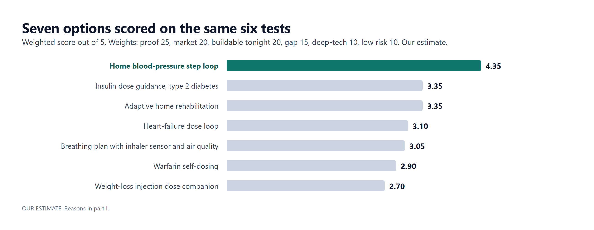

*Chart: the seven options on the same six tests. OUR ESTIMATE.*

#### Why each scored as it did

OUR VIEW, one line each.

| Option | Reason |
|---|---|
| A. Blood pressure | The strongest proof, at scale and under non-physicians; the largest patient pool; the exact Indian protocol text; no Indian service found. Weak spots: who pays, and it can look like "just rules" |
| B. Insulin | Good trials and drug-maker interest, but tonight's test is thin: the open data covers only 3-14 days ([D1-06-F11](https://pmc.ncbi.nlm.nih.gov/articles/PMC9849330/)) and no open type 2 simulator exists (chapter 2.3). Low blood sugar is a real hazard, and Sanofi already has a dosing app, cleared in the US (chapter 2.6) |
| D. Rehabilitation | The easiest demo, but software rehabilitation matches in-person care without beating usual care (chapter 2.1), and Lupin says it already holds an Indian Class C licence for cardiac rehabilitation |
| G. Heart failure | Strong outcome proof and the best fit to "far from a specialist": in the German TIM-HF2 trial the benefit of remote management grew with distance to a cardiologist, 13% lower risk per doubling of distance ([D1-01-F31](https://pubmed.ncbi.nlm.nih.gov/40672055/)). But it needs lab values, so it cannot be tested honestly tonight |
| C. Breathing plan | The most hardware and the best open data ([D1-06-F50](https://datashare.ed.ac.uk/handle/10283/4761)), but the dose change that works needs no sensor, and sensor inhalers failed commercially (chapters 1.5, 2.1) |
| F. Warfarin | The best proof of all, a small market, no meter tonight |
| E. Weight-loss injections | A hot market since generic semaglutide arrived on 20-21 March 2026 ([D1-04-F10](https://www.businesstoday.in/industry/pharma/story/generic-semaglutide-hits-india-prices-fall-90-as-companies-compete-for-diabetic-patients-521707-2026-03-21)), but no outcome evidence for digital dose support yet, with an independent US review due in 2027 ([D1-01-F41](https://hlth.com/insights/news/phti-launches-digital-diabetes-evaluation-focused-on-glp-1s-and-cgms)), and three Indian players already in it (chapter 2.4) |

A second pass of the claims check re-opened 53 clinical facts at source: 48 were confirmed and 5 corrected in wording, and every number matched. The corrections that bear on these reasons are already in chapter 2.1: the pooled gain with intensive support is not for dose changes alone, the China programme also gave free or discounted drugs and paid incentives tied to control, the heart-failure rates are adjusted and came with more side effects, the null telemonitoring trials lacked a mandated dose protocol, and warfarin self-dosing and self-testing were not compared head to head. OUR VIEW: no score moves. Option A leads by a full point, and its proof should be stated as "a protocol inside a funded programme", never as "the protocol alone".

#### The three to weigh, and why blood pressure first

Three options were weighed closely. Insulin dose guidance has strong trials and drug-maker interest, but no honest test tonight and a real low-sugar hazard; it is best shown as a second protocol on the same engine, tested on paper. Home rehabilitation is the easiest demo but a different product with weaker proof. Heart failure fits the challenge's "far from a specialist" best and has strong outcome proof, but it needs lab values, so it is the later protocol for the same engine. The breathing plan, warfarin and weight-loss injections fall behind on proof, market or the night's constraints.

OUR VIEW: blood pressure comes first because only it has all four things at once: a complete published Indian protocol, a cheap and valid home signal, outcome proof at scale (including deaths and strokes avoided under non-physicians), and an honest test tonight. It also has the largest pool of patients (chapter 1.2) and no Indian service doing it (chapter 1.5). Insulin and heart failure are the same loop with a new protocol file; rehabilitation and the breathing plan are different products.

So the choice is the **home blood-pressure step loop**: a checked home reading leads to the next step of the state's published protocol, which a doctor approves before the change reaches the patient. Insulin is the second protocol for the same engine, and heart failure the later expansion.

Full detail: Appendix F (strategy and the options).

OUR VIEW: the concept passes on evidence and timing. It does not yet pass on customer proof or on defence, and the stop lines above should be agreed before any pilot. Chapter 4 shows the product end to end: what the patient and the doctor see, and the checks that keep a bad reading or a missed tablet from changing a dose.

## 4. The product we can build

Chapter 3 ended with a choice: the home blood-pressure step loop. This chapter shows that product end to end: what it does, what the patient and the doctor see, and the checks that stop a bad reading or a missed tablet from changing a dose. It ends with the same loop carrying other protocols.

### 4.1 What it does

OUR DESIGN. The loop is for adults on blood-pressure medicine who miss the 30-day review: the half who do not return (chapter 1.3). Once a month the patient takes a week of home readings with an upper-arm cuff and sends each one as a photo of the cuff's screen. The software checks the readings, asks whether the medicine was taken, and drafts the next step of the state's published protocol, with its reasons. A registered doctor approves, edits or rejects it in one tap, and the patient gets the change in their own language, in the doctor's name. Nothing that changes treatment reaches the patient before a clinician approves.

The protocol is Gujarat's published ladder: amlodipine 5 mg, then 10 mg, then add telmisartan 40 mg, then raise it to 80 mg, then add chlorthalidone 12.5 mg (hydrochlorothiazide 25 mg if chlorthalidone is not available), with a re-check after 30 days on each step. After the last step the sheet says: "Check if the patient has been taking medications regularly and correctly. If yes, refer to a specialist." It covers adults over 30. Its safety rules are in chapter 4.7, and every protocol rule in this chapter comes from that sheet ([D1-06-F14](https://resolvetosavelives.org/wp-content/uploads/2025/02/759_CVH_HEARTS-in-India_Fact-Sheet_0225_Rev-A_v10.pdf)).

### 4.2 The system map

A loop that changes treatment has six stages. Open parts already exist for each (Appendix C); the work is joining them with a safety rule at each handover (OUR VIEW).

| Stage | Its job | Our build tonight (OUR VIEW) |
|---|---|---|
| Sense | Get a number from the home | Photo of any cuff's screen, confirmed by the patient; typed entry as fallback |
| Check | Was the reading taken properly | Kit-built motion clip plus a phone checklist |
| Decide | Turn valid readings into a proposed step | One file per protocol, run by one `decide()` function |
| Confirm | A clinician accepts or rejects | Clinician queue: Approve, Edit, Reject |
| Act | Tell the patient, in their language | Telegram chat plus a web form |
| Learn | Improve choices from each response | Roadmap only; nothing learns tonight |

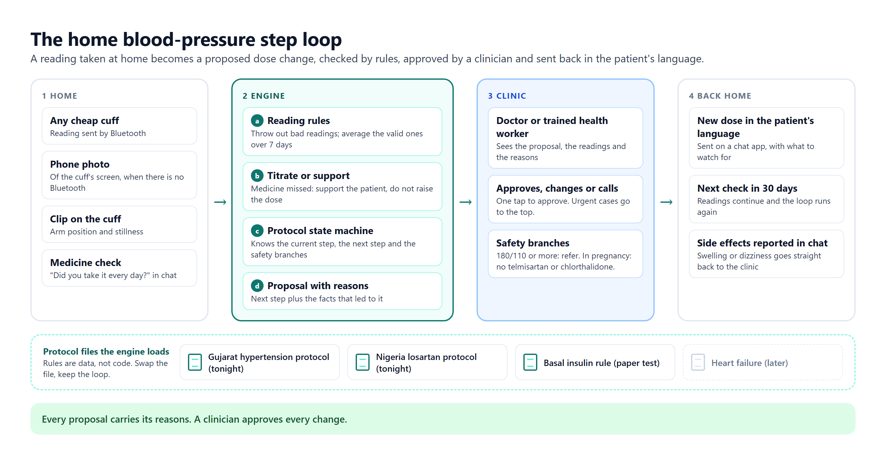

*The six stages of the loop and the technology chosen for each tonight.*

The engine is one pure Python function, `decide()` (OUR DESIGN). It reads a protocol file written in YAML (a plain-text data format), the patient's state and the week's readings, and returns a proposal with its reasons. It never computes a dose: it can only pick a regimen written in the file. Each number in the file carries the sheet's own words; a value the source does not give is left blank, and the engine refuses that branch until a clinician fills it. No language model sits in the dose path (chapter 2.3 gives the reason); a model only reads the cuff photo and handles translation and speech.

### 4.3 The patient side

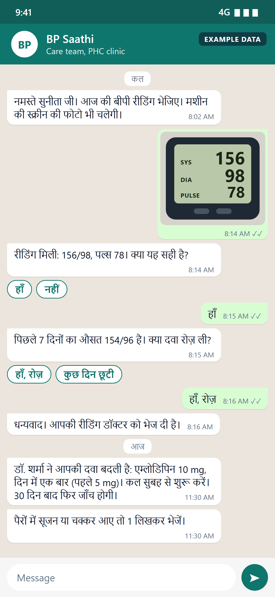

*Mock-up with example data.*

The patient uses a Telegram chat, or a web form if the chat fails, on a phone that may be a family member's (chapter 1.3). It prompts a measurement, takes a photo or typed reading, asks about tablets and delivers the change.

The home-reading rule (OUR DESIGN, from published guidance): on days 24 to 30 of each 30-day cycle the patient takes two readings 1 minute apart after 5 minutes of seated rest, morning before tablets and evening ([D2-02-F10](https://pmc.ncbi.nlm.nih.gov/articles/PMC11409525/)). A session counts only if both readings pass the quality checks. The engine needs at least 3 valid days and aims for 7, as the European Society of Hypertension advises; the same society says a home mean of 135/85 corresponds to 140/90 in clinic ([D2-01-F1](https://pmc.ncbi.nlm.nih.gov/articles/PMC9904446/)); the International Society of Hypertension ([D2-01-F3](https://www.aafp.org/pubs/afp/issues/2021/0615/p763.html)) and the Indian Guidelines IV (search summary only) ([D2-01-F4](https://www.pubmed.gov/32427886/)) use the same home line. So a mean at or above 135 systolic or 85 diastolic is "still high"; one session at or above 180 or 110 is "very high".

The Gujarat sheet is written for clinic readings at 140/90. **Applying a clinic protocol to home readings at 135/85 is OUR DESIGN.** The team says so aloud on the slide, and the threshold stays a value the clinician signs. No Indian home-against-clinic offset was searched.

The photo is read twice by a vision model, checked against plausible ranges and shown back for the person to confirm; memory screens are rejected. General vision models are untested on cuff screens (chapter 2.3) (D2-02-F8). A photo cannot prove who measured or when; the clip's time-stamped record (chapter 4.5) narrows that gap without closing it. Typed entry is always built; Bluetooth only if an Omron HEM-7156T is in hand ([D2-02-F1](https://raw.githubusercontent.com/userx14/omblepy/main/README.md)).

### 4.4 The doctor side

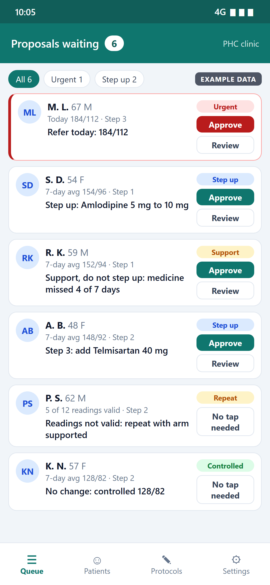

*Mock-up with example data.*

The doctor sees a queue of cards, urgent ones first, batched once a day. Each card shows the current step, a 7-day sparkline (a small chart of the week's readings), the mean, the answer to the medicine question, the protocol line it quotes, the safety checks ticked and the proposed regimen, with Approve, Edit and Reject. A timer logs each decision. Because the card carries everything needed, the decision is one tap (OUR DESIGN).

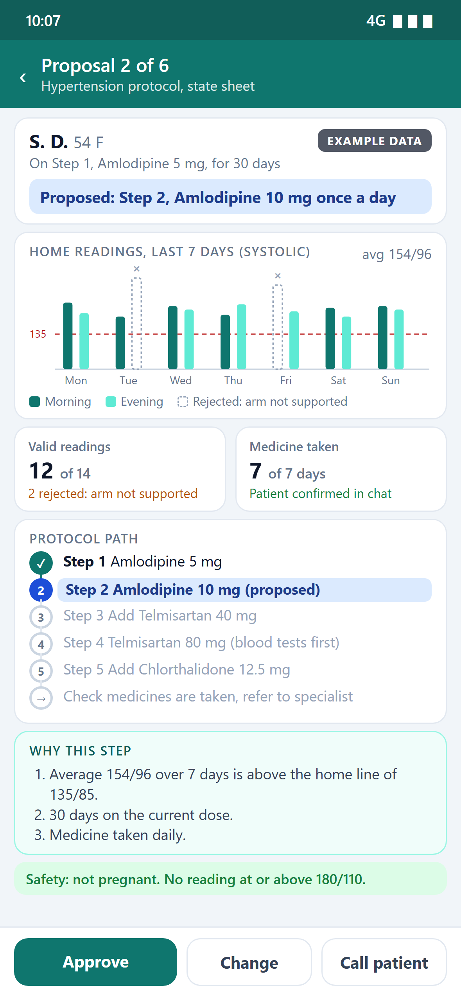

*Mock-up with example data.*

The approval and the patient message are the doctor's own act, sent in the doctor's name: OUR DESIGN, and a question for a lawyer, since the telemedicine guidelines want the registered doctor to deliver the prescription directly (chapter 2.6).

### 4.5 Trusting the reading

A home reading can be several mmHg wrong for reasons unrelated to the cuff, such as an arm hanging at the side (chapter 2.3). The loop answers with a small clip built from the maker kit (OUR DESIGN): an ESP32 board with two MPU6050 motion sensors, one on the cuff and one on the forearm. A helper seats the person correctly once, and the clip stores that posture. It then enforces 300 seconds of still rest, restarting on movement; checks that the forearm is within 20 degrees of flat (a hanging arm fails) and the upper arm within 15 degrees of the stored posture; and requires stillness through each 60-second measurement. It shows green or red, with reasons, time-stamped to join the reading. A 15-degree change moves the cuff about 2.4 cm, about 1.2 mmHg (OUR ARITHMETIC: 15 x (0.866 - 0.707) = 2.4 cm; 2.4 x 0.49 = 1.2) ([D2-02-F17](https://pubmed.ncbi.nlm.nih.gov/17106314/)). The thresholds are OUR ESTIMATE. What the clip cannot see (legs crossed, clothing, cuff size, talking, a full bladder, smoking) goes into a 4-question phone checklist.

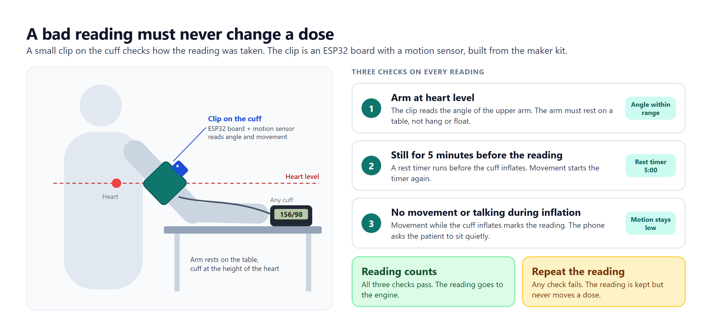

*The kit-built clip checks rest, stillness and arm position; it does not measure blood pressure.*

Cuff size matters too: a regular cuff on a large arm reads high ([D2-02-F19](https://pubmed.ncbi.nlm.nih.gov/37548984/)). So the app asks the arm size and refuses arms outside the cuff's range; the Omron HEM-7120 standard cuff fits 22-32 cm ([D2-02-F30](https://www.omronhealthcare-ap.com/in/product/12-hem-7120)), and it passed an independent validation (ESH-IP 2010) ([D2-02-F28](https://medaval.ie/resources/EN/devices/Omron-HEM-7120.php)).

OUR VIEW: the engine refuses to step a dose on readings that fail the clip, so a posture mistake costs a repeat, not a wrong prescription.

### 4.6 Was the medicine taken

Raising a dose that is not being taken is unsafe (chapter 2.1). So before any step-up the chat asks two questions, as buttons (OUR DESIGN):

- "In the last 7 days, how many days did you miss your BP tablet? 0 / 1-2 / 3 or more"
- "Do you have tablets left for the next 7 days? yes / no"

Adherent means 0 missed days. That cut-off is OUR DESIGN and the clinician can change it, because the sheet says "Check for compliance at each visit before titration of dose or addition of drugs" but gives no number. Any missed day, or no tablets left, sends support instead of a step-up, and a card goes to the clinician for information.

### 4.7 Safety built into the design

The engine runs its checks in a fixed order and proposes a step only at the end (OUR DESIGN, from the sheet):

1. A patient who is referred or waiting for lab results is left alone. A patient aged 30 or under, or with diabetes, a past heart attack or stroke, or kidney disease, is flagged "outside the demo, send to the doctor": the sheet has branches for these that tonight's engine does not handle.
2. Readings that failed the quality gate are dropped.
3. Safety first. A session at or above 180 or 110 brings a request to repeat after rest; if confirmed, an urgent card goes to the doctor and the patient is told to contact the clinic today, ahead of the 30-day wait. This home action is OUR DESIGN; the sheet's 180/110 line is for clinic entry. A low-pressure rule acts only once a clinician sets its threshold.
4. Fewer than 3 valid days: ask for more. Under 30 days on the step: "keep going". Home mean below 135/85: "same medicine", no doctor needed.
5. At or above the line: the medicine question (chapter 4.6).
6. The guards: referral after the last step; referral when pregnancy, or childbearing age without effective contraception, meets a barred drug (amlodipine steps may go ahead); a lab order before telmisartan 80 mg, and for an abnormal value, referral or, with no specialist reachable, withdrawing telmisartan and adding chlorthalidone.
7. Only then: propose the next step, quoting the sheet line.

Following the written safety rules of OpenAPS, a do-it-yourself insulin system (chapter 2.3) ([D2-03-F46](https://openaps.org/reference-design/)), the engine only chooses written regimens, holds the current step when data is missing and never steps on one reading.

OUR VIEW: four things are never dropped: valid home readings, the medicine-taken check, a protocol-true proposal with its reasons and safety branches, and a doctor's approval of every change. A dose worked out outside the protocol file, and a language model in the dose path, are ruled out for good.

### 4.8 Same loop, new protocol

OUR VIEW: each new protocol is a new market on the same engine, approval screen and safety method.

| In order | Home signal | Rule in the notes | Status |
|---|---|---|---|
| 1. High blood pressure | Cuff | Gujarat's ladder; a Nigerian ladder as a second file (chapter 5.2) | Being built tonight |
| 2. Insulin, then the tablet steps for diabetes | Sugar meter | The American Diabetes Association's step rule (chapter 2.3) | On paper only |
| 3. Heart failure | Weight, pressure, pulse, lab values | Step up to full doses soon after discharge (chapter 2.1) | Roadmap; needs a diagnostics partner |
| 4. Warfarin, then asthma | INR meter; inhaler use | Dosing tables differ between sources (search summary only) ([D1-06-F37](https://pmc.ncbi.nlm.nih.gov/articles/PMC8386977/table/t151)) | Roadmap |

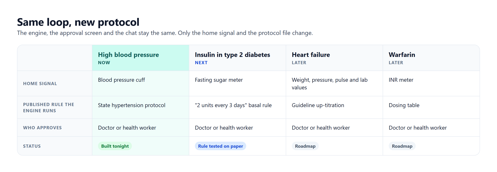

*Diagram: the engine, the approval screen and the chat stay the same; only the home signal and the protocol file change.*

The picture says a "doctor or health worker" approves. That is the later aim: only a registered doctor may prescribe (chapter 4.4), and no Indian rule was found that lets a nurse or health officer change a dose (chapter 2.6). It remains a question for counsel.

### 4.9 What the biology adds (new research, roadmap)

OUR VIEW and OUR DESIGN. The biology in chapter 2.7 suggests five additions to the loop. None changes the state protocol; each is for the team and a supervising clinician to decide. "Tonight" means a data field, question or test case that changes no dose decision; "next" means the two-week test or the pilot (chapter 5); "later" needs patient data.

| Feature | What it does | When | Key facts |
|---|---|---|---|
| 1. Expected effect per step | The protocol file stores each step's expected extra fall and time course, and the card shows expected against measured; a day-14 mean with almost no fall prompts the medicine question early; a patient's own response is learned only across repeated cycles, since one cycle is mostly noise | Tonight (display); next (day-14 prompt); later (learning) | ([D4-01-F49](https://dailymed.nlm.nih.gov/dailymed/drugInfo.cfm?setid=14f9b590-4c43-439c-a647-9fc2b0fd4d7f), [D4-02-F36](https://www.ebi.ac.uk/europepmc/webservices/rest/search?query=EXT_ID:21586424&format=json&resultType=core), [D4-03-F55](https://pubmed.ncbi.nlm.nih.gov/20625081/)) |
| 2. Profile fields | Age, sex and salt habit recorded from day one; for an adherent patient who fails a step, the card raises the switch between a renin-angiotensin blocker and amlodipine or a thiazide; no gene or renin tests | Tonight (fields); later (switch question) | ([D4-01-F02](https://pubmed.ncbi.nlm.nih.gov/37039792/), [D4-01-F47](https://pubmed.ncbi.nlm.nih.gov/31044759/), [D4-01-F36](https://pmc.ncbi.nlm.nih.gov/articles/PMC12203855/)) |
| 3. Adherence beyond self-report | The refill date and a photo of the remaining strip; a firmer check at steps 3 and 5, which add a drug; potassium and uric acid at the thiazide step as a weak sign; drug assays only at referral | Next | ([D4-05-F07](https://europepmc.org/article/MED/42564271), [D4-05-F03](https://europepmc.org/article/MED/28461599), [D4-05-F22](https://europepmc.org/article/MED/22547443), [D4-05-F15](https://europepmc.org/article/MED/34861979)) |
| 4. A "still high" rule sized to the noise | 135/85 as the centre of a band: about 141 or more with 7 days is clearly high (OUR ARITHMETIC: 135 + 6.0), 135-140 earns a second cycle, and 3-4 days near the line earn more days | Tonight (test cases); next (live, once a clinician signs the band) | ([D4-03-F34](https://europepmc.org/article/PMC/PMC6474964), [D4-03-F13](https://europepmc.org/article/PMC/PMC3623796), [D4-02-F21](https://journals.lww.com/jhypertension/fulltext/2023/12000/2023_esh_guidelines_for_the_management_of_arterial.2.aspx)) |
| 5. A safety window after each step | Creatinine and potassium 1-4 weeks after telmisartan starts or rises, holding the next step; sodium and potassium in the first month of the thiazide; a pregnancy question every cycle on a barred drug; a standing check and falls question for patients 60 or over; an ankle-swelling question after step 2; a symptom checklist at 180/110 | Tonight (pregnancy question and symptom checklist as tests); next (the rest) | ([D4-04-F34](https://www.ukkidney.org/sites/default/files/documents/FINAL%20VERSION%20-%20UKKA%20CLINICAL%20PRACTICE%20GUIDELINE%20-%20MANAGEMENT%20OF%20HYPERKALAEMIA%20IN%20ADULTS%20-%20UPDATED%20JULY%202026_0.pdf), [D4-04-F58](https://www.ebi.ac.uk/europepmc/webservices/rest/search?query=DOI:%2210.7326/m23-1989%22&format=json&resultType=core), [D4-04-F29](https://www.nice.org.uk/guidance/ng133/chapter/Recommendations), [D4-04-F48](https://www.ebi.ac.uk/europepmc/webservices/rest/search?query=EXT_ID:23165923&format=json&resultType=core), [D4-04-F70](https://www.ebi.ac.uk/europepmc/webservices/rest/search?query=EXT_ID:30165588&format=json&resultType=core)) |

Two flags for the doctor's card follow from the step prices in chapter 2.7: step 4 adds little for its four lab tests, and step 2 more than triples ankle swelling. Whether to change either is a question for the clinician and, later, the state; the software keeps the Gujarat order.

OUR VIEW: what would make this hard to copy is the record the loop builds. No Indian data were found on response by step with home readings, on how much one person's home readings vary, or on adherence measured by drug assay, and India's programme does not record side effects ([D4-02-F17](https://www.ebi.ac.uk/europepmc/webservices/rest/PMC10959138/fullTextXML), [D4-05-F15](https://europepmc.org/article/MED/34861979)). Each approved step adds one example. The comparison with the current design, item by item, is in Appendix I.

Full detail: Appendix C (technology for each stage, reading quality, protocols as data), Appendix G (protocol file, decision steps, screens) and Appendix I (the biology).

Chapter 5 shows the smallest version of this product that can be built and tested honestly in one night, and the steps after it.

## 5. The MVP

Chapter 4 showed the whole product. This chapter shows the MVP (minimum viable product: the smallest product that tests the business): what can be built and tested between 23:00 on 13 November and noon on 14 November, what it can honestly prove, and the two rungs after it.

### 5.1 The ladder

OUR DESIGN, all three rungs:

| Rung | When | What it is | What it proves | What it cannot prove |
|---|---|---|---|---|
| 1. Tonight | To noon, 14 Nov | Engine, three screens, reading route, quality clip, tests, simulation | The code does what the sheet says in every listed branch; readings flow end to end; a person can rule on a card in seconds | Anything about patients |
| 2. Two-week test | After the event | One clinic, a few patients on step 1 or 2, their own doctor rules on every proposal | Patients send valid readings and doctors act on proposals inside normal work | Any change in blood pressure control |
| 3. 90-day pilot | After rung 2 and approvals | Several clinics, a comparison group | Whether more enrolled patients are under the home line at 90 days | Heart attacks, strokes, deaths |

OUR VIEW: each rung earns the next. Going to rung 3 without rung 2 would put an untried loop in front of an ethics committee.

### 5.2 Rung 1: what gets built tonight

OUR DESIGN, from the two build notes:

- **Software.** The `decide()` engine (chapter 4.2), in Python 3.11 with FastAPI, SQLite, pydantic and pytest. Three screens: patient chat, clinician queue, and a results page with a protocol dropdown.
- **Hardware.** The photo route and typed entry (chapter 4.3); Bluetooth only if an Omron HEM-7156T is in hand by about 02:00; the quality clip (chapter 4.5); a pill-box sensor as a stretch goal. One non-Bluetooth cuff and small parts cost about ₹2,000-2,600 (OUR ARITHMETIC); night delivery to Sonipat was not confirmed.
- **Protocol files**, owned by the biology student: Gujarat; Nigeria's losartan ladder, which covers adults 18 and over and has no lab check and no medicine-taken question ([D1-06-F15](https://resolvetosavelives.org/wp-content/uploads/2023/05/nigeria-hypertension-protocol-04-1.pdf)); and the American Diabetes Association's basal-insulin rule, on paper only, never run on a person. Four rules the claims check found missing from the first Gujarat file (age, the wider pregnancy rule, abnormal labs, out of scope) are now added.
- **Tests.** Thirty-six, one per listed branch, across both protocols and the insulin file; tests for the four added Gujarat rules and the Nigeria rules are still to write. Coverage: every key read by a test, plus line and branch coverage.
- **Checkpoints** (the six roles are in Appendix G). 02:00: a typed reading flows to a proposal, an approval and a message. 05:00: engine frozen. 09:30: testing stops. 10:30: backup video recorded.
- **Cut lines.** If behind, drop in order: WhatsApp; a third language; 20-seed simulation bands; the insulin file as tests; Nigeria as a live dropdown (keep its tests); Telegram (use the web form); the photo or Bluetooth route (use typed readings). Missing 02:00 drops the first four at once. **Never cut:** the adherence check, clinician approval, the pregnancy and childbearing-age, abnormal-lab, "outside the demo" and very-high branches, the test table and the safety statement.

The hardware test uses 6 to 10 volunteer teammates, about 25 minutes each (OUR ESTIMATE), recorded by ID only; anyone at or above 180/110 is told to see a doctor and not tested further. Each is measured in correct posture, arm hanging and arm on the lap, reported as counts and ranges, not p-values. It tests the pipeline and the clip, not cuff accuracy or patients.

OUR VIEW: the critical path is the schema, `decide()`, the core tests, the queue with Approve, and the change message. Hardware hangs off it with a typed fallback, so a hardware failure costs a result, not the demo.

### 5.3 Honest tonight against roadmap

OUR VIEW.

| Tonight: built and tested by noon | Roadmap: needs patients, months or a partner |
|---|---|
| Gujarat and Nigeria files; insulin rule on paper | A model of each patient's response to a step, from real approved steps |
| A pure engine, every branch tested, coverage reported | Learning when to remind each person, to complete reading blocks |
| Photo reading of any cuff, checked and confirmed; Bluetooth if the cuff is in hand | A weighted reading-quality score instead of pass or fail |
| The clip on teammates: correct posture against arm at the side and on the lap | Insulin and heart-failure protocols; heart failure needs lab values |
| Approval queue and Telegram chat | Indian-language voice and offline speech models |
| Replay on open home readings; a labelled simulated cohort | Cuffless sensing, only after a validation protocol exists |

### 5.4 The four results the team can show honestly

The only results that will exist at noon:

| Result | What is measured | May claim | May not claim |
|---|---|---|---|
| (i) Branch coverage | Tests passing (target 36 of 36), line and branch coverage, keys read | "The code does what the sheet says in every branch we listed" | "Safe", "clinically validated" |
| (ii) Simulated cohort | Control by month, needless step-ups, doctor workload | "Under stated assumptions, our model suggests..." | Any effect on patients |
| (iii) Live readings and clip | Readings received, share passing the gate, photo time and accuracy, clip flags | "The pipeline works on real cuffs and real people" | Clinical data; that the clip improves control |
| (iv) Time to approve | Seconds per card and wrong taps, 3 people x 10 cards (OUR DESIGN) | "A person can rule on a card in about n seconds" | Clinical judgement; these are not clinicians on real patients |

Teammates' readings will mostly give "same medicine", so a labelled synthetic patient shows stepping.

**The simulated cohort** (OUR SIMULATION, not a trial, no effect on patients) follows 5,000 patients per arm for 12 monthly cycles. Each patient's hidden "responder step" comes from the programme's Punjab control-by-step figures (chapter 2.2); 48% are non-adherent (search summary only; definition-dependent) ([D1-03-F44](https://www.benthamscience.com/article/150468)), used only to count needless step-ups. The clinic arm attends each month at the return rate of chapter 1, an ASSUMPTION that favours it; the loop arm sends a valid block in 30%, 50% or 70% of months (ASSUMPTION). First run (seed 1; to be re-run tonight, not quoted as data): control at month 12 was 39.0% in the clinic-only arm and 49.1%, 55.0% and 59.8% in the loop arm at those three levels (OUR SIMULATION).

The build note's own reading: almost all the modelled gain comes from contact and refills, not smarter stepping, as the step curve is flat after step 3; the adherence check mainly cuts needless step-ups. Both follow from the assumptions. The clinic arm sits between district control and control among returners (chapter 1): plausible, not a validation. OUR VIEW: say this aloud; "the gain comes from contact" is more credible than a dosing claim.

### 5.5 The 3-minute demo script

OUR DESIGN, from the software build note:

| Time | Who | On screen | Words |
|---|---|---|---|
| 0:00-0:25 | Lead | The programme's return and control figures (chapter 1) | "India's protocol works when patients come back. Half don't. We bring the 30-day visit home." |
| 0:25-0:50 | Lead | Loop diagram | "Reading in, protocol step out, doctor taps once, patient told in Hindi." |
| 0:50-1:30 | Patient teammate | Telegram: live cuff photo (or the clip); "2 good readings saved" | "Real reading, quality-checked." |
| 1:30-1:50 | Engine owner | Synthetic patient "Asha", 7 days near 148/92 on amlodipine 5 mg; taps "0 days missed" | "Before stepping up, the protocol says check compliance. We ask." |
| 1:50-2:15 | Doctor (mentor or teammate) | Queue card; tap Approve; timer | "One tap. Every change is approved." |
| 2:15-2:30 | Patient teammate | Hindi message with the change and the doctor's name | "Change delivered in her language." |
| 2:30-2:50 | Biology student | Results page: 36 tests, coverage, simulation chart | "Every branch of the sheet tested. Our simulation, not a trial." |
| 2:50-3:00 | Lead | Switch the protocol to Nigeria; Asha's proposal becomes losartan 50 | "Same engine, any state's protocol." |

Backup: the flow on the local web page, plus the 10:30 recording. Asha's record must say she is past childbearing age (OUR DESIGN), or both sheets' pregnancy rules block the telmisartan and losartan steps.

### 5.6 The safety statement

For the first slide and the README, word for word:

> This is a student prototype built overnight. It is not medical advice and not a medical device. It does not diagnose or treat anyone. A clinician must approve every change of medicine; the software only drafts proposals from a published protocol. No patient data were used tonight. The readings shown are from teammates who volunteered and from synthetic patients; they are not clinical data. The simulation is our own model with stated assumptions, not a trial. Low-blood-pressure and lab-recency limits are deliberately left unset and must be set by a supervising clinician before any real use.

Appendix G holds the draft one-page Deep Tech Thesis and six hard questions with answers.

### 5.7 Rung 2: two weeks with a doctor in the loop

OUR DESIGN. It asks whether the loop survives normal clinic work, not whether it lowers pressure.

- **Setting:** as in the ladder above, inside normal consultations. Written consent names the software, as ICMR's guidance on artificial intelligence expects consent and a human in control ([D2-04-F35](https://www.icmr.gov.in/icmrobject/custom_data/pdf/Ethical-guidelines/Ethical_Guidelines_AI_Healthcare_2023.pdf)).
- **Measured:** days with valid readings per patient; proposals and how the doctor ruled, with reasons; time to rule; answers to the medicine question; any symptoms reported.
- **Must not claim:** any change in pressure or control, safety, or clinical effect. Two weeks is shorter than one 30-day step, so few step-ups will happen.
- **Ethics:** a desk test on team members is not a clinical investigation on patients ([D2-04-F50](https://abdm.gov.in:8081/uploads/HIP_HIU_Guidelines_f85df336ec.pdf)); whether this test needs an ethics committee is a question for the clinic and the university.

OUR VIEW: rung 2 answers the first stop question: do doctors rule on proposals in time.

### 5.8 Rung 3: a 90-day pilot

OUR DESIGN unless cited.

**Primary endpoint:** the share of all enrolled patients with a home mean under 135/85 at 90 days, counting silent patients as not controlled. It can move within three 30-day steps, India's programme already reports control, and counting silent patients tests the loop where the null Indian trial, mWellcare, did not look: between visits, among those who do not return (chapter 2.1).

**Secondary measures:** valid blocks a month; steps taken; time to approve; adverse events, including dizziness, falls and low readings.

| Comparison design | Can show | Cannot show |
|---|---|---|
| Before and after | Change against the clinics' own past | Whether it would have happened anyway |
| Matched clinics | A difference against similar clinics at the same time | Freedom from hidden differences |
| Staggered start (clinics switch on in random order, as in SMARThealth India ([D2-01-F16](https://typeset.io/pdf/smarthealth-india-a-stepped-wedge-cluster-randomised-4ezusx8u52.pdf))) | A fairer comparison, each clinic its own control | Quick results: it needs more clinics and time |

**Size** (OUR ARITHMETIC): to tell 40% from 55% controlled (ASSUMPTION) at 5% two-sided significance and 80% power, with 20% drop-out (ASSUMPTION), needs 217 patients per arm, 434 in all, if patients are randomised one by one; randomising by clinic would need more, not computed here. An earlier sketch had about 300 patients over 6 months (OUR DESIGN).

**Approvals** (chapter 2.6): a test licence, permission if the pilot counts as a clinical investigation (a question for counsel), an ethics committee and trial registration before the first patient. Data duties under India's data protection rules start on 13 May 2027 by the gazette's wording (one law firm says a day earlier), inside a pilot starting now ([D2-04-F19](https://dpdp1.pages.dev/rule/1), [D2-04-F20](https://www.azbpartners.com/bank/indias-digital-personal-data-protection-act-phased-rollout-and-key-compliance-milestones/)).

**Budget:** about ₹4.35-5.40 lakh for 217 loop-arm patients over 3 months (OUR ARITHMETIC), mostly cuffs at ₹1,849-2,334 each ([D2-02-F30](https://www.omronhealthcare-ap.com/in/product/12-hem-7120)), without doctor time, licence and ethics fees (not found) or team costs.

**Three results that would make the team stop** (OUR VIEW):

1. Doctors leave most proposals unruled for days; the loop stalls.
2. Most enrolled patients stop sending valid blocks within the first month; a US programme lost about 45% over its course ([D2-01-F5](https://pmc.ncbi.nlm.nih.gov/articles/PMC9647559/)).
3. Any serious harm linked to an approved step, such as symptomatic low pressure or a fall, that the safety branches did not catch.

### 5.9 The next 90 days

Five moves in order; costs only where the notes give one.

| Move | Owner | Cost | Done when |
|---|---|---|---|
| 1. Freeze the engine; replay it on open home readings from 757 Ghanaian patients ([D2-03-F61](https://cran.r-project.org/web/packages/bp/readme/README.html)) | Engineering | A cuff, about ₹2,600 (search summary only) ([D1-06-F31](https://www.flipkart.com/omron-hem-7156t-bp-monitor/p/itm05cef77f987c5)) | 36 of 36 tests pass; replay logged |
| 2. Sign a supervising physician and one clinic; set the open low-pressure and lab limits | Clinical | No price | A named doctor signs the protocol file |
| 3. Put the three questions for a lawyer (Appendix E) to counsel; ask CDSCO (India's device regulator) for a class through its portal ([D2-04-F11](https://cdscomdonline.gov.in/NewMedDev/ListOfApprovedRiskDevice)) | Business | Fees NOT FOUND (D2-04-F16) | Written answers on class, pilot permit and data duties |
| 4. Ten clinic conversations; test ₹99, ₹149 and ₹299 a month (ASSUMPTION); count cuff owners | Business | No price | Two signed letters, one naming a price |
| 5. File a 90-day pilot of about 300 patients with an ethics committee; register it before the first patient (search summary only) (D2-04-F45) | Clinical | Up to ₹7.8 lakh if every patient is lent a cuff (OUR ARITHMETIC: 300 x ₹2,600) | Submission accepted; registration filed |

OUR VIEW: moves 3 and 4 answer the two rows that the question tree in chapter 3.2 marks as missing: will anyone pay, and can it be defended.

Full detail: Appendix G (protocol file, tests, hour-by-hour plan, parts, hardware test, simulation, sample size, budget, draft thesis, hard questions).

OUR VIEW: tonight's win is a tested loop that a human approves, plus a simulation that honestly says the gain comes from contact. Chapter 6 turns it into a recommendation and names the weak spots before anyone else does.

## 6. Recommendation, risks and open questions

This chapter brings the story to its answer: what to do, how to say it, where the idea is weak, and what the team still must decide.

### 6.1 The recommendation

Build the home blood-pressure step loop tonight, and present it as the first protocol on a loop that can carry others. OUR VIEW, for three reasons.

1. **It is where the proof is strongest.** In the UK and US trials, pressure fell further than under usual care when a home reading led to a medicine change; in rural China, health workers stepping doses by protocol cut heart attacks, strokes and heart deaths, inside a programme that also gave cheaper medicines and paid for results; and an independent US review backed only the programmes that adjust medication (chapter 2.1).
2. **It is where India's gap is.** The government programme gets good control among patients who return, about half do not return, and only about one in five people with high blood pressure is controlled in its first nine districts (chapter 1). No Indian service was found that changes a dose from home readings, and no step logic was found in the government app's protocol model (chapter 1.5).
3. **It can be built and tested honestly by noon.** The state protocol is public, down to the doses and the 30-day interval (chapter 4.1), and the programme's own control-by-step figures give a base for a simulated cohort (chapter 5.4).

Make the engine load any protocol as data, so insulin becomes "same loop, new protocol" and heart failure is the expansion (chapter 4.8). Software builds the engine, the patient chat, the approval screen and the test harness. Hardware reads the cuff (chapter 4.3) and builds the clip, so a bad reading never triggers a dose change. Biology encodes the protocol and its safety branches, writes the test cases and owns the clinical story.

### 6.2 The pitch in one breath

OUR VIEW. "India's own blood-pressure protocol works when patients come back, and half do not. We bring the 30-day step home: a home reading that has been checked, the state's protocol run from a data file, a doctor's one-tap approval, and the change sent in the patient's language. Before any step-up we ask whether the medicine was taken. Every branch is tested, and the same loop is ready for the next protocol."

### 6.3 What you can say at noon, and what you cannot

| You can say | You cannot say |
|---|---|
| Every branch of two published protocols passes our tests. | The product is safe, validated or approved. |
| A simulation of ours, built on the programme's own figures, shows where the gain would come from. | The loop improves control. No patient has used it. |
| Readings from teammates flowed end to end, and this share passed the quality check. | These are clinical data. |
| A doctor approves every change; the software only drafts. | The software prescribes or treats. |
| It is a student prototype, not a medical device. | It complies with any rule. India's new guidance treats such software as a device (chapter 2.6). |

What we are not claiming: any benefit to patients, since tonight's results are code tests, our own simulation and teammates' readings; or that the loop is a cleared device, since India's guidance gives no exemption for tools only a clinician sees (chapter 2.6). The scores, the market model and the price are ours; no customer has been interviewed.

### 6.4 The three weak spots to own first

1. **Who pays.** Public treatment is cheap enough that a state will not pay app-scale prices, and outpatient insurance cover is tiny (chapter 1.5). Our price of ₹149 a patient a month is an ASSUMPTION, and at that price the US$100 million-a-year test fails in India alone (OUR ARITHMETIC, chapter 2.5). Companies that died abroad sold software without a payer (chapter 1.5).
2. **It will be regulated**, and a study on patients needs permission and ethics approval first ([D2-04-F13](https://cdscomdonline.gov.in/NewMedDev/ListOfApprovedRiskDevice), [D2-04-F14](https://cdscomdonline.gov.in/NewMedDev/ListOfApprovedRiskDevice)). The honest path is clinician-approved proposals at one partner clinic under ethics approval, then a licence.
3. **An Indian trial of clinic decision support found nothing.** In mWellcare, prompting nurses and doctors during visits added no significant gain over well-run usual care (chapter 2.1). The loop has to earn its value between visits, among the patients who do not return. If a pilot shows no gain in return rate or control, that result stops the project.

### 6.5 Why not the other options

OUR VIEW, from the scores and reasons in chapter 3.3.

| Option | Why it is not the first build |
|---|---|
| Insulin dose guidance | Good trials, but no open type 2 simulator for an honest test tonight ([D1-06-F30](https://www.research.unipd.it/retrieve/9cda7029-eabf-4dfe-88dc-09bf105f0092/Tailoring_the_Padova_Type_2_Diabetes_Simulator_for_Treatment_Guidance_in_Target_Populations.pdf)), a real risk of low blood sugar, and a large medicine maker's dosing app already exists. Shown on paper as the second protocol. |
| Adaptive home rehabilitation | Easy to demo, but it matches in-person care without beating usual care, and Lupin says it already holds an Indian Class C licence for cardiac rehabilitation. |
| Heart-failure dose loop | Strong outcome proof and the largest unmet need far from a specialist ([D1-01-F31](https://pubmed.ncbi.nlm.nih.gov/40672055/), [D1-01-F35](https://pubmed.ncbi.nlm.nih.gov/33049297/)), but it needs lab values, so no honest test tonight. The later protocol. |
| Breathing plan with a sensor | The dose change that works in asthma needs no sensor ([D1-02-F37](https://pubmed.ncbi.nlm.nih.gov/29554195/)), and sensor inhalers failed commercially. |
| Warfarin self-dosing | The best proof of all, a small market, and no meter tonight. |
| Weight-loss injection companion | A hot market after generic semaglutide, no outcome evidence yet ([D1-01-F41](https://hlth.com/insights/news/phti-launches-digital-diabetes-evaluation-focused-on-glp-1s-and-cgms)), and three Indian players already in. |
| Handgrip exercise dosed by a load-cell device | A drug-free arm, set aside late in the night: the one sham-controlled trial found no significant change ([D3-08-F10](https://pubmed.ncbi.nlm.nih.gov/28622156/)), and the main device drew a US regulator's warning letter in 2019 ([D3-08-F27](https://www.fda.gov/inspections-compliance-enforcement-and-criminal-investigations/warning-letters/zona-health-inc-584676-12062019)). A possible later arm (Appendix F). |

### 6.6 Pitching to the mentor

The mentor's fund (chapter 1.1) led a 2023 round in Wellthy, an Indian digital-therapeutics company ([D3-06-F01](https://www.prnewswire.com/in/news-releases/wellthy-therapeutics-adds-beyond-next-ventures-as-an-investor-expands-into-japan-301851599.html)). By its chief executive's account, its first investment, in 2015, was CureApp, the Japanese company whose blood-pressure app is covered by insurance there (THEIR CLAIM) ([D3-06-F26](https://beyondnextventures.com/insight/invested-in-cureapp)). That app coaches lifestyle and does not change medicines ([D3-06-F19](https://insurancenewsnet.com/oarticle/cureapp-digital-therapeutic-app-for-hypertension-receives-insurance-coverage-sales-of-the-service-to-medical-institutions-across-japan-launch-on-september-1)). The home step loop is the piece neither had: the reading changes the medicine. Say that plainly, and be ready for the question the Wellthy story raises: who pays.

OUR VIEW: he modelled outcome-based contracts for his master's thesis, so expect him to ask what outcome changes, by how much, and who checks it. He has promoted an 8-minute, no-slides pitch format (Appendix H): practise the whole loop that way.

**How to frame it** (OUR VIEW):

1. **One outcome, measured one way:** the share under 140/90 at 90 days among patients who would not have returned, set against the fall a US review counts as meaningful (chapter 2.1), with each reading checked for posture and repeats.
2. **The easiest wedge.** His partner asks for the "easiest" wedge into a large market ([D2-07-F14](https://www.linkedin.com/in/karthikvarada/recent-activity/all/)). Blood pressure is it: the largest patient pool (chapter 1), a cheap cuff (chapter 5.9) and a step protocol already in government text (chapter 4.1). The same engine loads insulin next.
3. **Prototype to product.** Tonight a tested loop; next a 90-day pilot. The partner says investors like to enter between an alpha prototype and a beta customer pilot.
4. **A real Japan angle.** Name only Panasonic's health and wellness theme ([D2-07-F9](https://beyondnextventures.com/team/karthik-varada/)), the CII healthcare delegation and the Intralink event (Appendix H). Claim no Japanese partner.
5. **Say the null result first:** mWellcare (chapter 2.1). Our loop works between visits, where that trial did not look.

| Question to expect | Honest answer |
|---|---|
| What outcome changes, by how much? | Point to HyperLink, the US trial of pharmacists adjusting doses from home readings (chapter 2.1). We have no patient data of our own. |
| Is this just a rules engine? | The rules are what the trials show works, and nobody runs them at home. The hard parts are trusting a home reading, telling a missed dose from a needed step-up, and proving safety; adherence tools alone failed (chapter 2.1). |
| Who pays? | Not known yet. Firms selling an app alone died (chapter 1.5). |
| Is it safe and legal? | A clinician approves every change; unsafe cases go up. The regulatory class is still open. |
| Will patients stay? | A clinician's referral keeps people in remote programmes longer (chapter 2.1); many women own no phone (chapter 1.3), so it must work on a shared one. |

**Five questions worth asking him:**

1. Your fund led Wellthy's 2023 round and Wellthy now sits inside TruDoc: who ended up paying for that kind of chronic-disease programme, and what would you do differently?
2. What evidence would you want before a pilot: 90-day control, or something harder?
3. Does anyone in the Panasonic programme or the CII corridor work on home measurement?
4. How does the campus pre-incubation route work, and can an Ashoka team enter it?
5. Could Biomoneta or Anaut share how they handled device approval?

### 6.7 Open decisions for the team

| Decision | Options | What would settle it |
|---|---|---|
| First customer | A private clinic chain; a district programme; a non-profit that runs hypertension care | Three conversations next week (discussion guide in Appendix F) |
| Who approves a step | A doctor only; later a health officer under a written order | A lawyer's answer. No order letting a health officer change a dose was found ([D3-05-F30](https://qps.nhsrcindia.org/sites/default/files/2024-10/2.%20Aspirational%20Block%20Programme.pdf)), and the telemedicine guidelines want the registered doctor to deliver the prescription directly (chapter 2.6) |
| How the reading comes in | Photo confirmed by the person (tonight); typed entry; Bluetooth with a suitable cuff (chapter 4.3) | Tonight's test of the photo reader on teammates |
| The home line | 135/85 at home for a protocol written for 140/90 in clinic (OUR DESIGN, chapter 4.3) | A clinician's signature on the protocol file |
| Open or closed | Give the engine to the public programme's open-source app; keep it proprietary | Who the first customer is |
| Second protocol | Insulin; heart failure | Whether a diagnostics partner for lab values can be found |

### 6.8 The next seven days

1. Interview one general doctor, two patients on blood-pressure medicine with a family member, one pharmacist and one health worker, using the guide in Appendix F.
2. Ask one clinic whether its doctor would approve proposals for ten of their own patients for two weeks (rung 2, chapter 5.7), and what paperwork they would need.
3. Put the three questions for a lawyer (Appendix E) to a lawyer or a regulatory consultant.
4. Rerun the simulation with engagement figures from the two-week test in place of assumptions.
5. Write up tonight's four results with their limits, and send them to the mentor with one clear ask.

### 6.9 What this document does not cover

Chapter 7 and the claim register (Appendix J) list what was not found or re-checked. The largest gaps: customer interviews, a measured public-private split of treatment, current specialist counts, and any Indian trial of home readings driving dose steps.

Full detail: Appendix F (options, frameworks, the handgrip arm), Appendix H (mentor and fund) and Appendix E (rules, questions for a lawyer).

OUR VIEW: the medicine is settled; payment and defence are not. A prototype alone is not fundable; the next proof is a signed pilot clinic, a doctor who signs the protocol, and a class answer from the regulator. Chapter 7 explains how this document was made and how far to trust it.

## 7. Method and limits

This chapter is the old part M. It says how the research was made, the rules it followed, the checks that were run and how far to trust it. The claim register that used to sit here is now Appendix J.

### This edition

- **What changed on 14 November.** The 13 November document was written by many agents, one view per part (the doctor's, the engineer's, the business view and so on), and opened with its answer. The same facts were repeated across parts. This edition re-orders the same parts into one story (chapters 1 to 6) followed by an appendix (A to H) that holds the full detail, each topic in one place, and Appendix J, the claim register.
- **What did not change.** The re-ordering added no research. No fact, number, tag or judgement from the 13 November parts was added or changed, with one exception found by the biology claims check: the GRAND study's percentages are shares of the 1,578 patients analysed, not the 1,920 enrolled, and this is corrected and marked where it appears. Repeated passages were removed and the wording was made plainer where that did not change the meaning.
- **What is new.** One research round was added on 14 November at the owner's request: a biology deep dive (Round 4, below). It is marked "new research" wherever it appears: chapter 2.7, chapter 4.9 and Appendix I.
- **How that was checked.** A script compared the new text with the 13 November parts: every fact ID cited in the old edition must be cited in the new one, no new ID may appear, and every number in the new text must also appear in the old text (the new biology sections are exempt, as they are new research). The result is in the table of checks below.

### How this was made

- **When.** The night of 13 November 2026, between about 9:40 PM and midnight, India time, while the buildathon was running.
- **Who did what.** A coordinator (Claude Fable) planned the run, scored the options, wrote the argument, the Decision brief, parts A, L and M of the 13 November edition (their content is now in chapters 6 and 7 and the opening pages), and ruled where notes disagreed. Research agents gathered and recorded facts: Claude Opus for the clinical evidence, the build plans, the AI methods and the law; Claude Sonnet for the burden, the players, the market, the funded startups, the public voice, the scaled-care cases, the fund and the claims checks. Writers turned notes into parts: Fable for the challenge decoded, the strategist's view and what we could build; Opus for the rest. Separate agents drew the pictures and applied corrections.
- **Three rounds.** Round 1 answered "what to build tonight" (six notes). Round 2 produced the build plans, the methods, the rules, the market inputs and the funded-abroad tab (six notes, plus the coordinator's reading of the mentor's LinkedIn profile in the signed-in browser). Round 3 checked claims, filled gaps and added public voice, scaled-care cases, the fund's record and one late lead (eight notes).
- **Round 4, 14 November (the biology deep dive).** Between about 12:30 AM and 1:30 AM, five research agents (Claude Opus) answered the questions the team's review of the document found missing: who responds to which drug, how fast a dose change works, how much blood pressure varies on its own, why each safety check exists, which lab values matter and how fast they move, and how to tell from the body whether a medicine was taken. They recorded 284 facts in notes `D4-01` to `D4-05`, mostly from primary papers, drug labels and guidelines read through Europe PMC, PubMed and DailyMed. Three claims checks (`D4-06` to `D4-08`) then re-opened 183 of them. A writer turned the notes into chapter 2.7, chapter 4.9 and Appendix I.
- **A second session.** A side session opened by a "btw" message ran a duplicate research pass for about 13 minutes and then stopped. Its web notes were not used. Its two LinkedIn notes (L1 and L2) were, and are cited as "LinkedIn, read 13 Nov 2026".
- **The notes.** Everything is in `research_notes\dtx\`: the brief every agent followed (`D0-brief.md`), the notes (`D1-` to `D3-`, and `D4-` for the biology round), the scoring (`DT1-triage.md`), the argument (`DT2-spine.md`), the market model's output (`DT3-market-model.md`), the corrections and audit logs (`C1-` to `C3-` files) and the LinkedIn notes.

### The rules the research followed

1. Every fact has an ID, a value, a year, a source link, the date of the source, and whether the page was opened or only seen in a search summary.
2. An agent's own memory was a lead, never a source. "Not found" was written instead of a guess.
3. Conflicting figures were both recorded.
4. Trials were recorded with their design, size, country, comparator and limits, and null results with the same care as positive ones.
5. Companies' statements about themselves are marked THEIR CLAIM.
6. Writers could use only facts in the notes and had to cite each by ID. A script then turned each ID into a link to its source and built the register in Appendix J.

### What "opened" means, and other limits

- **"Opened" is weaker than it sounds.** The tool that fetches a page returns an extract made by a model, not the raw page. "Opened" means the value appeared in that extract. For the facts that carry the argument, a second agent fetched the source again, usually by a different route, and compared.
- **Blocked sources.** Several publishers and official sites refused the fetch tool (among them the Lancet and PubMed web pages, some government PDFs, and most company press sites). Journal abstracts were read through Europe PMC and the US National Library of Medicine's service instead. Reddit could not be read at all. Agents could not read LinkedIn; only the coordinator and the side session could, in the signed-in browser.
- **Abstracts, not full papers.** Most trial facts come from abstracts. Details that live only in a paper's tables may be missing.
- **The search budget ran out in Round 3.** Three agents hit the shared limit early. Their notes say exactly what was left unsearched, and the parts built on them carry those gaps.
- **No interviews.** Nobody on the team has yet spoken to a patient, doctor, pharmacist or payer about this. Chapter 1.4 and Appendix A are public voice, not customer evidence. The persona and the buying committee in Appendix F are hypotheses.
- **Ours, not findings.** The option scores, the market model, the price, the unit costs, the simulation and every "OUR VIEW" paragraph are judgements or arithmetic from stated inputs.
- **Not advice.** Nothing here is medical or legal advice. Doses appear only as quoted from published protocols. The legal sections say what the texts say and list questions for a lawyer.
- **Speed.** The research was written up in one night. Parts were written by different agents, and although a consistency pass was run, small differences in wording between parts may remain. This edition removed the repetition between parts.

### The checks that were run

| Check | What it covered | Result |
|---|---|---|
| Claims check 1 | Clinical evidence (notes D1-01, D1-02) | 53 claims re-opened: 48 confirmed, 5 corrected in wording, none wrong |
| Claims check 2 | India burden, players, market (D1-03, D1-04, D2-05) | about 45 claims: 29 confirmed, 7 corrected, 5 contested, 3 not found. The search budget ran out before 9 search-summary facts could be upgraded |
| Claims check 3 | Players abroad, protocols, rules, funded startups (D1-05, D1-06, D2-04, D2-06, new facts in the build notes) | 85 claims: 63 confirmed, 13 corrected, 2 contested, 7 not found. Every protocol dose, step, interval and threshold matched the published sheets |
| Corrections | Three passes over the parts | 82, 69 and 60 edits, logged in `C1-corrections-log.md`, `C2-corrections-log.md` and `C3-audit-log.md` |
| Consistency audit | All parts read together | 19 contradictions between parts found and fixed |
| Sources | Every cited fact ID resolved against the notes by script | No cited fact is missing from the notes |
| Claims checks, Round 4 | The biology notes D4-01 to D4-05 (files D4-06 to D4-08) | 183 facts re-opened: 175 confirmed, 5 corrected, 1 contested, 2 not found. One correction reached back into the 13 November facts: the GRAND study's sample ([D3-04-F09](https://europepmc.org/article/MED/42995223)) |
| Fidelity of this edition | The 13 November parts against this edition, by script (`tools\check_restructure.py`) | All 587 cited fact IDs kept; no number added outside the new research and the GRAND correction; each picture placed once |
| Web searches | Research agents, three rounds | About 345 searches; most trial and protocol checks used direct fetches instead |
| Web searches, Round 4 | Five research agents and three checkers | 32 web searches; nearly everything else came from direct fetches of Europe PMC, PubMed, DailyMed, openFDA and guideline PDFs |
| Links | Every distinct source link in the 13 November edition requested once by script, 13 Nov 2026 about 11 PM | 494 links: 439 answered; 46 refused an automated request (LinkedIn and some news and journal sites; they open in a browser); 6 did not connect; 3 returned "not found" to the script (two US regulator pages, which often refuse scripts, and one news page) |

Most facts in the register below were read by one agent only and are marked "not re-checked". The checks were aimed at the facts that carry the argument, the market model and the protocol files.

### What was not found

Each appendix ends with its own list. The gaps that matter most for decisions:

- An Indian trial of home readings driving dose steps.
- A measured split of public and private treatment for high blood pressure.
- Current counts of specialists, and of private general doctors and clinics.
- Any Indian payer for remote monitoring or a digital therapeutic.
- A legal basis for a nurse or community health officer changing a dose.
- Prices paid to medicine-adjusting programmes in the United States.
- Uptake of the insured blood-pressure app in Japan.
- The buildathon's judging criteria.
- From the biology round: any rotation trial of drug choice in India or South Asia; any Indian study of drug assays for adherence or their price; any Indian data on how much home readings vary within a person, or on seasonal change in home cuff readings; the home-monitoring rules of the 2026 ISH guideline; how fast urine albumin and NT-proBNP fall after treatment (Appendix I lists the rest).

## Appendix A. The challenge, the burden and the voices in detail

This appendix holds the detail behind chapter 1: what the fund's challenge asks a product to do (A1 to A3), how many people in India it concerns and how few are controlled (A4 to A8), why care breaks down between visits (A9 to A12), and what patients and doctors say in public (A13). The trials behind the challenge's demands are in Appendix B.

### A1. The challenge, phrase by phrase

This section turns each phrase of the fund's challenge into what a product must do. The middle column is our reading of each phrase. Terms are explained in A15.

| The fund's words | What a product must do (OUR VIEW) | Facts behind it |
|---|---|---|
| "rapid feedback from medical devices or biomarkers" | A signal that moves within days of a treatment change and is cheap and correct to measure at home. | Bluetooth cuff: about ₹2,500-2,900 (online listings, mid-2026 or undated; search summary only) ([D1-06-F31](https://www.flipkart.com/omron-hem-7156t-bp-monitor/p/itm05cef77f987c5)). Signal speeds: Appendix B3. |
| "continuously personalise care" | Recompute the treatment from this patient's readings: protocol step, response to the last step, medicine taken or not, what is unsafe. | Gujarat's hypertension sheet: "Check for compliance at each visit before titration of dose or addition of drugs" ([D1-06-F14](https://resolvetosavelives.org/wp-content/uploads/2025/02/759_CVH_HEARTS-in-India_Fact-Sheet_0225_Rev-A_v10.pdf)). |
| "adaptive to patient needs between appointments" | Change the treatment without waiting for the next visit. | 51% of 21,895 patients at 24 government hypertension programme sites returned for follow-up (A6) ([D1-03-F10](https://pmc.ncbi.nlm.nih.gov/articles/PMC8678731/)). |
| "measurable improvements in health outcomes" | One endpoint that can move in 90 days, with an accepted threshold for "clinically meaningful" (A3). | An independent US review (October 2024) set it at 5 mmHg of systolic pressure (the upper number) ([D1-01-F39](https://www.phti.org/wp-content/uploads/2024/10/PHTI-Digital-Hypertension-Mgmt-Executive-Summary.pdf)). |
| "patients who cannot access frequent specialist support" | Move the routine decision to a general doctor, nurse or health worker under a written protocol. The specialist owns the protocol and sees the exceptions. | 79.9% of required specialist posts at rural community health centres were unfilled (A9) ([D1-03-F16](https://theprint.in/health/rural-india-has-an-80-shortfall-of-specialist-doctors-mp-gujarat-tamil-nadu-worst-off/2259874)). |
| "beyond monitoring and reminders" | Reach adaptive depth 4: the therapy itself changes (A2). | Self-monitoring alone: 1.0 mmHg; with intensive support (dose changes by doctors, pharmacists or patients, plus education or lifestyle counselling): 6.1 (Appendix B4) ([D1-01-F05](https://pubmed.ncbi.nlm.nih.gov/28926573/)). |

### A2. What "beyond monitoring and reminders" rules in and out

This document scores every product on an "adaptive depth" scale from 0 to 4. The fund names levels 1 and 2. OUR VIEW: it is asking for level 4.

| Level | Examples in the notes | What the evidence shows |
|---|---|---|
| 0: uses no patient data | Nerivio migraine wearable, switched on by the patient, rated 0-1 ([D1-02-F12](https://pubmed.ncbi.nlm.nih.gov/31074005/)). India: none rated 0 | Nothing adapts. |
| 1: shows data | India: pocket ECGs (search summary only) ([D1-04-F32](https://www.entrepreneur.com/en-in/news-and-trends/portable-ecg-maker-agatsa-raises-inr-125-million/427643)). Abroad: Omron VitalSight ([D1-01-F39](https://www.phti.org/wp-content/uploads/2024/10/PHTI-Digital-Hypertension-Mgmt-Executive-Summary.pdf)) | Self-monitoring alone: no effect ([D1-01-F05](https://pubmed.ncbi.nlm.nih.gov/28926573/)); one exception, a glucose sensor (Appendix B5) ([D1-01-F42](https://pubmed.ncbi.nlm.nih.gov/34077499/)). |
| 2: reminders, generic content | India: government Simple app, with overdue lists and reminder messages ([D3-05-F03](https://pmc.ncbi.nlm.nih.gov/articles/PMC10959138/)). Abroad: Medisafe reminder app | Medisafe reminder app against control: 0.5 mmHg, not significant (Appendix B9) ([D1-01-F06](https://pubmed.ncbi.nlm.nih.gov/29710289/)). |
| 3: coaching from the person's own data | India: Sugar.fit, BeatO, Fitterfly ([D1-04-F04](https://home.sugarfit.com/), [D1-04-F06](https://www.beatoapp.com), [D1-04-F07](https://www.fitterfly.com/)). Abroad: CureApp HT, Japan | CureApp HT against lifestyle advice alone: 24-hour systolic 2.4 mmHg lower (Appendix B4) ([D1-01-F07](https://pubmed.ncbi.nlm.nih.gov/34455443/)). |
| 4: changes the therapy (dose, protocol step, exercise prescription) | India: only Sanofi's My Dose Coach found, its Indian results unconfirmed ([D1-04-F09](https://katalog.lib.cas.cz/KNAV/EdsRecord/edsair,edsair.doi...........9f3e0f42ebdebabac03f1b12680223bf)). Abroad: d-Nav; insulin pumps ([D1-05-F41](https://www.sec.gov/Archives/edgar/data/1145197/000114519726000192/podd-20260930.htm)) | d-Nav dose device against clinician support alone: HbA1c (three-month average sugar) down 1.0 point against 0.3 (Appendix B5) ([D1-01-F13](https://pubmed.ncbi.nlm.nih.gov/30808512/)). |

**The line between 3 and 4.** Level 3 changes the advice: what to eat, how to exercise. Level 4 changes the prescription: a new dose or protocol step. A clinician approving each change keeps it at level 4. Indian diabetes programmes sit at 3: no page says sensor data changes a drug dose ([D1-04-F04](https://home.sugarfit.com/), [D1-04-F06](https://www.beatoapp.com), [D1-04-F07](https://www.fitterfly.com/)). The test: after the software runs, the prescription is different.

The loop that level 4 needs (sense, decide, confirm, act, learn) is set out in Appendix B1 (picture in chapter 1).

### A3. What "measurable" means

One endpoint per condition that a pilot could read at about 90 days. The trials behind each effect are described in full in Appendix B.

| Condition | Endpoint | Effect the trials found | "Clinically meaningful" threshold |
|---|---|---|---|
| High blood pressure | Share under 140/90 ([D1-06-F03](https://pmc.ncbi.nlm.nih.gov/articles/PMC10959138/)) | 57.2% controlled with pharmacist dose changes from home readings, against 30.0% with usual care (Appendix B4) ([D1-01-F04](https://pubmed.ncbi.nlm.nih.gov/23821088/)) | 5 mmHg systolic against usual care ([D1-01-F39](https://www.phti.org/wp-content/uploads/2024/10/PHTI-Digital-Hypertension-Mgmt-Executive-Summary.pdf)) |
| Type 2 diabetes on insulin | HbA1c | Down 1.44-1.48 points with daily dose proposals, against 0.92 with standard care (Appendix B5) ([D1-01-F14](https://pubmed.ncbi.nlm.nih.gov/31173451/)) | None given; a US review judged 0.23-0.60 points not meaningful for type 2 tools without a continuous sensor ([D1-05-F04](https://phti.org/wp-content/uploads/sites/3/2024/04/PHTI-Digital-Diabetes-Mgmt-Assessment-Report-v1.1.pdf)) |
| Diabetes with a sensor | Time in range | Up 14 points with a dose algorithm (Appendix B5) ([D1-01-F43](https://pubmed.ncbi.nlm.nih.gov/40105270/)) | NOT RESEARCHED |
| Heart failure | Readmission or death | 15.2% against 23.3% at 180 days with fast dose stepping after discharge, adjusted estimates (Appendix B6) ([D1-01-F27](https://pubmed.ncbi.nlm.nih.gov/36356631/)) | NOT RESEARCHED |
| Warfarin | Time in the target INR range | Trials against usual care report clots (risk ratio 0.47) and deaths (0.55) instead (Appendix B7) ([D1-02-F05](https://pubmed.ncbi.nlm.nih.gov/27378324/)) | NOT RESEARCHED |

No blood-pressure dose-change trial in our first-round notes reported before 6 months ([D1-01-F01](https://pubmed.ncbi.nlm.nih.gov/20619448/), [D1-01-F04](https://pubmed.ncbi.nlm.nih.gov/23821088/)).

### A4. How many people

The surveys measure different ages, use different blood-pressure rules and ran in different years, so they disagree. We give each figure with its source and do not pick one.

| Condition | Figure | Year of data | Who was counted | Source |
|---|---|---|---|---|
| High blood pressure | 35.5% | 2008-2020 | ICMR-INDIAB, adults 20+, measured BP, 113,043 people, 31 states and union territories | ([D1-03-F01](https://www.ebi.ac.uk/europepmc/webservices/rest/search?query=EXT_ID:37301218&resultType=core&format=json)) |
| High blood pressure | 315 million people, a 2021 projection by the survey's investigators, not a count in the paper | 2008-2020 survey, projected to 2021 | Same study, investigators' commentary and press | ([D1-03-F02](https://gulfnews.com/world/asia/india/india-study-estimates-11-of-population-or-101-million-is-diabetic-1.96302385)) |
| High blood pressure | 22.6%; 24% of men, 21% of women (search summary only) | 2019-21 | NFHS-5 (National Family Health Survey), ages 15+ | ([D1-03-F03](https://www.deccanherald.com/india/24-men-21-women-have-hypertension-survey-1108227.html), [D1-03-F04](https://bmcpublichealth.biomedcentral.com/counter/pdf/10.1186/s12889-024-20097-5.pdf)) |
| High blood pressure | 45.9% | 2017-19 | LASI (Longitudinal Ageing Study in India), adults 45+, 72,262 people | ([D1-03-F25](https://econpapers.repec.org/RePEc:plo:pmed00:1003855)) |
| High blood pressure | 22.1% of men, 19.4% of women, elevated or on drugs (search summary only, provisional) | 2023-24 | NFHS-6 | ([D1-03-F22](https://www.iasgyan.in/daily-current-affairs/national-family-health-survey-6-demographic-shifts-and-health-policy-progress)) |
| Diabetes | 11.4%; prediabetes 15.3% | 2008-2020 | ICMR-INDIAB, adults 20+ | ([D1-03-F01](https://www.ebi.ac.uk/europepmc/webservices/rest/search?query=EXT_ID:37301218&resultType=core&format=json)) |
| Diabetes | 101 million; prediabetes 136 million, 2021 projections by the survey's investigators, not counts in the paper | 2008-2020 survey, projected to 2021 | Same study, investigators' commentary and press | ([D1-03-F02](https://gulfnews.com/world/asia/india/india-study-estimates-11-of-population-or-101-million-is-diabetic-1.96302385)) |
| Diabetes | 89.8 million (age-standardised 10.5%); 156.7 million projected for 2050 | 2024 | IDF Diabetes Atlas, adults 20-79 | ([D1-03-F28](https://medicaldialogues.in/diabetes-endocrinology/news/international-diabetes-federation-releases-diabetes-atlas-11th-edition-2025-top-10-key-takeaways-from-india-146394)) |
| Diabetes | 20.9% of men, 17.8% of women with high sugar or on drugs, against 15.6% and 13.5% in NFHS-5 (search summary only, provisional) | 2023-24 | NFHS-6, random glucose (a screening test) | ([D1-03-F22](https://www.iasgyan.in/daily-current-affairs/national-family-health-survey-6-demographic-shifts-and-health-policy-progress)) |
| COPD (chronic lung disease); asthma | 55.3 million; 37.9 million (search summary only) | 2016 | GBD state study | ([D1-03-F36](https://www.healthdata.org/research-article/burden-chronic-respiratory-diseases-and-their-heterogeneity-across-states-india)) |
| Chronic kidney disease | 13.24% pooled; an older review 3-4% by a different method (search summary only) | 2011-2023 | Community studies | ([D1-03-F37](https://pubmed.ncbi.nlm.nih.gov/39763170/)) |
| Heart failure | 1.3-4.6 million cases, or about 8-10 million; the estimates differ (see A7) | 2010; 2016 | Reviews built from local and disease-specific data, no national survey | ([D3-07-F24](https://pmc.ncbi.nlm.nih.gov/articles/PMC11322948/), [D3-07-F25](https://doaj.org/article/29a22414f54d4c9090017c30fb14bcff)) |

Why they differ, as the notes give it:
- **Blood pressure, 35.5% against 22.6%.** Different ages (20+ against 15+), years and use of the BP threshold ([D1-03-F01](https://www.ebi.ac.uk/europepmc/webservices/rest/search?query=EXT_ID:37301218&resultType=core&format=json), [D1-03-F04](https://bmcpublichealth.biomedcentral.com/counter/pdf/10.1186/s12889-024-20097-5.pdf)). LASI counts only people 45+ ([D1-03-F25](https://econpapers.repec.org/RePEc:plo:pmed00:1003855)).
- **Diabetes, 101 million against 89.8 million.** Different survey base and age definition; the 101 million is a 2021 projection of survey rates ([D1-03-F02](https://gulfnews.com/world/asia/india/india-study-estimates-11-of-population-or-101-million-is-diabetic-1.96302385), [D1-03-F28](https://medicaldialogues.in/diabetes-endocrinology/news/international-diabetes-federation-releases-diabetes-atlas-11th-edition-2025-top-10-key-takeaways-from-india-146394)).
- **NFHS-6.** Random glucose is a screening test, and the findings are provisional ([D1-03-F22](https://www.iasgyan.in/daily-current-affairs/national-family-health-survey-6-demographic-shifts-and-health-policy-progress)).

### A5. The care cascade

(Picture in chapter 1: the share of adults with high blood pressure who know, are treated and are controlled, 2018-19 and 2023-24.)

A care cascade follows people with a condition through four steps: has it, knows it, is treated, is controlled. Percentages compare only when the denominator (the group the percentage is taken of) is the same, and several sources do not state it clearly.

#### High blood pressure

| Source | Aware or diagnosed | Treated | Controlled | Denominator | Status |
|---|---|---|---|---|---|
| NFHS-5 district paper, 2019-21 ([D1-03-F05](https://www.ebi.ac.uk/europepmc/webservices/rest/search?query=EXT_ID:40634518&resultType=core&format=json)) | 46.0% (district average; range 6.1-89.6%) | 18.7% | Not used: the abstract gives 32.9% "of individuals with hypertension", which cannot sit above 18.7% treated; the preprint below gives 9.1% of all for the same 2019-21 survey ([D1-03-F07](https://medrxiv.org/content/medrxiv/early/2023/06/05/2023.06.02.23290909.full.pdf)) | Contested; do not read this row as one chain | Abstract opened |
| NFHS-5 preprint, 1.69 million adults, 2019-21 ([D1-03-F07](https://medrxiv.org/content/medrxiv/early/2023/06/05/2023.06.02.23290909.full.pdf)) | 36.7% (about 1 in 3) | 17.7% (under 1 in 5) | 9.1% (about 1 in 11) | All people with hypertension | Preprint; record opened |
| NFHS-5 and NFHS-4, ages 15-49 (Cureus 2023) ([D1-03-F06](https://pubmed.ncbi.nlm.nih.gov/36994270/)) | | | 73.7% (80.8% in NFHS-4) | Only people on BP drugs, ages 15-49 | Abstract opened |
| LASI, adults 45+, 2017-19 ([D1-03-F25](https://econpapers.repec.org/RePEc:plo:pmed00:1003855)) | 55.7% | 38.9% | 31.7% | All hypertensives for the first two; **control denominator not stated, check before use** | Abstract opened |
| LASI, self-reported ([D1-03-F26](https://frontiersin.org/articles/10.3389/fpubh.2021.766458/full)) | 4 in 10 not aware | 73% of the aware | 10% of the treated | Changes at each step | Search summary only |

The same survey gives 73.7% controlled when only people aged 15-49 on drugs are counted, and 9.1% (about 1 in 11) when everyone with hypertension is counted; the ages and denominators differ, so the two do not compare ([D1-03-F06](https://pubmed.ncbi.nlm.nih.gov/36994270/), [D1-03-F07](https://medrxiv.org/content/medrxiv/early/2023/06/05/2023.06.02.23290909.full.pdf)). A LASI preprint found 63.8% of measured hypertension undiagnosed, about 46 million older Indians (search summary only) ([D1-03-F27](https://www.researchsquare.com/article/rs-10019957/v1)).

**The India Hypertension Control Initiative (IHCI) district surveys.** The government programme surveyed the same 9 districts in 5 states twice. The surveys are before and after, with no comparison districts ([D1-01-F10](https://pubmed.ncbi.nlm.nih.gov/40121324/), [D1-01-F11](https://pubmed.ncbi.nlm.nih.gov/42827825/), [D1-03-F12](https://www.ebi.ac.uk/europepmc/webservices/rest/search?query=EXT_ID:42827825&resultType=core&format=json)). The 2018-19 source was opened.

| | 2018-19 | 2023-24 | Change |
|---|---|---|---|
| People with hypertension | 7,047 ([D1-01-F10](https://pubmed.ncbi.nlm.nih.gov/40121324/)) | 7,324 ([D1-01-F11](https://pubmed.ncbi.nlm.nih.gov/42827825/)) | |
| Aware | 52.4% ([D1-01-F10](https://pubmed.ncbi.nlm.nih.gov/40121324/)) | 58.5% ([D1-03-F12](https://www.ebi.ac.uk/europepmc/webservices/rest/search?query=EXT_ID:42827825&resultType=core&format=json)) | +6.1 points (OUR ARITHMETIC) |
| Treated | 40.8% ([D1-01-F10](https://pubmed.ncbi.nlm.nih.gov/40121324/)) | 44.7% ([D1-03-F12](https://www.ebi.ac.uk/europepmc/webservices/rest/search?query=EXT_ID:42827825&resultType=core&format=json)) | +3.9 points (OUR ARITHMETIC) |
| Controlled | 14.5% ([D1-01-F10](https://pubmed.ncbi.nlm.nih.gov/40121324/)) | 21.2% ([D1-01-F11](https://pubmed.ncbi.nlm.nih.gov/42827825/)) | +6.7 points ([D1-03-F12](https://www.ebi.ac.uk/europepmc/webservices/rest/search?query=EXT_ID:42827825&resultType=core&format=json)) |

In 2018-19, control was under 5% in two of the districts ([D1-01-F10](https://pubmed.ncbi.nlm.nih.gov/40121324/)).

#### Diabetes

- **Undiagnosed:** 43%, about 38.6 million, in 2024 ([D1-03-F28](https://medicaldialogues.in/diabetes-endocrinology/news/international-diabetes-federation-releases-diabetes-atlas-11th-edition-2025-top-10-key-takeaways-from-india-146394)).
- **Treated but not controlled:** in Tamil Nadu over 95% of diagnosed people were treated, yet the diabetes control rate was 9.8% (the abstract does not state the denominator; survey detail in A6) ([D1-03-F09](https://www.ebi.ac.uk/europepmc/webservices/rest/search?query=EXT_ID:41398228&resultType=core&format=json)).
- **Slow insulin starts:** a mean of 7 years of diabetes before insulin in one older Indian study (search summary only) ([D1-03-F30](https://doaj.org/article/81a371b2547e48cabe3f9cbb91e7f4c4)). AIIMS Bhopal clinic records (950 patients, not a trial) classed 11.8% as insulin inertia (delay in starting or raising insulin), mean HbA1c (a blood test showing average sugar over about three months) 8.43% ([D1-03-F29](https://pmc.ncbi.nlm.nih.gov/articles/PMC11610898/)).

### A6. Treatment is not control, and half do not return

Two Indian data sets show that getting people onto medicine is not enough, and that people who return do far better than those who do not.

**Tamil Nadu survey.** The state's doorstep programme, Makkalai Thedi Maruthuvam, was surveyed in 6,856 adults aged 30+ across all 38 districts (paper abstract, 2025; a South First news report gives 6,809) ([D1-03-F09](https://www.ebi.ac.uk/europepmc/webservices/rest/search?query=EXT_ID:41398228&resultType=core&format=json)). Screening reached 79.4% for diabetes and 82.6% for hypertension, and over 95% of diagnosed people were on treatment. Control rates remained low: 9.8% for diabetes and 35.4% for hypertension; the abstract does not say whether these are shares of everyone with the disease, the diagnosed or the treated ([D1-03-F09](https://www.ebi.ac.uk/europepmc/webservices/rest/search?query=EXT_ID:41398228&resultType=core&format=json)). How the scheme delivers medicines is in Appendix B13.

**IHCI cohort.** A government programme with a fixed drug protocol. The cohort registered 21,895 patients at 24 sentinel sites in Punjab, Madhya Pradesh, Maharashtra and Telangana (Jan 2018-Jun 2019), followed up Jul-Sep 2019, with no comparison group ([D1-03-F10](https://pmc.ncbi.nlm.nih.gov/articles/PMC8678731/)).
- Only 11,274 (51%) returned ([D1-03-F10](https://pmc.ncbi.nlm.nih.gov/articles/PMC8678731/)).
- Among returners, control rose from 26.3% to 59.8% ([D1-03-F10](https://pmc.ncbi.nlm.nih.gov/articles/PMC8678731/)).
- Control was 70.4% in primary care against 52.2% in secondary care ([D1-03-F10](https://pmc.ncbi.nlm.nih.gov/articles/PMC8678731/)).
- Protocol drugs: amlodipine, telmisartan or losartan, chlorthalidone or hydrochlorothiazide; 44.6% were on amlodipine 5 mg alone at follow-up ([D1-03-F11](https://pmc.ncbi.nlm.nih.gov/articles/PMC8678731/)).

A second IHCI cohort, in Punjab and Maharashtra, gives a different loss figure; the two are compared in Appendix B11.

**Return visits.** About 27% of registered IHCI patients did not return in Jan-Mar 2021 (search summary only) ([D1-03-F13](https://theprint.in/health/indias-hypertension-initiative-substantially-improved-bp-control-in-4-states-study-finds/575856)). IHCI enrolled about 4 million patients, about 12.5% of the estimated total, by around 2022 (search summary only) ([D1-03-F13](https://theprint.in/health/indias-hypertension-initiative-substantially-improved-bp-control-in-4-states-study-finds/575856)). Pooled Indian non-adherence to BP drugs is 48%, with a prediction interval of 9-90% (search summary only) ([D1-03-F44](https://www.benthamscience.com/article/150468)). The reasons patients give for missing visits are in A13.

### A7. Heart failure and stroke in India

No national count of heart failure was found, and the estimates differ widely: 1.3 to 4.6 million cases in a 2010 estimate built from disease-specific figures, whose authors say no surveillance exists (quoted in a 2024 review) ([D3-07-F24](https://pmc.ncbi.nlm.nih.gov/articles/PMC11322948/)), against about 8 to 10 million, about 1% of the population, in a 2016 review of local and global studies (search summary only) ([D3-07-F25](https://doaj.org/article/29a22414f54d4c9090017c30fb14bcff)). For stroke, the Global Burden of Disease study put India's prevalent cases at 9.4 million in 2021, up from 4.4 million in 1990, with over 1.25 million new cases a year (press report quoting the authors) ([D3-07-F26](https://www.downtoearth.org.in/health/global-stroke-rates-climb-india-faces-51-spike-in-cases-over-30-years-lancet)).

The registries show patients leave hospital on too few of the drugs that work and stop them afterwards. The three guideline classes are beta blocker, RAS blocker (ACE inhibitor or ARB) and MRA.

| Registry | Who | Treatment finding | Outcome | Source |
|---|---|---|---|---|
| National Heart Failure Registry | 10,851 acute patients, 53 hospitals, 21 states | 47.5% of eligible patients on guideline drugs | 90-day mortality 14.2%; 1-year mortality 22.1% | ([D1-01-F47](https://pubmed.ncbi.nlm.nih.gov/36214477/), [D1-01-F48](https://pubmed.ncbi.nlm.nih.gov/41985986/)) |
| Indian College of Cardiology registry | 5,182 acute patients, 17 centres, 2019-2021 | All three classes taken: 18.8% of men, 15.9% of women | 1-year death 18.1% | ([D1-01-F49](https://pubmed.ncbi.nlm.nih.gov/40519232/)) |
| Trivandrum, Kerala | 1,205 admissions, 16 hospitals, 2013 | Only 25% of patients with weak pumping discharged on all three drug classes | 5-year mortality 59% | ([D1-01-F35](https://pubmed.ncbi.nlm.nih.gov/33049297/)) |
| NORIN-STEMI, Delhi | Heart-attack patients with weak pumping | Use of one class (MRA) fell from 69% at discharge to 6% at 1 year | | ([D1-01-F50](https://pubmed.ncbi.nlm.nih.gov/35950269/)) |

The national registries differ (47.5% against about 17%) partly because one counts prescription and the other adherence ([D1-01-F49](https://pubmed.ncbi.nlm.nih.gov/40519232/)). The registries report drug classes, not dose levels; none reports doses as a share of target ([D1-01-F35](https://pubmed.ncbi.nlm.nih.gov/33049297/), [D1-01-F47](https://pubmed.ncbi.nlm.nih.gov/36214477/), [D1-01-F49](https://pubmed.ncbi.nlm.nih.gov/40519232/)). The trials of dose stepping and telemonitoring in heart failure are in Appendix B6.

### A8. The world and Japan

Low control is a world problem, and Japan, the fund's home, has a large, old population with high blood pressure.

| Measure | Figure | Year | Source |
|---|---|---|---|
| World hypertension (30-79) | About 1.4 billion; 44% unaware; 23% controlled; two-thirds in low- and middle-income countries | 2024 | ([D1-03-F32](https://www.who.int/news-room/fact-sheets/detail/hypertension)) |
| World diabetes | 830 million adults; 59% of those 30+ not on diabetes medicine | 2022 | ([D1-03-F33](https://www.who.int/news-room/fact-sheets/detail/diabetes)) |
| Japan hypertension | About 43 million; about 31 million (73%) poorly controlled (search summary only) | 2010 base, cited for 2017 | ([D1-03-F47](https://www.nature.com/articles/hr20144)) |
| Japan aged 65+ | 29.4% (Sep 2025); 34.8% projected for 2040 (search summary only) | 2025 | ([D1-03-F48](https://thestar.com.my/aseanplus/aseanplus-news/2025/09/14/japan039s-share-of-population-aged-65-or-older-hits-record-high-of-294-per-cent)) |
| Japan visit length | 10.2 minutes | 2012 | ([D1-03-F24](https://pmc.ncbi.nlm.nih.gov/articles/PMC5695512/)) |

### A9. The specialist and time gap

Few specialists work where most patients live, and doctors who see chronic patients have very little time per visit. This is what the challenge's phrase "patients who cannot access frequent specialist support" means in India.

**Rural community health centre (CHC) specialist posts, March 2023** ([D1-03-F16](https://theprint.in/health/rural-india-has-an-80-shortfall-of-specialist-doctors-mp-gujarat-tamil-nadu-worst-off/2259874)):

| Specialty | Shortfall | Share of required posts |
|---|---|---|
| Surgeon | 4,578 | 83.3% ([D1-03-F16](https://theprint.in/health/rural-india-has-an-80-shortfall-of-specialist-doctors-mp-gujarat-tamil-nadu-worst-off/2259874)) |
| Physician | 4,499 | 81.9% ([D1-03-F16](https://theprint.in/health/rural-india-has-an-80-shortfall-of-specialist-doctors-mp-gujarat-tamil-nadu-worst-off/2259874)) |
| Paediatrician | 4,425 | 80.5% ([D1-03-F16](https://theprint.in/health/rural-india-has-an-80-shortfall-of-specialist-doctors-mp-gujarat-tamil-nadu-worst-off/2259874)) |
| Obstetrician-gynaecologist | 4,078 | 74.2% ([D1-03-F16](https://theprint.in/health/rural-india-has-an-80-shortfall-of-specialist-doctors-mp-gujarat-tamil-nadu-worst-off/2259874)) |
| All four | 17,551 of 21,964 (4,413 in post) | 79.9% ([D1-03-F16](https://theprint.in/health/rural-india-has-an-80-shortfall-of-specialist-doctors-mp-gujarat-tamil-nadu-worst-off/2259874)) |

The article's rows sum to 17,580, not 17,551 ([D1-03-F16](https://theprint.in/health/rural-india-has-an-80-shortfall-of-specialist-doctors-mp-gujarat-tamil-nadu-worst-off/2259874)). The shortfall has stayed near 17,500 since 2014-15 ([D1-03-F17](https://theprint.in/health/rural-india-has-an-80-shortfall-of-specialist-doctors-mp-gujarat-tamil-nadu-worst-off/2259874)).

**Specialist counts.** The only figures are from a 2017 parliamentary committee (search summary only): about 4,000 cardiologists, 1,200 nephrologists and 650 endocrinologists, against the committee's estimated needs of 88,000, 40,000 and 28,000 ([D1-03-F18](https://www.deccanherald.com/archives/india-has-shortage-specialist-doctors-2039485)). The government told Parliament it does not hold speciality-wise doctor data (news report of the reply, 13 Apr 2025) ([D3-07-F22](https://medicaldialogues.in/news/health/doctors/speciality-wise-data-of-doctors-not-available-health-minister-tells-parliament-146512)).

**Consultation length.** Indian primary-care visits lasted about 2.3 minutes (2013, stopwatch, 412 visits) and 2 minutes (2015) ([D1-03-F24](https://pmc.ncbi.nlm.nih.gov/articles/PMC5695512/)). Japan's, for comparison, lasted 10.2 minutes in 2012 (A8) ([D1-03-F24](https://pmc.ncbi.nlm.nih.gov/articles/PMC5695512/)).

**Doctor ratio and its caveat.** The government gave 1:811 in Rajya Sabha (about 2 Dec 2025), counting 13,88,185 allopathic doctors plus 7,51,768 AYUSH practitioners (traditional medicine) and "assuming that 80 per cent" are available ([D1-03-F40](https://medicaldialogues.in/news/health/doctors/indias-doctor-population-ratio-1811-govt-tells-parliament-159970)). Allopathic doctors alone give a lower ratio. OUR ARITHMETIC from the note: 13,88,185 x 0.8 = about 11.1 lakh, about 0.79 per 1,000 people if the population is about 1.4 billion (an assumption, not sourced) ([D1-03-F40](https://medicaldialogues.in/news/health/doctors/indias-doctor-population-ratio-1811-govt-tells-parliament-159970)).

### A10. Cost and follow-up

Families pay a large share of health costs themselves, and the share rose in the latest year on record.

- **Out-of-pocket share:** 39.4% of total health expenditure in 2021-22 and 43.41% in 2022-23 (National Health Accounts released 27 May 2026, via a news report) ([D1-03-F23](https://thesouthfirst.com/health/as-public-health-spending-fell-in-2022-23-indians-paid-6-4-more-from-their-own-pockets/)). In 2022-23 household spending rose by ₹26,375 crore while government spending fell by nearly ₹49,000 crore ([D1-03-F23](https://thesouthfirst.com/health/as-public-health-spending-fell-in-2022-23-indians-paid-6-4-more-from-their-own-pockets/)).
- **Per visit:** medicines were 61.15% of spend per outpatient spell in a Delhi report; another report says median outpatient spend is zero (search summary only) ([D1-03-F49](https://des.delhi.gov.in/sites/default/files/household_social_consumption_on_health_in_delhi.pdf)).
- **Cheaper medicines:** 18,646 Jan Aushadhi Kendras (generic medicine shops), Feb 2026, priced 50-80% below branded ([D1-03-F20](https://static.pib.gov.in/WriteReadData/specificdocs/documents/2026/aug/doc2026812952101.pdf)).
- **Diabetes spend:** about US$109.5 per person and over US$9.8 billion in total (IDF 2024) ([D1-03-F28](https://medicaldialogues.in/diabetes-endocrinology/news/international-diabetes-federation-releases-diabetes-atlas-11th-edition-2025-top-10-key-takeaways-from-india-146394)).

The cost of a chronic-care visit to the household, and how long a dose change is delayed, were not found (A14).

### A11. Public programmes and their scale

India already screens and treats at large scale through free public programmes, the channels a loop would plug into.

| Programme | Scale (date) | Source |
|---|---|---|
| National NCD screening drives | 41.5 crore screened for hypertension, 41.3 crore for diabetes (cumulative, Aug 2026) | ([D1-03-F20](https://static.pib.gov.in/WriteReadData/specificdocs/documents/2026/aug/doc2026812952101.pdf)) |
| Ayushman Arogya Mandirs (12 free services) | Over 1.86 lakh functional (Aug 2026) | ([D1-03-F19](https://static.pib.gov.in/WriteReadData/specificdocs/documents/2026/aug/doc2026812952101.pdf)) |
| NCD clinics | 770 district clinics; 6,410 at CHCs (2026) | ([D1-03-F20](https://static.pib.gov.in/WriteReadData/specificdocs/documents/2026/aug/doc2026812952101.pdf)) |
| Tamil Nadu doorstep care | Two crore beneficiaries by Dec 2024 (search summary only) | ([D1-03-F46](https://www.thenewsminute.com/tamil-nadu/tn-allocates-rs-22090-crore-to-health-department-in-202627-budget)) |
| eSanjeevani teleconsultation | Over 49 crore consultations by Aug 2026; 2.4 lakh providers | ([D1-03-F19](https://static.pib.gov.in/WriteReadData/specificdocs/documents/2026/aug/doc2026812952101.pdf)) |
| ABHA digital health ID | 96.43 crore IDs; over 110 crore records linked (Aug 2026) | ([D1-03-F19](https://static.pib.gov.in/WriteReadData/specificdocs/documents/2026/aug/doc2026812952101.pdf)) |

Progress against the "75 by 25" target (75 million on standard care by 2025) is in Appendix E ([D1-03-F14](https://rsdebate.nic.in/bitstream/123456789/759008/1/PQ_267_11032025_U1383_p385_p386.pdf)). How IHCI and Tamil Nadu's scheme run in practice is in Appendix B11 and B13.

### A12. Phones and who is left out

Most Indians have a mobile connection, but rural women are least likely to own a phone, and the phone is often not the patient's.

| Measure | Figure | Year | Source |
|---|---|---|---|
| Smartphone owners | Over 622 million (industry estimate) | 2025 | ([D1-03-F41](https://marketingmind.in/india-crosses-nine-hundred-and-fifteen-million-internet-users-as-focus-shifts-from-access-to-engagement-nielsen/)) |
| Internet users | Over 915 million, 48% women (industry estimate) | 2025 | ([D1-03-F41](https://marketingmind.in/india-crosses-nine-hundred-and-fifteen-million-internet-users-as-focus-shifts-from-access-to-engagement-nielsen/)) |
| Internet subscriptions | 1.09 billion connections, not unique people (search summary only) | Mar 2026 | ([D1-03-F31](https://www.freepressjournal.in/tech/india-internet-subscribers-cross-109-billion-in-fy26-wireless-data-usage-jumps-nearly-25)) |
| Women 15-49 owning a phone | 63.6%; rural 57.4% (search summary only) | 2023-24 | ([D1-03-F42](https://www.thenewsminute.com/news/womens-internet-use-nearly-doubles-but-access-gaps-remain)) |
| Women 15-49 who own the phone they use | 54%; rural 46.6% | Not stated | ([D3-04-F23](https://www.downtoearth.org.in/economy/what-does-nfhs-5-data-tell-us-about-state-of-women-empowerment-in-india-80920)) |
| Phone ownership, 15+ | Men 83.9%, women 56.2% (search summary only) | 2025 | ([D1-03-F42](https://www.thenewsminute.com/news/womens-internet-use-nearly-doubles-but-access-gaps-remain)) |
| Rural older adults near Mysore, 150 people | 50% owned a phone, few a smartphone; digital literacy 11% | Not stated | ([D3-04-F56](https://europepmc.org/article/MED/35314600)) |
| eSanjeevani users | Women 57.14%; age 60+ 16.25% (search summary only) | 2026 | ([D1-03-F21](https://ddnews.gov.in/en/esanjeevani-crosses-50-crore-milestone-women-account-for-57-of-utilisation/)) |
| Indians who spoke English | About 10.6% | 2011 | ([D3-04-F57](https://en.wikipedia.org/wiki/Multilingualism_in_India)) |

The two figures for women aged 15-49 differ (63.6% owning a phone, 54% owning the phone they use); our source parts give no year for the second and no reason for the gap ([D1-03-F42](https://www.thenewsminute.com/news/womens-internet-use-nearly-doubles-but-access-gaps-remain), [D3-04-F23](https://www.downtoearth.org.in/economy/what-does-nfhs-5-data-tell-us-about-state-of-women-empowerment-in-india-80920)).

**The phone is often not the patient's.** Caregivers enable access for older adults and devices are shared (A13) ([D3-04-F05](https://europepmc.org/article/MED/41832485)); one review moves a meter from a husband's phone to a mother's ([D3-04-F25](https://apps.apple.com/in/app/beato/id1070739458)).

### A13. What patients and doctors say in public

The team has done no interviews, so this section stands in until it does. It reports published interview studies, surveys, public app reviews and posts, labelled PUBLISHED STUDY, PUBLIC REVIEW or FORUM POST. None of it is customer evidence gathered by the team; reviews are self-selected and studies were read as abstracts only.

#### Why patients miss follow-up and stop medicines

Eight Indian interview studies (PUBLISHED STUDY) name the same causes: feeling well, cost, family duties, fear of long-term drugs, traditional medicine.

| Where | People | Barriers, in the authors' words |
|---|---|---|
| Coastal Karnataka, tertiary hospital | 32 hypertensive patients lost to follow-up | "symptom-driven healthcare seeking, medication non-adherence, occupational responsibilities, and competing family priorities"; wage loss, rushed consultations ([D3-04-F01](https://europepmc.org/article/MED/42945358)) |
| Rural Tamil Nadu (Thiruvallur) | 15 adults with diabetes or hypertension | Stopping is structural, unintentional (work, travel, caregiving) or intentional, "perceived harm, symptoms or treatment need"; "Family relationships could both support and hinder medication-taking" ([D3-04-F02](https://europepmc.org/article/MED/42778240)) |
| Tehri, Uttarakhand | 40 (20 diabetes, 20 hypertension) | "the use of alternative medicine"; "lack of self-management guidance from their physicians" ([D3-04-F03](https://europepmc.org/article/MED/41426819)) |
| West Garo Hills, Meghalaya | 52 (providers, health workers, community) | "concern about long-term treatment"; "a preference for traditional medicine constrained screening efforts"; elders decide ([D3-04-F12](https://europepmc.org/article/MED/41933310), [D3-04-F48](https://pubmed.ncbi.nlm.nih.gov/41933310/)) |
| Rural Meghalaya | 29 women aged 60+ with diabetes | "caregiving roles as barriers to care"; "feelings of guilt due to financial dependency" ([D3-04-F04](https://europepmc.org/article/MED/41930620)) |
| Rural Punjab | 8 focus groups plus 15 health professionals | "beliefs in alternative therapies, drug side effects"; "Physicians' guidance and support were motivating them" ([D3-04-F13](https://europepmc.org/article/MED/38330094)) |
| Ludhiana, urban health centre | 40 with diabetes | "side effects of taking medications daily"; "about 50% patients were adherent" ([D3-04-F14](https://europepmc.org/article/MED/37767450)) |
| Chennai and Chunampet | 54 (patients, caregivers, providers, officials) | Caregivers enable access for older adults; "shared device ownership"; "data privacy, security, and app reliability affected trust" ([D3-04-F05](https://europepmc.org/article/MED/41832485)) |

Karnataka patients suggested reminders and digital records ([D3-04-F01](https://europepmc.org/article/MED/42945358)). A FORUM POST by an adult child says the father's pressure stayed controlled on Ayurvedic treatment, then rose, and he "re-started some medication" ([D3-04-F52](https://www.doctorspring.com/question/risks-significance-of-fluctuating-blood-pressure-with-nebicard)).

The same reasons appear in numbers in one IHCI district. A Bathinda (Punjab) phone survey of 157 people who had missed visits for over 3 months, a small convenience sample, found: no sense of being ill 24.8%, distance 22.2%, no guidance or reminder 15.2%, acute illness 8.2% ([D3-05-F07](https://pmc.ncbi.nlm.nih.gov/articles/PMC8678807)).

#### Home monitors in Indian homes

Few patients own a home cuff, most taught themselves, and home readings show that many "controlled" patients are not.

- **Who has one.** Of 2,588 clinic-attending people with hypertension and caregivers in North India, 18.1% used a home monitor (urban 20.5%, rural 8.5%) ([D3-04-F06](https://europepmc.org/article/MED/39579976)). No household figure exists; a web claim of under 5% cites no source ([D3-04-F22](https://www.omnicuris.com/medshots/daily_updates/home-blood-pressure-monitoring-india-clinical-insights_30-Oct-26_16-21)).
- **Who taught them.** 75.2% reported "learning HBPM themselves through observation, videos, and reading"; 24.7% were trained by a health worker. Technique was excellent in 15.9% of patients and 5.9% of caregivers ([D3-04-F06](https://europepmc.org/article/MED/39579976)).
- **Do doctors act on home readings.** About 88% of 832 Indian doctors recommend home monitoring, but estimate only 30.4% of patients measure; 31.3% say to measure before tablets, about 30% give no instructions ([D3-04-F07](https://europepmc.org/article/MED/37088141)). Only 15.1% knew the correct home thresholds ([D3-04-F18](https://pubmed.ncbi.nlm.nih.gov/37088141/)).
- **What home readings reveal.** In GRAND (18 centres, 12 states, 1,920 treated regular attenders enrolled, 1,578 with valid clinic and home readings analysed, 7 days of home readings), 77.7% of those analysed looked controlled by clinic pressure but 55.9% by clinic plus home; 21.8% had masked uncontrolled pressure (high at home, normal in clinic) ([D3-04-F09](https://europepmc.org/article/MED/42995223), [D4-03-F40](https://pubmed.ncbi.nlm.nih.gov/42995223/)). Corrected on 14 November: the 13 November edition gave these as shares of the 1,920 (Appendix I). Median knowledge of home monitoring was 1 out of 7 ([D3-04-F10](https://europepmc.org/article/MED/42629489)).

#### What doctors and health workers say

Doctors describe heavy workloads, and many private doctors do not follow the state protocol.

- **Workload.** In Kolar, Karnataka: "Doctors face very high workloads, especially in the public sector"; care is "very doctor-centred" ([D3-04-F16](https://europepmc.org/article/MED/30658641)). Meghalaya reports staff vacancies and limited training ([D3-04-F12](https://europepmc.org/article/MED/41933310), [D3-04-F20](https://europepmc.org/article/MED/38504174)).
- **The state protocol.** Of 30 private doctors in Bhopal, 19 did not follow it, citing "fear of either losing patients due to a lack of immediate blood pressure control or causing drug-related adverse effects" and a preference for fixed-dose combinations (two drugs in one tablet) ([D3-04-F15](https://europepmc.org/article/MED/33289944)).
- **Health workers with a decision tool.** IMPACT Diabetes, a cluster trial in 16 villages in two states (418 people, 9 months): ASHAs (village health workers) with a tablet tool under physician supervision, against usual care. HbA1c fell by 0.5 or more in 21.8% against 10.3%; physician visits 85.0% against 29.8%; "acceptable and feasible for patients, ASHAs, and physicians" ([D3-04-F17](https://europepmc.org/article/MED/41120559)). Diabetes, not blood pressure.

No Indian doctor, nurse or health worker was found speaking about dose steps from home readings (A14).

#### What users say about existing programmes

The latest 100 Apple App Store India reviews each of three diabetes programmes, BeatO, Sugar.fit and Fitterfly, were read on 13 Nov 2026. One-star reviews: 55, 76 and 9 (count from the research note's method section); Fitterfly's 5-star profile looks prompted (the note's inference). All quotes are PUBLIC REVIEW, verbatim.

| Theme | Quote 1 | Quote 2 |
|---|---|---|
| Spam calls | "Please stop calling and sending WhatsApp messages about webinar. I never signed up for it." (Sugar.fit, 17 Oct 2026) (D3-04-F27) | "we will get continuous pre recorded calls to join sugarfit class everyday atleast 5 calls." (Sugar.fit, 26 Jul 2026) (D3-04-F28) |
| No reachable person | "Since 5 days I am trying for doctor appointment but no slot available" (Sugar.fit, 21 Sep 2026) (D3-04-F30) | "Unable to access blood reports and unable to reach any support or helpline number." (Sugar.fit, 12 Oct 2026) (D3-04-F29) |
| Coaching runs dry | "by the third month, there is hardly anything new to discuss." (Sugar.fit, 26 Sep 2026) (D3-04-F33) | "no results no calling or follow ups aftee 1 month" (Sugar.fit, 25 Sep 2026) (D3-04-F34) |
| Device and data | "sensor got activated, but data never synced." (BeatO, 2 Sep 2026) (D3-04-F36) | "Within five minutes, I got five readings with a difference of over 50." (BeatO, 17 Mar 2026) (D3-04-F37) |
| Money and medicine | "Sugar.fit took ₹18,990 for a 4-month programme but delivered only 1 month’s medicine and keeps lying about it." (16 Oct 2026) (D3-04-F40) | "It's been almost 20 days i have cancelled my order and i have not been refunded my money..." (BeatO, 12 Jul 2026) (D3-04-F42) |
| Praise for a named coach | "The support from my coach was effective and without her knowledge and support throughout the program I could not have achieved my goal." (Fitterfly, 23 Apr 2025) (D3-04-F43) | "Now my HBA1c reduced to 6.1 and medicine also reduced to half." (Fitterfly, 10 Nov 2024) (D3-04-F44) |

None of the 300 reviews mentions language or voice, and none describes a dose change from a home reading (count from the research note's method section).

#### Reminders and messages

In a Punjab trial at two public hospitals, 388 patients with uncontrolled pressure got two myth-busting WhatsApp reminders before their visit or none; attendance was 21.8% against 19.6%, a null result, and beliefs did not change ([D3-04-F50](https://europepmc.org/article/MED/39245777)). A Delhi study of 110 patients (counselling, voice calls, SMS) reported control rising from 14.7% to 52.9%, with no control group ([D3-04-F51](https://europepmc.org/article/MED/40524849)). Who holds the phone that receives such messages is in A12.

#### Two field voices from people who run programmes

Both are LinkedIn posts, paraphrased; numbers inside them are unverified.

- A national NCD (non-communicable disease) consultant at UNICEF India, about Apr 2026: programmes failed on BP machines uncalibrated for months and mid-month drug stock-outs; one protocol, steady supply and the Simple app made missed visits visible. Claims control rose 48 percentage points in primary care and 23 in secondary (POST CLAIM, source not named) (LinkedIn, read 13 Nov 2026).
- A doctor and WHO consultant, about Oct 2026: counting visits is not enough; programmes must know who continues, who is controlled and who missed follow-up. Cites mWellcare (Appendix B14): a digital system does not guarantee results (LinkedIn, read 13 Nov 2026).

Neither describes dose changes from home readings.

### A14. What we could not find

- **Specialists and doctors:** current counts of endocrinologists, cardiologists, nephrologists, chest physicians and physiotherapists; doctors per 1,000 people, rural against urban.
- **Disease counts:** a heart-failure count newer than 2016; dose levels in any Indian heart-failure registry ([D1-01-F35](https://pubmed.ncbi.nlm.nih.gov/33049297/)); a stroke-survivor count from a primary source; depression prevalence after 2015-16 from a primary source; a depression-only treatment gap.
- **Follow-up:** the share of chronic patients who see a doctor each year; loss to follow-up outside IHCI; HbA1c at insulin start in India; how long a dose change is delayed, in months.
- **Cost:** household cost per chronic-care visit; travel distance and lost wages.
- **Phones:** official WhatsApp India users; unique smartphone users from a regulator.
- **Japan and the world:** Japan's 2023-24 hypertension control rate; a dated WHO India NCD death share.
- **Voices:** a household figure for cuff ownership; any Indian doctor, nurse or health worker on dose steps from home readings; any qualitative study of ASHAs on blood-pressure follow-up; any patient voice on a dose increase; voice against text preference among older patients; Reddit posts (the archive timed out) and Google Play reviews.

### A15. Terms used in this document

- **Adaptive depth:** 0-4 score for how far a product changes treatment (A2).
- **Adherence:** taking the medicine as prescribed.
- **ANM:** auxiliary nurse midwife.
- **ASHA:** a village health worker.
- **AYUSH:** practitioners of traditional medicine.
- **Basal insulin:** long-acting insulin.
- **Biofeedback:** a body signal shown back to the patient.
- **Care cascade:** following people with a condition through four steps: has it, knows it, is treated, is controlled.
- **CGM:** continuous glucose monitor (a glucose sensor).
- **CHC:** community health centre.
- **CHO:** community health officer.
- **Closed loop:** a device that measures and adjusts therapy itself.
- **COPD:** chronic lung disease.
- **Denominator:** the group a percentage is taken of.
- **Digital therapeutic:** software that changes one patient's treatment.
- **DKA (diabetic ketoacidosis):** a dangerous acid build-up.
- **Endpoint:** the result a trial is judged on.
- **Fixed-dose combination:** two drugs in one tablet.
- **Hazard ratio:** a risk ratio measured over time; below 1 means fewer events.
- **HbA1c:** blood test of average sugar over about three months.
- **Heart-failure guideline drug classes:** beta blocker, RAS blocker (ACE inhibitor or ARB) and MRA.
- **HWC:** health and wellness centre.
- **IHCI:** India Hypertension Control Initiative, a government programme with a fixed drug protocol.
- **INR:** clotting test that sets the warfarin dose.
- **Insulin inertia:** delay in starting or raising insulin.
- **Masked uncontrolled pressure:** high at home, normal in clinic.
- **NCD:** non-communicable disease.
- **Not significant:** small enough to be chance (a null result).
- **NT-proBNP:** a blood marker of heart strain.
- **Protocol:** a written step-by-step treatment plan.
- **Randomised trial:** people get treatments by chance.
- **Risk ratio:** risk with treatment divided by risk without; below 1 means lower risk.
- **SMART:** one inhaler for both maintenance and relief, so each reliever puff also raises the steroid dose.
- **Systolic:** the upper blood-pressure number, in mmHg (millimetres of mercury).
- **Time in range:** share of the day with sugar at 70-180 mg/dL.
- **Titration:** stepping a dose towards a target.

### A16. So what for us

OUR VIEW.
- **The fund asks for a routine treatment decision between visits,** from a home reading, by someone the patient can reach. Level 4 on the adaptive depth scale is the entry condition, however good the sensor (A2).
- **Blood pressure first.** On any count it is the largest pool: 35.5% of adults 20+, against 11.4% for diabetes on the same survey ([D1-03-F01](https://www.ebi.ac.uk/europepmc/webservices/rest/search?query=EXT_ID:37301218&resultType=core&format=json)).
- **The leak is after treatment starts.** Two steps of the cascade leak, diagnosis and control. Over 95% of diagnosed Tamil Nadu patients are treated, yet the hypertension control rate was 35.4% (denominator not stated) ([D1-03-F09](https://www.ebi.ac.uk/europepmc/webservices/rest/search?query=EXT_ID:41398228&resultType=core&format=json)). The step from "treated" to "controlled" depends on the dose being raised and the medicine being taken, which is the decision our loop prepares.
- **Screening and enrolment are already huge** and run at crore scale ([D1-03-F20](https://static.pib.gov.in/WriteReadData/specificdocs/documents/2026/aug/doc2026812952101.pdf)); the missing piece is the dose change between visits. A loop that feeds the existing protocol and records fits the system rather than competing with it.
- **The return visit is the bottleneck.** 51% of IHCI patients returned, and among those who returned control rose from 26.3% to 59.8%, with no comparison group ([D1-03-F10](https://pmc.ncbi.nlm.nih.gov/articles/PMC8678731/)). Our loop must reach the half who do not come back, between visits. For blood pressure, the pilot should measure the share under 140/90 at 90 days among patients who would not have returned.
- **The scarce thing is the prescriber's decision,** which waits for a visit that about half the patients do not make. About 80% of required rural CHC posts in four specialities (surgeon, physician, obstetrician-gynaecologist, paediatrician) were unfilled in March 2023 ([D1-03-F16](https://theprint.in/health/rural-india-has-an-80-shortfall-of-specialist-doctors-mp-gujarat-tamil-nadu-worst-off/2259874)), and visits lasted about two minutes in 2013-2015 ([D1-03-F24](https://pmc.ncbi.nlm.nih.gov/articles/PMC5695512/)). A two-minute visit has no time to read two weeks of home readings. Software should prepare the next protocol step for a general doctor or nurse to approve, with the specialist owning the protocol.
- **Patient costs.** Avoided trips save patients money, but without a rupee figure per visit we cannot yet claim a saving.
- **Not only an Indian product.** Treated but not controlled is the gap in Japan too.
- **Heart failure.** A clear dose gap with high death rates, but safe titration needs lab values, so heart failure is a later protocol for the same engine.
- **Assume most patients do not own a cuff.** Only 18.1% used one even among clinic attenders ([D3-04-F06](https://europepmc.org/article/MED/39579976)). The loop must bring the cuff, the teaching and the thresholds.
- **Feeling well** recurs as a reason to stop, and a home reading is one thing that can contradict it.
- **A doctor's approval cannot be assumed.** A doctor may not trust the state protocol, so each proposal must show why the step is safe, answering the fears of slow control and side effects ([D3-04-F15](https://europepmc.org/article/MED/33289944)).
- **Never rely on a reminder alone.** WhatsApp reminders did not raise attendance ([D3-04-F50](https://europepmc.org/article/MED/39245777)). A message only works if it reaches the person who holds the phone and leads to a decision.
- **Design for the household phone.** 57.4% of rural women own a phone ([D1-03-F42](https://www.thenewsminute.com/news/womens-internet-use-nearly-doubles-but-access-gaps-remain)), so about four in ten do not (OUR ARITHMETIC: 100 - 57.4 = 42.6%). The design must work on a shared phone, through a health worker, and by voice, in the local language ([D3-04-F05](https://europepmc.org/article/MED/41832485), [D3-04-F23](https://www.downtoearth.org.in/economy/what-does-nfhs-5-data-tell-us-about-state-of-women-empowerment-in-india-80920)).
- **Risk: home readings bring bad news.** 21.8% of treated clinic attenders had masked uncontrolled pressure ([D3-04-F09](https://europepmc.org/article/MED/42995223)); expect fear of more drugs and the urge to stop ([D3-04-F02](https://europepmc.org/article/MED/42778240)).

## Appendix B. The clinical evidence in detail

This appendix holds the detail behind chapter 2.1 (what actually improves outcomes) and chapter 2.2 (how care has been scaled without specialists). B1 to B10 cover what works, with every trial's design, size, place, comparator, length, confidence interval (CI) and limits, including the null results. B11 to B17 cover how care has been scaled without specialists, in India and abroad. B18 sets out what a doctor would ask. The burden figures and the Indian cohorts are in Appendix A.

### B1. The loop: sense, decide, confirm, act, learn

A therapy loop has five stages. This section says what happens at each and where existing products stop (picture in chapter 1: monitoring stops at the reading; a therapy loop changes the treatment).

- **Sense.** A home device gives a number, valid only if taken correctly. Level 1 products stop here (Appendix A2).
- **Decide.** Software applies a written protocol to this patient's readings and proposes the next step. Coaching apps decide advice, not doses ([D1-04-F04](https://home.sugarfit.com/)); the protocol model of the government's Simple app stores a drug list and follow-up days, and no step ladder was found in it ([D1-06-F40](https://github.com/simpledotorg/simple-server/tree/master/app/models)).
- **Confirm.** A doctor, nurse or health worker approves each change; unsafe cases go to a specialist. Trials used pharmacists ([D1-01-F04](https://pubmed.ncbi.nlm.nih.gov/23821088/)) or village doctors ([D1-01-F09](https://pubmed.ncbi.nlm.nih.gov/35500594/)); no Indian service doing this from home readings was found ([D1-04-F09](https://katalog.lib.cas.cz/KNAV/EdsRecord/edsair,edsair.doi...........9f3e0f42ebdebabac03f1b12680223bf)).
- **Act.** The patient gets the new dose, medicine or exercise level. Heart-failure telemonitoring trials without a mandated dose protocol found no benefit (B6).
- **Learn.** The next readings show whether it worked, and the loop runs again. At 24 government-programme sites, 10,621 of 21,895 patients did not return ([D1-03-F10](https://pmc.ncbi.nlm.nih.gov/articles/PMC8678731/)).

### B2. Five rules the evidence gives

Across six disease areas, a home reading improved outcomes when it led to a changed treatment, and mostly did not when it was only displayed or turned into a reminder. OUR VIEW: five rules follow from that, each with its headline numbers. The full trials are in B4 to B9 and B14.

**1. The reading must change the treatment.** In 15 pooled trials, self-monitoring alone lowered systolic pressure 1.0 mmHg against usual care, no effect; self-monitoring with intensive support (dose changes by doctors, pharmacists or patients, plus education or lifestyle counselling), not dose changes alone, lowered it 6.1 (B4) ([D1-01-F05](https://pubmed.ncbi.nlm.nih.gov/28926573/)). Two US heart-failure trials of remote monitoring without a mandated dose protocol found no benefit ([D1-01-F32](https://pubmed.ncbi.nlm.nih.gov/21080835/), [D1-01-F33](https://pubmed.ncbi.nlm.nih.gov/26857383/)), while fast dose stepping after discharge cut readmission or death (B6) ([D1-01-F27](https://pubmed.ncbi.nlm.nih.gov/36356631/)). Against usual care, warfarin patients who set their own dose from home tests had fewer deaths; in separate trials, those who left the dose to the clinic did not; the two approaches were not compared head to head (B7) ([D1-02-F05](https://pubmed.ncbi.nlm.nih.gov/27378324/)).

**2. Who is allowed to decide matters more than the electronics.** In a UK trial, sending readings electronically added a non-significant 1.2 mmHg over paper once the family doctor adjusted doses (B4) ([D1-01-F03](https://pubmed.ncbi.nlm.nih.gov/29499873/)). In rural China, supervised village doctors stepping drugs by protocol got 57.0% under 130/80, against 19.9% with enhanced usual care, and cardiovascular events were lower at 4 years, though the programme also gave free or discounted drugs and paid incentives (B14) ([D1-01-F09](https://pubmed.ncbi.nlm.nih.gov/35500594/), [D1-01-F38](https://pubmed.ncbi.nlm.nih.gov/38888905/)). The Indian null result belongs here: mWellcare gave nurses and doctors an app that prompted treatment steps at the visit, and found no benefit over enhanced usual care. What that null result does and does not show is in B14 ([D1-01-F46](https://pubmed.ncbi.nlm.nih.gov/30586732/)).

**3. Adherence technology alone does not move outcomes.** Smart pillboxes or medication labels for tuberculosis did not reduce poor outcomes against standard care, and inhaler reminders raised children's adherence with no difference in school absence (B9) ([D1-02-F59](https://pubmed.ncbi.nlm.nih.gov/40086457/), [D1-02-F01](https://pubmed.ncbi.nlm.nih.gov/25617215/)). OUR VIEW: raising a dose that is not being taken is unsafe, so adherence is an input to the dose decision ("is the current dose being taken before we raise it"), not a product.

**4. Someone must pay for the outcome.** Apps and sensors sold on their own failed. Pear's assets fetched just over $6 million against $130 million of liabilities (2023-2024; B8) ([D1-02-F42](https://foleyhoag.com/news-and-insights/news/2024/may/foley-hoag-advises-pear-therapeutics-through-confirmation-of-chapter-11-liquidating-plan/)); Teva withdrew the Digihaler app and stopped US distribution of its sensor inhalers on 1 June 2024 ([D1-02-F41](https://aafa.org/digihaler-discontinuation-may-cause-another-disruption-in-care-for-people-with-asthma/)). Those at scale are paid by employers and insurers for clinician-led programmes (Hinge Health: revenue $234.970 million in the third quarter of 2026 ([D1-05-F15](https://www.sec.gov/Archives/edgar/data/1673743/000162828026072251/hnge-20260930.htm), [D1-05-F16](https://www.sec.gov/Archives/edgar/data/1673743/000162828026072251/hnge-20260930.htm))) or sell a therapy device (Insulet: $842.0 million ([D1-05-F41](https://www.sec.gov/Archives/edgar/data/1145197/000114519726000192/podd-20260930.htm))). The companies are in Appendix D and the payers in Appendix E.

**5. People stay when their own clinician is in it.** In 8 remote US studies (over 1,00,000 participants) median retention was 5.5 days; clinician referral added 40 days, payment 22 days (one study) ([D1-02-F27](https://pubmed.ncbi.nlm.nih.gov/32128451/)). OUR VIEW: a consumer app is the wrong shape. More retention figures are in B9.

### B3. A map of feedback-driven therapies

Five kinds of feedback-driven therapy, sorted by what the loop changes.

| What changes | Home signal | How fast it responds | Proof | Who decides |
|---|---|---|---|---|
| 1. Drug dose or protocol step | Cuff, fasting sugar, INR (clotting test), weight | Days to weeks: insulin every 3 days in a 2025 US rule ([D1-06-F16](https://diabetesed.net/wp-content/uploads/2024/12/ADA-2025-Instensifying-Injectable-Therapy_v2.pdf)); blood pressure re-checked at 30 days ([D1-06-F14](https://resolvetosavelives.org/wp-content/uploads/2025/02/759_CVH_HEARTS-in-India_Fact-Sheet_0225_Rev-A_v10.pdf)) | Strong: randomised trials with fewer deaths, clots or hospital stays ([D1-01-F38](https://pubmed.ncbi.nlm.nih.gov/38888905/), [D1-01-F27](https://pubmed.ncbi.nlm.nih.gov/36356631/), [D1-02-F05](https://pubmed.ncbi.nlm.nih.gov/27378324/)) | Patient on an agreed plan, pharmacist, nurse or health worker ([D1-01-F01](https://pubmed.ncbi.nlm.nih.gov/20619448/), [D1-01-F04](https://pubmed.ncbi.nlm.nih.gov/23821088/), [D1-02-F06](https://pubmed.ncbi.nlm.nih.gov/30343856/), [D1-01-F09](https://pubmed.ncbi.nlm.nih.gov/35500594/)) |
| 2. Food and behaviour | Glucose sensor, step count | Each meal ([D1-01-F22](https://pubmed.ncbi.nlm.nih.gov/26590418/)) | Mixed: a company-linked Indian trial cut HbA1c 2.9 points against 0.3 with standard care (B5) ([D1-01-F19](https://pubmed.ncbi.nlm.nih.gov/37778441/)); a US review of type 2 tools without a continuous sensor was negative (B5) ([D1-01-F40](https://phti.org/wp-content/uploads/sites/3/2024/03/PHTI-Digital-Diabetes-Mgmt-Overview-for-Policymakers-v1.0.pdf)) | App, coach |
| 3. Exercise as the dose | Camera, pulse, effort rating | Each session ([D1-06-F36](https://pmc.ncbi.nlm.nih.gov/articles/PMC7344739)) | Matches in-person care; no better than usual care (pooled stroke trials, B7) ([D1-02-F07](https://pubmed.ncbi.nlm.nih.gov/32002991/)) | Therapist or app ([D1-02-F54](https://www.phti.org/?p=1710)) |
| 4. Therapy delivered by the device (closed-loop insulin pump) | Glucose sensor | Automatic | Strong: against a sensor alone, a dose algorithm cut HbA1c a further 0.6 points (B5) ([D1-01-F43](https://pubmed.ncbi.nlm.nih.gov/40105270/)) | Algorithm, within clinician-set limits ([D1-05-F41](https://www.sec.gov/Archives/edgar/data/1145197/000114519726000192/podd-20260930.htm)) |
| 5. Biofeedback (a body signal shown back to the patient) | Breathing or pulse sensor | During practice ([D1-02-F15](https://pubmed.ncbi.nlm.nih.gov/41310318/)) | Weak: guided breathing had no blood-pressure effect once maker-linked trials were excluded (B7) ([D1-02-F11](https://pubmed.ncbi.nlm.nih.gov/22495126/)) | Patient |

OUR VIEW: proof is strongest in kinds 1 and 4, where a drug dose with a known effect is changed and the signal is cheap, valid and fast. Kind 4 needs expensive hardware; kind 1 needs almost none. A student team, and a low-resource country, should start there.

### B4. Blood pressure: home readings that change the medicine

Blood pressure has the deepest evidence: primary-care titration trials, a 33,995-person trial of dose stepping by village health workers with four-year hard outcomes, and South Asian and Indian trials, including a null result that shows where a product should not try to add value. This section covers trials where a home reading changed the medicine; dose stepping by non-specialists at scale, and the South Asian and Indian trials, are in B14.

(Two pictures in chapter 2 belong here: the extra fall in systolic pressure against usual care by what was done with the reading, and the share of patients under control with and without a programme that steps the dose. They set separate trials with different patients and end points side by side, so compare the groups, not single bars.)

#### Trials where home readings led to a medicine change

| Trial, year | Country, setting | Patients | What changed, and who decided | Comparator | Result |
|---|---|---|---|---|---|
| TASMINH2, 2010 | UK, 24 general practices | 527, BP above 140/90 despite treatment | Patient self-titrated by a pre-agreed plan, with telemonitoring | Usual care | Systolic 3.7 mmHg lower at 6 months; 5.4 lower at 12 months (95% CI 2.4 to 8.5) ([D1-01-F01](https://pubmed.ncbi.nlm.nih.gov/20619448/)) |
| TASMIN-SR, 2014 | UK, 59 practices | 552 at high cardiovascular risk (stroke, heart disease, diabetes, kidney disease) | Patient self-titrated by an individual algorithm, home target 120/75 | Usual care | 12-month BP 128.2/73.8 against 137.8/76.3; systolic 9.2 mmHg lower (5.7 to 12.7) ([D1-01-F02](https://pubmed.ncbi.nlm.nih.gov/25157723/)) |
| TASMINH4, 2018 | UK, 142 practices | 1,182 | GP titrated from home readings, sent on paper or by telemonitoring | Usual care using clinic readings | Clinic systolic -3.5 mmHg (paper) and -4.7 (telemonitoring) at 12 months ([D1-01-F03](https://pubmed.ncbi.nlm.nih.gov/29499873/)) |
| HyperLink, 2013 | USA, 16 primary care clinics, cluster trial | 450, uncontrolled BP | Pharmacists adjusted drugs from telemonitored home readings for 12 months | Usual care | Controlled 57.2% against 30.0% (at both 6 and 12 months); systolic -10.7 mmHg at 6 months, -9.7 at 12, -6.6 at 18 (six months after the service stopped) ([D1-01-F04](https://pubmed.ncbi.nlm.nih.gov/23821088/)) |

Limits: TASMINH2 analysed completers only (91%) ([D1-01-F01](https://pubmed.ncbi.nlm.nih.gov/20619448/)); TASMIN-SR had primary data from 81% (8.8 mmHg with imputation) ([D1-01-F02](https://pubmed.ncbi.nlm.nih.gov/25157723/)).

**The pooled analysis.** An analysis of individual patient data from 15 trials (7,138 people, 12 months) compared self-monitoring with usual care ([D1-01-F05](https://pubmed.ncbi.nlm.nih.gov/28926573/)):
- Self-monitoring alone: clinic systolic -1.0 mmHg (95% CI -3.3 to 1.2), no effect ([D1-01-F05](https://pubmed.ncbi.nlm.nih.gov/28926573/)).
- Self-monitoring with intensive support (dose changes by doctors, pharmacists or patients, plus education or lifestyle counselling), not dose changes alone: -6.1 mmHg (95% CI -9.0 to -3.2) ([D1-01-F05](https://pubmed.ncbi.nlm.nih.gov/28926573/)).
- Self-monitoring worked best in people on fewer drugs and with baseline systolic up to 170 ([D1-01-F05](https://pubmed.ncbi.nlm.nih.gov/28926573/)).

#### What telemonitoring adds once someone is titrating

Little. In TASMINH4, telemonitoring against paper self-monitoring, with the GP titrating in both arms, gave -1.2 mmHg (95% CI -3.5 to 1.2), not significant ([D1-01-F03](https://pubmed.ncbi.nlm.nih.gov/29499873/)). The independent US review by PHTI (Peterson Health Technology Institute, October 2024) rated monitoring-only programmes "not clinically meaningful", and said monitoring "may support adoption for providers who consistently act on monitoring data" ([D1-01-F39](https://www.phti.org/wp-content/uploads/2024/10/PHTI-Digital-Hypertension-Mgmt-Executive-Summary.pdf)). It rated medication-management programmes, where virtual care teams adjust drugs, "clinically meaningful and more rapid", against a threshold of a 5 mmHg systolic fall ([D1-01-F39](https://www.phti.org/wp-content/uploads/2024/10/PHTI-Digital-Hypertension-Mgmt-Executive-Summary.pdf)).

#### A lifestyle-only prescription app in Japan

HERB-DH1 tested CureApp HT, an app giving personalised lifestyle coaching with no drug change (adaptive depth 3), in 390 untreated adults with hypertension at 12 sites in Japan, open-label, for 12 weeks ([D1-01-F07](https://pubmed.ncbi.nlm.nih.gov/34455443/)). Against lifestyle advice alone: 24-hour ambulatory systolic -2.4 mmHg (95% CI -4.5 to -0.3), home -4.3, office -3.6; no major programme-related safety events to 24 weeks ([D1-01-F07](https://pubmed.ncbi.nlm.nih.gov/34455443/)). CureApp HT was approved in April 2022 and covered by national health insurance from 1 September 2022, prescribed by doctors (THEIR CLAIM for "first worldwide") ([D1-01-F57](https://insurancenewsnet.com/oarticle/cureapp-digital-therapeutic-app-for-hypertension-receives-insurance-coverage-sales-of-the-service-to-medical-institutions-across-japan-launch-on-september-1)). A price of about 8,000 yen, with the patient paying 30%, appears in a search summary only ([D1-01-F57](https://insurancenewsnet.com/oarticle/cureapp-digital-therapeutic-app-for-hypertension-receives-insurance-coverage-sales-of-the-service-to-medical-institutions-across-japan-launch-on-september-1)); the company's June 2026 release gives 7,010 yen for the app as an insured material (THEIR CLAIM) ([D2-04-F43](https://prtimes.jp/main/html/rd/p/000000271.000015777.html)).

OUR VIEW: it moved BP about half as much as the titration trials, in patients not yet on drugs; depth 3 helps a little but does not replace dose changes.

#### Home blood pressure in an Indian diabetes trial

A secondary analysis of a company-linked Indian diabetes trial (Twin Health) used home BP to guide drug changes: systolic -7.6 against -3.2 mmHg, in small subgroups ([D1-01-F20](https://pubmed.ncbi.nlm.nih.gov/39372467/)).

### B5. Diabetes

In type 2 diabetes the same split holds: software that changes the insulin dose works, and monitoring or coaching alone gives small gains. Closed-loop insulin, where the device changes the dose itself every few minutes, is the model case of an adaptive therapy.

#### Insulin-dose software (adaptive depth 4)

- **d-Nav, 2019:** randomised trial, 181 adults on insulin with HbA1c 7.5-11%, 3 US centres, 6 months. A handheld device measured glucose and computed the next dose, plus clinician support, against clinician support alone (both arms 7 contacts). HbA1c fell 1.0% against 0.3% (p<0.0001); low blood sugar 0.29 against 0.29 events a month. Funded by the US NIH; the authors are maker-linked ([D1-01-F13](https://pubmed.ncbi.nlm.nih.gov/30808512/)).
- **TeleDiab-2, 2019:** randomised, 191 adults starting basal (long-acting) insulin, 4 months. A phone voice system and an app both proposed daily dose changes towards a fasting glucose of about 100 mg/dL. HbA1c -1.44% and -1.48% against -0.92% with standard care. No severe low blood sugar ([D1-01-F14](https://pubmed.ncbi.nlm.nih.gov/31173451/)). The country (France) comes from the research agent's knowledge, not the abstract ([D1-01-F14](https://pubmed.ncbi.nlm.nih.gov/31173451/)).
- **Sanofi My Dose Coach** has observational data only: in the US, 2,517 users, 44% reached their fasting target, low blood sugar in 12-16% of users ([D1-01-F15](https://pubmed.ncbi.nlm.nih.gov/35316509/)); in Saudi Arabia and Kuwait, 494 users, 55.9% reached target in a mean 14.8 days, low blood sugar 1.4% ([D1-01-F16](https://pubmed.ncbi.nlm.nih.gov/40690110/)). Neither had a control group. Its status in India is unknown (search summary only) ([D1-04-F09](https://katalog.lib.cas.cz/KNAV/EdsRecord/edsair,edsair.doi...........9f3e0f42ebdebabac03f1b12680223bf)).

#### Glucose sensors with and without an algorithm

- **Sensor alone (CGM, continuous glucose monitor), not on insulin:** IMMEDIATE, 116 adults, 16 weeks, time in range up 9.9 points, HbA1c 0.3% lower (95% CI 0 to 0.7) ([D1-01-F17](https://pubmed.ncbi.nlm.nih.gov/36546594/)).
- **Sensor alone, on basal insulin:** MOBILE, 175 adults, 15 US centres, 8 months: HbA1c 0.4% lower (-0.8 to -0.1). Funded by Dexcom, the sensor maker ([D1-01-F42](https://pubmed.ncbi.nlm.nih.gov/34077499/)). This is the one exception to "self-monitoring alone has no effect".
- **Sensor plus algorithm:** 2IQP, 2025, 319 adults with type 2 diabetes on insulin, US and Canada, 13 weeks. Automated insulin delivery against own insulin method, with a sensor in both arms. HbA1c 0.6 points lower (-0.8 to -0.4); time in range 14 points higher. Funded by Tandem, the pump maker ([D1-01-F43](https://pubmed.ncbi.nlm.nih.gov/40105270/)). Because both arms had a sensor, this isolates what the dose-changing algorithm adds.

#### Closed loop as the model case

In type 1 diabetes, Control-IQ (168 people, 6 months) raised time in range by 11 points against a sensor-augmented pump and ran in closed-loop mode 90% of the time ([D1-01-F24](https://pubmed.ncbi.nlm.nih.gov/31618560/)). The iLet bionic pancreas (326 people, 13 weeks) started from body weight alone with no carbohydrate counting and lowered HbA1c by 0.5 ([D1-01-F25](https://pubmed.ncbi.nlm.nih.gov/36170500/)). In type 2 diabetes, a 26-person crossover trial with no meal doses gave time in range 66.3% against 32.3% ([D1-01-F26](https://pubmed.ncbi.nlm.nih.gov/36631592/)). A 2026 review says the American Diabetes Association now supports automated delivery as the preferred method for some type 2 patients; the ADA text itself was not opened ([D1-01-F45](https://pubmed.ncbi.nlm.nih.gov/42580627/)).

#### Nutrition and "digital twin" results, with caveats

- **Zeevi 2015, Israel, 800 people:** a model predicted each person's post-meal glucose; HbA1c was not the outcome ([D1-01-F22](https://pubmed.ncbi.nlm.nih.gov/26590418/)). **ZOE METHOD** (347 US adults, mostly without diabetes, company-sponsored): triglycerides -0.13 mmol/L ([D1-01-F55](https://pubmed.ncbi.nlm.nih.gov/38714898/)).
- **Twin Health, India,** 319 people, open-label, 2:1: HbA1c -2.9 against -0.3 with standard care at 1 year, and "72.7% remission"; the remission definition and drug-withdrawal rules are not in the abstract, and author company links were not checked ([D1-01-F19](https://pubmed.ncbi.nlm.nih.gov/37778441/)).
- **Twin Health, Cleveland Clinic,** 150 people, single site: HbA1c 6.5% or under on no drug except metformin, 71% against 2.4%. Read through a trade article only ([D1-01-F56](https://www.patientcareonline.com/view/use-of-digital-twin-technology-enabled-significant-hba1c-reduction-and-medication-tapering-in-primary-care-t2d-management)).
- **Virta:** not randomised (262 against 87, self-selected). At 2 years, use of diabetes drugs other than metformin fell from 55.7% to 26.8% ([D1-01-F21](https://pubmed.ncbi.nlm.nih.gov/31231311/)).

#### The independent verdict

PHTI (March 2024) found US digital tools for type 2 diabetes without a continuous glucose monitor "do not deliver clinically meaningful benefits and result in a higher cost than usual care", with gains "minimal and short-term" ([D1-01-F40](https://phti.org/wp-content/uploads/sites/3/2024/03/PHTI-Digital-Diabetes-Mgmt-Overview-for-Policymakers-v1.0.pdf)). The two exceptions were people with higher HbA1c newly starting insulin, and nutritional ketosis programmes ([D1-01-F40](https://phti.org/wp-content/uploads/sites/3/2024/03/PHTI-Digital-Diabetes-Mgmt-Overview-for-Policymakers-v1.0.pdf)). PHTI's new review of sensor and GLP-1 support reports in 2027 ([D1-01-F41](https://hlth.com/insights/news/phti-launches-digital-diabetes-evaluation-focused-on-glp-1s-and-cgms)).

### B6. Heart failure

Heart failure gives the sharpest contrast in the notes: fast dose stepping cut death or readmission by a third, while several large telemonitoring trials without a mandated dose protocol were null.

#### Fast dose stepping

STRONG-HF (2022) was an open-label trial in 87 hospitals in 14 countries with 1,078 patients admitted with acute heart failure ([D1-01-F27](https://pubmed.ncbi.nlm.nih.gov/36356631/)). The high-intensity arm raised drugs to full recommended doses within 2 weeks of discharge, with 4 visits in 2 months checking symptoms, lab tests and NT-proBNP (a blood marker of heart strain). At day 90, full doses: RAS blockers 55% against 2%, beta blockers 49% against 4%. Readmission or death at 180 days: 15.2% against 23.3% (adjusted estimates, not raw shares), RR 0.66 (0.50 to 0.86); the high-intensity arm also reported more side effects, 41% against 29% (B10). The trial stopped early for benefit. Funder: Roche Diagnostics, maker of NT-proBNP tests ([D1-01-F27](https://pubmed.ncbi.nlm.nih.gov/36356631/)). Benefit by age: HR 0.51 under 65, 0.73 over 65, no significant difference ([D1-01-F28](https://pubmed.ncbi.nlm.nih.gov/37246591/)).

A Russian chatbot titration trial (66 patients, 6 weeks) saw 2 against 16 decompensations or deaths but lost 7 of 33 remote patients ([D1-01-F51](https://pubmed.ncbi.nlm.nih.gov/41925172/)).

#### Telemonitoring: positive and negative trials

| Trial | Patients, place | What happened to the reading | Result |
|---|---|---|---|
| TELE-HF, 2010 | 1,653, USA, 180 days | Daily symptoms and weight by phone, reviewed by patients' own clinicians | Readmission or death 52.3% against 51.5%, null ([D1-01-F32](https://pubmed.ncbi.nlm.nih.gov/21080835/)) |
| BEAT-HF, 2016 | 1,437, California, 180 days | BP, pulse, weight reviewed by central nurses with protocol actions and phone calls; no mandated dose protocol | Readmission aHR 1.03, null; better quality of life ([D1-01-F33](https://pubmed.ncbi.nlm.nih.gov/26857383/)) |
| GUIDE-HF, 2021 | 1,000, US and Canada | Implanted lung-artery pressure sensor guiding care | HR 0.88 (0.74 to 1.05), neutral overall ([D1-01-F34](https://pubmed.ncbi.nlm.nih.gov/34461042/)) |
| TIM-HF2, 2018 | 1,571, Germany | Structured remote management | Days lost ratio 0.80 (p=0.046); all-cause death HR 0.70 (0.50 to 0.96) ([D1-01-F30](https://pubmed.ncbi.nlm.nih.gov/30153985/)) |

OUR VIEW on what separates them: the positive trials had a structured team or explicit dose targets; the null ones sent data to clinicians or nurses without a mandated dose protocol (BEAT-HF's nurses did follow protocol actions). TIM-HF2's benefit grew with distance to a cardiologist, 13% lower risk per doubling of distance ([D1-01-F31](https://pubmed.ncbi.nlm.nih.gov/40672055/)). The TELE-HF authors stressed "a thorough, independent evaluation of disease-management strategies before their adoption" ([D1-01-F32](https://pubmed.ncbi.nlm.nih.gov/21080835/)).

#### Pooled analyses, which conflict

A 2026 meta-analysis of 79 trials (31,669 patients) found remote monitoring cut heart-failure admissions (IRR 0.81) and death (RR 0.90) with no difference by method ([D1-01-F53](https://pubmed.ncbi.nlm.nih.gov/41667841/)). Another 2026 meta-analysis of 16 trials (8,618) found a gradient: pressure-guided RR 0.71, structured remote management 0.79, non-invasive telemonitoring alone 0.93, not significant; the authors wrote "passive telemonitoring alone is insufficient" ([D1-01-F54](https://pubmed.ncbi.nlm.nih.gov/42194840/)). They used different trial sets ([D1-01-F54](https://pubmed.ncbi.nlm.nih.gov/42194840/)).

#### The Indian treatment gap

Indian registries show patients discharged on too few guideline drugs, with high death rates, and they report drug classes, not dose levels. The registry table is in Appendix A7 ([D1-01-F35](https://pubmed.ncbi.nlm.nih.gov/33049297/), [D1-01-F47](https://pubmed.ncbi.nlm.nih.gov/36214477/), [D1-01-F48](https://pubmed.ncbi.nlm.nih.gov/41985986/), [D1-01-F49](https://pubmed.ncbi.nlm.nih.gov/40519232/), [D1-01-F50](https://pubmed.ncbi.nlm.nih.gov/35950269/)).

### B7. Other conditions

The other conditions repeat the pattern and add two lessons: a dose loop can work with no sensor at all, and rehabilitation by software matches in-person care without beating usual care.

- **Warfarin.** A Cochrane review of 28 trials (8,950 patients) found that patients who tested INR (a blood-clotting test) at home and adjusted their own dose by a schedule had fewer clots (RR 0.47) and lower death (RR 0.55, 8 trials). Patients who tested at home and left the dose to the clinic had fewer clots (RR 0.69) but no change in death (RR 0.94, 3 trials). Each approach was compared with usual care in separate sets of trials, not with each other. Major bleeding did not change overall (RR 0.95) ([D1-02-F05](https://pubmed.ncbi.nlm.nih.gov/27378324/)).
- **Gout.** In a UK trial (517 patients, Nottingham, 2 years), nurses titrating urate-lowering drugs to a target reached it in 95% against 30% under GP care, RR 3.18, at £5,066 per quality-adjusted life year. It was not digital: it was a protocol run by nurses ([D1-02-F06](https://pubmed.ncbi.nlm.nih.gov/30343856/)).
- **Asthma and COPD.** SMART (one inhaler for both maintenance and relief, so each reliever puff also raises the steroid dose) cut exacerbations by RR 0.68 in 16 trials with 22,748 people aged 12 and over ([D1-02-F37](https://pubmed.ncbi.nlm.nih.gov/29554195/)). No sensor was needed because the patient's own reliever use is the signal and the inhaler delivers the dose change at that moment. Sensor inhalers did less: reminders raised adherence without changing school absence (B9) ([D1-02-F01](https://pubmed.ncbi.nlm.nih.gov/25617215/)); the Digihaler system's odds ratio for control was 1.35, with a credible interval of 0.846 to 2.038 crossing 1, and adherence fell from 79.2% to 68.6% over 6 months ([D1-02-F02](https://pubmed.ncbi.nlm.nih.gov/38040117/)); a Propeller trial cut reliever use but not asthma control scores overall (company-affiliated authors) ([D1-02-F38](https://pubmed.ncbi.nlm.nih.gov/26778246/)). Commercially, Teva's sensor inhalers were withdrawn (B2, rule 4) ([D1-02-F41](https://aafa.org/digihaler-discontinuation-may-cause-another-disruption-in-care-for-people-with-asthma/)), and an undated ResMed page says Propeller "has ceased operations" ([D1-02-F40](https://resmed.com/en-us/?p=15596)).
- **Rehabilitation by software.** Stroke telerehab after discharge (pooled trials, 661 people) was no better than usual care for daily-living activities (SMD 0.00) and about equal to in-person physiotherapy ([D1-02-F07](https://pubmed.ncbi.nlm.nih.gov/32002991/)). Lung telerehab, 99% COPD, matched centre rehab on walking distance, with completion 93% against 70% ([D1-02-F03](https://pubmed.ncbi.nlm.nih.gov/33511633/)). A Sword Health trial (140 back-pain patients, company-affiliated) found no difference in disability against in-person physiotherapy but lower dropout, 15.7% against 34.3% ([D1-02-F08](https://pubmed.ncbi.nlm.nih.gov/37420107/)). PHTI (June 2024) found physiotherapist-guided virtual care comparable to in-person care with lower spending, app-only exercise "unlikely to be effective as total substitutes", and did not separate the effect of adapting exercise to measured performance ([D1-02-F54](https://www.phti.org/?p=1710)).
- **Biofeedback and stimulation.** Device-guided breathing lowered systolic BP by 3.67 mmHg across 8 trials (494 people), but showed no effect once the 5 manufacturer-linked trials were removed ([D1-02-F11](https://pubmed.ncbi.nlm.nih.gov/22495126/)). Nerivio, a sham-controlled migraine stimulator, gave pain relief at 2 hours in 66.7% against 38.8%, but it uses no sensor loop ([D1-02-F12](https://pubmed.ncbi.nlm.nih.gov/31074005/)).

### B8. Prescription apps

Software sold as a prescribed treatment has passed trials, yet most of the companies behind it failed. The table lists the products in the notes; "status" is the regulatory status where the notes give it.

| Product (company) | Treats | Status in notes | Pivotal effect | What happened to the company |
|---|---|---|---|---|
| reSET, Somryst (Pear, US) | Addiction; insomnia | Not stated | reSET abstinence OR 1.62 ([D1-02-F17](https://pubmed.ncbi.nlm.nih.gov/24700332/)); Somryst 56.6% insomnia remission at 1 year ([D1-02-F18](https://pubmed.ncbi.nlm.nih.gov/27902836/)) | Chapter 11 in April 2023; assets sold for "just over $6 million" against $130M liabilities ([D1-02-F42](https://foleyhoag.com/news-and-insights/news/2024/may/foley-hoag-advises-pear-therapeutics-through-confirmation-of-chapter-11-liquidating-plan/)) |
| EndeavorRx (Akili, US) | ADHD in children | De Novo 2020 | Attention test score up 0.88, a computerised test rather than parent or teacher ratings ([D1-02-F45](https://pubmed.ncbi.nlm.nih.gov/33334505/)) | 2023 prescription revenue $523,000; sale for about $34M announced May 2024, completed 2 July 2024 ([D1-02-F44](https://www.medtechdive.com/news/akili-sell-34m-virtual-therapeutics-digital/717570/)) |
| AspyreRx (Better Therapeutics, US) | Type 2 diabetes | Cleared 2023 | HbA1c 0.39 points better than a control app at 90 days ([D1-02-F21](https://pubmed.ncbi.nlm.nih.gov/36181554/)) | Expected no revenue in 2023 (revenue not reported); wind-down considered, March 2024, then wound down ([D1-02-F46](https://www.medtechdive.com/news/better-therapeutics-lay-offs/710402/)); assets to Click, terms undisclosed ([D1-02-F47](https://pharmaphorum.com/news/click-buys-better-assets-speed-its-digital-obesity-drive)) |
| SleepioRx, DaylightRx (Big Health) | Insomnia; anxiety | Says it is among 9 FDA-cleared products (THEIR CLAIM) | Sleep efficiency +20% against +6% ([D1-02-F19](https://pubmed.ncbi.nlm.nih.gov/22654196/)); anxiety d=1.08 against a waitlist ([D1-02-F20](https://pubmed.ncbi.nlm.nih.gov/32725848/)) | Medicare codes from 1 January 2025; $23.7M raised February 2026 (search summary only) ([D1-02-F52](https://www.businesswire.com/news/home/20260212541697/en/Big-Health-Secures-Funding-to-Accelerate-Adoption-of-Digital-Mental-Health-Treatments)) |
| Rejoyn (Otsuka, Click) | Depression, add-on | FDA clearance April 2024 ([D1-02-F48](https://www.drugtopics.com/view/fda-clears-first-digital-therapeutic-to-treat-major-depressive-disorder)) | Primary result p=0.0568, not significant; supportive analysis p=0.0211 (from a secondary copy of the FDA summary) ([D1-02-F49](https://fda.innolitics.com/device/K231209)) | Sales NOT FOUND |
| Motivista (Click) | Negative symptoms of schizophrenia | FDA clearance, announced October 2026 | 457 patients, 6.8 against 4.2 points, d -0.36 ([D1-02-F50](https://www.psychiatrictimes.com/view/fda-grants-clearance-to-motivista-the-first-authorized-treatment-for-negative-symptoms-of-schizophrenia)) | Too new |
| CureApp Smoking (Japan) | Smoking | Not stated | Abstinence 63.9% against 50.5%, OR 1.73; uses an exhaled carbon monoxide checker ([D1-02-F22](https://pubmed.ncbi.nlm.nih.gov/32195370/)) | NOT SEARCHED ([D1-02-F53](https://www.businesswire.com/news/home/20260212541697/en/Big-Health-Secures-Funding-to-Accelerate-Adoption-of-Digital-Mental-Health-Treatments)) |
| CureApp HT (Japan) | Hypertension | Approved April 2022, insured September 2022 (B4) ([D1-01-F57](https://insurancenewsnet.com/oarticle/cureapp-digital-therapeutic-app-for-hypertension-receives-insurance-coverage-sales-of-the-service-to-medical-institutions-across-japan-launch-on-september-1)) | Ambulatory systolic -2.4 mmHg (B4) ([D1-02-F23](https://pubmed.ncbi.nlm.nih.gov/34455443/)) | NOT SEARCHED ([D1-02-F53](https://www.businesswire.com/news/home/20260212541697/en/Big-Health-Secures-Funding-to-Accelerate-Adoption-of-Digital-Mental-Health-Treatments)) |

The research note records that none of these changes a drug dose (D1-02, note under its trial table). Most deliver scripted therapy content at adaptive depth 2-3.

### B9. Drop-off and adherence technology

People stop using health apps quickly, and the trials show that raising adherence on its own often leaves outcomes unchanged.

#### Retention

- 93 Android mental-health apps with 10,000 or more installs (2019): the median app kept 3.3% of users at day 30 ([D1-02-F26](https://pubmed.ncbi.nlm.nih.gov/31573916/)).
- Eight remote US studies: median retention 5.5 days, with clinician referral adding 40 days (B2, rule 5) ([D1-02-F27](https://pubmed.ncbi.nlm.nih.gov/32128451/)).
- Chronic-disease app trials: pooled dropout 43% (40% in randomised trials, 49% in observational studies) ([D1-02-F28](https://pubmed.ncbi.nlm.nih.gov/32990635/)).
- Engagement strategies helped modestly, SMD 0.33, very low certainty ([D1-02-F56](https://pubmed.ncbi.nlm.nih.gov/38113062/)).
- With a clinician in the loop, retention was higher: Sword dropout 15.7% ([D1-02-F08](https://pubmed.ncbi.nlm.nih.gov/37420107/)); lung telerehab completion 93% ([D1-02-F03](https://pubmed.ncbi.nlm.nih.gov/33511633/)) (both in B7).

#### Adherence rose; outcomes did not

| Trial | Patients | Adherence result | Outcome result |
|---|---|---|---|
| Inhaler reminders, New Zealand, 2015 | 220 children, 6 months | 84% against 30% | School absence 1.9% against 1.7% of days, no difference ([D1-02-F01](https://pubmed.ncbi.nlm.nih.gov/25617215/)) |
| MedISAFE-BP reminder app, US, 2018 | 411 adults, 12 weeks, against control | Adherence score +0.4 | Systolic -0.5 mmHg, p=0.78, not significant ([D1-01-F06](https://pubmed.ncbi.nlm.nih.gov/29710289/)) |
| TB pillbox, China, 2015 | 4,173, 36 districts | Missed doses 17.0% against 29.9% (aMR 0.58); text messages no effect | Cure not measured ([D1-02-F34](https://pubmed.ncbi.nlm.nih.gov/26372470/)) |
| ASCENT TB, four countries, 2025 | 23,483 | Smart pillboxes or medication labels, against standard of care | Poor outcomes not reduced (adjusted ratios 1.13 to 1.49, all intervals crossing 1); two social harms from pillbox disclosure ([D1-02-F59](https://pubmed.ncbi.nlm.nih.gov/40086457/)) |
| 99DOTS phone-based adherence, 2025 | Interrupted time series, not randomised | 87.2% enrolled | Completion 89.8% against 87.1% before; no change in treatment success ([D1-02-F58](https://pubmed.ncbi.nlm.nih.gov/40579762/)) |

No trial in the notes changed a tuberculosis treatment from adherence data. In the China trial, the planned step (doctor moves non-adherent patients to intensive management) was "underutilised" ([D1-02-F34](https://pubmed.ncbi.nlm.nih.gov/26372470/)).

### B10. Safety

Every adverse-event finding from the titration and closed-loop trials in the notes.

| Area | Trial | Finding |
|---|---|---|
| Blood pressure | TASMINH2 | Leg swelling 32% against 22% (p=0.022); other side effects similar ([D1-01-F01](https://pubmed.ncbi.nlm.nih.gov/20619448/)) |
| Blood pressure | TASMIN-SR | "without excessive adverse events" ([D1-01-F02](https://pubmed.ncbi.nlm.nih.gov/25157723/)) |
| Blood pressure | TASMINH4 | Adverse events similar in all arms ([D1-01-F03](https://pubmed.ncbi.nlm.nih.gov/29499873/)) |
| Blood pressure | CRHCP, 18 months | No treatment-related serious adverse events ([D1-01-F09](https://pubmed.ncbi.nlm.nih.gov/35500594/)) |
| Blood pressure | CRHCP, 4 years | No difference in injurious falls, symptomatic low BP, fainting or kidney outcomes ([D1-01-F38](https://pubmed.ncbi.nlm.nih.gov/38888905/)) |
| Insulin | d-Nav | Low blood sugar 0.29 against 0.29 events a month ([D1-01-F13](https://pubmed.ncbi.nlm.nih.gov/30808512/)) |
| Insulin | TeleDiab-2 | No severe low blood sugar; mild episodes similar ([D1-01-F14](https://pubmed.ncbi.nlm.nih.gov/31173451/)) |
| Insulin | My Dose Coach, no control | Low blood sugar in 12-16% of US users ([D1-01-F15](https://pubmed.ncbi.nlm.nih.gov/35316509/)), 1.4% in the Gulf ([D1-01-F16](https://pubmed.ncbi.nlm.nih.gov/40690110/)) |
| Closed loop | Control-IQ; iLet | Time below 70 mg/dL fell; 1 diabetic ketoacidosis (DKA, a dangerous acid build-up) ([D1-01-F24](https://pubmed.ncbi.nlm.nih.gov/31618560/)). Severe low blood sugar 17.7 against 10.8 per 100 patient-years, not significant ([D1-01-F25](https://pubmed.ncbi.nlm.nih.gov/36170500/)) |
| Closed loop, type 2 | CamAPS HX; 2IQP; twiist | 1 serious adverse event ([D1-01-F26](https://pubmed.ncbi.nlm.nih.gov/36631592/)); 1 severe low blood sugar ([D1-01-F43](https://pubmed.ncbi.nlm.nih.gov/40105270/)); 1 DKA, no control arm ([D1-01-F44](https://pubmed.ncbi.nlm.nih.gov/42844027/)) |
| Heart failure | STRONG-HF | Any adverse event by day 90: 41% against 29%; serious 16% against 17%; fatal 5% against 6% ([D1-01-F27](https://pubmed.ncbi.nlm.nih.gov/36356631/)); similar by age ([D1-01-F28](https://pubmed.ncbi.nlm.nih.gov/37246591/)) |
| Heart failure | Chatbot titration, Russia | Potassium and kidney function no different at 6 weeks ([D1-01-F51](https://pubmed.ncbi.nlm.nih.gov/41925172/)) |

Potassium and kidney event rates by arm in STRONG-HF are not in the notes (B19).

### B11. India's hypertension programme in practice

India and other low-income settings have raised blood-pressure control without specialists by giving routine work to nurses and health workers under a written protocol, backed by free drugs and regular refills. In India the dose change still waits for a doctor's visit, and that is where a home step loop could fit (B17). The India Hypertension Control Initiative (IHCI) shows what a protocol programme does well, and where patients drop out.

#### Design choices

- A protocol of 3 to 4 steps, amlodipine first. Punjab: amlodipine 5 mg, then 10 mg, then add telmisartan 40 mg (to 80 mg), then add chlorthalidone 12.5 mg (to 25 mg). Maharashtra orders the steps differently ([D3-05-F01](https://pmc.ncbi.nlm.nih.gov/articles/PMC10959138/)).
- Free drugs, given as 30-day refills at every facility level from health and wellness centres (HWC) to district hospitals; sub-centres are not named ([D3-05-F02](https://pmc.ncbi.nlm.nih.gov/articles/PMC10959138/)).
- The open-source Simple app: about 80 seconds to register a patient, 15 seconds for a follow-up, overdue lists with high-risk patients first, one-click nurse calls, automated reminders ([D3-05-F03](https://pmc.ncbi.nlm.nih.gov/articles/PMC10959138/)).

#### Who does what

Medical officers start amlodipine and review at 30 days; nurses register patients and record follow-up; Senior Treatment Supervisors support training. Who steps the dose in Maharashtra is not stated ([D3-05-F06](https://pmc.ncbi.nlm.nih.gov/articles/PMC10959138/)).

#### Starts and losses

Two cohorts give different loss figures; they differ in sites, years and definition:

| Cohort | Started | Not seen again | Control among those seen |
|---|---|---|---|
| 24 sentinel sites, 4 states, registered 2018-19 (detail in Appendix A6) | 21,895 | 49% (51% returned by Jul-Sep 2019) | 26.3% at registration, 59.8% at follow-up ([D1-03-F10](https://pmc.ncbi.nlm.nih.gov/articles/PMC8678731/)) |
| Punjab and Maharashtra, started 2018-2021 | 281,209 | 36% (no visit Jan-Mar 2022) | 70% and 76% on amlodipine 5 mg alone; 75% and 81% after step 2 ([D3-05-F04](https://pmc.ncbi.nlm.nih.gov/articles/PMC10959138/)) |

District surveys of awareness, treatment and control in nine IHCI districts, 2018-19 against 2023-24, with no control districts, are in Appendix A5 ([D1-01-F10](https://pubmed.ncbi.nlm.nih.gov/40121324/), [D1-01-F11](https://pubmed.ncbi.nlm.nih.gov/42827825/)). The programme's own deck claims 75 million people with hypertension and/or diabetes on standard care by December 2025 (THEIR CLAIM) ([D3-05-F10](https://resolvetosavelives.org/wp-content/uploads/2026/05/INDIAS-HYPERTENSION-PROGRAM-JOURNEY-updated-version_30-Apr.pdf)).

#### Why patients stopped

A Bathinda (Punjab) phone survey of 157 people who had missed visits for over 3 months gives the reasons in numbers; it sits with the other patient voices in Appendix A13 ([D3-05-F07](https://pmc.ncbi.nlm.nih.gov/articles/PMC8678807)).

#### The refill rule

A doctor dispenses the first medicine. Trained paramedical staff dispense the monthly refill only when pressure is controlled; uncontrolled patients are sent to a doctor for a dose change ([D3-05-F08](https://pmc.ncbi.nlm.nih.gov/articles/PMC8678807)).

#### Cost

Amlodipine for the first two steps cut drug cost about 20%, from US$2.50 to US$2.05 per patient per year ([D3-05-F05](https://pmc.ncbi.nlm.nih.gov/articles/PMC10959138/)). A 2022 WHO release gives "as low as Rs 200" per patient per year, a modelled drug cost (SOURCE ESTIMATE) ([D3-05-F09](https://www.who.int/india/news/detail/02-06-2022-india-hypertension-control-initiative--a-high-impact-and-low-cost-solution)). Neither includes staff; a full cost was not found.

### B12. Who may change a dose in India

The sources found on who may start or change a blood-pressure dose, and how strong each is:

- Opened source: in Bathinda, paramedical staff refill only when pressure is controlled; uncontrolled patients go to a doctor ([D3-05-F08](https://pmc.ncbi.nlm.nih.gov/articles/PMC8678807)).
- Search summary only: state protocol text has the medical officer start and raise the dose; once controlled, the ANM (auxiliary nurse midwife) at the HWC or sub-centre measures pressure and gives a month's medicines (D3-05-F31).
- Search summary only: community health officer (CHO) duties are screening, referral and follow-up; starting treatment sits with the medical officer and staff nurse ([D3-05-F30](https://qps.nhsrcindia.org/sites/default/files/2024-10/2.%20Aspirational%20Block%20Programme.pdf), D3-05-F13).
- NOT FOUND: any order letting a CHO or nurse start or change an antihypertensive dose. The 2023-2030 national NCD guidelines could not be opened.

We cannot say they may, nor that they are barred. It remains a question for state health departments and a lawyer. The legal detail is in Appendix E.

### B13. Tamil Nadu's doorstep scheme

Makkalai Thedi Maruthuvam (MTM) brings screening and medicines to the home ([D3-05-F15](https://spc.tn.gov.in/makkalai-thedi-maruthuvam/)).

- **Scale:** launched August 2021; by August 2024, 1,86,13,872 beneficiaries, with 92,59,821 people with hypertension given medicines (government figures, not audited; THEIR CLAIM) ([D3-05-F14](https://www.dtnext.in/amp/story/news/tamilnadu/186-crore-people-benefitted-from-makkalai-thedi-maruthuvam-in-last-4-years-in-tamil-nadu-798235)).
- **Who delivers:** women health volunteers deliver drugs to registered patients over 45 or with poor mobility (search summary only) (D3-05-F16).
- **Results:** the 2025 survey of 6,856 adults found over 95% of those diagnosed on treatment but a hypertension control rate of 35.4%, denominator not stated (full detail in Appendix A6) ([D1-03-F09](https://www.ebi.ac.uk/europepmc/webservices/rest/search?query=EXT_ID:41398228&resultType=core&format=json)).
- **It refills; it does not step.** No source says the dose is changed at the door; delivery continues the existing prescription ([D3-05-F15](https://spc.tn.gov.in/makkalai-thedi-maruthuvam/)).

### B14. Dose stepping without specialists: programmes and trials compared

Programmes and trials in other settings, compared by who decides the dose, who delivers care and what else came in the package. Four of them, the trials in China, South Asia and India, are described in more detail below the table.

| Programme, size | Who decides the dose | Who delivers | Also in the package | Result | Comparison group |
|---|---|---|---|---|---|
| China rural project; 326 villages, 33,995 | Village doctors by protocol, physician-supervised | Village doctors | Free or discounted drugs; doctors paid on control rate; audit; free home cuffs (search summary only) | Under 130/80 at 18 months 57.0% vs 19.9%; 4-year events HR 0.75 (60+), 0.64 (under 60); no rise in falls | Yes, cluster trial ([D1-01-F09](https://pubmed.ncbi.nlm.nih.gov/35500594/), [D1-01-F38](https://pubmed.ncbi.nlm.nih.gov/38888905/), D3-05-F21) |
| Lesotho; 103 villages, 547 | Lay village health workers, by app | Same workers | One fixed-dose pill | Under 140/90 at 12 months 58% vs 48%, p=0.046 | Yes, cluster trial vs facility referral ([D3-05-F24](https://doi.org/10.1038/s41591-026-04208-w)) |
| IMPACT-BP, South Africa; 774 | Nurses remotely by app (not stated explicitly) | Health worker at home collects readings, delivers medicine | Home cuff | Systolic 7.9-9.1 mmHg lower at 6 months; control 57.6% vs 76.9-82.8% (ACC summary) or about 32% vs 60% (GroundUp, time point not stated) | Yes, vs standard care ([D3-05-F27](https://www.acc.org/latest-in-cardiology/articles/2025/08/26/11/47/mon-321am-international-esc-2025)) |
| Nigeria; 60 centres, 21,922 | Health workers under standing orders (search summary only) | Centre staff | Free drugs, then US$1.60 co-pay a month; single pills 16.3% to 65.2%; 30-day stock 27% to 96% of centres | Control 21.7% to 55.9% (2020-2023) | No ([D3-05-F22](https://pmc.ncbi.nlm.nih.gov/articles/PMC12763998/), D3-05-F23) |
| Uganda HIV clinic; 1,082 | Clinic | Clinic | 3-month refills once controlled | Control 73.5% to 78.3%; 96.4% retained | No ([D3-05-F36](https://pmc.ncbi.nlm.nih.gov/articles/PMC8896410)) |
| COBRA-BPS, Bangladesh, Pakistan, Sri Lanka; 2,645 | Trained physicians; health workers did not change doses | Health worker home visits | Counselling, coordination | Systolic 5.2 mmHg lower at 24 months | Yes, cluster trial ([D1-01-F37](https://pubmed.ncbi.nlm.nih.gov/32074419/)) |
| CARRS, India and Pakistan; 1,146 | Physicians, with software prompts | Care coordinators calling monthly | Low-cost generics | Combined target 18.2% vs 8.7%; more mild lows | Yes, 28 months ([D3-05-F18](https://pmc.ncbi.nlm.nih.gov/articles/PMC6561084)) |
| mWellcare, India; 3,698 | Nurse-managed care, app prompts | Nurses | Reminders | Systolic difference 0.98 mmHg (CI -4.64 to 2.67): null | Yes, 12 months ([D1-01-F46](https://pubmed.ncbi.nlm.nih.gov/30586732/)) |
| Kaiser, US (search summary only) | Not stated | Medical assistants | Registry, single pill | Control 43.6% (2001) to 80.4% (2009) | No (D3-05-F20) |
| PAHO HEARTS, 33 countries | Roadmap names nurse dose adjustment | Primary care | Multi-month prescriptions | About 60% where fully run (THEIR CLAIM) | No ([D3-05-F28](https://www.paho.org/en/news/15-12-2025-paho-launches-roadmap-improve-high-blood-pressure-control-and-save-lives)) |

#### China Rural Hypertension Control Project (CRHCP)

CRHCP was an open cluster trial in 326 villages with 33,995 people aged 40 and over ([D1-01-F09](https://pubmed.ncbi.nlm.nih.gov/35500594/)). Village doctors (community health workers) started and stepped drugs by a standard protocol, supervised by primary-care physicians, and coached patients on home BP monitoring. The comparator was enhanced usual care ([D1-01-F09](https://pubmed.ncbi.nlm.nih.gov/35500594/)).

- **18 months:** BP under 130/80 in 57.0% against 19.9%, a difference of 37.0 points (95% CI 34.9 to 39.1); systolic 14.5 mmHg lower, diastolic 7.1 lower; no treatment-related serious adverse events ([D1-01-F09](https://pubmed.ncbi.nlm.nih.gov/35500594/)).
- **4 years (median), age 60 and over (22,386 people):** cardiovascular events (heart attack, stroke, heart-failure admission, cardiovascular death) 2.7% against 3.5% a year, HR 0.75 (0.69 to 0.81); all-cause death HR 0.90 (0.83 to 0.98) ([D1-01-F38](https://pubmed.ncbi.nlm.nih.gov/38888905/)).
- **4 years, under 60 (11,609 people):** cardiovascular events HR 0.64 (0.56 to 0.75); stroke 0.64; heart failure 0.39; cardiovascular death 0.54 ([D1-01-F38](https://pubmed.ncbi.nlm.nih.gov/38888905/)).
- **Safety at 4 years:** injurious falls, symptomatic low BP, fainting and kidney outcomes did not differ between groups in either age band (B10) ([D1-01-F38](https://pubmed.ncbi.nlm.nih.gov/38888905/)).

The caveat. The trial registry entry (opened by the claims check) says the intervention also gave free or discounted drugs and paid village doctors incentives tied to control rates ([D1-01-F38](https://pubmed.ncbi.nlm.nih.gov/38888905/)). The effect therefore cannot be credited to the protocol alone.

#### COBRA-BPS (Bangladesh, Pakistan, Sri Lanka)

COBRA-BPS was a cluster trial in 30 rural communities in Bangladesh, Pakistan and Sri Lanka with 2,645 adults with hypertension, run for 24 months ([D1-01-F37](https://pubmed.ncbi.nlm.nih.gov/32074419/)). Government community health workers made home visits for BP monitoring and counselling; physicians were trained; care was coordinated in the public sector. Systolic fell 9.0 against 3.9 mmHg, a difference of 5.2 (3.2 to 7.1); control under 140/90 was 53.2% against 43.7%, RR 1.22; all-cause death 2.9% against 4.3%, with no confidence interval in the abstract ([D1-01-F37](https://pubmed.ncbi.nlm.nih.gov/32074419/)). Health workers monitored and referred; trained physicians changed the drugs ([D1-01-F37](https://pubmed.ncbi.nlm.nih.gov/32074419/)). Post-hoc, patients got about 0.11 more drugs each ([D1-01-F12](https://pubmed.ncbi.nlm.nih.gov/34013966/)).

#### CARRS (India and Pakistan)

In CARRS, a South Asian diabetes trial, non-physician care coordinators plus physician decision-support software doubled the chance of improving HbA1c, BP and LDL cholesterol together, RR 2.1 (1.5 to 2.8) at 12 months ([D1-01-F23](https://pubmed.ncbi.nlm.nih.gov/31479537/)). OUR VIEW: the extra ingredient was a person following patients up.

#### mWellcare (India): the decision-support trial that found nothing

mWellcare was an open cluster trial, randomised by centre, in 40 community health centres in India with 3,698 people with hypertension, diabetes or both, run for 12 months ([D1-01-F46](https://pubmed.ncbi.nlm.nih.gov/30586732/)). Nurse-managed care with an Android app giving algorithm-based management prompts, a health record and reminders was compared with enhanced usual care. Systolic difference -0.98 mmHg (95% CI -4.64 to 2.67), not significant; HbA1c +0.11 (-0.24 to 0.45). Both arms fell by about 13 mmHg ([D1-01-F46](https://pubmed.ncbi.nlm.nih.gov/30586732/)). The authors: "We did not find an incremental benefit of mWellcare over enhanced usual care" ([D1-01-F46](https://pubmed.ncbi.nlm.nih.gov/30586732/)).

OUR VIEW, what the null result means:
- Prompting a nurse or doctor during a clinic visit added nothing over a well-run protocol programme that already produced a 13 mmHg fall ([D1-01-F46](https://pubmed.ncbi.nlm.nih.gov/30586732/)).
- The app worked at the visit. It did not act on home readings between visits, and it did not reach patients who never came back.

OUR VIEW, what it does not mean:
- It does not show that between-visit titration fails in India. The notes found no Indian randomised trial of home readings driving a titration protocol (D1-01, NOT FOUND list).
- It does not show that protocols fail. The enhanced usual-care arm improved as much as the app arm.

### B15. What the fixes are worth

Programmes also changed refills, pills, delivery and follow-up. What each fix is worth:

| Fix | Evidence |
|---|---|
| Longer refills | Uganda 3-month refills: 96.4% retained, control 73.5% to 78.3%, no control group ([D3-05-F36](https://pmc.ncbi.nlm.nih.gov/articles/PMC8896410)) |
| Single-pill combinations | Systolic 3.99 mmHg lower at week 12 vs separate pills; mostly observational (search summary only) ([D3-05-F39](https://www.pubmed.gov/38088763/)) |
| Home delivery | IMPACT-BP home arm 7.9 mmHg lower ([D3-05-F27](https://www.acc.org/latest-in-cardiology/articles/2025/08/26/11/47/mon-321am-international-esc-2025)) |
| Phone follow-up | Calls beat generic reminders, "moderately effective" (search summary only) ([D3-05-F41](https://pubmed.ncbi.nlm.nih.gov/35365519/)); no Indian trial isolates calls |

### B16. What these programmes changed that software alone could not

Each working programme changed something in the system around the patient:

- **Drug stock:** Nigeria ([D3-05-F22](https://pmc.ncbi.nlm.nih.gov/articles/PMC12763998/)); IHCI ([D3-05-F02](https://pmc.ncbi.nlm.nih.gov/articles/PMC10959138/)); China ([D1-01-F38](https://pubmed.ncbi.nlm.nih.gov/38888905/)).
- **Authority for a non-doctor to change drugs:** China ([D1-01-F09](https://pubmed.ncbi.nlm.nih.gov/35500594/)); Lesotho ([D3-05-F24](https://doi.org/10.1038/s41591-026-04208-w)); PAHO roadmap ([D3-05-F28](https://www.paho.org/en/news/15-12-2025-paho-launches-roadmap-improve-high-blood-pressure-control-and-save-lives)).
- **A person carrying medicine to the home:** IMPACT-BP ([D3-05-F27](https://www.acc.org/latest-in-cardiology/articles/2025/08/26/11/47/mon-321am-international-esc-2025)); Tamil Nadu ([D3-05-F14](https://www.dtnext.in/amp/story/news/tamilnadu/186-crore-people-benefitted-from-makkalai-thedi-maruthuvam-in-last-4-years-in-tamil-nadu-798235)).
- **Pay linked to control and physician audit:** China (D3-05-F21).
- **A person who phones and books visits:** CARRS ([D3-05-F18](https://pmc.ncbi.nlm.nih.gov/articles/PMC6561084)); IHCI nurses ([D3-05-F03](https://pmc.ncbi.nlm.nih.gov/articles/PMC10959138/)).
- **Software alone,** mWellcare, added nothing ([D1-01-F46](https://pubmed.ncbi.nlm.nih.gov/30586732/)).

### B17. Where a home step loop fits

OUR VIEW. This section places the loop against IHCI as it runs today.

**What it adds to IHCI today**
- The dose step for patients who do not return (36-49% ([D3-05-F04](https://pmc.ncbi.nlm.nih.gov/articles/PMC10959138/), [D1-03-F10](https://pmc.ncbi.nlm.nih.gov/articles/PMC8678731/))), who now need a doctor's visit to step up ([D3-05-F08](https://pmc.ncbi.nlm.nih.gov/articles/PMC8678807)). The loop sends the doctor a proposed step from home readings, approved without a visit.
- A reading trusted enough to act on, so the "controlled or not" rule ([D3-05-F08](https://pmc.ncbi.nlm.nih.gov/articles/PMC8678807)) can run at home.
- It answers distance and missing guidance, not "no sense of being ill" ([D3-05-F07](https://pmc.ncbi.nlm.nih.gov/articles/PMC8678807)).

**What it must borrow:** free 30-day refills ([D3-05-F02](https://pmc.ncbi.nlm.nih.gov/articles/PMC10959138/)) or doorstep delivery ([D3-05-F14](https://www.dtnext.in/amp/story/news/tamilnadu/186-crore-people-benefitted-from-makkalai-thedi-maruthuvam-in-last-4-years-in-tamil-nadu-798235)); a person who follows up ([D3-05-F03](https://pmc.ncbi.nlm.nih.gov/articles/PMC10959138/)); the protocol ([D3-05-F01](https://pmc.ncbi.nlm.nih.gov/articles/PMC10959138/)); a doctor's sign-off ([D3-05-F30](https://qps.nhsrcindia.org/sites/default/files/2024-10/2.%20Aspirational%20Block%20Programme.pdf)).

**Closest precedent:** IMPACT-BP, with home cuffs, delivered medicine and remote nurse decisions ([D3-05-F27](https://www.acc.org/latest-in-cardiology/articles/2025/08/26/11/47/mon-321am-international-esc-2025)). Warnings: visit-time prompts added nothing ([D1-01-F46](https://pubmed.ncbi.nlm.nih.gov/30586732/)), and China's gain came with drugs and incentives ([D1-01-F38](https://pubmed.ncbi.nlm.nih.gov/38888905/)).

### B18. What a doctor in a small town would ask

OUR VIEW. These are the questions we expect, with what the evidence can and cannot answer.

1. **Time saved.** A primary-care consultation in India lasted about 2 minutes in 2013-2015, and 79.9% of required posts in four specialities in rural community health centres were unfilled in March 2023 (Appendix A9) ([D1-03-F24](https://pmc.ncbi.nlm.nih.gov/articles/PMC5695512/), [D1-03-F16](https://theprint.in/health/rural-india-has-an-80-shortfall-of-specialist-doctors-mp-gujarat-tamil-nadu-worst-off/2259874)). A product that adds screens to the visit repeats mWellcare (B14) ([D1-01-F46](https://pubmed.ncbi.nlm.nih.gov/30586732/)). It must do the reading, the protocol logic and the draft, and leave one approve-or-change action. How long approval takes in practice: NOT RESEARCHED.
2. **Which protocol.** Doctors will trust a protocol they already use. Trials that worked used pre-agreed plans or standard protocols ([D1-01-F01](https://pubmed.ncbi.nlm.nih.gov/20619448/), [D1-01-F09](https://pubmed.ncbi.nlm.nih.gov/35500594/)); an Indian state protocol with steps, thresholds and 30-day re-checks already exists ([D1-06-F14](https://resolvetosavelives.org/wp-content/uploads/2025/02/759_CVH_HEARTS-in-India_Fact-Sheet_0225_Rev-A_v10.pdf)).
3. **Can I overrule it.** In every positive BP trial a named person held the authority: patient by a pre-agreed plan, GP, pharmacist or supervised village doctor ([D1-01-F01](https://pubmed.ncbi.nlm.nih.gov/20619448/), [D1-01-F03](https://pubmed.ncbi.nlm.nih.gov/29499873/), [D1-01-F04](https://pubmed.ncbi.nlm.nih.gov/23821088/), [D1-01-F09](https://pubmed.ncbi.nlm.nih.gov/35500594/)). The design must let the doctor change or refuse any proposal, and record why.
4. **Are home readings valid.** Home and clinic targets differ (TASMIN-SR used a home target of 120/75) ([D1-01-F02](https://pubmed.ncbi.nlm.nih.gov/25157723/)); the rules for a trustworthy reading are in Appendix C.
5. **Who is liable** if a proposed step harms a patient, and what licence the tool needs. The clinical evidence cannot answer this; see Appendix E.
6. **Who pays me** for the time. Not answerable from the clinical evidence; see Appendix E.

### B19. What we could not find

- An Indian randomised trial of home BP readings driving a titration protocol (D1-01, NOT FOUND list).
- Potassium and kidney event rates by arm in STRONG-HF (D1-01, NOT FOUND list); GOALS-HF results ([D1-01-F52](https://pubmed.ncbi.nlm.nih.gov/40403835/)).
- PHTI's category-level mmHg figures for hypertension (D1-01, NOT FOUND list).
- Rejoyn's primary publication and sales ([D1-02-F49](https://fda.innolitics.com/device/K231209)).
- Indian evidence for warfarin, gout, asthma or rehab loops (D1-02, NOT SEARCHED list).
- Any order letting a CHO or nurse change a dose; the text of the national NCD guidelines.
- IHCI full cost per patient; who steps the dose in Maharashtra; an effect size for nurse calls.
- Tamil Nadu's delivering cadre and refill interval; who exactly changed doses in IMPACT-BP; Kerala control outcomes.
- An Indian decentralised-refill pilot with numbers; China's programme cost; INTE-COMM results; an ECHO India effect on control (D3-05-F33).
- Only the facts the claims checks (D3-01, D3-02) reached have been re-verified; their corrections are applied here.

### B20. So what for us

OUR VIEW.
- **Build at adaptive depth 4.** The active ingredient is the treatment change, not the sensor and not the nudge. The reading must come back as a proposed dose change, or we sit with the null trials ([D1-01-F05](https://pubmed.ncbi.nlm.nih.gov/28926573/), [D1-01-F39](https://www.phti.org/wp-content/uploads/2024/10/PHTI-Digital-Hypertension-Mgmt-Executive-Summary.pdf)). A sensor earns its place only if it changes a decision that a cheaper signal cannot; warfarin and SMART show the dose rule itself carries the benefit (B7).
- **India lacks decide, confirm and act between visits** (B1).
- **Give the decision to a named person under a written protocol, and make approving it take seconds.** The authority to change the dose between visits, and someone acting on it, is what worked; electronics added little once someone titrated ([D1-01-F03](https://pubmed.ncbi.nlm.nih.gov/29499873/), [D1-01-F09](https://pubmed.ncbi.nlm.nih.gov/35500594/)). A doctor will judge the product on minutes and liability before outcomes (B18). In India, design for a doctor approving every dose change (B12).
- **Aim at the gap mWellcare left:** between visits, from home readings, among the 49% who do not return ([D1-01-F46](https://pubmed.ncbi.nlm.nih.gov/30586732/), [D1-03-F10](https://pmc.ncbi.nlm.nih.gov/articles/PMC8678731/)).
- **Software was part of every working programme and the whole of none.** The largest controlled gains came where a non-doctor could step the dose, with free drugs or one pill; monitoring, counselling or prompts gained less or nothing. Each fix in B15 keeps patients on drugs; none changes the dose.
- **IHCI already has the protocol, free drugs, a record and an overdue list.** It lacks a dose decision for the uncontrolled patient who does not go back to the doctor. In Tamil Nadu the drugs already reach the door at the same dose; high treatment with low control is the gap a dose step addresses.
- **Write a safety branch for each known harm** (swelling, low BP, falls, kidney, low sugar) and report it from day one ([D1-01-F01](https://pubmed.ncbi.nlm.nih.gov/20619448/), [D1-01-F38](https://pubmed.ncbi.nlm.nih.gov/38888905/)). Protocol titration has a good safety record when the protocol has stop rules. The known costs are more minor side effects, leg swelling in self-managed BP care, and low blood sugar with insulin, so each needs its own safety branch.
- **Insulin titration is the second protocol** for the same loop and has trial support, but low blood sugar makes it riskier, and the large nutrition effects come from company-linked or non-randomised studies.
- **Heart failure** fits the challenge's "far from a specialist" best, but the working loop needs lab values and visits, so it belongs on the roadmap, not in tonight's build.
- **Trial success did not make prescription-app companies viable.** Who pays is a business question (Appendix E). A clinician's name on the programme keeps people in it.
- **The three-question test.** The five rules in B2 turn into three questions any idea must pass:
  1. **What changes.** After a home reading the prescription is different (level 4), within days.
  2. **Who decides.** A general doctor, nurse or health worker, under a written protocol; unsafe cases go to a specialist.
  3. **What moves, and who pays.** One endpoint passes an accepted threshold in 90 days (Appendix A3), and a named payer wants it.

(Picture in chapter 4: the same loop runs insulin, heart-failure and warfarin rules; only the home signal and the protocol file change.)

## Appendix C. The technology in detail

This appendix holds the detail behind chapter 2.3 (and the system parts in chapter 4): for each stage of a therapy loop, the technology that exists in November 2026, its cost and testing, and what a student team can build by noon. The protocol file itself (doses, steps, intervals, thresholds) and tonight's parts list and costs are in Appendix G; here we explain the idea of a protocol as data and the science of a trustworthy home reading. OUR VIEW: the hard engineering is in trusting the home reading and in bounding the decision, not in the model that makes it.

### C1. The parts of a therapy loop

A loop that changes treatment has six stages. The picture of this system map is in chapter 4.

| Stage | Its job | Technology found | Our build tonight (OUR VIEW) |
|---|---|---|---|
| Sense | Get a number from the patient's home | Omron cuffs read with omblepy ([D1-06-F07](https://github.com/userx14/omblepy)); cuff-screen photo readers ([D2-02-F4](https://doi.org/10.5281/zenodo.4383306)); Bluetooth glucose profile ([D1-06-F29](https://github.com/LiamsGitHub/GlucometerBluetoothToHealthKit)) | Photo of any cuff, confirmed by the patient; typed entry as fallback |
| Check the reading | Check that it was taken properly | AHA and ESH home rules ([D2-02-F10](https://pmc.ncbi.nlm.nih.gov/articles/PMC11409525/), [D2-02-F11](https://pmc.ncbi.nlm.nih.gov/articles/PMC11409525/)); posture-error trials ([D2-02-F16](https://pubmed.ncbi.nlm.nih.gov/39373998/)) | Kit-built motion clip plus a checklist |
| Decide | Turn valid readings into a proposed next step | Step protocols ([D1-06-F14](https://resolvetosavelives.org/wp-content/uploads/2025/02/759_CVH_HEARTS-in-India_Fact-Sheet_0225_Rev-A_v10.pdf)); HL7 CQL ([D2-03-F52](https://cql.hl7.org/)); OpenAPS bounds ([D2-03-F46](https://openaps.org/reference-design/)) | One YAML file per protocol, run by a pure `decide()` function |
| Confirm | A clinician accepts or rejects | CDS Hooks cards with an accept button ([D2-03-F53](https://cds-hooks.org/)) | Clinician queue: Approve, Edit, Reject |
| Act | Tell the patient, in their language | Telegram bot ([D2-01-F9](https://core.telegram.org/bots/tutorial)); Indian speech APIs ([D2-03-F58](https://www.sarvam.ai/api-pricing)) | Telegram chat plus a web form |
| Learn | Improve choices from each patient's response | Personal drug-response trials ([D2-03-F12](https://pubmed.ncbi.nlm.nih.gov/37039792/)); adaptive message timing ([D2-03-F10](https://pubmed.ncbi.nlm.nih.gov/42862923/)) | Roadmap only; nothing learns tonight |

### C2. Sensing at home in India

This section shows what a household or maker kit can measure tonight, how the number gets out, and what accuracy studies say. Night delivery to Sonipat was NOT FOUND.

| Signal | Device | Price (date) | How data gets out | Accuracy evidence |
|---|---|---|---|---|
| Blood pressure | Omron HEM-7156T (Bluetooth) | about ₹2,600 (search summary only; listings in Appendix E1) ([D1-06-F31](https://www.flipkart.com/omron-hem-7156t-bp-monitor/p/itm05cef77f987c5)) | Omron's own protocol, not the standard service; read with omblepy ([D1-06-F07](https://github.com/userx14/omblepy), [D2-02-F1](https://raw.githubusercontent.com/userx14/omblepy/main/README.md)) | Maker's table cites ISO and ESH grades (THEIR CLAIM) ([D2-02-F29](https://omronhealthcare-ap.com/in/Why-choose-omron)) |
| Blood pressure | Omron HEM-7120 | RRP ₹2,334 (undated); ₹1,849 online, 10 Jun 2026 (search summary only) ([D2-02-F30](https://www.omronhealthcare-ap.com/in/product/12-hem-7120)) | Photo or typing | Passed ESH-IP 2010 (Medaval) ([D2-02-F28](https://medaval.ie/resources/EN/devices/Omron-HEM-7120.php)) |
| Blood pressure | Dr Morepen BP-01 | NOT RESEARCHED | Photo or typing | "has not been clinically validated" (Medaval) (D2-02-F32) |
| Glucose | Accu-Chek Instant (Bluetooth) | ₹1,124-1,321 (undated, search summary only) ([D1-06-F48](https://www.pchalliance.org/node/2345)) | Certified Bluetooth glucose meter; one paired device; third-party reading not confirmed ([D1-06-F48](https://www.pchalliance.org/node/2345)) | NOT RESEARCHED |
| Pulse, oxygen | MAX30102 (kit) | In kit | I2C to ESP32 | No large independent validation (search summary only) ([D1-06-F19](https://springerlink.bibliotecabuap.elogim.com/content/pdf/10.1007/978-3-031-49410-9_35)) |
| Heart rhythm | AD8232 (kit) | In kit | Analog to ESP32 | No human validation found (search summary only) ([D1-06-F47](https://reference-global.com/article/10.37190/abb/231067)) |
| Arm position | MPU6050 (kit) | ₹144-275 (undated, search summary only) (D2-02-F31) | I2C to ESP32 | NOT RESEARCHED |
| Lung function | ESP32 Venturi spirometer, about £45 | Parts | Python, no repository | n = 30: FEV1 error 5.18%; peak flow error 18.01%, 51.80 L/min too low ([D1-06-F24](https://www.frontiersin.org/journals/bioengineering-and-biotechnology/articles/10.3389/fbioe.2025.1664127/full)) |
| Movement, pulse, walking | Phone only: MediaPipe Pose (33 body points) ([D1-06-F26](https://developers.google.com/edge/mediapipe/solutions/vision/pose_landmarker)); camera pulse with pyVHR, GPL-3 ([D1-06-F45](https://github.com/phuselab/pyVHR)); 6-minute walk app | Free | Phone | Walk distance r = 0.83, n = 32 (search summary only) ([D1-06-F52](https://pmc.ncbi.nlm.nih.gov/articles/PMC4843495)); others NOT RESEARCHED |

**Bluetooth in practice.** The standard blood-pressure service is 0x1810 (search summary only) ([D1-06-F09](https://community.particle.io/t/boron-ble-connection-to-blood-pressure-monitor-or-heart-rate-monitor/56469)), but no India-sold cuff was confirmed to use it (D2-02-F3). Two Omron Connect models are encrypted ([D1-06-F07](https://github.com/userx14/omblepy)). Web Bluetooth needs HTTPS and a user click and is marked experimental ([D1-06-F46](https://developer.mozilla.org/en-US/docs/Web/API/Web_Bluetooth_API)).

**Reading any cuff's screen from a photo.** A purpose-trained reader reached mean errors of 1.2/0.8 mmHg on 776 US images and 0.9/0.5 mmHg on 1,934 Guatemalan recordings, against 4.1/2.7 mmHg for human transcribers on the Guatemalan set ([D2-02-F4](https://doi.org/10.5281/zenodo.4383306)). But 82% of 7,205 images in another Guatemalan set were poor quality, errors sat in the last digit, and only Omron screens were tested ([D2-02-F4](https://doi.org/10.5281/zenodo.4383306)). The open tool ssocr reads one row of digits ([D2-02-F7](https://github.com/auerswal/ssocr)); 0 and 8, 1 and 7 get confused (search summary only) (D2-02-F9). No published test of a general vision-language model on these screens was found (D2-02-F8).

**Blood pressure without a cuff, as of 2026.** The FDA cleared the Aktiia G0 cuffless monitor on 2 Jul 2025 ([D2-02-F23](https://api.fda.gov/device/510k.json?search=applicant:aktiia)). The ESH says there are "no generally accepted protocols" for validating such devices ([D2-02-F25](https://pubmed.ncbi.nlm.nih.gov/37303198/)), and a 2025 review found "no compelling evidence" of added value from pulse-wave methods ([D2-02-F26](https://pubmed.ncbi.nlm.nih.gov/40231350/)). A cuff must agree within a mean of 5 mmHg, SD up to 8 (search summary only) (D2-02-F27). OUR VIEW: cuffless error is about the size of a dose step, and a kit version cannot be validated by noon. Do not build it tonight. Cuffless sensing stays on the roadmap until a validation protocol exists (chapter 5).

### C3. Making a home reading trustworthy

A home reading can be several mmHg wrong for reasons unrelated to the cuff. This section gives the guidance, the size of each mistake, the home threshold, and the clip that catches what a sensor can see.

**The guidance.** AHA: at least 5 minutes of quiet seated rest, two readings at least 1 minute apart, morning before tablets and evening, 7 days or more (minimum 3) ([D2-02-F10](https://pmc.ncbi.nlm.nih.gov/articles/PMC11409525/)). ESH: the same, "Seven-day monitoring (not fewer than 3 days)" ([D2-02-F11](https://pmc.ncbi.nlm.nih.gov/articles/PMC11409525/), [D2-01-F1](https://pmc.ncbi.nlm.nih.gov/articles/PMC9904446/)). Dropping day 1 is "a matter of debate" for the ESH ([D2-02-F12](https://pmc.ncbi.nlm.nih.gov/articles/PMC11409525/)); the AHA notes some guidelines drop it ([D2-02-F10](https://pmc.ncbi.nlm.nih.gov/articles/PMC11409525/)). The ESH warns monitors over 4 years old drift ([D2-02-F13](https://pmc.ncbi.nlm.nih.gov/articles/PMC11409525/)) and calls handwritten logs "often incomplete and inaccurate" ([D2-02-F14](https://pmc.ncbi.nlm.nih.gov/articles/PMC11409525/)).

**The size of each mistake** (systolic / diastolic, mmHg):

| Mistake | Effect | Source |
|---|---|---|
| Arm on lap instead of on a desk | +3.9 / +4.0 (randomised crossover, n = 133, Baltimore) | ([D2-02-F16](https://pubmed.ncbi.nlm.nih.gov/39373998/)) |
| Arm hanging at the side | +6.5 / +4.4 (same trial) | ([D2-02-F16](https://pubmed.ncbi.nlm.nih.gov/39373998/)) |
| Arm below heart level | +0.49 / +0.47 per cm; arm at desk height against heart height +6.1 / +5.7 (n = 128) | ([D2-02-F17](https://pubmed.ncbi.nlm.nih.gov/17106314/)) |
| Back not supported | +5 to +15 / +6 (AHA); +6 to +10 systolic (older table) | ([D2-02-F18](https://pubmed.ncbi.nlm.nih.gov/17106314/), [D2-02-F20](https://pubmed.ncbi.nlm.nih.gov/37548984/)) |
| Legs crossed | +5 to +8 / +3 to +5 | ([D2-02-F18](https://pubmed.ncbi.nlm.nih.gov/17106314/)) |
| Regular cuff on an arm that needs a large one | +4.8 systolic (randomised crossover, n = 195) | ([D2-02-F19](https://pubmed.ncbi.nlm.nih.gov/37548984/)) |
| Regular cuff on an arm that needs an extra-large one | +19.5 systolic | ([D2-02-F19](https://pubmed.ncbi.nlm.nih.gov/37548984/)) |
| Talking | +10 / +10 (older table, no citations in it) | ([D2-02-F20](https://pubmed.ncbi.nlm.nih.gov/37548984/)) |
| Cuff over clothing | +5 to +50 systolic (older table) | ([D2-02-F20](https://pubmed.ncbi.nlm.nih.gov/37548984/)) |
| No rest instead of 5 minutes | No meaningful difference below 140 systolic; none to at least 4 mmHg above (secondary review) | ([D2-02-F21](https://cfpclearn.ca/tfp415/)) |

The HEM-7120 standard cuff fits arms of 22-32 cm ([D2-02-F30](https://www.omronhealthcare-ap.com/in/product/12-hem-7120)), so arm size must be measured.

**Home against clinic thresholds.** The ESH says a home mean of 135/85 corresponds to 140/90 in clinic ([D2-01-F1](https://pmc.ncbi.nlm.nih.gov/articles/PMC9904446/)); the ISH ([D2-01-F3](https://www.aafp.org/pubs/afp/issues/2021/0615/p763.html)) and the Indian Guidelines on Hypertension IV (search summary only) ([D2-01-F4](https://www.pubmed.gov/32427886/)) use 135/85 at home. The Gujarat protocol is written for clinic readings at 140/90 ([D1-06-F14](https://resolvetosavelives.org/wp-content/uploads/2025/02/759_CVH_HEARTS-in-India_Fact-Sheet_0225_Rev-A_v10.pdf)). Our engine (OUR DESIGN, from ([D2-01-F1](https://pmc.ncbi.nlm.nih.gov/articles/PMC9904446/))) reads home sessions on days 24-30 of each 30-day cycle and calls a block "still high" at a home mean of 135 or 85; the full reading rule, with its minimum number of valid days, the day-1 rule and the urgent line, is in Appendix G. Using a clinic protocol on home readings is our choice and must be said on the slide.

Why it matters: SMARThealth India (stepped-wedge cluster trial, 18 clusters, rural Andhra Pradesh) found no blood-pressure effect, partly because "fluctuating BP values" made risk scores disagree, so only 37.2% of the cohort was exposed ([D2-03-F17](https://pubmed.ncbi.nlm.nih.gov/30913216/)).

**The kit-built quality clip** (OUR DESIGN, from ([D2-02-F10](https://pmc.ncbi.nlm.nih.gov/articles/PMC11409525/), [D2-02-F16](https://pubmed.ncbi.nlm.nih.gov/39373998/), [D2-02-F17](https://pubmed.ncbi.nlm.nih.gov/17106314/)); the picture is in chapter 4, the wiring and parts in Appendix G). An ESP32 with two MPU6050 motion sensors, on the cuff and the forearm. A helper seats the person correctly once and the clip stores that posture. It then:
- enforces 300 seconds of still rest, restarting on movement;
- checks the forearm is within 20 degrees of flat (a hanging arm fails) and the upper arm within 15 degrees of the stored posture;
- requires stillness through a 60-second measurement;
- enforces 60 seconds between readings.

A 15-degree change moves the cuff about 2.4 cm, about 1.2 mmHg (OUR ARITHMETIC: 15 x (0.866 - 0.707) = 2.4 cm; 2.4 x 0.49 = 1.2). The clip shows green or red and posts reasons, joined to the reading by time. It does not measure blood pressure. Legs crossed, clothing, cuff size, talking, bladder and smoking go into a 4-question phone checklist. Thresholds are OUR ESTIMATE. A weighted reading-quality score instead of pass or fail is roadmap work (chapter 5).

### C4. Algorithms that set a dose

Four families of dose algorithm are in use; each is bounded. The insulin and warfarin trials named here are described in full in Appendix B; this section is about how each algorithm limits what it can do.

**Closed-loop insulin, the model case.** In trials, Control-IQ raised time in the target glucose range by 11 points against a sensor-augmented pump in type 1 diabetes ([D1-01-F24](https://pubmed.ncbi.nlm.nih.gov/31618560/)), and 2IQP cut HbA1c (a blood test showing average sugar over about three months) a further 0.6 points in insulin-treated type 2 diabetes ([D1-01-F43](https://pubmed.ncbi.nlm.nih.gov/40105270/)). The do-it-yourself system OpenAPS writes its safety rules down ([D2-03-F46](https://openaps.org/reference-design/)):
- It acts only through temporary basal rates, so if it stops, the pump returns to the normal plan; the core version "cannot issue insulin boluses".
- The temporary rate is capped by the lowest of several limits, including "4x the current scheduled basal rate".
- Missing or conflicting data sends it back to the pre-set plan.

Its code (oref0, MIT) says it is "not a 'set and forget' system" ([D1-06-F12](https://github.com/openaps/oref0)); dosing logic sits in `determine-basal.js` ([D1-06-F53](https://pmc.ncbi.nlm.nih.gov/articles/PMC4843495)).

**Insulin titration rules.** ADA 2025: start basal insulin at 10 units a day or 0.1-0.2 units/kg, "increase 2 units every 3 days to reach FPG target without hypoglycemia", and if low sugar has no clear reason "lower dose by 10-20%" ([D1-06-F16](https://diabetesed.net/wp-content/uploads/2024/12/ADA-2025-Instensifying-Injectable-Therapy_v2.pdf)). An upper limit of 0.5 units/kg/day is quoted (search summary only) ([D1-06-F18](https://pmc.ncbi.nlm.nih.gov/articles/PMC7364465)). India's ICMR workflow gives targets but no titration schedule ([D1-06-F17](https://icmr.gov.in/icmrobject/uploads/STWs/1726567245_diabetes_mellitus_type_2.pdf)). In trials, d-Nav (device plus clinician) cut HbA1c 1.0% against 0.3% for the clinician alone ([D1-01-F13](https://pubmed.ncbi.nlm.nih.gov/30808512/)), and TeleDiab-2 cut it 1.44% and 1.48% against 0.92% ([D1-01-F14](https://pubmed.ncbi.nlm.nih.gov/31173451/)). The FDA has cleared dose apps such as My Dose Coach (2017) and iSage Rx (2024) ([D2-03-F47](https://openaps.org/reference-design/)). A reinforcement-learning model, RL-DITR, was tested only single-arm in 16 inpatients in China ([D2-03-F11](https://pubmed.ncbi.nlm.nih.gov/37710000/)).

**Blood-pressure protocols.** Gujarat's published ladder, with 30-day reviews: amlodipine 5 mg, amlodipine 10 mg, add telmisartan 40 mg, telmisartan 80 mg (after blood sugar, urea, creatinine and urine protein; if any is abnormal, refer, or, with no specialist reachable, withdraw telmisartan and add chlorthalidone), add chlorthalidone 12.5 mg, then check adherence and refer. The sheet covers adults over 30, checks adherence at each visit, and bars telmisartan and chlorthalidone in pregnancy and in women of childbearing age not on effective contraception ([D1-06-F14](https://resolvetosavelives.org/wp-content/uploads/2025/02/759_CVH_HEARTS-in-India_Fact-Sheet_0225_Rev-A_v10.pdf)). (How this sheet is written as a data file is in Appendix G.) Punjab and Maharashtra differ at step 2 ([D1-06-F01](https://pmc.ncbi.nlm.nih.gov/articles/PMC10959138/), [D1-06-F02](https://pmc.ncbi.nlm.nih.gov/articles/PMC10959138/)); across 159,292 patients who returned and stayed on protocol, control on clinic readings plateaued at 77% and 82% ([D1-06-F04](https://pmc.ncbi.nlm.nih.gov/articles/PMC10959138/)).

People do differ. PHYSIC (randomised, double-blind, repeated crossover, 280 people, Sweden, 1,468 treatment periods) found real between-person differences in drug response, worth about 4.4 mmHg if chosen per person ([D2-03-F12](https://pubmed.ncbi.nlm.nih.gov/37039792/)). A one-time "responder" label from a short run-in did not predict 12-month response in 608 Chinese patients ([D2-03-F13](https://pubmed.ncbi.nlm.nih.gov/41263071/)).

**Warfarin tables.** The IWPC algorithm sets only the starting dose ([D2-03-F48](https://pubmed.ncbi.nlm.nih.gov/19228618/)). Feedback tables agree on no change at INR (a clotting test) 2.0-3.0 but differ outside it (search summary only) ([D1-06-F37](https://pmc.ncbi.nlm.nih.gov/articles/PMC8386977/table/t151)). Self-management cut clots (RR 0.47) and deaths (RR 0.55) in pooled trials, compared indirectly with self-testing ([D1-02-F05](https://pubmed.ncbi.nlm.nih.gov/27378324/)).

| Algorithm | Input | Output | How it is bounded |
|---|---|---|---|
| Closed-loop insulin | Continuous glucose sensor | Temporary basal rate | Rate caps, no boluses (oref0), revert on missing data ([D2-03-F46](https://openaps.org/reference-design/)) |
| Basal titration | Fasting glucose over 3 days | +2 units or -10-20% | Upper limit per kg; hypo branch; clinician sets cause ([D1-06-F16](https://diabetesed.net/wp-content/uploads/2024/12/ADA-2025-Instensifying-Injectable-Therapy_v2.pdf), [D1-06-F18](https://pmc.ncbi.nlm.nih.gov/articles/PMC7364465)) |
| BP ladder | 30-day review of readings | Next written regimen | Fixed steps, lab and pregnancy guards, referral at the end ([D1-06-F14](https://resolvetosavelives.org/wp-content/uploads/2025/02/759_CVH_HEARTS-in-India_Fact-Sheet_0225_Rev-A_v10.pdf)) |
| Warfarin table | INR | Weekly dose change in % | No-change band 2.0-3.0; hold at high INR ([D1-06-F37](https://pmc.ncbi.nlm.nih.gov/articles/PMC8386977/table/t151)) |

### C5. A protocol as data

A protocol written as data, not code, can be read by a clinician, tested branch by branch, and swapped without changing the engine. This section gives the prior art, what Indian decision-support trials found, the test-coverage lesson, and how our files fit.

**Prior art.**
- A 2002 review of 11 guideline languages found four basic parts: data collection, decision, patient state, intervention ([D2-03-F54](https://pubmed.ncbi.nlm.nih.gov/12467791/)).
- WHO SMART Guidelines have no general hypertension kit; the blood-pressure kit is for pregnancy only, its machine-readable layers are "not yet available", and its licence is non-commercial ([D2-03-F50](https://www.who.int/teams/digital-health-and-innovation/smart-guidelines), [D2-03-F51](https://smart.who.int/dak-smbp/)).
- HL7 CQL is a standard logic language with an Apache-2.0 engine that is "not a complete implementation" and needs a Java 17 translator ([D2-03-F52](https://cql.hl7.org/)).
- CDS Hooks returns suggestion cards with an accept button (CC BY 4.0) ([D2-03-F53](https://cds-hooks.org/)).
- India's open Simple app stores a protocol as a drug list plus `follow_up_days`, with no step logic found (Appendix D2) ([D1-06-F40](https://github.com/simpledotorg/simple-server/tree/master/app/models)).

**Indian decision-support trials.**

| Trial | Design and setting | Compared | Result |
|---|---|---|---|
| CARRS ([D2-03-F14](https://pubmed.ncbi.nlm.nih.gov/27398874/)) | Randomised, 1,146 with diabetes, urban clinics, India and Pakistan, 28 months | Coordinators plus decision-support records against usual care | Positive: composite goal 18.2% against 8.1% |
| mWellcare ([D2-03-F15](https://pubmed.ncbi.nlm.nih.gov/30586732/)) | Cluster randomised, 40 health centres, 3,698 people, 12 months | Nurse-run app with decision support against enhanced usual care | Null: systolic -0.98 (95% CI -4.64 to 2.67) |
| mPower Heart ([D2-03-F16](https://pubmed.ncbi.nlm.nih.gov/28003248/)) | Before-and-after, no control, Himachal Pradesh, 6,797 people | Phone tool drafts prescription, physician vets | Systolic -14.6 mmHg, uncontrolled |
| SMARThealth India ([D2-03-F17](https://pubmed.ncbi.nlm.nih.gov/30913216/)) | Stepped-wedge cluster, 18 clusters, rural Andhra Pradesh | Health-worker tablet plus doctor decision support against usual care | Null on blood pressure |
| IMPACT Diabetes ([D2-03-F18](https://pubmed.ncbi.nlm.nih.gov/41120559/)) | Cluster randomised, 8 centres, 418 people, 9 months | Health-worker decision support under physician supervision | Small positive: HbA1c fall of 0.5% or more, 21.8% against 10.3% |

**The test-coverage lesson.** When the US VA re-encoded its hypertension decision support (ATHENA-HTN), 26 decision points gave 3,120 possible outputs, and 100 test cases covered "only 1% of the possible output combinations" ([D2-03-F55](https://pubmed.ncbi.nlm.nih.gov/27570678/)).

**How our files fit** (OUR DESIGN; the files, the decision steps and the test table are in Appendix G). One YAML file per protocol: Gujarat, Nigeria, and the ADA insulin rule as paper only ([D1-06-F14](https://resolvetosavelives.org/wp-content/uploads/2025/02/759_CVH_HEARTS-in-India_Fact-Sheet_0225_Rev-A_v10.pdf), [D1-06-F15](https://resolvetosavelives.org/wp-content/uploads/2023/05/nigeria-hypertension-protocol-04-1.pdf), [D1-06-F16](https://diabetesed.net/wp-content/uploads/2024/12/ADA-2025-Instensifying-Injectable-Therapy_v2.pdf)). Each number carries the exact source words; a missing value is `null` and the engine refuses that branch. A pure `decide()` function checks safety first, then enough readings, the 30-day interval, the threshold, adherence, the last step, and the lab and pregnancy guards, and only then proposes a step. It never computes a dose; it only picks a regimen written in the file. Thirty-six test cases cover every branch listed so far, run against two protocols; the age, childbearing-age, abnormal-lab and "outside the demo" branches found later on the sheets still need tests ([D1-06-F14](https://resolvetosavelives.org/wp-content/uploads/2025/02/759_CVH_HEARTS-in-India_Fact-Sheet_0225_Rev-A_v10.pdf), [D1-06-F15](https://resolvetosavelives.org/wp-content/uploads/2023/05/nigeria-hypertension-protocol-04-1.pdf)). Insulin and heart-failure protocols in the same engine are roadmap work, and heart failure needs lab values (chapter 5).

### C6. Language models and medicine doses

Language models make dose errors even when told to follow a protocol.

| Study | Setup | Error |
|---|---|---|
| TacroDose AI ([D2-03-F38](https://pubmed.ncbi.nlm.nih.gov/42253298/)) | GPT-4 prompted with a hospital tacrolimus protocol, 300 simulated cases | First version: 13.9% "sentinel errors"; with stronger constraints and output checks: 1.0%, and 13.3% of runs not reproducible (OUR ARITHMETIC: 100 - 86.7) |
| Anticoagulant hold times ([D2-03-F39](https://pubmed.ncbi.nlm.nih.gov/42614371/)) | ChatGPT and Gemini, 25 cases | "potentially dangerous recommendations in 12-20% of scenarios" |
| Prescribing-error checker ([D2-03-F40](https://pubmed.ncbi.nlm.nih.gov/40997804/)) | Randomised crossover, 91 error scenarios | Pharmacist plus model was best, 61% accuracy; 1.5 times better than the pharmacist alone at catching serious errors |
| Incident-report classification ([D2-03-F41](https://pubmed.ncbi.nlm.nih.gov/41601915/)) | o4-mini, 200 Swedish reports | 96.0% agreement with pharmacists |

No completed randomised trial of a language-model coach with a blood-pressure or HbA1c outcome was found; two are registered (D2-03-F44), and an Indian trial protocol uses a frozen Mistral-7B with nurses after heart surgery ([D2-03-F37](https://pubmed.ncbi.nlm.nih.gov/42550966/)).

**The design pattern** (OUR VIEW, following ([D2-03-F38](https://pubmed.ncbi.nlm.nih.gov/42253298/), [D2-03-F40](https://pubmed.ncbi.nlm.nih.gov/40997804/), [D2-03-F46](https://openaps.org/reference-design/))):
1. The model handles language only: cuff photo to strict JSON, translation, speech.
2. A fixed, tested engine makes every decision, from the protocol file.
3. Code checks every output against the protocol: plausible ranges, two agreeing reads, a regimen that exists in the file.
4. A clinician approves every change.

**Indian-language tools.** Indian-language voice and offline speech models are roadmap work (chapter 5).

| Tool | What | Price or licence | Fact |
|---|---|---|---|
| Sarvam AI API | Speech-to-text, text-to-speech, translation | Speech-to-text ₹0.49 a minute (price page, 13 Nov 2026) or ₹1.5 a minute (another listing, search summary only); text-to-speech ₹2-3 per 1,000 characters; ₹100 free credits (THEIR CLAIM) | ([D2-03-F58](https://www.sarvam.ai/api-pricing), [D1-06-F35](https://docs.sarvam.ai/api/changelog.md)) |
| AI4Bharat IndicTrans2 | Translation, 22 languages plus English | MIT | ([D2-03-F59](https://github.com/AI4Bharat/IndicTrans2)) |
| AI4Bharat IndicConformer | Speech recognition, 22 languages | MIT; needs a NeMo fork | ([D2-03-F60](https://github.com/AI4Bharat/IndicConformerASR)) |
| Bhashini (Government of India) | Voice in 22 languages, text in 36 (government claim) | Price NOT FOUND | ([D2-03-F57](https://static.pib.gov.in/WriteReadData/specificdocs/documents/2026/feb/doc202629784101.pdf)) |

### C7. Sensor and language models from the frontier labs

The large labs have built models of wearable signals and health conversations; few can be used today. Their consumer health products (ChatGPT Health, Claude, Google's Gemini coach, Copilot Health) are described as products in Appendix D11.

| Who | What | Evidence | Usable by a team today | Seen only in search summaries |
|---|---|---|---|---|
| Google | LSM and SensorLM wearable models (D2-03-F25, D2-03-F26) | Up to 40 and 59.7 million hours of wearable data | No open weights found | |
| Google | PH-LLM; Personal Health Agent ([D2-03-F31](https://pubmed.ncbi.nlm.nih.gov/42310463/), [D2-03-F30](https://pubmed.ncbi.nlm.nih.gov/42310463/)) | PH-LLM matched experts on fitness, not sleep; the agent splits data, expert and coach roles | Not released; the agent pattern is reusable | |
| Google | AMIE for disease management, Nature 2026 ([D2-03-F29](https://pubmed.ncbi.nlm.nih.gov/42310463/)) | Randomised, blinded virtual exam against 21 GPs on 100 cases; non-inferior; simulated patients | No public model | |
| Google | MedGemma 1.5 4B ([D2-03-F32](https://pubmed.ncbi.nlm.nih.gov/42310463/), [D2-03-F62](https://huggingface.co/google/medgemma-1.5-4b-it)) | Released 13 Jan 2026; adds lab-report extraction | Yes, gated; "not intended to directly inform clinical diagnosis" | |
| Apple | Wearable behaviour model (D2-03-F27) | 2.5 billion hours, 162,000 people, 57 tasks | No weights stated | |
| Apple | Paid AI health coach (D2-03-F45) | Pre-launch press reports only | No | Yes; launch NOT FOUND |
| OpenAI | HealthBench ([D2-03-F33](https://pubmed.ncbi.nlm.nih.gov/42310463/)) | 5,000 conversations, rubrics by 262 physicians; o3 scored 60% | Yes, open source (licence not opened) | |
| OpenAI | ChatGPT Health, launched 7 Jan 2026 (D2-03-F36) | "not intended for diagnosis or treatment"; US records only | Consumer product | Yes; user numbers conflict (230 against 300 million) |
| Microsoft | MAI-DxO ([D2-03-F34](https://pubmed.ncbi.nlm.nih.gov/42310463/)) | 80% on 304 NEJM cases against 20% for generalists; diagnosis, not dosing | NOT RESEARCHED | |
| Anthropic | Claude for Healthcare, 11 Jan 2026 ([D2-03-F35](https://pubmed.ncbi.nlm.nih.gov/42310463/)) | Connectors (ICD-10, PubMed), FHIR skills; "We do not use users' health data to train models" (THEIR CLAIM) | Yes, via API | |
| Academic | PaPaGei pulse-wave model (D2-03-F28) | 57,000 hours; better on at least 14 of 20 tasks | Yes; code BSD-3, weights licence not stated | |

### C8. Adaptive nudging, bandits and reinforcement learning (later work)

Adaptive nudging learns when and what to send each person. A just-in-time adaptive intervention (JITAI) adapts "weekly, daily, or even many times a day"; a micro-randomised trial randomises each decision point ([D2-03-F01](https://pubmed.ncbi.nlm.nih.gov/35025583/)). Bandit timing of reminders, to help complete reading blocks, is roadmap work (chapter 5).

| Study | Design | Result |
|---|---|---|
| HeartSteps V1 ([D2-03-F02](https://pubmed.ncbi.nlm.nih.gov/30192907/)) | Micro-randomised, 44 US adults, 6 weeks | Any suggestion +35 steps in 30 minutes (p = .06), fading over time; walking suggestions +59 (p = .02) |
| HeartSteps V2 ([D2-03-F03](https://pubmed.ncbi.nlm.nih.gov/34527853/)); Oralytics ([D2-03-F08](https://pubmed.ncbi.nlm.nih.gov/40452862/)) | Learning algorithms deployed in US trials | Outcome results NOT FOUND |
| DIAMANTE ([D2-03-F10](https://pubmed.ncbi.nlm.nih.gov/42862923/)) | Randomised, 3 arms, 168 people with diabetes and depression, US safety-net clinics, 6 months | Learned texts beat random texts: steps up 19% against 1.6% (random) and 3.9% (weekly message); HbA1c not in the abstract |
| Automated diabetes prevention app ([D2-03-F42](https://pubmed.ncbi.nlm.nih.gov/41144242/)) | Randomised non-inferiority, 368 people, 2 US sites, 12 months | Matched human coaches: 31.7% against 31.9% |
| JITAI meta-analyses ([D2-03-F04](https://pubmed.ncbi.nlm.nih.gov/41027677/), [D2-03-F06](https://pubmed.ncbi.nlm.nih.gov/42994167/)) | Mental health, 23 studies; sleep, 11 trials | Small effect (g = 0.15); adaptive not better than non-adaptive for sleep |

Two cautions. Standard estimators "can be inconsistent and fail to be replicable" on bandit-trial data ([D2-03-F09](https://pubmed.ncbi.nlm.nih.gov/41536936/)). A 2026 guideline for live learning systems uses pre-set fallbacks, which "safeguarded participants" in two case studies ([D2-03-F07](https://pubmed.ncbi.nlm.nih.gov/42082685/)).

Open tools: MABWiser (Apache 2.0) ([D1-06-F55](https://github.com/fidelity/mabwiser)); Open Bandit Pipeline (Apache 2.0, off-policy estimators) ([D2-03-F49](https://github.com/st-tech/zr-obp)); HeartSteps V1 data (CC BY 4.0, 8,274 decisions) ([D1-06-F44](https://github.com/klasnja/HeartStepsV1)).

### C9. Personal response models and "digital twins" (later work)

A "digital twin" here is a model of one person that predicts their response to food or treatment. A model of each patient's response to the next step, built from real approved steps, is roadmap work (chapter 5). Twin Health as a company (funding, depth, Indian presence) is in Appendix D.

- **Twin Health, India, blood pressure** ([D2-03-F19](https://pubmed.ncbi.nlm.nih.gov/39372467/)): secondary analysis of an Indian randomised trial in 319 people with type 2 diabetes (233 twin, 86 standard care). Home readings guided blood-pressure drug changes. Systolic fell 7.6 against 3.2 mmHg at one year. Limits: secondary analysis, only 59 people on blood-pressure drugs, company-linked. The drug changes followed a protocol; the machine learning predicted diet response.
- **Method** ([D2-03-F21](https://pubmed.ncbi.nlm.nih.gov/39634180/)): predicts each person's post-meal glucose from a glucose sensor, food logs and other inputs and "dynamically adjusts dietary recommendations". No open code found.
- **Twin Health, US** ([D2-03-F43](https://consultqd.clevelandclinic.org/randomized-clinical-trial-demonstrates-ai-supported-coaching-program-improved-outcomes-in-patients-with-t2d)): randomised, 150 people, Cleveland Clinic, 12 months; HbA1c under 6.5% without glucose drugs other than metformin in 71% against 2.4%. Source is the institution's summary; funding not shown.
- **Twin Health, real world** ([D2-03-F20](https://pubmed.ncbi.nlm.nih.gov/39461977/)): 1,853 completers, HbA1c -1.8%, no control (THEIR CLAIM).
- **Glucose foundation models**: GluFormer (over 10 million readings, 10,812 adults) predicted later diabetes and cardiovascular death (arXiv only) (D2-03-F23); CGM-LSM and GlucoFM report lower forecast error ([D2-03-F24](https://pubmed.ncbi.nlm.nih.gov/39634180/)).
- **Blood pressure**: one agent-based model simulates six drugs on virtual patients; licence unconfirmed (search summary only) ([D1-06-F43](https://gitlab.sirius-web.org/virtual-patient/antihypertensive-treatment-modeling)).

PHYSIC measured personal response over repeated periods ([D2-03-F12](https://pubmed.ncbi.nlm.nih.gov/37039792/)); a single run-in response did not predict the long-term one ([D2-03-F13](https://pubmed.ncbi.nlm.nih.gov/41263071/)) (both in C4).

### C10. Open data, simulators and code

This table lists what a team can download tonight and the test each one makes possible.

| Name | What it is | Licence or access | Test it enables | Fact |
|---|---|---|---|---|
| IHCI control by step | Per-step control for 159,292 patients, Punjab and Maharashtra | CC BY 4.0 paper | Calibrate a simulated cohort to real step curves | ([D1-06-F04](https://pmc.ncbi.nlm.nih.gov/articles/PMC10959138/)) |
| R `bp` package | Home blood-pressure series incl. 757 Ghanaian patients and 1,283 children | GPL-3 | Replay the engine on real home readings | ([D2-03-F61](https://cran.r-project.org/web/packages/bp/readme/README.html)) |
| BPimageTranscribe | Contour-based cuff-photo reader | On Zenodo; data not public | Baseline for the photo reader | ([D2-02-F4](https://doi.org/10.5281/zenodo.4383306)) |
| ShanghaiT2DM | 100 type 2 patients, glucose sensor plus insulin doses, 3-14 days | CC BY 4.0, no application | Replay fasting values through the 2-units rule | ([D1-06-F11](https://pmc.ncbi.nlm.nih.gov/articles/PMC9849330/)) |
| simglucose | Type 1 simulator, 30 virtual patients, Gym interface | MIT | Test an insulin rule; type 1 only | ([D1-06-F10](https://github.com/jxx123/simglucose)) |
| OpenAPS oref0 | Open closed-loop dosing code | MIT | Read real dose-bounding code | ([D1-06-F12](https://github.com/openaps/oref0), [D1-06-F53](https://pmc.ncbi.nlm.nih.gov/articles/PMC4843495)) |
| AAMOS-00 | 22 UK asthma patients, 2,054 patient-days, of which 1,099 have peak-flow readings; smart peak flow, inhaler, watch, air quality | CC BY 4.0 | Replay an asthma action-plan rule | ([D1-06-F50](https://datashare.ed.ac.uk/handle/10283/4761)) |
| HeartSteps V1 | 8,274 randomised nudge decisions | CC BY 4.0 | Offline bandit replay | ([D1-06-F44](https://github.com/klasnja/HeartStepsV1)) |
| BIDMC PPG | 53 ICU recordings, pulse and breathing | ODC Attribution | Test a heart-rate algorithm before using MAX30102 data | ([D1-06-F33](https://physionet.org/content/bidmc/1.0.0/)) |
| cql-execution | HL7 CQL engine | Apache-2.0 | Run protocol logic in a standard language | ([D2-03-F52](https://cql.hl7.org/)) |

No open type 2 diabetes simulator, blood-pressure titration simulator, or large home-blood-pressure dataset with medicine changes was found ([D1-06-F30](https://www.research.unipd.it/retrieve/9cda7029-eabf-4dfe-88dc-09bf105f0092/Tailoring_the_Padova_Type_2_Diabetes_Simulator_for_Treatment_Guidance_in_Target_Populations.pdf), [D1-06-F42](https://data.mendeley.com/datasets/pjcv33hpp7/1), [D1-06-F43](https://gitlab.sirius-web.org/virtual-patient/antihypertensive-treatment-modeling)).

### C11. What we could not find

- A published test of a general vision-language model reading blood-pressure screens (D2-02-F8).
- Any cuff sold in India confirmed to use the standard Bluetooth blood-pressure service (D2-02-F3).
- An open type 2 diabetes simulator or a blood-pressure titration simulator ([D1-06-F30](https://www.research.unipd.it/retrieve/9cda7029-eabf-4dfe-88dc-09bf105f0092/Tailoring_the_Padova_Type_2_Diabetes_Simulator_for_Treatment_Guidance_in_Target_Populations.pdf), [D1-06-F43](https://gitlab.sirius-web.org/virtual-patient/antihypertensive-treatment-modeling)).
- A large open dataset of home readings with medicine changes ([D1-06-F42](https://data.mendeley.com/datasets/pjcv33hpp7/1)).
- A completed trial of a language-model coach with a blood-pressure or HbA1c outcome (D2-03-F44).
- A WHO computable kit for general hypertension ([D2-03-F50](https://www.who.int/teams/digital-health-and-innovation/smart-guidelines)).
- Open weights for Google and Apple sensor models, or Twin Health code (D2-03-F25, D2-03-F27, [D2-03-F21](https://pubmed.ncbi.nlm.nih.gov/39634180/)).
- HeartSteps V2 and Oralytics outcome results ([D2-03-F03](https://pubmed.ncbi.nlm.nih.gov/34527853/), [D2-03-F08](https://pubmed.ncbi.nlm.nih.gov/40452862/)).
- Bhashini prices and terms ([D2-03-F57](https://static.pib.gov.in/WriteReadData/specificdocs/documents/2026/feb/doc202629784101.pdf)).
- Indian guideline text on how many home readings over how many days, and an Indian home-against-clinic offset (D2-02-F15).
- Independent validation of MAX30102, AD8232 and MPU6050 tilt ([D1-06-F19](https://springerlink.bibliotecabuap.elogim.com/content/pdf/10.1007/978-3-031-49410-9_35), [D1-06-F47](https://reference-global.com/article/10.37190/abb/231067)).
- Night delivery to Sonipat.
- Any trial of adherence-gated titration (NOT SEARCHED).

### C12. So what for us

OUR VIEW.
- **The reading is the science.** Arm position alone adds 3.9-6.5 mmHg ([D2-02-F16](https://pubmed.ncbi.nlm.nih.gov/39373998/)), and noisy readings broke an Indian trial ([D2-03-F17](https://pubmed.ncbi.nlm.nih.gov/30913216/)). The clip and reading rules are our deep-tech claim, not the rules engine. The engine refuses to step a dose on readings that fail the clip, so a posture mistake costs a repeat, not a wrong prescription.
- **Blood pressure is the signal to start with.** It is the one signal a household can measure tonight with a validated, cheap device. The photo path reaches any cuff, so we do not depend on Bluetooth, but every photo read must be shown back to the patient to confirm.
- **Join open parts, with a safety rule at each handover.** Every stage of the loop has open parts and none needs a new model tonight; the value is in joining them.
- **Bound every action.** Every working dose algorithm caps its actions and falls back to a standing plan when data is missing; a ladder is the simplest case. Copy OpenAPS ([D2-03-F46](https://openaps.org/reference-design/)): choose only written regimens, hold the current step on missing data, never step on one reading.
- **Keep models on language.** A 1% dangerous-error rate under the best constraints ([D2-03-F38](https://pubmed.ncbi.nlm.nih.gov/42253298/)) rules out a model choosing doses. The model reads photos and speaks Hindi; the engine decides. Sarvam is the fastest way to a Hindi voice message tonight; the MIT models are the path to running offline later. Of the frontier-lab models, only MedGemma, PaPaGei and HealthBench can be downloaded, none sets doses, and nothing from them enters our decision.
- **Act between visits, not during them.** Decision support used during clinic visits did not beat good usual care in two Indian trials ([D2-03-F15](https://pubmed.ncbi.nlm.nih.gov/30586732/), [D2-03-F17](https://pubmed.ncbi.nlm.nih.gov/30913216/)); our value is the change made without a visit.
- **Test on generated cases and replayed data, not only hand-written ones.** ATHENA's 1% coverage says so ([D2-03-F55](https://pubmed.ncbi.nlm.nih.gov/27570678/)). Our honest tests tonight are branch coverage, a replay of the `bp` Ghana data, and a labelled simulated cohort calibrated to the IHCI step curve.
- **The learning layer is earned, not claimed.** People do respond differently to drugs ([D2-03-F12](https://pubmed.ncbi.nlm.nih.gov/37039792/)), which is the honest reason a later learning layer could add value, but no open twin exists for blood-pressure drugs. Each approved step in our loop gives one labelled example (readings before, readings 30 days after); that is the dataset a response model would need, and it does not exist in the open today ([D1-06-F42](https://data.mendeley.com/datasets/pjcv33hpp7/1)). Adaptive timing has one head-to-head win, on steps, not a clinical measure; in our loop it could help complete 7-day reading blocks, later, and a HeartSteps replay shows the method only.

## Appendix D. Every player in detail

This appendix holds the detail behind chapter 2.4: who works in chronic-disease care in India and abroad, what each sells, how deep each goes, who failed and why, which companies abroad were funded in 2025-2026, and where nobody was found. It joins the old map of the players and the old funded-abroad tab, so each company is described once; a company named in more than one table points to the section that describes it.

How to read it:
- **The adaptive depth scale:** 0 = uses no patient data, 1 = shows data, 2 = reminders, 3 = coaching personalised from the patient's own data, 4 = changes the therapy itself.
- **Claims:** every traction figure (users, patients, outcomes a company reports about itself) is THEIR CLAIM, not checked against a trial. "(search summary only)" or * means the source was not opened. "YC mirror" means a secondary copy of the Y Combinator directory. A fund that "took part" put money into a round another investor led, a weaker signal than a fund that "led".
- **Dates:** Indian players as found on 13 Nov 2026; figures for companies abroad are for the quarter to 30 Sep 2026 unless dated.

### D1. The people in this business

The table shows what each party wants and what it pays for or controls today. OUR VIEW marks our judgement, kept short.

| Who | What they want | What they pay for or control today |
|---|---|---|
| Patient | OUR VIEW: fewer trips, lower cost | Pays out of pocket for programmes such as Sugar.fit and HealthifyRx (prices in D2) ([D1-04-F04](https://home.sugarfit.com/), [D1-04-F26](https://inc42.com/?p=515015)). Stays 40 days longer when a clinician referred them ([D1-02-F27](https://pubmed.ncbi.nlm.nih.gov/32128451/)). |
| Family | OUR VIEW: help a parent without travelling | NOT RESEARCHED |
| General doctor | OUR VIEW: less time, clear liability | Writes the prescription: 95% of Oviva's German prescriptions came from GPs (THEIR CLAIM, 2025) ([D1-05-F47](https://d2nspiuqk4mwad.cloudfront.net/global/wp-content/uploads/2026/03/Oviva-Wachstum-2025.pdf)). Pear failed to win enough prescribers ([D1-05-F21](https://medcitynews.com/2023/10/digital-medicines-sector-draws-lessons-from-pear-therapeutics-demise/)). |
| Specialist | OUR VIEW: owns the protocol, sees exceptions | Leads Lupin's Lyfe cardiac programme with nurses and coaches ([D1-04-F15](https://medicaldialogues.in/news/industry/pharma/lupin-digital-healths-lyfe-platform-gets-class-c-medical-device-license-from-cdsco-127687)). |
| Nurse or health worker | OUR VIEW: a clear rule, less paperwork | Logs readings under a fixed state protocol in IHCI ([D1-04-F19](https://pmc.ncbi.nlm.nih.gov/articles/PMC10959138/)). Medtronic LABS trained 3,000+ health workers (THEIR CLAIM, 2022) ([D1-05-F50](https://news.medtronic.com/Medtronic-LABS-road-to-reimagining-global-healthcare)). |
| Pharmacist | OUR VIEW: steady refills | Handled medicine orders in Phable before it shut (D3) ([D1-04-F14](https://www.biospectrumindia.com/news/20/21035/chronic-disease-management-startup-phablecare-raises-rs-187-cr.html), [D1-04-F23](https://www.thenewsminute.com/karnataka/bengaluru-based-start-phablecare-goes-grid-hundreds-employees-unpaid-181934)). |
| Diagnostic lab | OUR VIEW: repeat tests | Lab-software firm ConnectedH shut (D3) ([D1-04-F24](https://inc42.com/buzz/kalaari-backed-connectedh-shuts-shop-to-return-capital-to-investors)). |
| Device maker | OUR VIEW: sensor and strip sales | Sells sensors, meters and pumps: Abbott Libre and BeatO meters (prices in D2) ([D1-04-F33](https://www.biospectrumindia.com/public/news/16/26560/abbott-launches-next-gen-freestyle-libre-2-plus-in-india.html), [D1-04-F06](https://www.beatoapp.com)); Insulet pumps (revenue in D5) ([D1-05-F41](https://www.sec.gov/Archives/edgar/data/1145197/000114519726000192/podd-20260930.htm)). |
| Medicine maker | OUR VIEW: patients who start and stay on its drug | Sanofi gives My Dose Coach free ([D1-04-F09](https://katalog.lib.cas.cz/KNAV/EdsRecord/edsair,edsair.doi...........9f3e0f42ebdebabac03f1b12680223bf)); Dr Reddy's offers titration guidance through obesity centres ([D1-04-F11](https://www.businesstoday.in/latest/corporate/story/dr-reddys-plans-beyond-the-pill-strategy-for-semaglutide-517068-2026-02-19)); Lupin owns Lyfe ([D1-04-F15](https://medicaldialogues.in/news/industry/pharma/lupin-digital-healths-lyfe-platform-gets-class-c-medical-device-license-from-cdsco-127687)). |
| Insurer | Outcome proof ([D1-05-F21](https://medcitynews.com/2023/10/digital-medicines-sector-draws-lessons-from-pear-therapeutics-demise/)) | India: NOT RESEARCHED. US: Omada's Q3 2026 revenue from Cigna-related partners is contested: $53.7M in one note ([D1-05-F13](https://www.sec.gov/Archives/edgar/data/1611115/000162828026071654/omda-20260930.htm)), about $57.7M-58M in other readings of the same quarter's results ([D2-05-F23](https://www.fiercehealthcare.com/finance/omada-health-hikes-2026-outlook-after-strongest-quarter-ever-q3)); Pear won too little payer buy-in ([D1-05-F21](https://medcitynews.com/2023/10/digital-medicines-sector-draws-lessons-from-pear-therapeutics-demise/)). Germany's insurers pay for prescribed apps (D8) ([D1-05-F28](https://www.pharmazeutische-zeitung.de/finanzkommission-will-diga-preisfreiheit-streichen-164339/seite/2/)). |
| Employer | Outcome proof ([D1-05-F21](https://medcitynews.com/2023/10/digital-medicines-sector-draws-lessons-from-pear-therapeutics-demise/)) | Pays Hinge "primarily" ([D1-05-F16](https://www.sec.gov/Archives/edgar/data/1673743/000162828026072251/hnge-20260930.htm)). Lupin's VITALYFE targets Indian workforces (search summary only, Oct 2025) ([D1-04-F17](https://www.tribuneindia.com/news/business/lupin-digital-health-launches-vitalyfe-ai-powered-cardiometabolic-wellness-platform-for-indias-workforce)). |
| Hospital chain | OUR VIEW: patients kept in follow-up | Dozee claims 200+ hospitals ([D1-04-F20](https://yourstory.com/2023/04/dozee-raises-6-million-in-series-a2-funding-round)); Cadence works with 20+ US health systems (both THEIR CLAIM) ([D1-05-F46](https://hitconsultant.net/2026/06/24/cadence-raises-100-million-series-c-chronic-care-ai/)). |
| State programme | OUR VIEW: control at scale, cheaply | IHCI and Simple are free; 24,31,962 hypertension patients registered by Oct 2022 (search summary only) ([D1-04-F19](https://pmc.ncbi.nlm.nih.gov/articles/PMC10959138/)). |
| Regulator | OUR VIEW: safety and proof | Two digital products we found announce CDSCO Class C licences (THEIR CLAIM; the CDSCO register was not searched) ([D1-04-F15](https://medicaldialogues.in/news/industry/pharma/lupin-digital-healths-lyfe-platform-gets-class-c-medical-device-license-from-cdsco-127687), [D1-04-F30](https://www.huma.com/newsroom/huma-secures-clearance-for-class-c-medical-device-certification-in-india)), and the regulator asked Dr Reddy's for a post-marketing Nerivio study (search summary only) ([D1-04-F18](https://medicaldialogues.in/news/industry/pharma/conduct-post-marketing-clinical-study-to-generate-safety-data-of-nerivio-cdsco-panel-tells-dr-reddys-lab-121259)). Germany ties at least 20% of app pay to performance from 2026 (D8) ([D1-05-F31](https://www.covingtonblogs.com/2026/02/03/germany-changes-rules-for-digital-health-applications/)). |

### D2. Players in India that are alive

Deepest first, as found on 13 Nov 2026. * = search summary only. Traction figures are THEIR CLAIM.

| Player | Depth | Measures | Changes in therapy | In loop | Evidence | Licence | Price | Funding | Status |
|---|---|---|---|---|---|---|---|---|---|
| Sanofi My Dose Coach ([D1-04-F09](https://katalog.lib.cas.cz/KNAV/EdsRecord/edsair,edsair.doi...........9f3e0f42ebdebabac03f1b12680223bf)) | 4 | Fasting glucose, low-sugar events | Basal insulin dose from a clinician-set plan | Clinician sets plan | India abstract 2018: could not be confirmed; US FDA 510(k) | India: NOT FOUND | Free | Pharma | Unknown in 2026 |
| Tracky ([D1-04-F27](https://biospectrumindia.com/news/16/27536/tracky-unveils-new-platform-to-track-patient-outcomes-for-glp-1-therapies.html)) | 3 (claims to support titration; no algorithm shown) | CGM, wearables, food | Supports clinician GLP-1 titration | Clinicians, pharma | None | Not stated | Not stated | NOT FOUND | Launched 23 Mar 2026 |
| Twin Health ([D1-04-F01](https://inc42.com/buzz/healthtech-startup-twin-health-raises-140-mn-series-c), [D1-04-F02](https://ind.twinhealth.com/), D1-04-F03) | 3 | CGM, wearables | Food, activity; aims to cut drugs | AI, clinical team | RCT cited by press (trials in Appendix C9) | None stated | Not stated | $140M, Oct 2021; a 2026 round could not be confirmed (its 2025 US round is in D10) | Alive; "90%+" cut or stop medicines (footnote missing) |
| Sugar.fit ([D1-04-F04](https://home.sugarfit.com/), [D1-04-F05](https://www.outlookbusiness.com/sector/e-commerce/sugar-fit-raises-11-million-in-series-a-funding-round-led-by-massmutual-ventures-news-9761)) | 3 | CGM, glucometer, watch | Meal, fitness plans | Doctor, coach | Testimonials | None shown | ₹15,990 for 4 months; ₹29,990 for 12 months (13 Nov 2026) | $11M (2023), $5M (2024)* | Alive; "1,50,000+ users" |
| BeatO ([D1-04-F06](https://www.beatoapp.com)) | 3 | Glucometer, CGM, BP | Doctor-led diabetes, GLP-1 programmes | Doctor, coach | Own retrospective cohort of 721: HbA1c -2.16% | CDSCO approval, product unnamed | Meter from ₹549; CGM ₹4,299-4,499 | $5.7M (2021)* (total raised in Appendix E7) | Alive; "2 million+ patients" |
| Fitterfly ([D1-04-F07](https://www.fitterfly.com/)) | 3 | CGM, blood tests | Diet, exercise | Coach, doctor | Own averages, design not given | None shown | Not shown | Not searched for this table; sale in Appendix E7 ([D2-05-F35](https://www.digitalhealthnews.com/pb-fintech-s-health-arm-acquires-fitterfly-to-strengthen-ai-led-healthcare-model-with-218-mn-boost)) | Alive; bought by PB Health, Nov 2025 (Appendix E7) |
| HealthifyRx ([D1-04-F26](https://inc42.com/?p=515015)) | 3 | Weight, devices | Doctor-set tirzepatide dose | Doctor, nutritionist | None | Not stated | ₹48,000 / 80,000 / 1,00,000 for 3 / 6 / 12 months (23 May 2025) | $20M (2024) | Alive |
| MyTatva ([D1-04-F08](https://www.mytatva.in/)) | 3 | Own spirometer | Diet, physio plans | Coach, doctor | Says trials under way | None stated | ₹5,750 (3 months) | NOT SEARCHED | Plans "coming soon" |
| Lupin Lyfe ([D1-04-F15](https://medicaldialogues.in/news/industry/pharma/lupin-digital-healths-lyfe-platform-gets-class-c-medical-device-license-from-cdsco-127687), [D1-04-F16](https://medicaldialogues.in/news/industry/pharma/lupin-digital-health-unveils-digital-heart-failure-clinic-in-india-115497), [D1-04-F17](https://www.tribuneindia.com/news/business/lupin-digital-health-launches-vitalyfe-ai-powered-cardiometabolic-wellness-platform-for-indias-workforce)) | 3 | Wearables | Home cardiac rehab; remote drug change not stated | Cardiologist, nurses | "Clinically proven", no trial named | CDSCO Class C, Apr 2024 (THEIR CLAIM) | Not stated | Lupin | Alive |
| Zyla, Curelink ([D1-04-F28](https://inc42.com/buzz/zyla-health-bags-4-mn-to-boost-personalised-offerings-for-chronic-patients), [D1-04-F35](https://inc42.com/buzz/curelink-raises-3-5-mn-seed-funding-from-elevation-capital-venture-highway)) | 2-3 | Care records | Coaching | Care team | None | Not found | Not found | $4M; $3.5M* | Unclear |
| IHCI + Simple app ([D1-04-F19](https://pmc.ncbi.nlm.nih.gov/articles/PMC10959138/)) | 2 | BP, glucose logged by nurse | Fixed protocol; reminders | Nurse, doctor | 47% BP control under care, 2019-22* | Public | Free | Government | Alive |
| Medtronic LABS ([D1-04-F34](https://www.medtronic.com/in-en/our-impact/labs.html)) | 2 (not checked) | BP, glucose | Protocol-based care | Health workers | Not checked | n/a | n/a | Medtronic | Alive* |
| Lupin Adhero, Cipla Spirofy, Dr Reddy's Nerivio ([D1-04-F25](https://business.medicaldialogues.in/first-lupin-launches-adhero-smart-device-to-support-treatment-of-respiratory-disease-in-india), [D1-04-F12](https://www.business-standard.com/amp/companies/news/cipla-launches-cipair-asthma-screening-app-125010600550_1.html), [D1-04-F18](https://medicaldialogues.in/news/industry/pharma/conduct-post-marketing-clinical-study-to-generate-safety-data-of-nerivio-cdsco-panel-tells-dr-reddys-lab-121259)) | 2 | Inhaler use, lung function, migraine stimulation | Reminders, alerts; no dose change | Patient, physician | None | Not found; Nerivio import cleared | Not found | Pharma | Launched 2019-2023 |
| 2care.ai ([D1-04-F36](https://yourstory.com/2026/01/2care-ai-whatsapp-chronic-care-platform-india)) | 2 | Lab reports on WhatsApp | Reminders, diet tips | AI | None | Not found | Free tier | NOT FOUND | Launched 2025* |
| Device and screening makers: Libre, Ultrahuman, Dozee, Swaasa, Neodocs, Agatsa, Sunfox ([D1-04-F33](https://www.biospectrumindia.com/public/news/16/26560/abbott-launches-next-gen-freestyle-libre-2-plus-in-india.html), [D1-04-F20](https://yourstory.com/2023/04/dozee-raises-6-million-in-series-a2-funding-round), [D1-04-F29](https://www.tatatrusts.org/media/press-releases/on-world-tuberculosis-day-india-health-fund-and-act-for-health-come-together-to-support-swaasa), [D1-04-F31](https://yourstory.com/2024/02/neodocs-secures-2m-seed-funding-from-omidyar-yc), [D1-04-F32](https://www.entrepreneur.com/en-in/news-and-trends/portable-ecg-maker-agatsa-raises-inr-125-million/427643)) | 1 | CGM, bed sensor, cough, urine strip, ECG | Reading or screening only | Varies | Little or none | Mostly not found | Libre ₹4,349 a sensor*; Ultrahuman ₹8,999-18,000 per 4 weeks | $2M-6M rounds* | Alive |

**What the diabetes programmes sell.** A glucose sensor or meter plus a doctor and a coach. None of their pages says glucose data changes a drug dose by algorithm, so on what is published they sit at depth 3 ([D1-04-F02](https://ind.twinhealth.com/), [D1-04-F04](https://home.sugarfit.com/), [D1-04-F06](https://www.beatoapp.com), [D1-04-F07](https://www.fitterfly.com/)). Their outcome figures are their own averages with no comparison group (THEIR CLAIM) ([D1-04-F06](https://www.beatoapp.com), [D1-04-F07](https://www.fitterfly.com/)). In practice they sell food and activity coaching around a sensor.

**What the government's tools do and do not do.** IHCI runs a fixed state drug-and-dose protocol. The Simple app keeps a registry, flags overdue patients and sends reminders ([D1-04-F19](https://pmc.ncbi.nlm.nih.gov/articles/PMC10959138/)). Simple is open code (MIT, alive 4 Nov 2026); its protocol model stores a drug list and follow-up days (`follow_up_days`), and no step logic was found in it ([D1-06-F40](https://github.com/simpledotorg/simple-server/tree/master/app/models)). So the nurse records the reading, but the step-up decision still waits for a visit. 2025-26 figures: NOT FOUND ([D1-04-F19](https://pmc.ncbi.nlm.nih.gov/articles/PMC10959138/)).

**What medicine makers do around weight-loss injections.** Generic semaglutide launched on 20-21 Mar 2026, as key patents expired; ₹1,290 a month is one maker's (Natco's) lowest vial price, not the market price, and other makers started from about ₹750-1,300 a month ([D1-04-F10](https://www.businesstoday.in/industry/pharma/story/generic-semaglutide-hits-india-prices-fall-90-as-companies-compete-for-diabetic-patients-521707-2026-03-21)). Dr Reddy's plans obesity centres, onboarding and titration guidance, with no app named (Feb 2026) ([D1-04-F11](https://www.businesstoday.in/latest/corporate/story/dr-reddys-plans-beyond-the-pill-strategy-for-semaglutide-517068-2026-02-19)). HealthifyRx reported a Novo Nordisk India tie-up (search summary only) ([D1-04-F26](https://inc42.com/?p=515015)); BeatO runs a GLP-1 programme ([D1-04-F06](https://www.beatoapp.com)). Tracky is the first Indian product found that names dose titration as its purpose ([D1-04-F27](https://biospectrumindia.com/news/16/27536/tracky-unveils-new-platform-to-track-patient-outcomes-for-glp-1-therapies.html)). Abroad, Omada leaves prescribing to partner clinicians ([D1-05-F14](https://www.sec.gov/Archives/edgar/data/1611115/000162828026071654/omda-20260930.htm)).

**What these companies say on their own LinkedIn pages.** Read on 13 Nov 2026 in the signed-in browser (notes L1 and L2). Every figure is THEIR CLAIM. "Staff" is the number of LinkedIn members who list the company as their employer: a rough size signal, not a payroll count.

| Company | What its page or posts say | Staff on LinkedIn | Page |
|---|---|---|---|
| Lupin Digital Health | A wholly owned Lupin subsidiary set up for digital therapeutics, with heart care as its speciality. A post of about Jan 2026, written for hospital managers, says its programme adds about ₹19,000-21,000 in value per cardiac patient within 6 months, with about 92% adherence to rehabilitation sessions and about 50% fewer hospitalisations (THEIR CLAIM; the note records no source study). A post of about Jun 2026 describes its programme as a model that doctors, hospitals, insurers and employers can adopt as it is. A post of about late Sep 2026 asks who a patient can turn to between appointments. No drug-dose rule is described. | 271 | [posts](https://www.linkedin.com/company/lupin-digital-health/posts/) |
| Sugar.fit | Glucose sensor, app, personal food and fitness plans, and coaching. Says it has over 72,000 active subscribers (THEIR CLAIM; its website says 1,50,000+ users, and the two figures may measure different things). A post of about Oct 2026 says a coach's job is to find why a plan is not working and change the plan. No drug-dose rule is described. | 441 | [about](https://www.linkedin.com/company/sugarfit/about/) |
| BeatO | Its page line now puts GLP-1 weight loss beside diabetes. Its latest company posts (about Jun-Jul 2026) promote a doctor-led GLP-1 programme and its glucose sensor. | 408 | [about](https://www.linkedin.com/company/beato-health-arx-technologies-pvt-ltd/about/) |
| Tricog Health | AI plus expert reading of ECGs and echocardiograms for hospitals and clinics; says it works in 14+ countries with 5,000+ physicians and 10 million+ patients (THEIR CLAIM). Diagnosis only: no therapy product is described. Its posts were NOT READ. | 372 | [about](https://www.linkedin.com/company/tricog-health/about/) |
| Fitterfly | Programmes for prediabetes, diabetes and obesity, sold as an add-on to the doctor's treatment and run by coaches. | 162 | [about](https://www.linkedin.com/company/fitterfly/about/) |
| Twin Health | Says it is sold only through employers or health plans. | 774 | [about](https://www.linkedin.com/company/twinhealth/about/) |
| Wellthy Therapeutics | Its page name says it was acquired by TruDoc. | 53 | [about](https://www.linkedin.com/company/wellthytherapeutics/about/) |

A lead, not a finding: the chief executive of INSTACARE, a Chennai company, posted about Aug 2026 on long-term condition support delivered at home by a visiting team, for diabetes, hypertension and obesity. No dose-change claim was seen, and only that one post was read (LinkedIn, read 13 Nov 2026).

### D3. Who shut or was sold in India

| Company | What happened | Stated reason |
|---|---|---|
| PhableCare (BP and glucose devices, consults; depth 2) ([D1-04-F14](https://www.biospectrumindia.com/news/20/21035/chronic-disease-management-startup-phablecare-raises-rs-187-cr.html), [D1-04-F23](https://www.thenewsminute.com/karnataka/bengaluru-based-start-phablecare-goes-grid-hundreds-employees-unpaid-181934)) | Raised ₹187 crore in Apr 2022; stopped work Feb 2023; staff fell from about 2,000 to 200, many unpaid | Former staff: no funds. Founders: staff misconduct |
| Wellthy Therapeutics (coaching; depth 3) ([D1-04-F21](https://prnewswire.com/in/news-releases/from-insight-to-impact-trudoc-acquires-wellthy-therapeutics-to-deliver-premier-digital-health-services-in-the-gcc-and-expand-to-india-302060283.html)) | The fund Beyond Next Ventures led an "additional financing" in June 2023, amount undisclosed (Appendix H) ([D3-06-F01](https://www.prnewswire.com/in/news-releases/wellthy-therapeutics-adds-beyond-next-ventures-as-an-investor-expands-into-japan-301851599.html)); bought by TruDoc, 13 Feb 2024, price undisclosed ([D2-05-F14](https://enterpriseam.com/uae/2024/02/14/healthtech-firm-trudoc-acquires-mumbais-wellthy-therapeutics/)) | Not stated |
| ConnectedH (lab software) ([D1-04-F24](https://inc42.com/buzz/kalaari-backed-connectedh-shuts-shop-to-return-capital-to-investors)) | Shut July 2023 after raising $2.5M | "Market realities" |

Fitterfly's sale to PB Health in Nov 2025 is shown in D2 and Appendix E7.

### D4. What was not found in India

Searches that found no live player, in the note's own wording. This is one agent's limited search on 13 Nov 2026, not proof of absence.

| Concept | Search | Result |
|---|---|---|
| Remote BP titration | "India hypertension remote blood pressure titration app medication adjustment doctor" | Phable (shut) and two trial records only ([D1-04-F23](https://www.thenewsminute.com/karnataka/bengaluru-based-start-phablecare-goes-grid-hundreds-employees-unpaid-181934)) |
| Insulin titration | "insulin dose titration app India type 2 diabetes remote clinician" | My Dose Coach only; no Indian product, no licence found ([D1-04-F09](https://katalog.lib.cas.cz/KNAV/EdsRecord/edsair,edsair.doi...........9f3e0f42ebdebabac03f1b12680223bf)) |
| Licensed DTx for diabetes or hypertension | "digital therapeutics India CDSCO licence software as medical device ..." | Lyfe and Huma only, in this search (CDSCO register not searched) ([D1-04-F15](https://medicaldialogues.in/news/industry/pharma/lupin-digital-healths-lyfe-platform-gets-class-c-medical-device-license-from-cdsco-127687), [D1-04-F30](https://www.huma.com/newsroom/huma-secures-clearance-for-class-c-medical-device-certification-in-india)) |
| Inhaler plan that changes therapy | "smart inhaler India asthma COPD sensor app startup" | Monitoring and reminders only ([D1-04-F25](https://business.medicaldialogues.in/first-lupin-launches-adhero-smart-device-to-support-treatment-of-respiratory-disease-in-india)) |
| Home heart-failure titration | Lupin queries | Remote medicine change not stated ([D1-04-F16](https://medicaldialogues.in/news/industry/pharma/lupin-digital-health-unveils-digital-heart-failure-clinic-in-india-115497)) |
| Home kidney care | "home dialysis chronic kidney disease remote care app India startup CKD programme" | None live |
| WhatsApp dose change | "WhatsApp chatbot chronic disease management India hypertension diabetes medication adjust" | None |
| GLP-1 companion that adapts the dose | GLP-1 queries | Tracky and HealthifyRx close; no algorithm shown ([D1-04-F26](https://inc42.com/?p=515015), [D1-04-F27](https://biospectrumindia.com/news/16/27536/tracky-unveils-new-platform-to-track-patient-outcomes-for-glp-1-therapies.html)) |
| Remote BP dose changes, on LinkedIn | Two LinkedIn content searches (wording in note L2) | Market-report posts only, nothing relevant. LinkedIn search is weak for this, so it is not proof of absence (LinkedIn, read 13 Nov 2026) |

What was not searched at all is listed in D16.

### D5. Players abroad

Scaled companies are paid by employers, insurers or health systems, or sell a device that delivers the therapy. Figures are for the quarter to 30 Sep 2026 unless dated.

| Player | Who pays | Price | Revenue and members | Depth | Status |
|---|---|---|---|---|---|
| Omada (US) ([D1-05-F12](https://www.sec.gov/Archives/edgar/data/1611115/000162828026071654/omda-20260930.htm), [D1-05-F13](https://www.sec.gov/Archives/edgar/data/1611115/000162828026071654/omda-20260930.htm), [D1-05-F14](https://www.sec.gov/Archives/edgar/data/1611115/000162828026071654/omda-20260930.htm)) | Employers, plans, health systems | Enrolment or engagement fees, some refundable | $91.3M; 1,134,000 members (profit and revenue per member in Appendix E7) | 3; partner clinicians prescribe obesity drugs | Listed, profitable |
| Hinge Health (US) ([D1-05-F15](https://www.sec.gov/Archives/edgar/data/1673743/000162828026072251/hnge-20260930.htm), [D1-05-F16](https://www.sec.gov/Archives/edgar/data/1673743/000162828026072251/hnge-20260930.htm)) | Self-insured employers, mostly via partners | Annual or engagement fee, with guarantees | $234.97M; net income $57.4M | 3 | Listed, profitable |
| Virta (US) ([D1-05-F18](https://www.virtahealth.com/press/virta-health-surpasses-160m-in-annualized-revenue)) | About 550 employers, plans, government bodies | NOT FOUND; spend guarantees | Above $160M a year (THEIR CLAIM, Sep 2025) | 4 (clinicians cut medicines) | Private |
| Cadence (US) ([D1-05-F46](https://hitconsultant.net/2026/06/24/cadence-raises-100-million-series-c-chronic-care-ai/)) | Health systems | Not disclosed | 100,000+ older adults (THEIR CLAIM; full entry in D9) | 4 | Alive |
| Oviva (Germany, UK) ([D1-05-F47](https://d2nspiuqk4mwad.cloudfront.net/global/wp-content/uploads/2026/03/Oviva-Wachstum-2025.pdf), [D1-05-F29](https://www.pharmazeutische-zeitung.de/finanzkommission-will-diga-preisfreiheit-streichen-164339/seite/2/)) | Statutory insurers, NHS | EUR 218.70 a course | 306,700 German activations in 2025 (THEIR CLAIM) | 3 | Alive |
| DarioHealth ([D1-05-F45](https://www.sec.gov/Archives/edgar/data/1533998/000110465926125567/drio-20260930x10q.htm)) | Pharma, plans, employers | NOT FOUND | $5.3M; loss $8.8M | 3 or below | Services shrinking |
| Insulet, Tandem, Beta Bionics ([D1-05-F41](https://www.sec.gov/Archives/edgar/data/1145197/000114519726000192/podd-20260930.htm), [D1-05-F42](https://www.sec.gov/Archives/edgar/data/1438133/000143813326000144/tndm-20260930.htm), [D1-05-F43](https://last10k.com/sec-filings/bbnx/0001171843-26-006856.htm)) | Insurers, pharmacies, distributors | NOT FOUND | $842.0M; $283.7M; $35.5M (last: search summary only) | 4 | Alive |
| CureApp HT (Japan) ([D1-05-F33](https://www.mhlw.go.jp/content/12404000/001223886.pdf)) | Public insurance | Conflicting (see D8) | NOT FOUND | 2-3 | Alive |

**Programmes that adjust medication remotely.** PHTI (Peterson Health Technology Institute, a US review body) grouped Cadence, Ochsner and Story Health as virtual teams that include a prescriber ([D1-05-F1](https://phti.org/wp-content/uploads/sites/3/2024/10/PHTI-Digital-Hypertension-Mgmt-Executive-Summary.pdf)). Cadence is described in D9. Story Health's VITAL-HF randomised 178 heart-failure patients in seven US health systems against usual care; at 6 months medicine use improved with no rise in admissions; funded by Innovaccer ([D1-05-F61](https://pubmed.ncbi.nlm.nih.gov/38363585/)). Virta's non-randomised study (262 against 87) cut insulin from 81.9 to 15.5 units a day (company sources, search summary only) ([D1-05-F59](https://diatribe.org/diabetes-research/remote-medical-care-and-nutrition-guidance-remission-type-2-diabetes-impressive)). 9amHealth's study is in D9.

**Closed-loop insulin makers.** Their pumps change insulin delivery automatically within limits a clinician sets ([D1-05-F41](https://www.sec.gov/Archives/edgar/data/1145197/000114519726000192/podd-20260930.htm), [D1-05-F42](https://www.sec.gov/Archives/edgar/data/1438133/000143813326000144/tndm-20260930.htm)). Together they took about $1,161M in Q3 2026 (OUR ARITHMETIC: 842.0 + 283.7 + 35.5) ([D1-05-F41](https://www.sec.gov/Archives/edgar/data/1145197/000114519726000192/podd-20260930.htm), [D1-05-F42](https://www.sec.gov/Archives/edgar/data/1438133/000143813326000144/tndm-20260930.htm), [D1-05-F43](https://last10k.com/sec-filings/bbnx/0001171843-26-006856.htm)). Insurers and pharmacies pay because the device is the therapy. No filing gives a user count (D1-05-F44).

### D6. Independent verdicts

Most reviews draw the same line: changing the medicine works; monitoring or coaching alone does little. Conclusions are paraphrased unless quoted.

| Review | Conclusion | Monitoring versus medicine change |
|---|---|---|
| PHTI hypertension, Oct 2024, 73 studies ([D1-05-F1](https://phti.org/wp-content/uploads/sites/3/2024/10/PHTI-Digital-Hypertension-Mgmt-Executive-Summary.pdf), [D1-05-F2](https://phti.org/wp-content/uploads/sites/3/2024/10/PHTI-Digital-Hypertension-Mgmt-Executive-Summary.pdf)) | Medication management: meaningful falls (bar: 5 mmHg systolic), higher certainty. Monitoring: not meaningful, raises spending. Behaviour change: "current evidence does not support broader adoption for most patients" | Only the medicine-changing group passed |
| PHTI diabetes, Mar 2024, eight products ([D1-05-F4](https://phti.org/wp-content/uploads/sites/3/2024/04/PHTI-Digital-Diabetes-Mgmt-Assessment-Report-v1.1.pdf), [D1-05-F5](https://phti.org/wp-content/uploads/sites/3/2024/04/PHTI-Digital-Diabetes-Mgmt-Assessment-Report-v1.1.pdf)) | Monitoring and coaching (US, type 2, tools without a continuous glucose monitor): HbA1c (average sugar over about three months) down 0.23-0.60 points, not meaningful, spending up. Virta: meaningful, lower certainty | No category for clinician insulin titration ([D1-05-F66](https://fic.nih.gov/News/GlobalHealthMatters/march-april-2025/Pages/sean-duffy-hypertension-control-guatemala.aspx)) |
| PHTI physiotherapy, Jun 2024 ([D1-05-F9](https://www.phti.org/assessment/virtual-msk-solutions/), [D1-02-F54](https://www.phti.org/?p=1710)) | Physiotherapist-guided care matches in-person care and may save money; monitoring add-ons cost more | A human adjusts the exercise |
| PHTI kidney, Sep 2026 ([D1-05-F10](https://www.phti.org/assessment/virtual-solutions-ckd-management/)) | No consistent benefit; about 1 in 1,000 gains a planned dialysis start | Medicine use did not improve |
| NICE weight apps, 2023-24 ([D1-05-F39](https://www.nice.org.uk/guidance/htg700/chapter/1-Recommendations)) | Could not be confirmed (the page did not open at the claims check) | Could not be confirmed |
| Germany, Sep 2026 ([D1-05-F25](https://www.aok.de/pp/gg/daten-und-analysen/digitale-gesundheitsanwendungen/)) | 18 of 81 listed apps removed for lack of proven benefit | Not drawn |

Hello Heart called the PHTI hypertension analysis flawed; PHTI replied that the cited studies had no comparison group (search summary only) ([D1-05-F3](https://www.fiercehealthcare.com/digital-health/remote-monitoring-hypertension-worth-zilch-without-medication-management-phti)).

### D7. Why companies died

- **Pear** (addiction and insomnia apps): that Medicare did not pay and half of revenue came from three payers could not be confirmed; bankrupt April 2023; assets sold for just over $6M against $130M of liabilities ([D1-05-F20](https://medtech.citeline.com/MT147939/Pear-Bankruptcy-Filing-Highlights-Difficult-Challenges-Facing-Digital-Therapeutics), [D1-02-F42](https://foleyhoag.com/news-and-insights/news/2024/may/foley-hoag-advises-pear-therapeutics-through-confirmation-of-chapter-11-liquidating-plan/)). Its products had randomised trials ([D1-02-F17](https://pubmed.ncbi.nlm.nih.gov/24700332/)). A panel said it tried to change care and payment at once ([D1-05-F21](https://medcitynews.com/2023/10/digital-medicines-sector-draws-lessons-from-pear-therapeutics-demise/)).
- **Akili** (ADHD game): $523,000 of prescription revenue in 2023, net loss $59.5M; sale agreed for about $34M in May 2024 ([D1-02-F44](https://www.medtechdive.com/news/akili-sell-34m-virtual-therapeutics-digital/717570/)). Staff cuts conflict: 40% (search summary only) ([D1-05-F22](https://managedhealthcareexecutive.com/view/what-does-pear-therapeutics-bankruptcy-mean-for-pdts-)), or a third in Jan 2023 and 46% in Apr 2024 ([D1-02-F44](https://www.medtechdive.com/news/akili-sell-34m-virtual-therapeutics-digital/717570/)).
- **Better Therapeutics** (diabetes app): its trial showed HbA1c 0.39 points lower than a control app (Appendix B) ([D1-02-F21](https://pubmed.ncbi.nlm.nih.gov/36181554/)); expected no revenue in 2023 (revenue not reported), deficit $134.3M, weighed winding down in Mar 2024 ([D1-02-F46](https://www.medtechdive.com/news/better-therapeutics-lay-offs/710402/)).
- **Teva Digihaler**: US distribution and app support stopped 1 June 2024; the US notice gave no reason and a UK recall cited "commercial reasons" ([D1-02-F41](https://aafa.org/digihaler-discontinuation-may-cause-another-disruption-in-care-for-people-with-asthma/)); its trial's interval crossed 1 ([D1-02-F02](https://pubmed.ncbi.nlm.nih.gov/38040117/)).
- **Propeller**: bought by ResMed for $225M in 2019. Sources conflict: still a ResMed company in 2023 ([D1-05-F63](https://medtech.citeline.com/MT124325/ResMed-Continues-To-Build-Digital-Medicine-Business-With-$225M-Acquisition-Of-Propeller-Health)); an undated ResMed page says it "has ceased operations" ([D1-02-F40](https://resmed.com/en-us/?p=15596)).
- **Proteus** (ingestible sensor): bankrupt June 2020, reason NOT FOUND ([D1-05-F56](https://www.beckershospitalreview.com/healthcare-information-technology/digital-health/3-digital-health-bankruptcies)).
- **Babylon**: lost NHS contracts; $221M loss on about $1B revenue; UK business sold for just over $600,000 in 2023 ([D1-05-F54](https://www.statnews.com/2023/09/27/health-tech-2021-ipo-spac-bankruptcy/)).
- **Livongo**: bought by Teladoc for $18.5B in 2020 ([D1-05-F7](https://phti.org/wp-content/uploads/sites/3/2024/04/PHTI-Digital-Diabetes-Mgmt-Assessment-Report-v1.1.pdf)); Teladoc booked a $13.4B goodwill write-down for the whole company in 2022 after its share price fell; its annual report does not name Livongo for the charge ([D1-05-F53](https://www.sec.gov/Archives/edgar/data/1477449/000155837023002559/tdoc-20221231x10k.htm)).
- **Onduo**: Sanofi said it "over-invested" (2019); Verily began phasing it out in 2024 ([D1-05-F57](https://www.statnews.com/2024/06/11/google-verily-glp1-weight-loss-drugs-lightpath-onduo/)).
- **In India:** PhableCare, Wellthy and ConnectedH (D3).

Common causes:
- No one paid for the app alone ([D1-05-F20](https://medtech.citeline.com/MT147939/Pear-Bankruptcy-Filing-Highlights-Difficult-Challenges-Facing-Digital-Therapeutics), [D1-02-F44](https://www.medtechdive.com/news/akili-sell-34m-virtual-therapeutics-digital/717570/), [D1-05-F23](https://managedhealthcareexecutive.com/view/what-does-pear-therapeutics-bankruptcy-mean-for-pdts-)).
- Too few prescribers ([D1-05-F21](https://medcitynews.com/2023/10/digital-medicines-sector-draws-lessons-from-pear-therapeutics-demise/)).
- Trials that payers did not accept as outcome proof ([D1-05-F21](https://medcitynews.com/2023/10/digital-medicines-sector-draws-lessons-from-pear-therapeutics-demise/)).
- Sensors with no therapy change ([D1-02-F41](https://aafa.org/digihaler-discontinuation-may-cause-another-disruption-in-care-for-people-with-asthma/), [D1-02-F02](https://pubmed.ncbi.nlm.nih.gov/38040117/)).
- Valuations ahead of revenue, then no cash ([D1-05-F55](https://www.statnews.com/2023/09/27/health-tech-2021-ipo-spac-bankruptcy/), [D1-04-F23](https://www.thenewsminute.com/karnataka/bengaluru-based-start-phablecare-goes-grid-hundreds-employees-unpaid-181934)).
- Drop-off: the median of 93 mental-health apps kept 3.3% of users at 30 days ([D1-02-F26](https://pubmed.ncbi.nlm.nih.gov/31573916/)).

### D8. Prescribed apps in Germany, Japan and Korea

Germany is the one country with years of numbers on apps doctors prescribe and public insurers pay for (DiGA). Japan and Korea have few public numbers. How each country's device and payment rules work is in Appendix E10.

**Germany.**
- Listed: 50 to 74, by definition: 74 at end 2025 (ever listed); 58 in the catalogue at end 2025 (search summary only); 50 permanent plus 13 in trial phase on 23 Sep 2026 ([D1-05-F25](https://www.aok.de/pp/gg/daten-und-analysen/digitale-gesundheitsanwendungen/), [D1-05-F26](https://www.pharmazeutische-zeitung.de/finanzkommission-will-diga-preisfreiheit-streichen-164339/seite/2/)).
- Prescribed: about 1.9 million, 2020-2025; 82% used ([D1-05-F27](https://www.pharmazeutische-zeitung.de/finanzkommission-will-diga-preisfreiheit-streichen-164339/seite/2/)).
- Spend: about EUR 400M in five years; Oviva largest at EUR 101.9M ([D1-05-F28](https://www.pharmazeutische-zeitung.de/finanzkommission-will-diga-preisfreiheit-streichen-164339/seite/2/)).
- Price: average negotiated EUR 227 across 40 apps; list prices EUR 119-2,077 ([D1-05-F29](https://www.pharmazeutische-zeitung.de/finanzkommission-will-diga-preisfreiheit-streichen-164339/seite/2/)).
- From 1 Jan 2026, at least 20% of pay depends on performance (search summary only) ([D1-05-F31](https://www.covingtonblogs.com/2026/02/03/germany-changes-rules-for-digital-health-applications/)).

**Japan.** CureApp HT has been covered since 1 Sep 2022 ([D1-05-F33](https://www.mhlw.go.jp/content/12404000/001223886.pdf)). Its trial (open-label, 390 untreated patients, 12 weeks) found 24-hour systolic 2.4 mmHg lower than usual care (Appendix B) ([D1-02-F23](https://pubmed.ncbi.nlm.nih.gov/34455443/)). Price: 7,010 yen (Jan 2024) or about 2,490 yen a month at a 30% patient share (2022), different bases, unreconciled ([D1-05-F33](https://www.mhlw.go.jp/content/12404000/001223886.pdf)). Prescription counts: NOT FOUND (D1-05-F36).

**Korea.** Two insomnia apps approved in 2023, with three-year temporary payment registration ([D1-05-F37](https://dtxalliance.org/wp-content/uploads/2022/01/South-Korea-Regulatory-and-Reimbursement-Pathways_2025_r1.pdf)). Fees and uptake: NOT FOUND (D1-05-F38).

### D9. The closest relatives to our loop

These are the four funded companies nearest to our product: a home reading drives a protocol-based medicine change that a clinician approves. Plainly: the research found no funded startup in 2025 or 2026 whose funding page describes home blood-pressure dose steps by protocol, with or without a clinician signing. Cadence is the nearest: its funding page says only that its AI agents "support" medicine changes ([D2-06-F1](https://pulse2.com/cadence-raises-100-million-series-c-to-automate-chronic-care/amp/)), but its own August 2026 page describes protocol-bound titration software that is in a US regulator's pilot and not cleared ([D3-06-F31](https://www.cadence.care/post/cadences-hypertensionos-software-selected-for-fdas-tempo-to-advance-hypertension-care)).

#### Cadence (US)

- **What.** Remote vital signs for older adults between visits; supervised AI agents flag risk and support medicine changes under the partner medical group's protocols; clinicians keep judgement calls; health systems pay. How far the AI decides alone is not stated ([D2-06-F1](https://pulse2.com/cadence-raises-100-million-series-c-to-automate-chronic-care/amp/)).
- **Round.** $100M Series C, June 2026 (pages differ by a day, 23 or 24 Jun), led by Spark Capital; Thrive Capital, General Catalyst, Coatue, Duke Health and others took part ([D2-06-F1](https://pulse2.com/cadence-raises-100-million-series-c-to-automate-chronic-care/amp/)). No valuation is stated on the pages the claims check opened ([D2-06-F1](https://pulse2.com/cadence-raises-100-million-series-c-to-automate-chronic-care/amp/)).
- **Regulator pilot.** On 13 Aug 2026 Cadence said its HypertensionOS, prescription software for clinician-supervised, protocol-bound initiation and titration of blood-pressure medicines, was selected for the FDA's TEMPO pilot; the company says this "does not constitute FDA approval or clearance" (THEIR CLAIM) ([D3-06-F31](https://www.cadence.care/post/cadences-hypertensionos-software-selected-for-fdas-tempo-to-advance-hypertension-care)).
- **Reports (THEIR CLAIM, Jun 2026).** 100,000+ active patients (older adults) ([D2-06-F2](https://pulse2.com/cadence-raises-100-million-series-c-to-automate-chronic-care/amp/), [D1-05-F46](https://hitconsultant.net/2026/06/24/cadence-raises-100-million-series-c-chronic-care-ai/)); 55% of alerts (vital-sign alerts in general, not medicine changes) resolved with no human adjustment ([D2-06-F2](https://pulse2.com/cadence-raises-100-million-series-c-to-automate-chronic-care/amp/)); blood-pressure control up 70% relative ([D2-06-F2](https://pulse2.com/cadence-raises-100-million-series-c-to-automate-chronic-care/amp/), [D1-05-F46](https://hitconsultant.net/2026/06/24/cadence-raises-100-million-series-c-chronic-care-ai/)); admissions down 27% ([D2-06-F2](https://pulse2.com/cadence-raises-100-million-series-c-to-automate-chronic-care/amp/)). It also claims $1,302 lower yearly cost per patient. Its claims on control and cost do not say who changes the medicine ([D1-05-F46](https://hitconsultant.net/2026/06/24/cadence-raises-100-million-series-c-chronic-care-ai/)).
- **Independent view.** The US review body PHTI (Oct 2024) named Cadence among programmes where a team adjusts medicine, the only kind with clinically meaningful falls in systolic pressure (D6) ([D1-05-F1](https://phti.org/wp-content/uploads/sites/3/2024/10/PHTI-Digital-Hypertension-Mgmt-Executive-Summary.pdf)).
- **India differs.** No Medicare-type payer; 79.9% of required posts in four specialities were unfilled at rural community health centres in March 2023 ([D1-03-F16](https://theprint.in/health/rural-india-has-an-80-shortfall-of-specialist-doctors-mp-gujarat-tamil-nadu-worst-off/2259874)), so the approver is a general doctor or health worker, not a pharmacist.
- **Borrow.** Report the share of readings needing no clinician touch, and clinician minutes per patient, as in the HyperLink pharmacist trial ([D1-01-F04](https://pubmed.ncbi.nlm.nih.gov/23821088/)).

#### Closed Loop Medicine, WeDosify (UK, launched in the US)

- **What.** Personalised dose options for GLP-1 weight-loss medicines, shown to clinicians, from tolerability, goals, clinical data and response. Built on 29 studies and 15,000+ patient profiles with PK/PD modelling (how a drug moves through the body and acts). FDA status not stated ([D2-06-F24](https://www.cambridgenetwork.co.uk/news/closed-loop-medicine-launches-first-personalized-glp-1-dosing-platform-us)).
- **Round.** NOT FOUND. US launch announced 18 Sep 2025 ([D2-06-F24](https://www.cambridgenetwork.co.uk/news/closed-loop-medicine-launches-first-personalized-glp-1-dosing-platform-us)).
- **Status, Nov 2026.** Closed Loop Medicine Ltd has been in members' voluntary liquidation (a solvent winding-up by shareholders) since 28 Apr 2026 ([D3-06-F07](https://find-and-update.company-information.service.gov.uk/company/10584642/insolvency)). Its website now points to Morchella Medical, a 2026 company that licenses the patents and dosing models (THEIR CLAIM) ([D3-06-F08](https://morchella.med/)).
- **Reports (THEIR CLAIM).** 91% of surveyed GLP-1 patients would stay on treatment longer with support ([D2-06-F25](https://www.cambridgenetwork.co.uk/news/closed-loop-medicine-launches-first-personalized-glp-1-dosing-platform-us)).
- **Evidence.** Its one blood-pressure trial (UK, published 2024, authors from the company and a university) titrated amlodipine through an app in 205 adults over 14 weeks, with no comparison group; systolic pressure fell 11 mmHg ([D3-06-F09](https://eutils.ncbi.nlm.nih.gov/entrez/eutils/efetch.fcgi?db=pubmed&id=38323513&retmode=xml)).
- **India differs.** Generic semaglutide launched in March 2026 (D2) ([D1-04-F10](https://www.businesstoday.in/industry/pharma/story/generic-semaglutide-hits-india-prices-fall-90-as-companies-compete-for-diabetic-patients-521707-2026-03-21)); Healthify and Tracky sit at depth 3 with no proof of a dose algorithm ([D1-04-F26](https://inc42.com/?p=515015), [D1-04-F27](https://biospectrumindia.com/news/16/27536/tracky-unveils-new-platform-to-track-patient-outcomes-for-glp-1-therapies.html)).
- **Borrow.** The closest published depth-4 pattern to our engine: protocol as data, options to the clinician, response fed back. The step rule itself can be the product.

#### Counsel Health (US)

- **What.** An "AI native medical group": doctors in front, AI behind; prescribes and orders labs; the AI gets more autonomy as clinicians validate it ([D2-06-F11](https://a16z.com/announcement/investing-in-counsel-health/), [D2-06-F51](https://a16z.com/announcement/investing-in-counsel-health/)).
- **Round.** Series A, 16 Oct 2025, co-led by a16z and Google Ventures; amount not stated ([D2-06-F11](https://a16z.com/announcement/investing-in-counsel-health/)).
- **Reports.** "Strong market adoption", no figures (THEIR CLAIM) ([D2-06-F11](https://a16z.com/announcement/investing-in-counsel-health/)).
- **India differs.** Telemedicine rules and the regulatory class of a dose-proposing tool are open (Appendix E9).
- **Borrow.** Log every clinician accept, edit or reject; it is the safety record and future training data.

#### 9amHealth (US)

- **What.** Virtual specialists and clinical pharmacists manage medicines for obesity, diabetes, blood pressure and cholesterol, with home lab tests; employers, plans and PBMs (pharmacy benefit managers) pay. Who changes doses is not stated ([D2-06-F22](https://hitconsultant.net/2026/05/13/9amhealth-raises-26m-series-b-virtual-specialty-care/)).
- **Round.** $26M Series B, 13 May 2026, led by Define Ventures; total raised about $35M or $55.2M (search summary only) ([D2-06-F22](https://hitconsultant.net/2026/05/13/9amhealth-raises-26m-series-b-virtual-specialty-care/)).
- **Reports (THEIR CLAIM).** "$50 million in projected" savings at two Fortune 100 employers, not realised; no blood-pressure outcome ([D2-06-F23](https://hitconsultant.net/2026/05/13/9amhealth-raises-26m-series-b-virtual-specialty-care/)).
- **Evidence.** In 9amHealth's study (not randomised, 95 patients, company authors), HbA1c fell from 8.2% to 7.2% in a year ([D1-05-F60](https://diabetes.jmir.org/2024/1/e53835)).
- **India differs.** Whether clinical pharmacists work in Indian primary care was not checked.
- **Borrow.** A "titration desk" between app and doctor ([D1-01-F04](https://pubmed.ncbi.nlm.nih.gov/23821088/)).

#### Also close, not a funded startup

Omron, the Japanese cuff maker, runs Hypertension Plus (later Viso) in the UK: it collates home readings and drafts a medication plan that the clinician accepts or modifies (search summary only; THEIR CLAIM) ([D3-06-F35](https://www.biospectrumasia.com/news/90/18007/omron-hypertension-plus-enables-remote-patient-monitoring-in-the-uk.html)).

### D10. Funded abroad: the full table

This table lists 32 companies and products abroad, most funded or launched in 2025-2026, in chronic care, AI clinicians, new sensors and frontier-lab health tools, with the Indian equivalent and one idea to borrow for each ([D2-06-F1](https://pulse2.com/cadence-raises-100-million-series-c-to-automate-chronic-care/amp/), [D2-06-F15](https://fortune.com/2026/01/07/openai-launches-chatgpt-health-in-a-push-to-become-a-hub-for-personal-health-data/)). One row per entry. Depth uses the scale at the top of this appendix. Funding figures marked "(search summary only)" were not opened at source. The last column is OUR VIEW. Rows described in full elsewhere point there.

#### Remote medication adjustment and virtual clinics

| Company, country | What it does | Round, date, lead | Depth | Indian equivalent | Idea to borrow |
|---|---|---|---|---|---|
| Cadence, US (D9) | AI agents support medicine changes. THEIR CLAIM: 100,000+ patients ([D2-06-F2](https://pulse2.com/cadence-raises-100-million-series-c-to-automate-chronic-care/amp/)) | $100M C, Jun 2026, Spark Capital ([D2-06-F1](https://pulse2.com/cadence-raises-100-million-series-c-to-automate-chronic-care/amp/)) | 4 | None; no step logic found in Simple's protocol model ([D1-06-F40](https://github.com/simpledotorg/simple-server/tree/master/app/models)) | Alerts closed with no clinician |
| Twin Health, US (Indian presence in D2) | Glucose sensor model; members cut medicines. THEIR CLAIM: 71% lowered A1C ([D2-06-F4](https://fortune.com/2025/08/21/exclusive-twin-health-metabolic-health-startup-raises-53-million-series-e-at-950-million-valuation)) | $53M E, 21 Aug 2025, Maj Invest ([D2-06-F3](https://fortune.com/2025/08/21/exclusive-twin-health-metabolic-health-startup-raises-53-million-series-e-at-950-million-valuation)) | 4 | Sugar.fit, BeatO, Fitterfly, depth 3 ([D1-04-F04](https://home.sugarfit.com/), [D1-04-F06](https://www.beatoapp.com), [D1-04-F07](https://www.fitterfly.com/)) | "Fewer drugs" as payer outcome |
| Nourish, US | Dietitians plus AI, GLP-1 prescribing. THEIR CLAIM: systolic -23 ([D2-06-F6](https://femtechinsider.com/nourish-raises-100m-series-c-for-ai-native-metabolic-health-clinic-with-glp-1-integration/)) | $100M C, 20 May 2026, Menlo; YC took part ([D2-06-F5](https://femtechinsider.com/nourish-raises-100m-series-c-for-ai-native-metabolic-health-clinic-with-glp-1-integration/)) | 3-4 | Healthify, Tracky ([D1-04-F26](https://inc42.com/?p=515015), [D1-04-F27](https://biospectrumindia.com/news/16/27536/tracky-unveils-new-platform-to-track-patient-outcomes-for-glp-1-therapies.html)) | One plan for drug, food, BP |
| Oska Health, Germany | Coaches plus AI for several conditions; outcomes NOT FOUND ([D2-06-F7](https://tech.eu/2026/02/26/oska-health-secures-eur11m-to-expand-ai-driven-care/)) | EUR 11M seed, 26 Feb 2026, Capricorn, SwissHealth ([D2-06-F7](https://tech.eu/2026/02/26/oska-health-secures-eur11m-to-expand-ai-driven-care/)) | 3 | Curelink, Zyla (search summary only) ([D1-04-F35](https://inc42.com/buzz/curelink-raises-3-5-mn-seed-funding-from-elevation-capital-venture-highway), [D1-04-F28](https://inc42.com/buzz/zyla-health-bags-4-mn-to-boost-personalised-offerings-for-chronic-patients)) | Health worker carries doctor's rule |
| Kivo Health, US (YC W23) | AI care for lung disease. THEIR CLAIM: saves payers $8k+ a patient (D2-06-F8) | $10M A per YC mirror; lead NOT FOUND (D2-06-F8) | 3 | NOT RESEARCHED | Price as admissions avoided |
| 9amHealth, US (D9) | Specialists and pharmacists manage medicines ([D2-06-F22](https://hitconsultant.net/2026/05/13/9amhealth-raises-26m-series-b-virtual-specialty-care/)) | $26M B, 13 May 2026, Define ([D2-06-F22](https://hitconsultant.net/2026/05/13/9amhealth-raises-26m-series-b-virtual-specialty-care/)) | 3-4 | BeatO ([D1-04-F06](https://www.beatoapp.com)) | Titration desk |

#### AI clinicians, nurses and navigators

| Company, country | What it does | Round, date, lead | Depth | Indian equivalent | Idea to borrow |
|---|---|---|---|---|---|
| Tucuvi, Spain | Voice agent calls patients, escalates to nurses. THEIR CLAIM: up to 80% of nurse follow-up automated ([D2-06-F10](https://pulse2.com/tucuvi-20-million-series-a/amp/)) | $20M A, 10 Jan 2026, Cathay Innovation, Kfund ([D2-06-F9](https://pulse2.com/tucuvi-20-million-series-a/amp/)) | 2-3 | 2care.ai (search summary only) ([D1-04-F36](https://yourstory.com/2026/01/2care-ai-whatsapp-chronic-care-platform-india)) | Call in patient's language before a step |
| Hippocratic AI, US | Voice agents for check-ins. THEIR CLAIM: 115M interactions ([D2-06-F21](https://siliconangle.com/2025/11/03/hippocratic-ais-valuation-soars-3-5b-raising-126m-new-funding/)) | $126M C, 3 Nov 2025, Avenir; a16z took part ([D2-06-F20](https://siliconangle.com/2025/11/03/hippocratic-ais-valuation-soars-3-5b-raising-126m-new-funding/)) | 2-3 | 2care.ai ([D1-04-F36](https://yourstory.com/2026/01/2care-ai-whatsapp-chronic-care-platform-india)) | Staged safety ladder |
| Counsel Health, US (D9) | AI-native medical group ([D2-06-F11](https://a16z.com/announcement/investing-in-counsel-health/)) | A, 16 Oct 2025, a16z, GV ([D2-06-F11](https://a16z.com/announcement/investing-in-counsel-health/)) | 3-4 | None found | Accept, edit, reject log |
| Juno, US (YC Spring 2026) | Chronic-illness chat, no clinician. THEIR CLAIM: 300,000+ patients (D2-06-F12) | NOT FOUND | 3 | NOT RESEARCHED | Count users before hardware |
| Prana, US (YC W26) | AI physician watching for "clinical drift" (D2-06-F13) | NOT FOUND | 3-4 | None found | Alert on 7-day mean drift |
| Clara, US (YC Spring 2026) | AI primary care; refills, labs (D2-06-F14) | NOT FOUND | 3-4 | None found | Refills first |

#### Companions for weight-loss medicines and metabolic health

| Company, country | What it does | Round, date, lead | Depth | Indian equivalent | Idea to borrow |
|---|---|---|---|---|---|
| Closed Loop Medicine, UK (D9) | GLP-1 dose options for clinician review ([D2-06-F24](https://www.cambridgenetwork.co.uk/news/closed-loop-medicine-launches-first-personalized-glp-1-dosing-platform-us)) | NOT FOUND; US launch 18 Sep 2025 ([D2-06-F24](https://www.cambridgenetwork.co.uk/news/closed-loop-medicine-launches-first-personalized-glp-1-dosing-platform-us)); company in solvent liquidation since 28 Apr 2026 ([D3-06-F07](https://find-and-update.company-information.service.gov.uk/company/10584642/insolvency)) | 4 | Healthify, Tracky ([D1-04-F26](https://inc42.com/?p=515015), [D1-04-F27](https://biospectrumindia.com/news/16/27536/tracky-unveils-new-platform-to-track-patient-outcomes-for-glp-1-therapies.html)) | Protocol as data |
| Ilant, US | Matches drug, behaviour or surgery; adjusts path. THEIR CLAIM: 15% weight loss ([D2-06-F27](https://itbrief.co.uk/story/ilant-raises-usd-15-million-to-tackle-obesity-costs)) | $15M A, 5 Jun 2026, Cornucopian ([D2-06-F26](https://itbrief.co.uk/story/ilant-raises-usd-15-million-to-tackle-obesity-costs)) | 3-4 | Healthify ([D1-04-F26](https://inc42.com/?p=515015)) | "First drug failed" branch |
| Signos, US | Glucose sensor plus coaching, no dose advice ([D2-06-F29](https://athletechnews.com/signos-secures-20m-to-scale-cgm-behavioral-coaching-in-the-glp-1-era/)) | $20M, 27 May 2026, no lead named ([D2-06-F28](https://athletechnews.com/signos-secures-20m-to-scale-cgm-behavioral-coaching-in-the-glp-1-era/)) | 3 | Libre, Ultrahuman (search summary only) ([D1-04-F33](https://www.biospectrumindia.com/public/news/16/26560/abbott-launches-next-gen-freestyle-libre-2-plus-in-india.html)) | Sensor two weeks, then stop |

#### Infrastructure

| Company, country | What it does | Round, date, lead | Depth | Indian equivalent | Idea to borrow |
|---|---|---|---|---|---|
| Junction, US/UK (YC) | One API for 500+ wearables. THEIR CLAIM: 2M+ devices ([D2-06-F31](https://techcrunch.com/?p=2978519)) | $18M A, 11 Mar 2025, Creandum ([D2-06-F30](https://techcrunch.com/?p=2978519)) | 0 | NOT SEARCHED | One schema for any cuff |
| Bevel, US | Companion on owned devices, $6 a month. THEIR CLAIM: 80%+ kept at 90 days ([D2-06-F33](https://techcrunch.com/2025/10/30/bevel-raises-10m-series-a-from-general-catalyst-for-its-ai-health-companion)) | $10M A, 30 Oct 2025, General Catalyst ([D2-06-F32](https://techcrunch.com/2025/10/30/bevel-raises-10m-series-a-from-general-catalyst-for-its-ai-health-companion)) | 3 | NOT RESEARCHED | No new hardware |
| Galen AI, US | Joins records and wearables ([D2-06-F34](https://hitconsultant.net/2026/04/23/oura-acquires-galen-ai-clinical-data-integration/)) | Bought by Oura, reported 23 Apr 2026, price not disclosed ([D2-06-F34](https://hitconsultant.net/2026/04/23/oura-acquires-galen-ai-clinical-data-integration/)) | 1-2 | NOT RESEARCHED | The data join has value |
| Wellinks, US | COPD wearable and monitoring. THEIR CLAIM: 60%+ lower readmission odds ([D2-06-F35](https://hitconsultant.net/2026/08/05/wellinks-secures-10m-series-b-funding-predictive-cardiopulmonary-rpm/)) | $10M B, 5 Aug 2026, UMass Memorial Health ([D2-06-F35](https://hitconsultant.net/2026/08/05/wellinks-secures-10m-series-b-funding-predictive-cardiopulmonary-rpm/)) | 1-2 | Lupin Adhero ([D1-04-F25](https://business.medicaldialogues.in/first-lupin-launches-adhero-smart-device-to-support-treatment-of-respiratory-disease-in-india)) | Hospital as investor |

#### New sensors and at-home tests

| Company, country | What it does | Round, date, lead | Depth | Indian equivalent | Idea to borrow |
|---|---|---|---|---|---|
| Biobeat, Israel | Cuffless 24-hour BP patch ([D2-06-F36](https://pulse2.com/biobeat-50-million-series-b-secured-to-expand-u-s-commercialization-of-cuff-less-24-hour-blood-pressure-monitoring/)) | $50M B, 31 Dec 2025, co-led by Ally Bridge, OrbiMed and Elevage Medical ([D2-06-F36](https://pulse2.com/biobeat-50-million-series-b-secured-to-expand-u-s-commercialization-of-cuff-less-24-hour-blood-pressure-monitoring/)) | 1 | Omron cuff about ₹2,600 (search summary only) ([D1-06-F31](https://www.flipkart.com/omron-hem-7156t-bp-monitor/p/itm05cef77f987c5)) | 24-hour check before a step |
| Aktiia / Hilo, Switzerland | Cuffless wrist BP; FDA clearance Jul 2025 ([D2-06-F37](https://hlth.com/insights/news/aktiia-gets-fda-clearance-for-otc-cuffless-blood-pressure-monitor-2025-07-08)) | $42M B, May 2025; leads not named on the page opened ([D2-06-F37](https://hlth.com/insights/news/aktiia-gets-fda-clearance-for-otc-cuffless-blood-pressure-monitor-2025-07-08)) | 1 | Omron cuff ([D1-06-F07](https://github.com/userx14/omblepy)) | Cuffless trend as input only |
| Vital Signals, US | BP monitoring, technology undisclosed ([D2-06-F38](https://briefglance.com/articles/vital-signals-15m-bid-to-tame-the-silent-killer-blood-pressure)) | $15M+, 19 May 2026, XYZ Ventures ([D2-06-F38](https://briefglance.com/articles/vital-signals-15m-bid-to-tame-the-silent-killer-blood-pressure)) | 1 | None | None yet |
| Biolinq, US | Glucose patch with colour light; FDA de novo announced 25 Sep 2025 ([D2-06-F39](https://medtechdive.com/news/biolinq-de-novo-diabetes-clearance-cgm/761303)) | $100M C, Apr 2025 ([D2-06-F39](https://medtechdive.com/news/biolinq-de-novo-diabetes-clearance-cgm/761303)) | 1 | Libre, Ultrahuman ([D1-04-F33](https://www.biospectrumindia.com/public/news/16/26560/abbott-launches-next-gen-freestyle-libre-2-plus-in-india.html)) | Green, amber, red light |
| SiPhox Health, US | Mail-in fingerprick test ([D2-06-F40](https://pulse2.com/siphox-health-27-million-funding/)) | $27M, 2023, Intel Capital (search summary only) ([D2-06-F40](https://pulse2.com/siphox-health-27-million-funding/)) | 1 | Neodocs ([D1-04-F31](https://yourstory.com/2024/02/neodocs-secures-2m-seed-funding-from-omidyar-yc)) | None |
| Helios Intelligence, US (YC Fall 2026) | Blood markers from one drop ([D2-06-F41](https://pulse2.com/siphox-health-27-million-funding/)) | NOT FOUND | 1 | Neodocs ([D1-04-F31](https://yourstory.com/2024/02/neodocs-secures-2m-seed-funding-from-omidyar-yc)) | None |

#### Prevention and health-check companies

| Company, country | What it does | Round, date, lead | Depth | Indian equivalent | Idea to borrow |
|---|---|---|---|---|---|
| Function Health, US | 160+ lab tests, AI explanations, $365 a year ([D2-06-F43](https://pulse2.com/function-health-298-million-series-b/)) | $298M B, Nov 2025, Redpoint; a16z and others took part ([D2-06-F42](https://pulse2.com/function-health-298-million-series-b/)) | 1-2 | Neodocs ([D1-04-F31](https://yourstory.com/2024/02/neodocs-secures-2m-seed-funding-from-omidyar-yc)) | Result, plan, retest |
| Lucis, France (YC Spring 2025) | 110+ markers, physicians review. THEIR CLAIM: 75% of six-month completers improved 3+ markers (D2-06-F45) | $20M A, 26 May 2026, Singular ([D2-06-F44](https://tech.eu/2026/05/26/lucis-raises-20m-series-a-to-expand-ai-driven-preventive-healthcare-platform/)) | 3 | NOT RESEARCHED | One headline metric |
| Superpower, US | Twice-yearly blood tests ([D2-06-F46](https://sacra.com/research/superpower)) | Could not be confirmed ([D2-06-F46](https://sacra.com/research/superpower)) | 1-2 | NOT RESEARCHED | Check every claim |

#### Frontier-lab consumer health products (detail in D11)

| Company | What it does | Date | Depth | Indian equivalent | Idea to borrow |
|---|---|---|---|---|---|
| OpenAI, ChatGPT Health | Reads Apple Health and records ([D2-06-F15](https://fortune.com/2026/01/07/openai-launches-chatgpt-health-in-a-push-to-become-a-hub-for-personal-health-data/)) | 7 Jan 2026 ([D2-06-F15](https://fortune.com/2026/01/07/openai-launches-chatgpt-health-in-a-push-to-become-a-hub-for-personal-health-data/)) | 1-3 | Not in India (NOT FOUND) | Read from a standard health store |
| Anthropic, Claude | Apple Health, Health Connect, US beta ([D2-06-F16](https://www.anthropic.com/news/healthcare-life-sciences)) | 11 Jan 2026 ([D2-06-F16](https://www.anthropic.com/news/healthcare-life-sciences)) | 1-3 | Not in India (NOT FOUND) | Health Connect on Android |
| Google Health, Gemini coach | Coach across devices (search summary only) (D2-06-F17) | 19 May 2026 (D2-06-F17) | 3 | NOT FOUND | No single-cuff lock-in |
| Microsoft, Copilot Health | Vitals, medicines, records (search summary only) (D2-06-F18) | Mar 2026 (D2-06-F18) | 1-2 | NOT FOUND | None |
| Apple, AI health coach | Reported wound down (search summary only) (D2-06-F19) | May 2026 (D2-06-F19) | n/a | n/a | None |

### D11. What frontier AI labs have shipped for health

All five shipped or planned consumer health features in 2026; none changes a treatment. The labs' research models (wearable models, MedGemma, HealthBench and others) are in Appendix C7.

- **OpenAI, ChatGPT Health.** Announced 7 Jan 2026, waitlist first. Connects Apple Health, medical records (partner b.well), Function and MyFitnessPal; wearable data arrives through those apps; record links US only. OpenAI says 230 million people a week ask it health questions (THEIR CLAIM). Read via Fortune because OpenAI's page was blocked; a "23 Jul" wide rollout is search summary only and conflicts with other dates ([D2-06-F15](https://fortune.com/2026/01/07/openai-launches-chatgpt-health-in-a-push-to-become-a-hub-for-personal-health-data/)).
- **Anthropic, Claude.** 11 Jan 2026: HealthEx and Function connectors in beta; Apple Health and Android Health Connect rolling out in beta; US only, Pro and Max plans; summarises history, explains results, finds patterns. The page says: "We do not use users' health data to train models." ([D2-06-F16](https://www.anthropic.com/news/healthcare-life-sciences))
- **Google.** Fitbit app renamed Google Health, Gemini coach in a Premium plan from 19 May 2026, to work with Apple Watch through HealthKit (search summary only) (D2-06-F17).
- **Microsoft, Copilot Health.** March 2026; data from 50+ wearables and records from 50,000+ US hospitals (search summary only) (D2-06-F18).
- **Apple.** An AI health coach reported wound down in May 2026, features moving into the Health app; not confirmed after WWDC in June 2026 (search summary only) (D2-06-F19).

**What is available to build on.** The phone health stores that feed these assistants: Apple Health and Android Health Connect ([D2-06-F15](https://fortune.com/2026/01/07/openai-launches-chatgpt-health-in-a-push-to-become-a-hub-for-personal-health-data/), [D2-06-F16](https://www.anthropic.com/news/healthcare-life-sciences)). Indian availability of all five was NOT FOUND, and lab health APIs for developers were NOT RESEARCHED.

### D12. What the funds say they want

These are the lines the research opened from Y Combinator and a16z (Andreessen Horowitz); none mentions dose titration by rule ([D2-06-F47](https://www.ycombinator.com/rfs?year=2026), [D2-06-F49](https://a16z.com/infinite-healthcare-whats-it-worth/), [D2-06-F50](https://a16z.com/the-state-of-longevity/)). The right column is OUR VIEW.

| Source and date | Line | Meaning for a medicine-adjusting loop |
|---|---|---|
| YC Requests for Startups, Winter 2027, opened 13 Nov 2026 | No chronic-care item. Closest: "millions of jobs like this in benefits, taxes, insurance claims, medical billing" ([D2-06-F47](https://www.ycombinator.com/rfs?year=2026)) | Drafting a dose proposal for a doctor to sign is routine expert work of this kind. |
| YC Summer 2026 list, per a newsletter, 28 Apr 2026 | "one patient, one protocol", not confirmed on YC's page ([D2-06-F48](https://www.thevccorner.com/p/yc-summer-2026-requests-for-startups-ideas)) | Our loop personalises the patient's place on a shared, published protocol; say so plainly. |
| a16z, "Infinite Healthcare", 26 Feb 2026 | "AI drives the marginal cost of that work toward zero." ([D2-06-F49](https://a16z.com/infinite-healthcare-whats-it-worth/)) | Clinician minutes per patient is the number they would read first. |
| a16z, "The State of Longevity", 3 Nov 2026 | "The opportunity is helping people act on them." ([D2-06-F50](https://a16z.com/the-state-of-longevity/)) | A dose step is the clearest "act"; our best investor line. |
| a16z, Counsel Health post, 16 Oct 2025 | "makes medical care abundant" ([D2-06-F51](https://a16z.com/announcement/investing-in-counsel-health/)) | They fund the clinic, not a tool for clinics; in India the clinic may be the public programme. |
| a16z Big Ideas 2026, per Fitt Insider, 6 Jan 2026 | "healthy MAUs" (monthly active users) as the prize, secondary summary ([D2-06-F52](https://insider.fitt.co/the-new-economics-of-preventative-health-a16z/)) | Consumer framing; weak fit for a clinician-run loop. |

The longevity essay also says 55% of wearable users report their data never prompted a change or a doctor visit (THEIR figure, source not checked) ([D2-06-F50](https://a16z.com/the-state-of-longevity/)).

### D13. Patterns in the funded table

OUR VIEW throughout, each point tied to rows in D10.

- **Money goes to AI clinician time and virtual clinics.** The largest rounds are Function $298M, Hippocratic AI $126M, Cadence $100M and Nourish $100M ([D2-06-F42](https://pulse2.com/function-health-298-million-series-b/), [D2-06-F20](https://siliconangle.com/2025/11/03/hippocratic-ais-valuation-soars-3-5b-raising-126m-new-funding/), [D2-06-F1](https://pulse2.com/cadence-raises-100-million-series-c-to-automate-chronic-care/amp/), [D2-06-F5](https://femtechinsider.com/nourish-raises-100m-series-c-for-ai-native-metabolic-health-clinic-with-glp-1-integration/)); only Cadence describes medicine changes.
- **Blood-pressure money buys sensors, not decisions.** Biobeat, Aktiia and Vital Signals raised $50M, $42M and $15M+ at depth 1 ([D2-06-F36](https://pulse2.com/biobeat-50-million-series-b-secured-to-expand-u-s-commercialization-of-cuff-less-24-hour-blood-pressure-monitoring/), [D2-06-F37](https://hlth.com/insights/news/aktiia-gets-fda-clearance-for-otc-cuffless-blood-pressure-monitor-2025-07-08), [D2-06-F38](https://briefglance.com/articles/vital-signals-15m-bid-to-tame-the-silent-killer-blood-pressure)), while the independent review found benefit only where a team adjusted medicine ([D1-05-F1](https://phti.org/wp-content/uploads/sites/3/2024/10/PHTI-Digital-Hypertension-Mgmt-Executive-Summary.pdf)).
- **Who pays.** Health systems pay Cadence and led Wellinks's round ([D2-06-F1](https://pulse2.com/cadence-raises-100-million-series-c-to-automate-chronic-care/amp/), [D2-06-F35](https://hitconsultant.net/2026/08/05/wellinks-secures-10m-series-b-funding-predictive-cardiopulmonary-rpm/)). Employers and plans pay Twin Health, Nourish, 9amHealth and Ilant ([D2-06-F3](https://fortune.com/2025/08/21/exclusive-twin-health-metabolic-health-startup-raises-53-million-series-e-at-950-million-valuation), [D2-06-F5](https://femtechinsider.com/nourish-raises-100m-series-c-for-ai-native-metabolic-health-clinic-with-glp-1-integration/), [D2-06-F22](https://hitconsultant.net/2026/05/13/9amhealth-raises-26m-series-b-virtual-specialty-care/), [D2-06-F26](https://itbrief.co.uk/story/ilant-raises-usd-15-million-to-tackle-obesity-costs)). Consumers pay only for tests and companions, Function at $365 a year and Bevel at $6 a month ([D2-06-F43](https://pulse2.com/function-health-298-million-series-b/), [D2-06-F33](https://techcrunch.com/2025/10/30/bevel-raises-10m-series-a-from-general-catalyst-for-its-ai-health-companion)); none of those changes a dose. This matches the wider record that scaled firms are paid by employers and insurers ([D1-05-F12](https://www.sec.gov/Archives/edgar/data/1611115/000162828026071654/omda-20260930.htm), [D1-05-F13](https://www.sec.gov/Archives/edgar/data/1611115/000162828026071654/omda-20260930.htm), [D1-05-F15](https://www.sec.gov/Archives/edgar/data/1673743/000162828026072251/hnge-20260930.htm), [D1-05-F16](https://www.sec.gov/Archives/edgar/data/1673743/000162828026072251/hnge-20260930.htm)).
- **Safety is sold as a staged process.** Hippocratic trains each agent before release, Counsel widens AI autonomy as clinicians validate it, Tucuvi claims Class IIb device status ([D2-06-F20](https://siliconangle.com/2025/11/03/hippocratic-ais-valuation-soars-3-5b-raising-126m-new-funding/), [D2-06-F11](https://a16z.com/announcement/investing-in-counsel-health/), [D2-06-F10](https://pulse2.com/tucuvi-20-million-series-a/amp/)).
- **Missing.** No funded home blood-pressure dose-step service; no funded heart-failure or kidney startup surfaced; nothing built for a public health system or health workers. Every outcome in the table is THEIR CLAIM.

### D14. Eight ideas to borrow for a home blood-pressure step loop

OUR VIEW, most useful first.

1. Protocol held as data, options with reasons shown to the clinician, response fed back (Closed Loop Medicine) ([D2-06-F24](https://www.cambridgenetwork.co.uk/news/closed-loop-medicine-launches-first-personalized-glp-1-dosing-platform-us)).
2. Before any step up, a call in the patient's language asks whether the tablet was taken, as the Gujarat protocol requires (Tucuvi) ([D2-06-F10](https://pulse2.com/tucuvi-20-million-series-a/amp/), [D1-06-F14](https://resolvetosavelives.org/wp-content/uploads/2025/02/759_CVH_HEARTS-in-India_Fact-Sheet_0225_Rev-A_v10.pdf)).
3. Report readings closed with no clinician touch and clinician minutes per patient (Cadence) ([D2-06-F2](https://pulse2.com/cadence-raises-100-million-series-c-to-automate-chronic-care/amp/)).
4. Log every accept, edit and reject as the safety and training record (Counsel Health) ([D2-06-F11](https://a16z.com/announcement/investing-in-counsel-health/)).
5. A one-page staged safety ladder: supervised first, wider authority after testing (Hippocratic AI) ([D2-06-F20](https://siliconangle.com/2025/11/03/hippocratic-ais-valuation-soars-3-5b-raising-126m-new-funding/)).
6. Alert on drift of the 7-day mean, not single readings (Prana) (D2-06-F13).
7. One reading schema (value, time, device, quality) for any cuff or watch (Junction) ([D2-06-F30](https://techcrunch.com/?p=2978519)).
8. Cuffless or 24-hour readings as an input or one-off check only; dose decisions stay on cuff readings (Aktiia, Biobeat) ([D2-06-F37](https://hlth.com/insights/news/aktiia-gets-fda-clearance-for-otc-cuffless-blood-pressure-monitor-2025-07-08), [D2-06-F36](https://pulse2.com/biobeat-50-million-series-b-secured-to-expand-u-s-commercialization-of-cuff-less-24-hour-blood-pressure-monitoring/)).

### D15. The gap

OUR VIEW. No Indian service was found that turns home BP or glucose readings into a medicine change between visits ([D1-04-F09](https://katalog.lib.cas.cz/KNAV/EdsRecord/edsair,edsair.doi...........9f3e0f42ebdebabac03f1b12680223bf), [D1-04-F19](https://pmc.ncbi.nlm.nih.gov/articles/PMC10959138/)). Indian programmes stop at coaching or reminders ([D1-04-F02](https://ind.twinhealth.com/), [D1-06-F40](https://github.com/simpledotorg/simple-server/tree/master/app/models)). Abroad the space is held by US programmes paid by US payers ([D1-05-F13](https://www.sec.gov/Archives/edgar/data/1611115/000162828026071654/omda-20260930.htm), [D1-05-F46](https://hitconsultant.net/2026/06/24/cadence-raises-100-million-series-c-chronic-care-ai/)); the low-income-country programmes found are protocol care, not device-linked dose loops ([D1-05-F65](https://fic.nih.gov/News/GlobalHealthMatters/march-april-2025/Pages/sean-duffy-hypertension-control-guatemala.aspx)). The closest relatives abroad (D9) are a company in solvent liquidation whose one trial had no comparison group (Closed Loop Medicine) ([D3-06-F07](https://find-and-update.company-information.service.gov.uk/company/10584642/insolvency), [D3-06-F09](https://eutils.ncbi.nlm.nih.gov/entrez/eutils/efetch.fcgi?db=pubmed&id=38323513&retmode=xml)), protocol-bound titration software in an FDA pilot and not cleared (Cadence, THEIR CLAIM) ([D3-06-F31](https://www.cadence.care/post/cadences-hypertensionos-software-selected-for-fdas-tempo-to-advance-hypertension-care)), and Omron's UK product that drafts a medication plan for the clinician to accept or modify (search summary only) ([D3-06-F35](https://www.biospectrumasia.com/news/90/18007/omron-hypertension-plus-enables-remote-patient-monitoring-in-the-uk.html)). These are one night's search results: a hospital, drug maker or state may run something unpublished.

### D16. What we could not find

- Any 2025-2026 startup selling home blood-pressure dose steps by protocol as a cleared product; Cadence's HypertensionOS is in an FDA pilot and not cleared ([D3-06-F31](https://www.cadence.care/post/cadences-hypertensionos-software-selected-for-fdas-tempo-to-advance-hypertension-care)).
- Funding for Closed Loop Medicine, Juno, Prana, Clara and Helios; Kivo's round date and lead.
- Any funded heart-failure or kidney startup; Selera Medical (YC W24, heart-failure implant) is inactive on the YC mirror.
- YC's own "AI Personalized Medicine" text; OpenAI's launch page; Google and Microsoft pages.
- Valuations for Cadence and Nourish: none stated on the pages the claims check opened ([D2-06-F1](https://pulse2.com/cadence-raises-100-million-series-c-to-automate-chronic-care/amp/), [D2-06-F5](https://femtechinsider.com/nourish-raises-100m-series-c-for-ai-native-metabolic-health-clinic-with-glp-1-integration/)).
- Conflicts left open: Function's round date ([D2-06-F42](https://pulse2.com/function-health-298-million-series-b/)), 9amHealth's total ([D2-06-F22](https://hitconsultant.net/2026/05/13/9amhealth-raises-26m-series-b-virtual-specialty-care/)), ChatGPT Health's rollout ([D2-06-F15](https://fortune.com/2026/01/07/openai-launches-chatgpt-health-in-a-push-to-become-a-hub-for-personal-health-data/)).
- NOT SEARCHED in India: the CDSCO register itself, insurers' wellness benefits, Bluetooth BP makers.
- NOT SEARCHED abroad: Vitl, HealthSnap, Thesis Care, Dimer Health, Hera; Japanese and Indian wearable data firms. A later search found no blood-pressure product under the name Embla, and Brook Health's page does not say who changes medicines ([D3-06-F37](https://brook.ai/news/transforming-hypertension-at-ecmc)).

### D17. So what for us

OUR VIEW.
- **Stand where nobody was found.** India has many depth-3 sellers and one depth-4 product of unknown status; the step from a reading to a dose change is empty on what we found. Our place is a home BP loop that proposes the next protocol step for a doctor to approve, the only kind of programme PHTI passed ([D1-05-F2](https://phti.org/wp-content/uploads/sites/3/2024/10/PHTI-Digital-Hypertension-Mgmt-Executive-Summary.pdf)). A payer reading PHTI asks first whether a prescriber changes the medicine; our pitch should answer that in its first line.
- **The gap is real, and nobody has priced it.** The pattern exists abroad inside broad virtual clinics and for weight-loss medicines, but nobody funded sells it as a blood-pressure product for a public programme run by health workers. Only three of 32 rows in D10 are clearly at depth 4 (Cadence, Twin Health, WeDosify), and the one built most like our engine has no funding on record and its company is in liquidation ([D3-06-F07](https://find-and-update.company-information.service.gov.uk/company/10584642/insolvency)); most money sits at depths 1 to 3. Neither Brook.ai nor Embla showed a medicine change in the later search ([D3-06-F37](https://brook.ai/news/transforming-hypertension-at-ecmc)), so Cadence stays the nearest funded relative. Because no investor has priced this gap, the pitch must carry its own trial evidence (Appendix B).
- **Sell to a payer, not a patient.** The doctor controls the prescription and the payer controls the money; a product that leaves either out has no user or no buyer. Lasting businesses are paid for an outcome a payer counts, or for hardware that delivers the dose. Pear, Akili and Better Therapeutics had trials yet failed for lack of payment ([D1-05-F20](https://medtech.citeline.com/MT147939/Pear-Bankruptcy-Filing-Highlights-Difficult-Challenges-Facing-Digital-Therapeutics), [D1-02-F44](https://www.medtechdive.com/news/akili-sell-34m-virtual-therapeutics-digital/717570/), [D1-02-F46](https://www.medtechdive.com/news/better-therapeutics-lay-offs/710402/)). Public payers will pay for prescribed apps, around EUR 227 a course in Germany, but increasingly for results.
- **Build the prescriber in.** Clinician referral adds 40 days of retention ([D1-02-F27](https://pubmed.ncbi.nlm.nih.gov/32128451/)); Pear lacked prescribers ([D1-05-F21](https://medcitynews.com/2023/10/digital-medicines-sector-draws-lessons-from-pear-therapeutics-demise/)).
- **Never sell the sensor or the reminder as the product,** and keep spending in line with revenue ([D1-02-F41](https://aafa.org/digihaler-discontinuation-may-cause-another-disruption-in-care-for-people-with-asthma/), [D1-04-F23](https://www.thenewsminute.com/karnataka/bengaluru-based-start-phablecare-goes-grid-hundreds-employees-unpaid-181934)). India's best-funded chronic-care app ran out of money within a year of its largest round; money raised is not proof that anyone will pay.
- **Measure what payers count from day one:** share under 140/90, and how many lost patients return ([D1-05-F31](https://www.covingtonblogs.com/2026/02/03/germany-changes-rules-for-digital-health-applications/)).
- **Supply the mechanism the funds name.** The funds name the goal (act on numbers, cheaper clinician time) but not the mechanism; our thesis page can supply it: the dose step.
- **Do not sell explanation.** The labs are taking the "explain my numbers" job, so a reading app with a chat on top is a weak product. They stop before the regulated step, a medicine change approved by a named clinician, which is where our loop sits. Writing readings to Health Connect keeps our data open to whatever assistant the patient uses.

## Appendix E. Money and rules in detail

This appendix holds the detail behind chapters 2.5 and 2.6. It shows what India already spends on blood-pressure care, who might pay for a loop that changes the dose between visits, how big that market is on our own arithmetic, and what comparable companies earn and are worth. It then sets out the rules in India and abroad that decide what a pilot may do and claim, and what tonight's prototype may say.

### E1. What is spent today

Money already flows to blood-pressure medicines, doctors' fees and a few private chronic-care programmes. The table gives each figure with its date.

| Item | Value | Date | Source |
|---|---|---|---|
| Indian retail medicine market | ₹2,45,943 crore a year, up 8.6% | year to Mar 2026 | ([D2-05-F02](https://medicaldialogues.in/news/industry/pharma/indian-pharma-market-grows-101-to-rs-20012-cr-in-march-report-168487)) |
| Share from chronic therapies | 40.4% (39% a year earlier) | Mar 2026 | ([D2-05-F03](https://www.businesstoday.in/india/story/hypertension-diabetes-high-cholesterol-now-account-for-40-of-indian-pharma-market-527096-2026-04-23)) |
| Heart medicines (cardiac) | ₹33,115 crore | year to Dec 2025 | ([D2-05-F01](https://biospectrumindia.com/news/73/27190/cardiac-therapy-emerges-as-the-strongest-growth-driver-of-ipm-in-mat-december-2025-pharmarack.html)) |
| Blood-pressure medicines | about ₹16,371 crore at retail chemists (not hospital tenders or Jan Aushadhi), about 49% of cardiac; growth 10% (11% on the page is a five-year rate). The page does not label the period explicitly (claims check) | year to Dec 2025 | ([D2-05-F01](https://biospectrumindia.com/news/73/27190/cardiac-therapy-emerges-as-the-strongest-growth-driver-of-ipm-in-mat-december-2025-pharmarack.html)) |
| Diabetes medicines | Rupee total NOT FOUND. At 9-10% of the market (search summary only) it would be about ₹22,135-24,594 crore (OUR ARITHMETIC: 0.09 and 0.10 x ₹2,45,943 crore), not a published figure | 2026 | ([D2-05-F05](https://www.biospectrumindia.com/news/73/28087/indian-pharma-market-to-expand-11-3-in-jan-dec-2026-pharmarack.html)) |
| Growth forecast | whole market +11.3%, cardiac +14.0%, diabetes +13.2% (search summary only) | Jan-Dec 2026 | ([D2-05-F05](https://www.biospectrumindia.com/news/73/28087/indian-pharma-market-to-expand-11-3-in-jan-dec-2026-pharmarack.html)) |
| One pill a day of amlodipine plus telmisartan 5/40, median price per tablet | private brand ₹10.7; Jan Aushadhi generic ₹1.5; public programme ₹0.59 | 2019-20 prices | ([D2-05-F17](https://pmc.ncbi.nlm.nih.gov/articles/PMC10471490)) |
| Same pill, private brand, a year | about ₹3,906 a year, about ₹325 a month (OUR ARITHMETIC: ₹10.7 x 365). The claims check notes this is the cost of one brand pill, not a measured patient spend; the paper's private range is about ₹2,500-5,100 a year | 2019-20 prices | ([D2-05-F17](https://pmc.ncbi.nlm.nih.gov/articles/PMC10471490)) |
| Public-sector treatment | "could be as low as Rs 200 per patient per year" | 2022 | ([D2-01-F12](https://www.who.int/india/news/detail/02-06-2022-india-hypertension-control-initiative--a-high-impact-and-low-cost-solution), [D2-05-F18](https://www.who.int/india/news/detail/02-06-2022-india-hypertension-control-initiative--a-high-impact-and-low-cost-solution)) |
| General doctor's fee | could not be confirmed | | |
| Sugar.fit diabetes programme | ₹29,990 for 12 months (all its prices in Appendix D2) | 13 Nov 2026 | ([D1-04-F04](https://home.sugarfit.com/)) |
| Healthify weight-loss medicine programme | ₹48,000 for 3 months up to ₹1,00,000 for 12 (all its prices in Appendix D2) | 23 May 2025 | ([D1-04-F26](https://inc42.com/?p=515015)) |
| Omron HEM-7156T Bluetooth home cuff | about ₹2,600 (listings ₹2,593-3,500; search summary only) | 2026 listings | ([D1-06-F31](https://www.flipkart.com/omron-hem-7156t-bp-monitor/p/itm05cef77f987c5)) |
| Home blood-pressure monitor market | US$94.8 million, 13.0% a year to 2030 (SOURCE ESTIMATE); home ownership contested: Omron says household penetration is "below 5%" (2026 article) or "just 2%" (2024 article), and that it holds about 40% of the market (THEIR CLAIM) ([D3-07-F14](https://india.entrepreneur.com/business-news/omron-opens-first-india-factory-targets-3-mn-monitors-a-year), [D3-07-F15](https://www.digitalhealthnews.com/omron-targets-a-20-penetration-rate-by-2030-in-the-indian-blood-pressure-monitor-market)); another report gives 6% (search summary only) | 2024-26 | ([D2-05-F29](https://www.nexdigm.com/market-research/report-store/india-blood-pressure-monitors-market-research-report/), [D3-07-F14](https://india.entrepreneur.com/business-news/omron-opens-first-india-factory-targets-3-mn-monitors-a-year), [D3-07-F15](https://www.digitalhealthnews.com/omron-targets-a-20-penetration-rate-by-2030-in-the-indian-blood-pressure-monitor-market)) |

What spend data is missing is listed in E13.

### E2. Who could pay in India

Six payers are possible. The notes found no Indian payer, public or private, that pays for remote blood-pressure monitoring or a digital therapeutic as a line item ([D2-04-F47](https://rsdebate.nic.in/bitstream/123456789/757667/1/PQ_267_04022025_S26_p78_p81.pdf)).

| Payer | What the notes have | Would they pay (OUR VIEW) |
|---|---|---|
| Patients | One private-brand pill a day costs about ₹3,906 a year (a modelled price; E1) ([D2-05-F17](https://pmc.ncbi.nlm.nih.gov/articles/PMC10471490)); for diabetes, monthly outpatient spend is 2.5 times higher in private than public care (2017-18) ([D3-07-F02](https://pmc.ncbi.nlm.nih.gov/articles/PMC11168574/)). On one survey's definition, about 43.2 crore people were middle class (household income ₹5-30 lakh a year) in 2021 (press report of the PRICE survey) ([D3-07-F09](https://theprint.in/india/middle-class-set-to-boom-in-india-avg-household-income-to-be-rs-20l-year-by-2047-finds-price-survey/1657450)). | Some urban patients will, as Sugar.fit's buyers show, but a monthly fee on top of medicines is hard for most. |
| Clinics and hospital chains | 66.3% of outpatient diabetes cases used private care (2017-18) ([D3-07-F01](https://pmc.ncbi.nlm.nih.gov/articles/PMC11168574/)); the private sector gives about 70% of all outpatient care (authors' statement, 2021) ([D3-07-F03](https://pmc.ncbi.nlm.nih.gov/articles/PMC8064298/)); no hypertension figure was found. Private clinic counts NOT FOUND ([D2-05-F38](https://medicaldialogues.in/news/health/doctors/altogether-1386136-registered-allopathic-doctors-in-india-health-ministry-132403)). A seller already pitches hospitals in rupees: Lupin Digital Health tells hospital managers that its cardiac programme adds value per cardiac patient (THEIR CLAIM; figures and source in Appendix D2). | Yes, if the loop keeps patients and refills inside their system. |
| Makers of medicines | Blood-pressure medicines sell about ₹16,371 crore a year at retail (E1) ([D2-05-F01](https://biospectrumindia.com/news/73/27190/cardiac-therapy-emerges-as-the-strongest-growth-driver-of-ipm-in-mat-december-2025-pharmarack.html)); brands such as Telma-AM, Telmikind-AM, Targit AM (search summary only) ([D2-05-F06](https://www.1mg.com/generics/telmisartan-amlodipine-403093)). Patient-support budgets NOT FOUND ([D2-05-F40](https://plumhq.com/corporate-health-report-2023)). | Possible, but a maker that sells the drug being stepped up has a conflict; the protocol must stay state-published and locked. |
| Insurers | 58.20 crore lives under 2.65 crore policies in 2024-25 ([D2-05-F08](https://www.orfonline.org/expert-speak/india-s-health-insurance-boom-and-the-transparency-deficit)). FY25 health premiums ₹1,27,417 crore (Outlook Money) or ₹1,17,505 crore (ORF, 21 Jan 2026); the two may measure different things ([D2-05-F09](https://www.outlookmoney.com/insurance/irdai-2024-25-annual-report-health-premiums-cross-rs-127-lakh-crore-mark)). Outpatient cover below 0.1% of a US$37.7 billion outpatient market (industry-sponsored, search summary only) ([D2-05-F10](https://www.theweek.in/wire-updates/business/2025/07/01/dcm88-health-and-india-insurtech-association.html)). IRDAI's 2024 master circular says insurers should offer products covering chronic conditions and outpatient care; it does not mandate them ([D2-04-F33](https://mail.caalley.com/irda24/Master_Circular_on_Health_Insurance_Business_29052024.pdf)). Insurance-linked firms are buying care firms: PB Health (PB Fintech) bought Fitterfly in Nov 2025 (E7) ([D2-05-F35](https://www.digitalhealthnews.com/pb-fintech-s-health-arm-acquires-fitterfly-to-strengthen-ai-led-healthcare-model-with-218-mn-boost)). | Not yet: almost no outpatient cover. Their care arms are the opening. |
| Employers | could not be confirmed | Possible, with a slow sales cycle. |
| State programmes | 42.01 million hypertension patients put on standard care by the public programme, as of 5 Mar 2025 (search summary only; three outlets agree) ([D1-03-F14](https://rsdebate.nic.in/bitstream/123456789/759008/1/PQ_267_11032025_U1383_p385_p386.pdf)). Medicines about ₹200 a patient a year (E1) ([D2-01-F12](https://www.who.int/india/news/detail/02-06-2022-india-hypertension-control-initiative--a-high-impact-and-low-cost-solution)). AB-PMJAY pays ₹5 lakh per family a year for hospital care only (search summary only); outpatient chronic care runs through Ayushman Arogya Mandirs and 6,410 NCD clinics ([D2-04-F47](https://rsdebate.nic.in/bitstream/123456789/757667/1/PQ_267_04022025_S26_p78_p81.pdf)). Full programme cost per patient NOT FOUND; state purchases of digital health NOT FOUND ([D2-05-F18](https://www.who.int/india/news/detail/02-06-2022-india-hypertension-control-initiative--a-high-impact-and-low-cost-solution)). | Largest pool, lowest price; only for proven results. |

### E3. Market size, counted two ways

The chart of these levels is in chapter 2. All figures here are OUR ARITHMETIC from our market model (DT3), in rupees a year, at ₹149 a patient a month, ₹1,788 a year (ASSUMPTION, from the build plan). Each level is counted top-down and bottom-up, and the lower figure is used so the case does not rest on the kinder count. (TAM: total market; SAM: the part we could serve; SOM: the part we could win.)

| Level | Top-down | Bottom-up | Used (the lower) |
|---|---|---|---|
| TAM: every Indian adult on blood-pressure medicines who could be served (OUR ARITHMETIC) | ₹7,494 crore (419.1 lakh private retail patients) | ₹9,969 crore (557.5 lakh treated adults, low case) | **₹7,494 crore** |
| SAM: private patients a doctor could enrol on a household smartphone (OUR ARITHMETIC) | ₹1,668 crore (93.3 lakh patients through 3.1 lakh doctors) | ₹749 crore (41.9 lakh patients) | **₹749 crore** |
| SOM year 3 (OUR ARITHMETIC) | ₹3.7 crore (0.5% of SAM) | ₹2.1 crore (60 clinics x 200 patients) | **₹2.1 crore** |
| SOM year 5 (OUR ARITHMETIC) | ₹22.5 crore (3% of SAM) | ₹17.9 crore (400 clinics x 250 patients) | **₹17.9 crore** |

**How each figure is counted.**
- **TAM top-down.** Retail blood-pressure medicine sales ₹16,371 crore ([D2-05-F01](https://biospectrumindia.com/news/73/27190/cardiac-therapy-emerges-as-the-strongest-growth-driver-of-ipm-in-mat-december-2025-pharmarack.html)) divided by a private patient's yearly medicine spend ₹3,906 ([D2-05-F17](https://pmc.ncbi.nlm.nih.gov/articles/PMC10471490)) = 419.1 lakh patients buying in the private market. Times ₹1,788 a year = ₹7,494 crore. The spend figure is a modelled price for one brand pill a day; across the paper's range of about ₹2,500 to ₹5,100 the count runs from 321.0 lakh to 654.8 lakh patients ([D2-05-F17](https://pmc.ncbi.nlm.nih.gov/articles/PMC10471490)).
- **TAM bottom-up.** 315 million adults with high blood pressure (a 2021 projection by the survey's investigators, not a count; Appendix A) ([D1-03-F02](https://gulfnews.com/world/asia/india/india-study-estimates-11-of-population-or-101-million-is-diabetic-1.96302385)) x 17.7% on medicines (NFHS-5 2019-21, preprint; Appendix A) ([D1-03-F07](https://medrxiv.org/content/medrxiv/early/2023/06/05/2023.06.02.23290909.full.pdf)) = 557.5 lakh. (The ceiling from drug sales, 30.7%, a 2018 ceiling that assumes the public sector gives 30% of treatment ([D2-05-F30](https://www.ncbi.nlm.nih.gov/pmc/articles/PMC8064298/)), would give 967.0 lakh.) Times ₹1,788 = ₹9,969 crore.
- **SAM bottom-up.** 419.1 lakh private patients x 50% reachable on a household smartphone x 20% whose doctor could enrol them (both ASSUMPTION) = 41.9 lakh patients. Times ₹1,788 = ₹749 crore.
- **SAM top-down.** 13,88,185 registered doctors (reply to Parliament, December 2025) ([D2-05-F38](https://medicaldialogues.in/news/health/doctors/altogether-1386136-registered-allopathic-doctors-in-india-health-ministry-132403)) x 80% in practice x 70% private x 40% managing blood pressure = 3.1 lakh doctors, x 30 patients each = 93.3 lakh patients. Times ₹1,788 = ₹1,668 crore. The 80% is the ministry's own availability assumption, for allopathic and AYUSH doctors together; the rest are ASSUMPTION. Beside our 70% private: the notes have 11% of registered doctors in government in 2018, and "more than 80%" private in an NSSO-based study (search summary only) ([D3-07-F08](https://theindiaforum.in/)). The model has not been rerun with these.
- **SOM bottom-up.** Clinics live and paying patients per clinic at each year end; the first year is an unpaid pilot (all ASSUMPTION):

| Year | Clinics | Patients per clinic | Paying patients | Revenue a year |
|---|---|---|---|---|
| 1 | 2 | 0 | 0 | pilot, unpaid |
| 2 | 15 | 150 | 2,250 | ₹0.4 crore (OUR ARITHMETIC) |
| 3 | 60 | 200 | 12,000 | ₹2.1 crore (OUR ARITHMETIC) |
| 4 | 180 | 220 | 39,600 | ₹7.1 crore (OUR ARITHMETIC) |
| 5 | 400 | 250 | 1,00,000 | ₹17.9 crore (OUR ARITHMETIC) |

The model leaves out public-system patients (shown in E5), diabetes and other conditions, device sales and every country outside India.

**The weakest inputs.** The smartphone and enrolment shares (50% and 20%) are guesses, and they set the SAM used; the 50% is in line with smartphone access of 57.9% at ages 50-59 and 44.7% at 60-69 (quoted second-hand) ([D3-07-F11](https://theprint.in/opinion/from-aadhaar-to-upi-how-indias-digital-rails-can-include-not-exclude-older-adults/3053392/)). The 17.7% treated share rests on a preprint ([D1-03-F07](https://medrxiv.org/content/medrxiv/early/2023/06/05/2023.06.02.23290909.full.pdf)). The private count comes from medicine sales because no measured hypertension split exists; the 30.7% ceiling is built on an assumed 30% public share ([D2-05-F30](https://www.ncbi.nlm.nih.gov/pmc/articles/PMC8064298/), [D3-07-F04](https://pmc.ncbi.nlm.nih.gov/articles/PMC8064298/)).

### E4. The US$100 million-a-year test

The test asks whether the company could reach US$100 million of revenue a year.

- US$100 million a year = ₹942 crore at ₹94.25 to the dollar (rate on 13 Nov 2026) (OUR ARITHMETIC).
- At ₹1,788 a patient a year that needs 52.7 lakh paying patients (52,71,253) (OUR ARITHMETIC).
- The serviceable market in E3 holds 41.9 lakh patients. **The test fails on this model in India alone**: it needs 1.3 times the SAM (OUR ARITHMETIC).

At higher prices fewer patients are needed: 7,85,417 at ₹1,000 a month, 3,92,708 at ₹2,000, and 3,40,136 at Omada's revenue of about US$24.5 a member a month (revenue over all members, not a price; E7) (OUR ARITHMETIC: ₹9,42,50,00,000 divided by the yearly price) ([D2-05-F23](https://www.fiercehealthcare.com/finance/omada-health-hikes-2026-outlook-after-strongest-quarter-ever-q3)).

Where the rest would have to come from: more protocols on the same loop (diabetes, heart failure), a paid public tier, other countries that use the same family of protocols, or a higher price paid by an insurer, employer or medicine maker.

### E5. Price sensitivity and the public tier

The model at three prices (OUR ARITHMETIC; prices are ASSUMPTION).

| Price a month | SAM used | SOM year 5 (bottom-up) | Patients needed for US$100 million |
|---|---|---|---|
| ₹99 | ₹498 crore | ₹11.9 crore | 79.3 lakh (OUR ARITHMETIC) |
| ₹149 | ₹749 crore | ₹17.9 crore | 52.7 lakh (OUR ARITHMETIC) |
| ₹299 | ₹1,504 crore | ₹35.9 crore | 26.3 lakh (OUR ARITHMETIC) |

**A public tier, shown apart.** 420.1 lakh patients on treatment in the public programme (the 42.01 million in E2) ([D1-03-F14](https://rsdebate.nic.in/bitstream/123456789/759008/1/PQ_267_11032025_U1383_p385_p386.pdf)) x ₹15 a month (ASSUMPTION) x 12 = ₹756 crore a year (OUR ARITHMETIC). A state would pay this only for results, since the medicines themselves cost about ₹200 a patient a year ([D2-01-F12](https://www.who.int/india/news/detail/02-06-2022-india-hypertension-control-initiative--a-high-impact-and-low-cost-solution)).

### E6. Unit economics per patient a month

From the build note (D2-01, section 6). Every cost line is an ASSUMPTION to be checked.

| Line | Value | Label |
|---|---|---|
| Price to clinic, private tier | ₹149 per active patient a month | ASSUMPTION; below Sugar.fit's ₹2,499 a month (OUR ARITHMETIC: ₹29,990 / 12) ([D1-04-F04](https://home.sugarfit.com/)) |
| Messages | ₹15 (WhatsApp templates; Telegram is ₹0). Two resellers copying Meta's India card give ₹0.115 a utility message and ₹0.8631 a marketing message, before 18% GST, from 1 Oct 2026 (third party, not Meta) ([D3-07-F20](https://chatmaxima.com/whatsapp-api-pricing/india/), [D3-07-F21](https://routemobile.com/?p=24920)) | ASSUMPTION |
| Cloud and storage | ₹5 | ASSUMPTION |
| Reading cuff photos | ₹2 (about 30 photos) | ASSUMPTION |
| Health-worker call to silent patients | ₹30 (one 5-minute call a month; ₹25,000 salary / 9,600 call-minutes x 5 = about ₹13, rounded up for overhead) | ASSUMPTION and OUR ARITHMETIC |
| Doctor time | 6.5-8.5 proposals per 100 patients a month at 30 seconds each, about 4 minutes per 100 patients; not costed | OUR SIMULATION and ASSUMPTION |
| **Gross margin** | **₹149 - (15 + 5 + 2 + 30) = ₹97, about 65%** | **OUR ARITHMETIC** |
| Cuff | ₹2,600 one time (search summary only; E1) ([D1-06-F31](https://www.flipkart.com/omron-hem-7156t-bp-monitor/p/itm05cef77f987c5)), or the patient's own | paid by patient or clinic |

### E7. What comparable companies earn and are worth

Indian chronic-care firms in the notes lose money; the profitable foreign ones are paid by employers and plans. What each company sells is in Appendix D.

| Company | Revenue and result | Funding, value, exit | Source |
|---|---|---|---|
| Sugar.fit (India) | FY25 ₹66.5 crore (+77%), loss ₹42 crore | not in these notes | ([D2-05-F19](https://entrackr.com/fintrackr/sugarfit-posts-77-revenue-growth-in-fy25-narrows-losses-11002610)) |
| BeatO (India) | revenue could not be confirmed (the one page found contradicts itself) | US$47.6M+ raised; last round Nov 2022 | ([D2-05-F20](https://inc42.com/company/beato/financials/)) |
| Fitterfly (India) | could not be confirmed | raised about US$18.9M, last valued US$41.7M; bought by PB Health, Nov 2025, price undisclosed | ([D2-05-F35](https://www.digitalhealthnews.com/pb-fintech-s-health-arm-acquires-fitterfly-to-strengthen-ai-led-healthcare-model-with-218-mn-boost)) |
| Healthify (India) | FY23 ₹228.76 crore, loss ₹142 crore; FY24 about ₹206.3 crore, loss about ₹88 crore (aggregators) | US$20M Series D, Oct 2024; US$550M third-party value | ([D2-05-F22](https://dealroom.launchvic.org/companies/healthifyme)) |
| Wellthy (India) | NOT FOUND | bought by TruDoc, 13 Feb 2024, price undisclosed (Appendix D3) | ([D2-05-F14](https://enterpriseam.com/uae/2024/02/14/healthtech-firm-trudoc-acquires-mumbais-wellthy-therapeutics/)) |
| Omada (US) | Q3 2026 US$91.3M and 1,134,000 members (also in Appendix D5), net income US$6.551M; revenue per member US$294 a year, about US$24.5 a month (OUR ARITHMETIC: 294 / 12), gross margin 76% (both in the company's Q3 release) | listed; revenue from one partner group in the quarter is contested between two sources (figures in Appendix D1) | ([D1-05-F12](https://www.sec.gov/Archives/edgar/data/1611115/000162828026071654/omda-20260930.htm), [D1-05-F13](https://www.sec.gov/Archives/edgar/data/1611115/000162828026071654/omda-20260930.htm), [D2-05-F23](https://www.fiercehealthcare.com/finance/omada-health-hikes-2026-outlook-after-strongest-quarter-ever-q3)) |
| Hinge Health (US) | Q3 2026 US$234.97M, net income US$57.4M (Appendix D5) | listed; mainly self-insured employers | ([D1-05-F15](https://www.sec.gov/Archives/edgar/data/1673743/000162828026072251/hnge-20260930.htm), [D1-05-F16](https://www.sec.gov/Archives/edgar/data/1673743/000162828026072251/hnge-20260930.htm)) |
| Twin Health (US) | revenue NOT FOUND (aggregator estimates conflict, US$1M to US$250M) | US$53M Series E at about US$950M (Aug 2025) | ([D2-05-F15](https://www.mobihealthnews.com/news/digital-twin-startup-twin-health-secures-53m-nears-1b-valuation), [D1-05-F48](https://fortune.com/2025/08/21/exclusive-twin-health-metabolic-health-startup-raises-53-million-series-e-at-950-million-valuation)) |
| Cadence (US) | price NOT FOUND | US$100M Series C, June 2026 (reported 23 and 24 Jun; Appendix D9) | ([D2-05-F24](https://www.statnews.com/2026/06/23/cadence-100-million-raise-automate-chronic-care-ai/), [D1-05-F46](https://hitconsultant.net/2026/06/24/cadence-raises-100-million-series-c-chronic-care-ai/)) |

No US medicine-adjusting programme publishes a price per member a month. Cadence states a lower total cost of care per patient, not a price (THEIR CLAIM; Appendix D9) ([D1-05-F46](https://hitconsultant.net/2026/06/24/cadence-raises-100-million-series-c-chronic-care-ai/)). The Medicare remote-monitoring benchmark is about US$100 a patient a month in older industry articles (search summary only) ([D2-05-F24](https://www.statnews.com/2026/06/23/cadence-100-million-raise-automate-chronic-care-ai/)).

**Cost-effectiveness.** TASMINH2 (UK, self-titration against usual care, a 35-year model, 2014): about £1,624 per QALY (a year of life in full health) for men and £4,923 for women, if the blood-pressure gain lasts 2 years for men and 5 for women (SOURCE ESTIMATE) ([D2-05-F25](https://research.birmingham.ac.uk/en/publications/tele-monitoring-and-self-management-in-the-control-of-hypertensio)). TASMINH4 (UK, 2019): £17,424 per QALY, 89% likely cost-effective at £20,000 (search summary only) ([D2-05-F26](https://research.birmingham.ac.uk/en/publications/cost-effectiveness-of-telemonitoring-and-self-monitoring-of-blood)). No Indian study was found.

### E8. The funding climate in 2026

- US digital health raised US$7.4 billion in 244 deals in H1 2026, against US$6.4 billion in H1 2025; deals of US$100 million or more took 45% ([D2-05-F16](https://rockhealth.com/insights/h1-2026-funding-and-market-overview/)).
- India health-tech raised US$310 million in H1 2026 (headline only, tracker not named) ([D2-05-F11](https://www.digitalhealthnews.com/h1-2026-healthtech-funding-recap-how-310-mn-reshaped-the-future-of-healthcare-delivery-in-india)).
- All Indian tech start-ups raised US$7.2 billion in H1 2026, up 12%, with fewer deals (search summary only) ([D2-05-F13](https://business-standard.com/industry/news/india-tech-startup-funding-rises-12-per-cent-in-h1-2026-126062500605_1.html)).

Which companies abroad were funded in 2025-2026, and by whom, is in Appendix D10.

### E9. The rules in India

These are readings of the texts; open points remain questions for a lawyer and for CDSCO (the national medical-device regulator).

**(a) Software as a medical device.** CDSCO issued its "Guidance Document on Medical Device Software" (CDSCO/MD/GD/MDSW/01/2026) on 21 Jul 2026 ([D2-04-F01](https://www.cdsco.gov.in/opencms/export/sites/CDSCO_WEB/Pdf-documents/Guidance-document-on-Medical-Device-Software-under-MDR-2017.pdf)). Class follows the intended use, as stated in the label, website and promotion ([D2-04-F02](https://www.cdsco.gov.in/opencms/export/sites/CDSCO_WEB/Pdf-documents/Guidance-document-on-Medical-Device-Software-under-MDR-2017.pdf)). Its grid for standalone software ([D2-04-F03](https://www.cdsco.gov.in/opencms/export/sites/CDSCO_WEB/Pdf-documents/Guidance-document-on-Medical-Device-Software-under-MDR-2017.pdf)):

| Situation | Treatment or diagnosis | Drive clinical management | Inform clinical management |
|---|---|---|---|
| Critical | D | C | B |
| Serious | C | B | A |
| Non-serious | B | A | A |

"Drive clinical management" covers information "to guide next diagnostics or next treatment interventions" and support for "safe and effective use of medicinal products" (D2-04-F04). A dose proposal a doctor approves reads most naturally as "drive": Class B if hypertension is "serious", Class A if "non-serious", Class C if CDSCO reads it as "treatment" (D2-04-F06, [D2-04-F49](https://abdm.gov.in:8081/uploads/HIP_HIU_Guidelines_f85df336ec.pdf)). The guidance does not say where hypertension sits, so the class turns on that grading (D2-04-F05). A patient-facing tool used without a professional can be moved up to "critical" ([D2-04-F03](https://www.cdsco.gov.in/opencms/export/sites/CDSCO_WEB/Pdf-documents/Guidance-document-on-Medical-Device-Software-under-MDR-2017.pdf)). CDSCO names a hypertension digital therapeutics platform and a Bluetooth cuff app as medical device software, and bars the wellness carve-out once a disease is named (D2-04-F07, D2-04-F09). Unlike the US, there is no exemption for tools only a clinician sees (D2-04-F10). CDSCO confirms the class on review (D2-04-F06).

**(b) A study on patients before a licence.** A test licence (Form MD-13) covers making small quantities "for the purpose of Clinical Investigations or Test or Evaluation or Demonstration" ([D2-04-F13](https://cdscomdonline.gov.in/NewMedDev/ListOfApprovedRiskDevice)). A clinical investigation on patients needs CDSCO permission (MD-22/MD-23) ([D2-04-F14](https://cdscomdonline.gov.in/NewMedDev/ListOfApprovedRiskDevice)); the flowchart notes it is not mandatory for Class A ([D2-04-F39](https://cdsco.gov.in/opencms/export/sites/CDSCO_WEB/Pdf-documents/medical-device/RegulatoryMDR-2017.pdf)). A desk test on open data, simulators or teammates is not a clinical investigation; whether a pilot where software drafts and a doctor decides counts as one is a question for counsel ([D2-04-F50](https://abdm.gov.in:8081/uploads/HIP_HIU_Guidelines_f85df336ec.pdf)). Fees and processing days NOT FOUND (D2-04-F16).

**(c) Telemedicine.** The Telemedicine Practice Guidelines (25 Mar 2020), clause 5.4, say platforms based on artificial intelligence or machine learning "are not allowed to counsel the patients or prescribe any medicines"; such tools may "assist and support" the doctor, but only a registered doctor may counsel or prescribe, and "the final prescription or counseling has to be directly delivered by the RMP" (registered medical practitioner) ([D2-04-F17](https://conventuslaw.com/report/india-note-on-telemedicine-practice-guidelines/)). List B medicines may be added at a follow-up; the guidelines define follow-up as the same doctor, same condition, within 6 months of the previous in-person consultation (clause 3.6.2) ([D2-04-F17](https://conventuslaw.com/report/india-note-on-telemedicine-practice-guidelines/), [D2-01-F10](https://pmc.ncbi.nlm.nih.gov/articles/PMC8554922)). Annexure 1 names hypertension examples (List A refills such as enalapril and atenolol; List B add-on of a thiazide diuretic with atenolol); amlodipine, telmisartan and chlorthalidone are not named ([D2-04-F17](https://conventuslaw.com/report/india-note-on-telemedicine-practice-guidelines/)). The claims check read the official text; whether later rules changed it in 2026 was not checked ([D2-04-F17](https://conventuslaw.com/report/india-note-on-telemedicine-practice-guidelines/)).

**(d) Nurse or health officer changing a dose.** In the national hypertension programme, community health officers delivered refills "based on the patient's prior prescription"; no titration by them is described ([D2-04-F18](https://pmc.ncbi.nlm.nih.gov/articles/PMC8663742)). NOT FOUND: any law, rule or ministry order letting a nurse, health officer or pharmacist change a dose under a standing order ([D2-04-F18](https://pmc.ncbi.nlm.nih.gov/articles/PMC8663742)).

**(e) Claims and advertising.** The Drugs and Magic Remedies Act 1954 bans advertisements suggesting a drug treats a disease in its Schedule, which lists "Diabetes", "Heart diseases" and "High or low blood pressure" ([D2-04-F31](https://www.indiacode.nic.in/indiacode/bitstream/123456789/1412/1/A1954-21.pdf)). Whether software counts as a "drug" under it is untested; a question for counsel ([D2-04-F31](https://www.indiacode.nic.in/indiacode/bitstream/123456789/1412/1/A1954-21.pdf)).

**(f) Data law.** Under the Digital Personal Data Protection Rules 2025, consent-manager rules start one year after 13 Nov 2025, on 13 Nov 2026; notice, consent and data-fiduciary duties start 18 months after, on 13 May 2027, by the gazette's wording; one law firm (AZB) says a day earlier, 12 Nov 2026 and 12 May 2027 ([D2-04-F19](https://dpdp1.pages.dev/rule/1), [D2-04-F20](https://www.azbpartners.com/bank/indias-digital-personal-data-protection-act-phased-rollout-and-key-compliance-milestones/)). Health data has no general exemption; only children's-data duties are waived for health providers (D2-04-F40).

**(g) Ethics and registration.** ICMR's 2023 AI guidelines say humans should keep "complete control" and require consent that names the AI ([D2-04-F35](https://www.icmr.gov.in/icmrobject/custom_data/pdf/Ethical-guidelines/Ethical_Guidelines_AI_Healthcare_2023.pdf)). Trial registration on CTRI is mandatory before first enrolment for trials, with ethics approval uploaded; whether a clinician-decides pilot needs it is NOT FOUND (search summary only) (D2-04-F45).

### E10. The rules and payment abroad

Each country has a device route and a payment route; none fits our loop exactly. Numbers on Germany's listed apps, and on CureApp HT's trial and earlier price, are in Appendix D8.

| | Device rule | How it is paid | NOT FOUND |
|---|---|---|---|
| United States | Insulin-titration software is a Class II device cleared by 510(k): My Dose Coach (K163099, K171230), d-Nav (K181916) ([D2-04-F24](https://www.fda.gov/regulatory-information/search-fda-guidance-documents/clinical-decision-support-software)). Software is not a device if it supports a clinician who can review its basis and does not analyse a device signal ([D2-04-F22](https://www.cov.com/en/news-and-insights/insights/2026/01/5-key-takeaways-from-fdas-revised-clinical-decision-support-cds-software-guidance)); FDA's 6 Jan 2026 guidance extends this to a single recommendation, for clinician-facing tools only ([D2-04-F23](https://www.fda.gov/regulatory-information/search-fda-guidance-documents/clinical-decision-support-software)). Whether home cuff readings count as a signal is a question for counsel ([D2-04-F23](https://www.fda.gov/regulatory-information/search-fda-guidance-documents/clinical-decision-support-software)). | Medicare remote monitoring: from 1 Jan 2027 a face-to-face initiating visit is needed; clinical staff must be direct employees from 1 Jan 2029 ([D2-04-F26](https://www.nixonpeabody.com/-/media/files/alerts/2026/11/cms_finalizes_2027_medicare_rpm_rtm_changes.pdf)). Digital therapy codes cover behavioural health only ([D2-04-F41](https://www.cms.gov/files/document/mm14315-medicare-physician-fee-schedule-final-rule-summary-cy-2026.pdf)). | A 510(k) for blood-pressure titration software (not searched separately); 2026 payment amounts ([D2-04-F24](https://www.fda.gov/regulatory-information/search-fda-guidance-documents/clinical-decision-support-software), D2-04-F27) |
| Germany | Prescribed-app (DiGA) route: positive care effect required; decision in 3 months; trial listing up to 12 months, extendable by 12 ([D2-04-F28](https://www.gesetze-im-internet.de/sgb_5/__139e.html)). | Price negotiated after year one; from 1 Jan 2026 at least 20% of the price must depend on measured outcomes ([D2-04-F29](https://www.gesetze-im-internet.de/sgb_5/__134.html)). Average negotiated price €227 (search summary only) ([D2-04-F42](https://www.gkv-spitzenverband.de/media/dokumente/krankenversicherung_1/telematik/digitales/2025_DiGA_Bericht_GKV_SV.pdf)). | Device-class limit in the statute (D2-04-F30) |
| Japan | CureApp HT, a hypertension app, approved Apr 2022 (search summary only) ([D2-04-F37](https://www.carenet.com/news/general/carenet/55001)) and insured from 1 Sep 2022 as an add-on treatment app that coaches lifestyle (salt, weight, exercise), not a dose change ([D3-06-F19](https://insurancenewsnet.com/oarticle/cureapp-digital-therapeutic-app-for-hypertension-receives-insurance-coverage-sales-of-the-service-to-medical-institutions-across-japan-launch-on-september-1)). A 6-month billing cap could not be confirmed. | From 1 Jun 2026: 90 points a month in person or 78 points online (the online rate is new), once a month, plus 7,010 yen for the app as an insured material (company release and a news report) ([D2-04-F43](https://prtimes.jp/main/html/rd/p/000000271.000015777.html), [D3-06-F20](https://www.carenet.com/news/general/carenet/62965)); patient pays 30% (search summary only) ([D3-06-F20](https://www.carenet.com/news/general/carenet/62965)). | Uptake (clinics, patients) ([D2-04-F43](https://prtimes.jp/main/html/rd/p/000000271.000015777.html)) |

### E11. What tonight's prototype may and may not say

OUR VIEW, drawn from E9:
- It is a prototype for test and demonstration, not a medical device on sale and not tested on patients ([D2-04-F50](https://abdm.gov.in:8081/uploads/HIP_HIU_Guidelines_f85df336ec.pdf)).
- It uses open data, simulated patients or teammates' readings; no patient data.
- A clinician approves every dose change and the doctor directly delivers the prescription and counselling; the software only drafts and shows its reasons ([D2-04-F17](https://conventuslaw.com/report/india-note-on-telemedicine-practice-guidelines/), [D2-04-F35](https://www.icmr.gov.in/icmrobject/custom_data/pdf/Ethical-guidelines/Ethical_Guidelines_AI_Healthcare_2023.pdf)).
- It makes no claim that it treats or controls high blood pressure, and no claim of benefit to patients ([D2-04-F31](https://www.indiacode.nic.in/indiacode/bitstream/123456789/1412/1/A1954-21.pdf)).

### E12. Three questions for a lawyer

From the regulation note ([D2-04-F49](https://abdm.gov.in:8081/uploads/HIP_HIU_Guidelines_f85df336ec.pdf), [D2-04-F50](https://abdm.gov.in:8081/uploads/HIP_HIU_Guidelines_f85df336ec.pdf)). These remain the team's open questions for counsel and for CDSCO:
1. Under CDSCO's 2026 grid, is a clinician-approved blood-pressure (or insulin) step proposal "drive clinical management" or "treatment or diagnosis", and is essential hypertension "serious" or "non-serious"? Will CDSCO give a written class opinion before we build?
2. For a pilot where software drafts and a registered doctor approves each change, do we need a test licence, clinical-investigation permission and CTRI registration, or only ethics approval? Who is the sponsor and the data fiduciary: the clinic, us, or both?
3. Under the 2020 telemedicine guidelines and the prescription-drug rules, may an approved change be sent by text as a follow-up consultation, does a message sent in the doctor's name after approval count as the doctor directly delivering the prescription (clause 5.4), and may a nurse or health officer deliver it under a written protocol? Does marketing that names hypertension engage section 3(d) of the 1954 Act?

### E13. What we could not find

- A survey of a patient's total monthly spend, and a measured public-private split of treatment; a 2021 letter assumed 30% public ([D2-05-F30](https://www.ncbi.nlm.nih.gov/pmc/articles/PMC8064298/)).
- A general doctor's fee; what employers would pay (both could not be confirmed).
- A rupee total for diabetes medicines ([D2-05-F05](https://www.biospectrumindia.com/news/73/28087/indian-pharma-market-to-expand-11-3-in-jan-dec-2026-pharmarack.html)).
- Counts of private clinics ([D2-05-F38](https://medicaldialogues.in/news/health/doctors/altogether-1386136-registered-allopathic-doctors-in-india-health-ministry-132403)); medicine makers' patient-support budgets ([D2-05-F40](https://plumhq.com/corporate-health-report-2023)).
- The full public-programme cost per patient, and state purchases of digital health ([D2-05-F18](https://www.who.int/india/news/detail/02-06-2022-india-hypertension-control-initiative--a-high-impact-and-low-cost-solution)).
- A hypertension figure for the private share of outpatient care.
- Revenue for BeatO, Fitterfly, Wellthy and Twin Health; Cadence's price; a published price per member a month for any US medicine-adjusting programme; an Indian cost-effectiveness study.
- CDSCO fees and processing days (D2-04-F16); a rule letting a nurse, health officer or pharmacist change a dose under a standing order ([D2-04-F18](https://pmc.ncbi.nlm.nih.gov/articles/PMC8663742)); whether a clinician-decides pilot needs CTRI registration (D2-04-F45); whether the 2020 telemedicine guidelines changed in 2026 (not checked) ([D2-04-F17](https://conventuslaw.com/report/india-note-on-telemedicine-practice-guidelines/)).
- Abroad: a 510(k) for blood-pressure titration software (not searched separately) and 2026 US payment amounts ([D2-04-F24](https://www.fda.gov/regulatory-information/search-fda-guidance-documents/clinical-decision-support-software), D2-04-F27); Germany's device-class limit in the statute (D2-04-F30); uptake of CureApp HT in Japan ([D2-04-F43](https://prtimes.jp/main/html/rd/p/000000271.000015777.html)) and its 6-month billing cap.

### E14. So what for us

OUR VIEW.
- **Someone other than the patient must usually pay.** One private-brand combination pill a day costs about ₹325 a month; a service near that price doubles the bill, and patients alone will not pay enough.
- **Sell to private clinics and hospital chains first,** at about ₹149 a patient a month (ASSUMPTION). Insurers become a payer only after outcome data exist.
- **Blood pressure in India is the entry, not the whole company.** The used SAM of ₹749 crore is real money but small for a venture fund, and the US$100 million test fails in India on blood pressure alone (OUR ARITHMETIC). The pitch must show the same engine carrying more protocols and more payers.
- **Price and clinic signing drive the numbers.** The year-5 figure of ₹17.9 crore depends entirely on how fast clinics sign, and price moves the result as much as clinic count. The public tier matches the private SAM but needs outcome proof first.
- **The margin depends on unpaid approvals.** The health-worker call is the largest cost, and the margin holds only if doctors approve proposals without being paid per approval.
- **Abroad, the revenue comes from employers and insurers.** About US$24.5 of revenue a member a month is reached abroad only with employer and insurer payers. Indian comparables are small, loss-making and sold at undisclosed prices.
- **Produce control data at 90 days.** Insurers, states and German-style outcome pay all ask for it; all three countries abroad pay through a clinician, and Germany now ties part of the price to outcomes.
- **Plan for Class B.** Clinician sign-off lowers the class; it does not take the software out of the device rules. Ask CDSCO for a written class early, and keep the doctor approving every change.
- **Build data consent to the May 2027 duties now,** and say nothing in public about treating blood pressure.

## Appendix F. Strategy and the options in detail

This appendix holds the full detail behind chapter 3. F1 to F9 test the home blood-pressure step loop as a strategy partner and an early-stage deep-tech investor would; F10 to F13 set out every option the team weighed, the scores, the five concept cards and one option set aside late; F14 applies the venture course's frameworks to the chosen concept. Claims-check corrections (D3-01 to D3-03) are applied. A fact whose full description lives in another appendix appears here as one short clause with its ID.

### F1. The question tree

The governing question: "Can a medicine-adjusting loop that starts with blood pressure become a business that improves outcomes for people far from a specialist?" Six sub-questions follow, each graded strong, partial or missing (OUR VIEW).

| Sub-question | What the research supports | Evidence |
|---|---|---|
| 1. Does the loop work? | Abroad, yes, in randomised trials. In the US (HyperLink), pharmacists adjusting doses from home readings got 57.2% controlled against 30.0% under usual care ([D1-01-F04](https://pubmed.ncbi.nlm.nih.gov/23821088/)). In Lesotho, lay workers adjusting one pill with an app got 58% controlled against 48% with referral to a clinic ([D3-05-F24](https://doi.org/10.1038/s41591-026-04208-w)). India's nearest trial was null: in mWellcare, a decision-support app at the visit, against enhanced usual care, left systolic pressure (the upper number) 0.98 mmHg apart, not significant ([D1-01-F46](https://pubmed.ncbi.nlm.nih.gov/30586732/)). No Indian randomised trial of the home loop was found (D1-01). Trial details: Appendix B. | Strong abroad; missing in India |
| 2. Is the gap real in India? | Yes. At 24 government-programme clinics 51% of 21,895 registered patients returned; among them control rose from 26.3% to 59.8% (no comparison group) ([D1-03-F10](https://pmc.ncbi.nlm.nih.gov/articles/PMC8678731/)). The cause is less clear: of 157 lapsed patients phoned in Bathinda (not a random sample), 24.8% felt no illness and 22.2% named distance ([D3-05-F07](https://pmc.ncbi.nlm.nih.gov/articles/PMC8678807)). | Strong on size; partial on cause |
| 3. Can it be delivered safely and legally? | Safety: in rural China, dose-stepping by village doctors under physician supervision brought no more falls, low pressure or kidney harm than in comparison villages ([D1-01-F38](https://pubmed.ncbi.nlm.nih.gov/38888905/)). Law: CDSCO (India's device regulator) lists hypertension platforms as medical device software (July 2026 guidance) (D2-04-F07); the risk class and the pilot permit are questions for counsel and CDSCO (D2-04-F06, [D2-04-F14](https://cdscomdonline.gov.in/NewMedDev/ListOfApprovedRiskDevice)). The 2020 telemedicine guidelines say only a registered doctor may prescribe and must deliver the prescription directly ([D2-04-F17](https://conventuslaw.com/report/india-note-on-telemedicine-practice-guidelines/)). No order letting a nurse change a dose was found ([D2-04-F18](https://pmc.ncbi.nlm.nih.gov/articles/PMC8663742)). | Partial |
| 4. Will anyone pay? | No Indian payer was found paying for remote monitoring or digital therapy as a line item ([D2-04-F47](https://rsdebate.nic.in/bitstream/123456789/757667/1/PQ_267_04022025_S26_p78_p81.pdf)). Our ₹149 a month is an ASSUMPTION (DT3). | Missing |
| 5. Can it be defended? | Not yet. The protocol is public ([D1-06-F14](https://resolvetosavelives.org/wp-content/uploads/2025/02/759_CVH_HEARTS-in-India_Fact-Sheet_0225_Rev-A_v10.pdf)). The government programme (over 2.5 million patients by April 2022) runs on the open-source Simple app, whose protocol model has no step ladder ([D2-01-F12](https://www.who.int/india/news/detail/02-06-2022-india-hypertension-control-initiative--a-high-impact-and-low-cost-solution), [D1-06-F40](https://github.com/simpledotorg/simple-server/tree/master/app/models)). | Missing |
| 6. Can this team start it? | The prototype, yes: the protocol and open readings exist ([D1-06-F14](https://resolvetosavelives.org/wp-content/uploads/2025/02/759_CVH_HEARTS-in-India_Fact-Sheet_0225_Rev-A_v10.pdf), [D2-03-F61](https://cran.r-project.org/web/packages/bp/readme/README.html)). A pilot needs a supervising doctor, an ethics committee and prior registration (search summary only) (D2-04-F45); the team has none yet. | Partial |

### F2. Where to play

Four choices set the field (OUR VIEW).

| Choice | Options weighed | Our choice | Why |
|---|---|---|---|
| Disease | Blood pressure, insulin, heart failure, warfarin, asthma, rehabilitation, weight-loss injections (DT1) | Blood pressure first; insulin second | 35.5% of adults aged 20 and over have high blood pressure ([D1-03-F01](https://www.ebi.ac.uk/europepmc/webservices/rest/search?query=EXT_ID:37301218&resultType=core&format=json)). Insulin adds a low-sugar hazard, and the US clears its dose software as a Class II device ([D2-04-F24](https://www.fda.gov/regulatory-information/search-fda-guidance-documents/clinical-decision-support-software)). |
| Customer | Patient, private clinic or chain, medicine maker, insurer, employer, state | Private clinics and chains first, on a ladder their doctors sign; states later, paid on results | Public-sector treatment "could be as low as Rs 200 per patient per year" (WHO India, 2022) ([D2-01-F12](https://www.who.int/india/news/detail/02-06-2022-india-hypertension-control-initiative--a-high-impact-and-low-cost-solution)), so a state will not pay app prices. Caution: 19 of 30 private doctors interviewed in Bhopal (2020) did not follow the state protocol ([D3-04-F15](https://europepmc.org/article/MED/33289944)). |
| Channel | Consumer app, doctor-enrolled chat, voice call, health worker | Doctor-enrolled chat on a family phone; voice later | Clinician referral added 40 days to median retention across eight remote studies ([D1-02-F27](https://pubmed.ncbi.nlm.nih.gov/32128451/)). Smartphone access is 57.9% at ages 50-59 and 44.7% at 60-69 (2025 national survey, quoted second-hand) ([D3-07-F11](https://theprint.in/opinion/from-aadhaar-to-upi-how-indias-digital-rails-can-include-not-exclude-older-adults/3053392/)). |
| Geography | One state, all India, countries with similar protocols, Japan, the US | One state at a time; abroad later | State ladders differ at the second step ([D1-06-F01](https://pmc.ncbi.nlm.nih.gov/articles/PMC10959138/), [D1-06-F02](https://pmc.ncbi.nlm.nih.gov/articles/PMC10959138/)). |

### F3. How to win

The business must beat everyone at four things, each with a measure (OUR VIEW).

| Must be best at | Why it decides the result | "Better" is measured by |
|---|---|---|
| Trusting a home reading from any cuff | An arm hanging at the side adds 6.5 mmHg systolic (133 adults, US) ([D2-02-F16](https://pubmed.ncbi.nlm.nih.gov/39373998/)) | Share of patients completing a valid 3-day block each cycle ([D2-01-F1](https://pmc.ncbi.nlm.nih.gov/articles/PMC9904446/)); photo-reading error ([D2-02-F4](https://doi.org/10.5281/zenodo.4383306)) |
| A safe decision in seconds of doctor time | A consultation lasted about 2 minutes (2013-2015) ([D1-03-F24](https://pmc.ncbi.nlm.nih.gov/articles/PMC5695512/)) | Median seconds per approval; share decided within 7 days; step-ups proposed for patients who missed doses |
| Keeping patients sending readings | In a Punjab trial of 388 patients, WhatsApp reminders did not raise return visits: 21.8% against 19.6% ([D3-04-F50](https://europepmc.org/article/MED/39245777)) | Share sending blocks at 3 and 6 months; lapsed patients brought back |
| Proof a payer accepts | Pear had a randomised trial yet won too few payers and prescribers, a trade-press review said ([D1-02-F17](https://pubmed.ncbi.nlm.nih.gov/24700332/), [D1-05-F21](https://medcitynews.com/2023/10/digital-medicines-sector-draws-lessons-from-pear-therapeutics-demise/)) | Gain in share under 140/90 at 90 days against comparison clinics |

### F4. Where the money is today

This follows the rupee along the chain and names the pool a loop could draw on.

- **Medicines.** The largest pool: about ₹16,371 crore of blood-pressure medicines sold through chemists (Pharmarack, year to December 2025) ([D2-05-F01](https://biospectrumindia.com/news/73/27190/cardiac-therapy-emerges-as-the-strongest-growth-driver-of-ipm-in-mat-december-2025-pharmarack.html)). One private-brand combination pill a day costs about ₹3,906 a year (OUR ARITHMETIC: ₹10.7 x 365, 2019-20 prices) ([D2-05-F17](https://pmc.ncbi.nlm.nih.gov/articles/PMC10471490)).
- **Devices.** Small and one-time: a cuff costs about ₹2,600 (2026 listings, search summary only) ([D1-06-F31](https://www.flipkart.com/omron-hem-7156t-bp-monitor/p/itm05cef77f987c5)).
- **Consultations.** No checked figure in the notes.
- **Programmes.** Diabetes only, loss-making: Sugar.fit earned ₹66.5 crore and lost ₹42 crore in the year to March 2025 ([D2-05-F19](https://entrackr.com/fintrackr/sugarfit-posts-77-revenue-growth-in-fy25-narrows-losses-11002610)). Blood-pressure programme revenue: no figure.

**Which pool (OUR VIEW).** A loop can draw on what a clinic or hospital earns by keeping a patient, or on a medicine maker's patient-support budget (size NOT FOUND). On our model (DT3: OUR ARITHMETIC, ₹149 a month ASSUMPTION) the reachable market is ₹749 crore, under 5% of the pill pool (749 ÷ 16,371), and year-5 revenue is ₹17.9 crore. US$100 million a year needs 52.7 lakh paying patients against 41.9 lakh reachable: the test fails in India alone. The model, counted two ways, is in Appendix E.

### F5. Five forces

Five forces decide who keeps the profit. The readings are OUR VIEW.

| Force | Reading | The fact behind it |
|---|---|---|
| Rivalry | Low today | One night's search found no private home-titration service in India ([D1-04-F19](https://pmc.ncbi.nlm.nih.gov/articles/PMC10959138/)) |
| New entrants | High | Simple is open source and its programme holds the patients ([D1-06-F40](https://github.com/simpledotorg/simple-server/tree/master/app/models), [D2-01-F12](https://www.who.int/india/news/detail/02-06-2022-india-hypertension-control-initiative--a-high-impact-and-low-cost-solution)). Lupin's Lyfe and Huma's platform announce Class C licences ([D1-04-F15](https://medicaldialogues.in/news/industry/pharma/lupin-digital-healths-lyfe-platform-gets-class-c-medical-device-license-from-cdsco-127687), [D1-04-F30](https://www.huma.com/newsroom/huma-secures-clearance-for-class-c-medical-device-certification-in-india)). Any hospital software team can code a public sheet ([D1-06-F14](https://resolvetosavelives.org/wp-content/uploads/2025/02/759_CVH_HEARTS-in-India_Fact-Sheet_0225_Rev-A_v10.pdf)). ChatGPT Health and Claude (January 2026) read phone health data and change no therapy; Indian availability not found ([D2-06-F15](https://fortune.com/2026/01/07/openai-launches-chatgpt-health-in-a-push-to-become-a-hub-for-personal-health-data/), [D2-06-F16](https://www.anthropic.com/news/healthcare-life-sciences)) |
| Substitutes | High | The free public visit: of 159,292 programme patients still attending in Punjab and Maharashtra, 70-76% were controlled on the first pill, on clinic readings (about 43% of starters are missing from that count) ([D1-06-F04](https://pmc.ncbi.nlm.nih.gov/articles/PMC10959138/)) |
| Buyer power | High | No payer buys this today ([D2-04-F47](https://rsdebate.nic.in/bitstream/123456789/757667/1/PQ_267_04022025_S26_p78_p81.pdf)) |
| Supplier power | Moderate | Omron sells a medication-plan tool for clinicians in the UK (search summary only) ([D3-06-F35](https://www.biospectrumasia.com/news/90/18007/omron-hypertension-plus-enables-remote-patient-monitoring-in-the-uk.html)); the scarcest input is the approving doctor's time ([D1-03-F24](https://pmc.ncbi.nlm.nih.gov/articles/PMC5695512/)) |

### F6. Three futures

The next three years turn on two things we do not control: how strictly CDSCO applies its 2026 guidance, and whether anyone but the patient pays. The futures are OUR VIEW.

| Future | What it means | Early sign to watch |
|---|---|---|
| A. Light class, a payer appears | CDSCO confirms Class A or B (the two lowest of four) for a doctor-approved proposal, licensed by the state (D2-04-F06, [D2-04-F12](https://cdscomdonline.gov.in/NewMedDev/ListOfApprovedRiskDevice)) | A class reply through CDSCO's portal ([D2-04-F11](https://cdscomdonline.gov.in/NewMedDev/ListOfApprovedRiskDevice)); a first paid contract; insurers offering the outpatient cover IRDAI's 2024 circular asks for ([D2-04-F33](https://mail.caalley.com/irda24/Master_Circular_on_Health_Insurance_Business_29052024.pdf)) |
| B. Strict class, a payer appears | Read as "treatment", or as patient-facing without professional support, the tool can move to Class C, licensed centrally ([D2-04-F49](https://abdm.gov.in:8081/uploads/HIP_HIU_Guidelines_f85df336ec.pdf), [D2-04-F12](https://cdscomdonline.gov.in/NewMedDev/ListOfApprovedRiskDevice)), and a pilot becomes a clinical investigation needing CDSCO's permission ([D2-04-F14](https://cdscomdonline.gov.in/NewMedDev/ListOfApprovedRiskDevice)). Slower, but the licence then keeps others out | CDSCO's risk list puts dose-proposing software in Class C ([D2-04-F11](https://cdscomdonline.gov.in/NewMedDev/ListOfApprovedRiskDevice)) |
| C. No payer, either class | The patient is the only buyer. The loop survives as a free feature of the public programme | Pilot clinics decline to pay after the free period; outpatient insurance stays under 0.1% of outpatient spending (industry report, search summary only) ([D2-05-F10](https://www.theweek.in/wire-updates/business/2025/07/01/dcm88-health-and-india-insurtech-association.html)) |

### F7. The risks that matter

Six risks can end the project. The stop lines are OUR VIEW.

| Risk | Leading indicator | Response | Stop if |
|---|---|---|---|
| Doctors leave proposals unanswered; mWellcare's prompts added no benefit ([D1-01-F46](https://pubmed.ncbi.nlm.nih.gov/30586732/)) | Days from proposal to decision | One-tap cards; a daily review slot | Most proposals outlast the 30-day cycle after two months |
| No cuff at home: 18.1% of 2,588 north Indian clinic attenders measured at home (rural 8.5%) ([D3-04-F06](https://europepmc.org/article/MED/39579976)) | Share completing a valid block | Clinic-lent cuffs; health-worker visits | Under half complete a block even with a lent cuff |
| A wrong step from a bad reading; the Gujarat sheet has no low-pressure rule (D2-01) | Readings failing the quality gate; dizziness reports | Several-day averages; the doctor sets the low limit | Serious harm traced to an approved proposal: halt and review |
| A clinical investigation is required before any pilot ([D2-04-F14](https://cdscomdonline.gov.in/NewMedDev/ListOfApprovedRiskDevice)) | Counsel's answer; CDSCO's class reply | A hospital-led study under a test licence ([D2-04-F13](https://cdscomdonline.gov.in/NewMedDev/ListOfApprovedRiskDevice)) | Class C and no partner to sponsor it |
| Nobody pays ([D2-04-F47](https://rsdebate.nic.in/bitstream/123456789/757667/1/PQ_267_04022025_S26_p78_p81.pdf)) | Clinics signing a paid letter before results | Result-linked price; maker-funded support | A positive pilot and no buyer above our ₹52 monthly cost (ASSUMPTION, D2-01) |
| No gain over a well-run clinic ([D1-01-F46](https://pubmed.ncbi.nlm.nih.gov/30586732/)) | Control and return against comparison clinics at 90 days | Enrol patients who stopped coming | Under 5 mmHg and no gain in share controlled ([D1-01-F39](https://www.phti.org/wp-content/uploads/2024/10/PHTI-Digital-Hypertension-Mgmt-Executive-Summary.pdf)) |

### F8. The investor's lens

A deep-tech fund that reports impact and works across Japan and India ([D2-07-F3](https://www.linkedin.com/in/karthikvarada/details/experience/), [D2-07-F8](https://beyondnextventures.com/team/karthik-varada/)) (Appendix H1) would test four things. The readings are ours, not the mentor's.

| Test | What we can show | Where the idea is weak (OUR VIEW) |
|---|---|---|
| Hard to copy | No open data set of home readings with medicine changes was found ([D1-06-F42](https://data.mendeley.com/datasets/pjcv33hpp7/1)) | Nothing is hard to copy today; learning is about 15% of the build (D2-01, OUR ESTIMATE) |
| Prototype to licensed product | Test licence, clinical-investigation permit if required, then a manufacturing licence from the state (Class A, B) or centre (C, D) ([D2-04-F13](https://cdscomdonline.gov.in/NewMedDev/ListOfApprovedRiskDevice), [D2-04-F14](https://cdscomdonline.gov.in/NewMedDev/ListOfApprovedRiskDevice), [D2-04-F12](https://cdscomdonline.gov.in/NewMedDev/ListOfApprovedRiskDevice)) | Class unknown; fees and timelines NOT FOUND (D2-04-F16); no doctor or sponsor on the team. Cadence's US titration software entered an FDA pilot as a medical device in August 2026 and is not yet cleared ([D3-06-F31](https://www.cadence.care/post/cadences-hypertensionos-software-selected-for-fdas-tempo-to-advance-hypertension-care)) |
| Proof that changes the valuation | A controlled 90-day pilot: share under 140/90 among lapsed patients against comparison clinics, with one clinic paying | Uncontrolled results are not enough: Closed Loop Medicine (UK) reported systolic 11 mmHg lower in 205 adults over 14 weeks, with company authors and no control group ([D3-06-F09](https://eutils.ncbi.nlm.nih.gov/entrez/eutils/efetch.fcgi?db=pubmed&id=38323513&retmode=xml)), and its shareholders wound it up in April 2026 ([D3-06-F07](https://find-and-update.company-information.service.gov.uk/company/10584642/insolvency)) |
| Where Japan fits | Since September 2022 Japan's public insurance has paid for a prescribed hypertension app, CureApp HT: lifestyle guidance, no dose change ([D3-06-F19](https://insurancenewsnet.com/oarticle/cureapp-digital-therapeutic-app-for-hypertension-receives-insurance-coverage-sales-of-the-service-to-medical-institutions-across-japan-launch-on-september-1)). Omron, the cuff maker, is based in Kyoto ([D2-02-F34](https://healthcare.omron.com/press-releases/omron-healthcare-exceeds-400m-blood-pressure-monitors-sold)) | Precedent and supplier, not customer: the notes show no Japanese partner, payer rule or regulator route |

The fund has backed digital therapy twice, Japan's CureApp ([D3-06-F26](https://beyondnextventures.com/insight/invested-in-cureapp)) and India's Wellthy Therapeutics ([D3-06-F01](https://www.prnewswire.com/in/news-releases/wellthy-therapeutics-adds-beyond-next-ventures-as-an-investor-expands-into-japan-301851599.html)), and its partner says investors like to enter between an alpha prototype and a customer pilot. The detail is in Appendix H3 to H5.

### F9. Three questions a partner would press

Each has the honest answer and what would settle it.

1. **"Is this a dose product or a follow-up product?"** On clinic data, mostly follow-up: among programme patients who kept attending, later steps added 6-7 points of control to the first pill's 70-76% (OUR ARITHMETIC: 77 - 70; 82 - 76) ([D1-06-F04](https://pmc.ncbi.nlm.nih.gov/articles/PMC10959138/)). Home data may show more: of 1,578 treated attenders analysed in 12 states (corrected on 14 November from 1,920, the number enrolled) ([D4-03-F40](https://pubmed.ncbi.nlm.nih.gov/42995223/)), 21.8% looked controlled in clinic but not at home ([D3-04-F09](https://europepmc.org/article/MED/42995223)). Settled by: a pilot that counts patients brought back separately from doses changed.
2. **"Who pays, and does that buyer serve the patient the challenge names?"** Nobody yet ([D2-04-F47](https://rsdebate.nic.in/bitstream/123456789/757667/1/PQ_267_04022025_S26_p78_p81.pdf)). ₹1,788 a year (₹149 a month) adds about 46% to one private-brand pill's ₹3,906 (OUR ARITHMETIC: 1,788 ÷ 3,906) ([D2-05-F17](https://pmc.ncbi.nlm.nih.gov/articles/PMC10471490)); the rural patient sits in the public tier, assumed at ₹15 a month (DT3). Settled by: two clinics signing at a stated price; one state naming the result it would pay for.
3. **"What stops Simple, a hospital or a medicine maker copying it?"** Nothing today ([D1-06-F40](https://github.com/simpledotorg/simple-server/tree/master/app/models)). Later: outcome data, a licence, clinic contracts. Settled by: whether logged step responses improve decisions, which takes months of patients.

### F10. The option tree

The options are grouped by what the feedback loop changes; seven were scored (A to G, see F11). The rest were weighed and left out, and each reason given is OUR VIEW.

- **1. A drug dose or a protocol step**
  - **A. Blood pressure**, from a home cuff. Scored 4.35. Card 1.
  - **B. Insulin dose in type 2 diabetes**, from fasting sugar. Scored 3.35. Card 2.
  - **G. Heart-failure medicines**, from weight, pressure, pulse and lab values. Scored 3.10. Card 4.
  - **C. Breathing plan for asthma and COPD (long-term lung disease)**, from an inhaler sensor, peak flow (how hard a person can blow out) and air quality. Scored 3.05. Card 5.
  - **F. Warfarin (a blood thinner)**, from a home INR test (a blood test of clotting time). Scored 2.90. In a pooled review (28 trials, 8,950 people), the trials where patients tested at home and set their own dose showed fewer clots (risk ratio 0.47; below 1 means fewer) and fewer deaths (0.55) than usual care ([D1-02-F05](https://pubmed.ncbi.nlm.nih.gov/27378324/)). Self-dosing and self-testing were not compared head to head.
  - **E. Weight-loss injection dose**, from weight and side effects. Scored 2.70. No outcome evidence for digital dose support was found; an independent US review is due in 2027 ([D1-01-F41](https://hlth.com/insights/news/phti-launches-digital-diabetes-evaluation-focused-on-glp-1s-and-cgms)).
  - **Gout medicine**, from blood urate. Not scored: the one trial found had nurses stepping the dose, with no device or software ([D1-02-F06](https://pubmed.ncbi.nlm.nih.gov/30343856/)).
- **2. Food and behaviour**
  - **Meals guided by a glucose sensor.** Not scored: Indian programmes already sell this with a doctor and a coach ([D1-04-F04](https://home.sugarfit.com/), [D1-04-F06](https://www.beatoapp.com), [D1-04-F07](https://www.fitterfly.com/)).
  - **Lifestyle coaching app for blood pressure.** Not scored: it changes no medicine. Japan has insured one, CureApp HT, since 1 September 2022 ([D1-01-F57](https://insurancenewsnet.com/oarticle/cureapp-digital-therapeutic-app-for-hypertension-receives-insurance-coverage-sales-of-the-service-to-medical-institutions-across-japan-launch-on-september-1)).
  - **Activity nudges.** Not scored: in a 6-week trial of 44 US adults, the effect on steps faded ([D1-02-F31](https://pubmed.ncbi.nlm.nih.gov/30192907/), [D2-03-F02](https://pubmed.ncbi.nlm.nih.gov/30192907/)).
- **3. Exercise as the dose**
  - **D. Rehabilitation at home**, guided by camera and pulse sensor. Scored 3.35. Card 3.
  - **Handgrip exercise dosed by a load-cell device.** Not scored: checked late in the night and set aside (F13).
- **4. Therapy delivered by the device itself**
  - **Closed-loop insulin pumps.** Not scored: costly hardware. One maker, Insulet, reported US$842.0 million of revenue in the third quarter of 2026 ([D1-05-F41](https://www.sec.gov/Archives/edgar/data/1145197/000114519726000192/podd-20260930.htm)).
  - **Wearable nerve stimulation for migraine.** Not scored: the patient triggers it and no sensor closes the loop ([D1-02-F12](https://pubmed.ncbi.nlm.nih.gov/31074005/)).
  - **Auto-adjusting breathing machines.** NOT RESEARCHED.
- **5. Biofeedback**
  - **Device-guided slow breathing for blood pressure.** Not scored: across 8 trials (494 people, up to 9 weeks) the effect vanished once the 5 trials tied to the maker were left out ([D1-02-F11](https://pubmed.ncbi.nlm.nih.gov/22495126/)).
  - **Heart-rhythm feedback.** Not scored: a pooled result (18 studies, 1,352 people) showed no fall in stress ([D1-02-F15](https://pubmed.ncbi.nlm.nih.gov/41310318/)).

### F11. Gates, scores and reasons

Each option had to pass two gates and was then scored on six axes. The scores are OUR ESTIMATE: the coordinator's judgement from the first round of notes, not measurements. The reasons below are also in `research_notes\dtx\DT1-triage.md`.

**The two gates**

1. The product changes the therapy itself from device or biomarker feedback.
2. It can be built honestly tonight: kit or phone parts, a clinician or health worker confirming every change, and a test on open data, a simulator or teammates.

All seven options pass gate 1. Heart failure and warfarin pass gate 2 only as rule tests, because neither has a device or data tonight.

**The scores** (OUR ESTIMATE; 1 to 5; weights: proof 25, market 20, feasibility tonight 20, gap 15, deep-tech 10, low risk 10). The chart of these scores is in chapter 3.

| Option | Proof | Market | Tonight | Gap | Deep-tech | Low risk | Score |
|---|---|---|---|---|---|---|---|
| A. Home blood-pressure step loop | 5 | 4 | 5 | 4 | 3 | 4 | **4.35** |
| B. Insulin dose guidance, type 2 diabetes | 4 | 4 | 3 | 3 | 3 | 2 | 3.35 |
| D. Adaptive home rehabilitation (camera and pulse) | 3 | 3 | 5 | 2 | 3 | 4 | 3.35 |
| G. Heart-failure dose loop | 4 | 3 | 2 | 4 | 3 | 2 | 3.10 |
| C. Breathing plan with inhaler sensor and air quality | 2 | 3 | 4 | 3 | 4 | 3 | 3.05 |
| F. Warfarin self-dosing | 5 | 2 | 2 | 3 | 2 | 2 | 2.90 |
| E. Weight-loss injection dose companion | 2 | 4 | 3 | 2 | 2 | 3 | 2.70 |

#### The three to weigh

OUR VIEW.

**A. Home blood-pressure step loop (recommended, 4.35).**
- *What it is.* Card 1 in F12; the protocol file itself is in Appendix G.
- *Why.* The strongest proof of any option, including deaths and strokes avoided at scale by non-physicians. The largest patient pool: 35.5% of Indian adults aged 20 and over have high blood pressure ([D1-03-F01](https://www.ebi.ac.uk/europepmc/webservices/rest/search?query=EXT_ID:37301218&resultType=core&format=json)). The exact Indian protocol text is public. No Indian service was found.
- *Honest test results.* Every branch of two published protocols passes. A simulated cohort built on the programme's own control-by-step figures from 159,292 patients ([D1-06-F04](https://pmc.ncbi.nlm.nih.gov/articles/PMC10959138/)), labelled as a simulation. Reading-quality tests on teammates. The four results are set out in Appendix G.
- *Main risk.* Who pays, which is the open business question. And it can look like "just rules", and the mWellcare result will be raised. The answer: the rules are what the trials show works; nobody runs them at home; the hard parts are trusting a home reading, checking the pills were taken before raising a dose, and proving safety.

**B. Insulin dose guidance for type 2 diabetes (3.35).** Good trials and pharma interest. But tonight's test would be thin: no open type 2 simulator exists ([D1-06-F30](https://www.research.unipd.it/retrieve/9cda7029-eabf-4dfe-88dc-09bf105f0092/Tailoring_the_Padova_Type_2_Diabetes_Simulator_for_Treatment_Guidance_in_Target_Populations.pdf)), and the open data covers 3-14 days ([D1-06-F11](https://pmc.ncbi.nlm.nih.gov/articles/PMC9849330/)). Low blood sugar is a real hazard. Sanofi already has a dosing app, cleared in the US (card 2) ([D2-04-F24](https://www.fda.gov/regulatory-information/search-fda-guidance-documents/clinical-decision-support-software)). Best shown as the second protocol on the same engine, tested on paper.

**D. Adaptive home rehabilitation (3.35).** The easiest demo. But software rehabilitation only matches in-person care and does not beat usual care ([D1-02-F07](https://pubmed.ncbi.nlm.nih.gov/32002991/), [D1-02-F54](https://www.phti.org/?p=1710)), and Lupin says it already holds an Indian Class C device licence for cardiac rehabilitation ([D1-04-F15](https://medicaldialogues.in/news/industry/pharma/lupin-digital-healths-lyfe-platform-gets-class-c-medical-device-license-from-cdsco-127687)).

#### The other four

OUR VIEW.

- **G. Heart-failure dose loop (3.10).** Strong outcome proof and the best fit to "far from a specialist" ([D1-01-F31](https://pubmed.ncbi.nlm.nih.gov/40672055/)). It needs lab values, so it cannot be tested honestly tonight; it is the later protocol for the same engine.
- **C. Breathing plan (3.05).** The most hardware and the best open data ([D1-06-F50](https://datashare.ed.ac.uk/handle/10283/4761)), but the dose change that works in asthma needs no sensor ([D1-02-F37](https://pubmed.ncbi.nlm.nih.gov/29554195/)), and sensor inhalers failed commercially.
- **F. Warfarin (2.90).** The best proof of all, a small market, no meter tonight.
- **E. Weight-loss injection support (2.70).** A hot market since generic semaglutide arrived on 20-21 March 2026 ([D1-04-F10](https://www.businesstoday.in/industry/pharma/story/generic-semaglutide-hits-india-prices-fall-90-as-companies-compete-for-diabetic-patients-521707-2026-03-21)), with no outcome evidence yet and three Indian players already in it ([D1-04-F26](https://inc42.com/?p=515015), [D1-04-F06](https://www.beatoapp.com), [D1-04-F27](https://biospectrumindia.com/news/16/27536/tracky-unveils-new-platform-to-track-patient-outcomes-for-glp-1-therapies.html)).

#### Corrections from the claims check

A second pass (claims check D3-01) re-opened 53 clinical facts at source: 48 confirmed, 5 corrected in wording, every number matched. Those that bear on the reasons:

| Bears on | Fact | What the source says |
|---|---|---|
| A | The pooled fall of 6.1 mmHg (the unit of blood pressure) ([D1-01-F05](https://pubmed.ncbi.nlm.nih.gov/28926573/)) | It is for self-monitoring with intensive co-interventions (titration, meaning dose stepping, by doctors, pharmacists or patients, plus education or counselling), not for dose changes alone. |
| A | Rural China ([D1-01-F38](https://pubmed.ncbi.nlm.nih.gov/38888905/)) | The programme also gave discounted or free medicines and paid village doctors incentives tied to control rates. |
| G | Fast up-titration trial ([D1-01-F27](https://pubmed.ncbi.nlm.nih.gov/36356631/)) | The headline rates are adjusted estimates, and the fast arm had more side effects (card 4). |
| G | Two null trials of telemonitoring (home readings sent to a clinic) ([D1-01-F32](https://pubmed.ncbi.nlm.nih.gov/21080835/), [D1-01-F33](https://pubmed.ncbi.nlm.nih.gov/26857383/)) | One had nurse "protocolized actions". Say "without a mandated dose protocol", not "without a therapy change". |
| F | Warfarin ([D1-02-F05](https://pubmed.ncbi.nlm.nih.gov/27378324/)) | Self-dosing and self-testing were not compared head to head. |

### F12. The five concept cards

The five highest-scoring options in score order, each on the same ten points. Card 1 is the recommended build. Trial details sit in Appendix B; company details in Appendix D.

#### Card 1. Home blood-pressure step loop (A, 4.35)

| Point | Card 1 |
|---|---|
| Who it is for | Adults on blood-pressure medicine who do not return for the 30-day review. In the government programme IHCI (India Hypertension Control Initiative), 51% of 21,895 patients registered in 2018-19 returned (F1) ([D1-03-F10](https://pmc.ncbi.nlm.nih.gov/articles/PMC8678731/)). |
| The loop | A week of home readings, a check that the medicine was taken, a drafted next step of the state's protocol, the doctor's tap, a message to the patient (OUR DESIGN). |
| Home signal | An upper-arm cuff: two readings morning and evening for 7 days, not fewer than 3 ([D2-01-F1](https://pmc.ncbi.nlm.nih.gov/articles/PMC9904446/)), sent as a photo of the screen. A kit-built clip checks arm position and stillness. |
| What changes | The step on Gujarat's published ladder: amlodipine 5 mg, then 10 mg, then add telmisartan 40 mg, then 80 mg, then add chlorthalidone 12.5 mg, with a re-check after 30 days. Lab values are checked before telmisartan is raised, and referral rules cover very high readings, abnormal lab values and pregnancy, including women of childbearing age not on effective contraception. The sheet covers adults over 30 ([D1-06-F14](https://resolvetosavelives.org/wp-content/uploads/2025/02/759_CVH_HEARTS-in-India_Fact-Sheet_0225_Rev-A_v10.pdf)). The protocol as a data file: Appendix G. |
| Who approves | A registered doctor, for every change of medicine (OUR DESIGN). |
| Strongest proof | Three trials, each against usual care. TASMIN-SR (UK, 12 months): patients stepping their own dose by a set plan had systolic pressure 9.2 mmHg lower ([D1-01-F02](https://pubmed.ncbi.nlm.nih.gov/25157723/)). HyperLink (US, 12 months): pharmacists adjusting medicines from home readings got 57.2% controlled against 30.0% ([D1-01-F04](https://pubmed.ncbi.nlm.nih.gov/23821088/)). Rural China (4 years): where village doctors stepped doses by protocol, with discounted or free medicines and pay tied to results, cardiovascular events at age 60 and over were a quarter lower (hazard ratio 0.75), with no more falls or low pressure ([D1-01-F38](https://pubmed.ncbi.nlm.nih.gov/38888905/)). |
| Who has tried | No running service was found in India. The protocol model of the government's Simple app stores a drug list and follow-up days, and no step logic was found in it ([D1-06-F40](https://github.com/simpledotorg/simple-server/tree/master/app/models)). mWellcare's decision-support app at the visit gave 0.98 mmHg, not significant (F1) ([D1-01-F46](https://pubmed.ncbi.nlm.nih.gov/30586732/)). Mass General Brigham (US, 3,658 enrolled, not randomised): 8.7 mmHg lower at 6 months against 1.5 with education only; about 45% left or could not be reached ([D2-01-F5](https://pmc.ncbi.nlm.nih.gov/articles/PMC9647559/)). |
| What a demo shows | A reading by photo, the medicine question, a proposal quoting the protocol line, the doctor's tap and the message in Hindi. |
| Market | OUR ARITHMETIC at ₹149 a patient a month, ₹1,788 a year (ASSUMPTION), using the lower of a top-down and a bottom-up count: TAM (the whole market) ₹7,494 crore; SAM (the part we could serve) ₹749 crore; SOM (the part we could win) ₹2.1 crore in year 3 and ₹17.9 crore in year 5. The US$100 million-a-year test fails in India alone: ₹942 crore needs 52.7 lakh paying patients, 1.3 times the SAM. Both counts and their inputs: Appendix E. |
| Main risk | Nobody pays; doctors do not clear the queue; or it adds nothing over a clinic programme that already works ([D1-01-F46](https://pubmed.ncbi.nlm.nih.gov/30586732/)). |

The patient chat and the doctor's queue for card 1 are pictured in chapter 4.

#### Card 2. Insulin dose guidance, type 2 diabetes (B, 3.35)

| Point | Card 2 |
|---|---|
| Who it is for | Adults with type 2 diabetes on basal (long-acting) insulin whose dose is not being raised. |
| The loop | Morning fasting sugar, a rule proposing the next dose, a clinician's approval. |
| Home signal | A finger-prick sugar meter. |
| What changes | The insulin dose. The American Diabetes Association's 2025 example rule: "increase 2 units every 3 days to reach FPG target without hypoglycemia" (FPG is fasting sugar; hypoglycemia is low sugar) ([D1-06-F16](https://diabetesed.net/wp-content/uploads/2024/12/ADA-2025-Instensifying-Injectable-Therapy_v2.pdf)). |
| Who approves | A clinician sets the plan and its limits (OUR VIEW). Tonight: a paper-only file. |
| Strongest proof | d-Nav (randomised, 181 US adults, 6 months): a device computing the next dose plus clinician support, against clinician support alone. HbA1c (a blood test of average sugar over about three months) fell 1.0 against 0.3 points; several authors work for or hold shares in the maker ([D1-01-F13](https://pubmed.ncbi.nlm.nih.gov/30808512/)). |
| Who has tried | Sanofi's My Dose Coach, cleared in the US as a Class II device in 2017 ([D2-04-F24](https://www.fda.gov/regulatory-information/search-fda-guidance-documents/clinical-decision-support-software)). Its India status in 2026 is unknown ([D1-04-F09](https://katalog.lib.cas.cz/KNAV/EdsRecord/edsair,edsair.doi...........9f3e0f42ebdebabac03f1b12680223bf)). |
| What a demo shows | The rule as a protocol file with unit tests, and a replay of open data from 100 patients recorded for 3-14 days ([D1-06-F11](https://pmc.ncbi.nlm.nih.gov/articles/PMC9849330/)). |
| Market | NOT RESEARCHED: the notes hold no count of Indians on insulin. |
| Main risk | Low blood sugar: among 2,517 US users of My Dose Coach (no control group), 12-16% reported it ([D1-01-F15](https://pubmed.ncbi.nlm.nih.gov/35316509/)). |

#### Card 3. Adaptive home rehabilitation (D, 3.35)

| Point | Card 3 |
|---|---|
| Who it is for | People recovering from a heart event, stroke or lung disease who cannot reach a rehabilitation centre. |
| The loop | Each session is scored, a rule sets the next session's intensity, a physiotherapist reviews. |
| Home signal | Body position from a phone camera ([D1-06-F26](https://developers.google.com/edge/mediapipe/solutions/vision/pose_landmarker)), pulse from a sensor, and the patient's effort rating. |
| What changes | The exercise dose. A published rule starts at resting heart rate plus 20-30 beats and raises intensity if the patient is symptom-free and rates the effort as low ([D1-06-F36](https://pmc.ncbi.nlm.nih.gov/articles/PMC7344739)). |
| Who approves | A physiotherapist or cardiologist (OUR VIEW). |
| Strongest proof | Lung disease, pooled review (15 studies, 1,904 people): home tele-rehabilitation matched centre rehabilitation on walking distance ([D1-02-F03](https://pubmed.ncbi.nlm.nih.gov/33511633/)). Stroke (2 studies, 661 people): no difference from usual care in daily activities ([D1-02-F07](https://pubmed.ncbi.nlm.nih.gov/32002991/)). |
| Who has tried | Lupin's Lyfe says it holds an Indian Class C device licence for cardiac rehabilitation (April 2024) ([D1-04-F15](https://medicaldialogues.in/news/industry/pharma/lupin-digital-healths-lyfe-platform-gets-class-c-medical-device-license-from-cdsco-127687)). India has four risk classes, A lowest, D highest ([D2-04-F02](https://www.cdsco.gov.in/opencms/export/sites/CDSCO_WEB/Pdf-documents/Guidance-document-on-Medical-Device-Software-under-MDR-2017.pdf)). |
| What a demo shows | Joint angles from the camera against a protractor. |
| Market | NOT RESEARCHED. |
| Main risk | It equals in-person care and does not beat usual care. |

#### Card 4. Heart-failure dose loop (G, 3.10)

| Point | Card 4 |
|---|---|
| Who it is for | People sent home after a heart-failure admission and not on full doses. In India's national registry (10,851 patients, 53 hospitals), 47.5% of eligible patients received the guideline medicines ([D1-01-F47](https://pubmed.ncbi.nlm.nih.gov/36214477/)). |
| The loop | Home and lab readings, a drafted dose step, a doctor's approval. |
| Home signal | Weight, pressure and pulse at home; blood tests from a laboratory. |
| What changes | The doses of the guideline medicines, raised step by step. |
| Who approves | A doctor; the specialist owns the protocol (OUR VIEW). |
| Strongest proof | STRONG-HF (randomised, 1,078 patients, 14 countries): fast up-titration with four visits in two months, against usual care. Death or heart-failure readmission at 180 days was an adjusted 15.2% against 23.3%, with more side effects (41% against 29%) ([D1-01-F27](https://pubmed.ncbi.nlm.nih.gov/36356631/)). Two US trials of telemonitoring without a mandated dose protocol, against usual care, were null (1,653 and 1,437 patients, 180 days) ([D1-01-F32](https://pubmed.ncbi.nlm.nih.gov/21080835/), [D1-01-F33](https://pubmed.ncbi.nlm.nih.gov/26857383/)). |
| Who has tried | Story Health (randomised, 178 US patients, 6 months): remote medicine steps raised a therapy score against usual care ([D1-05-F61](https://pubmed.ncbi.nlm.nih.gov/38363585/)). |
| What a demo shows | Rule tests only: no open dataset was found (D1-06-F51). |
| Market | Retail heart-failure medicine sales: ₹1,519 crore in the year to December 2025 ([D2-05-F01](https://biospectrumindia.com/news/73/27190/cardiac-therapy-emerges-as-the-strongest-growth-driver-of-ipm-in-mat-december-2025-pharmarack.html)). Patient count NOT RESEARCHED. |
| Main risk | It needs lab values, so it cannot be tested honestly tonight. |

#### Card 5. Breathing plan with inhaler sensor and air quality (C, 3.05)

| Point | Card 5 |
|---|---|
| Who it is for | People with asthma or COPD: 37.9 million and 55.3 million cases in India in 2016 (search summary only) ([D1-03-F36](https://www.healthdata.org/research-article/burden-chronic-respiratory-diseases-and-their-heterogeneity-across-states-india)). |
| The loop | Home readings move the patient along a written action plan. |
| Home signal | An inhaler sensor, a peak-flow meter, an air-quality feed. A kit-built meter read peak flow 18% off on average (30 people) ([D1-06-F24](https://www.frontiersin.org/journals/bioengineering-and-biotechnology/articles/10.3389/fbioe.2025.1664127/full)). |
| What changes | The inhaled steroid dose, by the rules of the 2025 global asthma guide ([D1-06-F21](https://ginasthma.org/wp-content/uploads/2025/11/GINA-Summary-Guide-2025-WEB_FINAL-WMS.pdf)). |
| Who approves | The doctor writes the plan in advance; the patient acts on it ([D1-06-F20](https://ginasthma.org/wp-content/uploads/2025/11/GINA-Summary-Guide-2025-WEB_FINAL-WMS.pdf)). |
| Strongest proof | Pooled review (16 trials, 22,748 people): patients who took a steroid dose with every reliever puff had fewer flare-ups (risk ratio 0.68, age 12 and over) than those on the same-dose controller with a separate reliever ([D1-02-F37](https://pubmed.ncbi.nlm.nih.gov/29554195/)). |
| Who has tried | Teva stopped US distribution of its sensor inhalers on 1 June 2024 ([D1-02-F41](https://aafa.org/digihaler-discontinuation-may-cause-another-disruption-in-care-for-people-with-asthma/)). ResMed says Propeller "has ceased operations" (undated page) ([D1-02-F40](https://resmed.com/en-us/?p=15596)). |
| What a demo shows | A replay of open data (22 UK patients, 2,054 patient-days, of which 1,099 have peak-flow readings) through the plan's rules ([D1-06-F50](https://datashare.ed.ac.uk/handle/10283/4761)). |
| Market | NOT RESEARCHED beyond those counts. |
| Main risk | The dose change that works needs no sensor, and sensor inhalers failed commercially. |

### F13. A drug-free arm set aside: handgrip exercise dosed by a device

This option was checked late in the night and set aside. It is not one of the seven scored options; chapter 6 names it in one line among the options not built first. The judgement is OUR VIEW.

| Point | Handgrip exercise dosed by a load-cell device |
|---|---|
| What it would be | A drug-free arm: handgrip exercise dosed by a load-cell device. |
| Evidence for | A 2023 analysis of 270 trials put isometric exercise at 8.24 mmHg lower systolic pressure ([D3-08-F01](https://pubmed.ncbi.nlm.nih.gov/37491419/)), and handgrip alone at 5.38 mmHg across 31 studies ([D3-08-F05](https://pubmed.ncbi.nlm.nih.gov/41922197/)). |
| Evidence against | The one sham-controlled handgrip trial found no significant change ([D3-08-F10](https://pubmed.ncbi.nlm.nih.gov/28622156/)). The effect on 24-hour pressure is not significant ([D3-08-F07](https://pubmed.ncbi.nlm.nih.gov/39185910/)). |
| The device | The main device sold for it received a US regulator's warning letter in 2019 ([D3-08-F27](https://www.fda.gov/inspections-compliance-enforcement-and-criminal-investigations/warning-letters/zona-health-inc-584676-12062019)). |
| Guidance | European guidance names isometric training as a complement to aerobic exercise ([D3-08-F21](https://api.iscpcardio.org/storage/guidelines/___25_Hypertension_HT_AHA_ACC_guideline_glance.pdf)). |
| Verdict (OUR VIEW) | Set aside: a possible later arm once the evidence firms up. |

### F14. The course frameworks, applied to the home blood-pressure step loop

This section applies the venture course's frameworks to card 1. Facts carry IDs; every target, price and rating is ours and is labelled.

#### S.M.A.R.T problem statement

To stop blood pressure staying high because the dose change waits for a visit that half the patients never make [R], doctors in private clinics and their patients on blood-pressure medicine [S] need the 30-day review done from home, as a doctor-approved next step of the published protocol [A], shown in one clinic over a 90-day pilot [T], measured by the share of patients under 140/90 and bought at ₹149 a patient a month (ASSUMPTION) [M].

- **S · Specific:** one buyer (a hypothesis) and one gap: the dose step between visits.
- **M · Measurable:** the share under 140/90 at 90 days among patients who would not have returned. The price is an ASSUMPTION.
- **A · Action-oriented:** each cycle ends in one action: step up, support, order tests, refer or hold.
- **R · Relevant:** 51% returned, and control rose among those who did, with no comparison group (F1) ([D1-03-F10](https://pmc.ncbi.nlm.nih.gov/articles/PMC8678731/)).
- **T · Time-bound:** a prototype by noon on 14 November 2026; a pilot endpoint at 90 days.

#### The belief we turn upside down

- **Belief we turn over:** a medicine dose can change only when the patient is in front of the doctor.
- **Instead:** the reading travels to the doctor and the decision travels home. The 30-day review happens whether or not the patient returns.

Why we think this solves the problem (OUR VIEW):

- The step that fails in India is the return visit, not the protocol ([D1-03-F10](https://pmc.ncbi.nlm.nih.gov/articles/PMC8678731/)).
- Where the dose changed without a clinic visit, pressure fell ([D1-01-F02](https://pubmed.ncbi.nlm.nih.gov/25157723/), [D1-01-F04](https://pubmed.ncbi.nlm.nih.gov/23821088/)).
- Readings alone do not do it: in pooled trials, self-monitoring alone gave 1.0 mmHg against usual care, no effect ([D1-01-F05](https://pubmed.ncbi.nlm.nih.gov/28926573/)).
- The limit: prompting a clinician during a visit added nothing in mWellcare ([D1-01-F46](https://pubmed.ncbi.nlm.nih.gov/30586732/)), so the value must come between visits.

#### CVT integrity test

| | Customer centricity | Value creation | Timing |
|---|---|---|---|
| The test | A clear segment with an acute, measurable pain it is trying to solve. | Real value, not hype or a speculative market. | Several factors make now the right time. |
| Our answer (OUR VIEW) | Not shown. The pain is measured for the health system, not for the private doctor we assume will buy. | Yes, if the loop changes doses and reaches patients who do not return. | Yes. The protocols, the rules and the cuffs are in place. |
| Evidence | 51% returned ([D1-03-F10](https://pmc.ncbi.nlm.nih.gov/articles/PMC8678731/)). A consultation lasted about 2 minutes (2015) ([D1-03-F24](https://pmc.ncbi.nlm.nih.gov/articles/PMC5695512/)). No interviews. | A US review (October 2024) rated only medicine-adjusting programmes as clinically meaningful, with a bar of 5 mmHg ([D1-01-F39](https://www.phti.org/wp-content/uploads/2024/10/PHTI-Digital-Hypertension-Mgmt-Executive-Summary.pdf)). SAM ₹749 crore (OUR ARITHMETIC). | Published state ladders ([D1-06-F14](https://resolvetosavelives.org/wp-content/uploads/2025/02/759_CVH_HEARTS-in-India_Fact-Sheet_0225_Rev-A_v10.pdf)). The regulator's software guidance, 21 July 2026 ([D2-04-F01](https://www.cdsco.gov.in/opencms/export/sites/CDSCO_WEB/Pdf-documents/Guidance-document-on-Medical-Device-Software-under-MDR-2017.pdf)). A validated cuff at ₹2,334 (undated page) ([D2-02-F28](https://medaval.ie/resources/EN/devices/Omron-HEM-7120.php), [D2-02-F30](https://www.omronhealthcare-ap.com/in/product/12-hem-7120)). |
| Remaining risk | The 51% comes from public clinics. No measured public-private split was found (search summary only) ([D2-05-F30](https://www.ncbi.nlm.nih.gov/pmc/articles/PMC8064298/)). | No Indian payer for remote monitoring was found (search summary only) ([D2-04-F47](https://rsdebate.nic.in/bitstream/123456789/757667/1/PQ_267_04022025_S26_p78_p81.pdf)). The US$100 million test fails in India alone. | Consent duties under the data protection rules start on 13 May 2027 (one law firm says 12 May) ([D2-04-F20](https://www.azbpartners.com/bank/indias-digital-personal-data-protection-act-phased-rollout-and-key-compliance-milestones/)). Whether a pilot needs the regulator's permission is a question for counsel ([D2-04-F14](https://cdscomdonline.gov.in/NewMedDev/ListOfApprovedRiskDevice)). |
| Verdict | NOT YET SHOWN | PASS, WITH RISK | PASS, WITH RISK |

#### Voice of customer

The team has done no interviews. Nothing in this document is voice of customer: every fact comes from published studies and public pages.

**Who to speak to in the next week** (OUR VIEW)

- **A general doctor in a private clinic:** the assumed buyer, who must approve each change.
- **A patient on blood-pressure medicine and a family member:** the users. The phone may be the family's: 57.4% of rural women own one (search summary only) ([D1-03-F42](https://www.thenewsminute.com/news/womens-internet-use-nearly-doubles-but-access-gaps-remain)).
- **A pharmacist:** sees refills and gaps.
- **A health worker:** follows up patients who stop coming.

**Discussion guide: ten "last time" questions.** No product, no price, no "would you".

| # | Ask | Question |
|---|---|---|
| 1 | Doctor | Tell me about the last patient whose blood-pressure medicine you changed. What made you change it that day? |
| 2 | Doctor | When did a patient last return later than you had asked? What had happened in between? |
| 3 | Doctor | The last time a patient showed you home readings, what did you do with them? |
| 4 | Doctor | When did you last change a dose without the patient in the room? How did it happen? |
| 5 | Patient | When was your blood pressure last measured? Where, and by whom? |
| 6 | Patient | Tell me about your last clinic visit, from leaving home to getting back. What did you give up to go? |
| 7 | Patient | The last time your tablets ran out, what did you do? |
| 8 | Family member | When did you last help with a relative's medicine or clinic visit? What did you do? |
| 9 | Pharmacist | Think of the last customer who asked for blood-pressure tablets without a recent prescription. What happened? |
| 10 | Health worker | Tell me about the last patient on your list who stopped coming. What did you do next? |

#### Persona and buying committee

A hypothesis until interviews are done, built from published facts and the build plan.

- **Primary customer:** the doctor-owner of a private clinic with a regular blood-pressure and diabetes practice, paid per visit.
- **Sees today:** the reading on the day of the visit. **Cannot see:** the 30 days between visits, or who has stopped coming (ASSUMPTION).
- **Goals (OUR VIEW):** patients who stay with the clinic, less time on routine decisions, clear liability.
- **Decides and pays:** the clinic owner, or a chain's medical director. Price ₹149 a patient a month (ASSUMPTION, untested).
- **Uses:** the treating doctor (approves), a nurse or assistant (enrols, calls silent patients), the patient and often a family member (send readings).
- **Can block:** the treating doctor, by not clearing the queue; the patient, by not measuring; whoever handles the clinic's legal questions, over the device class (D2-04-F06).

#### Value proposition

- **FOR** doctors in private clinics who manage patients on blood-pressure medicine (a hypothesis),
- our product **IS THE** between-visit dose-step service: a patient chat, an engine that runs the state's published protocol, and an approval queue,
- **THAT** turns a week of checked home readings and a medicine-taken check into a drafted next step with its reasons,
- **SO THEY CAN** change the dose on time for patients who do not come back, in one tap, and raise it only for patients who are taking the current one,
- **BECAUSE** the protocol is the state's own sheet ([D1-06-F14](https://resolvetosavelives.org/wp-content/uploads/2025/02/759_CVH_HEARTS-in-India_Fact-Sheet_0225_Rev-A_v10.pdf)), and in trials home readings lowered pressure when they led to a dose change ([D1-01-F02](https://pubmed.ncbi.nlm.nih.gov/25157723/), [D1-01-F04](https://pubmed.ncbi.nlm.nih.gov/23821088/)).

#### Features: the two-question filter and the non-negotiables

| From the value proposition | Feature | Solves the core pain today? | New data about users? | Verdict |
|---|---|---|---|---|
| THAT | Home readings by photo of any cuff's screen, confirmed by the patient: 7 days, average against 135/85 | Yes | Yes | NN1 |
| THAT | Medicine-taken check before any step-up | Yes | Yes | NN2 |
| THAT | Step engine: the protocol as a data file, each proposal quoting its line | Yes | Yes | NN3 |
| BECAUSE | Safety branches: very high reading, pregnancy or childbearing age without effective contraception, tests before telmisartan 80 mg (abnormal value: referral), referral after the last step, patients outside the sheet's population or with its other conditions sent to the doctor | Yes | Yes | NN3 |
| SO THEY CAN | One-tap approval queue, then the message in the patient's language | Yes | Yes | NN4 |
| THAT | Clip that checks arm position and stillness | Partly | Yes | Kept for tonight's test; a pilot decides |
| none | Bluetooth cuff reading; a model predicting the response to a step | No | No | Later |
| none | A language model choosing doses; pressure estimates without a cuff | No | No | Chopped |

Non-negotiables: NN1 valid home readings · NN2 the medicine-taken check · NN3 a protocol-true proposal with reasons and safety branches · NN4 a doctor's approval of every change.

Never: a dose worked out outside the protocol file, or a language model in the dose path. In one study of 300 simulated cases, GPT-4 held to a dosing protocol still made errors of possible clinical significance in 1.0% ([D2-03-F38](https://pubmed.ncbi.nlm.nih.gov/42253298/)).

#### Five-pillar MVP

MVP: the smallest product that tests the business.

1. **Product north star (by noon, 14 November 2026):** the four non-negotiables working end to end on a seeded synthetic patient and on teammates' real readings, with the build plan's 36 test cases passing (Appendix G).
2. **Commercial north star (OUR TARGET, not a result):** 1 private clinic, 2 doctors, 60 patients, 90 days. At least 30 of the 60 send a valid week of readings in every cycle, half of all proposals are decided within 2 days, and the owner commits in writing to pay ₹149 a month for each of the 60: ₹8,940 a month (OUR ARITHMETIC).
3. **Channel:** by hand, to one clinic owner reached through the team's own contacts. None is identified yet.
4. **Hypothesis:** private-clinic doctors will approve drafted steps within days, their patients will send a valid week of readings each month, and the owner will pay.
5. **Measure:** the share of patients with a valid week each cycle; time from proposal to decision; the share under 140/90 at 90 days (not a controlled result); the written commitment; urgent cards and any harm reported.

Before any real patient: an ethics committee's approval, a supervising doctor who sets the limits the protocol leaves open, and counsel's answer on whether the pilot needs the regulator's permission ([D2-04-F50](https://abdm.gov.in:8081/uploads/HIP_HIU_Guidelines_f85df336ec.pdf)).

#### User journey

| Step | What happens | Who |
|---|---|---|
| 1. Discover | A 10-minute demo to a doctor we can reach | Us, owner |
| 2. Sign up | The owner agrees to a 90-day pilot; the supervising doctor sets the open limits | Owner, doctor |
| 3. Enrol | At a normal visit the doctor enrols a patient already on the ladder; consent is recorded; the cuff is checked | Doctor, patient |
| 4. Measure · F1 | In the last week of each 30-day cycle: two readings morning and evening, sent as photos | Patient, family |
| 5. Check | Two questions on missed tablets; the engine drafts a proposal | Patient, engine |
| 6. Approve · F2 | The doctor approves, edits or rejects each card | Doctor |
| 7. Change and pay | The patient gets the change in their language; the clinic pays monthly for each active patient | Patient, owner |

Both frictions are predicted from published studies, not heard from customers.

- **F1 · Step 4 · the patient sends no valid week.** No cuff, a shared phone, forgotten days. In the Mass General Brigham programme about 45% left or could not be reached (card 1) ([D2-01-F5](https://pmc.ncbi.nlm.nih.gov/articles/PMC9647559/)). **Fix:** the doctor enrols the patient, since a clinician's referral added 40 days of retention across eight remote studies ([D1-02-F27](https://pubmed.ncbi.nlm.nih.gov/32128451/)); the clinic lends a validated cuff; three valid days are enough ([D2-01-F1](https://pmc.ncbi.nlm.nih.gov/articles/PMC9904446/)); a health worker calls silent patients.
- **F2 · Step 6 · the doctor does not clear the queue.** No time, unclear liability. **Fix:** the card carries the readings, the protocol line and the checks, so the decision is one tap; cards are batched daily with urgent ones first; time to decide is measured from day one.

#### Price, unit economics and the 4-box monetization engine

From the build plan, in rupees for one patient for one month. Every cost line is an ASSUMPTION. Appendix E holds the same cost lines with the message-price detail ([D3-07-F20](https://chatmaxima.com/whatsapp-api-pricing/india/)), and the full market model.

| Box | For this concept |
|---|---|
| Value exchange | The clinic pays. It gets patients who stay in follow-up and dose decisions drafted for one tap. The patient gets the change without a trip (OUR VIEW). |
| Revenue mechanic | A monthly fee for each active patient: ₹149 (ASSUMPTION). Later, a results-linked tier for states. Since 1 January 2026 Germany's law requires at least 20% of a prescribed app's price to depend on results ([D2-04-F29](https://www.gesetze-im-internet.de/sgb_5/__134.html)). |
| Unit economic engine | One active patient-month: ₹149 in; ₹52 out (OUR ARITHMETIC: messages ₹15 + cloud and storage ₹5 + reading the photos ₹2 + health-worker call to silent patients ₹30, each an ASSUMPTION); ₹97 kept, a gross margin of about 65% (OUR ARITHMETIC: 149 - 52; 97 / 149). One clinic of 150 patients: ₹2.68 lakh a year (OUR ARITHMETIC: 150 x ₹1,788). |
| Margin lever | The health-worker call is ₹30 of the ₹52 cost (58%, OUR ARITHMETIC). Patients who keep measuring without a call are the lever. |

- **Doctor's time:** 3 to 4 minutes a month for 100 patients. OUR SIMULATION, a model and not data (6.5 to 8.5 proposals a month for 100 patients), x ASSUMPTION of 30 seconds each; not priced.
- **Cuff, once:** about ₹2,600 (search summary only) ([D1-06-F31](https://www.flipkart.com/omron-hem-7156t-bp-monitor/p/itm05cef77f987c5)); the patient or the clinic pays.
- NOT RESEARCHED: the cost of winning and setting up a clinic, clinical supervision and the device licence.

#### The 3D moat framework

Rated 1 (none) to 5 (strong). OUR VIEW.

| Dimension | Today | What could build it |
|---|---|---|
| Source of defence | 1. The engine is a public protocol in a data file. No step logic was found in the protocol model of the government's Simple app ([D1-06-F40](https://github.com/simpledotorg/simple-server/tree/master/app/models)), but its team could add it. | The record of every approved step and the response 30 days later; a device licence; a published Indian pilot. |
| Customer friction | 1. With no patients, a clinic loses nothing by switching. | Each patient's reading and step history; the doctor's daily habit. |
| Durability | 1. A funded rival could copy tonight's build in weeks. | Outcome data and clinical validation take years to gather. Could reach 3 after a pilot and a licence. |

Honest rating today: no moat, only a head start of weeks.

#### The channel guillotine

Six channels, cut to one at each stage (OUR VIEW).

| Channel | MVP | At ₹1 crore a year |
|---|---|---|
| Founders, one clinic at a time | **KEEP.** The only way to learn. | Cut as the main channel. |
| Private hospital and clinic chains | Cut. Buyers want outcome proof first ([D1-05-F21](https://medcitynews.com/2023/10/digital-medicines-sector-draws-lessons-from-pear-therapeutics-demise/)). | **KEEP.** One contract covers many clinics. |
| Medicine makers' patient programmes | Cut. A conflict if the payer sells the medicine being stepped up. | Second choice. |
| Employers and insurers | Cut. | Cut. No Indian payer for remote monitoring was found (search summary only) ([D2-04-F47](https://rsdebate.nic.in/bitstream/123456789/757667/1/PQ_267_04022025_S26_p78_p81.pdf)). |
| State programmes | Cut. | Cut. Public medicines cost as little as ₹200 a patient a year (2022) ([D2-01-F12](https://www.who.int/india/news/detail/02-06-2022-india-hypertension-control-initiative--a-high-impact-and-low-cost-solution)), so a state would pay only for results. |
| Direct to patients | Cut. Median retention in remote studies is 5.5 days ([D1-02-F27](https://pubmed.ncbi.nlm.nih.gov/32128451/)). | Cut. |

₹1 crore a year at the assumed price (OUR ARITHMETIC): ₹1,00,00,000 / ₹1,788 = 5,593 paying patients. That is 38 clinics of 150 patients, 28 of 200, or 23 of 250. The market model reaches it between year 2 (2,250 patients) and year 3 (12,000).

#### The master prompt

- **The weakness (OUR VIEW):** what we build tonight is a public protocol in a data file. We have no clinic, no patient data, no licence, and a buyer we have not met.
- **How a competitor with US$10 million would attack (OUR VIEW):** US$10 million is about ₹94 crore (OUR ARITHMETIC, at ₹94.25 to the dollar on 13 November 2026). Serving 1,00,000 patients, our year-5 target, at ₹52 a month costs about ₹6.2 crore a year (OUR ARITHMETIC). So the rival gives the service away, signs the chains, and pays for an Indian trial and the licence. The likeliest rival already has patients: BeatO claims over 2 million and sells blood-pressure devices (THEIR CLAIM, 13 November 2026) ([D1-04-F06](https://www.beatoapp.com)).
- **The fix (OUR VIEW):** plug into Simple or a hospital's records rather than compete with them; start the slow assets first (a clinical partner, an ethics-approved pilot, the regulator's class opinion); charge for results early, because buyers ask for outcome proof ([D1-05-F21](https://medcitynews.com/2023/10/digital-medicines-sector-draws-lessons-from-pear-therapeutics-demise/)).

#### Expansion order: same loop, new protocol

OUR VIEW: each new protocol is a new market on the same engine, approval screen and safety method.

| Order | Protocol | Home signal | Rule in the notes | Status |
|---|---|---|---|---|
| 1 | High blood pressure | Cuff | Gujarat's ladder ([D1-06-F14](https://resolvetosavelives.org/wp-content/uploads/2025/02/759_CVH_HEARTS-in-India_Fact-Sheet_0225_Rev-A_v10.pdf)); a Nigerian ladder as a second file ([D1-06-F15](https://resolvetosavelives.org/wp-content/uploads/2023/05/nigeria-hypertension-protocol-04-1.pdf)) | Being built tonight |
| 2 | Insulin, then the tablet steps for diabetes | Sugar meter | "increase 2 units every 3 days" ([D1-06-F16](https://diabetesed.net/wp-content/uploads/2024/12/ADA-2025-Instensifying-Injectable-Therapy_v2.pdf)) | On paper only |
| 3 | Heart failure | Weight, pressure, pulse, lab values | Step up to full doses soon after discharge ([D1-01-F27](https://pubmed.ncbi.nlm.nih.gov/36356631/)) | Roadmap; needs a diagnostics partner |
| 4 | Warfarin, then asthma | INR meter; inhaler use | Dosing tables differ between sources (search summary only) ([D1-06-F37](https://pmc.ncbi.nlm.nih.gov/articles/PMC8386977/table/t151)) | Roadmap |

The picture of the same loop carrying four protocols is in chapter 4. It says a "doctor or health worker" approves. That is the later aim. The telemedicine guidelines (clause 5.4) say only a registered doctor may counsel or prescribe, and the final prescription has to be delivered directly by that doctor ([D2-04-F17](https://conventuslaw.com/report/india-note-on-telemedicine-practice-guidelines/)), and no Indian rule was found that lets a nurse or health officer change a dose ([D2-04-F18](https://pmc.ncbi.nlm.nih.gov/articles/PMC8663742)). It remains a question for counsel.

#### Open decisions for the team

| Decision | Options | What would settle it |
|---|---|---|
| First buyer | Private clinic or chain; medicine maker; state | Five doctor interviews, and one owner who agrees to a pilot |
| "Still high" at home | 135/85, the home line in European guidance ([D2-01-F1](https://pmc.ncbi.nlm.nih.gov/articles/PMC9904446/)) (applying it to a clinic protocol is OUR DESIGN); or the sheet's clinic line of 140/90 ([D1-06-F14](https://resolvetosavelives.org/wp-content/uploads/2025/02/759_CVH_HEARTS-in-India_Fact-Sheet_0225_Rev-A_v10.pdf)) | The supervising doctor |
| How the reading arrives | Photo with a confirm step (tonight's route); typed entry as fallback; Bluetooth only if a suitable cuff is in hand | Tonight's match rate. No published test of a general vision model on cuff screens was found (D2-02-F8) |
| Regulatory route | The notes read this tool as likely device class A or B, depending on how hypertension is graded (C if read as treatment); the regulator confirms the class (D2-04-F06) | A written class opinion, and counsel on pilot permissions ([D2-04-F50](https://abdm.gov.in:8081/uploads/HIP_HIU_Guidelines_f85df336ec.pdf)) |
| Pilot design | 90 days in one clinic; or 6 months, about 300 patients, against matched clinics (OUR DESIGN) | A clinical partner and an ethics committee |
| Price | ₹99, ₹149 or ₹299 a month (ASSUMPTION) | The first owner's written commitment |

### F15. So what for us

OUR VIEW. The judgements from F1 to F14, each said once.

- **The evidence.** The medicine is settled; payment and defence are not. The clinical logic is strong abroad, untested in India, with no proven payer. State the proof as "a protocol inside a funded programme", never as "the protocol alone".
- **Where to start.** The proof is strongest in option groups 1 and 4. Group 4 needs expensive hardware and group 1 needs almost none, so a student team, and a low-resource country, should start in group 1. After the claims check no score moves: A leads by a full point.
- **Why blood pressure first.** Only card 1 has a complete published Indian protocol, a cheap valid home signal, outcome proof at scale and an honest test tonight. Cards 2 and 4 are the same loop with a new protocol file; cards 3 and 5 are different products. Build card 1 tonight, show insulin as a second protocol file on paper, and name heart failure as the later step.
- **The buyer.** The first payer is an urban private clinic, not the rural patient the challenge names. A doctor paid per visit may see a home loop as lost visits, so sell kept patients: return and control at 90 days, not the engine. Staying in care is likely to matter more than the dose step. None of the four things the business must be best at is the rules engine.
- **The weakest leg is the customer.** No interviews, a hypothetical persona, and return-visit figures from public clinics for an assumed private buyer. Do the ten-question interviews next week. The concept passes on evidence and timing; it does not yet pass on customer proof or on defence.
- **The market.** State it plainly: SAM ₹749 crore, SOM ₹17.9 crore in year 5, and a US$100 million test that fails in India alone (OUR ARITHMETIC, DT3). The story needs more protocols, a public tier or other countries.
- **The payer decides whether this is a company or a feature.** Entry is easy and buyers are few. No answer to "who pays" in 90 days means a public-good tool, not a company.
- **Defence.** There is no moat today. Start the slow assets now: a clinical partner, a 90-day pilot, the regulator's class opinion and the record of step responses.
- **Funding.** A prototype alone is not fundable; a signed pilot customer is the next proof. Spend 90 days getting a doctor, a class answer and a paying clinic. Without them, this is a free add-on to the public programme.
- **Discipline.** Agree the stop lines before the pilot. Hold the line on claims: a doctor approves every change, the engine is rules, and nothing built tonight shows an effect on patients.

### F16. What we could not find

- Spending on consultations: no checked figure in the notes (F4).
- Revenue of blood-pressure programmes: no figure (F4).
- The size of medicine makers' patient-support budgets: NOT FOUND (F4).
- Licence fees and timelines: NOT FOUND (D2-04-F16) (F8).
- Whether ChatGPT Health and Claude are available in India: not found ([D2-06-F15](https://fortune.com/2026/01/07/openai-launches-chatgpt-health-in-a-push-to-become-a-hub-for-personal-health-data/), [D2-06-F16](https://www.anthropic.com/news/healthcare-life-sciences)) (F5).
- A Japanese partner, payer rule or regulator route: none in the notes (F8).
- An Indian payer for remote monitoring or digital therapy: none found (search summary only) ([D2-04-F47](https://rsdebate.nic.in/bitstream/123456789/757667/1/PQ_267_04022025_S26_p78_p81.pdf)).
- An Indian rule letting a nurse or health officer change a dose: none found ([D2-04-F18](https://pmc.ncbi.nlm.nih.gov/articles/PMC8663742)).
- A measured split of public and private treatment: none found (search summary only) ([D2-05-F30](https://www.ncbi.nlm.nih.gov/pmc/articles/PMC8064298/)).
- An open heart-failure dataset: none found (D1-06-F51) (card 4).
- A published test of a general vision model on cuff screens: none found (D2-02-F8).
- Markets for insulin, rehabilitation and the breathing plan, and the count of heart-failure patients: NOT RESEARCHED (F12).
- Auto-adjusting breathing machines: NOT RESEARCHED (F10).
- The cost of winning and setting up a clinic, clinical supervision and the device licence: NOT RESEARCHED (F14).
- Any customer interview: none done, so nothing here is voice of customer (F14).

## Appendix G. The build pack in detail

This appendix is tonight's full build pack and the plan for the two steps after it; it supports chapter 5, and the product described in chapter 4. It merges the software note (D2-01) and the hardware note (D2-02) into one schedule, one test list and one list of honest claims for noon. It is also the home of the protocol file and of the parts list and costs.

### G1. The ladder: three rungs

OUR DESIGN, all three rungs:

| Rung | When | What it is | What it proves | What it cannot prove |
|---|---|---|---|---|
| 1. Tonight | 23:00 Thu 13 Nov to 12:00 Fri 14 Nov | Engine, three screens, reading route, quality clip, tests, simulation | The code does what the protocol sheet says in every listed branch; readings flow end to end; a person can rule on a card in seconds | Anything about patients |
| 2. Two-week test | After the event | One clinic, a few patients already on step 1 or 2, their own doctor rules on every proposal | Patients send valid readings and doctors act on proposals inside normal work | Any change in blood pressure control |
| 3. 90-day pilot | After rung 2 and approvals | Several clinics, a comparison group | Whether more enrolled patients are under the home line at 90 days | Heart attacks, strokes, deaths |

Rung 1 is set out in G2 to G15, rung 2 in G16 and rung 3 in G17.

### G2. What gets built tonight

OUR DESIGN, from the two build notes:

- **The engine.** One pure Python function, `decide()`, reads a protocol file (YAML, a plain-text data format), the patient's state and the week's readings, and returns a proposal with reasons. No input or output, no clock, no randomness. It never computes a dose; it can only pick a regimen written in the file. No language model in the dose path. Stack: Python 3.11, FastAPI, SQLite, pydantic, pytest.
- **Three screens.** (1) Patient: Telegram chat, same flow on a web form as fallback: measure prompt, photo or typed entry, adherence buttons, change message. (2) Clinician queue: cards sorted urgent first, with step, 7-day sparkline, mean, adherence answer, quoted protocol line, guards ticked, proposed regimen, and Approve, Edit, Reject; a timer is logged. (3) Results: tests, coverage, simulation chart, live-run counts, approve times, protocol dropdown.
- **The reading route.** Every route writes {sys, dia, pulse, time, source, quality_flag}. D2-02's order for tonight: a phone photo of any cuff's screen, read by a vision model and confirmed by the patient; an Omron HEM-7156T over Bluetooth with omblepy, only if one is in hand by about 02:00 ([D2-02-F1](https://raw.githubusercontent.com/userx14/omblepy/main/README.md)); typed entry, always built. Photos are read twice, checked for plausible ranges, and shown back for confirmation. Purpose-trained readers reached 0.9-1.2 mmHg mean systolic error on held-out sets, but about 82% of one Guatemalan field set were poor-quality images and errors clustered in the last digit ([D2-02-F4](https://doi.org/10.5281/zenodo.4383306)); general vision models are untested on cuff screens (D2-02-F8).
- **The quality clip.** An ESP32 with two MPU6050 motion sensors, on the cuff (0x68) and a wrist strap (0x69), on GPIO21 and GPIO22. It enforces 300 seconds of still rest, checks the forearm is near horizontal (within 20 degrees) and the upper arm within 15 degrees of a calibrated posture, holds stillness through each 60-second reading, and posts a valid flag with reasons. It does not measure blood pressure. It targets arm hanging at the side (+6.5/+4.4 mmHg) and arm on the lap (+3.9/+4.0) against arm on a desk, from a crossover randomised trial of 133 adults in Baltimore ([D2-02-F16](https://pubmed.ncbi.nlm.nih.gov/39373998/)). Unsensed errors (legs crossed, clothing, cuff size, talking) go into a phone checklist.

The patient chat, the clinician queue and one proposal card in detail are pictured in chapter 4 (mock-ups with example data).

### G3. The protocol as a data file

The biology student owns these files. Every number carries the sheet's words; a `null` key means "not in the source", and the engine refuses that branch until a clinician fills it. Shortened excerpt of the Gujarat HEARTS file ([D1-06-F14](https://resolvetosavelives.org/wp-content/uploads/2025/02/759_CVH_HEARTS-in-India_Fact-Sheet_0225_Rev-A_v10.pdf)):

```yaml
population: {age_gt: 30, text: "Measure blood pressure of all adults over 30 years"}
steps:
  - n: 1
    regimen: [{drug: amlodipine, dose_mg: 5}]
    text: "Prescribe Amlodipine 5mg"
  - n: 2
    regimen: [{drug: amlodipine, dose_mg: 10}]
    text: "After 30 days measure BP again. If still high: Increase to Amlodipine 10mg"
  - n: 3
    regimen: [{drug: amlodipine, dose_mg: 10}, {drug: telmisartan, dose_mg: 40}]
    text: "Add Telmisartan 40mg"
  - n: 4
    regimen: [{drug: amlodipine, dose_mg: 10}, {drug: telmisartan, dose_mg: 80}]
    text: "Increase to Telmisartan 80mg**"
    requires: [blood_sugar, urea, creatinine, urine_protein]   # max_age_days: null
    if_any_abnormal: refer
    if_no_specialist: {withdraw: telmisartan, add: {drug: chlorthalidone, dose_mg: 12.5}}
    text_lab: "If any value is abnormal refer to a specialist. If the patient cannot consult a specialist, withdraw Telmisartan and add Chlorthalidone."
  - n: 5
    regimen: [amlodipine 10, telmisartan 80, {drug: chlorthalidone, dose_mg: 12.5}]
    text: "Add Chlorthalidone 12.5mg***"
    substitutes: [{drug: hydrochlorothiazide, dose_mg: 25, if: chlorthalidone_unavailable}]
after_last_step:
  action: adherence_then_refer
  text: "Check if the patient has been taking medications regularly and correctly. If yes, refer to a specialist."
contraindications:
  - when: [pregnancy, childbearing_age_without_effective_contraception]
    blocked_drugs: [telmisartan, chlorthalidone, ace_inhibitors, arbs, thiazide_or_thiazide_like_diuretics, statins]
    allowed_drugs: [amlodipine]           # "Calcium channel blocker (CCB) can be used."
    if_uncontrolled_on_intensified_dose: refer
    action: block_step_and_refer
    text: "DO NOT give Telmisartan or Chlorthalidone."
out_of_scope:                             # OUR DESIGN: the sheet has these branches; tonight's engine does not
  when: [diabetes, past_heart_attack, past_stroke, chronic_kidney_disease]
  action: flag_outside_demo_send_to_doctor
safety:
  very_high: {sbp_gte: 180, dbp_gte: 110, rule: any, action: repeat_then_urgent_review}
  low: {sbp_lt: null, action: urgent_review}   # not in the sheet; the supervising clinician sets it
```

The rule: **the full files are in the D2-01 note** (Gujarat; Nigeria losartan ([D1-06-F15](https://resolvetosavelives.org/wp-content/uploads/2023/05/nigeria-hypertension-protocol-04-1.pdf)); the ADA basal-insulin rule from the ADA 2025 figure ([D1-06-F16](https://diabetesed.net/wp-content/uploads/2024/12/ADA-2025-Instensifying-Injectable-Therapy_v2.pdf)), paper only, never run on a person). Copy from there, not from this excerpt, but add what the claims check found missing from the Gujarat file: the age rule, the wider pregnancy rule, the abnormal-lab branch and the out-of-scope flag shown above ([D1-06-F14](https://resolvetosavelives.org/wp-content/uploads/2025/02/759_CVH_HEARTS-in-India_Fact-Sheet_0225_Rev-A_v10.pdf)).

The two blanks in the D2-01 note's second file are now filled from the Nigeria sheet: "still high" is 140/90 or above, and the pregnancy rule is "DO NOT GIVE losartan to pregnant women nor to women of childbearing age who are not on effective contraception. If pregnant, refer to obstetric specialist". That sheet covers adults 18 and over and has no lab check and no medicine-taken question ([D1-06-F15](https://resolvetosavelives.org/wp-content/uploads/2023/05/nigeria-hypertension-protocol-04-1.pdf)).

The very-high action is OUR DESIGN for home readings; the sheet's 180/110 line is for clinic entry ([D1-06-F14](https://resolvetosavelives.org/wp-content/uploads/2025/02/759_CVH_HEARTS-in-India_Fact-Sheet_0225_Rev-A_v10.pdf)).

### G4. The decision in plain steps

1. If the patient is referred or waiting for lab results, do nothing. If the patient is outside the sheet's population (30 or under on the Gujarat file), or has diabetes, a past heart attack or stroke, or kidney disease, flag "outside the demo, send to the doctor": the sheet has branches for these that tonight's engine does not handle ([D1-06-F14](https://resolvetosavelives.org/wp-content/uploads/2025/02/759_CVH_HEARTS-in-India_Fact-Sheet_0225_Rev-A_v10.pdf)).
2. Keep only readings that passed the quality gate.
3. Safety first. Newest session at or above 180 systolic or 110 diastolic: ask for a repeat after rest; if confirmed, raise an urgent card and tell the patient to contact the clinic today. This beats the 30-day wait. The low-pressure branch fires only once a clinician sets its threshold.
4. Fewer than 3 valid days: ask for more readings.
5. Fewer than 30 days on the step: "keep going".
6. Home mean below 135/85: "same medicine", no doctor needed.
7. At or above the line: ask the adherence question. Any missed day, or no tablets left: send support, no step-up, card to the clinician for information.
8. On the last step: propose referral.
9. Pregnant, or a woman of childbearing age not on effective contraception, and the next step has a barred drug (telmisartan, chlorthalidone, or any ACE inhibitor, ARB, thiazide-type diuretic or statin): propose referral. Amlodipine steps may go ahead; uncontrolled on the intensified amlodipine dose: propose referral ([D1-06-F14](https://resolvetosavelives.org/wp-content/uploads/2025/02/759_CVH_HEARTS-in-India_Fact-Sheet_0225_Rev-A_v10.pdf)). Labs missing before telmisartan 80: propose a lab order. Any lab value abnormal: propose referral, or, if no specialist can be reached, propose withdrawing telmisartan and adding chlorthalidone ([D1-06-F14](https://resolvetosavelives.org/wp-content/uploads/2025/02/759_CVH_HEARTS-in-India_Fact-Sheet_0225_Rev-A_v10.pdf)).
10. Otherwise propose the next step, quoting the sheet line. Nothing that changes treatment reaches the patient before a clinician approves.

The adherence question is two chat buttons: "In the last 7 days, how many days did you miss your BP tablet? 0 / 1-2 / 3 or more" and "Do you have tablets left for the next 7 days? yes / no". Adherent means 0 missed days. That cut-off is OUR DESIGN and the clinician can change it, because the sheet says "Check for compliance at each visit before titration of dose or addition of drugs" but gives no number ([D1-06-F14](https://resolvetosavelives.org/wp-content/uploads/2025/02/759_CVH_HEARTS-in-India_Fact-Sheet_0225_Rev-A_v10.pdf)).

### G5. The home-reading rule

- **Block:** on days 24 to 30 of each 30-day cycle, two readings 1 minute apart after 5 minutes seated rest, morning before tablets and evening ([D2-01-F1](https://pmc.ncbi.nlm.nih.gov/articles/PMC9904446/), [D2-02-F10](https://pmc.ncbi.nlm.nih.gov/articles/PMC11409525/)).
- **Valid session:** both readings pass the quality flags; its value is their mean.
- **Enough:** at least 3 distinct valid days, aiming for 7. ESH (the European Society of Hypertension) says "Seven-day monitoring (not fewer than 3 days)" ([D2-01-F1](https://pmc.ncbi.nlm.nih.gov/articles/PMC9904446/)).
- **Day 1:** dropped only if 4 or more valid days remain. ESH calls dropping it a "matter of debate" ([D2-02-F12](https://pmc.ncbi.nlm.nih.gov/articles/PMC11409525/)); the AHA notes some guidelines drop it ([D2-02-F10](https://pmc.ncbi.nlm.nih.gov/articles/PMC11409525/)).
- **Still high (the home threshold):** mean systolic at or above 135 OR mean diastolic at or above 85. ESH says home 135/85 corresponds to office 140/90 ([D2-01-F1](https://pmc.ncbi.nlm.nih.gov/articles/PMC9904446/)); ISH says home hypertension is readings "consistently 135/85 mm Hg or greater" ([D2-01-F3](https://www.aafp.org/pubs/afp/issues/2021/0615/p763.html)); the Indian Guidelines IV give above 135/85 (search summary only) ([D2-01-F4](https://www.pubmed.gov/32427886/), D2-02-F15).
- **Very high:** any single session at or above 180 or 110.
- **Clinic reading in the cycle:** the card shows both; the clinician decides.

The Gujarat sheet is written for clinic readings ("SBP 140 or DBP 90") ([D1-06-F14](https://resolvetosavelives.org/wp-content/uploads/2025/02/759_CVH_HEARTS-in-India_Fact-Sheet_0225_Rev-A_v10.pdf)). **Mapping a clinic protocol to home readings at 135/85 is OUR DESIGN.** Say so aloud on the slide, and keep the threshold a protocol value the clinician signs. No Indian home-against-clinic offset was searched.

### G6. The test table

Thirty-six tests, one per branch; exact inputs are in D2-01 section 3c. The rows marked "to add" cover the rules the claims check found on the sheets ([D1-06-F14](https://resolvetosavelives.org/wp-content/uploads/2025/02/759_CVH_HEARTS-in-India_Fact-Sheet_0225_Rev-A_v10.pdf), [D1-06-F15](https://resolvetosavelives.org/wp-content/uploads/2023/05/nigeria-hypertension-protocol-04-1.pdf)); they have no test numbers or inputs in D2-01 yet.

| Branch group | Tests | What is checked | Count |
|---|---|---|---|
| On target and threshold edges | T1-T4 | 128/80 holds; 135/80 and 130/85 count as high; 134/84 holds | 4 |
| Reading window and quality | T5, T22, T24, T25 | 2 valid days asks for more; "arm moving" readings ignored; day 1 dropped, but never below 3 days | 4 |
| 30-day interval | T6 | 150/95 after 20 days: keep going | 1 |
| Titrate or support | T7, T15 | Missed doses give SUPPORT, also before referral | 2 |
| Step-ups and guards | T8-T13 | Steps 2 to 5; lab order before telmisartan 80; hydrochlorothiazide substitute | 6 |
| Last step | T14 | Referral with the sheet text | 1 |
| Pregnancy | T16, T17 | Telmisartan step blocked and referred; amlodipine step allowed | 2 |
| Very high and order of checks | T18-T21 | Repeat asked; confirmed gives urgent; diastolic alone counts; safety beats the interval | 4 |
| Paused and unset values | T23, T26 | Referred patient untouched; unset low threshold logs a warning | 2 |
| Clinic entry rules | T27-T29 | 182/96, 165/95, 145/92 route correctly | 3 |
| Second protocol (Nigeria) | T30-T33 | Losartan step with no adherence question; referral; entry at step 2; refuses a file with a null value | 4 |
| Approval path | T34 | Rejected proposal leaves the step unchanged and is logged | 1 |
| Insulin file (paper only) | T35, T36 | +2 units never sent to anyone; low sugar proposes a 10-20% cut | 2 |
| **Total** | | | **36** |
| Childbearing age (Gujarat) | to add | Woman of childbearing age not on effective contraception: telmisartan step blocked and referred; amlodipine step allowed; uncontrolled on amlodipine 10: referral | to add |
| Abnormal lab (Gujarat) | to add | Abnormal value before telmisartan 80: referral; no specialist reachable: withdraw telmisartan, add chlorthalidone | to add |
| Outside the demo (Gujarat) | to add | Age 30 or under; diabetes; past heart attack or stroke; kidney disease: flagged "outside the demo, send to the doctor" | to add |
| Nigeria rules | to add | Still high at 140/90 or above; age under 18 flagged; losartan blocked for pregnancy or childbearing age without contraception; pregnant: referral | to add |

Coverage target: every key in each file read by at least one test; line and branch coverage of `decide()` from `pytest --cov --cov-branch`.

### G7. Hour by hour, 23:00 Thu to 12:00 Fri

Roles: **E** engine (CS), **I** interfaces (CS), **P** protocol and tests (biology), **H1** clip, **H2** cuff and photo route (hardware), **L** lead, story and simulation. OUR DESIGN, merged from the two notes; where they clash, this table picks one and the clash is listed below it.

| Time | E | I | P | H1 | H2 | L | Checkpoint |
|---|---|---|---|---|---|---|---|
| 23:00-23:30 | Repo, schema, Proposal class | FastAPI skeleton, SQLite tables | Copy file 1; enter the Nigeria 140/90 line and pregnancy rule ([D1-06-F15](https://resolvetosavelives.org/wp-content/uploads/2023/05/nigeria-hypertension-protocol-04-1.pdf)) | Kit inventory | Find a cuff (teammates, staff, health centre) | Problem slide, safety statement | `pytest` runs; is there a cuff |
| 23:30-01:00 | `decide()` steps 0-4, window rules | Telegram echo, then saves readings | T1-T12 | ESP32 + sensor A streaming | Photo page + vision call returning JSON | Write `sim/cohort.py` | 00:30: T1-T8 green; one sensor streams; one photo parsed |
| 01:00-02:30 | `decide()` steps 5-8, guards | Queue page with Approve | T13-T29 | Sensor B; rest-and-measure state machine; LEDs | Confirm screen, checks, post to engine; omblepy if a HEM-7156T exists (60 min) | Run sim, chart v1 | 01:30: sensor B or forearm only. **02:00: typed reading to proposal to approve to message.** 02:30: photo to engine; clip green or red; drop Bluetooth if not working |
| 02:30-04:00 | Nigeria file, refusal of incomplete files, audit log | Adherence buttons; web form | T30-T36, coverage | Tune thresholds on two teammates | Second read and disagreement rule; typed fallback | Seed synthetic patients; loop slide | 03:30: 36 tests and a coverage number |
| 04:00-05:30 | Join reading route and quality flags | Hindi and third-language templates | Check every template against the sheet words | WiFi, NTP time, post quality record | Adherence question in morning flow | Results page | 04:30: flag beside each reading. **05:00: engine frozen** |
| 05:30-07:00 | Approve timer, edit and reject reasons | Protocol dropdown | Prepare test sheets | Rest in shifts (to 06:30) | Rest in shifts | Approve-time trial, 3 people x 10 cards | 06:30: all four results exist in some form |
| 07:00-09:30 | Bug fixes only; 20-seed bands | Optional WhatsApp, stop 08:30; polish card | Run teammates through the bot | Run test protocol (G10) | Photograph and transcribe every reading | Thesis final; 6-slide deck | **09:30: stop testing; dress rehearsal 1** |
| 09:30-10:30 | | Record backup video | | Fill results table | Count photo matches | | 10:30: backup recorded |
| 10:30-11:30 | Rehearsal bugs only | | Mentor question drill | Rehearse clip red, engine refuses | Rehearse cheap-cuff photo to engine | Rehearsals 2 and 3 | |
| 11:30-12:00 | Offline mode tested | | | Freeze, pack spares | Freeze | | Present |

Clashes resolved: D2-01 runs teammate readings at 05:30-07:00 and 08:30-10:00, while D2-02 rests hardware until 06:30 and tests 06:30-09:30; the table uses one shared session in D2-02's window. D2-02 builds a reed-switch pill box at 04:30-05:30; D2-01 builds no pill sensor tonight; the table follows D2-01 and keeps the box as a stretch.

### G8. Cut lines

Drop in this order if behind (D2-01): 1. WhatsApp. 2. Third language. 3. 20-seed simulation bands. 4. ADA file as tests (show the YAML only). 5. Nigeria file as a live dropdown (keep its tests). 6. Telegram (use the web form). 7. Photo or Bluetooth route (use typed readings; show the measurement work separately). If the 02:00 end-to-end checkpoint is missed, apply cuts 1 to 4 at once.

Hardware cuts (D2-02): sensor B failing at 01:30, forearm only; Bluetooth not working at 02:30, drop it; no pill box at 05:30, phone "taken" tap; pulse sensor only if all else is done by 07:00.

**Never cut:** the adherence check, the clinician approval step, the pregnancy and childbearing-age branch, the abnormal-lab branch, the "outside the demo" flag, the very-high branch, the test table and the safety statement.

### G9. Parts and cost

From D2-02 section 7; prices are search listings (SNIPPET) unless marked opened.

| Item | Usually in a maker kit | Buy tonight if a shop is open | Fallback if not |
|---|---|---|---|
| Upper-arm cuff | No | Omron HEM-7120, list price ₹2,334 (opened, undated) ([D2-02-F30](https://www.omronhealthcare-ap.com/in/product/12-hem-7120)); ₹1,849 online (10 Jun 2026) | Any cuff a teammate, staff member or health centre owns |
| Bluetooth cuff | No | Omron HEM-7156T, ₹2,593-2,892 (mid-2026) ([D1-06-F31](https://www.flipkart.com/omron-hem-7156t-bp-monitor/p/itm05cef77f987c5)) | Skip Bluetooth; photo route only |
| Tape measure | Sometimes | Tailor's tape, about ₹50 (OUR ESTIMATE) | Paper strip and ruler |
| ESP32, buttons, LEDs, wires | Yes | | Arduino Uno with USB serial |
| MPU6050 x 2 | Yes | ₹144-275 each (undated) (D2-02-F31) | One sensor on the forearm only |
| Velcro, tape, pill box | Often / No | Under ₹100 each (OUR ESTIMATE) | Medical tape; cardboard box |
| Bluetooth 4.2+ laptop | Laptops | Avoid CSR8510 dongles ([D2-02-F1](https://raw.githubusercontent.com/userx14/omblepy/main/README.md)) | Mac or Raspberry Pi |

Cash outlay for one non-Bluetooth cuff and small parts: about ₹2,000-2,600 (OUR ARITHMETIC in D2-02). Only the HEM-7120 is on an independent validation list (passed ESH-IP 2010, Medaval) ([D2-02-F28](https://medaval.ie/resources/EN/devices/Omron-HEM-7120.php)); the HEM-7156T's validation is Omron's own table (THEIR CLAIM) ([D2-02-F29](https://omronhealthcare-ap.com/in/Why-choose-omron)). Night delivery to Sonipat was not confirmed.

### G10. Hardware test protocol on teammates

OUR DESIGN, from D2-02 section 8. Volunteers agree verbally; IDs only, no names; anyone at or above 180/110 is told to see a doctor and is not tested further. It tests the pipeline and the clip, not cuff accuracy or patients.

1. Measure arm circumference; the HEM-7120 cuff fits 22-32 cm ([D2-02-F30](https://www.omronhealthcare-ap.com/in/product/12-hem-7120)). Leave other arms out of the posture comparison.
2. Calibrate the clip in correct posture.
3. Conditions in coin-flip order, 2 readings each: C correct; W1 arm hanging at the side; W2 arm on the lap. Repeat C at the end if time allows, to expose drift.
4. Each reading: clip record, two photos (well lit, then with glare), a second person's transcription, Bluetooth readout if present.

Reach: 6 to 10 people, about 25 minutes each on one cuff (OUR ESTIMATE). Report n and ranges, not p-values: clip flags W1 and W2 invalid (x of y); clip passes C (x of y); W1 minus C and W2 minus C against ARMS ([D2-02-F16](https://pubmed.ncbi.nlm.nih.gov/39373998/)); photo exact-match rate and confirms; seconds from reading to proposal. Report every failed photo and false alarm.

### G11. The four results the team can show honestly

The only results that will exist by noon, with what each may and may not claim.

| Result | What is measured | May claim | May not claim |
|---|---|---|---|
| (i) Branch coverage | Tests passing (target 36 of 36), line and branch coverage, protocol keys read | "The code does what the sheet says in every branch we listed" | "Safe", "clinically validated" |
| (ii) Simulated cohort | Control by month, needless step-ups, doctor workload | "Under stated assumptions, our model suggests..." | Any effect on patients |
| (iii) Live readings and clip | Readings received, % passing the gate, photo-to-stored time, photo accuracy, clip flags | "The pipeline works on real cuffs and real people" | Clinical data; that the clip improves control |
| (iv) Time to approve | Seconds per card and wrong taps, 3 people x 10 cards (OUR DESIGN) (7 step-ups, 1 lab order, 1 pregnancy block, 1 urgent) | "A person can rule on a card in about n seconds" | Clinical judgement; these are not clinicians on real patients |

Teammates' readings will mostly give HOLD; the step path is shown with a labelled synthetic patient.

#### The simulated cohort

OUR SIMULATION, not a trial, no effect on patients. Design: 5,000 patients per arm, monthly cycles for 12 months, same random seed. Assumptions:

- A hidden "responder step" per patient from Punjab control by step (70%, 75%, 77%, then flat) ([D1-06-F04](https://pmc.ncbi.nlm.nih.gov/articles/PMC10959138/)): 0.70 at step 1, 0.05 at step 2, 0.02 at step 3, 0.23 never (OUR ARITHMETIC).
- 48% non-adherent (search summary only; definition-dependent) ([D1-03-F44](https://www.benthamscience.com/article/150468)), used only to count needless step-ups.
- Clinic arm: monthly attendance 0.51 from the 51% return rate ([D1-03-F10](https://pmc.ncbi.nlm.nih.gov/articles/PMC8678731/)) (ASSUMPTION that favours the clinic arm). No visit means no refill and no control that month; visits step up without an adherence check.
- Loop arm: a valid block each month with probability 0.3, 0.5 or 0.7; non-adherent patients get support, adherent uncontrolled ones an approved step-up; refill 0.9; otherwise the clinic chance (all ASSUMPTION).

First-run numbers (OUR SIMULATION, seed 1, n = 5,000; re-run tonight, do not quote as data):

| Arm | Controlled, month 6 | Controlled, month 12 | Step-ups to non-adherent patients per 100 (12 months) | Proposals per 100 patients a month |
|---|---|---|---|---|
| Clinic only (OUR SIMULATION) | 38.7% | 39.0% | 47.6 | 8.5 |
| Loop, engagement 30% (OUR SIMULATION) | 47.8% | 49.1% | 44.6 | 8.1 |
| Loop, engagement 50% (OUR SIMULATION) | 53.5% | 55.0% | 37.3 | 7.5 |
| Loop, engagement 70% (OUR SIMULATION) | 58.9% | 59.8% | 25.3 | 6.5 |

With Maharashtra figures: clinic 41.4%, loop 52.4-64.3% at month 12. The note's own reading: almost all the modelled gain comes from contact and refills (the 51% return gap), not smarter stepping, because the step curve is flat after step 3; the adherence check mainly cuts needless step-ups. Both follow from the assumptions. The clinic arm's 39% sits between district control of 21.2% ([D1-01-F11](https://pubmed.ncbi.nlm.nih.gov/42827825/)) and 59.8% among returners ([D1-03-F10](https://pmc.ncbi.nlm.nih.gov/articles/PMC8678731/)): plausible, not a validation. Chart title: "OUR SIMULATION. Assumptions listed. Not a trial."

### G12. The 3-minute demo script

OUR DESIGN, from D2-01:

| Time | Who | On screen | Words |
|---|---|---|---|
| 0:00-0:25 | Lead | 51% return; 26.3% to 59.8% among returners, no comparison group; 21.2% controlled ([D1-03-F10](https://pmc.ncbi.nlm.nih.gov/articles/PMC8678731/), [D1-01-F11](https://pubmed.ncbi.nlm.nih.gov/42827825/)) | "India's protocol works when patients come back. Half don't. We bring the 30-day visit home." |
| 0:25-0:50 | Lead | Loop diagram | "Reading in, protocol step out, doctor taps once, patient told in Hindi." |
| 0:50-1:30 | Patient teammate | Telegram: live cuff photo (or the clip); "2 good readings saved" | "Real reading, quality-checked." |
| 1:30-1:50 | Engine owner | Synthetic patient "Asha", 7 days near 148/92 on amlodipine 5 mg; adherence question, tap "0 days missed" | "Before stepping up, the protocol says check compliance. We ask." |
| 1:50-2:15 | Doctor (mentor or teammate) | Queue card with mean, readings, sheet line, guards; tap Approve; timer | "One tap. Every change is approved." |
| 2:15-2:30 | Patient teammate | Hindi message with the change and the doctor's name | "Change delivered in her language." |
| 2:30-2:50 | Biology student | Results page: 36 tests, coverage, simulation chart | "Every branch of the sheet tested. Our simulation, not a trial." |
| 2:50-3:00 | Lead | Switch the protocol to Nigeria; Asha's proposal becomes losartan 50 | "Same engine, any state's protocol." |

Backup: the whole flow on the localhost web page, plus the 10:30 recording. Asha's synthetic record must say she is past childbearing age (OUR DESIGN); otherwise both sheets' pregnancy rules block the telmisartan and losartan steps ([D1-06-F14](https://resolvetosavelives.org/wp-content/uploads/2025/02/759_CVH_HEARTS-in-India_Fact-Sheet_0225_Rev-A_v10.pdf), [D1-06-F15](https://resolvetosavelives.org/wp-content/uploads/2023/05/nigeria-hypertension-protocol-04-1.pdf)).

### G13. The safety statement

Shown on the first slide and in the README, verbatim from D2-01:

> This is a student prototype built overnight. It is not medical advice and not a medical device. It does not diagnose or treat anyone. A clinician must approve every change of medicine; the software only drafts proposals from a published protocol. No patient data were used tonight. The readings shown are from teammates who volunteered and from synthetic patients; they are not clinical data. The simulation is our own model with stated assumptions, not a trial. Low-blood-pressure and lab-recency limits are deliberately left unset and must be set by a supervising clinician before any real use.

### G14. The draft one-page Deep Tech Thesis

OUR VIEW. Use this corrected draft. Fill the three blanks with tonight's real numbers.

> **Home BP step loop: bringing India's 30-day blood-pressure step home**
>
> *Problem.* India has a simple, published blood-pressure ladder: amlodipine, then telmisartan, then a diuretic, one step every 30 days. In the government programme's cohort, control rose from 26.3% to 59.8% among patients who returned, with no comparison group. But only 51% returned, and in the programme's first nine districts 21.2% of people with high blood pressure are controlled. About 80% of required specialist posts at rural community health centres are unfilled.
>
> *Insight.* Home readings alone do little: 1.0 mmHg in pooled trials. Home readings that lead to a medicine change work. Pharmacists adjusting from home readings got 57% of patients controlled against 30%. In rural China, village health workers stepping doses by protocol, with free or cheaper medicines and pay for results, cut cardiovascular events by about a quarter over four years. An Indian trial that only prompted clinicians during visits added nothing. The missing piece is the step between visits: someone reads the pressure, checks the pills were taken, and moves one rung.
>
> *What we built.* A loop that takes a home reading (a phone photo of any cuff's screen, confirmed by the person, with a clip that checks posture), runs the state's published protocol from a data file, and asks whether the medicine was taken before any step-up. It drafts the next step with its reasons. A doctor approves in one tap, and the change goes out in the patient's language in the doctor's name. The same engine runs a second country's protocol with no code change, and an insulin rule on paper.
>
> *Results by noon.* [tests passed and coverage]. [teammates' readings received and share passing the quality check]. [median seconds to approve]. Our simulation, built on the programme's own step-by-step figures, suggests most of the gain would come from restoring contact and refills. It is a model, not evidence.
>
> *Why it is deep tech.* The hard parts are a home reading that can be trusted on a cheap cuff, the decision to step up or to support, and a record of each patient's response to each step, which nobody in India holds.
>
> *Path.* A prototype today, not a medical device. Next: clinician-approved proposals at one clinic under ethics approval, then a licence under India's 2026 guidance on device software. Our price of ₹149 a patient a month is an assumption to test.

Sources for the corrected draft: ([D1-03-F10](https://pmc.ncbi.nlm.nih.gov/articles/PMC8678731/)), ([D1-01-F11](https://pubmed.ncbi.nlm.nih.gov/42827825/)), ([D1-03-F16](https://theprint.in/health/rural-india-has-an-80-shortfall-of-specialist-doctors-mp-gujarat-tamil-nadu-worst-off/2259874)), ([D1-01-F05](https://pubmed.ncbi.nlm.nih.gov/28926573/)), ([D1-01-F04](https://pubmed.ncbi.nlm.nih.gov/23821088/)), ([D1-01-F09](https://pubmed.ncbi.nlm.nih.gov/35500594/)), ([D1-01-F38](https://pubmed.ncbi.nlm.nih.gov/38888905/)), ([D1-01-F46](https://pubmed.ncbi.nlm.nih.gov/30586732/)), ([D1-06-F14](https://resolvetosavelives.org/wp-content/uploads/2025/02/759_CVH_HEARTS-in-India_Fact-Sheet_0225_Rev-A_v10.pdf)), ([D2-04-F01](https://www.cdsco.gov.in/opencms/export/sites/CDSCO_WEB/Pdf-documents/Guidance-document-on-Medical-Device-Software-under-MDR-2017.pdf)).

**What was corrected.** This draft replaces the 347-word draft in the D2-01 note. It applies the claims checks' wording fixes: the China result came with free or discounted drugs and incentives for village doctors ([D1-01-F38](https://pubmed.ncbi.nlm.nih.gov/38888905/)); the 26.3% to 59.8% rise is among returners with no comparison group ([D1-03-F10](https://pmc.ncbi.nlm.nih.gov/articles/PMC8678731/)); consultations lasted about two minutes in 2013-2015 ([D1-03-F24](https://pmc.ncbi.nlm.nih.gov/articles/PMC5695512/)); "most rural specialist posts" means about 80% of required posts in four specialities at rural community health centres, March 2023 ([D1-03-F16](https://theprint.in/health/rural-india-has-an-80-shortfall-of-specialist-doctors-mp-gujarat-tamil-nadu-worst-off/2259874)); and ₹149 is marked as an assumption. It also applies tonight's rulings on the reading route.

**Update once tonight's numbers exist:** the test count and coverage percentage; the median seconds to approve; readings received and % passing the quality gate; photo-reader match rate; the re-run simulation figures.

### G15. The hardest questions

Six questions the notes expect from a deep-tech fund, with short answers.

**Software (D2-01)**

1. *"This is a rules engine. Where is the deep tech, and what stops Simple copying it?"* The dose logic should be rules, because the evidence comes from protocol titration ([D1-01-F09](https://pubmed.ncbi.nlm.nih.gov/35500594/), [D1-01-F38](https://pubmed.ncbi.nlm.nih.gov/38888905/)). The hard parts are trusting a home reading from any cuff, choosing between stepping up and fixing intake, and a dataset of approved steps with their 30-day response that nobody in India holds ([D1-06-F42](https://data.mendeley.com/datasets/pjcv33hpp7/1)). Simple's protocol model stores a drug list and follow-up days, and no step logic was found in it ([D1-06-F40](https://github.com/simpledotorg/simple-server/tree/master/app/models)); we aim to plug into it.
2. *"What measurable impact, and how soon?"* Tonight: code correctness and a simulation only. The endpoint is the share of enrolled patients controlled plus the return rate, against IHCI's 51% return and 21.2% district control ([D1-03-F10](https://pmc.ncbi.nlm.nih.gov/articles/PMC8678731/), [D1-01-F11](https://pubmed.ncbi.nlm.nih.gov/42827825/)). A US programme, Mass General Brigham (not randomised), reported 8.7 mmHg lower at 6 months against 1.5 with education only, and about 45% left or could not be reached ([D2-01-F5](https://pmc.ncbi.nlm.nih.gov/articles/PMC9647559/)), so engagement is the number to watch.
3. *"Who pays, and is this a medical device?"* Probably a device. CDSCO's software guidance was issued 21 Jul 2026 ([D2-04-F01](https://www.cdsco.gov.in/opencms/export/sites/CDSCO_WEB/Pdf-documents/Guidance-document-on-Medical-Device-Software-under-MDR-2017.pdf)) (D2-01 still had the 21 Oct 2025 draft ([D2-01-F11](https://india-briefing.com/news/cdsco-draft-guidance-medical-software-40691.html))) and names a hypertension digital therapeutic as device software (D2-04-F07); the D2-04 note reads a doctor-approved step proposal as Class B, or A, with CDSCO confirming the class (D2-04-F06). First payer: a private clinic chain at about ₹149 per patient a month (ASSUMPTION), since public drugs cost about ₹200 per patient per year ([D2-01-F12](https://www.who.int/india/news/detail/02-06-2022-india-hypertension-control-initiative--a-high-impact-and-low-cost-solution)).

**Hardware (D2-02)**

4. *"Your clip measures angles, not heart level."* It compares each reading with a supervised reference posture and catches the two errors with published sizes ([D2-02-F16](https://pubmed.ncbi.nlm.nih.gov/39373998/)). Its tolerance is about 1 mmHg of height shift (OUR ARITHMETIC at 0.49 mmHg per cm ([D2-02-F17](https://pubmed.ncbi.nlm.nih.gov/17106314/))). Legs, clothing, cuff size and talking are checklist items. Tonight shows only whether it separates deliberately wrong posture on a few teammates.
5. *"Patients can photograph an old reading, and the model can misread."* Trained readers reach about 1 mmHg error on good images, but field images are often poor ([D2-02-F4](https://doi.org/10.5281/zenodo.4383306)) and general models are untested (D2-02-F8). So reads are shown back, two must agree, memory screens are rejected, a step needs at least 3 days, and the doctor approves. A photo cannot prove who or when; the clip time-join narrows that gap without closing it.
6. *"Is a ₹2,000 cuff accurate enough, in Indian arms?"* Use listed cuffs: the HEM-7120 passed ESH-IP 2010 ([D2-02-F28](https://medaval.ie/resources/EN/devices/Omron-HEM-7120.php)); a popular Indian model is listed as not validated (D2-02-F32). Cuff size matters more: a regular cuff reads +4.8 mmHg on large arms and +19.5 on extra-large arms ([D2-02-F19](https://pubmed.ncbi.nlm.nih.gov/37548984/)), so the app asks arm size and refuses out-of-range arms. Validation in Indian populations was not found.

### G16. Rung 2: a two-week test with a doctor in the loop

OUR DESIGN, built only from what the notes support. It asks whether the loop survives normal clinic work, not whether it lowers pressure.

- **Setting:** one clinic; a small number of adults already on step 1 or 2; their own doctor reviews every proposal in a normal consultation; written consent naming the software, as ICMR's AI guidance expects consent and a human in control ([D2-04-F35](https://www.icmr.gov.in/icmrobject/custom_data/pdf/Ethical-guidelines/Ethical_Guidelines_AI_Healthcare_2023.pdf)). Under the telemedicine guidelines only a registered doctor may counsel or prescribe, and the final prescription or counselling "has to be directly delivered by the RMP" (registered medical practitioner; clause 5.4) ([D2-04-F17](https://conventuslaw.com/report/india-note-on-telemedicine-practice-guidelines/)). OUR DESIGN, a question for a lawyer: the approval and the patient message are the doctor's own act, sent in the doctor's name.
- **Measured:** days with valid readings per patient; proposals raised and how the doctor ruled, with reasons; time to rule; answers to the medicine question; any symptoms reported.
- **Must not be used to claim:** any change in pressure or control, safety, or clinical effect. Two weeks is shorter than one 30-day step ([D1-06-F14](https://resolvetosavelives.org/wp-content/uploads/2025/02/759_CVH_HEARTS-in-India_Fact-Sheet_0225_Rev-A_v10.pdf)), so few step-ups are expected.
- **Ethics:** a desk test on team members is not a clinical investigation on patients ([D2-04-F50](https://abdm.gov.in:8081/uploads/HIP_HIU_Guidelines_f85df336ec.pdf)). Whether this test counts as research needing an ethics committee is a question to put to the clinic and the university, not something this document decides.

### G17. Rung 3: a 90-day pilot

OUR DESIGN throughout unless cited.

**Primary endpoint:** the share of all enrolled patients with a home mean under 135/85 at 90 days; patients who stop sending readings count as not controlled. Why: it can move within three 30-day steps; control is what India's programme already reports ([D1-01-F11](https://pubmed.ncbi.nlm.nih.gov/42827825/)); and counting silent patients tests the loop where mWellcare did not look, between visits and among the 49% who do not return ([D1-01-F46](https://pubmed.ncbi.nlm.nih.gov/30586732/), [D1-03-F10](https://pmc.ncbi.nlm.nih.gov/articles/PMC8678731/)).

**Secondary measures:** return or engagement rate (valid blocks a month); steps taken; time to approve; adverse events, including dizziness, falls and low readings.

**Comparison options:**

| Design | Can show | Cannot show |
|---|---|---|
| Before and after | Change against the clinics' own past | Whether it would have happened anyway |
| Matched clinics | A difference against similar clinics at the same time | Freedom from hidden differences between clinics |
| Staggered start (clinics switch on in random order, as in SMARThealth India ([D2-01-F16](https://typeset.io/pdf/smarthealth-india-a-stepped-wedge-cluster-randomised-4ezusx8u52.pdf))) | A fairer comparison, each clinic its own control | Quick results: it needs more clinics and time |

**Sample size (OUR ARITHMETIC).** Comparing two proportions, 40% controlled against 55% (ASSUMPTION), two-sided 5% significance (z = 1.96), 80% power (z = 0.8416):

- p-bar = (0.40 + 0.55) / 2 = 0.475; 2 x 0.475 x 0.525 = 0.49875; square root = 0.7062
- 0.40 x 0.60 + 0.55 x 0.45 = 0.24 + 0.2475 = 0.4875; square root = 0.6982
- n per arm = (1.96 x 0.7062 + 0.8416 x 0.6982)^2 / (0.15)^2 = (1.3842 + 0.5876)^2 / 0.0225 = 3.8880 / 0.0225 = 172.8, so 173
- With 20% drop-out (ASSUMPTION): 173 / 0.8 = 216.3, so **217 per arm, 434 in all**

This assumes patients are randomised one by one. Randomising by clinic would need more patients; that is not computed here. D2-01's earlier sketch was about 300 patients over 6 months (OUR DESIGN).

**Approvals and registrations (from D2-04):** a Form MD-13 test licence covers software made "for the purpose of Clinical Investigations or Test or Evaluation or Demonstration" ([D2-04-F13](https://cdscomdonline.gov.in/NewMedDev/ListOfApprovedRiskDevice)); a clinical investigation of an investigational device on patients needs CLA permission on Form MD-22/MD-23 ([D2-04-F14](https://cdscomdonline.gov.in/NewMedDev/ListOfApprovedRiskDevice), [D2-04-F39](https://cdsco.gov.in/opencms/export/sites/CDSCO_WEB/Pdf-documents/medical-device/RegulatoryMDR-2017.pdf)); an ethics committee approval and CTRI registration before the first patient (D2-04-F45). Whether a pilot where software drafts and a doctor decides each change counts as a clinical investigation is a question for counsel ([D2-04-F50](https://abdm.gov.in:8081/uploads/HIP_HIU_Guidelines_f85df336ec.pdf)). Data duties under the DPDP Rules start on 13 May 2027 by the gazette's wording (one law firm says a day earlier), inside a pilot that starts now ([D2-04-F19](https://dpdp1.pages.dev/rule/1), [D2-04-F20](https://www.azbpartners.com/bank/indias-digital-personal-data-protection-act-phased-rollout-and-key-compliance-milestones/)). No Indian legal basis was found for a nurse or community health officer changing doses ([D2-04-F18](https://pmc.ncbi.nlm.nih.gov/articles/PMC8663742)).

**Budget lines** (OUR ARITHMETIC, 217 loop-arm patients, 3 months, prices from the notes):

| Line | Unit | Total |
|---|---|---|
| Cuffs (HEM-7120) | ₹1,849-2,334 each ([D2-02-F30](https://www.omronhealthcare-ap.com/in/product/12-hem-7120)) | ₹4,01,233-5,06,478 |
| Messages (WhatsApp) | ₹15 a patient a month (ASSUMPTION in D2-01; price not searched) | ₹9,765 |
| Health worker calls to silent patients | ₹30 a patient a month (ASSUMPTION; D2-01: ₹25,000 / 9,600 minutes x 5 = about ₹13, rounded up) | ₹19,530 |
| Cloud and photo reading | ₹7 a patient a month (ASSUMPTION) | ₹4,557 |
| **Total** | | **about ₹4.35-5.40 lakh (OUR ARITHMETIC)** |

Not included: doctor time, licence and ethics fees (not found in the notes), team costs.

**Three results that would make the team stop (OUR VIEW):**

1. Doctors leave most proposals unruled for days, so the loop stalls.
2. Most enrolled patients stop sending valid blocks within the first month (about 45% left or could not be reached in the Mass General Brigham programme ([D2-01-F5](https://pmc.ncbi.nlm.nih.gov/articles/PMC9647559/))).
3. Any serious harm linked to an approved step, such as symptomatic low pressure or a fall, that the safety branches did not catch.

### G18. So what for us

OUR VIEW. The judgements from G1 to G17, each said once.

- **Each rung earns the next.** Going to rung 3 without rung 2 would put an untried loop in front of an ethics committee.
- **Protect the critical path.** It is schema, `decide()`, tests T1-T29, queue with Approve, change message. Hardware hangs off it with a typed fallback, so a hardware failure costs a result, not the demo.
- **Tonight's win** is a tested loop that a human approves, plus a simulation that honestly says the gain comes from contact. Say the simulation's own finding aloud: "the gain comes from contact" is more credible than a dosing claim. Do not trade that for a bigger claim.
- **The 135/85 home mapping is our design;** say it before a mentor does.
- **Rung 2 is the real next step:** one clinic, two weeks, with the ethics question put to the clinic and university on day one. It answers the first kill question in the spine: do doctors rule on proposals in time.
- **The 90-day pilot** needs about 434 patients if randomised one by one (OUR ARITHMETIC), more by clinic, and an answer from counsel. Budget time for that before money.

### G19. What we could not find

- An Indian offset between home and clinic readings: not searched (G5).
- Tests and inputs for the four "to add" rule groups: not yet in the D2-01 note (G6).
- Night delivery of parts to Sonipat: not confirmed (G9).
- A test of general vision models on cuff screens: none; they are untested (D2-02-F8) (G2).
- Cuff validation in Indian populations: not found (G15).
- The sample size if clinics rather than patients are randomised: not computed (G17).
- The WhatsApp message price: not searched; ₹15 is an ASSUMPTION (G17).
- Licence and ethics fees: not found in the notes (G17).
- An Indian legal basis for a nurse or community health officer changing doses: none found ([D2-04-F18](https://pmc.ncbi.nlm.nih.gov/articles/PMC8663742)) (G17).

## Appendix H. The mentor and the fund in detail

This appendix holds the full detail behind the pitching advice in chapter 6 and the note on who set the challenge in chapter 1: who the challenge mentor is, how he runs a pitch session, what his fund backs in health, and how to frame the home blood-pressure step loop for him. Sources: the fund's pages (read 12 Nov 2026, claims-checked) and two readings of his LinkedIn on 13 Nov 2026. Nothing is from him about this challenge.

### H1. Who he is

Karthik Varada is Senior Associate in the India investment group of Beyond Next Ventures ([fund's team page](https://beyondnextventures.com/team/karthik-varada/)). His LinkedIn, which the team page links to, lists him as "Venture Capitalist" at Beyond Next Ventures India since Dec 2023, based in Bengaluru ([D2-07-F1](https://beyondnextventures.com/team/karthik-varada/), [D2-07-F2](https://www.linkedin.com/in/karthikvarada/), [D2-07-F3](https://www.linkedin.com/in/karthikvarada/details/experience/)). The India team has a second Karthik, Karthik Rampalli, with the same title ([fund's India page](https://beyondnextventures.com/india/)); nothing here is about him.

| Years | Step |
|---|---|
| Before 2014 | Engineering degree, IIT Hyderabad ([D2-07-F8](https://beyondnextventures.com/team/karthik-varada/)) |
| 2014-2016 | Master's, University of Tokyo; thesis a mathematical model of Social Impact Bonds (contracts that pay investors when a measured social outcome is reached), graded best thesis of the department ([his LinkedIn profile](https://www.linkedin.com/in/karthikvarada/), read 13 Nov 2026) |
| 2016-2020 | Impact investing: ARUN ([D2-07-F7](https://www.linkedin.com/in/karthikvarada/details/experience/)); founding team of the Asia Women Impact Fund ([D2-07-F6](https://www.linkedin.com/in/karthikvarada/details/experience/)) |
| 2016-2021 | PhD, University of Tokyo, on ESG investing ([D2-07-F8](https://beyondnextventures.com/team/karthik-varada/)) |
| 2021-2022 | Postdoc on climate-tech investment and technology readiness ([D2-07-F5](https://www.linkedin.com/in/karthikvarada/details/experience/)) |
| 2022 on | Beyond Next Ventures, Tokyo from Sep 2022 ([D2-07-F4](https://www.linkedin.com/in/karthikvarada/details/experience/)), India arm from Dec 2023 ([D2-07-F3](https://www.linkedin.com/in/karthikvarada/details/experience/)) |

His fund page names "impact visibility of portfolio companies" as part of his work ([D2-07-F8](https://beyondnextventures.com/team/karthik-varada/)). In a December 2022 piece he argued that private capital must help because public services alone cannot keep up with India's needs (paraphrased; [his 2022 piece](https://beyondnextventures.com/insight/karthik-varada)).

### H2. How he runs a pitch session

On about 2 Jun 2026 he posted an invitation to a "DeepTech Open Mic" for health and biotech builders at IIT Madras Research Park on 4 Jun 2026: five early founders, an 8-minute pitch with no slides, then 7 minutes of feedback on narrative and positioning ([his LinkedIn activity](https://www.linkedin.com/in/karthikvarada/recent-activity/all/), read 13 Nov 2026). He wrote that deep-tech builders need low-pressure places to practise their story. The two readings disagree: one recorded every item in his feed as a repost ([D2-07-F10](https://www.linkedin.com/in/karthikvarada/recent-activity/all/)), the other recorded this invitation as his own post.

### H3. The fund

- **What it backs.** Founders solving social issues with deep science and deep tech, pre-seed to Series A, lab to market; health and biotech sit in its "life infrastructure" area ([fund's India page](https://beyondnextventures.com/india/)).
- **The India fund.** India 1 Investment Partnership, its first fund only for Indian deep tech. First deal: Volt14 (battery cells), 14 May 2025, a US$1.87M round led by Blume, the fund participating ([fund's release](https://beyondnextventures.com/news/beyond-next-ventures-volt14)). Second: FinalLayer (AI video), amount undisclosed ([Entrepreneur India, 27 Oct 2025](https://india.entrepreneur.com/news-and-trends/beyond-next-ventures-invests-in-ai-startup-finallayer/498777)); the fund page dates it 23 Oct 2025 ([D2-07-F9](https://beyondnextventures.com/team/karthik-varada/)).
- **Registration.** The India trust is registered with SEBI as a Category II Alternative Investment Fund ([D2-07-F11](https://www.linkedin.com/in/karthikvarada/recent-activity/all/)).
- **Japan-India link.** The India arm hosts a talk on Japan's "Physical AI" startups on 18 Nov 2026 ([D2-07-F11](https://www.linkedin.com/in/karthikvarada/recent-activity/all/)); a 3 Dec 2026 Tokyo event with Intralink on Japanese companies working with Indian startups names healthcare among its sectors ([fund's India LinkedIn posts](https://www.linkedin.com/company/beyond-next-ventures-india/posts/), read 13 Nov 2026).
- **Why a Delhi-NCR campus.** The India arm hired a Delhi-NCR operator for university pre-incubation and campus events ([D2-07-F17](https://www.linkedin.com/in/karthikvarada/recent-activity/all/)) and partnered with IILM University on pre-incubation ([D2-07-F16](https://www.linkedin.com/in/karthikvarada/recent-activity/all/)). His link to SPARK Night rests on the poster only; the event site did not list him on 12 Nov 2026 ([event site](https://techsparks.org)).

### H4. The fund's health record

| Item | What the notes say | Status |
|---|---|---|
| Biomoneta | Airborne-infection control for hospitals; reports US FDA 510(k) clearance for "Avata Rx" ([D2-07-F12](https://www.linkedin.com/in/karthikvarada/recent-activity/all/), [D2-07-F13](https://www.linkedin.com/in/karthikvarada/recent-activity/all/)) | Portfolio verified; clearance THEIR CLAIM |
| MediBuddy, ImpactGuru, Generic Aadhaar, MEDFIN, TruDoc | Older, non-deep-tech India holdings ([fund's India page](https://beyondnextventures.com/india/)) | Listed by the fund |
| CarePal / ImpactGuru | Health financing; about 70% of India's middle class lacks health insurance ([D2-07-F15](https://www.linkedin.com/in/karthikvarada/recent-activity/all/)) | Figure THEIR CLAIM |
| Wellthy Therapeutics | Indian digital-therapy company, labelled "acquired by TruDoc" on LinkedIn ([D2-07-F19](https://www.linkedin.com/in/karthikvarada/recent-activity/comments/)) | The fund led Wellthy's financing announced on 15 June 2023, amount not disclosed ([D3-06-F01](https://www.prnewswire.com/in/news-releases/wellthy-therapeutics-adds-beyond-next-ventures-as-an-investor-expands-into-japan-301851599.html)) |
| SCOHIA PHARMA | Japanese drug discovery for metabolic, endocrine and cardiovascular disease, about Jun 2026 ([fund's India LinkedIn posts](https://www.linkedin.com/company/beyond-next-ventures-india/posts/)). Its programme SCO-240 was selected, about Sep 2026, for a drug-discovery venture scheme of AMED (the Japan Agency for Medical Research and Development) that subsidises two thirds of eligible costs ([fund's Tokyo LinkedIn posts](https://www.linkedin.com/company/beyond-next-ventures/posts/), read 13 Nov 2026). | Fund's announcement |
| Anaut | AI reading of endoscopic images in surgery; UKCA mark (UK product-conformity mark), Jun 2026 (same page) | Fund repost |
| Aillis | Medical AI company; one of three portfolio companies recognised at the Japan Startup Awards 2026, about Oct 2026 ([fund's Tokyo LinkedIn posts](https://www.linkedin.com/company/beyond-next-ventures/posts/), read 13 Nov 2026) | Fund's post |
| Panasonic Ignition 3.0 | Fund continues as venture partner (3 Sep 2025) ([D2-07-F9](https://beyondnextventures.com/team/karthik-varada/)); "health and wellness" is a theme ([Jay Krishnan's LinkedIn activity](https://www.linkedin.com/in/thejaykrishnan/recent-activity/all/)) | Verified |
| CII healthcare delegation | Tokyo firm hosted Indian health executives about a year ago; named telemedicine, diagnostics and medtech for partnership (same page) | Partner's repost |
| RayIoT | Wi-Fi breathing and sleep sensing in Panasonic air-conditioners; he congratulated the founder ([D2-07-F20](https://www.linkedin.com/in/karthikvarada/recent-activity/comments/)) | Portfolio status NOT VERIFIED |

About three years ago, under the Wellthy founder's post on its FDA quality-system and HIPAA certifications, he wrote: "This truly broadens the scope for number of patients that Wellthy can serve! Congratulations!!" ([D2-07-F19](https://www.linkedin.com/in/karthikvarada/recent-activity/comments/)).

#### Added from a second LinkedIn reading (13 Nov 2026, about 10:25 PM)

These items come from the fund's and companies' own LinkedIn pages, recorded in `research_notes\dtx\L2-linkedin-players-fund-health.md`. Company figures are THEIR CLAIM.

- **A live case of measurement guiding treatment in the fund's portfolio.** Universal Brain received a US FDA 510(k) clearance, about August 2026, for an EEG-based brain-function measurement used in psychiatry. It is starting studies in the US and Japan on markers of response to antidepressants, and began clinical use about mid-October 2026 (LinkedIn, read 13 Nov 2026). OUR VIEW: this is the nearest thing in the portfolio to the challenge's "biomarkers to personalise care", and it shows the fund backs products that carry a regulator's clearance.
- **Wellthy.** LinkedIn alone shows no post linking the fund to Wellthy. The open-web check settled it (next block).
- **Nothing on digital therapeutics.** No post on digital therapeutics, or on Japan's prescription-app companies, appeared in the 30 Tokyo posts that loaded.
- **Two field voices worth knowing before the pitch** (paraphrased; numbers inside the posts are unverified). A national NCD consultant at UNICEF India wrote, about April 2026, that what broke programmes on the ground was blood-pressure machines left uncalibrated for months and medicines running out mid-month. A doctor who works as a WHO consultant wrote, about October 2026, that counting registrations and visits is not enough, and cited the mWellcare trial as proof that a digital system alone does not improve control. OUR VIEW: both points are already in this document's argument (trust the reading; the dose change is the active part), and the mentor's circle is likely to know them.

#### Added from the open-web check (13 Nov 2026, about 10:30 PM)

- **The fund led a round in an Indian digital-therapeutics company, and the mentor is named in the release.** Wellthy Therapeutics announced on 15 June 2023 "additional financing" led by Beyond Next Ventures, amount not disclosed, to fund expansion into Japan. The release carries a joint quote from Yuichiro Sano and Karthik Varada saying the firm has "invested in many cutting-edge digital health ventures across India and Japan" ([D3-06-F01](https://www.prnewswire.com/in/news-releases/wellthy-therapeutics-adds-beyond-next-ventures-as-an-investor-expands-into-japan-301851599.html)). The fund's India page today lists TruDoc, which bought Wellthy in February 2024, and not Wellthy ([D3-06-F03](https://beyondnextventures.com/india/)).
- **The fund's first investment was Japan's prescription-app company.** The fund's chief executive wrote on 7 October 2024 that CureApp was the first investment from its first fund in 2015 (THEIR CLAIM) ([D3-06-F26](https://beyondnextventures.com/insight/invested-in-cureapp)). CureApp's blood-pressure app has been covered by Japan's health insurance since 1 September 2022; it supports lifestyle change and does not change medicines ([D3-06-F19](https://insurancenewsnet.com/oarticle/cureapp-digital-therapeutic-app-for-hypertension-receives-insurance-coverage-sales-of-the-service-to-medical-institutions-across-japan-launch-on-september-1)). What Japan pays for it is in Appendix E, and its trial result in Appendix B.
- **A Japanese cuff maker already sells the nearest product, in the UK.** Omron's Hypertension Plus, licensed from the University of Oxford, is reported to collect home readings and draft a medication plan that the clinician accepts or modifies (search summary only; Omron's own pages could not be opened) ([D3-06-F35](https://www.biospectrumasia.com/news/90/18007/omron-hypertension-plus-enables-remote-patient-monitoring-in-the-uk.html)).
- **A warning from the same field.** Closed Loop Medicine, a UK company that adjusted amlodipine doses through an app, entered members' voluntary liquidation on 28 April 2026 ([D3-06-F07](https://find-and-update.company-information.service.gov.uk/company/10584642/insolvency)). Its one trial had no comparison group (Appendix F8) ([D3-06-F09](https://eutils.ncbi.nlm.nih.gov/entrez/eutils/efetch.fcgi?db=pubmed&id=38323513&retmode=xml)).

### H5. How to frame the home blood-pressure step loop for him

OUR VIEW. The open-web check changes how to frame the pitch. The fund has backed a lifestyle-only blood-pressure app in Japan and a coaching-led programme in India. The home step loop is the piece neither had: the reading changes the medicine. Say that plainly, and be ready for the question the Wellthy story raises, which is who pays.

Five points (OUR VIEW):

1. **One outcome, measured one way.** Share under 140/90 at 90 days among patients who would not have returned (51% return today) ([D1-03-F10](https://pmc.ncbi.nlm.nih.gov/articles/PMC8678731/)); a US review counted a 5 mmHg systolic fall as meaningful ([D1-01-F39](https://www.phti.org/wp-content/uploads/2024/10/PHTI-Digital-Hypertension-Mgmt-Executive-Summary.pdf)). Show how each home reading is checked for posture and repeats.
2. **The easiest wedge.** His partner asks for the "easiest" wedge into a large market ([D2-07-F14](https://www.linkedin.com/in/karthikvarada/recent-activity/all/)). Blood pressure is it: 35.5% of Indian adults 20 and over ([D1-03-F01](https://www.ebi.ac.uk/europepmc/webservices/rest/search?query=EXT_ID:37301218&resultType=core&format=json)), a cuff at about ₹2,600 (search summary only) ([D1-06-F31](https://www.flipkart.com/omron-hem-7156t-bp-monitor/p/itm05cef77f987c5)), and a step protocol already in government text ([D1-06-F14](https://resolvetosavelives.org/wp-content/uploads/2025/02/759_CVH_HEARTS-in-India_Fact-Sheet_0225_Rev-A_v10.pdf)). The same engine loads an insulin protocol next.
3. **Prototype to product.** Tonight: every protocol branch tested, a clinician approving each change. Next: a 90-day pilot. The partner says investors like to enter between an alpha prototype and a beta customer pilot ([Jay Krishnan's LinkedIn activity](https://www.linkedin.com/in/thejaykrishnan/recent-activity/all/)).
4. **A real Japan angle.** Name only Panasonic's health and wellness theme ([D2-07-F9](https://beyondnextventures.com/team/karthik-varada/)), the CII delegation and the Intralink event. Claim no Japanese partner.
5. **Say the null result first.** In mWellcare, a cluster trial of 3,698 people at 40 Indian health centres, a nurse decision-support app made no difference against enhanced usual care: 0.98 mmHg (95% CI -4.64 to 2.67) ([D1-01-F46](https://pubmed.ncbi.nlm.nih.gov/30586732/)). Our loop works between visits, where that trial did not look.

### H6. Five questions to expect

| Question | Honest answer |
|---|---|
| What outcome changes, by how much? | In HyperLink, pharmacist titration from home readings gave 57.2% controlled against 30.0% at 6 months ([D1-01-F04](https://pubmed.ncbi.nlm.nih.gov/23821088/)). We have no patient data of our own. |
| Is this just a rules engine? | The hard parts are trusting a home reading and telling a missed dose from a needed step-up; adherence tools alone failed ([D1-02-F59](https://pubmed.ncbi.nlm.nih.gov/40086457/)). |
| Who pays? | Not known yet. Firms selling an app alone died ([D1-02-F42](https://foleyhoag.com/news-and-insights/news/2024/may/foley-hoag-advises-pear-therapeutics-through-confirmation-of-chapter-11-liquidating-plan/)). |
| Is it safe and legal? | A clinician approves every change; unsafe cases go up. The regulatory class is still open. |
| Will patients stay? | Clinician referral adds 40 days of retention ([D1-02-F27](https://pubmed.ncbi.nlm.nih.gov/32128451/)); only 63.6% of women own a phone, so it must work on a shared one ([D1-03-F42](https://www.thenewsminute.com/news/womens-internet-use-nearly-doubles-but-access-gaps-remain)). |

### H7. Five questions worth asking him

1. Your fund led Wellthy's 2023 round and Wellthy now sits inside TruDoc: who ended up paying for that kind of chronic-disease programme, and what would you do differently?
2. What evidence would you want before a pilot: 90-day control, or something harder?
3. Does anyone in the Panasonic programme or the CII corridor work on home measurement?
4. How does the campus pre-incubation route work, and can an Ashoka team enter it?
5. Could Biomoneta or Anaut share how they handled device approval?

### H8. So what for us

OUR VIEW. The judgements from H1 to H4, each said once.

- **Lead with one outcome and how we will measure it.** Someone who modelled outcome-based contracts will ask what outcome changes, by how much, and who checks it.
- **Tell the whole loop in 8 minutes without slides:** patient, reading, dose step, clinician approval, outcome.
- **Ashoka sits inside a campus funnel the fund builds on purpose;** a team with a working prototype is its pipeline.
- **The record shows device clearances and financing, not a dose-changing therapy;** our loop would be new.

### H9. What we do not know

- Any statement by him on digital therapeutics, chronic disease or hypertension. Neither reading found one ([D2-07-F10](https://www.linkedin.com/in/karthikvarada/recent-activity/all/)).
- The judges, judging criteria or scoring. Nothing read mentions SPARK Night.
- Any cheque size or fund size. Nothing read states one.
- Whether RayIoT is a portfolio company.

## Appendix I. Biology deep dive (new research, 14 Nov)

This appendix is the biology underneath the step loop, for the team's biology student, who will turn it into protocol rules: how each drug lowers pressure, who responds to which, how fast a step works, how much readings move on their own, why each safety check exists, which lab tests matter, and how to tell whether a medicine was taken. Chapter 2.7 tells it in short; chapter 4.9 lists the product features.

### I1. How to read this appendix

- **New research.** Five notes written early on 14 Nov 2026, after the rest of this document: who responds to what (D4-01), how fast a dose change works (D4-02), natural variation and how many readings (D4-03), why each safety check exists (D4-04), and biomarkers and adherence signals (D4-05). Their fact IDs start with D4.
- **Claims checks.** Three checks re-opened the sources by a second route (D4-06, D4-07, D4-08). A corrected fact carries the corrected value and "(corrected in the claims check)"; a confirmed fact whose use the check limited carries "(claims check)"; where a check found two values, both are given. Appendix J gives every verdict.
- **What was opened.** Mostly primary sources: US drug labels; NICE, KDIGO (the international kidney guideline group), UK Kidney Association (UKKA), WHO 2021, ESH 2023 and ISH 2020 texts; Indian state protocol sheets (Punjab, Madhya Pradesh, Telangana, Maharashtra) and Nigeria's sheet; India's 2025 essential diagnostics list; papers through Europe PMC. Many trials were read as abstracts only. Facts seen only in a search result are marked "(search summary only)", including every Indian test price. The Gujarat sheet was not reopened in this round.
- **India data are thin.** No Indian rotation trial of drug choice, no Indian drug-assay study of adherence, no Indian data on how much one person's home readings vary, and Indian seasonal data come from readings by nurses or investigators, not home cuffs. Each number below says where it was measured.
- **Not medical advice.** Medicines and doses appear only as written in a label, guideline, protocol sheet or trial. Every suggestion (I9, I10) is for the team and a supervising clinician to decide; the state protocol stays as written.

### I2. How the protocol's drugs lower pressure

The ladder uses three drug families, and each pulls a different lever.

| Drug | Lever | What happens in the body | Half-life |
|---|---|---|---|
| Amlodipine (calcium-channel blocker) | Muscle of the arterioles, the smallest arteries | It "inhibits the transmembrane influx of calcium ions" into vessel muscle more than heart muscle, so arterioles relax and resistance falls; slow binding gives "a gradual onset of effect"; no significant heart-rate change on daily dosing; GFR (glomerular filtration rate, how much blood the kidneys filter) rises ([D4-01-F17](https://dailymed.nlm.nih.gov/dailymed/drugInfo.cfm?setid=03fe9ad2-3a1a-78db-e063-6294a90a2ed3)) | 30-50 hours ([D4-02-F01](https://dailymed.nlm.nih.gov/dailymed/drugInfo.cfm?setid=7367289c-b0b0-466a-83e2-558e2985c29f)) |
| Telmisartan (ARB: angiotensin II receptor blocker) | The angiotensin hormone system | Blocks angiotensin II at the AT1 receptor, so blocks vessel tightening and aldosterone release; renin and angiotensin II rise but "do not overcome the effect"; 80 mg blocked the response to infused angiotensin II about 90% at peak and 40% at 24 hours ([D4-01-F20](https://dailymed.nlm.nih.gov/dailymed/drugInfo.cfm?setid=09d31eee-cd22-4918-a889-3eb4d2969525)) | About 24 hours, cleared in bile ([D4-02-F05](https://dailymed.nlm.nih.gov/dailymed/drugInfo.cfm?setid=20a60231-64f0-4751-aa81-6c0e64334179)) |
| Losartan (ARB, Nigeria's sheet) | Same | About 14% is turned by liver enzymes (CYP2C9, CYP3A4) into a metabolite 10-40 times more potent; renin doubles to triples ([D4-01-F25](https://dailymed.nlm.nih.gov/dailymed/drugInfo.cfm?setid=9949448f-c3b9-44ee-94ed-c1aca8c90f39)) | 2 hours; metabolite 6-9 ([D4-01-F25](https://dailymed.nlm.nih.gov/dailymed/drugInfo.cfm?setid=9949448f-c3b9-44ee-94ed-c1aca8c90f39)) |
| Chlorthalidone (thiazide-like diuretic) | The kidney's handling of salt | More sodium and chloride lost in urine (distal convoluted tubule); lower plasma volume and cardiac output; "sodium and water depletion appear to provide a basis for its antihypertensive effect"; extra urine for up to 72 hours ([D4-01-F23](https://dailymed.nlm.nih.gov/dailymed/drugInfo.cfm?setid=3f0f3ee0-f5a6-4bda-8160-a77744e9fa46)) | About 40-60 hours ([D4-01-F23](https://dailymed.nlm.nih.gov/dailymed/drugInfo.cfm?setid=3f0f3ee0-f5a6-4bda-8160-a77744e9fa46)) |
| Hydrochlorothiazide (thiazide) | Same | Distal tubule; shrinking plasma volume raises renin, aldosterone and potassium loss; mechanism "not fully understood"; extra urine for 6-12 hours ([D4-01-F24](https://dailymed.nlm.nih.gov/dailymed/drugInfo.cfm?setid=41aaea48-6c1b-42c8-a96f-5923d49dc934)) | 5.6-14.8 hours ([D4-02-F11](https://dailymed.nlm.nih.gov/dailymed/drugInfo.cfm?setid=01ad3531-5ed9-434c-b7d5-02d72aa82e46)) |

Three mechanisms matter later. Aldosterone drives the kidney's collecting duct to pass potassium, so an ARB tends to raise potassium ([D4-04-F06](https://dailymed.nlm.nih.gov/dailymed/drugInfo.cfm?setid=56a72ddf-c2a2-45ce-91b1-1fcfbff52c10), [D4-04-F26](https://kdigo.org/wp-content/uploads/2016/10/KDIGO-2021-BP-GL.pdf)), although telmisartan up to 80 mg did not change plasma aldosterone in healthy volunteers ([D4-05-F18](https://dailymed.nlm.nih.gov/dailymed/lookup.cfm?setid=3bb7bc69-7752-4c16-9c60-e61eb5355a4d)). Angiotensin II keeps the efferent arteriole (the vessel leaving each glomerulus, the kidney's filter) tight and so holds up filtration; blocking it lowers filtration pressure and creatinine rises a little (I6) ([D4-04-F52](https://www.ebi.ac.uk/europepmc/webservices/rest/search?query=EXT_ID:16858164&format=json&resultType=core), [D4-04-F26](https://kdigo.org/wp-content/uploads/2016/10/KDIGO-2021-BP-GL.pdf)). And a thiazide's effect changes over weeks: in 11 patients on hydrochlorothiazide 50 mg twice daily (a small 1978 Western study), the 48-hour fall came with lower cardiac output and plasma volume and a reflex rise in resistance; by 6-8 weeks resistance had fallen and cardiac output recovered while the volumes stayed down (claims check) ([D4-02-F39](https://www.ebi.ac.uk/europepmc/webservices/rest/search?query=EXT_ID:637001&format=json&resultType=core)).

The families add up because each provokes a reaction the next one blocks. A thiazide shrinks volume and raises renin and aldosterone; an ARB blocks exactly that, and adding telmisartan to hydrochlorothiazide gave an extra fall "similar in magnitude" to telmisartan alone ([D4-01-F22](https://dailymed.nlm.nih.gov/dailymed/drugInfo.cfm?setid=41aaea48-6c1b-42c8-a96f-5923d49dc934)). Amlodipine's widening of the arterioles is thought to raise capillary pressure, so fluid leaks into the ankles ([D4-04-F65](https://www.ebi.ac.uk/europepmc/webservices/rest/search?query=EXT_ID:21558959&format=json&resultType=core)); adding an ARB or ACE inhibitor cut that swelling by 38%, for a reason the sources checked do not state ([D4-04-F66](https://www.ebi.ac.uk/europepmc/webservices/rest/search?query=EXT_ID:21295192&format=json&resultType=core)). Across 42 factorial trials (10,968 people) the effects of two families simply added (observed against expected 1.01) ([D4-01-F09](https://pubmed.ncbi.nlm.nih.gov/19272490/)).

**For the loop (OUR VIEW).** Steps 3 and 5 add a new lever; steps 2 and 4 push the same lever harder. The mechanisms predict that the new levers do more, and I3 shows that they do.

### I3. Who responds to what

#### Two kinds of high pressure

The Cambridge rotation trial proposed that some people's pressure is driven mainly by renin and angiotensin, and others' by salt and volume ([D4-01-F04](https://pubmed.ncbi.nlm.nih.gov/10376615/)). Renin-angiotensin blockers work when pressure is renin-driven, diuretics when it is volume-driven (low renin), and calcium blockers across renin levels ([D4-01-F06](https://pubmed.ncbi.nlm.nih.gov/9777817/)). In 1,031 US men, hydrochlorothiazide worked in 82%, 78% and 14% at low, medium and high renin, captopril (an ACE inhibitor) in 51%, 83% and 100%, and diltiazem (a calcium blocker) in 83%, 82% and 83%; yet age and race predicted response better than renin did ([D4-01-F06](https://pubmed.ncbi.nlm.nih.gov/9777817/)). Salt suppresses renin: in 391 salt-sensitive US patients on alternating high and low salt, the calcium blocker isradipine lost less effect on high salt than enalapril (high-minus-low salt difference -3.6/-1.6 to -8.1/-5.3 against -9.0/-5.3 to -11.8/-7.0 mmHg) ([D4-01-F13](https://pubmed.ncbi.nlm.nih.gov/9576119/)).

#### Rotation trials: how much better is each person's best drug

| Trial | Who, where, how long | Finding |
|---|---|---|
| PHYSIC ([D4-01-F01](https://pmc.ncbi.nlm.nih.gov/articles/PMC10091169/), [D4-01-F02](https://pubmed.ncbi.nlm.nih.gov/37039792/), [D4-01-F03](https://pmc.ncbi.nlm.nih.gov/articles/PMC10091169/)) | Sweden, 280 randomised, 270 analysed, mean age 64. Lisinopril 20 mg, candesartan 16 mg, hydrochlorothiazide 25 mg and amlodipine 10 mg in random order, two repeated; each period a 1-week washout, 2 weeks of dose increase and at least 4 weeks at full dose; ambulatory (24-hour monitor) readings | Each person's best drug gave 4.4 mmHg lower systolic pressure than a fixed choice, 3.1 against lisinopril; both are model estimates (claims check). Real differences lay between a renin-angiotensin blocker and amlodipine or the thiazide; large differences within those pairs were excluded, which is not the same as none. Authors: about twice the gain of doubling a dose |
| Cambridge ([D4-01-F04](https://pubmed.ncbi.nlm.nih.gov/10376615/)) | 56 young untreated UK patients, a month each on four families; 36 finished; 1999 | Control on one drug rose from 39% on the first drug to 73% on each person's best (p=0.0001); ACE-inhibitor and beta-blocker responses went together, as did calcium-blocker and diuretic responses |
| GENRES ([D4-01-F32](https://pubmed.ncbi.nlm.nih.gov/17324745/)) | 208 Finnish men, four drugs for 4 weeks each with placebo gaps | The same split; amlodipine and thiazide responses grew with age, with higher placebo pressure and with less night-time dipping |

A counterweight: across 7 placebo-controlled ACE-inhibitor trials (28,281 people, change at 3 months, clinic readings), only 3% of the apparent spread in individual systolic response was real ([D4-03-F55](https://pubmed.ncbi.nlm.nih.gov/20625081/)). OUR VIEW: PHYSIC repeated each drug, so it could see a modest real difference between families; one patient's single before-and-after change mostly shows noise.

#### Traits that predict response

| Trait | Evidence |
|---|---|
| Age | Amlodipine works better in older patients, "perhaps because of greater baseline systolic pressure" ([D4-01-F18](https://dailymed.nlm.nih.gov/dailymed/drugInfo.cfm?setid=03fe9ad2-3a1a-78db-e063-6294a90a2ed3)); in an open US trial (1,084 patients, 16 weeks, no placebo) 91.5% of those 65 or over reached goal against 84.1% ([D4-01-F39](https://pubmed.ncbi.nlm.nih.gov/8651122/)); telmisartan's effect is "not influenced by patient age, gender, weight, or body mass index" ([D4-01-F21](https://dailymed.nlm.nih.gov/dailymed/drugInfo.cfm?setid=09d31eee-cd22-4918-a889-3eb4d2969525)) |
| Sex | Same trial: 91.4% of women against 83.0% of men ([D4-01-F39](https://pubmed.ncbi.nlm.nih.gov/8651122/)); amlodipine ankle swelling 14.6% in women against 5.6% in men, all doses pooled ([D4-01-F19](https://dailymed.nlm.nih.gov/dailymed/drugInfo.cfm?setid=03fe9ad2-3a1a-78db-e063-6294a90a2ed3)); the benefit of each mmHg is the same in both sexes (51 trials, 358,636 people) ([D4-01-F38](https://pubmed.ncbi.nlm.nih.gov/37485657/)) |
| Salt (India data) | North-east India, 374 volunteers: 47.6% of people with high pressure were salt-sensitive, and an extra-salt habit doubled the odds (OR 1.99) ([D4-01-F47](https://pubmed.ncbi.nlm.nih.gov/31044759/)). UK Bangladeshi kidney patients (56, 6 months): low-salt advice lowered 24-hour pressure 8/2 mmHg on top of drugs ([D4-01-F48](https://pmc.ncbi.nlm.nih.gov/articles/PMC3756453/)) |
| African ancestry | Calcium blockers and diuretics beat ACE inhibitors and beta-blockers (35 trials, 25,540 people) ([D4-01-F11](https://pmc.ncbi.nlm.nih.gov/articles/PMC4820501/)); CREOLE (728 patients, six sub-Saharan countries, 6 months): pairs with amlodipine lowered 24-hour systolic pressure about 3 mmHg more than perindopril plus thiazide ([D4-01-F12](https://pubmed.ncbi.nlm.nih.gov/30883050/)); telmisartan is "noticeably less" effective in Black patients ([D4-01-F21](https://dailymed.nlm.nih.gov/dailymed/drugInfo.cfm?setid=09d31eee-cd22-4918-a889-3eb4d2969525)) |
| South Asian ancestry | 16 low-quality trials with 1,719 patients, mostly in India, median 8 weeks: "no significant difference" between families ([D4-01-F11](https://pmc.ncbi.nlm.nih.gov/articles/PMC4820501/)). ASCOT (UK and Nordic, 132 South Asians): adding perindopril to amlodipine changed systolic pressure by -6.2 mmHg against -1.7 in white patients (interaction P=0.004) ([D4-01-F07](https://pubmed.ncbi.nlm.nih.gov/20725056/)) |
| Body weight | No usable rule for the protocol drugs ([D4-01-F41](https://pubmed.ncbi.nlm.nih.gov/9231834/), [D4-01-F42](https://pmc.ncbi.nlm.nih.gov/articles/PMC1678609/)) |

Guidelines use little of this. NICE alone has an age and ancestry rule (an ACE inhibitor or ARB first for adults with type 2 diabetes, or under 55 and not of Black African or African-Caribbean origin; a calcium blocker first at 55 or over, or of Black African or African-Caribbean origin, without diabetes), and has no South Asian rule ([D4-01-F15](https://www.nice.org.uk/guidance/ng136/chapter/Recommendations)); its committee found "No evidence for step 2 or step 3 treatment was identified that was relevant to determining the best sequence" ([D4-01-F16](https://www.nice.org.uk/guidance/ng136/chapter/Recommendations)). WHO 2021 lets any of three families start (search summary only) ([D4-01-F43](https://pmc.ncbi.nlm.nih.gov/articles/PMC8654104/)). India's IHCI starts amlodipine except in kidney disease, with procurement within budget a stated reason ([D4-01-F46](https://pmc.ncbi.nlm.nih.gov/articles/PMC10959138/)); state documents say amlodipine needs no metabolic monitoring and can be given to women of childbearing age (search summary only) ([D4-01-F46](https://pmc.ncbi.nlm.nih.gov/articles/PMC10959138/)).

**Gene tests are not usable.** In GENRES's gene study (228 Finnish men) one signal reached genome-wide significance and did not replicate ([D4-01-F33](https://pmc.ncbi.nlm.nih.gov/articles/PMC4330076/)); polygenic scores predicted nothing ([D4-01-F34](https://pmc.ncbi.nlm.nih.gov/articles/PMC7371738/)); the best single variant (YEATS4) added 3.4/2.5 mmHg of thiazide response in 746 US patients and is untested in South Asians ([D4-01-F35](https://pmc.ncbi.nlm.nih.gov/articles/PMC3360116/)). A 2025 review says clinical use "remains challenging", each common variant is worth about 1 mmHg, and gene-based dosing advice exists for metoprolol but not for amlodipine, telmisartan or the thiazides ([D4-01-F36](https://pmc.ncbi.nlm.nih.gov/articles/PMC12203855/)); South Asian gene claims are hypotheses ([D4-01-F37](https://pmc.ncbi.nlm.nih.gov/articles/PMC12203855/)).

#### Raising a dose against adding a drug

Doubling a dose gave about one fifth (0.22) of the extra fall that adding a second family gave (42 factorial trials, 10,968 people) ([D4-01-F09](https://pubmed.ncbi.nlm.nih.gov/19272490/)). Across 484 placebo-controlled trials (104,176 people, mean 8.6 weeks), a standard-dose drug lowered systolic pressure 8.7 mmHg, each doubling added 1.5, and two drugs gave 14.9 ([D4-01-F10](https://pubmed.ncbi.nlm.nih.gov/40885583/)). Half the maximum ARB dose gives 80% of the maximum fall ([D4-01-F52](https://pmc.ncbi.nlm.nih.gov/articles/PMC6669255/)); chlorthalidone 12.5-75 mg showed no dose dependence (low-quality evidence) ([D4-01-F26](https://pubmed.ncbi.nlm.nih.gov/24869750/)); thiazide and calcium-blocker side effects rise steeply with dose, while ARBs caused no excess symptoms ([D4-01-F08](https://pubmed.ncbi.nlm.nih.gov/12829555/)). In TRIUMPH (Sri Lanka, 700 patients, 6 months, open-label, against usual care), one low-dose pill of telmisartan 20 mg, amlodipine 2.5 mg and chlorthalidone 12.5 mg brought 70% to target against 55%, with dizziness or fainting in 5.2% against 2.8% ([D4-01-F28](https://pmc.ncbi.nlm.nih.gov/articles/PMC6583010/)).

#### What each Gujarat step adds

From the US telmisartan-amlodipine label (8-week trials, place not stated):

| Step | Extra systolic fall | Cost |
|---|---|---|
| 2. Amlodipine 5 to 10 mg | 5.3 mmHg (OUR ARITHMETIC: 18.2 - 12.9, placebo-subtracted, 1,461 patients) ([D4-01-F49](https://dailymed.nlm.nih.gov/dailymed/drugInfo.cfm?setid=14f9b590-4c43-439c-a647-9fc2b0fd4d7f)) | Ankle swelling from 3.0% to 10.8% ([D4-01-F19](https://dailymed.nlm.nih.gov/dailymed/drugInfo.cfm?setid=03fe9ad2-3a1a-78db-e063-6294a90a2ed3)) |
| 3. Add telmisartan 40 mg | 4.0 mmHg (OUR ARITHMETIC: 22.2 - 18.2) ([D4-01-F49](https://dailymed.nlm.nih.gov/dailymed/drugInfo.cfm?setid=14f9b590-4c43-439c-a647-9fc2b0fd4d7f)); 3.7 beyond staying on amlodipine 10 mg, in 947 patients not controlled on it ([D4-01-F50](https://dailymed.nlm.nih.gov/dailymed/drugInfo.cfm?setid=14f9b590-4c43-439c-a647-9fc2b0fd4d7f)) | Kidney and potassium checks (I6) |
| 4. Telmisartan 40 to 80 mg | 1.7 mmHg (OUR ARITHMETIC: 23.9 - 22.2) ([D4-01-F49](https://dailymed.nlm.nih.gov/dailymed/drugInfo.cfm?setid=14f9b590-4c43-439c-a647-9fc2b0fd4d7f)); 0.2 in the same 947 (OUR ARITHMETIC: 11.3 - 11.1, not formally tested) ([D4-01-F50](https://dailymed.nlm.nih.gov/dailymed/drugInfo.cfm?setid=14f9b590-4c43-439c-a647-9fc2b0fd4d7f)); -1 to +4 from the telmisartan label's ranges (OUR ARITHMETIC, claims check) ([D4-01-F21](https://dailymed.nlm.nih.gov/dailymed/drugInfo.cfm?setid=09d31eee-cd22-4918-a889-3eb4d2969525)) | Four lab tests on the sheet |
| 5. Add chlorthalidone 12.5 mg | About 6.2 mmHg when hydrochlorothiazide 25 mg was added to amlodipine plus valsartan (another ARB) in 2,271 patients starting at 170/107, with no placebo arm ([D4-01-F53](https://dailymed.nlm.nih.gov/dailymed/drugInfo.cfm?setid=18d7820d-471f-4ee2-9ec6-25d8d27c77de)) | Potassium, sodium, uric acid, sugar (I6) |

In 1,097 patients not controlled on amlodipine 5 mg, adding telmisartan 40 mg beat raising amlodipine to 10 mg by 2.4/1.4 mmHg, with swelling in 4.3% against 27.2% ([D4-01-F51](https://dailymed.nlm.nih.gov/dailymed/drugInfo.cfm?setid=14f9b590-4c43-439c-a647-9fc2b0fd4d7f)). In India's programme, step 2 lifted clinic control from 70% to 75% in Punjab (amlodipine 10 mg) and from 76% to 81% in Maharashtra (add telmisartan 40 mg) ([D4-01-F45](https://pmc.ncbi.nlm.nih.gov/articles/PMC10959138/)). These are levels at the latest visit after a median 12 months, among patients who returned, with 16.5% and 31.5% already under 140/90 at registration; they are not the effect of one 30-day step (claims check) ([D4-02-F17](https://www.ebi.ac.uk/europepmc/webservices/rest/PMC10959138/fullTextXML)).

**For the loop (OUR VIEW).** Adding or switching a family is where the millimetres are; step 4 buys almost nothing for four lab tests. No family stands out in South Asians, so the fixed order is defensible; age, sex and salt habit are the cheap traits to record; gene and renin tests are not ready.

### I4. How fast a dose change works

A step can be judged only once the new dose has had its full effect. Two clocks matter: the blood level, which is steady after 4-5 half-lives (about 94-97% of the steady state; OUR ARITHMETIC, as in the note) ([D4-02-F01](https://dailymed.nlm.nih.gov/dailymed/drugInfo.cfm?setid=7367289c-b0b0-466a-83e2-558e2985c29f)), and the body's response, which can lag behind it.

| Drug | Steady level | Time to (near) full effect | Label step interval |
|---|---|---|---|
| Amlodipine | 7-8 days ([D4-02-F01](https://dailymed.nlm.nih.gov/dailymed/drugInfo.cfm?setid=7367289c-b0b0-466a-83e2-558e2985c29f)) | Not stated; slow binding builds the effect over days ([D4-02-F02](https://dailymed.nlm.nih.gov/dailymed/drugInfo.cfm?setid=7367289c-b0b0-466a-83e2-558e2985c29f), [D4-02-F03](https://dailymed.nlm.nih.gov/dailymed/drugInfo.cfm?setid=7367289c-b0b0-466a-83e2-558e2985c29f)) | "In general, wait 7 to 14 days between titration steps" ([D4-02-F03](https://dailymed.nlm.nih.gov/dailymed/drugInfo.cfm?setid=7367289c-b0b0-466a-83e2-558e2985c29f)) |
| Telmisartan | About 4-5 days (OUR ARITHMETIC: 24 hours x 4-5) ([D4-02-F05](https://dailymed.nlm.nih.gov/dailymed/drugInfo.cfm?setid=20a60231-64f0-4751-aa81-6c0e64334179)) | US label: "Most of the antihypertensive effect is apparent within 2 weeks and maximal reduction is generally attained after 4 weeks" ([D4-02-F06](https://dailymed.nlm.nih.gov/dailymed/drugInfo.cfm?setid=20a60231-64f0-4751-aa81-6c0e64334179)); a European label: maximum at 4-8 weeks, to bear in mind "when considering raising the dose" ([D4-02-F43](https://docetp.mpa.se/LMF/Elicator%20tablet%20ENG%20SmPC_09001bee807af83e.pdf)) | 2-4 weeks (with hydrochlorothiazide) ([D4-02-F07](https://dailymed.nlm.nih.gov/dailymed/drugInfo.cfm?setid=b078dae2-664d-4144-847a-3b9d9b557402)) |
| Losartan | Not given | "substantially present within one week", maximal at 3-6 weeks in some studies ([D4-02-F13](https://dailymed.nlm.nih.gov/dailymed/drugInfo.cfm?setid=9949448f-c3b9-44ee-94ed-c1aca8c90f39)) | Not given |
| Chlorthalidone | About 7-12 days (OUR ARITHMETIC: 40-60 hours x 4-5; half-lives measured at 50-200 mg, claims check) ([D4-02-F08](https://dailymed.nlm.nih.gov/dailymed/drugInfo.cfm?setid=01065eda-7515-46bc-b858-a062c3aa35bd)) | Office readings: mostly by week 2 ([D4-02-F41](https://www.ebi.ac.uk/europepmc/webservices/rest/search?query=EXT_ID:16432050&format=json&resultType=core)); 24-hour readings in India: still growing at 12 weeks ([D4-02-F44](https://www.healio.com/news/cardiology/20160308/lowdose-chlorthalidone-superior-to-lowdose-hydrochlorothiazide-for-sustained-bp-lowering)) | 2 weeks (15 mg product) ([D4-02-F09](https://dailymed.nlm.nih.gov/dailymed/drugInfo.cfm?setid=bc5a0299-115b-4e60-bb3f-c75a95c51c15)) |
| Hydrochlorothiazide | About 1-3 days (OUR ARITHMETIC: 5.6-14.8 hours x 5) ([D4-02-F11](https://dailymed.nlm.nih.gov/dailymed/drugInfo.cfm?setid=01ad3531-5ed9-434c-b7d5-02d72aa82e46)) | Near maximal at 4 weeks, with olmesartan ([D4-02-F12](https://dailymed.nlm.nih.gov/dailymed/drugInfo.cfm?setid=017bc6a3-5b3d-2381-e063-6394a90abece)) | Not given |

**Share of the full effect by day.** A review of 18 trials (4,168 patients starting a first drug, office readings; abstract only) found half the maximum systolic fall arrived in 0.91 weeks, with no difference between families, and in 1.2 weeks where the dose was being raised ([D4-02-F36](https://www.ebi.ac.uk/europepmc/webservices/rest/search?query=EXT_ID:21586424&format=json&resultType=core)). None of the trials raised the dose of a drug already being taken, so the 1.2-week figure is the closer match to a protocol step (claims check) ([D4-02-F36](https://www.ebi.ac.uk/europepmc/webservices/rest/search?query=EXT_ID:21586424&format=json&resultType=core)). The paper's curve shape could not be opened; it says only "asymptotic approach model" (the claims check could not find the equation) ([D4-02-F37](https://www.ebi.ac.uk/europepmc/webservices/rest/search?query=EXT_ID:21586424&format=json&resultType=core)). ASSUMING an exponential curve, the share is about 53% at 1 week, 78% at 2 and 95% at 4 (OUR ARITHMETIC: 1 - 0.5^(weeks / 0.91)); on a hyperbolic curve, about 69% at 2 weeks and 82% at 4 (OUR ARITHMETIC, by the claims check) ([D4-02-F37](https://www.ebi.ac.uk/europepmc/webservices/rest/search?query=EXT_ID:21586424&format=json&resultType=core)). ESH 2023 expects a two-drug combination's fall "within 1-2 weeks" and a single drug's more slowly ([D4-02-F20](https://journals.lww.com/jhypertension/fulltext/2023/12000/2023_esh_guidelines_for_the_management_of_arterial.2.aspx)).

**Thiazides lag on 24-hour readings.** Office readings show most of chlorthalidone's effect early: 15.7 mmHg by week 2 on 12.5 mg in a US crossover trial (30 completed the first period) ([D4-02-F41](https://www.ebi.ac.uk/europepmc/webservices/rest/search?query=EXT_ID:16432050&format=json&resultType=core)). In an Indian double-blind trial (54 patients, 12 weeks, abstract only; the first author and two co-authors are from the maker Ipca Laboratories), chlorthalidone 6.25 mg lowered ambulatory systolic pressure 6.74 mmHg at 4 weeks; two news reports give the 12-week fall as 12.11 or 11.1/7.8 mmHg, so week 4 held about 56-61% of it (OUR ARITHMETIC: 6.74 / 12.11 and 6.74 / 11.1; contested in the claims check) ([D4-02-F44](https://www.healio.com/news/cardiology/20160308/lowdose-chlorthalidone-superior-to-lowdose-hydrochlorothiazide-for-sustained-bp-lowering)). In the same trial hydrochlorothiazide 12.5 mg lowered office pressure but not 24-hour pressure: it "merely converted sustained hypertension into masked hypertension" ([D4-02-F42](https://www.ebi.ac.uk/europepmc/webservices/rest/search?query=EXT_ID:26821625&format=json&resultType=core)).

**Guideline intervals.** Punjab's IHCI sheet says "After 30 days" at each step, with a footnote: "Dose of anti-hypertension medications can be titrated at 15 days frequency if required" ([D4-02-F15](https://resolvetosavelives.org/wp-content/uploads/2023/09/punjab-a1-hypertension-protocol.pdf)). Madhya Pradesh's says 30 days only ([D4-02-F16](https://resolvetosavelives.org/wp-content/uploads/2023/09/mp-a1-hypertension-protocol.pdf)); Nigeria's, 1 month ([D4-02-F33](https://resolvetosavelives.org/wp-content/uploads/2023/05/nigeria-hypertension-protocol-04-1.pdf)). WHO 2021 suggests monthly follow-up until target (conditional, low-certainty evidence) and says the intervals "should be viewed as suggestions and may be modified" (claims check) ([D4-02-F18](https://iris.who.int/server/api/core/bitstreams/f062769d-f075-4a00-87af-0a2106e0bd04/content)). ISH 2020: "Aim for BP control within 3 months" ([D4-02-F19](https://repository.nwu.ac.za/items/b6e36b1c-2c89-4af5-b12a-6d419a5b2e9c)). ESH 2023 allows monthly checks, notes that observational studies and "one small RCT" favour 2-weekly visits, says frequency "should not be subjected to rigid rules" ([D4-02-F20](https://journals.lww.com/jhypertension/fulltext/2023/12000/2023_esh_guidelines_for_the_management_of_arterial.2.aspx)), and warns against "a long titration period" with uncontrolled pressure ([D4-02-F21](https://journals.lww.com/jhypertension/fulltext/2023/12000/2023_esh_guidelines_for_the_management_of_arterial.2.aspx)). NICE gives no interval ([D4-02-F22](https://www.nice.org.uk/guidance/ng136/chapter/Recommendations)).

| Faster stepping | Design | Result |
|---|---|---|
| Godwin 2010, Canada ([D4-02-F24](https://www.ebi.ac.uk/europepmc/webservices/rest/search?query=EXT_ID:19887462&format=json&resultType=core)) | Cluster trial, 19 doctors, 156 patients: 2-weekly visits for 16 weeks against usual care; abstract only | Office systolic pressure fell 14.7 against 2.7 mmHg at 12 months; side effects not reported |
| Turchin 2010, US ([D4-02-F25](https://www.ebi.ac.uk/europepmc/webservices/rest/PMC3752696/fullTextXML)) | Cohort, 5,042 patients with diabetes | Visits every 2 weeks or less reached normal pressure in a median 0.7 against 1.9 months; observational |
| Ojji 2024, Nigeria ([D4-02-F34](https://www.ebi.ac.uk/europepmc/webservices/rest/search?query=EXT_ID:39215620&format=json&resultType=core)) | Open-label trial, 300 adults, 6 months: a low-dose triple pill (telmisartan, amlodipine, indapamide) reviewed at 2 weeks and stepped up at clinic 135/85 or more, against the Nigeria protocol stepped monthly (corrected in the claims check) | Home control 62% against 28%; no stops for adverse events; but more eGFR falls of over 30% at month 1 (11% against 4%, equal by month 6) and more potassium under 3.5 at month 6 (34% against 18%). The arms differed in drugs, so speed is not isolated |
| Ishak 2024, US ([D4-02-F31](https://www.ebi.ac.uk/europepmc/webservices/rest/search?query=EXT_ID:38192180&format=json&resultType=core)) | Pilot, 42 patients, pharmacist telehealth, no control group | "no instances of falls or hypotension" |

No trial randomised 2-week against 4-week steps and counted side effects. Once pressure is controlled, 6-monthly review equalled 3-monthly (609 patients, Ontario, 3 years) ([D4-02-F27](https://www.ebi.ac.uk/europepmc/webservices/rest/PMC318487/fullTextXML)).

#### The 30-day step, drug by drug

OUR ARITHMETIC on an ASSUMED curve shape ([D4-02-F36](https://www.ebi.ac.uk/europepmc/webservices/rest/search?query=EXT_ID:21586424&format=json&resultType=core), [D4-02-F37](https://www.ebi.ac.uk/europepmc/webservices/rest/search?query=EXT_ID:21586424&format=json&resultType=core)): readings on days 24-30 see about 80-96% of the full effect (exponential with a half-time of 0.91 weeks gives 93-96%, with 1.2 weeks 86-92%, a hyperbolic curve 79-83%); a 14-day step read on days 8-14 would see about 48-78%.

| Step | Steady by day 24 | OUR VIEW |
|---|---|---|
| 2. Amlodipine 10 mg | Yes ([D4-02-F01](https://dailymed.nlm.nih.gov/dailymed/drugInfo.cfm?setid=7367289c-b0b0-466a-83e2-558e2985c29f)) | 30 days is sound; a 15-day step has support for this step alone (label, Punjab sheet, a 1987 trial in 30 patients titrated "at 2 weekly intervals") ([D4-02-F03](https://dailymed.nlm.nih.gov/dailymed/drugInfo.cfm?setid=7367289c-b0b0-466a-83e2-558e2985c29f), [D4-02-F15](https://resolvetosavelives.org/wp-content/uploads/2023/09/punjab-a1-hypertension-protocol.pdf), [D4-02-F35](https://www.ebi.ac.uk/europepmc/webservices/rest/search?query=PMCID:PMC1386394&format=json&resultType=core)), as a clinician's option |
| 3 and 4. Telmisartan 40, then 80 mg | Yes ([D4-02-F05](https://dailymed.nlm.nih.gov/dailymed/drugInfo.cfm?setid=20a60231-64f0-4751-aa81-6c0e64334179)) | Keep 30 days; the European label's 4-8 weeks argues against faster steps ([D4-02-F43](https://docetp.mpa.se/LMF/Elicator%20tablet%20ENG%20SmPC_09001bee807af83e.pdf)), and Ojji's fast ARB-plus-diuretic arm had early kidney and potassium changes ([D4-02-F34](https://www.ebi.ac.uk/europepmc/webservices/rest/search?query=EXT_ID:39215620&format=json&resultType=core)) |
| 5. Chlorthalidone 12.5 mg | Yes ([D4-02-F08](https://dailymed.nlm.nih.gov/dailymed/drugInfo.cfm?setid=01065eda-7515-46bc-b858-a062c3aa35bd)) | Keep 30 days; the 24-hour effect may still be growing ([D4-02-F44](https://www.healio.com/news/cardiology/20160308/lowdose-chlorthalidone-superior-to-lowdose-hydrochlorothiazide-for-sustained-bp-lowering)), so a mean just above the line may earn one more cycle |
| 5. Hydrochlorothiazide 25 mg | Yes ([D4-02-F11](https://dailymed.nlm.nih.gov/dailymed/drugInfo.cfm?setid=01ad3531-5ed9-434c-b7d5-02d72aa82e46)) | Keep 30 days; it is short-acting, so a morning reading before the tablet sits at its lowest level: record the dose time ([D4-02-F42](https://www.ebi.ac.uk/europepmc/webservices/rest/search?query=EXT_ID:26821625&format=json&resultType=core)) |

**For the loop (OUR VIEW).** The 30-day step and the day 24-30 window fit the biology on any curve shape. Faster stepping has mostly observational support, the one trial with side-effect numbers saw early kidney and potassium changes, and India's programme did not record side effects ([D4-02-F34](https://www.ebi.ac.uk/europepmc/webservices/rest/search?query=EXT_ID:39215620&format=json&resultType=core), [D4-02-F17](https://www.ebi.ac.uk/europepmc/webservices/rest/PMC10959138/fullTextXML)).

### I5. Natural variation and how many readings

A protocol step changes pressure by 2-6 mmHg (I3). This section measures how much pressure moves on its own, and how many readings it takes to see a step.

#### Why the number moves

- **Alerting reaction.** A doctor's arrival raised intra-arterial pressure within 1-4 minutes by a mean 26.7/14.9 mmHg in 48 people (Italy, 1983) ([D4-03-F53](https://pubmed.ncbi.nlm.nih.gov/6136837/)); 10-18 minutes of rest lowered an arrival reading by about 10 mmHg (65 people, Germany) ([D4-03-F54](https://pubmed.ncbi.nlm.nih.gov/42449230/)).
- **Habituation.** Day 1 of home readings runs about 2.8/1.4 mmHg high and readings level off after day 3 (2,122 people, Finland, Greece, UK) ([D4-03-F01](https://pubmed.ncbi.nlm.nih.gov/35762478/)); in treated UK patients the day-1 excess faded after 6 months of self-monitoring ([D4-03-F16](https://europepmc.org/article/PMC/PMC12237135)).
- **Two readings.** The second averaged 2.3 mmHg lower than the first but was higher in 31.7% of pairs (175 Japanese kidney patients) ([D4-03-F36](https://pubmed.ncbi.nlm.nih.gov/27194992/)); first, second and averaged readings predicted heart events equally (Japan) ([D4-03-F37](https://pubmed.ncbi.nlm.nih.gov/27488173/)).
- **Daily rhythm.** A normal "dipper" falls 10-20% at night ([D4-03-F50](https://pubmed.ncbi.nlm.nih.gov/42376251/)); 11.9% of 27,472 Indian primary-care patients had high pressure only at night ([D4-03-F39](https://europepmc.org/article/PMC/PMC7299842)). Evening home readings ran 3.8 mmHg above morning ones in untreated and 0.9 mmHg in treated Finnish adults (OUR ARITHMETIC: 141.5 - 137.7; 137.1 - 136.2) ([D4-03-F23](https://pubmed.ncbi.nlm.nih.gov/20849356/)).
- **Seasons.** Japanese home readings are 3-4 mmHg higher in winter (7,908 people) ([D4-03-F28](https://pubmed.ncbi.nlm.nih.gov/42827114/)). Indian figures are larger but are not home-cuff data: winter ran 9.01/5.61 mmHg above summer in 978 Punjab community members measured by nurses at home or work, with cold raising sympathetic drive ([D4-03-F31](https://europepmc.org/article/PMC/PMC6034019)), and 11.07/6.79 mmHg in 132 young women with normal pressure in a Delhi slum, measured at investigator visits ([D4-03-F32](https://pubmed.ncbi.nlm.nih.gov/20032043/)).
- **Regression to the mean.** People picked for a high reading are partly picked for a random error that does not repeat: 286 Australians starting at a home mean of 156 fell to 143 within a year, in both trial arms ([D4-03-F26](https://pubmed.ncbi.nlm.nih.gov/32634288/)), and the UK HOME BP usual-care group fell 9.8 mmHg (OUR ARITHMETIC: 151.6 - 141.8) ([D4-03-F57](https://europepmc.org/article/PMC/PMC7814507)).

#### How big the movement is

| Level | Systolic spread | Who |
|---|---|---|
| One reading within a week | SD 11.8 mmHg; a 95% band of about plus or minus 23 (OUR ARITHMETIC: 1.96 x 11.8) ([D4-03-F10](https://europepmc.org/article/PMC/PMC12237135), [D4-03-F62](https://europepmc.org/article/PMC/PMC12237135)) | 225 treated UK patients, mean age about 67 |
| Two weekly means | SD of the difference 10.11 (1 day), 6.37 (3 days), 4.36 mmHg (7 days) ([D4-03-F33](https://europepmc.org/article/PMC/PMC6474964)) | 316 untreated US adults, mean home 115/77 |
| Error band of one mean | About plus or minus 8.8 mmHg for 3 days, 6.0 for 7 days (OUR ARITHMETIC: SD / 1.414 x 1.96) ([D4-03-F34](https://europepmc.org/article/PMC/PMC6474964)) | Same |
| 3-day against 7-day mean | 3.66 mmHg apart on average at month 1 ([D4-03-F06](https://europepmc.org/article/PMC/PMC12237135)) | 84 treated UK patients |
| A week's or a month's readings around each person's own trend | SD 4.7 and 5.1 mmHg, the model's leftover scatter (claims check) ([D4-03-F11](https://pubmed.ncbi.nlm.nih.gov/40838357/)) | 232 and 582 treated UK patients |

The 3-day and 7-day figures come from untreated young adults; treated older patients vary more, so the loop's real bands are probably wider (claims check) ([D4-03-F34](https://europepmc.org/article/PMC/PMC6474964)).

#### How many readings, and how big a real change

A review of 37 studies found 3 days reach 72-91% of the best prediction of outcomes and 7 days 86-96%, and advises extending from 3 to 7 days only near a threshold ([D4-03-F02](https://pubmed.ncbi.nlm.nih.gov/30668627/)); with an upper and a lower cut-off, most people can be classed within 3 days ([D4-03-F04](https://pubmed.ncbi.nlm.nih.gov/37577827/)). ESH 2021 says 7 days, "not fewer than 3", and calls discarding day 1 "matter of debate" ([D4-03-F07](https://europepmc.org/article/PMC/PMC9904446), [D4-03-F17](https://europepmc.org/article/PMC/PMC9904446)). The smallest change beyond noise at 95% is about 12.5 mmHg between two 3-day means and 8.5 between two 7-day means (OUR ARITHMETIC: 1.96 x 6.37; 1.96 x 4.36) ([D4-03-F34](https://europepmc.org/article/PMC/PMC6474964)), and 13.0-14.1 between two months on unchanged drugs (OUR ARITHMETIC: 4.7-5.1 x 1.414 x 1.96) ([D4-03-F61](https://pubmed.ncbi.nlm.nih.gov/40838357/)). Reading noise as change misleads: on fixed drugs, a home mean of 130 had an 18% chance of reading 135 or more at 6 months, with only a 25% chance that such a rise was real ([D4-03-F11](https://pubmed.ncbi.nlm.nih.gov/40838357/)); among 1,709 PROGRESS trial patients, a clinic rise of over 10 mmHg gave 6 false alarms per true one ([D4-03-F15](https://pubmed.ncbi.nlm.nih.gov/19406886/)).

#### White-coat and masked high pressure in India

White-coat means high in clinic but normal at home; masked means the reverse (home line 135/85, clinic 140/90) ([D4-03-F42](https://www.aafp.org/pubs/afp/issues/2021/0615/p763.html)). Untreated people (India Heart Study, 18,918 people, 1,237 doctors): 23.7% white-coat, 18.2% masked ([D4-03-F21](https://pubmed.ncbi.nlm.nih.gov/32195821/)). Primary care with 24-hour monitors (27,472 people): 12.0% and 19.3% ([D4-03-F39](https://europepmc.org/article/PMC/PMC7299842)). Treated patients (GRAND, 1,578 analysed of 1,920 enrolled): 5.1% white-coat uncontrolled, 21.8% masked uncontrolled ([D4-03-F40](https://pubmed.ncbi.nlm.nih.gov/42995223/)). The labels are unstable: a masked label from home readings agreed with a repeat at kappa 0.26 (1 is perfect agreement) and a white-coat label at 0.18 (15 studies) ([D4-03-F44](https://pubmed.ncbi.nlm.nih.gov/35703872/)). Only 18.1% of 2,588 North Indian patients or carers used home monitoring, and technique was excellent in 15.9% of patients ([D4-03-F58](https://europepmc.org/article/PMC/PMC11705592)).

#### What self-titration trials required before a step

| Trial | Rule |
|---|---|
| TASMIN-SR, UK ([D4-03-F13](https://europepmc.org/article/PMC/PMC3623796)) | First week of each month, two morning readings 5 minutes apart, the second used; "Four or more above target readings in two consecutive weeks" required a change; each plan step came after "two consecutive months of raised readings" |
| TASMINH4, UK ([D4-03-F18](https://europepmc.org/article/PMC/PMC5854463)) | Twice morning and evening, first week of every month; weekly means; home targets under 135/85 (under 80 years), 145/85 (80 or over), 135/75 (diabetes) |
| HOME BP, UK, 622 patients ([D4-03-F56](https://europepmc.org/article/PMC/PMC7814507)) | Two morning readings for 7 days each month; a change only "When mean home blood pressure was above target for two consecutive months"; clinic systolic 3.4 mmHg lower than usual care |
| HOMEBP ([D4-03-F14](https://europepmc.org/article/PMC/PMC12517721)) | After 3 controlled months, measure every 8 weeks |
| Australia, 286 patients ([D4-03-F38](https://pubmed.ncbi.nlm.nih.gov/26755785/)) | 3 or more of the last 10 readings at 135 or more best predicted uncontrolled 24-hour pressure |

Trials that used the clinic target of 140/90 for home readings controlled pressure worse ([D4-03-F19](https://europepmc.org/article/PMC/PMC5854463)). ESH 2021 says dose self-adjustment is "to be avoided, if not under guidance by the physician in charge" ([D4-03-F07](https://europepmc.org/article/PMC/PMC9904446)). No home-titration trial was found that used a formal statistical rule.

**For the loop (OUR VIEW).** A step's 2-6 mmHg is smaller than the noise between two monthly means, so the loop should judge where the mean sits against the line, not how far it moved. Seven days narrow the error band from about 9 to about 6 mmHg, and the UK trials waited for two months above target.

### I6. Why each safety check exists

#### The kidney after telmisartan

Blocking angiotensin II "causes selectively greater vasodilatation of the efferent arterioles of the glomeruli, resulting in a decline of the intraglomerular filtration pressure", so GFR falls and creatinine (a waste product the kidney clears) rises ([D4-04-F26](https://kdigo.org/wp-content/uploads/2016/10/KDIGO-2021-BP-GL.pdf)); KDIGO treats a small early rise as expected ([D4-05-F28](https://kdigo.org/wp-content/uploads/2024/03/KDIGO-2024-CKD-Guideline.pdf)). The fall is bigger when both kidney arteries are narrowed, where ACE inhibitors are contraindicated "due to risk of azotemia" and ARB labels "anticipate an effect similar" ([D4-04-F52](https://www.ebi.ac.uk/europepmc/webservices/rest/search?query=EXT_ID:16858164&format=json&resultType=core), [D4-04-F04](https://dailymed.nlm.nih.gov/dailymed/drugInfo.cfm?setid=56a72ddf-c2a2-45ce-91b1-1fcfbff52c10)), and in patients short of salt and water, whose pressure leans on angiotensin II ([D4-04-F09](https://dailymed.nlm.nih.gov/dailymed/drugInfo.cfm?setid=56a72ddf-c2a2-45ce-91b1-1fcfbff52c10)).

| Source (scope) | Rule |
|---|---|
| Telmisartan label | Creatinine up 0.5 mg/dL or more in 0.4% against 0.3% on placebo; no threshold or recheck interval ([D4-04-F05](https://dailymed.nlm.nih.gov/dailymed/drugInfo.cfm?setid=56a72ddf-c2a2-45ce-91b1-1fcfbff52c10), [D4-04-F04](https://dailymed.nlm.nih.gov/dailymed/drugInfo.cfm?setid=56a72ddf-c2a2-45ce-91b1-1fcfbff52c10)) |
| UKKA 2026 (every ACE inhibitor or ARB start) | Recheck "at 1-2 weeks after initiation of ACE-I or ARB and after every dose titration" (grade 1A, the strongest) ([D4-04-F34](https://www.ukkidney.org/sites/default/files/documents/FINAL%20VERSION%20-%20UKKA%20CLINICAL%20PRACTICE%20GUIDELINE%20-%20MANAGEMENT%20OF%20HYPERKALAEMIA%20IN%20ADULTS%20-%20UPDATED%20JULY%202026_0.pdf)) |
| NICE NG203 (adults with kidney disease) | Test 1-2 weeks after starting and after each dose rise; under a 25% eGFR fall or a 30% creatinine rise, no change; at 25% or 30% or more, look for dehydration or NSAID painkillers, then stop or cut the dose ([D4-04-F23](https://www.nice.org.uk/guidance/ng203/chapter/Recommendations)) |
| KDIGO 2021 and 2024 (kidney disease) | Check within 2-4 weeks, "depending on the current GFR and serum potassium"; the rise "will typically happen during the first 2 weeks" and should settle "within 2-4 weeks"; continue "unless serum creatinine rises by more than 30% within 4 weeks"; no trial has tested any cut-off ([D4-04-F27](https://kdigo.org/wp-content/uploads/2016/10/KDIGO-2021-BP-GL.pdf), [D4-05-F27](https://kdigo.org/wp-content/uploads/2024/03/KDIGO-2024-CKD-Guideline.pdf), [D4-05-F28](https://kdigo.org/wp-content/uploads/2024/03/KDIGO-2024-CKD-Guideline.pdf)) |
| Bakris and Weir 2000 (12 ACE-inhibitor trials, 1,102 people) | Rises "of up to 30% that stabilize within the first 2 months" went with long-term kidney protection; withdraw if the rise exceeds 30% within 2 months or potassium reaches 5.6 (claims check) ([D4-04-F21](https://www.ebi.ac.uk/europepmc/webservices/rest/search?query=EXT_ID:10724055&format=json&resultType=core)) |
| IHCI Telangana and Maharashtra sheets | Baseline labs only; no recheck after telmisartan (claims check) ([D4-04-F57](https://resolvetosavelives.org/wp-content/uploads/2023/05/telangana-a4-letter-hypertension-protocol_04092018-1.pdf)) |

A 30% creatinine rise is about a 25% eGFR fall, so the two cut-offs differ in size (claims check) ([D4-05-F28](https://kdigo.org/wp-content/uploads/2024/03/KDIGO-2024-CKD-Guideline.pdf)). Rises below 30% are not fully harmless: among 122,363 UK starters (observational), death was 1.15 times as frequent after a 10-19% rise and 1.35 times after 20-29%, against under 10%, though the rise may mark sicker patients rather than cause harm ([D4-04-F22](https://www.ebi.ac.uk/europepmc/webservices/rest/search?query=EXT_ID:28279964&format=json&resultType=core)). In ONTARGET (25,620 patients, median 56 months) telmisartan 80 mg equalled ramipril, and combining an ARB with an ACE inhibitor raised kidney dysfunction with no extra benefit ([D4-04-F55](https://www.ebi.ac.uk/europepmc/webservices/rest/search?query=EXT_ID:18378520&format=json&resultType=core)).

#### Potassium

Potassium sets the resting electrical charge of heart muscle cells; high potassium can cause "arrhythmias and cardiac arrest", moving fast "from peaked T waves to ventricular fibrillation or asystole", and the ECG may look normal, so only a blood test rules it out ([D4-04-F35](https://www.ukkidney.org/sites/default/files/documents/FINAL%20VERSION%20-%20UKKA%20CLINICAL%20PRACTICE%20GUIDELINE%20-%20MANAGEMENT%20OF%20HYPERKALAEMIA%20IN%20ADULTS%20-%20UPDATED%20JULY%202026_0.pdf)). ARBs push potassium up by blunting aldosterone ([D4-04-F26](https://kdigo.org/wp-content/uploads/2016/10/KDIGO-2021-BP-GL.pdf)); thiazides push it down, because more sodium reaching the collecting duct is swapped for potassium (textbook physiology, not in the label) ([D4-05-F21](https://dailymed.nlm.nih.gov/dailymed/lookup.cfm?setid=36ef8d83-45f2-4873-b7cb-1be096d14d18)). Death is least common at 4.0 to under 5.0 mEq/L and rises on either side (911,698 US records, observational) ([D4-04-F36](https://www.ebi.ac.uk/europepmc/webservices/rest/search?query=EXT_ID:28866674&format=json&resultType=core)); thiazide 100 mg carried 3.6 times the odds of sudden cardiac arrest of 25 mg (US case-control study, 114 arrests) ([D4-04-F37](https://www.ebi.ac.uk/europepmc/webservices/rest/search?query=EXT_ID:8196728&format=json&resultType=core)).

| Potassium (mmol/l) | Action |
|---|---|
| Above 5.0 before starting | Caution (UKKA); do not routinely start (NICE, kidney disease) ([D4-04-F34](https://www.ukkidney.org/sites/default/files/documents/FINAL%20VERSION%20-%20UKKA%20CLINICAL%20PRACTICE%20GUIDELINE%20-%20MANAGEMENT%20OF%20HYPERKALAEMIA%20IN%20ADULTS%20-%20UPDATED%20JULY%202026_0.pdf), [D4-04-F24](https://www.nice.org.uk/guidance/ng203/chapter/Recommendations)) |
| 5.5-5.9 | Repeat "within 3 days, or as soon as feasible" if found unexpectedly; consider a lower dose ([D4-04-F34](https://www.ukkidney.org/sites/default/files/documents/FINAL%20VERSION%20-%20UKKA%20CLINICAL%20PRACTICE%20GUIDELINE%20-%20MANAGEMENT%20OF%20HYPERKALAEMIA%20IN%20ADULTS%20-%20UPDATED%20JULY%202026_0.pdf)) |
| 6.0-6.4 | Repeat within 1 day; stop the ACE inhibitor or ARB if the patient does not qualify for potassium binders (claims check) ([D4-04-F34](https://www.ukkidney.org/sites/default/files/documents/FINAL%20VERSION%20-%20UKKA%20CLINICAL%20PRACTICE%20GUIDELINE%20-%20MANAGEMENT%20OF%20HYPERKALAEMIA%20IN%20ADULTS%20-%20UPDATED%20JULY%202026_0.pdf), [D4-04-F24](https://www.nice.org.uk/guidance/ng203/chapter/Recommendations)) |
| 6.5 or more | Admit at once ([D4-04-F34](https://www.ukkidney.org/sites/default/files/documents/FINAL%20VERSION%20-%20UKKA%20CLINICAL%20PRACTICE%20GUIDELINE%20-%20MANAGEMENT%20OF%20HYPERKALAEMIA%20IN%20ADULTS%20-%20UPDATED%20JULY%202026_0.pdf)) |

Telmisartan alone caused "no clinically significant changes" in potassium; the risk comes with kidney disease, heart failure, supplements, potassium-sparing diuretics and "potassium-containing salt substitutes" ([D4-04-F06](https://dailymed.nlm.nih.gov/dailymed/drugInfo.cfm?setid=56a72ddf-c2a2-45ce-91b1-1fcfbff52c10), [D4-04-F07](https://dailymed.nlm.nih.gov/dailymed/drugInfo.cfm?setid=56a72ddf-c2a2-45ce-91b1-1fcfbff52c10)), which NICE says people on ACE inhibitors or ARBs should not use ([D4-04-F28](https://www.nice.org.uk/guidance/ng136/chapter/Recommendations)). KDIGO prefers managing high potassium to stopping the drug ([D4-05-F31](https://kdigo.org/wp-content/uploads/2024/03/KDIGO-2024-CKD-Guideline.pdf)). On the other side, chlorthalidone caused more low potassium than hydrochlorothiazide (6.0% against 4.4%; 13,523 US veterans aged 65 or over, 2.4 years), with equal heart outcomes ([D4-04-F33](https://www.ebi.ac.uk/europepmc/webservices/rest/search?query=EXT_ID:36516076&format=json&resultType=core)).

#### Pregnancy

In the second and third trimesters, renin-angiotensin drugs reduce the fetus's kidney function: less fetal urine, so the amniotic fluid drains (oligohydramnios), the lungs cannot grow, the squeezed fetus gets skull and limb deformities, and newborns can have no urine, low pressure or kidney failure, or die ([D4-04-F02](https://dailymed.nlm.nih.gov/dailymed/drugInfo.cfm?setid=56a72ddf-c2a2-45ce-91b1-1fcfbff52c10)). Timing matters because amniotic fluid grows from 10-20 ml at 10 weeks to about 800 ml at 24 weeks, with fetal urine a main source late in pregnancy ([D4-04-F56](https://www.ebi.ac.uk/europepmc/webservices/rest/search?query=EXT_ID:9199840&format=json&resultType=core)). Autopsies of 14 exposed fetuses or newborns found malformed kidney tubules, and the lesions may persist after the drug stops ([D4-04-F54](https://www.ebi.ac.uk/europepmc/webservices/rest/search?query=EXT_ID:24477978&format=json&resultType=core)). First-trimester evidence is ACE-inhibitor data, not ARB data, and the two studies measure different outcomes: any major malformation had a risk ratio of 2.71 against no blood-pressure drug in Tennessee (29,507 infants) ([D4-04-F31](https://www.ebi.ac.uk/europepmc/webservices/rest/search?query=EXT_ID:16760444&format=json&resultType=core)); in California (465,754 pairs), heart defects had an odds ratio of 1.14 against untreated hypertensive mothers, and any birth defect 0.97 on the like-for-like comparison (claims check) ([D4-04-F32](https://www.ebi.ac.uk/europepmc/webservices/rest/search?query=EXT_ID:22010128&format=json&resultType=core)).

The telmisartan label (a generic made in India, revised March 2025; maker corrected in the claims check) says: "When pregnancy is detected, discontinue telmisartan as soon as possible" ([D4-04-F01](https://dailymed.nlm.nih.gov/dailymed/drugInfo.cfm?setid=56a72ddf-c2a2-45ce-91b1-1fcfbff52c10)); losartan's says the same ([D4-04-F03](https://dailymed.nlm.nih.gov/dailymed/drugInfo.cfm?setid=9949448f-c3b9-44ee-94ed-c1aca8c90f39)). Thiazides "can cause placental hypoperfusion", and chlorthalidone "should not be used as first-line therapy to treat hypertension in pregnancy", with no boxed warning ([D4-04-F17](https://dailymed.nlm.nih.gov/dailymed/drugInfo.cfm?setid=bc5a0299-115b-4e60-bb3f-c75a95c51c15)). Amlodipine's data "are not sufficient to inform a drug-associated risk" ([D4-04-F14](https://dailymed.nlm.nih.gov/dailymed/drugInfo.cfm?setid=abd6a2ca-40c2-485c-bc53-db1c652505ed)). NICE says to stop an ACE inhibitor or ARB "preferably within 2 working days of notification of pregnancy" and offer labetalol, then nifedipine, then methyldopa ([D4-04-F29](https://www.nice.org.uk/guidance/ng133/chapter/Recommendations), [D4-04-F30](https://www.nice.org.uk/guidance/ng133/chapter/Recommendations)).

#### Dizziness on standing in older people

Standing pools 25-30% of the blood in the legs and gut ([D4-04-F47](https://www.ebi.ac.uk/europepmc/webservices/rest/search?query=EXT_ID:22445241&format=json&resultType=core)). Pressure sensors in the carotid sinus and aortic arch (the baroreflex) signal the brainstem, which raises heart rate and tightens vessels; with age the reflex, fluid volume and vein tone weaken, and drugs add to it ([D4-04-F46](https://www.ebi.ac.uk/europepmc/webservices/rest/PMC4507375/fullTextXML)). Orthostatic hypotension is a fall of 20 systolic or 10 diastolic after at least 1 minute standing, measured from lying (or seated if lying is impractical, repeating from lying if a seated test is negative despite symptoms) ([D4-04-F38](https://www.nice.org.uk/guidance/ng136/chapter/Recommendations)). It affects 22.2% of community adults over 60 (24,967 people) ([D4-04-F39](https://www.ebi.ac.uk/europepmc/webservices/rest/search?query=EXT_ID:30169579&format=json&resultType=core)) and 9.6% of 240 older people in Kerala, where a first-minute drop went with falls (odds 1.97) ([D4-04-F40](https://www.ebi.ac.uk/europepmc/webservices/rest/search?query=EXT_ID:36403667&format=json&resultType=core)); an ordinary cuff finds first-minute drops in 5.6% against 29.0% by continuous measurement ([D4-04-F41](https://www.ebi.ac.uk/europepmc/webservices/rest/search?query=EXT_ID:34260686&format=json&resultType=core)). It goes with falls (odds 1.73, 50 studies) ([D4-04-F42](https://www.ebi.ac.uk/europepmc/webservices/rest/search?query=EXT_ID:30583909&format=json&resultType=core)). Hip fractures were 43% more common in the 45 days after starting any blood-pressure drug (301,591 people, Ontario) ([D4-04-F48](https://www.ebi.ac.uk/europepmc/webservices/rest/search?query=EXT_ID:23165923&format=json&resultType=core)), and in ALLHAT (23,964 people 65 or over) amlodipine brought more falls than chlorthalidone in the first year only (HR 2.24, needing confirmation) ([D4-04-F49](https://www.ebi.ac.uk/europepmc/webservices/rest/search?query=EXT_ID:31476905&format=json&resultType=core)). Lower targets slightly lowered orthostatic hypotension in 5 trials (18,466 people; odds 0.93), though the trials missed first-minute drops ([D4-04-F44](https://www.ebi.ac.uk/europepmc/webservices/rest/search?query=EXT_ID:32909814&format=json&resultType=core)). At home, a patient-led lying-to-standing test agreed with the clinician's at kappa 0.90 in 25 older patients in north-east England, though single readings differed by up to 17-20 mmHg ([D4-04-F50](https://www.ebi.ac.uk/europepmc/webservices/rest/search?query=EXT_ID:35776671&format=json&resultType=core)).

#### Sodium, uric acid and sugar on thiazides

- **Sodium.** Thiazides block the salt transporter in the distal convoluted tubule, the segment that dilutes urine, so free water is passed poorly; drinking a lot and eating little make it worse ([D4-04-F60](https://www.ebi.ac.uk/europepmc/webservices/rest/search?query=EXT_ID:31606239&format=json&resultType=core)). In Denmark (age 40 or over), 3.83% of new bendroflumethiazide users and 3.51% of new hydrochlorothiazide-combination users had sodium under 130 mmol/l within 2 years, with hazard ratios of 3.56 and 4.25 in the first 30 days falling to 1.26 and 1.29 after a year; labels call it rare ([D4-04-F58](https://www.ebi.ac.uk/europepmc/webservices/rest/search?query=DOI:%2210.7326/m23-1989%22&format=json&resultType=core)). Each 10 years of age gave a hazard ratio of 2.14 and each 5 kg more weight odds of 0.77 (Hong Kong, 223 cases) ([D4-04-F61](https://www.ebi.ac.uk/europepmc/webservices/rest/search?query=EXT_ID:14631057&format=json&resultType=core)). In Lucknow, 27% of outpatients on diuretics for 6 months or more had low sodium; of 247 hospitalised low-sodium cases of any cause, 45% were admitted in April-June and 46.6% in October-March, and diuretic use was not significant in the multivariate analysis (corrected in the claims check) ([D4-04-F62](https://www.ebi.ac.uk/europepmc/webservices/rest/search?query=EXT_ID:31879637&format=json&resultType=core)). Season is at most a soft flag.
- **Uric acid.** Thiazides cut uric acid clearance and "may precipitate gout in susceptible patients" ([D4-04-F16](https://dailymed.nlm.nih.gov/dailymed/drugInfo.cfm?setid=bc5a0299-115b-4e60-bb3f-c75a95c51c15)); in 5,789 US adults over 9 years they raised gout risk (HR 1.44), and the link vanished after adjusting for uric acid ([D4-04-F63](https://www.ebi.ac.uk/europepmc/webservices/rest/search?query=EXT_ID:22031222&format=json&resultType=core)).
- **Sugar.** Labels report dose-related glucose rises ([D4-04-F15](https://dailymed.nlm.nih.gov/dailymed/drugInfo.cfm?setid=bc5a0299-115b-4e60-bb3f-c75a95c51c15), [D4-04-F19](https://dailymed.nlm.nih.gov/dailymed/drugInfo.cfm?setid=4e43dd27-3f4b-4205-a26e-6ecaa8281347)); across 59 trials glucose rose as potassium fell (r = -0.54), perhaps because low potassium reduces insulin release ([D4-04-F64](https://www.ebi.ac.uk/europepmc/webservices/rest/search?query=EXT_ID:16801488&format=json&resultType=core)).

#### Ankle swelling on amlodipine

Widening the arterioles is thought to raise capillary pressure, so fluid leaks into the ankles ([D4-04-F65](https://www.ebi.ac.uk/europepmc/webservices/rest/search?query=EXT_ID:21558959&format=json&resultType=core)). Swelling was 3.0% at 5 mg and 10.8% at 10 mg against 0.6% on placebo ([D4-04-F11](https://dailymed.nlm.nih.gov/dailymed/drugInfo.cfm?setid=abd6a2ca-40c2-485c-bc53-db1c652505ed)), 14.6% in women and 5.6% in men across doses ([D4-04-F12](https://dailymed.nlm.nih.gov/dailymed/drugInfo.cfm?setid=abd6a2ca-40c2-485c-bc53-db1c652505ed)), and 24% after 6 months across 106 calcium-blocker trials ([D4-04-F65](https://www.ebi.ac.uk/europepmc/webservices/rest/search?query=EXT_ID:21558959&format=json&resultType=core)). Adding an ARB or ACE inhibitor cut it by 38% ([D4-04-F66](https://www.ebi.ac.uk/europepmc/webservices/rest/search?query=EXT_ID:21295192&format=json&resultType=core)). In India, 23.9% of 800 amlodipine patients in a Mumbai hospital record study had swelling at some point ([D4-04-F67](https://www.ebi.ac.uk/europepmc/webservices/rest/search?query=EXT_ID:35251710&format=json&resultType=core)), and an unpublished IHCI survey found about 12% on 10 mg ([D4-02-F17](https://www.ebi.ac.uk/europepmc/webservices/rest/PMC10959138/fullTextXML)).

#### What 180/110 means

Without symptoms this is urgency; an emergency is very high pressure "associated with acute organ damage" ([D4-04-F70](https://www.ebi.ac.uk/europepmc/webservices/rest/search?query=EXT_ID:30165588&format=json&resultType=core)). In 59,836 Cleveland Clinic office visits at 180/110 or more, matched patients sent home (852) had no major heart events at 7 days against 0.5% of those sent to hospital (426), and referral brought more admissions without better outcomes; patients referred for symptoms were excluded ([D4-04-F68](https://www.ebi.ac.uk/europepmc/webservices/rest/search?query=EXT_ID:27294333&format=json&resultType=core)). Long-standing high pressure "shifts the lower and upper blood pressure limits of CBF autoregulation towards higher pressure" (CBF: cerebral blood flow), and lowering cuts brain flow only below the lower limit ([D4-04-F72](https://www.ebi.ac.uk/europepmc/webservices/rest/search?query=EXT_ID:8538822&format=json&resultType=core)). OUR VIEW: a fast fall is more likely to cross that raised limit, which argues against bringing pressure down fast at home. NICE sends a person at 180/120 to same-day care only with eye signs or "life-threatening symptoms such as new onset confusion, chest pain, signs of heart failure, or acute kidney injury" ([D4-04-F71](https://www.nice.org.uk/guidance/ng136/chapter/Recommendations)). The sheets differ: Telangana refers "after starting treatment", Maharashtra starts treatment and refers immediately ([D4-04-F57](https://resolvetosavelives.org/wp-content/uploads/2023/05/telangana-a4-letter-hypertension-protocol_04092018-1.pdf)), and Nigeria sends the patient to emergency within 1 hour ([D4-02-F33](https://resolvetosavelives.org/wp-content/uploads/2023/05/nigeria-hypertension-protocol-04-1.pdf)).

**For the loop (OUR VIEW).** Each check has a window: kidney and potassium tests 1-4 weeks after telmisartan starts or rises; sodium and potassium in the first month of a thiazide; a pregnancy question every cycle on a barred drug; a standing check in older patients in the weeks after each step; and a symptom question, not a faster dose, at a very high reading.

### I7. Biomarkers beyond the cuff

"Public" is India's 2025 essential diagnostics list; these tests are free under the National Health Mission's free diagnostics initiative (2015, revised 2019) ([D4-05-F39](https://www.icmr.gov.in/icmrobject/uploads/Report/1752588650_nedl2ndedition.pdf)). Prices are search summaries from 14 Nov 2026.

| Marker | What it tells | Normal and action thresholds | How fast it changes | Public test site | Private price |
|---|---|---|---|---|---|
| Creatinine, eGFR | Kidney filtration; read against diet and muscle ([D4-05-F26](https://kdigo.org/wp-content/uploads/2024/03/KDIGO-2024-CKD-Guideline.pdf)) | On an ARB, a rise under 30% is expected ([D4-05-F28](https://kdigo.org/wp-content/uploads/2024/03/KDIGO-2024-CKD-Guideline.pdf)); 30% or more, look for causes (NICE) ([D4-04-F23](https://www.nice.org.uk/guidance/ng203/chapter/Recommendations)); an eGFR change over 20% exceeds normal variation in kidney disease ([D4-05-F29](https://kdigo.org/wp-content/uploads/2024/03/KDIGO-2024-CKD-Guideline.pdf)) | Rises in the first 2 weeks of an ARB, settles by 2-4 ([D4-04-F27](https://kdigo.org/wp-content/uploads/2016/10/KDIGO-2021-BP-GL.pdf)) | PHC (primary health centre) ([D4-05-F39](https://www.icmr.gov.in/icmrobject/uploads/Report/1752588650_nedl2ndedition.pdf)); point-of-care allowed where labs are far ([D4-05-F30](https://kdigo.org/wp-content/uploads/2024/03/KDIGO-2024-CKD-Guideline.pdf)) | Not searched; one point-of-care analyser listed at ₹30,000 (search summary only) ([D4-05-F50](https://www.tradeindia.com/products/finecare-hba1c-analyzer-c9041807.html)) |
| Potassium | Heart-rhythm risk | Caution above 5.0 before an ARB; 5.5-5.9 recheck within 3 days, 6.0-6.4 within 1 day, 6.5 or more admit ([D4-04-F34](https://www.ukkidney.org/sites/default/files/documents/FINAL%20VERSION%20-%20UKKA%20CLINICAL%20PRACTICE%20GUIDELINE%20-%20MANAGEMENT%20OF%20HYPERKALAEMIA%20IN%20ADULTS%20-%20UPDATED%20JULY%202026_0.pdf)); death risk rises below 4.0 ([D4-04-F36](https://www.ebi.ac.uk/europepmc/webservices/rest/search?query=EXT_ID:28866674&format=json&resultType=core)) | Recheck 1-2 weeks after an ARB starts or rises ([D4-04-F34](https://www.ukkidney.org/sites/default/files/documents/FINAL%20VERSION%20-%20UKKA%20CLINICAL%20PRACTICE%20GUIDELINE%20-%20MANAGEMENT%20OF%20HYPERKALAEMIA%20IN%20ADULTS%20-%20UPDATED%20JULY%202026_0.pdf)); 0.35 mmol/l lower by week 4 of chlorthalidone 15 mg ([D4-02-F10](https://dailymed.nlm.nih.gov/dailymed/drugInfo.cfm?setid=bc5a0299-115b-4e60-bb3f-c75a95c51c15)) | Sent from a PHC to a hub; on site at a CHC (community health centre) ([D4-05-F39](https://www.icmr.gov.in/icmrobject/uploads/Report/1752588650_nedl2ndedition.pdf)) | Not searched |
| Urine albumin-to-creatinine ratio (ACR) | Damage to the kidney's filter; predicts kidney and heart events ([D4-05-F32](https://kdigo.org/wp-content/uploads/2024/03/KDIGO-2024-CKD-Guideline.pdf)) | Under 30 mg/g normal to mild, 30-300 moderate, over 300 severe ([D4-05-F32](https://kdigo.org/wp-content/uploads/2024/03/KDIGO-2024-CKD-Guideline.pdf)); a doubling exceeds lab variation; confirm a strip result with a lab ACR ([D4-05-F33](https://kdigo.org/wp-content/uploads/2024/03/KDIGO-2024-CKD-Guideline.pdf)) | Not found | Dipstick at village level; ACR sent from a PHC ([D4-05-F39](https://www.icmr.gov.in/icmrobject/uploads/Report/1752588650_nedl2ndedition.pdf)) | ₹270-660 (search summary only) ([D4-05-F40](https://www.metropolisindia.com/parameter/albumincreatinine-ratio-urine)); a phone-read home test is US-cleared, no India price ([D4-05-F49](https://api.fda.gov/device/510k.json?search=applicant:%22healthy.io%22)) |
| NT-proBNP | Stretch of the heart wall (from a 2026 review) ([D4-05-F34](https://europepmc.org/article/PMC/PMC13513204)) | Heart failure ruled out under 125 pg/mL (not acute) or 300 (acute); acute rule-in at 450, 900 or 1,800 by age band ([D4-05-F34](https://europepmc.org/article/PMC/PMC13513204)) | Not found | District or sub-district hospital only ([D4-05-F35](https://www.icmr.gov.in/icmrobject/uploads/Report/1752588650_nedl2ndedition.pdf)) | ₹1,200-3,520 (search summary only; the claims check could not re-find it) ([D4-05-F36](https://www.labsadvisor.com/cost-of-nt-pro-bnp-in-india)) |
| HbA1c | Average sugar over about 2-3 months ([D4-05-F37](https://pmc.ncbi.nlm.nih.gov/articles/PMC12690178/)) | Goal under 7% for many adults; misleading in anaemia, kidney failure, pregnancy ([D4-05-F37](https://pmc.ncbi.nlm.nih.gov/articles/PMC12690178/)) | Months; test about 3-monthly after a change ([D4-05-F37](https://pmc.ncbi.nlm.nih.gov/articles/PMC12690178/)) | PHC sends the sample on ([D4-05-F39](https://www.icmr.gov.in/icmrobject/uploads/Report/1752588650_nedl2ndedition.pdf)) | ₹270-300 with home collection (search summary only) ([D4-05-F38](https://bajajfinservhealth.in/lab-tests/bengaluru-urban/hba1c)) |
| Uric acid | Raised by thiazides; gout ([D4-04-F16](https://dailymed.nlm.nih.gov/dailymed/drugInfo.cfm?setid=bc5a0299-115b-4e60-bb3f-c75a95c51c15), [D4-04-F63](https://www.ebi.ac.uk/europepmc/webservices/rest/search?query=EXT_ID:22031222&format=json&resultType=core)) | Threshold not found | Up 0.66 mg/dL by week 4 of chlorthalidone 15 mg ([D4-02-F10](https://dailymed.nlm.nih.gov/dailymed/drugInfo.cfm?setid=bc5a0299-115b-4e60-bb3f-c75a95c51c15)) | PHC ([D4-05-F39](https://www.icmr.gov.in/icmrobject/uploads/Report/1752588650_nedl2ndedition.pdf)) | Not searched |
| Sodium | Thiazide-linked low sodium | Under 130 mmol/l was the Danish study's outcome ([D4-04-F58](https://www.ebi.ac.uk/europepmc/webservices/rest/search?query=DOI:%2210.7326/m23-1989%22&format=json&resultType=core)) | Risk highest in the first 30 days ([D4-04-F58](https://www.ebi.ac.uk/europepmc/webservices/rest/search?query=DOI:%2210.7326/m23-1989%22&format=json&resultType=core)) | Sent from a PHC to a hub ([D4-05-F39](https://www.icmr.gov.in/icmrobject/uploads/Report/1752588650_nedl2ndedition.pdf)) | Not searched |
| Renin, aldosterone-to-renin ratio | Rises on an ARB: a sign it is taken ([D4-05-F18](https://dailymed.nlm.nih.gov/dailymed/lookup.cfm?setid=3bb7bc69-7752-4c16-9c60-e61eb5355a4d), [D4-05-F19](https://dailymed.nlm.nih.gov/dailymed/lookup.cfm?setid=9949448f-c3b9-44ee-94ed-c1aca8c90f39)) | A 48% fall in the ratio from baseline flagged adherence (one 40-patient study) ([D4-05-F43](https://europepmc.org/article/MED/34040531)) | Seen at 2 weeks ([D4-05-F43](https://europepmc.org/article/MED/34040531)) | Not routine in primary care ([D4-05-F18](https://dailymed.nlm.nih.gov/dailymed/lookup.cfm?setid=3bb7bc69-7752-4c16-9c60-e61eb5355a4d)) | Not found |

The Gujarat step-4 panel (sugar, urea, creatinine, urine protein) is mostly doable at a PHC; potassium and ACR need a sample sent on ([D4-05-F39](https://www.icmr.gov.in/icmrobject/uploads/Report/1752588650_nedl2ndedition.pdf)).

**For the loop (OUR VIEW).** Creatinine and potassium are the step-cycle tests, joined by sodium at the thiazide step; ACR and HbA1c are slow checks; NT-proBNP is for suspected heart failure only.

### I8. Signs the medicine was taken

#### How often apparent failure is non-adherence

| Study | Who | Not taking the drugs |
|---|---|---|
| Meta-analysis, 24 studies ([D4-05-F01](https://europepmc.org/article/MED/28777133)) | Uncontrolled on 3 or more families | 31.2% pooled (3.3-86.1%); assays found more than self-report or pharmacy data |
| UK and Czech clinics ([D4-05-F03](https://europepmc.org/article/MED/28461599)) | 1,348, urine or blood assay | 41.6% and 31.5%; each extra prescribed drug went with an 85% and 77% increase in non-adherence (the abstract does not say odds or risk; per drug, not per dose step, claims check) |
| Brazil 2026 ([D4-05-F07](https://europepmc.org/article/MED/42564271)) | 253 treated patients averaging 3.2 drugs | 32.4% adherent by urine assay against 90.1% by questionnaire; agreement nil (kappa 0.014); odds 1.57 per drug |
| UK primary care ([D4-05-F12](https://europepmc.org/article/MED/34876657)) | 191 people 65 or over, median 2 drugs | 4.7%; "widespread testing is not indicated" there |
| Global, 161 studies ([D4-05-F13](https://europepmc.org/article/MED/36056737)) | 27 million patients | 27-40%, higher in low- and middle-income countries |
| Belgium ([D4-05-F44](https://europepmc.org/article/MED/41842590)) | 201 referred as resistant | About 3 in 4 not truly resistant; only 23.4% on maximal doses |
| India ([D4-05-F15](https://europepmc.org/article/MED/34861979)) | No assay study found | Not known |

**Drug assays** (liquid chromatography with mass spectrometry, LC-MS/MS, which finds the drug in urine or blood) are the reference test. Telling non-adherent patients their result was followed by large falls in UK and Czech clinics, but with no control group ([D4-05-F04](https://europepmc.org/article/MED/28847892)). Two randomised trials were null on pressure: RHYME (Netherlands, 100 patients, 12 months) raised adherence from 70.0% to 92.5% without a significant change in resistant hypertension ([D4-05-F05](https://europepmc.org/article/MED/37796233)); OUTREACH (UK, 12 centres) randomised 130 non-adherent patients after 748 of 879 were excluded at the first visit (corrected in the claims check), and found -5.1 mmHg, not significant ([D4-05-F11](https://europepmc.org/article/MED/42311955)). Patients may take their drugs because they know they are tested (the Hawthorne effect) ([D4-05-F06](https://europepmc.org/article/MED/38010821)), and long half-lives mean a dose the day before still shows ([D4-05-F17](https://dailymed.nlm.nih.gov/dailymed/lookup.cfm?setid=abd6a2ca-40c2-485c-bc53-db1c652505ed)). UK experts advise ordering a test when systolic pressure fell less than 10 mmHg after a second drug ([D4-05-F14](https://europepmc.org/article/MED/34739765)); this is a trigger for a confirmatory assay, not a sign of non-adherence, and at Gujarat step 3 the label trial's mean fall was 11.1 mmHg, only 3.7 of it beyond staying on amlodipine, so many adherent patients would be flagged (claims check) ([D4-05-F14](https://europepmc.org/article/MED/34739765), [D4-01-F50](https://dailymed.nlm.nih.gov/dailymed/drugInfo.cfm?setid=14f9b590-4c43-439c-a647-9fc2b0fd4d7f)). No Indian lab offering such a panel, and no price, was found.

#### Which body signals work for which drug

| Drug | Signal | Shows intake |
|---|---|---|
| Amlodipine | No significant heart-rate change on daily dosing ([D4-05-F16](https://dailymed.nlm.nih.gov/dailymed/lookup.cfm?setid=abd6a2ca-40c2-485c-bc53-db1c652505ed)) | No |
| Telmisartan, losartan | No heart-rate change; renin rises (losartan: doubles to triples) ([D4-05-F18](https://dailymed.nlm.nih.gov/dailymed/lookup.cfm?setid=3bb7bc69-7752-4c16-9c60-e61eb5355a4d), [D4-05-F19](https://dailymed.nlm.nih.gov/dailymed/lookup.cfm?setid=9949448f-c3b9-44ee-94ed-c1aca8c90f39)) | Only by a lab test; one study (40 patients, 40 controls) found a 48% fall in the aldosterone-to-renin ratio flagged adherence with 90% sensitivity and 75% specificity ([D4-05-F43](https://europepmc.org/article/MED/34040531)) |
| Chlorthalidone, hydrochlorothiazide | Potassium falls and uric acid rises with dose, in step with the pressure effect ([D4-05-F21](https://dailymed.nlm.nih.gov/dailymed/lookup.cfm?setid=36ef8d83-45f2-4873-b7cb-1be096d14d18), [D4-05-F22](https://europepmc.org/article/MED/22547443)) | Weakly |
| Beta-blockers (not in the protocol) | Heart rate falls; "Monitor heart rate" ([D4-05-F41](https://dailymed.nlm.nih.gov/dailymed/lookup.cfm?setid=f6689572-d53d-49eb-a932-85056612a355)) | Yes, on a cuff's pulse reading |
| Any drug, by a wearable | No validated method found (search summary only) ([D4-05-F45](https://clinicaltrials.gov/study/NCT03794713)) | No |

#### Refill data, packaging and devices

In 597 Indian TB patients checked with urine tests on surprise home visits, the 99DOTS phone-call record had sensitivity 70% and negative predictive value 21% ([D4-05-F23](https://europepmc.org/article/MED/32221550)). REMIND (US, 53,480 people, 12 months) found a pillbox, timer cap or toggle strip no better than nothing ([D4-05-F24](https://europepmc.org/article/MED/28241271)). Blister and calendar packs raised pills taken by 11% and lowered diastolic but not systolic pressure (Cochrane, searches to 2010) ([D4-05-F46](https://europepmc.org/article/MED/21901694)). Patient traits predicted poor refill collection only weakly (C statistic 0.606), so the refill record itself is the measure ([D4-05-F47](https://europepmc.org/article/MED/20031876)), though refills and self-report both undercount non-adherence against assays ([D4-05-F48](https://europepmc.org/article/MED/28777133)).

**For the loop (OUR VIEW).** Amlodipine and telmisartan leave no cheap body signal. The practical layers are refill dates, a photo or count of the strip, and potassium and uric acid at the thiazide step; assays belong at referral.

### I9. Features this suggests for the product

OUR VIEW and OUR DESIGN throughout. **Tonight**: a data field, question or test case that changes no dose decision, before the 05:00 engine freeze. **Next**: the two-week test or pilot, after a clinician signs it. **Later**: needs patient data. "Hard to copy" appears only where the notes support it.

1. **A response model on each family's time course.** Store each step's expected extra fall (about 5, 4, 2 and 6 mmHg for steps 2 to 5) and time course in the protocol file, and show expected against measured on the doctor's card (tonight, display only) ([D4-01-F49](https://dailymed.nlm.nih.gov/dailymed/drugInfo.cfm?setid=14f9b590-4c43-439c-a647-9fc2b0fd4d7f), [D4-01-F50](https://dailymed.nlm.nih.gov/dailymed/drugInfo.cfm?setid=14f9b590-4c43-439c-a647-9fc2b0fd4d7f), [D4-01-F53](https://dailymed.nlm.nih.gov/dailymed/drugInfo.cfm?setid=18d7820d-471f-4ee2-9ec6-25d8d27c77de), [D4-02-F36](https://www.ebi.ac.uk/europepmc/webservices/rest/search?query=EXT_ID:21586424&format=json&resultType=core)). Around day 14 after a step, a home mean with almost no fall prompts the medicine question early, without an early step-up (next) ([D4-02-F37](https://www.ebi.ac.uk/europepmc/webservices/rest/search?query=EXT_ID:21586424&format=json&resultType=core)). Learn each patient's own response across repeated cycles (later); a single cycle is mostly noise ([D4-03-F55](https://pubmed.ncbi.nlm.nih.gov/20625081/)). Hard to copy: the national programme records no side effects or home readings by step ([D4-02-F17](https://www.ebi.ac.uk/europepmc/webservices/rest/PMC10959138/fullTextXML)), and each approved step adds one Indian example.
2. **Choosing the next drug from the profile.** Record age, sex and salt habit (tonight: three fields) ([D4-01-F39](https://pubmed.ncbi.nlm.nih.gov/8651122/), [D4-01-F47](https://pubmed.ncbi.nlm.nih.gov/31044759/), [D4-01-F13](https://pubmed.ncbi.nlm.nih.gov/9576119/)). For an adherent patient who fails a step, the card can raise the switch between a renin-angiotensin blocker and amlodipine or a thiazide, where differences between people lie (later, within what the sheet and clinician allow) ([D4-01-F02](https://pubmed.ncbi.nlm.nih.gov/37039792/), [D4-01-F04](https://pubmed.ncbi.nlm.nih.gov/10376615/)). No gene or renin tests ([D4-01-F34](https://pmc.ncbi.nlm.nih.gov/articles/PMC7371738/), [D4-01-F36](https://pmc.ncbi.nlm.nih.gov/articles/PMC12203855/)). South Asian trials show no family advantage ([D4-01-F11](https://pmc.ncbi.nlm.nih.gov/articles/PMC4820501/)). Hard to copy: no Indian rotation trial exists, so the loop's data could test these predictors first.
3. **Adherence beyond self-report.** Add the refill date and a strip photo, and ask harder at steps 3 and 5, which add a drug (next) ([D4-05-F47](https://europepmc.org/article/MED/20031876), [D4-05-F46](https://europepmc.org/article/MED/21901694), [D4-05-F03](https://europepmc.org/article/MED/28461599), [D4-05-F07](https://europepmc.org/article/MED/42564271)). Read potassium and uric acid at the thiazide step as a weak intake sign (next) ([D4-05-F22](https://europepmc.org/article/MED/22547443)); an aldosterone-to-renin baseline is the only ARB-specific sign found (later) ([D4-05-F43](https://europepmc.org/article/MED/34040531)). Not: heart rate ([D4-05-F16](https://dailymed.nlm.nih.gov/dailymed/lookup.cfm?setid=abd6a2ca-40c2-485c-bc53-db1c652505ed)), in-loop assays ([D4-05-F15](https://europepmc.org/article/MED/34861979)), or the less-than-10 mmHg trigger as a label ([D4-05-F14](https://europepmc.org/article/MED/34739765)). In older UK primary care only 4.7% were non-adherent ([D4-05-F12](https://europepmc.org/article/MED/34876657)), and clinicians fear patients feeling policed ([D4-05-F09](https://europepmc.org/article/MED/41572129)). Hard to copy: no Indian assay study of adherence exists ([D4-05-F15](https://europepmc.org/article/MED/34861979)).
4. **A "still high" rule sized to the noise.** Treat 135/85 as the centre of a band: with 7 valid days a mean of about 141 or more is high beyond noise (OUR ARITHMETIC: 135 + 6.0) ([D4-03-F34](https://europepmc.org/article/PMC/PMC6474964)); 135-140 earns a second cycle, as TASMIN-SR and HOME BP waited two months ([D4-03-F13](https://europepmc.org/article/PMC/PMC3623796), [D4-03-F56](https://europepmc.org/article/PMC/PMC7814507)); with 3-4 days and a mean within about 9 mmHg of 135, ask for more days ([D4-03-F02](https://pubmed.ncbi.nlm.nih.gov/30668627/), [D4-03-F34](https://europepmc.org/article/PMC/PMC6474964)). Test cases tonight; live next, once a clinician signs the band. The bands probably understate older treated patients' noise ([D4-03-F34](https://europepmc.org/article/PMC/PMC6474964)), and ESH warns against slow titration ([D4-02-F21](https://journals.lww.com/jhypertension/fulltext/2023/12000/2023_esh_guidelines_for_the_management_of_arterial.2.aspx)). Hard to copy: no Indian data on home-reading variation were found.
5. **A safety window after each step** (next, unless marked). Creatinine and potassium 1-2 weeks (UKKA) to 2-4 weeks (KDIGO) after telmisartan starts or rises, as percent change from a baseline taken before step 3, holding the next step until the result is in ([D4-04-F34](https://www.ukkidney.org/sites/default/files/documents/FINAL%20VERSION%20-%20UKKA%20CLINICAL%20PRACTICE%20GUIDELINE%20-%20MANAGEMENT%20OF%20HYPERKALAEMIA%20IN%20ADULTS%20-%20UPDATED%20JULY%202026_0.pdf), [D4-04-F27](https://kdigo.org/wp-content/uploads/2016/10/KDIGO-2021-BP-GL.pdf)); ask about potassium salt substitutes and painkillers first ([D4-04-F07](https://dailymed.nlm.nih.gov/dailymed/drugInfo.cfm?setid=56a72ddf-c2a2-45ce-91b1-1fcfbff52c10), [D4-04-F23](https://www.nice.org.uk/guidance/ng203/chapter/Recommendations)). Sodium and potassium in the first month of chlorthalidone, older and thinner patients first ([D4-04-F58](https://www.ebi.ac.uk/europepmc/webservices/rest/search?query=DOI:%2210.7326/m23-1989%22&format=json&resultType=core), [D4-04-F61](https://www.ebi.ac.uk/europepmc/webservices/rest/search?query=EXT_ID:14631057&format=json&resultType=core)). A pregnancy question every cycle on a barred drug, with "pregnant" raising a stop-within-2-working-days card and a drafted switch (tonight as a question and test) ([D4-04-F29](https://www.nice.org.uk/guidance/ng133/chapter/Recommendations), [D4-04-F30](https://www.nice.org.uk/guidance/ng133/chapter/Recommendations)). For patients 60 or over, a lying (or seated) to standing pair and a falls question in the 45 days after each step ([D4-04-F38](https://www.nice.org.uk/guidance/ng136/chapter/Recommendations), [D4-04-F48](https://www.ebi.ac.uk/europepmc/webservices/rest/search?query=EXT_ID:23165923&format=json&resultType=core), [D4-04-F50](https://www.ebi.ac.uk/europepmc/webservices/rest/search?query=EXT_ID:35776671&format=json&resultType=core)). An ankle-swelling question after step 2 ([D4-04-F11](https://dailymed.nlm.nih.gov/dailymed/drugInfo.cfm?setid=abd6a2ca-40c2-485c-bc53-db1c652505ed), [D4-04-F66](https://www.ebi.ac.uk/europepmc/webservices/rest/search?query=EXT_ID:21295192&format=json&resultType=core)). At 180/110, a rested repeat and a symptom checklist set by the clinician (OUR DESIGN, starting from NICE's list): symptoms to same-day care, no symptoms to urgent review, never extra doses (tonight if time allows) ([D4-04-F71](https://www.nice.org.uk/guidance/ng136/chapter/Recommendations), [D4-04-F68](https://www.ebi.ac.uk/europepmc/webservices/rest/search?query=EXT_ID:27294333&format=json&resultType=core), [D4-04-F72](https://www.ebi.ac.uk/europepmc/webservices/rest/search?query=EXT_ID:8538822&format=json&resultType=core)). Hard to copy: India's programme did not record side effects ([D4-01-F45](https://pmc.ncbi.nlm.nih.gov/articles/PMC10959138/)).

### I10. What this suggests changing in the current design

OUR VIEW: suggestions for the team and a clinician to decide. None changes the state protocol, and no other part of this document was edited to make them.

| Current design (where) | What the new research says | Suggested change | When |
|---|---|---|---|
| 30-day step (chapter 4.1) | Every drug is steady by day 24; about 80-96% of the effect is in by days 24-30 (OUR ARITHMETIC, assumed curve) ([D4-02-F37](https://www.ebi.ac.uk/europepmc/webservices/rest/search?query=EXT_ID:21586424&format=json&resultType=core)); Punjab allows 15 days ([D4-02-F15](https://resolvetosavelives.org/wp-content/uploads/2023/09/punjab-a1-hypertension-protocol.pdf)) | Keep 30 days; 15 days only for amlodipine 5 to 10 mg, as a clinician's option | Later |
| At least 3 valid days, aim for 7 (chapter 4.3) | 3-day error band about plus or minus 8.8 mmHg against 6.0 for 7 days (OUR ARITHMETIC) ([D4-03-F34](https://europepmc.org/article/PMC/PMC6474964)) | With 3-4 days and a mean within about 9 mmHg of 135, ask for more days | Next |
| "Still high" at 135/85 (chapter 4.3) | The home-clinic gap is supported ([D4-02-F22](https://www.nice.org.uk/guidance/ng136/chapter/Recommendations), [D4-03-F19](https://europepmc.org/article/PMC/PMC5854463)); a 7-day mean still carries about 6 mmHg of noise ([D4-03-F34](https://europepmc.org/article/PMC/PMC6474964)) | Keep the line; add a band (about 141 with 7 days) and a second cycle for 135-140 | Next |
| Day 1 dropped if 4 or more valid days remain (Appendix G) | Fits the evidence; the day-1 effect fades after 6 months ([D4-03-F01](https://pubmed.ncbi.nlm.nih.gov/35762478/), [D4-03-F16](https://europepmc.org/article/PMC/PMC12237135)) | Keep; stop dropping day 1 after 6 months | Later |
| Two self-report buttons (chapter 4.6) | Self-report 90.1% against assay 32.4% in one clinic ([D4-05-F07](https://europepmc.org/article/MED/42564271)) | Add refill date and strip photo; ask harder at steps 3 and 5 | Next |
| Step 2, amlodipine 10 mg (chapter 4.1) | Adds 5.3 mmHg but more than triples ankle swelling ([D4-01-F49](https://dailymed.nlm.nih.gov/dailymed/drugInfo.cfm?setid=14f9b590-4c43-439c-a647-9fc2b0fd4d7f), [D4-01-F19](https://dailymed.nlm.nih.gov/dailymed/drugInfo.cfm?setid=03fe9ad2-3a1a-78db-e063-6294a90a2ed3)); adding telmisartan to 5 mg did better ([D4-01-F51](https://dailymed.nlm.nih.gov/dailymed/drugInfo.cfm?setid=14f9b590-4c43-439c-a647-9fc2b0fd4d7f)) | Ask about swelling; show the trial on the card; keep the Gujarat order | Next |
| Step 4, telmisartan 80 mg (chapter 4.7) | Adds 0.2-1.7 mmHg for four lab tests ([D4-01-F49](https://dailymed.nlm.nih.gov/dailymed/drugInfo.cfm?setid=14f9b590-4c43-439c-a647-9fc2b0fd4d7f), [D4-01-F50](https://dailymed.nlm.nih.gov/dailymed/drugInfo.cfm?setid=14f9b590-4c43-439c-a647-9fc2b0fd4d7f)) | Flag it as low-yield; ask the clinician, and later the state, about going straight to step 5 | Next; later |
| Labs only before telmisartan 80 mg (chapter 4.7) | UKKA rechecks 1-2 weeks after every ARB start or rise; the IHCI sheets ask none ([D4-04-F34](https://www.ukkidney.org/sites/default/files/documents/FINAL%20VERSION%20-%20UKKA%20CLINICAL%20PRACTICE%20GUIDELINE%20-%20MANAGEMENT%20OF%20HYPERKALAEMIA%20IN%20ADULTS%20-%20UPDATED%20JULY%202026_0.pdf), [D4-04-F57](https://resolvetosavelives.org/wp-content/uploads/2023/05/telangana-a4-letter-hypertension-protocol_04092018-1.pdf)) | Baseline before step 3; recheck after steps 3 and 4; hold the next step for the result | Next |
| No labs at step 5 (chapter 4.7) | Thiazide low sodium is front-loaded in 30 days ([D4-04-F58](https://www.ebi.ac.uk/europepmc/webservices/rest/search?query=DOI:%2210.7326/m23-1989%22&format=json&resultType=core)) | Sodium and potassium in the first month | Next |
| Hydrochlorothiazide substitute (chapter 4.1) | Short-acting ([D4-02-F42](https://www.ebi.ac.uk/europepmc/webservices/rest/search?query=EXT_ID:26821625&format=json&resultType=core)) | Record the dose time beside readings | Next |
| Pregnancy checked at the next step (chapter 4.7) | Stop an ARB within 2 working days ([D4-04-F29](https://www.nice.org.uk/guidance/ng133/chapter/Recommendations)) | Ask every cycle while a barred drug is taken | Tonight (question); next |
| Low-pressure rule unset (chapter 4.7) | 22.2% of over-60s; hip fractures rise in 45 days ([D4-04-F39](https://www.ebi.ac.uk/europepmc/webservices/rest/search?query=EXT_ID:30169579&format=json&resultType=core), [D4-04-F48](https://www.ebi.ac.uk/europepmc/webservices/rest/search?query=EXT_ID:23165923&format=json&resultType=core)) | Standing check and falls question for patients 60 or over | Next |
| 180/110: repeat, then an urgent card (chapter 4.7) | Emergency means organ damage; do not lower fast ([D4-04-F70](https://www.ebi.ac.uk/europepmc/webservices/rest/search?query=EXT_ID:30165588&format=json&resultType=core), [D4-04-F72](https://www.ebi.ac.uk/europepmc/webservices/rest/search?query=EXT_ID:8538822&format=json&resultType=core)) | Add a symptom checklist | Tonight or next |
| No season rule | Indian winter readings 9-11 mmHg higher, not home-cuff data ([D4-03-F31](https://europepmc.org/article/PMC/PMC6034019), [D4-03-F32](https://pubmed.ncbi.nlm.nih.gov/20032043/)) | A season note on the card | Later |
| Loop for patients who miss review (chapter 4.1) | 21.8% of treated patients high only at home ([D4-03-F40](https://pubmed.ncbi.nlm.nih.gov/42995223/)) | Offer home cycles to the clinic-controlled | Later |
| Monthly cycles with no end (chapter 4.3) | Controlled patients: 6-monthly equalled 3-monthly; HOMEBP went 8-weekly ([D4-02-F27](https://www.ebi.ac.uk/europepmc/webservices/rest/PMC318487/fullTextXML), [D4-03-F14](https://europepmc.org/article/PMC/PMC12517721)) | A maintenance mode | Later |

### I11. Where the new research meets the old

Old numbers are repeated only where needed to show a difference; the old facts' own verdicts are in Appendix J.

| Topic | Old fact (where) | New fact | Same or different | Claims check |
|---|---|---|---|---|
| GRAND's size | Chapter 1.4 and Appendix A attach GRAND's percentages to 1,920 treated patients ([D3-04-F09](https://europepmc.org/article/MED/42995223)) | 1,920 were enrolled; 1,578 with valid clinic and home readings were analysed, and every percentage is of the 1,578 ([D4-03-F40](https://pubmed.ncbi.nlm.nih.gov/42995223/)) | Same percentages, different count | The claims check D4-06 corrected [D3-04-F09](https://europepmc.org/article/MED/42995223) and confirmed [D4-03-F40](https://pubmed.ncbi.nlm.nih.gov/42995223/); those chapters were not edited here |
| PHYSIC | Chapter 2.3, Appendix C ([D2-03-F12](https://pubmed.ncbi.nlm.nih.gov/37039792/)) | Same size and gain; adds 270 analysed, which pairs differ, model estimates ([D4-01-F01](https://pmc.ncbi.nlm.nih.gov/articles/PMC10091169/), [D4-01-F02](https://pubmed.ncbi.nlm.nih.gov/37039792/)); most apparent individual response is noise ([D4-03-F55](https://pubmed.ncbi.nlm.nih.gov/20625081/)) | Same, with a counterweight | Confirmed |
| Amlodipine leg swelling | Chapter 2.1, Appendix B: a rate by arm in a self-titration trial ([D1-01-F01](https://pubmed.ncbi.nlm.nih.gov/20619448/)) | Rates by dose: 3.0% at 5 mg, 10.8% at 10 mg ([D4-01-F19](https://dailymed.nlm.nih.gov/dailymed/drugInfo.cfm?setid=03fe9ad2-3a1a-78db-e063-6294a90a2ed3)); 23.9% in Mumbai records ([D4-04-F67](https://www.ebi.ac.uk/europepmc/webservices/rest/search?query=EXT_ID:35251710&format=json&resultType=core)) | Different measures, no conflict | [D4-01-F19](https://dailymed.nlm.nih.gov/dailymed/drugInfo.cfm?setid=03fe9ad2-3a1a-78db-e063-6294a90a2ed3) confirmed |
| IHCI control by step | Chapter 2.2 ([D3-05-F04](https://pmc.ncbi.nlm.nih.gov/articles/PMC10959138/), [D1-06-F04](https://pmc.ncbi.nlm.nih.gov/articles/PMC10959138/)) | Same figures ([D4-01-F45](https://pmc.ncbi.nlm.nih.gov/articles/PMC10959138/)); adds median 12 months of treatment, 16.5% and 31.5% controlled at registration, 36% not returning and 8% off protocol (OUR ARITHMETIC: 44%, near chapter 2.2's "about 43%") ([D4-02-F17](https://www.ebi.ac.uk/europepmc/webservices/rest/PMC10959138/fullTextXML)) | Same, with caveats | Confirmed, with cautions |
| Who returns | Chapter 1.3: about half of a 21,895-patient cohort ([D1-03-F10](https://pmc.ncbi.nlm.nih.gov/articles/PMC8678731/)) | 36% of 281,209 starters did not return in Jan-Mar 2022 ([D4-01-F45](https://pmc.ncbi.nlm.nih.gov/articles/PMC10959138/)) | Different cohorts, no conflict | Confirmed |
| TASMINH4, HyperLink, TASMIN-SR | Chapter 2.1, Appendix B ([D1-01-F03](https://pubmed.ncbi.nlm.nih.gov/29499873/), [D1-01-F04](https://pubmed.ncbi.nlm.nih.gov/23821088/), [D1-01-F02](https://pubmed.ncbi.nlm.nih.gov/25157723/)) | Same results; add schedules, the rule before a step and similar adverse events ([D4-02-F28](https://www.ebi.ac.uk/europepmc/webservices/rest/PMC5854463/fullTextXML), [D4-02-F29](https://www.ebi.ac.uk/europepmc/webservices/rest/search?query=EXT_ID:23821088&format=json&resultType=core), [D4-03-F13](https://europepmc.org/article/PMC/PMC3623796)) | Same, with detail | Confirmed |
| Share not taking drugs | Chapter 5.4's simulation uses 48% (search summary only) ([D1-03-F44](https://www.benthamscience.com/article/150468)) | 4.7% to 67.6% by setting (OUR ARITHMETIC: 100 - 32.4) ([D4-05-F12](https://europepmc.org/article/MED/34876657), [D4-05-F07](https://europepmc.org/article/MED/42564271)) | 48% is inside a wide range | Confirmed |
| 99DOTS and adherence technology | Chapter 2.1 rule 3, Appendix B ([D1-02-F58](https://pubmed.ncbi.nlm.nih.gov/40579762/), [D1-02-F59](https://pubmed.ncbi.nlm.nih.gov/40086457/)) | 99DOTS NPV 21% against urine tests ([D4-05-F23](https://europepmc.org/article/MED/32221550)); REMIND, RHYME, OUTREACH null ([D4-05-F24](https://europepmc.org/article/MED/28241271), [D4-05-F05](https://europepmc.org/article/MED/37796233), [D4-05-F11](https://europepmc.org/article/MED/42311955)) | Agrees | Confirmed; OUTREACH count corrected |
| Safety of stepping | Chapter 2.1: no rise in falls at 4 years in China ([D1-01-F38](https://pubmed.ncbi.nlm.nih.gov/38888905/)) | Hip fractures rise in the first 45 days ([D4-04-F48](https://www.ebi.ac.uk/europepmc/webservices/rest/search?query=EXT_ID:23165923&format=json&resultType=core)); Nigeria's fast arm had early kidney and potassium changes ([D4-02-F34](https://www.ebi.ac.uk/europepmc/webservices/rest/search?query=EXT_ID:39215620&format=json&resultType=core)) | Different time windows | Confirmed; [D4-02-F34](https://www.ebi.ac.uk/europepmc/webservices/rest/search?query=EXT_ID:39215620&format=json&resultType=core) corrected |
| Home and clinic lines | Chapter 4.3 ([D2-01-F1](https://pmc.ncbi.nlm.nih.gov/articles/PMC9904446/)) | NICE: home 5 mmHg lower ([D4-02-F22](https://www.nice.org.uk/guidance/ng136/chapter/Recommendations)); HOME BP used clinic minus 5/5 ([D4-03-F56](https://europepmc.org/article/PMC/PMC7814507)) | Agrees | Confirmed |
| Step curve | Chapter 5.4: the simulation's step curve is flat after step 3 | Step 4 adds 0.2-1.7 mmHg ([D4-01-F49](https://dailymed.nlm.nih.gov/dailymed/drugInfo.cfm?setid=14f9b590-4c43-439c-a647-9fc2b0fd4d7f), [D4-01-F50](https://dailymed.nlm.nih.gov/dailymed/drugInfo.cfm?setid=14f9b590-4c43-439c-a647-9fc2b0fd4d7f)) | Agrees | Confirmed |
| Interval | Chapter 4.1: Gujarat's 30 days ([D1-06-F14](https://resolvetosavelives.org/wp-content/uploads/2025/02/759_CVH_HEARTS-in-India_Fact-Sheet_0225_Rev-A_v10.pdf)) | Punjab allows 15 days, Madhya Pradesh does not ([D4-02-F15](https://resolvetosavelives.org/wp-content/uploads/2023/09/punjab-a1-hypertension-protocol.pdf), [D4-02-F16](https://resolvetosavelives.org/wp-content/uploads/2023/09/mp-a1-hypertension-protocol.pdf)) | Different sheets | Confirmed |

### I12. What we could not find

- **Who responds:** an Indian or South Asian rotation trial; Indian evidence that age, sex, renin or salt changes response; Indian renin profiles; any gene test in routine use for the protocol drugs.
- **Timing:** weeks to maximum effect for amlodipine; a trial of 2-week against 4-week steps with side effects counted; the 18-trial model's curve; the Indian chlorthalidone trial's full paper; the Gujarat sheet in this round; Indian package inserts.
- **Variation:** Indian data on within-person home variation or on seasonal home readings; a formal statistical stepping rule in any trial; the 2026 ISH home-monitoring rules; an Indian home-clinic offset.
- **Safety:** numeric creatinine or potassium thresholds in the US labels; a recheck after telmisartan in the IHCI sheets; Indian studies of high potassium on telmisartan or of thiazide low-sodium risk factors.
- **Tests and adherence:** how fast ACR or NT-proBNP change after treatment; a uric acid threshold; private prices for creatinine, potassium and sodium tests; an India price for home ACR; an Indian drug-assay study, lab or price; a validated wearable intake signal.

### I13. So what for us

OUR VIEW.

- **The biology supports the loop's shape:** a fixed ladder, 30-day steps, a mean of several days of home readings, a medicine check before a step-up and a doctor's approval.
- **It shows where the design is thin:** kidney and potassium rechecks after telmisartan, sodium after the thiazide, pregnancy at every cycle, a standing check for older patients, and self-report as the only adherence check. Each is a protocol-file change for the biology student and a clinician, not a code rewrite.
- **The number for the pitch:** a step moves pressure by 2-6 mmHg, less than the noise between two monthly means. The loop's value is getting each patient to the next step at the right time and safely, as chapter 5's simulation also says, not clever per-patient dosing tonight.
- **What makes it hard to copy is the record:** approved steps with home readings before and after, labs, refills and side effects, for Indian patients; none of this was found published.
- **Say it plainly:** none of this has been tested on patients; it is a design informed mostly by Western physiology and a few Indian studies.

## Appendix J. The claim register

Every fact cited in this document, in order of its ID. "Read as" says whether the research agent opened the page or saw only a search summary. "Claims check" gives the second agent's verdict where one was run; "not re-checked" means only one agent read the source.

| Fact | What the note records | Source | Read as | Claims check |
|---|---|---|---|---|
| D1-01-F1 | TASMINH2 (2010) / RCT, 527 patients, 24 UK general practices; BP >140/90 despite treatment. Self-monitoring + patient self-titration by pre-agreed plan + telemonitoring vs usual care. Primary: change in systolic BP. Difference 3.… | [pubmed.ncbi.nlm.nih.gov](https://pubmed.ncbi.nlm.nih.gov/20619448/) | OPENED | CONFIRMED |
| D1-01-F2 | TASMIN-SR (2014) / RCT, 552 patients at high CV risk (stroke, CHD, diabetes, CKD), 59 UK practices, 2011-2013. Self-monitoring + individualised self-titration algorithm (home target 120/75) vs usual care. 12-month BP 128.2/73.8 v… | [pubmed.ncbi.nlm.nih.gov](https://pubmed.ncbi.nlm.nih.gov/25157723/) | OPENED | CONFIRMED |
| D1-01-F3 | TASMINH4 (2018) / RCT, 1,182 patients, 142 UK practices, 3 arms: self-monitoring (GP titrates from home readings), self-monitoring + telemonitoring, usual care (clinic readings). Primary: clinic systolic at 12 months. Self-monito… | [pubmed.ncbi.nlm.nih.gov](https://pubmed.ncbi.nlm.nih.gov/29499873/) | OPENED | CORRECTED Numbers right (primary: clinic systolic at 12 months; 1,182 randomised, 1,003 analysed). Comparator is usual care titrated from clinic readings. Funding also i… |
| D1-01-F4 | HyperLink (Margolis 2013) / Cluster RCT, 16 primary care clinics, 450 adults with uncontrolled BP, Minneapolis-St Paul, USA. Home BP telemonitor data sent to pharmacists who adjusted drugs vs usual care; 12 months intervention + … | [pubmed.ncbi.nlm.nih.gov](https://pubmed.ncbi.nlm.nih.gov/23821088/) | OPENED | CONFIRMED |
| D1-01-F5 | Tucker 2017 IPD meta-analysis / 25 trials gave individual data; primary outcome data from 15 trials, 7,138 participants. Overall self-monitoring vs usual care at 12 months: clinic systolic -3.2 mm Hg (95% CI -4.9 to -1.6). Self-m… | [pubmed.ncbi.nlm.nih.gov](https://pubmed.ncbi.nlm.nih.gov/28926573/) | OPENED | CONFIRMED |
| D1-01-F6 | MedISAFE-BP (2018) / RCT, 411 US adults with uncontrolled BP on 1 to 3 drugs, recruited online. Medisafe reminder app (alerts, adherence reports, optional peer support) vs control, 12 weeks. Self-reported adherence (MMAS) +0.4 (9… | [pubmed.ncbi.nlm.nih.gov](https://pubmed.ncbi.nlm.nih.gov/29710289/) | OPENED | CONFIRMED |
| D1-01-F7 | HERB-DH1 pivotal (CureApp HT) (2021) / Open-label RCT, 12 sites, Japan; 390 untreated hypertensives (office SBP 140 to <180, 24 h SBP >=130). App (HERB system) + standard lifestyle advice vs lifestyle advice alone; 12 weeks. 24 h… | [pubmed.ncbi.nlm.nih.gov](https://pubmed.ncbi.nlm.nih.gov/34455443/) | OPENED | CONFIRMED |
| D1-01-F9 | China Rural Hypertension Control Project (CRHCP) (2022) / Open cluster RCT, 326 villages, rural China, 33,995 people aged 40+. Village doctors (community health workers) initiated and titrated drugs by standard protocol under pri… | [pubmed.ncbi.nlm.nih.gov](https://pubmed.ncbi.nlm.nih.gov/35500594/) | OPENED | CONFIRMED |
| D1-01-F10 | India Hypertension Control Initiative (IHCI) baseline survey 2018-19, 9 districts, 5 states: of 7,047 hypertensives 52.4% aware, 40.8% treated, 14.5% controlled; control <5% in two districts. INDIA. / J Hum Hypertens, 22 Mar 2025… | [pubmed.ncbi.nlm.nih.gov](https://pubmed.ncbi.nlm.nih.gov/40121324/) | OPENED | CONFIRMED |
| D1-01-F11 | IHCI repeat survey 2023-24, same 9 Phase I districts: 7,324 hypertensives; 58.5% aware, 44.7% treated, 21.2% controlled; absolute gain since 2018 of +6.1, +3.9, +6.7 points. Before-after survey, no control districts. INDIA. / Am … | [pubmed.ncbi.nlm.nih.gov](https://pubmed.ncbi.nlm.nih.gov/42827825/) | OPENED | CONFIRMED |
| D1-01-F12 | COBRA-BPS post-hoc (2021) / Post-hoc analysis of 2-year cluster RCT, 2,645 hypertensives aged 40+, 30 rural communities in Bangladesh, Pakistan, Sri Lanka. Multicomponent intervention (MCI) raised therapeutic intensity score by 0… | [pubmed.ncbi.nlm.nih.gov](https://pubmed.ncbi.nlm.nih.gov/34013966/) | OPENED | not re-checked |
| D1-01-F13 | d-Nav (Bergenstal 2019) / Multicentre RCT, 181 adults with T2D on stable insulin, HbA1c 7.5 to 11%, 3 US centres (Detroit, Minneapolis, Des Moines). Handheld device measures glucose and computes next insulin dose + clinician supp… | [pubmed.ncbi.nlm.nih.gov](https://pubmed.ncbi.nlm.nih.gov/30808512/) | OPENED | CONFIRMED |
| D1-01-F14 | TeleDiab-2 (2019) / RCT, 191 adults with T2D starting basal insulin (HbA1c 7.5 to 10%), France (country from trial knowledge, not stated in abstract). 3 arms: standard care; interactive voice response; Diabeo-BI app (Insulia prec… | [pubmed.ncbi.nlm.nih.gov](https://pubmed.ncbi.nlm.nih.gov/31173451/) | OPENED | CONFIRMED |
| D1-01-F15 | My Dose Coach, US real-world (2022) / Retrospective, 2,517 active users with T2D on basal insulin, Aug 2018 to Apr 2020. 44% reached individual fasting glucose target; high users did better (p<=0.01); hypoglycaemia 12 to 16% of u… | [pubmed.ncbi.nlm.nih.gov](https://pubmed.ncbi.nlm.nih.gov/35316509/) | OPENED | not re-checked |
| D1-01-F16 | My Dose Coach, Saudi Arabia and Kuwait real-world (2025) / Retrospective, 494 users 2021-2023; fasting glucose -44.4 mg/dL (SD 72.5); 55.9% reached target; mean time to target 14.8 days; hypoglycaemia reported in 1.4%. No control… | [pubmed.ncbi.nlm.nih.gov](https://pubmed.ncbi.nlm.nih.gov/40690110/) | OPENED | not re-checked |
| D1-01-F17 | IMMEDIATE (2023) / Open-label multisite RCT, 116 adults with T2D on non-insulin drugs, HbA1c >=7.5% (country not in abstract; Canada from memory, UNVERIFIED). Flash CGM + diabetes education vs education alone, 16 weeks. Time in r… | [pubmed.ncbi.nlm.nih.gov](https://pubmed.ncbi.nlm.nih.gov/36546594/) | OPENED | not re-checked |
| D1-01-F19 | Twin Health digital twin RCT, India (Endocr Pract 2023) / Open-label RCT 2:1, 319 people with T2D, India (CTRI/2020/08/027072). AI meal plans choosing foods with lowest predicted post-meal glucose (CGM-fed model). HbA1c -2.9 (SD … | [pubmed.ncbi.nlm.nih.gov](https://pubmed.ncbi.nlm.nih.gov/37778441/) | OPENED | not re-checked |
| D1-01-F20 | Twin RCT secondary analysis: BP (2024) / Same India RCT (DT n=233, SC n=86). Home BP monitoring guided antihypertensive changes. Systolic -7.6 vs -3.2 mm Hg (p<0.007); among 59 on BP drugs, 68.2% of DT arm stayed off them vs none… | [pubmed.ncbi.nlm.nih.gov](https://pubmed.ncbi.nlm.nih.gov/39372467/) | OPENED | not re-checked |
| D1-01-F21 | Virta continuous remote care (Athinarayanan 2019) / Open-label NON-randomised controlled study, USA; 262 intervention, 87 usual care. Nutritional ketosis with remote coaching and medication changes, adherence tracked by blood ket… | [pubmed.ncbi.nlm.nih.gov](https://pubmed.ncbi.nlm.nih.gov/31231311/) | OPENED | not re-checked |
| D1-01-F22 | Zeevi 2015 (Weizmann) / 800-person cohort (Israel); 46,898 meals with CGM; large variation in response to identical meals; ML model (blood tests, diet, body size, activity, gut microbiome) predicted post-meal glucose, validated i… | [pubmed.ncbi.nlm.nih.gov](https://pubmed.ncbi.nlm.nih.gov/26590418/) | OPENED | not re-checked |
| D1-01-F23 | CARRS trial quality-of-care analysis / South Asia multicentre trial (India and Pakistan per trial name; not restated in abstract): non-physician care coordinators + decision-support software for physicians vs usual care in T2D. T… | [pubmed.ncbi.nlm.nih.gov](https://pubmed.ncbi.nlm.nih.gov/31479537/) | OPENED | not re-checked |
| D1-01-F24 | iDCL / Control-IQ pivotal (Brown 2019) / RCT 2:1, 168 people with T1D aged 14 to 71, 6 months, USA. Closed loop vs sensor-augmented pump. Time in range 70 to 180 mg/dL: 61% to 71% vs 59% to 59%; adjusted difference 11 points (95%… | [pubmed.ncbi.nlm.nih.gov](https://pubmed.ncbi.nlm.nih.gov/31618560/) | OPENED | CONFIRMED |
| D1-01-F25 | iLet bionic pancreas (2022) / RCT 2:1, 326 people with T1D aged 6 to 79, 13 weeks, USA. Initialised by body weight only, no carb counting. HbA1c 7.9% to 7.3% vs 7.7% to 7.7%; difference -0.5 (95% CI -0.6 to -0.3). Time <54 mg/dL … | [pubmed.ncbi.nlm.nih.gov](https://pubmed.ncbi.nlm.nih.gov/36170500/) | OPENED | not re-checked |
| D1-01-F26 | CamAPS HX fully closed loop in T2D (2023) / Open-label randomised crossover, 26 adults with T2D (HbA1c 9.0%), single centre (UK; centre not named in abstract), two 8-week periods. No meal boluses. Time in range 66.3% vs 32.3%, di… | [pubmed.ncbi.nlm.nih.gov](https://pubmed.ncbi.nlm.nih.gov/36631592/) | OPENED | not re-checked |
| D1-01-F27 | STRONG-HF (Mebazaa 2022) / Multinational open-label RCT, 87 hospitals, 14 countries, 1,078 patients admitted with acute HF not on full guideline doses. High-intensity care: up-titrate to 100% of recommended doses within 2 weeks o… | [pubmed.ncbi.nlm.nih.gov](https://pubmed.ncbi.nlm.nih.gov/36356631/) | OPENED | CONFIRMED |
| D1-01-F28 | STRONG-HF age sub-analysis (2023): aHR 0.51 (0.32 to 0.82) under 65 vs 0.73 (0.46 to 1.15) over 65; interaction p=0.30; adverse events similar by age. / Eur J Heart Fail, 7 Jun 2023 / / OPENED, CITED | [pubmed.ncbi.nlm.nih.gov](https://pubmed.ncbi.nlm.nih.gov/37246591/) | OPENED | not re-checked |
| D1-01-F30 | TIM-HF2 (Koehler 2018) POSITIVE / Unmasked RCT, Germany, 1,571 NYHA II-III patients with HF admission in prior 12 months. Remote patient management + usual care vs usual care, up to 393 days (daily device set and 24/7 telemedical… | [pubmed.ncbi.nlm.nih.gov](https://pubmed.ncbi.nlm.nih.gov/30153985/) | OPENED | CONFIRMED |
| D1-01-F31 | TIM-HF2 distance analysis (2025): benefit grew with distance to cardiologist, 13% risk reduction per doubling of distance (p-interaction 0.021); rural residence ratio 0.74 (0.55 to 0.99). / Lancet Reg Health Eur, 18 May 2025 / / … | [pubmed.ncbi.nlm.nih.gov](https://pubmed.ncbi.nlm.nih.gov/40672055/) | OPENED | not re-checked |
| D1-01-F32 | TELE-HF (Chaudhry 2010) NEGATIVE / RCT, 1,653 recently hospitalised HF patients, USA. Telephone interactive voice response collecting daily symptoms and weight, reviewed by patients' own clinicians. Readmission or death at 180 da… | [pubmed.ncbi.nlm.nih.gov](https://pubmed.ncbi.nlm.nih.gov/21080835/) | OPENED | CONFIRMED |
| D1-01-F33 | BEAT-HF (Ong 2016) NEGATIVE / RCT, 1,437 patients aged 50+ hospitalised with HF, 6 California academic centres. Coaching calls + telemonitoring (BP, heart rate, symptoms, weight) reviewed by central nurses with protocolised actio… | [pubmed.ncbi.nlm.nih.gov](https://pubmed.ncbi.nlm.nih.gov/26857383/) | OPENED | CORRECTED Numbers right; primary is 180-day readmission. But "Centralized registered nurses conducted telemonitoring reviews, protocolized actions, and telephone calls" … |
| D1-01-F34 | GUIDE-HF (Lindenfeld 2021) NEUTRAL overall / Single-blind RCT, 118 US/Canada centres, 1,000 implanted with a pulmonary artery pressure sensor, NYHA II-IV. Pressure-guided management vs usual care. Death + HF events at 12 months H… | [pubmed.ncbi.nlm.nih.gov](https://pubmed.ncbi.nlm.nih.gov/34461042/) | OPENED | not re-checked |
| D1-01-F35 | Trivandrum Heart Failure Registry 5-year (2021) / 1,205 consecutive acute HF admissions, 16 hospitals, Trivandrum, Kerala, 2013. HFrEF 62%; of HFrEF only 25% discharged on all three guideline classes (beta blocker, RAS blocker, M… | [pubmed.ncbi.nlm.nih.gov](https://pubmed.ncbi.nlm.nih.gov/33049297/) | OPENED | CORRECTED (DT1 wording) Note is right. 25% is among the 62% with reduced ejection fraction (<40%), n=1,205 admissions, 2013. DT1 says "25% of Trivandrum patients". https… |
| D1-01-F37 | COBRA-BPS main result (Jafar 2020) / Cluster RCT, 30 rural communities in Bangladesh, Pakistan, Sri Lanka; 2,645 adults with hypertension. Home visits by trained government community health workers for BP monitoring and counselli… | [pubmed.ncbi.nlm.nih.gov](https://pubmed.ncbi.nlm.nih.gov/32074419/) | OPENED | CONFIRMED |
| D1-01-F38 | CRHCP 48-month hard outcomes (JAMA Cardiol 2024) / Same cluster RCT, 326 villages, 33,995 participants (22,386 aged 60+; 11,609 under 60). Non-physician village practitioners initiated and titrated drugs to <130/80 under primary-… | [pubmed.ncbi.nlm.nih.gov](https://pubmed.ncbi.nlm.nih.gov/38888905/) | OPENED | CONFIRMED |
| D1-01-F39 | PHTI Digital Hypertension Management assessment, Oct 2024 (page shows v1.2 update 8 Jun 2026). 11 companies, 73 evidence pieces. Three categories: (1) BP Monitoring (AMC Health, HRS, VitalSight/Omron): "Slightly greater, but not … | [phti.org](https://www.phti.org/wp-content/uploads/2024/10/PHTI-Digital-Hypertension-Mgmt-Executive-Summary.pdf), [2](https://phti.org/assessment/digital-hypertension-management/) | OPENED | CONFIRMED |
| D1-01-F40 | PHTI Digital Diabetes Management assessment, March 2024 (non-CGM connected meters; remote monitoring and behaviour/lifestyle tools). Verdict: tools "do not deliver clinically meaningful benefits and result in a higher cost than u… | [phti.org](https://phti.org/wp-content/uploads/sites/3/2024/03/PHTI-Digital-Diabetes-Mgmt-Overview-for-Policymakers-v1.0.pdf) | OPENED | CONFIRMED |
| D1-01-F41 | PHTI announced a new digital diabetes evaluation focused on CGM and GLP-1 support; findings expected 2027. / HLTH news, 1 Sep 2026 / / OPENED, CITED | [hlth.com](https://hlth.com/insights/news/phti-launches-digital-diabetes-evaluation-focused-on-glp-1s-and-cgms) | OPENED | not re-checked |
| D1-01-F42 | MOBILE (Martens 2021) / RCT 2:1, 175 adults with T2D on basal insulin only, cared for by primary care clinicians, 15 US centres, 2018-2020. Real-time CGM vs fingerstick meter. HbA1c 9.1% to 8.0% vs 9.0% to 8.4%; adjusted differen… | [pubmed.ncbi.nlm.nih.gov](https://pubmed.ncbi.nlm.nih.gov/34077499/) | OPENED | CONFIRMED |
| D1-01-F43 | 2IQP (Kudva 2025) / RCT 2:1, 319 adults with insulin-treated T2D, 13 weeks, multicentre US and Canada (sites listed in author affiliations). Control-IQ AID vs continuing own insulin method; BOTH arms had CGM. HbA1c -0.9 (8.2% to … | [pubmed.ncbi.nlm.nih.gov](https://pubmed.ncbi.nlm.nih.gov/40105270/) | OPENED | CONFIRMED |
| D1-01-F44 | twiist-T2D pivotal (2026) / Single-arm, 307 adults with insulin-treated T2D, 13 weeks. HbA1c 8.1% to 7.4%, change -0.7 (95% CI -0.9 to -0.6). Time in range 57% to 73%, +16 points (14 to 18). 1 DKA; no severe hypoglycaemia. No con… | [pubmed.ncbi.nlm.nih.gov](https://pubmed.ncbi.nlm.nih.gov/42844027/) | OPENED | not re-checked |
| D1-01-F45 | Review (2026) states updated American Diabetes Association Standards of Care "now support AID as the preferred insulin delivery method" for adults with T2D on multiple daily injections or where basal-only is insufficient. Review … | [pubmed.ncbi.nlm.nih.gov](https://pubmed.ncbi.nlm.nih.gov/42580627/) | OPENED | not re-checked |
| D1-01-F46 | mWellcare (Prabhakaran 2019) / Open-label cluster RCT, 40 community health centres, India; 3,698 people with hypertension and/or diabetes. Nurse-managed care with Android electronic decision support (algorithm-based management pr… | [pubmed.ncbi.nlm.nih.gov](https://pubmed.ncbi.nlm.nih.gov/30586732/) | OPENED | CONFIRMED |
| D1-01-F47 | National Heart Failure Registry (NHFR) India, 90-day outcomes (2022) / 10,851 consecutive acute decompensated HF patients, 53 tertiary hospitals, 21 states. In eligible patients 47.5% received GDMT. 90-day mortality 14.2%; readmi… | [pubmed.ncbi.nlm.nih.gov](https://pubmed.ncbi.nlm.nih.gov/36214477/) | OPENED | CONFIRMED |
| D1-01-F48 | NHFR 1-year (2026): cumulative 1-year all-cause mortality 22.1% in 10,850 patients. INDIA. / Open Heart, 15 Apr 2026 / / OPENED, CITED | [pubmed.ncbi.nlm.nih.gov](https://pubmed.ncbi.nlm.nih.gov/41985986/) | OPENED | CONFIRMED |
| D1-01-F49 | Indian College of Cardiology NHF Registry (2025): 5,182 acute HF patients, 17 centres, 2019-2021. Adherence to all three classes (RAAS inhibitor, beta blocker, MRA) 18.8% in men, 15.9% in women. 1-year mortality 18.1%. Note: two … | [pubmed.ncbi.nlm.nih.gov](https://pubmed.ncbi.nlm.nih.gov/40519232/) | OPENED | not re-checked |
| D1-01-F50 | NORIN-STEMI registry, Delhi (2022): in STEMI patients with reduced LVEF, use fell from discharge to 1 year: ACE inhibitor/ARB 91% to 41%; beta blocker 98% to 78%; MRA 69% to 6%. Shows drop-off after discharge. INDIA. / ESC Heart … | [pubmed.ncbi.nlm.nih.gov](https://pubmed.ncbi.nlm.nih.gov/35950269/) | OPENED | CONFIRMED |
| D1-01-F51 | Remote GDMT titration via messenger chatbot (Russia, 2026) / RCT, 66 HFrEF patients after discharge; weekly therapy recommendations from chatbot-reported vital signs for 6 weeks vs standard care. 26 of 33 completed in remote arm … | [pubmed.ncbi.nlm.nih.gov](https://pubmed.ncbi.nlm.nih.gov/41925172/) | OPENED | not re-checked |
| D1-01-F52 | GOALS-HF (2025): remote GDMT optimisation using home monitoring; research letter, no abstract available; authors include Tricog Health (India-founded) staff per affiliations. NOT OPENED beyond citation; results NOT FOUND. / J Car… | [pubmed.ncbi.nlm.nih.gov](https://pubmed.ncbi.nlm.nih.gov/40403835/) | OPENED | not re-checked |
| D1-01-F53 | Meta-analysis, 79 RCTs, 31,669 HF patients (2026): remote monitoring reduced total HF hospitalisations IRR 0.81 (0.72 to 0.91), first HF hospitalisation RR 0.82 (0.76 to 0.88), all-cause death RR 0.90 (0.84 to 0.95). Invasive hae… | [pubmed.ncbi.nlm.nih.gov](https://pubmed.ncbi.nlm.nih.gov/41667841/) | OPENED | not re-checked |
| D1-01-F54 | Meta-analysis, 16 RCTs, 8,618 HF patients (2026): telemedicine overall death RR 0.82 (0.73 to 0.92). Gradient by intensity (p interaction 0.008): haemodynamic-guided RR 0.71; structured remote patient management RR 0.79; non-inva… | [pubmed.ncbi.nlm.nih.gov](https://pubmed.ncbi.nlm.nih.gov/42194840/) | OPENED | not re-checked |
| D1-01-F55 | ZOE METHOD (Bermingham 2024) / RCT, 347 US adults aged 41-70, 18 weeks. App personalised food scores (post-meal glucose and triglyceride responses, microbiome, history) vs USDA general advice with check-ins. Primary: triglyceride… | [pubmed.ncbi.nlm.nih.gov](https://pubmed.ncbi.nlm.nih.gov/38714898/) | OPENED | not re-checked |
| D1-01-F56 | Twin Health Cleveland Clinic RCT (Pantalone, NEJM Catalyst 2025) / Single-site RCT 2:1, 150 adults with T2D (HbA1c 7.2%, BMI 35.1), Cleveland Clinic Twinsburg family health centre, Ohio; 13 primary care physicians. AI digital twi… | [patientcareonline.com](https://www.patientcareonline.com/view/use-of-digital-twin-technology-enabled-significant-hba1c-reduction-and-medication-tapering-in-primary-care-t2d-management) | OPENED | not re-checked |
| D1-01-F57 | CureApp HT: approved April 2022 as first hypertension digital therapeutic app; national health insurance coverage from 1 Sep 2022; prescribed by doctors at medical institutions; evidence cited is HERB-DH1 (F07). Reimbursement amo… | [insurancenewsnet.com](https://insurancenewsnet.com/oarticle/cureapp-digital-therapeutic-app-for-hypertension-receives-insurance-coverage-sales-of-the-service-to-medical-institutions-across-japan-launch-on-september-1) | OPENED | not re-checked |
| D1-02-F1 | Chan 2015, Lancet Respir Med. RCT, n=220 children aged 6-15 after an emergency visit for asthma, Auckland, New Zealand. Electronic inhaler monitor with audiovisual reminders ON vs same device with reminders OFF, 6 months. Median … | [pubmed.ncbi.nlm.nih.gov](https://pubmed.ncbi.nlm.nih.gov/25617215/) | OPENED | CONFIRMED |
| D1-02-F2 | CONNECT2 (Teva Digihaler maintenance-and-reliever system), J Allergy Clin Immunol Pract 2024. Randomised, 24 weeks, digital system (sensor inhaler + app + clinician dashboard) vs standard care. Bayesian primary: odds ratio for im… | [pubmed.ncbi.nlm.nih.gov](https://pubmed.ncbi.nlm.nih.gov/38040117/) | OPENED | CONFIRMED |
| D1-02-F3 | Cochrane, Cox et al. 2021, "Telerehabilitation for chronic respiratory disease". 15 studies, n=1904, 99% COPD. Telerehab vs centre pulmonary rehab: 6-minute walk MD 0.06 m (95% CI -10.82 to 10.94; moderate certainty), i.e. equiva… | [pubmed.ncbi.nlm.nih.gov](https://pubmed.ncbi.nlm.nih.gov/33511633/) | OPENED | CONFIRMED |
| D1-02-F5 | Cochrane, Heneghan et al. 2016, "Self-monitoring and self-management of oral anticoagulation" (CD003839.pub3). 28 RCTs, n=8950. Thromboembolic events RR 0.58 (95% CI 0.45 to 0.75; 18 studies, n=7594; moderate quality). Self-MANAG… | [pubmed.ncbi.nlm.nih.gov](https://pubmed.ncbi.nlm.nih.gov/27378324/) | OPENED | CONFIRMED |
| D1-02-F6 | Doherty et al. 2018, Lancet. RCT, n=517, UK primary care (Nottingham). Nurse-led care with education, shared decisions and treat-to-target urate-lowering titration vs GP usual care. Serum urate <360 umol/L at 2 years: 95% vs 30%,… | [pubmed.ncbi.nlm.nih.gov](https://pubmed.ncbi.nlm.nih.gov/30343856/) | OPENED | CONFIRMED |
| D1-02-F7 | Cochrane, Laver et al. 2020, "Telerehabilitation services for stroke". 22 trials, n=1937, reporting quality often inadequate. Post-discharge telerehab vs usual care, activities of daily living: SMD -0.00 (95% CI -0.15 to 0.15; 2 … | [pubmed.ncbi.nlm.nih.gov](https://pubmed.ncbi.nlm.nih.gov/32002991/) | OPENED | CONFIRMED |
| D1-02-F8 | Sword Health RCT, npj Digit Med 2023 (Correia et al.). n=140 chronic low back pain, digital care programme (motion-sensor-guided exercise + remote physiotherapist) vs in-person evidence-based physiotherapy. Disability (primary) c… | [pubmed.ncbi.nlm.nih.gov](https://pubmed.ncbi.nlm.nih.gov/37420107/) | OPENED | CONFIRMED |
| D1-02-F11 | Device-guided breathing (RESPeRATE) meta-analysis, Mahtani et al. 2012, J Hypertens. 8 trials, n=494. Systolic BP -3.67 mmHg (95% CI -5.99 to -1.39), diastolic -2.51 mmHg (-4.15 to -0.87). After excluding the 5 trials sponsored b… | [pubmed.ncbi.nlm.nih.gov](https://pubmed.ncbi.nlm.nih.gov/22495126/) | OPENED | CONFIRMED |
| D1-02-F12 | Nerivio (remote electrical neuromodulation) pivotal, Yarnitsky et al. 2019, Headache. Double-blind sham-controlled, multicentre. Pain relief at 2 h 66.7% (66/99) vs 38.8% (40/103); therapeutic gain 27.9% (95% CI 15.6 to 40.2; p<0… | [pubmed.ncbi.nlm.nih.gov](https://pubmed.ncbi.nlm.nih.gov/31074005/) | OPENED | not re-checked |
| D1-02-F15 | Remote HRV biofeedback meta-analysis 2026 (Appl Psychophysiol Biofeedback). 18 studies, n=1352. Depression g=-0.41 (CI reported as -0.049 to -0.772, p=0.026, I2=73%, k=10); HRV g=0.443 (p=0.002); stress not significant (p=0.152, … | [pubmed.ncbi.nlm.nih.gov](https://pubmed.ncbi.nlm.nih.gov/41310318/) | OPENED | not re-checked |
| D1-02-F17 | reSET (Pear), from Therapeutic Education System / Campbell 2014, Am J Psychiatry / Multisite RCT, outpatient addiction treatment, US / Abstinence OR 1.62 (95% CI 1.12 to 2.35); dropout HR 0.72 (0.57 to 0.92); in those positive at… | [pubmed.ncbi.nlm.nih.gov](https://pubmed.ncbi.nlm.nih.gov/24700332/) | OPENED | CONFIRMED |
| D1-02-F18 | Somryst (Pear), from SHUTi / Ritterband 2017, JAMA Psychiatry / RCT n=303 vs online education, 1 yr follow-up / Group x time significant on ISI, sleep-onset latency, wake after sleep onset (all P<.001); 56.6% (69/122) remission a… | [pubmed.ncbi.nlm.nih.gov](https://pubmed.ncbi.nlm.nih.gov/27902836/) | OPENED | not re-checked |
| D1-02-F19 | SleepioRx (Big Health), from Sleepio / Espie 2012, Sleep / 3-arm RCT n=164, UK, vs placebo (imagery relief) and usual care / Sleep efficiency +20% vs +6% (d=1.06 vs placebo; d=0.95 vs TAU) post-treatment / / OPENED, CITED | [pubmed.ncbi.nlm.nih.gov](https://pubmed.ncbi.nlm.nih.gov/22654196/) | OPENED | not re-checked |
| D1-02-F20 | DaylightRx (Big Health) / Carl 2020, Depress Anxiety / RCT n=256 vs WAITLIST, GAD / GAD-7 adjusted difference 3.22 (2.14 to 4.31), d=1.08. Waitlist control, not placebo / / OPENED, CITED | [pubmed.ncbi.nlm.nih.gov](https://pubmed.ncbi.nlm.nih.gov/32725848/) | OPENED | not re-checked |
| D1-02-F21 | AspyreRx / BT-001 (Better Therapeutics) / Hsia 2022, Diabetes Care / RCT n=669, T2D, vs control app, 90 days / HbA1c -0.28% vs +0.11%; difference 0.39 points (P<0.0001); dose-response with modules completed / / OPENED, CITED | [pubmed.ncbi.nlm.nih.gov](https://pubmed.ncbi.nlm.nih.gov/36181554/) | OPENED | CONFIRMED |
| D1-02-F22 | CureApp Smoking Cessation (CureApp, Japan; app + exhaled CO checker + physician software) / Masaki 2020, npj Digit Med / Multicentre RCT n=584 (572 analysed), Japan, all on drugs+counselling / Continuous abstinence wk 9-24: 63.9%… | [pubmed.ncbi.nlm.nih.gov](https://pubmed.ncbi.nlm.nih.gov/32195370/) | OPENED | CONFIRMED |
| D1-02-F23 | CureApp HT (hypertension, Japan) / HERB-DH1, Kario 2021, Eur Heart J / Open-label RCT n=390, 12 sites Japan, untreated hypertension / 24-h ambulatory SBP -2.4 mmHg (95% CI -4.5 to -0.3); home SBP -4.3 (-6.7 to -1.9); office -3.6 … | [pubmed.ncbi.nlm.nih.gov](https://pubmed.ncbi.nlm.nih.gov/34455443/) | OPENED | not re-checked |
| D1-02-F26 | Baumel et al. 2019, JMIR. 93 mental-health apps with >=10,000 installs, panel usage data. Median daily open rate 4.0%. Median 15-day retention 3.9%, 30-day retention 3.3%. Day-30: peer support 8.9%, trackers 6.1%, mindfulness 4.7… | [pubmed.ncbi.nlm.nih.gov](https://pubmed.ncbi.nlm.nih.gov/31573916/) | OPENED | CONFIRMED |
| D1-02-F27 | Pratap et al. 2020, npj Digit Med. 8 remote US digital health studies, >100,000 participants, 2014-2019. Median retention 2 to 26 days (median across studies 5.5 days). Clinician referral added 40 days to median retention; paymen… | [pubmed.ncbi.nlm.nih.gov](https://pubmed.ncbi.nlm.nih.gov/32128451/) | OPENED | CONFIRMED |
| D1-02-F28 | Meyerowitz-Katz et al. 2020, JMIR. Meta-analysis, 17 studies of app-based interventions for chronic disease. Pooled dropout 43% (95% CI 29 to 57); observational 49%, RCTs 40%; I2 >99%. (2020). OPENED. CITED | [pubmed.ncbi.nlm.nih.gov](https://pubmed.ncbi.nlm.nih.gov/32990635/) | OPENED | CONFIRMED |
| D1-02-F31 | HeartSteps micro-randomised trial, Klasnja 2019, Ann Behav Med (sample size not in abstract; NOT FOUND). Any suggestion vs none: +14% 30-min step count (35 steps; p=0.06, not significant overall). Initially +66% (167 steps; p<0.0… | [pubmed.ncbi.nlm.nih.gov](https://pubmed.ncbi.nlm.nih.gov/30192907/), [2](https://pubmed.ncbi.nlm.nih.gov/42994167/) | OPENED | not re-checked |
| D1-02-F34 | Liu et al. 2015, PLoS Med. Cluster RCT, 36 districts, 4 provinces of China, n=4173 new pulmonary TB patients, 6 months. Primary: % patient-months with >=20% doses missed. Control 29.9%; text messages 27.3% (aMR 0.94, 95% CI 0.71 … | [pubmed.ncbi.nlm.nih.gov](https://pubmed.ncbi.nlm.nih.gov/26372470/) | OPENED | not re-checked |
| D1-02-F37 | SMART (single maintenance and reliever therapy, budesonide-formoterol: the patient raises the steroid dose each time they take a reliever puff) meta-analysis, Sobieraj et al. 2018, JAMA. 16 RCTs, n=22,748. Age >=12: exacerbations… | [pubmed.ncbi.nlm.nih.gov](https://pubmed.ncbi.nlm.nih.gov/29554195/) | OPENED | CONFIRMED |
| D1-02-F38 | Propeller Health RCT, Merchant et al. 2016, J Allergy Clin Immunol Pract. Randomised, population health programme (US; sample size not in abstract, NOT FOUND). Reliever (SABA) use fell 0.41 vs 0.31 puffs/day (P<.001); SABA-free d… | [pubmed.ncbi.nlm.nih.gov](https://pubmed.ncbi.nlm.nih.gov/26778246/) | OPENED | not re-checked |
| D1-02-F40 | Propeller Health (Reciprocal Labs), add-on inhaler sensors + app / Inhaler actuations, time, location; no dose change / 1-2 / Acquired by ResMed for $225M, closed 31 Jan 2019. ResMed page now says Propeller "has ceased operations… | [resmed.com](https://resmed.com/en-us/?p=15596), [2](https://investor.resmed.com/news-events/press-releases/detail/132/resmed-completes-225-million-acquisition-of-propeller-health) | SNIPPET | CORRECTED ResMed page OPENED: "Reciprocal Labs Corporation (d/b/a Propeller Health), a Resmed company, has ceased operations. Resmed is retaining the Propeller brand, in… |
| D1-02-F41 | Teva Digihaler (ProAir, AirDuo, ArmonAir; GoResp in UK), built-in sensor inhalers / Inhalation flow, use; clinician dashboard / 1-2 / Digihaler app and dashboard withdrawn 1 June 2024; US distribution of the three Digihaler inhal… | [aafa.org](https://aafa.org/digihaler-discontinuation-may-cause-another-disruption-in-care-for-people-with-asthma/), [2](https://www.gov.uk/drug-device-alerts/class-3-medicines-recall-teva-uk-limited-goresp-digihaler-el-24-a-slash-23), [3](https://mdedge.com/content/digital-inhaler-discontinuations-not-enough-uptake-device) | SNIPPET | CONFIRMED |
| D1-02-F42 | Pear Therapeutics (US) / reSET, reSET-O, Somryst / Filed Chapter 11 April 2023; assets sold at auction to four buyers for "just over $6 million"; liquidation plan confirmed by Delaware court (article dated 20 May 2024); $130M tot… | [foleyhoag.com](https://foleyhoag.com/news-and-insights/news/2024/may/foley-hoag-advises-pear-therapeutics-through-confirmation-of-chapter-11-liquidating-plan/) | OPENED | NOT FOUND Not on the two pages I could open (Citeline, MedCity). Reuters, Fierce and Wikipedia pages were blocked or missing. A fresh search was refused (shared search c… |
| D1-02-F44 | Akili (US) / EndeavorRx (ADHD video game, De Novo 2020) / 2023 revenue $1.7M: $1.2M from over-the-counter EndeavorOTC, $523,000 from prescription EndeavorRx; net loss $59.5M. Moved away from the prescription model in 2023. Staff … | [medtechdive.com](https://www.medtechdive.com/news/akili-sell-34m-virtual-therapeutics-digital/717570/) | OPENED | CONFIRMED |
| D1-02-F45 | Akili pivotal (STARS-ADHD) / / RCT n=348, age 8-12, vs digital control; primary TOVA attention index median change 0.88 (95% CI 0.24 to 1.49; p=0.006); 83% of expected sessions played; sponsor Akili. Endpoint is a computerised at… | [pubmed.ncbi.nlm.nih.gov](https://pubmed.ncbi.nlm.nih.gov/33334505/) | OPENED | not re-checked |
| D1-02-F46 | Better Therapeutics (US) / AspyreRx (T2D CBT app, cleared 2023) / Launched Oct 2023, no product revenue expected in 2023; cash $6.6M at 30 Sep 2023; accumulated deficit $134.3M; terminated employees, asked Nasdaq to delist, weigh… | [medtechdive.com](https://www.medtechdive.com/news/better-therapeutics-lay-offs/710402/) | OPENED | CONFIRMED |
| D1-02-F47 | Click Therapeutics / took AspyreRx assets / Click says no plan to sell AspyreRx in current form; to adapt for obesity; terms undisclosed / 2024 / SNIPPET | [pharmaphorum.com](https://pharmaphorum.com/news/click-buys-better-assets-speed-its-digital-obesity-drive) | SNIPPET | CONFIRMED |
| D1-02-F48 | Otsuka + Click / Rejoyn (CT-152, depression adjunct) / FDA clearance announced 1-2 Apr 2024; Mirai trial n=386, primary = MADRS change at week 6 / 2024 / OPENED, CITED | [drugtopics.com](https://www.drugtopics.com/view/fda-clears-first-digital-therapeutic-to-treat-major-depressive-disorder) | OPENED | not re-checked |
| D1-02-F49 | Rejoyn primary result / / mITT primary: MADRS -9.03 vs -7.25 sham, p=0.0568 (not significant); ITT supportive: -8.78 vs -6.66, p=0.0211. Trade press called the endpoint "met" using the ITT figure / 2024 / SNIPPET (secondary sourc… | [fda.innolitics.com](https://fda.innolitics.com/device/K231209) | SNIPPET | CONFIRMED |
| D1-02-F50 | Click Therapeutics / Motivista (CT-155, negative symptoms of schizophrenia; with Boehringer Ingelheim per protocol code BI 3972080) / FDA 510(k) clearance, announced 5-7 Oct 2026 (search snippet gives clearance date 30 July 2026,… | [psychiatrictimes.com](https://www.psychiatrictimes.com/view/fda-grants-clearance-to-motivista-the-first-authorized-treatment-for-negative-symptoms-of-schizophrenia), [2](https://pubmed.ncbi.nlm.nih.gov/41057039/) | SNIPPET | CONFIRMED |
| D1-02-F52 | Big Health (UK/US) / SleepioRx, DaylightRx / US Medicare Digital Mental Health Treatment codes G0552-G0554 from 1 Jan 2025; Big Health says these are not a guarantee of payment; raised $23.7M strategic round 12 Feb 2026; says its… | [businesswire.com](https://www.businesswire.com/news/home/20260212541697/en/Big-Health-Secures-Funding-to-Accelerate-Adoption-of-Digital-Mental-Health-Treatments) | SNIPPET | not re-checked |
| D1-02-F53 | CureApp (Japan) / Smoking cessation (F22), HT hypertension (F23) / Commercial status as of 2026 NOT SEARCHED (Japanese insurance listing of CureApp HT not verified in this pass) / / NOT SEARCHED | [businesswire.com](https://www.businesswire.com/news/home/20260212541697/en/Big-Health-Secures-Funding-to-Accelerate-Adoption-of-Digital-Mental-Health-Treatments) |  | not re-checked |
| D1-02-F54 | Peterson Health Technology Institute (PHTI), Virtual MSK Solutions report, 5 June 2024. Assessed 8 products (DarioHealth, Hinge Health, Kaia Health, Limber, Omada, RecoveryOne, Sword Health, Vori Health), 3 categories. PT-guided … | [phti.org](https://www.phti.org/?p=1710) | OPENED | CONFIRMED |
| D1-02-F56 | Meta-analysis 2023 (JMIR), strategies to improve engagement with digital interventions for nutrition, activity, obesity: 54 studies; engagement strategies SMD 0.33 (95% CI 0.20 to 0.46), very low certainty. Social support ES 0.40… | [pubmed.ncbi.nlm.nih.gov](https://pubmed.ncbi.nlm.nih.gov/38113062/) | OPENED | not re-checked |
| D1-02-F58 | NOT FOUND: a 99DOTS randomised trial. Only an interrupted time series (2025, IJTLD): 87.2% enrolled on 99DOTS; treatment completion 89.8% vs 87.1% before; no level or slope change in treatment success. OPENED (D1-02-F58) | [pubmed.ncbi.nlm.nih.gov](https://pubmed.ncbi.nlm.nih.gov/40579762/) | OPENED | not re-checked |
| D1-02-F59 | (found late, Q9). ASCENT, Lancet 2025: four pragmatic cluster RCTs (Philippines, South Africa, Tanzania, Ukraine), 220 clusters, 25,606 enrolled, 23,483 ITT. Smart pillbox or medication labels with differentiated care vs standard… | [pubmed.ncbi.nlm.nih.gov](https://pubmed.ncbi.nlm.nih.gov/40086457/) | OPENED | CORRECTED Numbers and funder right. Primary: composite poor end-of-treatment outcome (failure, loss to follow-up, switch to MDR regimen, death). Abstract says "110 clust… |
| D1-03-F1 | ICMR-INDIAB-17, adults 20+, 113,043 people (79,506 rural, 33,537 urban), 31 states/UTs: diabetes 11.4%, prediabetes 15.3%, hypertension 35.5%, generalised obesity 28.6%, abdominal obesity 39.5%, dyslipidaemia 81.2% (the abstract … | [ebi.ac.uk](https://www.ebi.ac.uk/europepmc/webservices/rest/search?query=EXT_ID:37301218&resultType=core&format=json) | OPENED | CONFIRMED |
| D1-03-F2 | Same study as reported in the press: 101 million with diabetes, 136 million prediabetes, 315 million hypertension. Lead confirmed only via press; the million counts are not in the abstract extract I opened. Press also notes the I… | [gulfnews.com](https://gulfnews.com/world/asia/india/india-study-estimates-11-of-population-or-101-million-is-diabetic-1.96302385) | SNIPPET | CONFIRMED (upgraded from SNIPPET), with a limit |
| D1-03-F3 | NFHS-5 hypertension prevalence: 24% of men and 21% of women (ages 15+ surveyed) / 2019-21 / / c. 2022 / SNIPPET | [deccanherald.com](https://www.deccanherald.com/india/24-men-21-women-have-hypertension-survey-1108227.html) | SNIPPET | not re-checked |
| D1-03-F4 | NFHS-5 overall hypertension prevalence 22.6% (all adults analysis) / 2019-21 / Mohammad & Bansod, BMC Public Health 2024 () / 2024 / SNIPPET | [bmcpublichealth.biomedcentral.com](https://bmcpublichealth.biomedcentral.com/counter/pdf/10.1186/s12889-024-20097-5.pdf) | SNIPPET | not re-checked |
| D1-03-F5 | NFHS-5 district-level cascade, hypertension: awareness averaged 46.0% across districts (range 6.1% to 89.6%); treatment 18.7%; BP control 32.9% (control is among those treated, per the paper's definitions; check before use) / NFH… | [ebi.ac.uk](https://www.ebi.ac.uk/europepmc/webservices/rest/search?query=EXT_ID:40634518&resultType=core&format=json) | OPENED | CONTESTED (denominator) Europe PMC PMID 40634518 abstract: "Blood pressure control was achieved in 32.9% of individuals with hypertension." Treatment 18.7%, awareness 46… |
| D1-03-F6 | Basu et al. 2023: among people on BP-lowering drugs, controlled BP 73.7% in NFHS-5 vs 80.8% in NFHS-4; authors call the cascade "largely ineffectual" (that exact phrase from search summary) / NFHS-4 and 5 / (PubMed blocked by coo… | [pubmed.ncbi.nlm.nih.gov](https://pubmed.ncbi.nlm.nih.gov/36994270/) | SNIPPET | CORRECTED (source and ages) PMID 36994270 is Cureus 2023;15(2):e35449, "Hypertension Control Cascade and Regional Performance in India: A Repeated Cross-Sectional Analys… |
| D1-03-F7 | NFHS-5 preprint, 1.69 million adults: more than 1 in 4 have hypertension; about 1 in 3 diagnosed, under 1 in 5 treated, about 1 in 11 controlled. Preprint, not peer reviewed / 2019-21 / Varghese et al., medRxiv 2023 / SNIPPET | [medrxiv.org](https://medrxiv.org/content/medrxiv/early/2023/06/05/2023.06.02.23290909.full.pdf) | SNIPPET | CORRECTED -> denominators made explicit Europe PMC record of the medRxiv preprint (DOI 10.1101/2023.06.02.23290909): 1,691,109 respondents, NFHS-5 2019-21; hypertension … |
| D1-03-F9 | Tamil Nadu MTM household survey, 6,856 adults 30+, all 38 districts: screening coverage 79.4% diabetes, 82.6% hypertension; over 95% of diagnosed on treatment; control 9.8% diabetes, 35.4% hypertension; about 30% shifted from pri… | [ebi.ac.uk](https://www.ebi.ac.uk/europepmc/webservices/rest/search?query=EXT_ID:41398228&resultType=core&format=json) | OPENED | CONTESTED (minor) Europe PMC abstract says 6,856; South First (search extract) says 6,809 and "97.3% on treatment"; a protocol preprint says 10.8% glycaemic control. Kee… |
| D1-03-F10 | IHCI sentinel cohort: 21,895 patients registered in 24 sites, 4 states (Punjab 6,321; MP 7,320; Maharashtra 5,893; Telangana 2,361); 11,274 (51%) returned for follow-up; BP controlled 26.3% at registration, 59.8% at follow-up amo… | [pmc.ncbi.nlm.nih.gov](https://pmc.ncbi.nlm.nih.gov/articles/PMC8678731/) | OPENED | CONFIRMED |
| D1-03-F11 | IHCI protocol drugs: amlodipine (CCB), telmisartan or losartan (ARB), chlorthalidone or hydrochlorothiazide (diuretic). Prescribed at follow-up: amlodipine 5 mg 44.6%, amlodipine 10 mg 8.3%, telmisartan 40 mg 5.3%, amlodipine 5 +… | [pmc.ncbi.nlm.nih.gov](https://pmc.ncbi.nlm.nih.gov/articles/PMC8678731/) | OPENED | not re-checked |
| D1-03-F12 | IHCI Phase I community surveys, 9 districts, 7,324 hypertensives in 2023-24: 21.2% controlled; improvement of 6.7 percentage points from 2018 (implies about 14.5%: OUR ARITHMETIC 21.2 - 6.7 = 14.5; the abstract gives the gain, no… | [ebi.ac.uk](https://www.ebi.ac.uk/europepmc/webservices/rest/search?query=EXT_ID:42827825&resultType=core&format=json) | OPENED | CONFIRMED, with limits |
| D1-03-F13 | IHCI enrolment: about 4 million hypertensive patients (about 12.5% of estimated hypertensive adults) around 2022; controlled patients rose from 65,240 (Q1 2019) to 777,243 (Q1 2022); more than 100 districts. One older report said… | [theprint.in](https://theprint.in/health/indias-hypertension-initiative-substantially-improved-bp-control-in-4-states-study-finds/575856) | SNIPPET | not re-checked |
| D1-03-F14 | "75/25" initiative launched 17 May 2023: 75 million people with hypertension and diabetes on standard care by 2025. As of March 2025 (Rajya Sabha written reply, MoS Prataprao Jadhav): 42.01 million hypertension and 25.27 million … | [rsdebate.nic.in](https://rsdebate.nic.in/bitstream/123456789/759008/1/PQ_267_11032025_U1383_p385_p386.pdf), [2](https://www.lokmattimes.com/health/govt-treats-4201-mn-for-hypertension-2527-mn-for-diabetes-under-75-by-25-initiative/amp) | SNIPPET | CONFIRMED (upgraded) via search extract |
| D1-03-F16 | Rural CHCs, four specialties (surgeon, ob-gyn, physician, paediatrician): 21,964 required, 4,413 in position, shortfall 17,551 (79.9%). By specialty: surgeons 4,578 short (83.3%), ob-gyn 4,078 (74.2%), physicians 4,499 (81.9%), p… | [theprint.in](https://theprint.in/health/rural-india-has-an-80-shortfall-of-specialist-doctors-mp-gujarat-tamil-nadu-worst-off/2259874) | OPENED | CONFIRMED, with wording |
| D1-03-F17 | Trend of shortfall: 2005 6,110 of 13,884 (44%); 2014-15 17,525; 2018-19 17,459; 2020-21 17,519; 2023 17,551 / various / same as F16 / OPENED | [theprint.in](https://theprint.in/health/rural-india-has-an-80-shortfall-of-specialist-doctors-mp-gujarat-tamil-nadu-worst-off/2259874) | OPENED | not re-checked |
| D1-03-F18 | Specialists in practice vs "requirement" per a 2017 parliamentary committee (via Deccan Herald): cardiologists 4,000 vs 88,000; nephrologists 1,200 vs 40,000; endocrinologists about 650 vs about 28,000 (78 PG seats). Requirement … | [deccanherald.com](https://www.deccanherald.com/archives/india-has-shortage-specialist-doctors-2039485) | SNIPPET | not re-checked |
| D1-03-F19 | PIB Backgrounder, 12 Aug 2026 (Ministry of Health): over 1.86 lakh Ayushman Arogya Mandirs functional, cumulative footfall over 540 crore, 12 free services; 96.43 crore ABHA IDs created, over 110 crore health records linked, 5.47… | [static.pib.gov.in](https://static.pib.gov.in/WriteReadData/specificdocs/documents/2026/aug/doc2026812952101.pdf) | OPENED | not re-checked |
| D1-03-F20 | Same PIB backgrounder, NP-NCD screening drives cumulative: 41.5 crore screened for hypertension, 41.3 crore for diabetes, 35.3 crore oral cancer, 16.5 crore breast cancer; 770 district NCD clinics, 6,410 NCD clinics at CHCs, 524 … | [static.pib.gov.in](https://static.pib.gov.in/WriteReadData/specificdocs/documents/2026/aug/doc2026812952101.pdf) | OPENED | NOT RE-CHECKED Noted OPENED by the author; not repeated. |
| D1-03-F21 | eSanjeevani crossed 50 crore (50,00,92,730) teleconsultations on 15 Sep 2026, all 36 States/UTs; women 57.14% of use; age 60+ 16.25% (announced 6 Oct 2026) / 2026 / (my fetch failed; value from search summary of PIB/DD News) / SN… | [ddnews.gov.in](https://ddnews.gov.in/en/esanjeevani-crosses-50-crore-milestone-women-account-for-57-of-utilisation/) | SNIPPET | not re-checked |
| D1-03-F22 | NFHS-6 (2023-24) headline: high or very high blood sugar or on diabetes drugs 20.9% of men, 17.8% of women (NFHS-5: 15.6%, 13.5%); elevated BP or on drugs 22.1% men, 19.4% women; overweight/obese women 30.7%, men 27.3% (NFHS-5: 2… | [iasgyan.in](https://www.iasgyan.in/daily-current-affairs/national-family-health-survey-6-demographic-shifts-and-health-policy-progress) | SNIPPET | not re-checked |
| D1-03-F23 | Out-of-pocket spending: 39.4% of total health expenditure in 2021-22 (₹3,56,254 crore, 1.51% of GDP; govt share 48% in 2021-22 vs 29% in 2014-15); NHA 2022-23 (released 27 May 2026): OOPE 43.41% in 2022-23, GHE 43.7%; household O… | [thesouthfirst.com](https://thesouthfirst.com/health/as-public-health-spending-fell-in-2022-23-indians-paid-6-4-more-from-their-own-pockets/), [2](https://ianslive.in/out-of-pocket-health-expenditure-declined-to-394pc-in-2021-22-niti-aayog--20240926101032) | SNIPPET | CONFIRMED |
| D1-03-F24 | Consultation length, primary care, from Irving et al, BMJ Open 2017 (opened Table 1, ): India 2.3 min (2013, stopwatch, 412 consultations), 2 min (2015, secondary analysis), 1.5 min (2005), 1.9 min (1979); Bangladesh 0.8 min (199… | [pmc.ncbi.nlm.nih.gov](https://pmc.ncbi.nlm.nih.gov/articles/PMC5695512/) | OPENED | NOT RE-OPENED (kept) Note says PMC5695512 (Irving 2017) was opened: India 2.3 min (2013), 2 min (2015). My PMC fetches were blocked by a browser check; not re-verified. … |
| D1-03-F25 | LASI wave 1, adults 45+, n=72,262 (2017-19): hypertension 45.9% (CI 45.4-46.5); 55.7% of hypertensives diagnosed; 38.9% on drugs; 31.7% controlled (abstract extract did not state the control denominator; whole-group vs treated is… | [econpapers.repec.org](https://econpapers.repec.org/RePEc:plo:pmed00:1003855) | OPENED | NOT RE-CHECKED Not reached; keep the note's "check before use" flag. |
| D1-03-F26 | Other LASI analysis (Frontiers 2021, self-reported hypertension 25.8%): 4 in 10 over 45 not aware; of aware 73% on medication; only 10% of those have it controlled / 2017-18 / / SNIPPET. Conflicts with F25 control rate (10% vs 31… | [frontiersin.org](https://frontiersin.org/articles/10.3389/fpubh.2021.766458/full) | SNIPPET | not re-checked |
| D1-03-F27 | LASI biomarker preprint: 51.3% of biochemical diabetes (HbA1c 6.5%+) and 63.8% of measured hypertension (140/90+) undiagnosed, about 18 million and 46 million older Indians. Preprint / 2017-19 / / SNIPPET | [researchsquare.com](https://www.researchsquare.com/article/rs-10019957/v1) | SNIPPET | not re-checked |
| D1-03-F28 | IDF Diabetes Atlas 11th ed (2025): India 89.8 million adults 20-79 with diabetes in 2024 (age-standardised 10.5%), 43% undiagnosed (about 38.6 million), projected 156.7 million by 2050; IGT 13.9%, IFG 11.7%; diabetes health spend… | [medicaldialogues.in](https://medicaldialogues.in/diabetes-endocrinology/news/international-diabetes-federation-releases-diabetes-atlas-11th-edition-2025-top-10-key-takeaways-from-india-146394) | OPENED | CONFIRMED (secondary) |
| D1-03-F29 | Clinical inertia, AIIMS Bhopal retrospective clinic records, 950 patients, Jan 2019-Sep 2022: insulin inertia defined as HbA1c above 9% or 3+ oral drugs; 112 patients (11.8%) classed as inertia; mean HbA1c 8.43% (SD 1.63) in that… | [pmc.ncbi.nlm.nih.gov](https://pmc.ncbi.nlm.nih.gov/articles/PMC11610898/) | OPENED | not re-checked |
| D1-03-F30 | Older Indian study: mean 7 years of diabetes before insulin started in patients on oral drugs (IMPACT study, 2012) / 2012 / / SNIPPET | [doaj.org](https://doaj.org/article/81a371b2547e48cabe3f9cbb91e7f4c4) | SNIPPET | not re-checked |
| D1-03-F31 | TRAI: internet subscribers 1.09 billion at 31 Mar 2026 (969.1 million a year earlier), 1,046.26 million of those wireless; total wireless subscribers 1.28 billion FY26; wireless mobile 1,271.90 million (Apr 2026); wireless tele-d… | [freepressjournal.in](https://www.freepressjournal.in/tech/india-internet-subscribers-cross-109-billion-in-fy26-wireless-data-usage-jumps-nearly-25) | SNIPPET | not re-checked |
| D1-03-F32 | WHO hypertension fact sheet (global, adults 30-79, 2024): about 1.4 billion (33%) with hypertension; about 600 million (44%) unaware; about 630 million (44%) diagnosed and treated; about 320 million (23%) controlled; two-thirds i… | [who.int](https://www.who.int/news-room/fact-sheets/detail/hypertension) | OPENED | not re-checked |
| D1-03-F33 | WHO diabetes fact sheet: 830 million adults with diabetes in 2022 (200 million in 1990); 59% of those 30+ not taking diabetes medicine in 2022; treatment coverage lowest in LMICs; no India figure on page / 2022 / / OPENED (undate… | [who.int](https://www.who.int/news-room/fact-sheets/detail/diabetes) | OPENED | not re-checked |
| D1-03-F36 | COPD: 55.3 million cases in India in 2016 (28.1 million in 1990), prevalence 4.2% (3.3% in 1990); asthma 37.9 million cases in 2016; air pollution 53.7% of COPD DALYs, tobacco 25.4%. GBD 2016 state-level study (old; the PMC page … | [healthdata.org](https://www.healthdata.org/research-article/burden-chronic-respiratory-diseases-and-their-heterogeneity-across-states-india) | SNIPPET | not re-checked |
| D1-03-F37 | CKD: 2025 meta-analysis of community studies 2011-2023, pooled prevalence 13.24% (prediction interval 2.64-30.17%), 11.12% in 2011-17 vs 16.38% in 2018-23, rural 15.34% vs urban 10.65%. SEEK-India 17.2% of 5,588 people. Older 201… | [pubmed.ncbi.nlm.nih.gov](https://pubmed.ncbi.nlm.nih.gov/39763170/), [2](https://medicaldialogues.in/nephrology/news/ckd-prevalence-soars-in-india-study-calls-for-early-detection-and-regional-focus-141465) | SNIPPET | not re-checked |
| D1-03-F40 | Doctor-population ratio 1:811 (Rajya Sabha reply by Health Minister J P Nadda, about 2 Dec 2025): 13,88,185 registered allopathic doctors plus 7,51,768 AYUSH practitioners, "assuming that 80 per cent" are available (verbatim). Th… | [medicaldialogues.in](https://medicaldialogues.in/news/health/doctors/indias-doctor-population-ratio-1811-govt-tells-parliament-159970) | OPENED | CONFIRMED |
| D1-03-F41 | Smartphones and internet: Nielsen India Internet Report 2025 (article 4 May 2026): over 915 million active internet users, 52% men, 48% women; over 622 million smartphone owners; nearly 94% access via mobile data. Industry estima… | [marketingmind.in](https://marketingmind.in/india-crosses-nine-hundred-and-fifteen-million-internet-users-as-focus-shifts-from-access-to-engagement-nielsen/) | OPENED | CONFIRMED (secondary) |
| D1-03-F42 | Phone ownership: NFHS-5 women 15-49 with own phone about 54-55%; NFHS-6 63.6% (urban 61.8% to 77.6%, rural 36.9% to 57.4%). Separate survey (CMS Telecom 2025 per search summary): phone ownership 70.2% of those 15+, men 83.9%, wom… | [thenewsminute.com](https://www.thenewsminute.com/news/womens-internet-use-nearly-doubles-but-access-gaps-remain), [2](https://ruralindiaonline.org/gu/library/resource/comprehensive-modular-survey-telecom-2025/) | SNIPPET | not re-checked |
| D1-03-F44 | Adherence to BP drugs in India: pooled non-adherence 48% (CI 39-56%, I2 98%, prediction interval 9-90%); community 51%, rural 57%, east 76%; a Morisky-scale review pooled adherence at 15.8% (CI 4.4-43.4) from 12 studies, 3,164 pe… | [benthamscience.com](https://www.benthamscience.com/article/150468), [2](https://www.ncbi.nlm.nih.gov/pmc/articles/PMC12914141/) | SNIPPET | not re-checked |
| D1-03-F46 | Tamil Nadu Makkalai Thedi Maruthuvam: two crore beneficiaries by Dec 2024 (target was one crore); 2026-27 TN budget reportedly cites 2.25 crore people reached; one dtnext report gave 1,86,13,872 over four years; medicines deliver… | [thenewsminute.com](https://www.thenewsminute.com/tamil-nadu/tn-allocates-rs-22090-crore-to-health-department-in-202627-budget), [2](https://www.devdiscourse.com/article/health/3200591-makkalai-thedi-maruthuvam-a-health-initiative-touches-two-crore-lives) | SNIPPET | not re-checked |
| D1-03-F47 | Japan hypertension: about 43 million patients (NIPPON DATA 2010 basis; same figure cited for 2017 with about 31 million, 73%, poorly controlled); 2010 national survey: 60% of men and 45% of women over 30 hypertensive; over 60% of… | [nature.com](https://www.nature.com/articles/hr20144), [2](https://www.nature.com/articles/s41440-020-0508-z) | SNIPPET | not re-checked |
| D1-03-F48 | Japan ageing: 65+ share 29.4% (36.19 million) at 15 Sep 2025; 29.6% (36.24 million) at 15 Sep 2026 per newer release; projected 34.8% in 2040 (IPSS); highest share among 39 countries of 40 million+ / 2025, 2026 / ; / SNIPPET (202… | [thestar.com.my](https://thestar.com.my/aseanplus/aseanplus-news/2025/09/14/japan039s-share-of-population-aged-65-or-older-hits-record-high-of-294-per-cent), [2](https://www.nippon.com/en/news/yjj2026092000208/) | SNIPPET | not re-checked |
| D1-03-F49 | Outpatient costs (NSS 75th round, 2017-18): per-spell outpatient expenditure tables exist (Key Indicators table 3.8.2) but I did not get the values. Medicines 61.15% of spend per spell in a Delhi state report. A Business Today pi… | [des.delhi.gov.in](https://des.delhi.gov.in/sites/default/files/household_social_consumption_on_health_in_delhi.pdf), [2](https://www.businesstoday.in/industry/pharma/story/heres-why-median-outpatient-spending-is-zero-in-india-528028-2026-04-29) | SNIPPET | not re-checked |
| D1-04-F1 | Twin Series C $140M, 7 Oct 2021, OPENED | [inc42.com](https://inc42.com/buzz/healthtech-startup-twin-health-raises-140-mn-series-c) | OPENED | not re-checked |
| D1-04-F2 | Twin India page, 13 Nov 2026, OPENED, THEIR CLAIM | [ind.twinhealth.com](https://ind.twinhealth.com/) | OPENED | CONFIRMED (THEIR CLAIM) |
| D1-04-F3 | Twin 2026 rounds conflict (Series F ~$61.5M 29 Jun 2026 vs $59M Sep 2026 vs $53M Series E Jan 2026 or May 2025): SNIPPET, aggregators, unusable | see note | SNIPPET | not re-checked |
| D1-04-F4 | Sugar.fit plans and prices, 13 Nov 2026, OPENED | [home.sugarfit.com](https://home.sugarfit.com/) | OPENED | CONFIRMED |
| D1-04-F5 | Sugar.fit funding, SNIPPET | [outlookbusiness.com](https://www.outlookbusiness.com/sector/e-commerce/sugar-fit-raises-11-million-in-series-a-funding-round-led-by-massmutual-ventures-news-9761) | SNIPPET | not re-checked |
| D1-04-F6 | BeatO, 13 Nov 2026, OPENED, THEIR CLAIM | [beatoapp.com](https://www.beatoapp.com) | OPENED | CONFIRMED (as THEIR CLAIM), with a limit |
| D1-04-F7 | Fitterfly, 13 Nov 2026, OPENED | [fitterfly.com](https://www.fitterfly.com/) | OPENED | CONFIRMED (THEIR CLAIM) |
| D1-04-F8 | MyTatva, 13 Nov 2026, OPENED | [mytatva.in](https://www.mytatva.in/) | OPENED | not re-checked |
| D1-04-F9 | My Dose Coach India abstract (SNIPPET): ; FDA K171230 | [katalog.lib.cas.cz](https://katalog.lib.cas.cz/KNAV/EdsRecord/edsair,edsair.doi...........9f3e0f42ebdebabac03f1b12680223bf), [2](https://www.accessdata.fda.gov/cdrh_docs/pdf17/K171230.pdf) | SNIPPET | NOT FOUND The numbers 295/684 and 18.1 days are not in anything I could open. Search extracts show: the 2019 Diabetes abstract 138-LB covered India users registered 1 Se… |
| D1-04-F10 | Generic semaglutide, SNIPPET | [businesstoday.in](https://www.businesstoday.in/industry/pharma/story/generic-semaglutide-hits-india-prices-fall-90-as-companies-compete-for-diabetic-patients-521707-2026-03-21) | SNIPPET | CORRECTED (date and price basis) Business Today 20 Mar 2026 (opened): Natco announced launch on Fri 20 Mar 2026, Day 1 after key patents expired 20 Mar 2026; multi-dose … |
| D1-04-F11 | Dr Reddy's, 19 Feb 2026, OPENED | [businesstoday.in](https://www.businesstoday.in/latest/corporate/story/dr-reddys-plans-beyond-the-pill-strategy-for-semaglutide-517068-2026-02-19) | OPENED | not re-checked |
| D1-04-F12 | Cipla Spirofy/CipAir/Breathefree, SNIPPET | [business-standard.com](https://www.business-standard.com/amp/companies/news/cipla-launches-cipair-asthma-screening-app-125010600550_1.html), [2](https://copdnewstoday.com/news/cipla-launches-spirofy-device-tests-lung-function-copd-india/) | SNIPPET | not re-checked |
| D1-04-F14 | Phable Series B, 11 Apr 2022, OPENED | [biospectrumindia.com](https://www.biospectrumindia.com/news/20/21035/chronic-disease-management-startup-phablecare-raises-rs-187-cr.html) | OPENED | CONFIRMED |
| D1-04-F15 | Lyfe CDSCO Class C, 25 Apr 2024, OPENED | [medicaldialogues.in](https://medicaldialogues.in/news/industry/pharma/lupin-digital-healths-lyfe-platform-gets-class-c-medical-device-license-from-cdsco-127687) | OPENED | CONFIRMED |
| D1-04-F16 | Lyfe HF clinic, 7 Aug 2023, OPENED | [medicaldialogues.in](https://medicaldialogues.in/news/industry/pharma/lupin-digital-health-unveils-digital-heart-failure-clinic-in-india-115497) | OPENED | not re-checked |
| D1-04-F17 | VITALYFE Oct 2025, SNIPPET | [tribuneindia.com](https://www.tribuneindia.com/news/business/lupin-digital-health-launches-vitalyfe-ai-powered-cardiometabolic-wellness-platform-for-indias-workforce) | SNIPPET | not re-checked |
| D1-04-F18 | Nerivio, SNIPPET | [medicaldialogues.in](https://medicaldialogues.in/news/industry/pharma/conduct-post-marketing-clinical-study-to-generate-safety-data-of-nerivio-cdsco-panel-tells-dr-reddys-lab-121259) | SNIPPET | not re-checked |
| D1-04-F19 | IHCI/Simple, SNIPPET | [pmc.ncbi.nlm.nih.gov](https://pmc.ncbi.nlm.nih.gov/articles/PMC10959138/), [2](https://simple.org/) | SNIPPET | not re-checked |
| D1-04-F20 | Dozee, SNIPPET | [yourstory.com](https://yourstory.com/2023/04/dozee-raises-6-million-in-series-a2-funding-round) | SNIPPET | not re-checked |
| D1-04-F21 | Wellthy acquired 13 Feb 2024, SNIPPET | [prnewswire.com](https://prnewswire.com/in/news-releases/from-insight-to-impact-trudoc-acquires-wellthy-therapeutics-to-deliver-premier-digital-health-services-in-the-gcc-and-expand-to-india-302060283.html) | SNIPPET | not re-checked |
| D1-04-F23 | PhableCare stopped Feb 2023 (article 5 Sep 2023), OPENED | [thenewsminute.com](https://www.thenewsminute.com/karnataka/bengaluru-based-start-phablecare-goes-grid-hundreds-employees-unpaid-181934) | OPENED | CONFIRMED |
| D1-04-F24 | ConnectedH shut Jul 2023 (article 2 Aug 2023), OPENED | [inc42.com](https://inc42.com/buzz/kalaari-backed-connectedh-shuts-shop-to-return-capital-to-investors) | OPENED | not re-checked |
| D1-04-F25 | Adhero, 24 Nov 2019, OPENED | [business.medicaldialogues.in](https://business.medicaldialogues.in/first-lupin-launches-adhero-smart-device-to-support-treatment-of-respiratory-disease-in-india) | OPENED | not re-checked |
| D1-04-F26 | Healthify, 23 May 2025, OPENED | [inc42.com](https://inc42.com/?p=515015) | OPENED | CONFIRMED (dated) |
| D1-04-F27 | Tracky, 23 Mar 2026, OPENED | [biospectrumindia.com](https://biospectrumindia.com/news/16/27536/tracky-unveils-new-platform-to-track-patient-outcomes-for-glp-1-therapies.html) | OPENED | CONFIRMED, with a limit |
| D1-04-F28 | Zyla, SNIPPET | [inc42.com](https://inc42.com/buzz/zyla-health-bags-4-mn-to-boost-personalised-offerings-for-chronic-patients) | SNIPPET | not re-checked |
| D1-04-F29 | Swaasa, SNIPPET | [tatatrusts.org](https://www.tatatrusts.org/media/press-releases/on-world-tuberculosis-day-india-health-fund-and-act-for-health-come-together-to-support-swaasa) | SNIPPET | not re-checked |
| D1-04-F30 | Huma Class C, 27 Aug 2024, OPENED | [huma.com](https://www.huma.com/newsroom/huma-secures-clearance-for-class-c-medical-device-certification-in-india) | OPENED | CONFIRMED |
| D1-04-F31 | Neodocs, SNIPPET | [yourstory.com](https://yourstory.com/2024/02/neodocs-secures-2m-seed-funding-from-omidyar-yc) | SNIPPET | not re-checked |
| D1-04-F32 | Agatsa/Sunfox, SNIPPET | [entrepreneur.com](https://www.entrepreneur.com/en-in/news-and-trends/portable-ecg-maker-agatsa-raises-inr-125-million/427643), [2](https://biospectrumindia.com/news/20/25087/sunfox-secures-additional-rs-15-cr-in-pre-series-funding-to-scale-global-cardiac-innovations.html) | SNIPPET | not re-checked |
| D1-04-F33 | Libre/Ultrahuman, SNIPPET | [biospectrumindia.com](https://www.biospectrumindia.com/public/news/16/26560/abbott-launches-next-gen-freestyle-libre-2-plus-in-india.html), [2](https://nutriscan.app/blog/posts/is-ultrahuman-m1-free-2026-m1-cgm-price-e468d41ada) | SNIPPET | not re-checked |
| D1-04-F34 | Medtronic LABS, SNIPPET | [medtronic.com](https://www.medtronic.com/in-en/our-impact/labs.html) | SNIPPET | not re-checked |
| D1-04-F35 | Curelink, SNIPPET | [inc42.com](https://inc42.com/buzz/curelink-raises-3-5-mn-seed-funding-from-elevation-capital-venture-highway) | SNIPPET | not re-checked |
| D1-04-F36 | 2care.ai, SNIPPET: (fetch gave 403) | [yourstory.com](https://yourstory.com/2026/01/2care-ai-whatsapp-chronic-care-platform-india) | SNIPPET | not re-checked |
| D1-05-F1 | PHTI Digital Hypertension Management, Oct 2024 (PDF modified 2024-10-18). Groups by approach: (1) BP Monitoring (AMC Health, HRS, VitalSight/Omron); (2) Medication Management with a virtual care team incl. a prescriber (Cadence, … | [phti.org](https://phti.org/wp-content/uploads/sites/3/2024/10/PHTI-Digital-Hypertension-Mgmt-Executive-Summary.pdf) | OPENED | CONFIRMED |
| D1-05-F2 | Same report, ratings: Medication Management = "clinically meaningful and more rapid declines in SBP vs usual care", evidence certainty HIGHER, raises net spending in the 3-year window but may offset costs over a decade; rating "e… | [phti.org](https://phti.org/wp-content/uploads/sites/3/2024/10/PHTI-Digital-Hypertension-Mgmt-Executive-Summary.pdf) | OPENED | not re-checked |
| D1-05-F3 | Press: Hello Heart called the PHTI analysis "majorly flawed"; PHTI replied its JAMA/JAHA studies were single-arm with no comparison group. Omada said grouping was too broad. / SNIPPET (search summary, not opened) / / 2024-10 | [fiercehealthcare.com](https://www.fiercehealthcare.com/digital-health/remote-monitoring-hypertension-worth-zilch-without-medication-management-phti) | SNIPPET | not re-checked |
| D1-05-F4 | PHTI Digital Diabetes Management, March 2024 (v1.1 April 2024 opened). 8 solutions: DarioHealth, Glooko, Omada, Perry Health, Teladoc (Livongo), Verily (Onduo), Vida, Virta. RPM (Glooko) and Behavior/Lifestyle (Dario, Omada, Perr… | [phti.org](https://phti.org/wp-content/uploads/sites/3/2024/04/PHTI-Digital-Diabetes-Mgmt-Assessment-Report-v1.1.pdf) | OPENED | CONFIRMED |
| D1-05-F5 | Same report: Virta (nutritional ketosis) = clinically meaningful HbA1c reduction sufficient for remission in some patients, evidence certainty LOWER, initial net spending increase with potential long-term savings; "supports broad… | [phti.org](https://phti.org/wp-content/uploads/sites/3/2024/04/PHTI-Digital-Diabetes-Mgmt-Assessment-Report-v1.1.pdf) | OPENED | not re-checked |
| D1-05-F7 | Same report funding to date (PitchBook, 2024): Omada $530M, Livongo $592M, Virta $365M, Glooko $331M, Vida $263M, Dario $238M, Onduo $500M, Perry $26M. Livongo acquired by Teladoc 2020 for $18.5 billion. / CITED / same URL / OPEN… | [phti.org](https://phti.org/wp-content/uploads/sites/3/2024/04/PHTI-Digital-Diabetes-Mgmt-Assessment-Report-v1.1.pdf) | OPENED | not re-checked |
| D1-05-F9 | PHTI Virtual MSK, released 5 Jun 2024, updated 10 Oct 2024: solutions "deliver clinically-meaningful improvements in pain and function compared to usual care"; physical-therapist-guided can substitute for in-person PT and may red… | [phti.org](https://www.phti.org/assessment/virtual-msk-solutions/) | OPENED | not re-checked |
| D1-05-F10 | PHTI later assessments (listing opened 2026-11-13): Virtual CKD (released 9 Sep 2026, v1.1 21 Oct 2026); GI; Opioid Use Disorder; Depression and Anxiety; Virtual Maternity (protocol only). CKD conclusion: no consistent evidence o… | [phti.org](https://www.phti.org/assessment/virtual-solutions-ckd-management/) | OPENED | not re-checked |
| D1-05-F12 | Omada Health (US, NASDAQ: OMDA), Q3 2026 revenue $91.306M vs $68.030M Q3 2025; 9M 2026 $257.189M vs $184.364M; members 1,134,000 at 30 Sep 2026 vs 831,000 a year earlier; net income $6.551M Q3 2026 (loss $3.178M Q3 2025). / CITED… | [sec.gov](https://www.sec.gov/Archives/edgar/data/1611115/000162828026071654/omda-20260930.htm) | OPENED | CONFIRMED |
| D1-05-F13 | Omada who pays: employers, health systems, government entities; health plans and PBMs resell and some buy directly; fees based on enrollment and/or engagement; some contracts refund part of fees if engagement, outcome or savings … | [sec.gov](https://www.sec.gov/Archives/edgar/data/1611115/000162828026071654/omda-20260930.htm) | OPENED | not re-checked |
| D1-05-F14 | Omada prescribing: filing says capability "incorporates third-party licensed obesity care providers for prescribing AOMs" (anti-obesity medicines); care teams are coaches, specialists, physical therapists. No GLP-1 revenue or mem… | [sec.gov](https://www.sec.gov/Archives/edgar/data/1611115/000162828026071654/omda-20260930.htm) | OPENED | CONFIRMED |
| D1-05-F15 | Hinge Health (US, NYSE: HNGE), Q3 2026 revenue $234.970M vs $154.211M; 9M 2026 $630.094M vs $417.134M; Q3 2026 net income $57.398M (loss $1.844M Q3 2025). / CITED / / filed 2026-11-09 / OPENED | [sec.gov](https://www.sec.gov/Archives/edgar/data/1673743/000162828026072251/hnge-20260930.htm) | OPENED | CONFIRMED |
| D1-05-F16 | Hinge who pays: "primarily self-insured employers"; 86% of Q3 2026 revenue came via partners (health plans, PBMs, TPAs). Price: fixed annual fee or variable fee on member engagement; performance guarantees in most contracts, payo… | [sec.gov](https://www.sec.gov/Archives/edgar/data/1673743/000162828026072251/hnge-20260930.htm) | OPENED | not re-checked |
| D1-05-F18 | Virta Health (US, private), type 2 diabetes reversal and obesity via nutrition-first care with clinicians who adjust and deprescribe medicines (insulin etc.). Annualized revenue above $160M, growth above 80% year on year, about 5… | [virtahealth.com](https://www.virtahealth.com/press/virta-health-surpasses-160m-in-annualized-revenue) | OPENED | not re-checked |
| D1-05-F20 | Pear Therapeutics (US, prescription digital therapeutics for addiction, insomnia): Chapter 11 April 2023 after ~92% layoffs; assets auctioned May 2023 for just over $6M; went public via SPAC 2021 (reported $1.6B value); hoped to … | [medtech.citeline.com](https://medtech.citeline.com/MT147939/Pear-Bankruptcy-Filing-Highlights-Difficult-Challenges-Facing-Digital-Therapeutics) | SNIPPET | NOT FOUND Not on the two pages I could open (Citeline, MedCity). Reuters, Fierce and Wikipedia pages were blocked or missing. A fresh search was refused (shared search c… |
| D1-05-F21 | Pear post-mortem at an industry panel (MedCity INVEST Digital Health, Dallas): Pear "less successful at getting sufficient prescriber and payer buy-in"; it tried to change both care delivery and reimbursement at once; no benchmar… | [medcitynews.com](https://medcitynews.com/2023/10/digital-medicines-sector-draws-lessons-from-pear-therapeutics-demise/) | OPENED | CONFIRMED (as a reporter's view) |
| D1-05-F22 | Akili (US, EndeavorRx video-game ADHD therapy): dropped the prescription-only model for non-prescription and cut 40% of staff. Better Therapeutics: appears only in lists of PDT firms hit by reimbursement and funding problems; win… | [managedhealthcareexecutive.com](https://managedhealthcareexecutive.com/view/what-does-pear-therapeutics-bankruptcy-mean-for-pdts-) | SNIPPET | not re-checked |
| D1-05-F23 | Medicare coverage gap: CMS created HCPCS Level II code for "Prescription digital behavioral therapy, FDA cleared, per course of treatment" in 2021; Medicare still did not cover PDTs per the 2023 coverage; Access to Prescription D… | [managedhealthcareexecutive.com](https://managedhealthcareexecutive.com/view/what-does-pear-therapeutics-bankruptcy-mean-for-pdts-) | SNIPPET | not re-checked |
| D1-05-F25 | DiGA count, AOK page dated Sept 2026: 50 permanently listed and 13 provisional (trial phase) as of 23 Sep 2026; 18 of 81 once-listed DiGA removed for lack of proven benefit. / CITED / / 2026-09 / OPENED | [aok.de](https://www.aok.de/pp/gg/daten-und-analysen/digitale-gesundheitsanwendungen/) | OPENED | CONFIRMED |
| D1-05-F26 | CONFLICTING DiGA counts: "74 DiGA" at end 2025 (AOK page, metabolic = 8 of 74) vs 58 DiGA in the statutory benefits catalogue at end 2025 (Pharmazeutische Zeitung, via search summary) vs 50+13 on 23 Sep 2026 (F25). Definitions di… | [pharmazeutische-zeitung.de](https://www.pharmazeutische-zeitung.de/finanzkommission-will-diga-preisfreiheit-streichen-164339/seite/2/) | SNIPPET | not re-checked |
| D1-05-F27 | DiGA use: about 1.9 million prescribed 2020 to end 2025; about 1.6 million (82%) actively used; usage up 63% on prior year. Barmer Arztreport 2024: of 1,700 insured surveyed, 600 did not use their app for the full 90 days. / CITE… | [pharmazeutische-zeitung.de](https://www.pharmazeutische-zeitung.de/finanzkommission-will-diga-preisfreiheit-streichen-164339/seite/2/) | OPENED | not re-checked |
| D1-05-F28 | DiGA spend: about EUR 400M in first five years; over EUR 170M in 2025; metabolic area EUR 137M total (about one third), EUR 79.3M in 2025; Oviva Direkt (obesity) EUR 101.9M total, the largest single item; Vivira EUR 26.9M, zanadi… | [pharmazeutische-zeitung.de](https://www.pharmazeutische-zeitung.de/finanzkommission-will-diga-preisfreiheit-streichen-164339/seite/2/) | OPENED | not re-checked |
| D1-05-F29 | DiGA prices: manufacturer prices EUR 119 to 2,077 (GKV-SV, via AOK); average manufacturer price 2025 EUR 544 (EUR 411 in 2020); average negotiated reimbursement for 40 apps EUR 227. Oviva Direkt: manufacturer price EUR 445, negot… | [pharmazeutische-zeitung.de](https://www.pharmazeutische-zeitung.de/finanzkommission-will-diga-preisfreiheit-streichen-164339/seite/2/) | OPENED | not re-checked |
| D1-05-F31 | 2026 pay change: from 1 Jan 2026 at least 20% of each DiGA's remuneration must depend on measured performance; agreements without it must be renegotiated; amended DiGAV in force 1 Feb 2026. GKV-SV (press release 8 Apr 2026 "DiGA … | [covingtonblogs.com](https://www.covingtonblogs.com/2026/02/03/germany-changes-rules-for-digital-health-applications/) | SNIPPET | not re-checked |
| D1-05-F33 | CureApp HT (Japan): hypertension adjunct app, insurance cover from 1 Sep 2022, first in the world for hypertension; 6-month programme; adults with essential hypertension. Reimbursement price per MHLW-linked source 7,010 yen (cate… | [mhlw.go.jp](https://www.mhlw.go.jp/content/12404000/001223886.pdf) | SNIPPET | CONFIRMED in part |
| D1-05-F36 | Japan prescription counts or sales for any DTx: NOT FOUND | see note |  | not re-checked |
| D1-05-F37 | Korea: MFDS approved two insomnia DTx in Feb and Apr 2023 (Aimmed Somzz/Somz, Welt-I); DTx given 3-year temporary registration for reimbursement; reimbursement "selective" for prescribed patients at NECA-appointed institutions; n… | [dtxalliance.org](https://dtxalliance.org/wp-content/uploads/2022/01/South-Korea-Regulatory-and-Reimbursement-Pathways_2025_r1.pdf) |  | not re-checked |
| D1-05-F38 | Korea fee level and uptake: NOT FOUND | see note |  | not re-checked |
| D1-05-F39 | NICE HTG700 (formerly HTE14), early value assessment of digital weight-management technologies, published 26 Oct 2023, updated 6 Mar 2024. Text says "Seven" but lists eight names (CheqUp, Gro Health, W8Buddy, Juniper, Liva, Oviva… | [nice.org.uk](https://www.nice.org.uk/guidance/htg700/chapter/1-Recommendations) | OPENED | NOT FOUND (re-check) nice.org.uk returned 403. Not re-opened. |
| D1-05-F41 | Insulet (US, Omnipod 5 tubeless automated insulin delivery with CGM): Q3 2026 revenue $842.0M vs $706.3M (+19.2%); 9M 2026 $2,405.4M vs $1,924.3M (+25.0%); Omnipod revenue Q3 $836.6M (US $570.4M, international $266.2M). Indicated… | [sec.gov](https://www.sec.gov/Archives/edgar/data/1145197/000114519726000192/podd-20260930.htm) | OPENED | not re-checked |
| D1-05-F42 | Tandem Diabetes Care (US, t:slim X2 and Mobi with Control-IQ+ algorithm): revenue Q3 2026 $283.690M vs $249.253M; 9M 2026 $785.471M vs $724.353M. Paid by customers with third-party insurance and through distributors. No user coun… | [sec.gov](https://www.sec.gov/Archives/edgar/data/1438133/000143813326000144/tndm-20260930.htm) | OPENED | not re-checked |
| D1-05-F43 | Beta Bionics (US, iLet bionic pancreas): Q3 2026 net sales $35.5M vs $27.3M (+30%), net loss $24.4M, cash $373.6M at 30 Sep 2026; FDA clearance of "Mint" with full US launch expected Q1 2027; 2026 guidance about $124M to $126M. /… | [last10k.com](https://last10k.com/sec-filings/bbnx/0001171843-26-006856.htm) | SNIPPET | not re-checked |
| D1-05-F44 | Number of people on closed-loop systems worldwide: NOT FOUND (no filing gives a user count) | see note |  | not re-checked |
| D1-05-F45 | DarioHealth (US/Israel, Nasdaq DRIO): Q3 2026 revenue $5.311M (services $2.554M, consumer hardware $2.757M) vs $5.007M Q3 2025; 9M 2026 $16.071M vs $17.128M; Q3 2026 net loss $8.849M; 9M net loss $25.022M; cash $27.844M at 30 Sep… | [sec.gov](https://www.sec.gov/Archives/edgar/data/1533998/000110465926125567/drio-20260930x10q.htm) | OPENED | not re-checked |
| D1-05-F46 | Cadence (US, remote BP/chronic care for older adults, PHTI "medication management" group): $100M Series C announced 24 Jun 2026 led by Spark Capital (also Thrive, General Catalyst, Coatue, B Capital, Corewell, Memorial Hermann, D… | [hitconsultant.net](https://hitconsultant.net/2026/06/24/cadence-raises-100-million-series-c-chronic-care-ai/) | OPENED | CONFIRMED (THEIR CLAIM) |
| D1-05-F47 | Oviva (Switzerland/Germany/UK, obesity and diabetes coaching by dietitians, NICE-listed, DiGA): 306,700 activated unlock codes in Germany in 2025, up 146% on 2024 (124,700; 29% market share); 95% of prescriptions from GPs; one in… | [d2nspiuqk4mwad.cloudfront.net](https://d2nspiuqk4mwad.cloudfront.net/global/wp-content/uploads/2026/03/Oviva-Wachstum-2025.pdf) | OPENED | not re-checked |
| D1-05-F48 | Twin Health (US, "Whole Body Digital Twin", sensors plus AI nutrition guidance and clinicians who deprescribe): funding $140M Series C (2021), $50M (Dec 2023), $53M Series E at about $950M valuation (Fortune, 21 Aug 2025). Later … | [fortune.com](https://fortune.com/2025/08/21/exclusive-twin-health-metabolic-health-startup-raises-53-million-series-e-at-950-million-valuation) | SNIPPET | NOT FOUND Only the Fortune $950M figure is on an opened page. |
| D1-05-F50 | Medtronic LABS (non-profit funded by Medtronic): by 13 Jul 2022 close to 1.2 million screened, 3,000+ community health workers trained, 40,000+ lives improved, mainly Kenya (Empower Health expanding from six counties to national)… | [news.medtronic.com](https://news.medtronic.com/Medtronic-LABS-road-to-reimagining-global-healthcare) | OPENED | not re-checked |
| D1-05-F53 | Teladoc/Livongo: Teladoc paid $18.5B for Livongo in late 2020 (PHTI F7; coverage). FY2022 10-K: non-cash goodwill impairment $13,402.8M, tied to a sustained fall in Teladoc's share price; net loss $13.7B ($84.60 per share). A $6.… | [sec.gov](https://www.sec.gov/Archives/edgar/data/1477449/000155837023002559/tdoc-20221231x10k.htm) |  | CORRECTED (it is a Teladoc-wide charge, not a Livongo write-down) Teladoc FY2022 10-K (SEC): "non-cash goodwill impairment charges of $13,402.8 million ... following goo… |
| D1-05-F54 | Babylon Health (UK, AI triage and capitated primary care): once valued near $2B; went public via SPAC June 2021 (pre-debut valuation $4.2B per STAT); lost NHS contracts in 2022; 2022 net loss $221M on about $1B revenue; take-priv… | [statnews.com](https://www.statnews.com/2023/09/27/health-tech-2021-ipo-spac-bankruptcy/) | SNIPPET | not re-checked |
| D1-05-F55 | STAT 2023: of the 2021 digital-health SPAC/IPO class, 3 went bankrupt and 12 lost more than 90% of initial value (Bright Health, Cue Health and Better Therapeutics named); reasons: pandemic dealmaking led to "overblown valuations… | [statnews.com](https://www.statnews.com/2023/09/27/health-tech-2021-ipo-spac-bankruptcy/) | OPENED | not re-checked |
| D1-05-F56 | Proteus Digital Health (ingestible sensor): bankruptcy June 2020 (Becker's, via snippet); reason NOT FOUND. Propeller Health (inhaler sensor): NOT FOUND in search. / SNIPPET | [beckershospitalreview.com](https://www.beckershospitalreview.com/healthcare-information-technology/digital-health/3-digital-health-bankruptcies) | SNIPPET | not re-checked |
| D1-05-F57 | Verily Onduo (diabetes, hypertension coaching with CGM): Sanofi said in 2019 it "over-invested" and stopped funding operating costs; June 2024 Verily said it would phase out Onduo over about 18 months and replace it with Lightpat… | [statnews.com](https://www.statnews.com/2024/06/11/google-verily-glp1-weight-loss-drugs-lightpath-onduo/) | SNIPPET | not re-checked |
| D1-05-F59 | Virta two-year study (Frontiers in Endocrinology, June 2019; non-randomised, 262 Virta patients vs 87 usual care): 81% cut in insulin requirement (81.9 to 15.5 units per day) vs 13% rise in usual care; 55% of completers (54% in a… | [diatribe.org](https://diatribe.org/diabetes-research/remote-medical-care-and-nutrition-guidance-remission-type-2-diabetes-impressive) | SNIPPET | not re-checked |
| D1-05-F60 | 9amHealth (US, diabetes and hypertension, physicians prescribe asynchronously; adaptive depth 4): 12-month retrospective single-group cohort, 95 patients, HbA1c fell from 8.2% to 7.2% (-1.0, P<.001); in non-White participants SBP… | [diabetes.jmir.org](https://diabetes.jmir.org/2024/1/e53835) |  | not re-checked |
| D1-05-F61 | Story Health VITAL-HF (US, heart failure remote medicine optimisation): randomised, 178 patients in seven health systems, HFrEF patients not yet optimised; remote digital intervention was safe and raised the heart-failure medical… | [pubmed.ncbi.nlm.nih.gov](https://pubmed.ncbi.nlm.nih.gov/38363585/), [2](https://corporate.dukehealth.org/news/remote-health-care-helps-heart-failure-patients-get-right-medications-faster) |  | not re-checked |
| D1-05-F63 | Propeller Health (inhaler sensor, asthma and COPD): ResMed bought it for $225M cash in late 2018, closed January 2019; still "a ResMed company" in a 2023 release; no 2026 status found. / SNIPPET | [medtech.citeline.com](https://medtech.citeline.com/MT124325/ResMed-Continues-To-Build-Digital-Medicine-Business-With-$225M-Acquisition-Of-Propeller-Health) | SNIPPET | not re-checked |
| D1-05-F65 | Other LMIC items (search 2025): HEARTS programme (PAHO) implemented in 28 Latin American and Caribbean countries (protocol-based hypertension care, not a device-linked product; outcomes not read); Padayon pilot (Philippines, offl… | [fic.nih.gov](https://fic.nih.gov/News/GlobalHealthMatters/march-april-2025/Pages/sean-duffy-hypertension-control-guatemala.aspx) | SNIPPET | not re-checked |
| D1-05-F66 | Test of starting lead 1 (monitoring alone does not help, dose change does): PHTI hypertension evidence supports it for BP (F2: medication-management group clinically meaningful, monitoring-only not). PHTI diabetes found even beha… | [fic.nih.gov](https://fic.nih.gov/News/GlobalHealthMatters/march-april-2025/Pages/sean-duffy-hypertension-control-guatemala.aspx) |  | not re-checked |
| D1-06-F1 | IHCI Punjab protocol, steps quoted from the paper: start amlodipine 5 mg; if uncontrolled, amlodipine 10 mg; then add telmisartan 40 mg (to 80 mg); then add chlorthalidone 12.5 mg (to 25 mg). Quote: "all individuals diagnosed wit… | [pmc.ncbi.nlm.nih.gov](https://pmc.ncbi.nlm.nih.gov/articles/PMC10959138/) | OPENED | CONFIRMED |
| D1-06-F2 | IHCI Maharashtra protocol: amlodipine 5 mg; add telmisartan 40 mg; telmisartan 80 mg; amlodipine 10 mg; add chlorthalidone 6.25 mg then 12.5 mg. Same source, OPENED. CITED | [pmc.ncbi.nlm.nih.gov](https://pmc.ncbi.nlm.nih.gov/articles/PMC10959138/) | OPENED | CONFIRMED |
| D1-06-F3 | Step interval and target: patients "reviewed after 30 days" (Punjab) / "reviewed every 30 days" (Maharashtra); control = "SBP was <140 mmHg and DBP was <90 mmHg". Same source, OPENED. CITED | [pmc.ncbi.nlm.nih.gov](https://pmc.ncbi.nlm.nih.gov/articles/PMC10959138/) | OPENED | CONFIRMED |
| D1-06-F4 | Control by step (cumulative, follow-up Jan-Mar 2022): Punjab 70% at amlodipine 5 mg, 75% at 10 mg, 77% after telmisartan 40 mg, plateau 77% from step 4; Maharashtra 76% at amlodipine 5 mg, 81% after telmisartan 40 mg, plateau 82%… | [pmc.ncbi.nlm.nih.gov](https://pmc.ncbi.nlm.nih.gov/articles/PMC10959138/) | OPENED | CONFIRMED (cautions below) |
| D1-06-F7 | omblepy (Python CLI, bleak): reads Omron BLE cuffs via a CUSTOM protocol (EEPROM read commands), not the standard Blood Pressure service. Readout tested on HEM-7143T, 7150T, 7155T (M400/M4/X4 Smart), 7156T, 7280T, 7322T, 7342T, 7… | [github.com](https://github.com/userx14/omblepy) | OPENED | CONFIRMED |
| D1-06-F9 | Standard GATT: Blood Pressure service 0x1810, Blood Pressure Measurement characteristic 0x2A35. SNIPPET from (spec page not opened) | [community.particle.io](https://community.particle.io/t/boron-ble-connection-to-blood-pressure-monitor-or-heart-rate-monitor/56469) | SNIPPET | not re-checked |
| D1-06-F10 | simglucose: MIT; `pip install simglucose`; Python >=3.9; "30 virtual patients, 10 adolescents, 10 adults, 10 children" (UVA/Padova 2008-based); type 1 only, no type 2 mentioned; basal-bolus and PID controllers; OpenAI Gym / Gymna… | [github.com](https://github.com/jxx123/simglucose) | OPENED | CONFIRMED |
| D1-06-F11 | ShanghaiT1DM and ShanghaiT2DM (Zhao et al., Sci Data 2023): 12 T1D and 100 T2D patients; CGM every 15 min for 3 to 14 days; includes insulin doses (subcutaneous, IV, CSII basal/bolus), oral agents, weighed diet records, capillary… | [pmc.ncbi.nlm.nih.gov](https://pmc.ncbi.nlm.nih.gov/articles/PMC9849330/) | OPENED | CONFIRMED (licence now known) |
| D1-06-F12 | OpenAPS oref0: MIT; "Algorithm for OpenAPS implementations"; README: "This is not a "set and forget" system; it requires diligent and consistent testing and monitoring." OPENED | [github.com](https://github.com/openaps/oref0) | OPENED | not re-checked |
| D1-06-F14 | Gujarat hypertension protocol (WHO HEARTS, India), text extracted from the PDF: "High BP: SBP 140 or DBP 90 mmHg". "Check for compliance at each visit before titration of dose or addition of drugs". Step 1 "Prescribe Amlodipine 5… | [resolvetosavelives.org](https://resolvetosavelives.org/wp-content/uploads/2025/02/759_CVH_HEARTS-in-India_Fact-Sheet_0225_Rev-A_v10.pdf) | OPENED | CORRECTED (steps, doses, intervals and thresholds all match; the rules around them are incomplete in the note) Resolve to Save Lives PDF 759_CVH_0225_Rev A, Feb 2025, te… |
| D1-06-F15 | HEARTS-model Nigeria protocol (RTSL; PDF metadata title says Bangladesh, created 4 Dec 2019) for a losartan variant: Step 1 "Start amlodipine 5 mg."; Step 2 "After 1 month, measure BP again. If still high, Treat with amlodipine 5… | [resolvetosavelives.org](https://resolvetosavelives.org/wp-content/uploads/2023/05/nigeria-hypertension-protocol-04-1.pdf) | OPENED | CONFIRMED (and the two gaps are now filled) |
| D1-06-F16 | ADA Standards of Care 2025 Figure 9.4 (via diabetesed.net slide PDF): basal insulin "INITIATION: Start 10 units a day OR 0.1-0.2 units/kg a day"; "Choose evidenced-based titration algorithm, e.g., increase 2 units every 3 days to… | [diabetesed.net](https://diabetesed.net/wp-content/uploads/2024/12/ADA-2025-Instensifying-Injectable-Therapy_v2.pdf) | OPENED | CORRECTED (say "ADA 2025 figure"; do not claim the 2026 text) diabetesed.net slide copy of ADA 2025 Fig 9.4, text extracted: "INITIATION: Start 10 units a day OR 0.1-0.2… |
| D1-06-F17 | ICMR Standard Treatment Workflow, Diabetes Mellitus Type 2 (2022 edition): "HbA1c > 10%: Basal Insulin+ Metformin + another OAD / triple OAD combination"; targets "Pre-prandial capillary plasma glucose: 80-130 mg/dl", post-prandi… | [icmr.gov.in](https://icmr.gov.in/icmrobject/uploads/STWs/1726567245_diabetes_mellitus_type_2.pdf) | OPENED | not re-checked |
| D1-06-F18 | "2 x 3 rule" self-titration (2 units every 3 days, upper limit 0.5 units/kg/day) cited as used by AT.LANTUS, ADA, EASD, AACE. SNIPPET from and Patient Preference and Adherence 2024. RSSDI's own titration text: NOT FOUND | [pmc.ncbi.nlm.nih.gov](https://pmc.ncbi.nlm.nih.gov/articles/PMC7364465) | SNIPPET | not re-checked |
| D1-06-F19 | MAX30102: no large independent clinical validation found. A Springer conference pilot (Cebada-Fuentes et al.) reports Bland-Altman agreement "comparable" to a high-end oximeter; sample size not visible. Benchmark it cites: SpO2 w… | [springerlink.bibliotecabuap.elogim.com](https://springerlink.bibliotecabuap.elogim.com/content/pdf/10.1007/978-3-031-49410-9_35) | SNIPPET | not re-checked |
| D1-06-F20 | GINA Summary Guide 2025 (PDF uploaded Nov 2025): written action plan must include "The patient's usual asthma medications"; "When to increase inhaled medications and how to do this"; "When to start oral corticosteroids, if needed… | [ginasthma.org](https://ginasthma.org/wp-content/uploads/2025/11/GINA-Summary-Guide-2025-WEB_FINAL-WMS.pdf) | OPENED | CONFIRMED (spot check) |
| D1-06-F21 | GINA 2025 increase rules: ICS-formoterol reliever users "take extra doses of their ICS-formoterol inhaler whenever needed"; get care if "not improving after 2-3 days" or need more than the daily maximum. ICS-SABA (Track 2): 2 inh… | [ginasthma.org](https://ginasthma.org/wp-content/uploads/2025/11/GINA-Summary-Guide-2025-WEB_FINAL-WMS.pdf) | OPENED | not re-checked |
| D1-06-F24 | Wallace et al. 2025 (Warwick UK + Univ. of Ghana), Frontiers Bioeng Biotechnol 10.3389/fbioe.2025.1664127: ESP32 + MXP5010DP differential-pressure Venturi spirometer, ~£45 base parts; n = 30 vs MIR SmartOne (CE) spirometer. FEV1 … | [frontiersin.org](https://www.frontiersin.org/journals/bioengineering-and-biotechnology/articles/10.3389/fbioe.2025.1664127/full) | OPENED | CONFIRMED (abstract) |
| D1-06-F26 | MediaPipe Pose Landmarker: 33 3D landmarks (image coords and metres); Web JS (`@mediapipe/tasks-vision`), Android, Python (`pip install mediapipe`), iOS; lite/full/heavy models. Licence and accuracy not on the page. OPENED. Media… | [developers.google.com](https://developers.google.com/edge/mediapipe/solutions/vision/pose_landmarker) | OPENED | not re-checked |
| D1-06-F29 | GlucometerBluetoothToHealthKit (iOS): reads Contour Next One via the standard Bluetooth glucose GATT profile, using Glucose Measurement 0x2A18, Glucose Measurement Context 0x2A34 and Record Access Control Point 0x2A52; says it sh… | [github.com](https://github.com/LiamsGitHub/GlucometerBluetoothToHealthKit), [2](https://www.bluetooth.com/wp-content/uploads/Files/Specification/HTML/GLP_v1.0.1/out/en/index-en.html) | SNIPPET | not re-checked |
| D1-06-F30 | No open-source Python type 2 diabetes simulator with basal insulin found. Padova T2D simulator (14 ODEs; tailored version adds insulin degludec model) code release not confirmed. GlucoSym (Perceptus) open, T2D coverage unclear. S… | [research.unipd.it](https://www.research.unipd.it/retrieve/9cda7029-eabf-4dfe-88dc-09bf105f0092/Tailoring_the_Padova_Type_2_Diabetes_Simulator_for_Treatment_Guidance_in_Target_Populations.pdf), [2](https://www.github.com/Perceptus/GlucoSym) | SNIPPET | not re-checked |
| D1-06-F31 | Omron HEM-7156T (Bluetooth; plain HEM-7156 has none): Flipkart special price ₹2,593 vs MRP ₹4,990 (undated listing); Smartprix ₹2,892, price last changed 4 Jun 2026; Amazon tracker (pricebefore) ₹2,849 current, low ₹2,720, high ₹… | [flipkart.com](https://www.flipkart.com/omron-hem-7156t-bp-monitor/p/itm05cef77f987c5), [2](https://www.smartprix.com/monitors/omron-hem-7156t-digital-bp-monitor-ppd1lm03clem) | SNIPPET | not re-checked |
| D1-06-F33 | PhysioNet BIDMC PPG and Respiration: Open Data Commons Attribution v1.0, open download; 53 x 8-min ICU recordings; PPG, ECG, impedance respiration at 125 Hz; HR, RR, SpO2 numerics at 1 Hz; 207.8 MB zip. Enables offline test of a … | [physionet.org](https://physionet.org/content/bidmc/1.0.0/) | OPENED | not re-checked |
| D1-06-F35 | Sarvam AI speech-to-text (Saaras v3): 22 Indian languages + Indian English, streaming and batch; new users get ₹100 credits per docs (June 2026 changelog says previously ₹1,000); price per minute conflicting (₹0.49/min aggregator… | [docs.sarvam.ai](https://docs.sarvam.ai/api/changelog.md), [2](https://www.sarvam.ai/speech-to-text) | SNIPPET | not re-checked |
| D1-06-F36 | Hansen et al.-type review "Exercise Prescription Guidelines for Cardiovascular Disease Patients in the Absence of a Baseline Stress Test", J Cardiovasc Dev Dis 2020, CC BY 4.0: "the goal is to titrate exercise intensity to achiev… | [pmc.ncbi.nlm.nih.gov](https://pmc.ncbi.nlm.nih.gov/articles/PMC7344739) | SNIPPET | CONFIRMED |
| D1-06-F37 | INR 2.0-3.0 "no change" band is consistent across nomograms, but increase/decrease percentages and band edges differ: Brazilian cardiology guideline 2020 table: INR <=1.5 +15% weekly dose, 1.51-1.99 +10%, 2-3 maintain, 3.01-4.0 -… | [pmc.ncbi.nlm.nih.gov](https://pmc.ncbi.nlm.nih.gov/articles/PMC8386977/table/t151), [2](https://surgicalcriticalcare.net/Guidelines/pdf_view.php?id=60) | SNIPPET | not re-checked |
| D1-06-F40 | simple-server licence MIT (GitHub API spdx MIT), last push 4 Nov 2026 (alive). `app/models/protocol.rb`: a Protocol `has_many :protocol_drugs` and validates `name` and `follow_up_days`. `app/models/protocol_drug.rb`: each drug ha… | [github.com](https://github.com/simpledotorg/simple-server/tree/master/app/models) | OPENED | CONFIRMED (for the protocol data model) |
| D1-06-F42 | Home BP series: Mendeley Data "Trends and seasonality extracting from Home Blood Pressure Monitoring readings" v1, 25 Dec 2017, DOI 10.17632/pjcv33hpp7.1; size, n and licence not seen. SNIPPET, . R package `bp` (GPL-3) ships six … | [data.mendeley.com](https://data.mendeley.com/datasets/pjcv33hpp7/1) | SNIPPET | not re-checked |
| D1-06-F43 | BP response model: Kutumova et al., Front Physiol 2022, 10.3389/fphys.2022.1070115: agent-based cardiovascular-renal model simulating losartan, amlodipine, enalapril, aliskiren, HCTZ, bisoprolol on virtual hypertensive patients; … | [gitlab.sirius-web.org](https://gitlab.sirius-web.org/virtual-patient/antihypertensive-treatment-modeling) | SNIPPET | not re-checked |
| D1-06-F44 | HeartSteps V1 (micro-randomised trial): CC BY 4.0; 37 participants, 6 weeks, up to 5 decision points/day; `suggestions.csv` 8,274 x 86 (each decision, suggestion type, context, steps before/after); minute steps from Jawbone (237,… | [github.com](https://github.com/klasnja/HeartStepsV1) | OPENED | CONFIRMED |
| D1-06-F45 | pyVHR: GPL-3.0; rPPG methods ICA, PCA, GREEN, CHROM, POS, SSR, LGI, PBV, OMIT, MTTS-CAN; datasets UBFC1/2, PURE, COHFACE, etc.; master branch needs a GPU (CUDA 11.3, Python 3.9); CPU branch `pyVHR_CPU` (v1.2) exists. OPENED. GPL-… | [github.com](https://github.com/phuselab/pyVHR) | OPENED | not re-checked |
| D1-06-F46 | Web Bluetooth: MDN marks it experimental and "not Baseline"; secure context (HTTPS or localhost) only; `requestDevice()` needs a user click. MDN compatibility table text not captured; Chromium (desktop, Android) yes and Safari/iO… | [developer.mozilla.org](https://developer.mozilla.org/en-US/docs/Web/API/Web_Bluetooth_API) | OPENED | not re-checked |
| D1-06-F47 | AD8232: no human clinical validation of heart-rate accuracy found. A synthetic-signal bench comparison (AD8232 vs MAX30003) calls its results "implementation-specific technical observations"; a blog cites Sugunakar and Maruthy r … | [reference-global.com](https://reference-global.com/article/10.37190/abb/231067) | SNIPPET | not re-checked |
| D1-06-F48 | Accu-Chek Instant (Bluetooth, pairs with mySugr): India ₹1,124 (PharmEasy, marked down from ₹1,499) and ₹1,321 (Flipkart), listings undated. SNIPPET. PCHA certifies it as a Personal Health Device, Bluetooth LE, Glucose Meter clas… | [pchalliance.org](https://www.pchalliance.org/node/2345), [2](https://www.accu-chek.co.uk/support/faq/connecting-mysugr) | SNIPPET | not re-checked |
| D1-06-F50 | AAMOS-00 asthma dataset (Univ. of Edinburgh; Sci Data 2023, PMC10248342): 22 UK participants, 2,054 patient-days, Jun 2021-Jun 2022; smart peak-flow meter, smart inhaler, smartwatch, daily symptom questionnaires, plus local weath… | [datashare.ed.ac.uk](https://datashare.ed.ac.uk/handle/10283/4761) | OPENED | CORRECTED (peak-flow days are 1,099, not 2,054) Sci Data 2023 (PMC10248342): 22 participants, 24 Jun 2021 to 2 Jun 2022, 2,054 patient-days in total; "1,099 patient-days… |
| D1-06-F51 | Heart-failure remote monitoring open dataset (daily weight/BP): NOT FOUND in one search | see note |  | not re-checked |
| D1-06-F52 | Smartphone 6-minute walk test: UCSF 2015 iPhone app, n = 32, distance r = 0.83 vs measured (); Salvi et al. 2020 mean difference -2.0 m (SD 7.84) indoors, -0.8 m (SD 18.56) outdoors (); Ziegl et al. 2021 heart failure: body-worn … | [pmc.ncbi.nlm.nih.gov](https://pmc.ncbi.nlm.nih.gov/articles/PMC4843495), [2](https://pubmed.ncbi.nlm.nih.gov/31899457/) | SNIPPET | not re-checked |
| D1-06-F53 | OpenAPS dosing logic file: `lib/determine-basal/determine-basal.js` (plus `autosens.js`, `cob.js`) in openaps/oref0. GitHub API, OPENED (listing only). AndroidAPS (nightscout/AndroidAPS): AGPL-3.0, last push 13 Nov 2026. GitHub A… | [pmc.ncbi.nlm.nih.gov](https://pmc.ncbi.nlm.nih.gov/articles/PMC4843495), [2](https://pubmed.ncbi.nlm.nih.gov/31899457/) | OPENED | not re-checked |
| D1-06-F55 | MABWiser (Fidelity): Apache 2.0; `pip install mabwiser`; Epsilon Greedy, LinGreedy, LinTS, LinUCB, Softmax, Thompson Sampling, UCB1 plus neighbourhood policies; context-free and contextual. OPENED | [github.com](https://github.com/fidelity/mabwiser) | OPENED | CONFIRMED |
| D2-01-F1 | ESH Working Group 2021 position paper on home BP (Parati, Stergiou, Bilo et al.), J Hypertens 2021;39(9):1742-1767, 26 Jul 2021. "Seven-day monitoring (not fewer than 3 days)"; "Duplicate morning and evening measurements"; "After… | [pmc.ncbi.nlm.nih.gov](https://pmc.ncbi.nlm.nih.gov/articles/PMC9904446/) | OPENED | CONFIRMED |
| D2-01-F3 | ISH 2020 via AAFP practice guideline summary, Am Fam Physician 2021;103(12):763-765, 15 Jun 2021: "When BP is measured at home, hypertension is diagnosed if readings are consistently 135/85 mm Hg or greater." Schedule not in summ… | [aafp.org](https://www.aafp.org/pubs/afp/issues/2021/0615/p763.html) | OPENED | not re-checked |
| D2-01-F4 | Indian Guidelines on Hypertension IV (2019), Shah et al., J Hum Hypertens 2020: HBPM threshold ">135/85 mm of Hg"; office ">140/90"; exact home schedule NOT FOUND. / / SNIPPET | [pubmed.gov](https://www.pubmed.gov/32427886/) | SNIPPET | not re-checked |
| D2-01-F5 | Mass General Brigham remote hypertension and lipid programme, JAMA Cardiol, online 9 Nov 2022 (8[1]:12-21): prospective QI cohort, non-randomised, education-only comparison; hypertension n = 3,658; "Nonlicensed navigators and pha… | [pmc.ncbi.nlm.nih.gov](https://pmc.ncbi.nlm.nih.gov/articles/PMC9647559/) | OPENED | not re-checked |
| D2-01-F9 | Telegram bot tutorial (opened 13 Nov 2026): `/newbot` with @BotFather returns a token; examples use long polling; inline buttons supported; no time estimate. / / OPENED, CITED | [core.telegram.org](https://core.telegram.org/bots/tutorial) | OPENED | not re-checked |
| D2-01-F10 | Telemedicine Practice Guidelines 2020 (India): List B medicines may be prescribed in follow-up consultations as add-ons to drugs prescribed in person for the same condition; follow-up = same clinician, same condition, within 6 mo… | [pmc.ncbi.nlm.nih.gov](https://pmc.ncbi.nlm.nih.gov/articles/PMC8554922), [2](https://www.mondaq.com/india/healthcare/921874/telemedicine-practice-guidelines) | SNIPPET | not re-checked |
| D2-01-F11 | CDSCO draft Guidance on Medical Device Software, 21 Oct 2025: SaMD classified by intended use and clinical impact under MDR 2017 classes A-D, IMDRF-aligned; finalisation NOT CONFIRMED. / ; / SNIPPET | [india-briefing.com](https://india-briefing.com/news/cdsco-draft-guidance-medical-software-40691.html), [2](https://corporate.cyrilamarchandblogs.com/2026/01/medical-device-as-software-has-cdsco-guidance-changed-the-rules/) | SNIPPET | not re-checked |
| D2-01-F12 | WHO India, 2 Jun 2022: public-sector treatment "could be as low as Rs 200 per patient per year"; "more than 2.5 million patients with hypertension have been enrolled" by April 2022 across 15,000+ facilities; "Nearly 47% of the re… | [who.int](https://www.who.int/india/news/detail/02-06-2022-india-hypertension-control-initiative--a-high-impact-and-low-cost-solution) | OPENED | not re-checked |
| D2-01-F16 | SMARThealth India stepped-wedge cluster RCT, 18 PHC clusters, rural Andhra Pradesh, primary outcome SBP <140; result not opened. / / SNIPPET | [typeset.io](https://typeset.io/pdf/smarthealth-india-a-stepped-wedge-cluster-randomised-4ezusx8u52.pdf) | SNIPPET | not re-checked |
| D2-02-F1 | omblepy install and use, verbatim from README: Windows `pip install terminaltables bleak`; first pairing with the cuff blinking -P-: `python ./omblepy.py -p -d HEM-7322T`; later `python ./omblepy.py -d HEM-7322T`. Flags: `-p` wri… | [raw.githubusercontent.com](https://raw.githubusercontent.com/userx14/omblepy/main/README.md) | OPENED | not re-checked |
| D2-02-F3 | A search snippet says Omron's US telehealth product page lists "Blood Pressure Service" with Device Information and Current Time services. The page now 301-redirects to digitalhealth.omronconnect.com, which returned HTTP 403 on 1… | see note | SNIPPET | not re-checked |
| D2-02-F4 | Katebi et al., PLOS Digital Health 2024, "Automated image transcription for perinatal blood pressure monitoring using mobile health technology", PMID 39356720. YOLOv5 screen localisation plus three-layer CNN, up to 3 digits per r… | [doi.org](https://doi.org/10.5281/zenodo.4383306), [2](https://journals.plos.org/digitalhealth/article?id=10.1371/journal.pdig.0000588) | OPENED | CONFIRMED (small count mismatches in the paper itself) |
| D2-02-F7 | ssocr: GPL-3.0 or later; Linux, FreeBSD, macOS, Windows via Cygwin; reads one row of digits; no accuracy claim. OPENED 13 Nov 2026. CITED. A BP screen has three rows plus icons, so ssocr needs per-row crops | [github.com](https://github.com/auerswal/ssocr) | OPENED | not re-checked |
| D2-02-F8 | Published evaluation of a general vision-language model reading BP monitor screen photos: NOT FOUND (one search). Related only: a 2026 AHA-meeting study found AI chatbots often recommend unvalidated home BP monitors (Gemini 86-91… | see note | SNIPPET | not re-checked |
| D2-02-F9 | Seven-segment confusions 0 vs 8 and 1 vs 7 reported by Tanoto et al. SNIPPET | see note | SNIPPET | not re-checked |
| D2-02-F10 | AHA scientific statement "Measurement of Blood Pressure in Humans" (Muntner et al., Hypertension 2019, PMID 30827125, PMC11409525), Table 9 "Guidance for Conducting HBPM": rest quietly seated at least 5 minutes, no talking or tex… | [pmc.ncbi.nlm.nih.gov](https://pmc.ncbi.nlm.nih.gov/articles/PMC11409525/) | OPENED | CONFIRMED |
| D2-02-F11 | ESH Working Group position paper "Home blood pressure monitoring: methodology, clinical relevance and practical application" (Parati, Stergiou et al., J Hypertens 2021, PMC9904446), Box 15: "After a 5 min sitting rest and 1 min b… | [pmc.ncbi.nlm.nih.gov](https://pmc.ncbi.nlm.nih.gov/articles/PMC11409525/) | OPENED | CONFIRMED |
| D2-02-F12 | Same ESH paper on discarding day 1: a "matter of debate"; "no evidence of an improvement when measurements of the first day were discarded"; impact minimal with more days. OPENED. CITED. (Conflicts in emphasis with AHA F10, which… | [pmc.ncbi.nlm.nih.gov](https://pmc.ncbi.nlm.nih.gov/articles/PMC11409525/) | OPENED | not re-checked |
| D2-02-F13 | Same ESH paper, posture wording: the adult text says "standardized sitting posture"; the explicit "Back supported, arm resting at heart level, feet flat on floor" and "Avoid talking during and between measurements" appear in its … | [pmc.ncbi.nlm.nih.gov](https://pmc.ncbi.nlm.nih.gov/articles/PMC11409525/) | OPENED | not re-checked |
| D2-02-F14 | Same ESH paper: handwritten logbooks "often incomplete and inaccurate (misreporting)"; lists "Limited reliability of BP values reported by patients". No percentage given. OPENED. CITED | [pmc.ncbi.nlm.nih.gov](https://pmc.ncbi.nlm.nih.gov/articles/PMC11409525/) | OPENED | not re-checked |
| D2-02-F15 | India: Indian Guidelines on Hypertension-IV (2019) home mean threshold >135/85 mmHg (ABPM 24 h >130/80; office >140/90). SNIPPET (search summary; primary JAPI text not opened). A secondary source says Indian clinicians discard da… | see note | SNIPPET | not re-checked |
| D2-02-F16 | Liu, Ishigami et al., ARMS crossover randomised trial, JAMA Intern Med 2024, PMID 39373998, DOI 10.1001/jamainternmed.2024.5213; n = 133 adults, Baltimore, Aug 2022 to Jun 2023; NIH extramural support. Values above are difference… | [pubmed.ncbi.nlm.nih.gov](https://pubmed.ncbi.nlm.nih.gov/39373998/) | OPENED | CONFIRMED |
| D2-02-F17 | Adiyaman et al., Blood Press Monit 2006;11(6):309-313, PMID 17106314; n = 128, mostly treated hypertensive outpatients; simultaneous both-arm measurement, desk level vs heart level. "The effect of the height differences between t… | [pubmed.ncbi.nlm.nih.gov](https://pubmed.ncbi.nlm.nih.gov/17106314/) | OPENED | CORRECTED (0.74 is not in the source; two bigger numbers omitted) Abstract (PMID 17106314): 128 people, majority treated hypertensives, simultaneous both arms. Desk leve… |
| D2-02-F18 | AHA 2019 statement Table 4 "Body Position and BP Measurement" (F10 source). OPENED. CITED. Arm below heart and arm held up by patient: direction only, no value | [pubmed.ncbi.nlm.nih.gov](https://pubmed.ncbi.nlm.nih.gov/17106314/) | OPENED | CONFIRMED |
| D2-02-F19 | Ishigami et al., Cuff(SZ) randomised crossover trial, JAMA Intern Med 2023;183(10):1061-1068, PMID 37548984; n = 195 community adults. Authors: miscuffing gave "strikingly inaccurate BP measurements". Europe PMC record OPENED (ab… | [pubmed.ncbi.nlm.nih.gov](https://pubmed.ncbi.nlm.nih.gov/37548984/) | OPENED | CONFIRMED |
| D2-02-F20 | Handler, Perm J 2009 (PMC2911816), Table 1 "Factors affecting accuracy of blood pressure measure"; table carries no citations itself; talking linked in text to Le Pailleur 1998, clothing to Reeves 1995. OPENED. CITED. Older and l… | [pubmed.ncbi.nlm.nih.gov](https://pubmed.ncbi.nlm.nih.gov/37548984/) | OPENED | not re-checked |
| D2-02-F21 | Tools for Practice #415 (CFPCLearn, about June 2026) summarising Brady et al., Hypertension 2021, randomised crossover, n = 113: no meaningful difference between no rest and 5 min rest when SBP <140; when SBP >=140, results from … | [cfpclearn.ca](https://cfpclearn.ca/tfp415/) | OPENED | not re-checked |
| D2-02-F23 | FDA 510(k) K250415, "G0 Blood Pressure Monitoring System (G0)", Aktiia SA, product code DXN, decision 2 Jul 2025, Substantially Equivalent. OPENED. CITED. Search snippets add: first OTC cuffless clearance, trial of 140 patients v… | [api.fda.gov](https://api.fda.gov/device/510k.json?search=applicant:aktiia) | SNIPPET | CONFIRMED |
| D2-02-F25 | ESH recommendations for validating cuffless BP devices, J Hypertens 2023, PMID 37303198: says there are "no generally accepted protocols"; proposes six tests (static, device position, treatment, awake/asleep, exercise, recalibrat… | [pubmed.ncbi.nlm.nih.gov](https://pubmed.ncbi.nlm.nih.gov/37303198/) | OPENED | CONFIRMED |
| D2-02-F26 | "Cuffless Blood Pressure Measurement: Where Do We Actually Stand?", Hypertension 2025, PMID 40231350: "no compelling evidence that pulse wave analysis and pulse arrival time can provide significant added value"; many accuracy cla… | [pubmed.ncbi.nlm.nih.gov](https://pubmed.ncbi.nlm.nih.gov/40231350/) | OPENED | not re-checked |
| D2-02-F27 | Cuff device standard ISO 81060-2: mean difference within plus or minus 5 mmHg with SD no more than 8 mmHg over paired readings, typically 85 subjects; a second per-subject criterion (SD limit about 6.95 mmHg at zero mean). SNIPPE… | see note | SNIPPET | not re-checked |
| D2-02-F28 | Medaval Omron HEM-7120 page. OPENED, undated. CITED | [medaval.ie](https://medaval.ie/resources/EN/devices/Omron-HEM-7120.php) | OPENED | not re-checked |
| D2-02-F29 | Omron Healthcare India "Why choose OMRON" validation table (rows HEM-7120-IN, HEM-7124-IN grade B; HEM-7156, HEM-7156T, HEM-7361T grades C, G, I incl. pregnancy). HEM-7121J not listed. OPENED, undated. THEIR CLAIM (manufacturer t… | [omronhealthcare-ap.com](https://omronhealthcare-ap.com/in/Why-choose-omron) | OPENED | not re-checked |
| D2-02-F30 | Omron HEM-7120 India page: RRP INR 2,334 incl. taxes; cuff HEM-CR24 22-32 cm; optional S cuff HEM-CS24 17-22 cm; no Bluetooth. OPENED, undated. CITED | [omronhealthcare-ap.com](https://www.omronhealthcare-ap.com/in/product/12-hem-7120) | OPENED | not re-checked |
| D2-02-F31 | MPU6050 module retail: Robu ₹165 incl. GST, Zbotic ₹233 + GST, others ₹144 to ₹200. SNIPPET, undated | see note | SNIPPET | not re-checked |
| D2-02-F32 | Dr Morepen BPOne BP-01 / Medaval: "There appears to be no peer-reviewed clinical validation information available"; "This device has not been clinically validated." (D2-02-F32, OPENED, undated) / NOT SEARCHED / NOT SEARCHED | see note | OPENED | not re-checked |
| D2-02-F34 | Omron Healthcare (Kyoto): worldwide cumulative sales of its BP monitors passed 400 million units, announced 29 Sep 2025; first monitor in 1973; vision "Going for ZERO" (eradicating cerebro-cardiovascular events). The release clai… | [healthcare.omron.com](https://healthcare.omron.com/press-releases/omron-healthcare-exceeds-400m-blood-pressure-monitors-sold) | OPENED | not re-checked |
| D2-03-F1 | Definition, MRT method: JITAIs are "time-varying adaptive interventions" adapted "weekly, daily, or even many times a day"; the MRT randomises each decision point and is analysed with the weighted and centred least-squares (WCLS)… | [pubmed.ncbi.nlm.nih.gov](https://pubmed.ncbi.nlm.nih.gov/35025583/) | OPENED | not re-checked |
| D2-03-F2 | HeartSteps V1 MRT (Klasnja et al., Ann Behav Med 2019). Design: 6-week MRT; n=44 adults; US. Up to 5 decision points a day, randomised: suggestion or not, walking or anti-sedentary. Outcome: 30-min step count after randomisation.… | [pubmed.ncbi.nlm.nih.gov](https://pubmed.ncbi.nlm.nih.gov/30192907/) | OPENED | not re-checked |
| D2-03-F3 | HeartSteps V2: a Thompson-sampling style RL algorithm "being used in HeartSteps V2 to decide, five times per day, whether to deliver a context-tailored activity suggestion", designed from V1 data (Liao et al., Proc ACM IMWUT 2020… | [pubmed.ncbi.nlm.nih.gov](https://pubmed.ncbi.nlm.nih.gov/34527853/) | OPENED | not re-checked |
| D2-03-F4 | JITAI meta-analysis, mental health (BMJ Mental Health 2025): 23 studies, n=2,563; small between-group effect g=0.15 (95% CI 0.05 to 0.26, p=0.003); risk of bias moderate to high. PMID 41027677. OPENED (EPMC). CITED | [pubmed.ncbi.nlm.nih.gov](https://pubmed.ncbi.nlm.nih.gov/41027677/) | OPENED | not re-checked |
| D2-03-F6 | JITAI/EMI sleep meta-analysis (Sleep Medicine 2026): 11 RCTs (8 JITAIs); insomnia severity SMD -0.87 (-1.32 to -0.42); subgroup tests JITAI vs non-adaptive EMI "not statistically significant for any outcome". PMID 42994167, 2026.… | [pubmed.ncbi.nlm.nih.gov](https://pubmed.ncbi.nlm.nih.gov/42994167/) | OPENED | not re-checked |
| D2-03-F7 | Monitoring of online RL in JITAIs: guidelines with red/yellow/green issue severity and pre-specified "fallback methods"; in two case studies monitoring "detected real-time issues" and fallbacks "safeguarded participants". NPJ Dig… | [pubmed.ncbi.nlm.nih.gov](https://pubmed.ncbi.nlm.nih.gov/42082685/) | OPENED | not re-checked |
| D2-03-F8 | Oralytics (Trella et al., AAAI 2025): online RL algorithm deciding when to send tooth-brushing prompts; deployed in a registered US clinical trial with marginalised patients; paper reports design decisions and a re-sampling analy… | [pubmed.ncbi.nlm.nih.gov](https://pubmed.ncbi.nlm.nih.gov/40452862/) | OPENED | not re-checked |
| D2-03-F9 | Replicable bandits (Statistical Science 2025): standard estimators "can be inconsistent and fail to be replicable" on data from adaptive (bandit) trials; proposes "replicable bandit algorithm". PMID 41536936. OPENED (EPMC). CITED… | [pubmed.ncbi.nlm.nih.gov](https://pubmed.ncbi.nlm.nih.gov/41536936/) | OPENED | not re-checked |
| D2-03-F10 | DIAMANTE (Aguilera et al., AHRQ final report 2025; NCT03490253). Design: 3-arm RCT, US safety-net clinics plus online, English and Spanish, diabetes plus depression. Arms: RL-chosen texts vs uniformly random texts vs weekly mood … | [pubmed.ncbi.nlm.nih.gov](https://pubmed.ncbi.nlm.nih.gov/42862923/) | OPENED | not re-checked |
| D2-03-F11 | RL-DITR (Wang et al., Nature Medicine 2023): model-based RL for insulin regimens in type 2 diabetes, China. Development MAE 1.10 ± 0.03 U; inpatient validation MAE 1.18 ± 0.09 U, better than junior and intermediate physicians on … | [pubmed.ncbi.nlm.nih.gov](https://pubmed.ncbi.nlm.nih.gov/37710000/) | OPENED | not re-checked |
| D2-03-F12 | PHYSIC (Sundström et al., JAMA 2023): randomised, double-blind, repeated crossover; Sweden; n=280 randomised, 270 analysed, 1,468 treatment periods (median 56 days); grade 1 hypertension; lisinopril, candesartan, hydrochlorothiaz… | [pubmed.ncbi.nlm.nih.gov](https://pubmed.ncbi.nlm.nih.gov/37039792/) | OPENED | not re-checked |
| D2-03-F13 | Counter-evidence on apparent responders: China Salt Substitute Study run-in, n=608; run-in labelled 477 "sensitive" and 131 "resistant", but 12-month effects were -2.2 vs -7.2 mmHg with no difference (P=0.068); "no contribution o… | [pubmed.ncbi.nlm.nih.gov](https://pubmed.ncbi.nlm.nih.gov/41263071/) | OPENED | not re-checked |
| D2-03-F14 | CARRS (Ali et al., Ann Intern Med 2016): pragmatic RCT, India and Pakistan diabetes clinics, n=1,146; non-physician care coordinators plus decision-support EHR vs usual care; median 28 months. Composite goal 18.2% vs 8.1%, RR 2.2… | [pubmed.ncbi.nlm.nih.gov](https://pubmed.ncbi.nlm.nih.gov/27398874/) | OPENED | not re-checked |
| D2-03-F15 | mWellcare (Prabhakaran et al., Circulation 2019): cluster RCT, 40 community health centres, India, n=3,698 (3,324 completed), 12 months; nurse-run mHealth EHR plus electronic decision support for 5 conditions vs enhanced usual ca… | [pubmed.ncbi.nlm.nih.gov](https://pubmed.ncbi.nlm.nih.gov/30586732/) | OPENED | not re-checked |
| D2-03-F16 | mPower Heart (Ajay et al., JAHA 2016): Himachal Pradesh, 5 CHCs, pre-post (no control); nurse enters data, phone CDSS generates a prescription "vetted by a physician"; n=6,797 enrolled; 18-month change SBP -14.6 mmHg (-15.3 to -1… | [pubmed.ncbi.nlm.nih.gov](https://pubmed.ncbi.nlm.nih.gov/28003248/) | OPENED | not re-checked |
| D2-03-F17 | SMARThealth India (Peiris et al., PLoS One 2019): stepped-wedge cluster RCT, 18 PHC clusters, rural Andhra Pradesh; ASHA tablet risk assessment plus doctor CDSS. SBP target 41.2% vs 39.2%, adjusted OR 1.01 (0.76 to 1.35). Only 37… | [pubmed.ncbi.nlm.nih.gov](https://pubmed.ncbi.nlm.nih.gov/30913216/) | OPENED | not re-checked |
| D2-03-F18 | IMPACT Diabetes (Sci Rep 2025): cluster RCT, 8 PHCs, 16 villages, two Indian states; ASHA CDSS-supported care under physician supervision, 9 months; n=418 with diabetes. HbA1c fall ≥0.5%: 21.8% vs 10.3% (p<0.05); physician visits… | [pubmed.ncbi.nlm.nih.gov](https://pubmed.ncbi.nlm.nih.gov/41120559/) | OPENED | not re-checked |
| D2-03-F19 | Twin Health, hypertension in T2D (JACC Advances 2024): secondary analysis of an Indian RCT, n=319 with T2D (digital twin 233, standard care 86; unequal allocation). "A Home Blood Pressure Monitoring system guided anti-HTN medicat… | [pubmed.ncbi.nlm.nih.gov](https://pubmed.ncbi.nlm.nih.gov/39372467/) | OPENED | not re-checked |
| D2-03-F20 | Twin Health real-world 1-year (Sci Rep 2024): retrospective, commercial programme, 1,985 enrolled, 1,853 completed; HbA1c -1.8% (SD 1.7); 89.0% below 7%; diabetes drugs 1.9 to 0.5. PMID 39461977. OPENED (EPMC). THEIR CLAIM in eff… | [pubmed.ncbi.nlm.nih.gov](https://pubmed.ncbi.nlm.nih.gov/39461977/) | OPENED | not re-checked |
| D2-03-F21 | Method: ML platform predicts each person's post-meal glucose response from CGM, diet logs and other inputs and "dynamically adjusts dietary recommendations" (Front Endocrinol 2024, PMID 39634180). OPENED (EPMC). CITED. No open co… | [pubmed.ncbi.nlm.nih.gov](https://pubmed.ncbi.nlm.nih.gov/39634180/) | OPENED | not re-checked |
| D2-03-F23 | GluFormer (Segal lab; arXiv 2408.11876, 2024): generative CGM foundation model, >10 million CGM measurements from 10,812 adults mostly without diabetes; generalises to 19 external cohorts (n=6,044, 5 countries, 8 CGM devices); in… | see note | OPENED | not re-checked |
| D2-03-F24 | Other CGM foundation models: CGM-LSM (arXiv 2412.09727, 2024), pretrained on 1.6 million CGM records, 48.51% lower RMSE at 1-hour horizon vs prior methods; GlucoFM (arXiv 2605.30865, May 2026), 109,066 hours from 477 subjects, +4… | [pubmed.ncbi.nlm.nih.gov](https://pubmed.ncbi.nlm.nih.gov/39634180/) | OPENED | not re-checked |
| D2-03-F25 | Google LSM, "Scaling Wearable Foundation Models" (arXiv 2410.13638, Oct 2024): up to 40 million hours of per-minute HR, HRV, EDA, accelerometer, skin temperature, altimeter data from >165,000 people; scaling laws for imputation, … | see note | OPENED | not re-checked |
| D2-03-F26 | Google SensorLM (arXiv 2506.09108, June 2025): sensor-language model; >59.7 million hours from >103,000 people; CLIP/CoCa-style; zero-shot and few-shot activity and health tasks, sensor captioning. OPENED (arXiv abstract). CITED.… | see note | OPENED | not re-checked |
| D2-03-F27 | Apple wearable behaviour model, "Beyond Sensor Data" (arXiv 2507.00191, June 2025): foundation model of behavioural (not raw sensor) data; >2.5 billion hours of wearable data from 162,000 individuals; 57 health tasks; best on beh… | see note | OPENED | not re-checked |
| D2-03-F28 | PaPaGei (arXiv 2410.20542, Oct 2024): "the first open foundation model for PPG signals"; 57,000 hours, 20 million unlabelled PPG segments from public datasets; 20 tasks across 10 datasets; +6.3% classification and +2.9% regressio… | see note | OPENED | not re-checked |
| D2-03-F29 | Google AMIE for disease management, Nature 2026 (published version of arXiv 2503.06074, Mar 2025): Gemini-based agent with in-context retrieval of NICE and BMJ Best Practice guidance and drug formularies; randomised, blinded virt… | [pubmed.ncbi.nlm.nih.gov](https://pubmed.ncbi.nlm.nih.gov/42310463/) | OPENED | not re-checked |
| D2-03-F30 | Google Personal Health Agent (arXiv 2508.20148, Aug 2025): multi-agent system: data-science agent (wearable and record time series), domain-expert agent, health-coach agent; 10 benchmark tasks, >7,000 annotations, 1,100 hours of … | [pubmed.ncbi.nlm.nih.gov](https://pubmed.ncbi.nlm.nih.gov/42310463/) | OPENED | not re-checked |
| D2-03-F31 | Google PH-LLM (arXiv 2406.06474, June 2024): Gemini fine-tuned for wearable time series; 857 expert case studies in sleep and fitness; not statistically different from experts on fitness, experts better on sleep; 79% sleep and 88… | [pubmed.ncbi.nlm.nih.gov](https://pubmed.ncbi.nlm.nih.gov/42310463/) | OPENED | not re-checked |
| D2-03-F32 | MedGemma (arXiv 2507.05201, July 2025): Gemma 3 4B and 27B medical vision-language models; fine-tuning cut EHR retrieval errors by 50%. MedGemma 1.5 4B (arXiv 2604.05081, Apr 2026): adds CT/MRI volumes, whole-slide pathology, lab… | [pubmed.ncbi.nlm.nih.gov](https://pubmed.ncbi.nlm.nih.gov/42310463/) | OPENED | not re-checked |
| D2-03-F33 | OpenAI HealthBench (arXiv 2505.08775, May 2025): 5,000 multi-turn conversations, rubrics by 262 physicians, 48,562 criteria; GPT-3.5 Turbo 16%, GPT-4o 32%, o3 60%; HealthBench Hard top score 32%; open source. OPENED (arXiv abstra… | [pubmed.ncbi.nlm.nih.gov](https://pubmed.ncbi.nlm.nih.gov/42310463/) | OPENED | not re-checked |
| D2-03-F34 | Microsoft MAI-DxO (arXiv 2506.22405, June 2025): orchestrator on 304 NEJM clinicopathological cases turned into stepwise encounters; with o3, 80% diagnostic accuracy vs 20% average for generalist physicians; costs 20% below physi… | [pubmed.ncbi.nlm.nih.gov](https://pubmed.ncbi.nlm.nih.gov/42310463/) | OPENED | not re-checked |
| D2-03-F35 | Anthropic Claude for Healthcare (anthropic.com/news/healthcare-life-sciences, published 11 Jan 2026, changelog 7 Feb 2026): connectors to CMS Coverage Database, ICD-10, NPI Registry, PubMed; Agent Skills for FHIR development and … | [pubmed.ncbi.nlm.nih.gov](https://pubmed.ncbi.nlm.nih.gov/42310463/) | OPENED | not re-checked |
| D2-03-F36 | OpenAI ChatGPT Health: launched 7 Jan 2026 as a separate health space; connects medical records (via b.well, US only) and apps (Apple Health, Function, MyFitnessPal); "not intended for diagnosis or treatment"; launch excluded EEA… | see note | SNIPPET | not re-checked |
| D2-03-F37 | LLM chatbot trials in chronic disease: Europe PMC search for 2024-2026 randomised trials of LLM chatbots in hypertension or T2D returned protocols only: HabitBot (prehypertension, Beijing, 118 participants, 12 months, LLM chatbot… | [pubmed.ncbi.nlm.nih.gov](https://pubmed.ncbi.nlm.nih.gov/42550966/) | OPENED | not re-checked |
| D2-03-F38 | TacroDose AI (Front AI 2026): GPT-4 prompted to follow an institutional tacrolimus dosing protocol, 300 simulated scenarios. First version: 72.9% protocol adherence, 27.1% deviations, 13.9% "sentinel errors with potential clinica… | [pubmed.ncbi.nlm.nih.gov](https://pubmed.ncbi.nlm.nih.gov/42253298/) | OPENED | not re-checked |
| D2-03-F39 | ChatGPT and Gemini on 2025 ASRA anticoagulant hold-time guidelines (Cureus 2026): 25 vignettes; concordance 64% (ChatGPT) and 62% (Gemini); ChatGPT errors "predominantly dangerous underestimations and omissions"; "Both models pro… | [pubmed.ncbi.nlm.nih.gov](https://pubmed.ncbi.nlm.nih.gov/42614371/) | OPENED | not re-checked |
| D2-03-F40 | LLM as prescribing-error checker (Cell Reports Medicine 2025): prospective crossover, 91 error scenarios from 40 vignettes, 16 specialties, RAG-based LLM; pharmacist plus LLM "co-pilot" best, accuracy 61% (precision 0.57, recall … | [pubmed.ncbi.nlm.nih.gov](https://pubmed.ncbi.nlm.nih.gov/40997804/) | OPENED | not re-checked |
| D2-03-F41 | LLM classifying medication-error incident reports (JAMIA Open 2026, Sweden): o4-mini, 96.0% (192/200) concordance with pharmacists; subcategory accuracy 76.5%. PMID 41601915. OPENED (EPMC). CITED | [pubmed.ncbi.nlm.nih.gov](https://pubmed.ncbi.nlm.nih.gov/41601915/) | OPENED | not re-checked |
| D2-03-F42 | AI-led Diabetes Prevention Program vs human coaching (JAMA 2025; NCT05056376): phase 3 pragmatic non-inferiority RCT, 2 US sites, n=368 with prediabetes and overweight; fully automated app plus Bluetooth scale vs remote human coa… | [pubmed.ncbi.nlm.nih.gov](https://pubmed.ncbi.nlm.nih.gov/41144242/) | OPENED | not re-checked |
| D2-03-F43 | Twin Health de-escalation RCT (NEJM Catalyst 2025, Cleveland Clinic, Pantalone first author): 12-month RCT, n=150 (app 100, usual care 50); CGM, activity tracker, labs, "AI-ML algorithms" and human coaching. Primary outcome HbA1c… | [consultqd.clevelandclinic.org](https://consultqd.clevelandclinic.org/randomized-clinical-trial-demonstrates-ai-supported-coaching-program-improved-outcomes-in-patients-with-t2d) | OPENED | not re-checked |
| D2-03-F44 | LLM coach trials with HbA1c or BP outcome: NOT FOUND after one web search and two Europe PMC searches. Registered, not reporting: NCT06596330 (Stanford, LLM prompts in My Heart Counts app, HbA1c outcome, listed not yet recruiting… | see note | SNIPPET | not re-checked |
| D2-03-F45 | Apple AI health coach ("Health+"): only pre-launch press reports (Bloomberg via MacRumors 10 Nov 2025, iClarified 22 Mar 2026) of a paid AI coach, possibly delayed to iOS 27. No Apple announcement found. SNIPPET. Status as of Nov… | see note | SNIPPET | not re-checked |
| D2-03-F46 | OpenAPS reference design safety rules ( undated, OPENED): dosing only by temporary basal rates so that if the system stops, the pump reverts to normal basal; "OpenAPS oref0 cannot issue insulin boluses"; max temp basal capped by … | [openaps.org](https://openaps.org/reference-design/), [2](https://github.com/openaps/oref0), [3](https://github.com/LoopKit/Loop) | OPENED | not re-checked |
| D2-03-F47 | FDA-cleared insulin dose calculator apps, product code NDC (openFDA 510(k) API, OPENED 2026-11-13): My Dose Coach (Sanofi, K163099, 22 Mar 2017); Insulia Diabetes Management Companion (Voluntis, K170669, 19 Jun 2017); Insulia Bol… | [openaps.org](https://openaps.org/reference-design/), [2](https://github.com/openaps/oref0), [3](https://github.com/LoopKit/Loop) | OPENED | not re-checked |
| D2-03-F48 | Warfarin dosing algorithm (IWPC, NEJM 2009): derived on 4,043 patients, validated on 1,009; pharmacogenetic algorithm identified more patients needing ≤21 mg/week (49.4% vs 33.3%) and ≥49 mg/week (24.8% vs 7.2%) than the clinical… | [pubmed.ncbi.nlm.nih.gov](https://pubmed.ncbi.nlm.nih.gov/19228618/) | OPENED | not re-checked |
| D2-03-F49 | Safe learning and evaluation tools: "Guidelines for reinforcement learning in healthcare" (Gottesman et al., Nature Medicine 2019, PMID 30617332; title only opened, abstract not returned). Open Bandit Pipeline (`pip install obp`,… | [github.com](https://github.com/st-tech/zr-obp), [2](https://github.com/jxx123/simglucose) | OPENED | not re-checked |
| D2-03-F50 | WHO SMART Guidelines ( OPENED 2026-11-13): "Standards-based, Machine-readable, Adaptive, Requirements-based, and Testable"; five layers. Digital adaptation kits listed: antenatal care, family planning, HIV, TB, child health in em… | [who.int](https://www.who.int/teams/digital-health-and-innovation/smart-guidelines) | OPENED | not re-checked |
| D2-03-F51 | SMART DAK SMBP ( OPENED): FHIR R4 IG v1.0.0, active 1 Jul 2025; L2 business processes, data dictionary and decision-support logic available; L3 machine-readable IG, L4 reference implementation and L5 "not yet available"; licence … | [smart.who.int](https://smart.who.int/dak-smbp/) | OPENED | not re-checked |
| D2-03-F52 | CQL ( OPENED): HL7 Clinical Quality Language v2.0.0 (R2 STU 1), "Active as of 2026-07-29", trial-use with normative parts kept normative; based on FHIR R4; compiles to ELM (machine-readable). CITED. cql-execution ( OPENED): JavaS… | [cql.hl7.org](https://cql.hl7.org/), [2](https://github.com/cqframework/cql-execution) | OPENED | not re-checked |
| D2-03-F53 | CDS Hooks ( OPENED): HL7 standard to call decision support from inside the clinician's workflow; hooks patient-view, order-select, order-sign; returns cards (information, suggestion with an accept button, app link); CC BY 4.0. Pa… | [cds-hooks.org](https://cds-hooks.org/) | OPENED | not re-checked |
| D2-03-F54 | Older formalisms: a 2002 review compared 11 guideline representation models and found four basic primitives: data collection, decision, patient state, intervention (Int J Med Inform 2002, PMID 12467791). OPENED (EPMC). CITED. EON… | [pubmed.ncbi.nlm.nih.gov](https://pubmed.ncbi.nlm.nih.gov/12467791/) | OPENED | not re-checked |
| D2-03-F55 | ATHENA-HTN testing (AMIA 2016, PMID 27570678): VA hypertension decision support re-encoded for updated guidelines had 26 decision points and 3,120 possible output combinations; 100 test cases covered all major pathways but "only … | [pubmed.ncbi.nlm.nih.gov](https://pubmed.ncbi.nlm.nih.gov/27570678/) | OPENED | not re-checked |
| D2-03-F57 | Bhashini (Government of India, PIB backgrounder "Artificial Intelligence for Culture and Languages", 9 Feb 2026, OPENED via pdftotext): launched 2022 under the National Language Translation Mission; services: translation, speech-… | [static.pib.gov.in](https://static.pib.gov.in/WriteReadData/specificdocs/documents/2026/feb/doc202629784101.pdf) | SNIPPET | not re-checked |
| D2-03-F58 | Sarvam AI API prices ( OPENED 2026-11-13; pay-as-you-go, INR): speech-to-text ₹0.49 per minute (₹29.40 per hour, OUR ARITHMETIC 0.49 x 60); text-to-speech Bulbul V4 Flash ₹2.00 per 1,000 characters, Bulbul V3 ₹3.00; translation ₹… | [sarvam.ai](https://www.sarvam.ai/api-pricing) | OPENED | not re-checked |
| D2-03-F59 | AI4Bharat IndicTrans2 ( OPENED): translation across 22 scheduled Indian languages plus English; code and weights MIT; 1B base and 200M/320M distilled models on Hugging Face; latest update 18 Jan 2025 (long-context variants). CITED | [github.com](https://github.com/AI4Bharat/IndicTrans2) | OPENED | not re-checked |
| D2-03-F60 | AI4Bharat IndicConformer ASR ( OPENED): speech recognition for "all 22 official Indian languages", 600M multilingual model plus per-language models, MIT licence; needs AI4Bharat's NeMo fork. CITED. Setup estimate (OUR ESTIMATE): … | [github.com](https://github.com/AI4Bharat/IndicConformerASR) | OPENED | not re-checked |
| D2-03-F61 | R package `bp` v2.1.1 (CRAN, published 21 Nov 2025, GPL-3; OPENED): six sample datasets incl. `bp_ghana` (n=757, HBPM, cluster-randomised trial across 32 community health centres in Ghana, Ogedegbe et al. 2018), `bp_children` (n=… | [cran.r-project.org](https://cran.r-project.org/web/packages/bp/readme/README.html) | OPENED | not re-checked |
| D2-03-F62 | MedGemma 1.5 4B model card ( OPENED): released 13 Jan 2026; 4B parameters; gated, governed by Health AI Developer Foundations terms; "not intended to directly inform clinical diagnosis"; "not evaluated or optimized for multi-turn… | [huggingface.co](https://huggingface.co/google/medgemma-1.5-4b-it) | OPENED | not re-checked |
| D2-04-F1 | [GUIDANCE] CONFIRMED: CDSCO "Guidance Document on Medical Device Software", Doc No. CDSCO/MD/GD/MDSW/01/2026, 62 numbered pages (92 PDF pages with annexures), PDF modified 21 Jul 2026. Covering circular F. No. MED-16028/2/2025-eo… | [cdsco.gov.in](https://www.cdsco.gov.in/opencms/export/sites/CDSCO_WEB/Pdf-documents/Guidance-document-on-Medical-Device-Software-under-MDR-2017.pdf), [2](https://www.nishithdesai.com/research-and-articles/hotline/pharma-healthcare-update/from-code-to-compliance-decoding-indias-medical-device-software-guidance-15623), [3](https://www.pureglobal.com/news/india-cdsco-medical-device-software-guidance-2026) | SNIPPET | CONFIRMED |
| D2-04-F2 | [LAW, restated in GUIDANCE s.7.0]: MDR 2017 Rule 4 classes: "Low risk Class A; Low moderate risk Class B; Moderate high risk Class C; High risk Class D" (Table 1) [meaning: four risk classes, A lowest]. Class "fundamentally based… | [cdsco.gov.in](https://www.cdsco.gov.in/opencms/export/sites/CDSCO_WEB/Pdf-documents/Guidance-document-on-Medical-Device-Software-under-MDR-2017.pdf), [2](https://www.nishithdesai.com/research-and-articles/hotline/pharma-healthcare-update/from-code-to-compliance-decoding-indias-medical-device-software-guidance-15623), [3](https://www.pureglobal.com/news/india-cdsco-medical-device-software-guidance-2026) | OPENED | not re-checked |
| D2-04-F3 | [GUIDANCE] Standalone software matrix, Table 2 (s.7.1, p.17). Rows = healthcare situation; columns = significance of information | [cdsco.gov.in](https://www.cdsco.gov.in/opencms/export/sites/CDSCO_WEB/Pdf-documents/Guidance-document-on-Medical-Device-Software-under-MDR-2017.pdf), [2](https://www.nishithdesai.com/research-and-articles/hotline/pharma-healthcare-update/from-code-to-compliance-decoding-indias-medical-device-software-guidance-15623), [3](https://www.pureglobal.com/news/india-cdsco-medical-device-software-guidance-2026) |  | CONFIRMED |
| D2-04-F4 | [GUIDANCE] Definitions (s.7.1 a, p.18). "Treatment or diagnosis": information used "to take an immediate or near-term action to: Treat/prevent or mitigate by connecting to other medical devices, medicinal products..." "Drive clin… | see note | OPENED | CONFIRMED |
| D2-04-F5 | [GUIDANCE] Situation definitions (s.7.1 b, pp.18-19). "Critical": disease "life threatening..., requires major therapeutic interventions, and/or time critical", population fragile, "Intended for use by specialized trained users".… | see note | OPENED | not re-checked |
| D2-04-F6 | [OUR ARITHMETIC from F03] Reading the matrix: BP step-protocol proposal approved by a doctor = "drive clinical management" x "serious" = Class B, or x "non-serious" = Class A. If read as "treatment" x serious = Class C. Insulin d… | see note |  | not re-checked |
| D2-04-F7 | [GUIDANCE] In-scope examples (s.5.1, pp.9-10): "Example (2): An embedded software that controls or drives an insulin pump to deliver a calculated dose of insulin." "Example (5): A software application that connects via Bluetooth … | see note | OPENED | CONFIRMED |
| D2-04-F9 | [GUIDANCE] Out of scope (s.5.2, pp.11-13): ERP, data transfer/storage/"simple search", HIS/CIS for admission, scheduling, billing, communication; general communication systems sending "prescription, referrals, images, patient rec… | see note | OPENED | not re-checked |
| D2-04-F10 | [GUIDANCE] s.6.0 (p.13): intended use should state "whether it is a decision support software, driving a medical device, providing definitive diagnosis/treatment recommendation". The guidance has no separate carve-out for clinici… | see note | OPENED | not re-checked |
| D2-04-F11 | [GUIDANCE] Classification lists: CLA has published MDSW risk lists under Rule 4(3), at if not listed, apply on the portal for a class; "the strictest rules resulting in the higher classification shall apply" (p.19-20). (OPENED) | [cdscomdonline.gov.in](https://cdscomdonline.gov.in/NewMedDev/ListOfApprovedRiskDevice) | OPENED | not re-checked |
| D2-04-F12 | [GUIDANCE restating LAW] Licensing authorities, Table 5 (s.11, p.29): test licence CLA all classes; manufacturing licence SLA for A and B, CLA for C and D; import CLA; clinical investigation CLA all classes. "Class A (non-sterile… | [cdscomdonline.gov.in](https://cdscomdonline.gov.in/NewMedDev/ListOfApprovedRiskDevice) | OPENED | CONFIRMED |
| D2-04-F13 | [GUIDANCE restating LAW] Test licence (s.12.1, p.30): Form MD-12 application on NSWS for Form MD-13 test licence "to manufacture small quantities of MDSW for the purpose of Clinical Investigations or Test or Evaluation or Demonst… | [cdscomdonline.gov.in](https://cdscomdonline.gov.in/NewMedDev/ListOfApprovedRiskDevice) | OPENED | not re-checked |
| D2-04-F14 | [GUIDANCE restating LAW] Clinical investigation (s.12.2, p.32): "No person or sponsor shall conduct any Clinical Investigation of an Investigational Medical device (IMD)... except in accordance with the permission granted by the … | [cdscomdonline.gov.in](https://cdscomdonline.gov.in/NewMedDev/ListOfApprovedRiskDevice) | OPENED | not re-checked |
| D2-04-F16 | [LAW] Fees and statutory timelines: the guidance says fees are "as specified in the Second Schedule" and timelines "mentioned in the MDR-2017" (F12, F13). I did not open the MDR 2017 Second Schedule. NOT FOUND (not opened): rupee… | see note |  | not re-checked |
| D2-04-F17 | [GUIDANCE with regulatory status; text via COMMENTARY] Telemedicine Practice Guidelines, 25 Mar 2020, issued by the Board of Governors in supersession of MCI as Appendix 5 to the IMC (Professional Conduct, Etiquette and Ethics) R… | [conventuslaw.com](https://conventuslaw.com/report/india-note-on-telemedicine-practice-guidelines/) | SNIPPET | CORRECTED (primary text found; it is stronger, and names hypertension drugs) Primary text: esanjeevani.mohfw.gov.in copy of the Telemedicine Practice Guidelines, 25 Marc… |
| D2-04-F18 | [COMMENTARY/peer-reviewed] Nurse or CHO dose change under protocol: in IHCI (Kunwar et al., Global Heart 2021;16(1):82) "CHOs were involved in delivering refills for patients already prescribed medications", refills "based on the… | [pmc.ncbi.nlm.nih.gov](https://pmc.ncbi.nlm.nih.gov/articles/PMC8663742) | OPENED | not re-checked |
| D2-04-F19 | [LAW] DPDP Rules 2025, Rule 1 (text via dpdp1.pages.dev mirror, OPENED): "(2) Rules 1, 2 and 17 to 21 shall come into force on the date of their publication in the Official Gazette. (3) Rule 4 shall come into force one year after… | [dpdp1.pages.dev](https://dpdp1.pages.dev/rule/1) | SNIPPET | CONFIRMED |
| D2-04-F20 | [LAW, via COMMENTARY] Act sections in force (AZB & Partners, Nov 2025, OPENED): immediately (13 Nov 2025) ss.1(2), 2, 18-26, 35, 38-43, 44(1),(3) [definitions, Data Protection Board]; one year: ss.6(9), 27(1)(d) + Rule 4 [consent… | [azbpartners.com](https://www.azbpartners.com/bank/indias-digital-personal-data-protection-act-phased-rollout-and-key-compliance-milestones/) | OPENED | CONTESTED AZB page (opened) lists 12 Nov 2026 and 12 May 2027 and itself says to check the official notifications. The gazette says "one year after the date of publicati… |
| D2-04-F22 | [LAW] FD&C Act s.520(o)(1)(E): software is not a device if it (1) does not acquire, process or analyse a medical image or signal; (2) is for "displaying, analyzing, or printing medical information about a patient"; (3) is for "su… | [cov.com](https://www.cov.com/en/news-and-insights/insights/2026/01/5-key-takeaways-from-fdas-revised-clinical-decision-support-cds-software-guidance) | OPENED | not re-checked |
| D2-04-F23 | [GUIDANCE] FDA "Clinical Decision Support Software" revised final guidance, 6 Jan 2026, supersedes the Sept 2022 version; FDA page shows "January 2026", status "Final", "Content current as of 01/29/2026" ( OPENED). Change per Cov… | [fda.gov](https://www.fda.gov/regulatory-information/search-fda-guidance-documents/clinical-decision-support-software) | OPENED | CONFIRMED (partly) |
| D2-04-F24 | [LAW, regulator database] Insulin-dose software clearances (openFDA 510(k), queried 13 Nov 2026, OPENED). Product code NDC "Calculator, Drug Dose", Class II, 21 CFR 868.1890 | [fda.gov](https://www.fda.gov/regulatory-information/search-fda-guidance-documents/clinical-decision-support-software) | OPENED | CONFIRMED |
| D2-04-F26 | [LAW: final rule, via COMMENTARY] CY 2027 Medicare PFS final rule issued 4 Nov 2026, Federal Register 9 Nov 2026, effective 1 Jan 2027 (Nixon Peabody alert 9 Nov 2026, OPENED, ): from 1 Jan 2027 RPM and RTM need "a face-to-face i… | [nixonpeabody.com](https://www.nixonpeabody.com/-/media/files/alerts/2026/11/cms_finalizes_2027_medicare_rpm_rtm_changes.pdf) | SNIPPET | CONFIRMED (add the exceptions) |
| D2-04-F27 | RPM code list and 2026 payment amounts: 99445 (2-15 days device supply, new 2026) and 99470 (10-minute management, new 2026) appear in the Nixon alert as existing codes (OPENED); dollar amounts NOT FOUND. Digital mental health tr… | see note | OPENED | not re-checked |
| D2-04-F28 | [LAW] SGB V s.139e(2) sentence 2 no.3: manufacturer must show the app "positive Versorgungseffekte aufweist" [shows positive care effects: medical benefit or patient-relevant improvement of structure and process]; s.139e(3): BfAr… | [gesetze-im-internet.de](https://www.gesetze-im-internet.de/sgb_5/__139e.html) | OPENED | not re-checked |
| D2-04-F29 | [LAW] SGB V s.134(1): GKV-Spitzenverband negotiates price with maker; price applies "nach dem ersten Jahr nach Aufnahme"; until then "die tatsächlichen Preise der Hersteller" apply (s.134(5)) with thresholds and maximum amounts, … | [gesetze-im-internet.de](https://www.gesetze-im-internet.de/sgb_5/__134.html) | OPENED | CONFIRMED |
| D2-04-F30 | [COMMENTARY] Revised DiGAV published 29 Jan 2026, in force 1 Feb 2026 (physitrack, SNIPPET). DiGA directory 73 entries on 20 Nov 2025: 47 permanent, 10 trial, 16 removed (association report, SNIPPET). Medical device class limit (… | see note | SNIPPET | not re-checked |
| D2-04-F31 | [LAW] Drugs and Magic Remedies (Objectionable Advertisements) Act 1954 (in force 1 Apr 1955; amended by Act 42 of 1963). s.3(d): "no person shall take any part in the publication of any advertisement referring to any drug in term… | [indiacode.nic.in](https://www.indiacode.nic.in/indiacode/bitstream/123456789/1412/1/A1954-21.pdf) | OPENED | CONFIRMED |
| D2-04-F33 | [GUIDANCE with regulatory force] IRDAI Master Circular on Health Insurance Business, Ref IRDAI/HLT/CIR/PRO/84/5/2024, 29 May 2024, issued under IRDAI (Insurance Products) Regulations 2024: insurers to offer products covering "pre… | [mail.caalley.com](https://mail.caalley.com/irda24/Master_Circular_on_Health_Insurance_Business_29052024.pdf) | OPENED | not re-checked |
| D2-04-F35 | [GUIDANCE] ICMR (DHR-ICMR AI Cell) "Ethical Guidelines for Application of Artificial Intelligence in Biomedical Research and Healthcare", 2023 (PDF 26.8 MB). "Humans should have complete control of the AI based healthcare system … | [icmr.gov.in](https://www.icmr.gov.in/icmrobject/custom_data/pdf/Ethical-guidelines/Ethical_Guidelines_AI_Healthcare_2023.pdf) | OPENED | not re-checked |
| D2-04-F37 | [SNIPPET] CureApp HT pharmaceutical approval April 2022; insurance listing 1 Sep 2022; patient pays about ¥2,490/month (¥2,910 first month) at 30% copay; billed by applying ("準用") existing management fees incl. B100 smoking-cessa… | [carenet.com](https://www.carenet.com/news/general/carenet/55001), [2](https://www.mhlw.go.jp/content/12404000/001223886.pdf) | SNIPPET | CONTESTED (unreconciled) The 7,010 yen material price is confirmed above. The 2,490 yen a month patient share is not re-opened. The two are different quantities (materia… |
| D2-04-F39 | [GUIDANCE restating LAW] India licence forms (CDSCO "Regulatory pathway" flowchart, MDR 2017, OPENED, undated): test licence MD-12 -> MD-13 (manufacture) / MD-16 -> MD-17 (import); clinical investigation MD-22 -> MD-23 with CI pl… | [cdsco.gov.in](https://cdsco.gov.in/opencms/export/sites/CDSCO_WEB/Pdf-documents/medical-device/RegulatoryMDR-2017.pdf) | OPENED | not re-checked |
| D2-04-F40 | [LAW, via COMMENTARY] DPDP Rules Fourth Schedule Part A: exemption from s.9(1) and 9(3) (verifiable parental consent; no tracking/targeted ads of children) for "A Data Fiduciary who is a clinical establishment, mental health esta… | see note | SNIPPET | not re-checked |
| D2-04-F41 | [GUIDANCE/CMS] CY 2026 PFS final rule summary, MLN Matters MM14315, released 5 Dec 2025, effective 1 Jan 2026: G0552-G0554 extended to DMHT devices under "21 CFR 882.5803, digital therapy device for Attention Deficit Hyperactivit… | [cms.gov](https://www.cms.gov/files/document/mm14315-medicare-physician-fee-schedule-final-rule-summary-cy-2026.pdf) | SNIPPET | not re-checked |
| D2-04-F42 | [SOURCE ESTIMATE, SNIPPET] GKV-Spitzenverband DiGA report (period 1 Sep 2020 to 31 Dec 2025, published 1 Apr 2026): 74 DiGA ever listed, 58 in the GKV catalogue at end 2025; average negotiated price €227 (permanent DiGA); average… | [gkv-spitzenverband.de](https://www.gkv-spitzenverband.de/media/dokumente/krankenversicherung_1/telematik/digitales/2025_DiGA_Bericht_GKV_SV.pdf) | SNIPPET | not re-checked |
| D2-04-F43 | [THEIR CLAIM, citing MHLW] CureApp press release 1 Jun 2026: from 1 Jun 2026 (FY2026 fee revision) the programme-medical-device management fee for CureApp HT has a new online rate "「78点」が新設" [78 points newly created for online co… | [prtimes.jp](https://prtimes.jp/main/html/rd/p/000000271.000015777.html) | SNIPPET | CONFIRMED (THEIR CLAIM) |
| D2-04-F45 | [LAW/GUIDANCE via COMMENTARY] Trial registration: CTRI registration mandatory since DCGI order of 15 Jun 2009, now with footing in the New Drugs and Clinical Trials Rules 2019; must be prospective, before first enrolment; CTRI re… | see note | SNIPPET | not re-checked |
| D2-04-F47 | [GOVT, SNIPPET] AB-PMJAY: "Rs. 5 lakh per family per year for secondary and tertiary care hospitalization in 27 different medical specialties" (Rajya Sabha reply, 4 Feb 2025, not opened). Outpatient chronic care comes through Ayu… | [rsdebate.nic.in](https://rsdebate.nic.in/bitstream/123456789/757667/1/PQ_267_04022025_S26_p78_p81.pdf), [2](https://www.pib.gov.in/FactsheetDetails.aspx?Id=149254) | SNIPPET | not re-checked |
| D2-04-F49 | [OUR ARITHMETIC from F03-F07] India class readings under Table 2: BP step proposal to a doctor who approves = "drive clinical management". Hypertension as "serious" -> Class B (SLA licence, MD-3 -> MD-5); as "non-serious" -> Clas… | [abdm.gov.in:8081](https://abdm.gov.in:8081/uploads/HIP_HIU_Guidelines_f85df336ec.pdf) |  | not re-checked |
| D2-04-F50 | [READING of F13, F14, F17, F35] What the texts allow before a marketing licence: a Form MD-13 test licence covers manufacture "for the purpose of Clinical Investigations or Test or Evaluation or Demonstration"; clinical investiga… | [abdm.gov.in:8081](https://abdm.gov.in:8081/uploads/HIP_HIU_Guidelines_f85df336ec.pdf) |  | not re-checked |
| D2-05-F1 | Indian cardiac therapy market Rs 33,115 crore, MAT December 2025; sub-segment anti-hypertensives Rs 16,371 crore (10% growth; about 49% of cardiac), lipid-lowering Rs 7,646 crore, heart failure Rs 1,519 crore, diuretics Rs 1,496 … | [biospectrumindia.com](https://biospectrumindia.com/news/73/27190/cardiac-therapy-emerges-as-the-strongest-growth-driver-of-ipm-in-mat-december-2025-pharmarack.html) | OPENED | CORRECTED (period and growth) BioSpectrum page (opened): Rs 16,371 crore, 10% growth, about 49% of cardiac Rs 33,115 crore. The page does NOT label the period for the 16… |
| D2-05-F2 | Total Indian pharma market Rs 2,45,943 crore MAT March 2026, up 8.6%; Rs 20,012 crore in the month, up 10.1%; cardiac +14.6% and anti-diabetic +15.5% in the month. Top companies in March: Sun Rs 1,703 crore, Cipla Rs 1,191 crore,… | [medicaldialogues.in](https://medicaldialogues.in/news/industry/pharma/indian-pharma-market-grows-101-to-rs-20012-cr-in-march-report-168487) | OPENED | not re-checked |
| D2-05-F3 | IQVIA data compiled by Equirus: chronic therapies 40.4% of the market (39% a year earlier); cardiac about 14% of sales, +14.9% in March 2026; anti-diabetic +14.2%; MAT March 2026 total +9.9%. Semaglutide generics: Torrent about R… | [businesstoday.in](https://www.businesstoday.in/india/story/hypertension-diabetes-high-cholesterol-now-account-for-40-of-indian-pharma-market-527096-2026-04-23) | OPENED | not re-checked |
| D2-05-F5 | Anti-diabetic segment: about 9% of IPM (10% in another read), +9.9% MAT January 2026; Pharmarack July 2026 forecast for Jan-Dec 2026: IPM +11.3%, cardiac +14.0%, anti-diabetic +13.2%. A search summary also quoted anti-diabetic Rs… | [biospectrumindia.com](https://www.biospectrumindia.com/news/73/28087/indian-pharma-market-to-expand-11-3-in-jan-dec-2026-pharmarack.html) | SNIPPET | not re-checked |
| D2-05-F6 | Brands for telmisartan-amlodipine seen on pharmacy pages: Telma-AM (Glenmark), TAZloC-AM (USV), Telmikind-AM and Amlokind (Mankind), Targit AM (Pfizer). No brand sales ranking found. / SNIPPET | [1mg.com](https://www.1mg.com/generics/telmisartan-amlodipine-403093) | SNIPPET | not re-checked |
| D2-05-F8 | Health insurers issued 2.65 crore policies covering 58.20 crore lives in 2024-25 (double 2014-15). Includes government schemes as reported by insurers? NOT stated on page. / CITED (ORF reading IRDAI annual report) / / 2025 / OPEN… | [orfonline.org](https://www.orfonline.org/expert-speak/india-s-health-insurance-boom-and-the-transparency-deficit) | OPENED | CONFIRMED |
| D2-05-F9 | Health premiums Rs 1,27,417 crore in FY25, up 9.19%; standalone health Rs 38,414 crore; standalone health claims ratio 68.06%. (ORF gives FY25 premiums differently: Rs 1,17,505 crore for 2024-25; conflict, both recorded.) / CITED… | [outlookmoney.com](https://www.outlookmoney.com/insurance/irdai-2024-25-annual-report-health-premiums-cross-rs-127-lakh-crore-mark) | OPENED | CONTESTED ORF (opened) gives Rs 1,17,505 crore, up 9.19%. Outlook Money page not re-opened. Do not quote one premium total. The two may measure different things (health … |
| D2-05-F10 | OPD: Visit Health and India InsurTech Association report puts India OPD market at US$37.7 billion with insurance cover below 0.1%. Industry-sponsored. / SNIPPET / / 1 Jul 2025 | [theweek.in](https://www.theweek.in/wire-updates/business/2025/07/01/dcm88-health-and-india-insurtech-association.html) | SNIPPET | not re-checked |
| D2-05-F11 | India healthtech funding H1 2026: US$310 million (headline only; body paywalled, tracker not named, no deal count). / CITED headline, OPENED / / 2026 | [digitalhealthnews.com](https://www.digitalhealthnews.com/h1-2026-healthtech-funding-recap-how-310-mn-reshaped-the-future-of-healthcare-delivery-in-india) | OPENED | not re-checked |
| D2-05-F13 | Tracxn: all India tech startups US$7.2 billion H1 2026, +12% y/y, deal count fell. Not digital health. / SNIPPET / / 25 Jun 2026 | [business-standard.com](https://business-standard.com/industry/news/india-tech-startup-funding-rises-12-per-cent-in-h1-2026-126062500605_1.html) | SNIPPET | not re-checked |
| D2-05-F14 | TruDoc acquisition of Wellthy Therapeutics, 13 Feb 2024: price undisclosed in all outlets seen. Aggregator Prospeo lists an estimated value of about US$9.6 million (modelled, not a deal price). / SNIPPET | [enterpriseam.com](https://enterpriseam.com/uae/2024/02/14/healthtech-firm-trudoc-acquires-mumbais-wellthy-therapeutics/), [2](https://prospeo.io/c/wellthy-therapeutics-acquired-by-trudoc-revenue) | SNIPPET | CONFIRMED |
| D2-05-F15 | Twin Health: Series E US$53M at about US$950M (2025, led by Maj Invest, see D1-05-F48). Aggregators give US$1.4B (a Sep 2026 round, US$59M) and US$2.0B (TrueUp). SEC Form D dated 29 Jun 2026 with revenue "decline to disclose". Re… | [mobihealthnews.com](https://www.mobihealthnews.com/news/digital-twin-startup-twin-health-secures-53m-nears-1b-valuation), [2](https://vcbeast.com/deals/twin-health-form-d-2026-06-29) | SNIPPET | CONFIRMED / CORRECTED |
| D2-05-F16 | (F11/F12 update) D2-05-F16 / US digital health venture funding H1 2026 US$7.4B across 244 deals; H1 2025 US$6.4B across 245 deals; 2024 US$10.5B; 2023 US$10.9B; 20 mega deals ($100M+) took 45%; 115 acquisitions in H1 2026 vs 199 … | [rockhealth.com](https://rockhealth.com/insights/h1-2026-funding-and-market-overview/) | OPENED | CONFIRMED |
| D2-05-F17 | Annual drug cost per hypertension patient (WHO HEARTS protocols, US$ at INR 74, prices 2019-2022): public programme US$2.05-3.89 (single drugs), US$2.94-3.98 (single-pill combination); private most-prescribed brands US$33.88-58.4… | [pmc.ncbi.nlm.nih.gov](https://pmc.ncbi.nlm.nih.gov/articles/PMC10471490) | OPENED | CORRECTED (derived, range wider) Sahoo et al, J Hum Hypertens 2022/2023 (PMID 36271130, DOI 10.1038/s41371-022-00766-x), Europe PMC abstract: annual drug cost per patien… |
| D2-05-F18 | WHO India: treating hypertension in the public sector could cost as low as Rs 200 per patient per year (drugs). Full IHCI programme cost per patient NOT FOUND. / SNIPPET / / 2022 | [who.int](https://www.who.int/india/news/detail/02-06-2022-india-hypertension-control-initiative--a-high-impact-and-low-cost-solution) | SNIPPET | not re-checked |
| D2-05-F19 | Sugar.fit FY25 (year to Mar 2025) operating revenue ₹66.5 crore (FY24 ₹37.5 crore, +77%); total income ₹75 crore; expenses ₹117 crore; loss ₹42 crore (FY24 ₹47 crore). Users not on page (company site says 1,50,000+, D1-04-F04). /… | [entrackr.com](https://entrackr.com/fintrackr/sugarfit-posts-77-revenue-growth-in-fy25-narrows-losses-11002610) | OPENED | CONFIRMED |
| D2-05-F20 | BeatO FY25: Inc42 page contradicts itself. Revenue ₹28.5 crore and PAT -₹52.1 crore in the header and breakdown; ₹53.0 crore (FY24 ₹29.1 crore, +82%) and loss ₹56.3 crore in the FAQ. Total funding US$47.6M+, last round Series B N… | [inc42.com](https://inc42.com/company/beato/financials/) | OPENED | CONTESTED (not resolved) Inc42 page (opened) still contradicts itself: header and breakdown Rs 28.5 crore revenue, loss Rs 52.1 crore, total expenses Rs 80.6 crore, marg… |
| D2-05-F22 | HealthifyMe/Healthify: FY23 revenue ₹228.76 crore, loss ₹142 crore; FY24 about ₹206.3 crore, loss about ₹88 crore (aggregators; one says profit). FY25 not found (a headline says net loss cut 38% as revenue and staff costs fell; p… | [dealroom.launchvic.org](https://dealroom.launchvic.org/companies/healthifyme), [2](https://inc42.com/buzz/healthifyme-highest-ever-revenue-fy23-losses-fall/) | SNIPPET | not re-checked |
| D2-05-F23 | Omada Q3 2026 (reported 5 Nov 2026): revenue about US$91.3M (+34%), 1.1M members (1.13M per one summary), trailing-12-month revenue per total member US$294 (US$284 in Q2), gross margin 76%, net income US$7M, 2026 revenue guidance… | [fiercehealthcare.com](https://www.fiercehealthcare.com/finance/omada-health-hikes-2026-outlook-after-strongest-quarter-ever-q3) | SNIPPET | CONFIRMED (upgraded to primary) |
| D2-05-F24 | Cadence price to payers per member per month: NOT FOUND. Medicare RPM benchmark about US$100 a month per patient (older industry articles); Cadence claims US$203 per patient per month lower total cost of care (THEIR CLAIM) and US… | [statnews.com](https://www.statnews.com/2026/06/23/cadence-100-million-raise-automate-chronic-care-ai/), [2](https://www.cadence.care/payers/) | SNIPPET | not re-checked |
| D2-05-F25 | TASMINH2 (UK, self-monitoring with self-titration, Markov model up to 35 years): cost per QALY about £1,624 for men and £4,923 for women versus usual care; at least 99% probability cost-effective at £20,000/QALY; holds only if th… | [research.birmingham.ac.uk](https://research.birmingham.ac.uk/en/publications/tele-monitoring-and-self-management-in-the-control-of-hypertensio) | SNIPPET | CONFIRMED (upgraded) |
| D2-05-F26 | TASMINH4 (UK, 2019, Hypertension): self-monitoring plus telemonitoring £17,424 per QALY, 89% probability cost-effective at £20,000/QALY; unclear whether telemonitoring adds value over self-monitoring alone. SOURCE ESTIMATE. / SNI… | [research.birmingham.ac.uk](https://research.birmingham.ac.uk/en/publications/cost-effectiveness-of-telemonitoring-and-self-monitoring-of-blood) | SNIPPET | not re-checked |
| D2-05-F29 | Home BP monitors: Nexdigm puts the India BP monitor market at US$94.8 million in 2024, CAGR 13.0% to 2030 (SOURCE ESTIMATE). Omron says it holds about 40% of the home BP monitor market (2025, THEIR CLAIM), penetration 2% (Omron I… | [nexdigm.com](https://www.nexdigm.com/market-research/report-store/india-blood-pressure-monitors-market-research-report/), [2](https://www.digitalhealthnews.com/omron-targets-a-20-penetration-rate-by-2030-in-the-indian-blood-pressure-monitor-market) | SNIPPET | CONTESTED (parts) Search extract: Omron's own estimate about 40% (2025); penetration "fewer than 5% of households" (Okada) or 6% in another report, not 2%; Chennai plant… |
| D2-05-F30 | Public versus private treatment source for hypertension: no measured national split found. A 2021 research letter on drug sales ASSUMED the public sector covers 30% of treatment; it estimated no more than 30.7% of hypertensive ad… | [ncbi.nlm.nih.gov](https://www.ncbi.nlm.nih.gov/pmc/articles/PMC8064298/) | SNIPPET | CONFIRMED in direction, SNIPPET for the 30.7% |
| D2-05-F35 | PB Healthcare (PB Fintech) bought Fitterfly, Nov 2025; price and stake undisclosed. Fitterfly was last valued at US$41.7M and had raised about US$18.9M. PB Health raised US$218M in May 2025 (General Catalyst, Faering and others);… | [digitalhealthnews.com](https://www.digitalhealthnews.com/pb-fintech-s-health-arm-acquires-fitterfly-to-strengthen-ai-led-healthcare-model-with-218-mn-boost) | OPENED | CONFIRMED |
| D2-05-F38 | Registered allopathic doctors 13,88,185 (Feb 2026, Ministry reply to Parliament); a July 2026 Lok Sabha reply shows 15,35,155 on the Indian Medical Register, likely a different series (unverified). Doctor-population ratio 1:778 (… | [medicaldialogues.in](https://medicaldialogues.in/news/health/doctors/altogether-1386136-registered-allopathic-doctors-in-india-health-ministry-132403) | SNIPPET | CORRECTED (date) The figure is real: Rajya Sabha written reply by Health Minister J P Nadda, about 2 Dec 2025 (Medical Dialogues 4-5 Dec 2025, opened): 13,88,185 registe… |
| D2-05-F40 | Employers: Tata 1mg, Fitterfly, SecondMedic, MediBuddy sell chronic-care or diabetes programmes to employers; Plum 2023: 60% of Indians think employers care about their health, 30% use a corporate benefit; no price per employee f… | [plumhq.com](https://plumhq.com/corporate-health-report-2023), [2](https://www.1mg.com/corporate) | SNIPPET | not re-checked |
| D2-06-F1 | Backers: $100M Series C, 23 Jun 2026, led by Spark Capital; Thrive Capital, General Catalyst, Coatue, B Capital, Corewell Health Ventures, Memorial Hermann, Duke Health took part. Valuation not on the page. D2-06-F1 / CITED / / 2… | [pulse2.com](https://pulse2.com/cadence-raises-100-million-series-c-to-automate-chronic-care/amp/) | SNIPPET | CONFIRMED (date differs by one day between pages) |
| D2-06-F2 | Traction (THEIR CLAIM, Jun 2026): 20+ health systems, 100,000+ active patients; 55% of alerts resolved without human adjustment; heart-failure patients on guideline therapy +230%; BP control +70% relative; admissions -27%. D2-06-… | [pulse2.com](https://pulse2.com/cadence-raises-100-million-series-c-to-automate-chronic-care/amp/) |  | CONFIRMED (THEIR CLAIM) |
| D2-06-F3 | Backers: $53M Series E, 21 Aug 2025, led by Maj Invest; Iconiq and Temasek (existing) took part; valuation above $950M. D2-06-F3 / CITED / / 2025-08-21 / OPENED | [fortune.com](https://fortune.com/2025/08/21/exclusive-twin-health-metabolic-health-startup-raises-53-million-series-e-at-950-million-valuation) | OPENED | CONFIRMED |
| D2-06-F4 | Traction (THEIR CLAIM, Aug 2025): NEJM Catalyst study with Cleveland Clinic, 71% lowered A1C and "frequently" stopped medicines. Study size and design not opened. D2-06-F4 | [fortune.com](https://fortune.com/2025/08/21/exclusive-twin-health-metabolic-health-startup-raises-53-million-series-e-at-950-million-valuation) |  | not re-checked |
| D2-06-F5 | Backers: $100M Series C, 20 May 2026, led by Menlo Ventures; Thrive, Index Ventures, J.P. Morgan Growth Equity Partners, Y Combinator took part; total raised $215M. D2-06-F5 / CITED / / 2026-05-20 / OPENED. Bloomberg snippet: $1.… | [femtechinsider.com](https://femtechinsider.com/nourish-raises-100m-series-c-for-ai-native-metabolic-health-clinic-with-glp-1-integration/) | SNIPPET | CONFIRMED |
| D2-06-F6 | Traction (THEIR CLAIM, May 2026): weight -8%, A1C -1.3 points, LDL -31, systolic BP -23; plan savings over $2,000 per patient a year. D2-06-F6 | [femtechinsider.com](https://femtechinsider.com/nourish-raises-100m-series-c-for-ai-native-metabolic-health-clinic-with-glp-1-integration/) |  | not re-checked |
| D2-06-F7 | Backers: EUR 11M seed, 26 Feb 2026; Capricorn Partners and SwissHealth Ventures named as leads; Revent, Calm Storm, LBBW VC, BMH, GoHub Ventures, Aurum Impact took part. D2-06-F7 / CITED / / 2026-02-26 / OPENED | [tech.eu](https://tech.eu/2026/02/26/oska-health-secures-eur11m-to-expand-ai-driven-care/) | OPENED | CONFIRMED |
| D2-06-F8 | Mirror text: "save payers $8k+ on average per patient"; works with Stanford, UCLA, Optum Health (THEIR CLAIM, undated). D2-06-F8 / Mirror / OPENED. Round date and lead NOT FOUND | see note | OPENED | not re-checked |
| D2-06-F9 | Backers: $20M Series A, 10 Jan 2026; co-led by Cathay Innovation and Kfund (Leadwind); Frontline, Seaya, Shilling existing. D2-06-F9 / CITED / / 2026-01-10 / OPENED | [pulse2.com](https://pulse2.com/tucuvi-20-million-series-a/amp/) | OPENED | CONFIRMED |
| D2-06-F10 | Traction (THEIR CLAIM, Jan 2026): up to 80% of nurse follow-up automated; 90%+ reach; 5.5% fewer COPD readmissions; 60+ organisations. D2-06-F10 | [pulse2.com](https://pulse2.com/tucuvi-20-million-series-a/amp/) |  | not re-checked |
| D2-06-F11 | Backers: Series A announced 16 Oct 2025, a16z co-leading with Google Ventures; a16z led the seed; amount not on the page. D2-06-F11 / CITED / / 2025-10-16 / OPENED | [a16z.com](https://a16z.com/announcement/investing-in-counsel-health/) | OPENED | CONFIRMED |
| D2-06-F12 | 8. Juno (US, YC Spring 2026). AI health assistant for chronic illness.** Mirror: "launched in October", "300,000+ patients globally" (THEIR CLAIM, undated). D2-06-F12 / Mirror / OPENED. Funding NOT FOUND. Depth 3. India need not … | see note | OPENED | not re-checked |
| D2-06-F13 | 9. Prana (US, YC W26; 4 people). AI physician that watches records and wearables for "clinical drift" and manages prescriptions.** Mirror: automates 90% of "grunt work" so doctors decide (THEIR CLAIM). D2-06-F13 / Mirror / OPENED… | see note | OPENED | not re-checked |
| D2-06-F14 | 10. Clara (US, YC Spring 2026; 9 people). AI primary-care and longevity practice from the team that grew Circle Medical.** Mirror: "Clara can see your medical data and then act"; refills, labs. D2-06-F14 / Mirror / OPENED. Fundin… | see note | OPENED | not re-checked |
| D2-06-F15 | Announced 7 Jan 2026, waitlist first; connects Apple Health, medical records (partner b.well), Function, MyFitnessPal; wearable data reaches it through those apps. OpenAI says 230 million people a week ask health questions (THEIR… | [fortune.com](https://fortune.com/2026/01/07/openai-launches-chatgpt-health-in-a-push-to-become-a-hub-for-personal-health-data/) | SNIPPET | not re-checked |
| D2-06-F16 | Announced 11 Jan 2026: HealthEx and Function connectors (beta); Apple Health and Android Health Connect rolling out in beta; US only, Pro and Max plans; summarises history, explains results, finds patterns; quote: "We do not use … | [anthropic.com](https://www.anthropic.com/news/healthcare-life-sciences) | OPENED | not re-checked |
| D2-06-F17 | 13. Google, Google Health app (ex-Fitbit) with Gemini coach.** Rebrand and global coach availability 19 May 2026 inside a Premium plan; to work with Apple Watch via HealthKit. D2-06-F17 / SNIPPET (search summary of TechRepublic; … | see note | SNIPPET | not re-checked |
| D2-06-F18 | 14. Microsoft, Copilot Health.** Launched Mar 2026; records activity, sleep, vitals, medication lists, tests from 50+ wearables and records from 50,000+ US hospitals. D2-06-F18 / SNIPPET / 2026-03. Depth 1 to 2 | see note | SNIPPET | not re-checked |
| D2-06-F19 | 15. Apple, AI health coach ("Project Mulberry", Health+).** Reported wound down, features to trickle into Health app (Bloomberg via search summary). D2-06-F19 / SNIPPET / 2026-05. Not confirmed after WWDC June 2026 | see note | SNIPPET | not re-checked |
| D2-06-F20 | Backers: $126M Series C, 3 Nov 2025, led by Avenir Growth; CapitalG, General Catalyst, a16z, Kleiner Perkins, Premji Invest, Universal Health Services and others took part; $3.5B valuation; total $404M. D2-06-F20 / CITED / / 2025… | [siliconangle.com](https://siliconangle.com/2025/11/03/hippocratic-ais-valuation-soars-3-5b-raising-126m-new-funding/) | OPENED | CONFIRMED |
| D2-06-F21 | Traction (THEIR CLAIM, Nov 2025): 50+ health systems, payers, pharma in six countries; 1,000+ clinical use cases; 115 million patient interactions, "no safety issues". D2-06-F21 | [siliconangle.com](https://siliconangle.com/2025/11/03/hippocratic-ais-valuation-soars-3-5b-raising-126m-new-funding/) |  | not re-checked |
| D2-06-F22 | Backers: $26M Series B, 13 May 2026, led by Define Ventures; SemperVirens, Catalio, NewHealth Ventures new. Total raised conflicts: about $35M versus $55.2M (SNIPPET). D2-06-F22 / CITED / / 2026-05-13 / OPENED | [hitconsultant.net](https://hitconsultant.net/2026/05/13/9amhealth-raises-26m-series-b-virtual-specialty-care/) | SNIPPET | CONFIRMED |
| D2-06-F23 | Traction (THEIR CLAIM): "$50 million in projected medical and pharmacy savings" at two Fortune 100 employers (projections, not realised). D2-06-F23. No BP or diabetes outcome on the page | [hitconsultant.net](https://hitconsultant.net/2026/05/13/9amhealth-raises-26m-series-b-virtual-specialty-care/) |  | not re-checked |
| D2-06-F24 | Launch: US, announced 18 Sep 2025 (article 19 Sep 2025); a US research site began use that week. Funding and investors NOT on the page; NOT FOUND. D2-06-F24 / CITED / / 2025-09-19 / OPENED. Press-release page (BusinessWire) retur… | [cambridgenetwork.co.uk](https://www.cambridgenetwork.co.uk/news/closed-loop-medicine-launches-first-personalized-glp-1-dosing-platform-us) | OPENED | CONFIRMED |
| D2-06-F25 | Claims (THEIR CLAIM): 91% of surveyed GLP-1 patients said they would stay on treatment longer with support; up to 44% quit within 6 months and 60% within 12 (citing a 2021 paper). D2-06-F25 | [cambridgenetwork.co.uk](https://www.cambridgenetwork.co.uk/news/closed-loop-medicine-launches-first-personalized-glp-1-dosing-platform-us) |  | not re-checked |
| D2-06-F26 | Backers: $15M Series A, 5 Jun 2026, led by Cornucopian Capital; naturalX, Peakbridge, Semcap AI, Evidenced, Operator Partners; existing Celtic, LifeX, AlphaLab; total over $22M. D2-06-F26 / CITED / / 2026-06-05 / OPENED | [itbrief.co.uk](https://itbrief.co.uk/story/ilant-raises-usd-15-million-to-tackle-obesity-costs) | OPENED | CONFIRMED |
| D2-06-F27 | Traction (THEIR CLAIM): average 15% weight loss in early members. D2-06-F27 | [itbrief.co.uk](https://itbrief.co.uk/story/ilant-raises-usd-15-million-to-tackle-obesity-costs) |  | not re-checked |
| D2-06-F28 | Backers: $20M, 27 May 2026; no lead named; GV (Google Ventures), Dexcom, Blue Cross Blue Shield of Alabama (via 450 Ventures) backed it; 2023 Series B led by Cheyenne Ventures and GV. D2-06-F28 / CITED / / 2026-05-27 / OPENED | [athletechnews.com](https://athletechnews.com/signos-secures-20m-to-scale-cgm-behavioral-coaching-in-the-glp-1-era/) | OPENED | CONFIRMED |
| D2-06-F29 | Loop: CGM shows which food spikes glucose; coaching layer; no medicine-dose guidance on the page. Traction (THEIR CLAIM): 10-fold growth in six months. D2-06-F29 | [athletechnews.com](https://athletechnews.com/signos-secures-20m-to-scale-cgm-behavioral-coaching-in-the-glp-1-era/) |  | not re-checked |
| D2-06-F30 | Backers: $18M Series A, 11 Mar 2025, led by Creandum; Y Combinator, Point Nine, Amino Collective took part. D2-06-F30 / CITED / / 2025-03-11 / OPENED | [techcrunch.com](https://techcrunch.com/?p=2978519) | OPENED | CONFIRMED |
| D2-06-F31 | Traction (THEIR CLAIM, Mar 2025): 2M+ connected devices, 140+ healthcare customers, about 1M lab tests expected that year. D2-06-F31 | [techcrunch.com](https://techcrunch.com/?p=2978519) |  | not re-checked |
| D2-06-F32 | Backers: $10M Series A, 30 Oct 2025, from General Catalyst (page does not call it lead); GC and South Park Commons put $4M in an earlier 2025 seed. D2-06-F32 / CITED / / 2025-10-30 / OPENED | [techcrunch.com](https://techcrunch.com/2025/10/30/bevel-raises-10m-series-a-from-general-catalyst-for-its-ai-health-companion) | OPENED | CONFIRMED |
| D2-06-F33 | Traction (THEIR CLAIM, Oct 2025): 100,000+ daily users; 80%+ retention at 90 days; $6 a month or $50 a year. D2-06-F33 | [techcrunch.com](https://techcrunch.com/2025/10/30/bevel-raises-10m-series-a-from-general-catalyst-for-its-ai-health-companion) |  | not re-checked |
| D2-06-F34 | 23. Galen AI (US, YC Spring 2025; 2 people), acquired by Oura, Apr 2026.** Connected records from 800+ institutions (US, UK, Canada) and 20+ wearables (Apple Watch, Fitbit, Dexcom); Oura announced the deal 17 Apr 2026, price not … | [hitconsultant.net](https://hitconsultant.net/2026/04/23/oura-acquires-galen-ai-clinical-data-integration/) | OPENED | CORRECTED hitconsultant.net 2026-04-23: price not disclosed; founded in 2025 by Stanford graduates; the page does not mention YC, gives "over ten thousand systems" not 8… |
| D2-06-F35 | 24. Wellinks (US). Passive wearable plus RPM for COPD, extending to heart failure.** $10M first close of Series B, 5 Aug 2026, led by UMass Memorial Health; FDA-cleared Spire system; THEIR CLAIM: over 60% lower odds of 30-day rea… | [hitconsultant.net](https://hitconsultant.net/2026/08/05/wellinks-secures-10m-series-b-funding-predictive-cardiopulmonary-rpm/) | OPENED | CONFIRMED |
| D2-06-F36 | Backers: $50M Series B, 31 Dec 2025, from Ally Bridge Group, OrbiMed, Elevage Medical (new); a strategic investor took part. Page does not say lead; the search snippet named Ally Bridge and OrbiMed as leads (SNIPPET). D2-06-F36 /… | [pulse2.com](https://pulse2.com/biobeat-50-million-series-b-secured-to-expand-u-s-commercialization-of-cuff-less-24-hour-blood-pressure-monitoring/) | SNIPPET | CORRECTED (the page does name the leads) pulse2.com 2025-12-31: "The round was led by new investors Ally Bridge Group, OrbiMed Advisors, and Elevage Medical"; one unname… |
| D2-06-F37 | Backers: $42M Series B, May 2025, co-led by Earlybird Health and Wellington Partners; earlier CHF 27M (2024), $17.5M Series A (2021). Total above $100M. D2-06-F37 / CITED / / 2025-07-08 / OPENED. A $19M extension (total over $119… | [hlth.com](https://hlth.com/insights/news/aktiia-gets-fda-clearance-for-otc-cuffless-blood-pressure-monitor-2025-07-08) | SNIPPET | CORRECTED (co-leads not found; extension not found) HLTH article 2025-07-08: $42M "raised in May", "oversubscribed", total over $100M, earlier CHF 27M and $17.5M Series … |
| D2-06-F38 | 27. Vital Signals (US). Hypertension monitoring startup, over $15M, 19 May 2026, led by XYZ Ventures.** Technology undisclosed; the article's cuffless guess is speculation; not FDA cleared; no traction. D2-06-F38 / CITED / / 2026… | [briefglance.com](https://briefglance.com/articles/vital-signals-15m-bid-to-tame-the-silent-killer-blood-pressure) | OPENED | not re-checked |
| D2-06-F39 | Backers: $100M raised earlier in 2025 (Series C, Apr 2025 per SNIPPET), $58M Apr 2024 (SNIPPET); leads not named on the opened page. D2-06-F39 / CITED / / 2025-09-26 / OPENED | [medtechdive.com](https://medtechdive.com/news/biolinq-de-novo-diabetes-clearance-cgm/761303) | SNIPPET | CORRECTED (dates and the 2024 round) MedTech Dive 2025-09-26: company announcement dated 25 Sep 2025 (23 Sep not on the page); $100M Series C announced April 2025 (press… |
| D2-06-F40 | 29. SiPhox Health (US).** $27M ($10M seed plus $17M Series A led by Intel Capital), 2023, outside the window; fingerprick home test of 17 biomarkers mail-in. Only SNIPPET; listed so the report writer knows the at-home blood-test … | [pulse2.com](https://pulse2.com/siphox-health-27-million-funding/) | SNIPPET | not re-checked |
| D2-06-F41 | 29. SiPhox Health (US).** $27M ($10M seed plus $17M Series A led by Intel Capital), 2023, outside the window; fingerprick home test of 17 biomarkers mail-in. Only SNIPPET; listed so the report writer knows the at-home blood-test … | [pulse2.com](https://pulse2.com/siphox-health-27-million-funding/) | SNIPPET | not re-checked |
| D2-06-F42 | Backers: $298M Series B, led by Redpoint Ventures, a16z, Aglae Ventures, Battery, NFDG, QuantumLight, Samsung Next; $2.5B valuation; date conflicts: 19 Nov 2025 (Axios, SNIPPET) versus 23 Nov 2025 (Pulse 2). Prior $53M Series A l… | [pulse2.com](https://pulse2.com/function-health-298-million-series-b/) | SNIPPET | CONFIRMED (date conflict remains) |
| D2-06-F43 | Traction (THEIR CLAIM): hundreds of thousands of members; 50M+ lab tests since 2023; annual price cut from $499 to $365. D2-06-F43. Feeds ChatGPT Health and Claude (entries 11, 12) | [pulse2.com](https://pulse2.com/function-health-298-million-series-b/) |  | not re-checked |
| D2-06-F44 | Backers: $20M Series A, 26 May 2026, led by Singular; General Catalyst, YC; seed $8.5M Dec 2025 led by General Catalyst (SNIPPET lead). D2-06-F44 / CITED / / 2026-05-26 / OPENED | [tech.eu](https://tech.eu/2026/05/26/lucis-raises-20m-series-a-to-expand-ai-driven-preventive-healthcare-platform/) | SNIPPET | CORRECTED (seed amount and lead) tech.eu 2026-05-26: Series A $20M led by Singular; General Catalyst and Y Combinator took part. Seed: "$8M" in the text ("$8.5M" only in… |
| D2-06-F45 | Traction (THEIR CLAIM): 10,000+ users; 1M+ biomarker tests; 75% of six-month completers improved three or more biomarkers without medicine; 80%+ retest. D2-06-F45. Conflicting seed-year numbers: 3K users at one report (SNIPPET) | see note | SNIPPET | not re-checked |
| D2-06-F46 | 32. Superpower (US). Biannual blood tests (100+ biomarkers) at home or partner labs.** $30M Series A, Apr 2025, led by Forerunner Ventures, above $300M valuation (SNIPPET); Function Health sued it on 26 Jan 2026 over claims (SNIP… | [sacra.com](https://sacra.com/research/superpower) | SNIPPET | NOT FOUND (re-check) Only a Sacra aggregator snippet; not opened. Leave out. |
| D2-06-F47 | YC Requests for Startups, Winter 2027 page (opened 13 Nov 2026): no healthcare item on chronic care, AI doctors or devices. Closest: "There are millions of jobs like this in benefits, taxes, insurance claims, medical billing, and… | [ycombinator.com](https://www.ycombinator.com/rfs?year=2026) | OPENED | not re-checked |
| D2-06-F48 | YC Summer 2026 RFS, as summarised by a secondary newsletter dated 28 Apr 2026: item "AI Personalized Medicine": "The future of medicine is not population-level treatment. It is one patient, one protocol." This is the newsletter's… | [thevccorner.com](https://www.thevccorner.com/p/yc-summer-2026-requests-for-startups-ideas) | OPENED | not re-checked |
| D2-06-F49 | a16z, "Infinite Healthcare: What's It Worth?", 26 Feb 2026 (Jay Rughani, Jane Rhee, Julie Yoo): "AI drives the marginal cost of that work toward zero." Page uses "continuous monitoring, early intervention" but does not discuss ti… | [a16z.com](https://a16z.com/infinite-healthcare-whats-it-worth/) | SNIPPET | not re-checked |
| D2-06-F50 | a16z, "The State of Longevity", 3 Nov 2026 (Daisy Wolf, Eva Steinman): "Knowing your numbers is the starting point. The opportunity is helping people act on them." Also says 55% of wearable users report their data never prompted … | [a16z.com](https://a16z.com/the-state-of-longevity/) | OPENED | not re-checked |
| D2-06-F51 | a16z, Counsel Health post, 16 Oct 2025: Counsel is "a full-stack, AI native medical group that makes medical care abundant." D2-06-F51 / / OPENED | [a16z.com](https://a16z.com/announcement/investing-in-counsel-health/) | OPENED | not re-checked |
| D2-06-F52 | a16z Big Ideas 2026 via Fitt Insider summary, 6 Jan 2026 (Julie Yoo's view as reported): "healthy MAUs could become the largest and most valuable user base in healthtech." Secondary summary, not a16z's own text. D2-06-F52 / / OPE… | [insider.fitt.co](https://insider.fitt.co/the-new-economics-of-preventative-health-a16z/) | OPENED | not re-checked |
| D2-07-F1 | The fund's team page for Karthik Varada links to linkedin.com/in/karthikvarada. Identity confirmed; not Karthik Rampalli. / (undated) / OPENED 13 Nov 2026 | [beyondnextventures.com](https://beyondnextventures.com/team/karthik-varada/) | OPENED | not re-checked |
| D2-07-F2 | LinkedIn headline: "Venture Capital, Deep-Tech, Impact Investing, India, Japan". Location Bengaluru. 8,605 followers. / / OPENED 13 Nov 2026 | [linkedin.com](https://www.linkedin.com/in/karthikvarada/) | OPENED | not re-checked |
| D2-07-F3 | Role as he lists it: Venture Capitalist, Beyond Next Ventures India, Dec 2023 to present, Bengaluru: "Leading investments, portfolio management, and ecosystem development work in India." He invites deep-tech startups working on s… | [linkedin.com](https://www.linkedin.com/in/karthikvarada/details/experience/) | OPENED | not re-checked |
| D2-07-F4 | Also lists Beyond Next Ventures Inc., Tokyo, Sep 2022 to present: "Keen about working with deep-tech startups innovating to create social/environmental impact at scale." / / OPENED 13 Nov 2026 | [linkedin.com](https://www.linkedin.com/in/karthikvarada/details/experience/) | OPENED | not re-checked |
| D2-07-F5 | Postdoctoral researcher, University of Tokyo, Jul 2021 to Aug 2022: climate-tech investment mapping and technology readiness. / / OPENED 13 Nov 2026 | [linkedin.com](https://www.linkedin.com/in/karthikvarada/details/experience/) | OPENED | not re-checked |
| D2-07-F6 | Sasakawa Peace Foundation, Asia Women Impact Fund, Oct 2016 to Mar 2020, founding team; his profile describes the fund as about US$100 million. / / OPENED 13 Nov 2026, THEIR CLAIM | [linkedin.com](https://www.linkedin.com/in/karthikvarada/details/experience/) | OPENED | not re-checked |
| D2-07-F7 | ARUN, investment team, Aug 2016 to Mar 2017 (impact investing, India and Southeast Asia). / / OPENED 13 Nov 2026 | [linkedin.com](https://www.linkedin.com/in/karthikvarada/details/experience/) | OPENED | not re-checked |
| D2-07-F8 | Firm page: he is "engaged in new investments in Indian startups and support growth and impact visibility of portfolio companies". PhD on ESG investing, master's on impact investing (University of Tokyo), engineering degree from I… | [beyondnextventures.com](https://beyondnextventures.com/team/karthik-varada/) | OPENED | not re-checked |
| D2-07-F9 | Firm page, related news: 3 Sep 2025 "Beyond Next Ventures India Continues as Venture Partner for Panasonic Ignition 3.0"; 23 Oct 2025 investment in FinalLayer; 14 May 2025 investment in Volt14. / / OPENED 13 Nov 2026 | [beyondnextventures.com](https://beyondnextventures.com/team/karthik-varada/) | OPENED | not re-checked |
| D2-07-F10 | His "All activity" feed showed 18 items covering about 5 months. Every one is a repost; none is a post he wrote. / / OPENED 13 Nov 2026 | [linkedin.com](https://www.linkedin.com/in/karthikvarada/recent-activity/all/) | OPENED | not re-checked |
| D2-07-F11 | Repost, 2 days old: the fund's India arm hosts a talk on Japan's Physical AI startups and where they could work with Indian teams, 18 Nov 2026, Bengaluru. The post states the India trust is registered with SEBI as a Category II A… | [linkedin.com](https://www.linkedin.com/in/karthikvarada/recent-activity/all/) | OPENED | not re-checked |
| D2-07-F12 | Repost, 1 week old: Biomoneta (portfolio, air decontamination for hospitals) featured in NITI Aayog's Frontier Tech Repository; the company cites a US FDA 510(k) clearance for "Avata Rx". / / OPENED, THEIR CLAIM | [linkedin.com](https://www.linkedin.com/in/karthikvarada/recent-activity/all/) | OPENED | not re-checked |
| D2-07-F13 | Repost, 3 months old: C-CAMP article on Biomoneta, including a new AI/ML tool "to measure and quantify the biological quality of indoor air in real time". / / OPENED, THEIR CLAIM | [linkedin.com](https://www.linkedin.com/in/karthikvarada/recent-activity/all/) | OPENED | not re-checked |
| D2-07-F14 | Repost, 2 months old, of partner Jay Krishnan: "What is the 'easiest' wedge through which you can create a small company in a large market to get started?" / / OPENED, Jay Krishnan's words | [linkedin.com](https://www.linkedin.com/in/karthikvarada/recent-activity/all/) | OPENED | not re-checked |
| D2-07-F15 | Repost, 5 months old, of the fund's post on CarePal and ImpactGuru (portfolio, healthcare financing): the founder is quoted saying about 70% of India's middle class lacks health insurance. / / OPENED, THEIR CLAIM | [linkedin.com](https://www.linkedin.com/in/karthikvarada/recent-activity/all/) | OPENED | not re-checked |
| D2-07-F16 | Repost, 5 months old: IILM University announces a partnership with the fund's India arm for a pre-incubation programme, a venture-building elective and "A Japan-India innovation corridor, with Japanese university partners". / / O… | [linkedin.com](https://www.linkedin.com/in/karthikvarada/recent-activity/all/) | OPENED | not re-checked |
| D2-07-F17 | Repost, 5 months old, of colleague Aravind Kannan: the India arm was hiring a Delhi-NCR operator for "university pre-incubation and venture ecosystem partnership", running "events, competitions, and engagements across university … | [linkedin.com](https://www.linkedin.com/in/karthikvarada/recent-activity/all/) | OPENED | not re-checked |
| D2-07-F19 | His own comment, about 3 years old, under a post by Abhishek Shah (now President, TruDoc; founder of Wellthy Therapeutics) announcing Wellthy's FDA quality-system (21 CFR Part 820, Part 11) and HIPAA certifications: "This truly b… | [linkedin.com](https://www.linkedin.com/in/karthikvarada/recent-activity/comments/) | OPENED | not re-checked |
| D2-07-F20 | His own comment, about 1 year old, congratulating RayIoT's founder on a Panasonic India contract. The post says RayIoT's Wi-Fi sensing will let 10,000 Panasonic smart air-conditioners track breathing rate, sleep and presence. Whe… | [linkedin.com](https://www.linkedin.com/in/karthikvarada/recent-activity/comments/) | OPENED | not re-checked |
| D3-04-F1 | PLoS One, published 2026-10-27, Coastal Karnataka tertiary hospital: 32 hypertensive patients lost to follow-up, interviewed Feb-Apr 2026. Themes: illness perception, financial burden, wage loss, rushed consultations, paper recor… | [europepmc.org](https://europepmc.org/article/MED/42945358) | OPENED | not re-checked |
| D3-04-F2 | BMJ Open, 2026-09-23, rural Tamil Nadu (Thiruvallur): 15 adults with diabetes and/or hypertension, in-depth interviews in Tamil. Interruption routes: structural (supply, affordability), unintentional (work, travel, caregiving), i… | [europepmc.org](https://europepmc.org/article/MED/42778240) | OPENED | not re-checked |
| D3-04-F3 | Cureus, 2025-11-17, Tehri district, Uttarakhand: 40 people (20 diabetes, 20 hypertension), semi-structured interviews in Garhwali. Themes include "the use of alternative medicine", and "lack of self-management guidance from their… | [europepmc.org](https://europepmc.org/article/MED/41426819) | OPENED | not re-checked |
| D3-04-F4 | J Health Serv Res Policy, 2026-04-03, rural Meghalaya: 29 women aged 60+ with diabetes. Themes: "weak social support which hindered diabetes care", "caregiving roles as barriers to care", "feelings of guilt due to financial depen… | [europepmc.org](https://europepmc.org/article/MED/41930620) | OPENED | not re-checked |
| D3-04-F5 | BMC Public Health, 2026-03-14, DIG-EQUITY, Chennai and Chunampet (Tamil Nadu): 54 participants (4 focus groups, 12 key informant interviews: people with diabetes, family caregivers, providers, policymakers). Quotes: "Interpersona… | [europepmc.org](https://europepmc.org/article/MED/41832485) | OPENED | not re-checked |
| D3-04-F6 | North India, 3 centres, 2,588 people with hypertension plus caregivers (2,070 urban, 518 rural), published 2024-11-22: 468 (18.1%) used home BP monitoring; urban 20.5% (424/2070), rural 8.5% (44/518). Only 24.7% of the 468 recall… | [europepmc.org](https://europepmc.org/article/MED/39579976) | OPENED | not re-checked |
| D3-04-F7 | Asia HBPM survey, India arm: 832 physicians, Jun 2020 to Jun 2021, published 2023-04-23. About 88% recommend home BP monitoring; "only 34.9% of their patients own HBPM device and 30.4% of the patients measure their own BP at home… | [europepmc.org](https://europepmc.org/article/MED/37088141) | OPENED | not re-checked |
| D3-04-F9 | GRAND study, 18 centres in 12 states, 1,920 treated hypertensive patients aged 20-70 (all on drugs 3+ months and regular clinic attenders), 7 days home BP. Controlled by clinic BP alone 77.7%; by clinic plus home BP 55.9%; masked… | [europepmc.org](https://europepmc.org/article/MED/42995223) | OPENED | CORRECTED 1,920 were enrolled; 1,578 with valid clinic and home BP were analysed, and every percentage is of 1,578. Centres, states, percentages and date (online 6 Nov 2… |
| D3-04-F10 | GRAND knowledge paper, 1,920 patients, published 2026-08-21: "median knowledge score was 1 (range 0-7), indicating generally low knowledge"; "particularly poor understanding of BP thresholds". PMID 42629489; OPENED | [europepmc.org](https://europepmc.org/article/MED/42629489) | OPENED | not re-checked |
| D3-04-F12 | BMC Health Serv Res, 2026-04-03, West Garo Hills, Meghalaya: 52 participants (7 in-depth interviews, 6 focus groups: providers, frontline workers, community members, village health council). Barriers to hypertension/diabetes scre… | [europepmc.org](https://europepmc.org/article/MED/41933310) | OPENED | not re-checked |
| D3-04-F13 | Punjab (rural), published 2024-02-08, 8 focus groups of people with type 2 diabetes plus 15 health professionals: "beliefs in alternative therapies, drug side effects" among reasons for poor self-care; "Physicians' guidance and s… | [europepmc.org](https://europepmc.org/article/MED/38330094) | OPENED | not re-checked |
| D3-04-F14 | Ludhiana urban health centre, 2023-08-29, 40 people with diabetes, interviews: "lack of knowledge, financial problems, familial issues, misconceptions regarding the disease, and side effects of taking medications daily" were the … | [europepmc.org](https://europepmc.org/article/MED/37767450) | OPENED | not re-checked |
| D3-04-F15 | Private doctors on the India Hypertension Control Initiative protocol, Bhopal, 2020-07-20, 30 private physicians interviewed: only 11 followed the state protocol. Reasons for the other 19 included "fear of either losing patients … | [europepmc.org](https://europepmc.org/article/MED/33289944) | OPENED | not re-checked |
| D3-04-F16 | Kolar district, rural Karnataka, 2019-01-18, doctors in 3 private clinics and 3 public primary health centres plus 24 patients: "Doctors face very high workloads, especially in the public sector" and "the care processes are very … | [europepmc.org](https://europepmc.org/article/MED/30658641) | OPENED | not re-checked |
| D3-04-F17 | IMPACT Diabetes, cluster trial, 2025-10-21, 16 villages/8 primary health centres in two states, 418 people with diabetes found by ASHAs: ASHAs gave nine months of decision-support care under physician supervision. HbA1c fall of 0… | [europepmc.org](https://europepmc.org/article/MED/41120559) | OPENED | not re-checked |
| D3-04-F18 | Indian physicians on home BP (Asia HBPM India arm, F07): doctors' own reference values for home BP diagnosis correct in only 15.1%; "HBPM instructions to the patients are either lacking or not well aligned with the local hyperten… | [pubmed.ncbi.nlm.nih.gov](https://pubmed.ncbi.nlm.nih.gov/37088141/) | OPENED | not re-checked |
| D3-04-F20 | Chhattisgarh Health and Wellness Centres, 2024-03-19, 14 focus groups: "People appreciated the supportive behaviour of health workers in HWCs." Hypertension and diabetes services "seen as a key value addition". PMID 38504174; OPE… | [europepmc.org](https://europepmc.org/article/MED/38504174) | OPENED | not re-checked |
| D3-04-F22 | "Recent data reveal that fewer than 5% of Indian households possess a validated digital blood pressure monitor." Omnicuris MedShots, dated 30 Oct 2026 (from URL; page shows "2 weeks back"). Cites no source; reference list does no… | [omnicuris.com](https://www.omnicuris.com/medshots/daily_updates/home-blood-pressure-monitoring-india-clinical-insights_30-Oct-26_16-21) | SNIPPET | not re-checked |
| D3-04-F23 | NFHS-5 (2019-21): 54% of women aged 15-49 use a mobile phone they themselves own (urban 69.4%, rural 46.6%). Source: Down To Earth, 30 Dec 2021 (secondary article quoting NFHS-5; page OPENED; NFHS-5 PDF itself could not be opened… | [downtoearth.org.in](https://www.downtoearth.org.in/economy/what-does-nfhs-5-data-tell-us-about-state-of-women-empowerment-in-india-80920) | OPENED | not re-checked |
| D3-04-F25 | PUBLIC REVIEW (BeatO, Apple App Store India, 2026-07-10, 1 star), shared-phone case: "I connected this in my husband’s phone it worked well after one week it was unable to connect then I connected this in my mother’s phone". (rev… | [apps.apple.com](https://apps.apple.com/in/app/beato/id1070739458), [2](https://itunes.apple.com/in/rss/customerreviews/page=1/id=1070739458/sortby=mostrecent/json) | OPENED | not re-checked |
| D3-04-F27 | 2026-10-17, Sugar.fit, 1 star: "Please stop calling and sending WhatsApp messages about webinar. I never signed up for it." | see note |  | not re-checked |
| D3-04-F28 | 2026-07-26, Sugar.fit, 1 star: "we will get continuous pre recorded calls to join sugarfit class everyday atleast 5 calls." | see note |  | not re-checked |
| D3-04-F29 | 2026-10-12, Sugar.fit, 1 star: "Unable to access blood reports and unable to reach any support or helpline number." | see note |  | not re-checked |
| D3-04-F30 | 2026-09-21, Sugar.fit, 1 star: "Since 5 days I am trying for doctor appointment but no slot available" | see note |  | not re-checked |
| D3-04-F33 | 2026-09-26, Sugar.fit, 1 star: "the coach has provided guidance and has been supportive. However, by the third month, there is hardly anything new to discuss." | see note |  | not re-checked |
| D3-04-F34 | 2026-09-25, Sugar.fit, 1 star: "no results no calling or follow ups aftee 1 month" (typo as in source) | see note |  | not re-checked |
| D3-04-F36 | 2026-09-02, BeatO, 1 star: "sensor got activated, but data never synced." | see note |  | not re-checked |
| D3-04-F37 | 2026-03-17, BeatO, 1 star: "Within five minutes, I got five readings with a difference of over 50." | see note |  | not re-checked |
| D3-04-F40 | 2026-10-16, Sugar.fit, 1 star: "Sugar.fit took ₹18,990 for a 4-month programme but delivered only 1 month’s medicine and keeps lying about it." | see note |  | not re-checked |
| D3-04-F42 | 2026-07-12, BeatO, 1 star: "It's been almost 20 days i have cancelled my order and i have not been refunded my money..." | see note |  | not re-checked |
| D3-04-F43 | 2025-04-23, Fitterfly, 5 stars: "The support from my coach was effective and without her knowledge and support throughout the program I could not have achieved my goal." (23 words, verbatim opening) | see note |  | not re-checked |
| D3-04-F44 | 2024-11-10, Fitterfly, 5 stars: "Now my HBA1c reduced to 6.1 and medicine also reduced to half." | see note |  | not re-checked |
| D3-04-F48 | PUBLISHED STUDY, Meghalaya (F12): "fear of diagnosis, and concern about long-term treatment discouraged participation in screening"; "a preference for traditional medicine constrained screening efforts". PMID 41933310 | [pubmed.ncbi.nlm.nih.gov](https://pubmed.ncbi.nlm.nih.gov/41933310/) |  | not re-checked |
| D3-04-F50 | PUBLISHED STUDY (trial, null result), Punjab, 2024-09-09, 388 patients with uncontrolled BP in two public sub-district hospitals: two WhatsApp messages (3 and 1 days before the follow-up date) that debunked common beliefs. "We di… | [europepmc.org](https://europepmc.org/article/MED/39245777) | OPENED | not re-checked |
| D3-04-F51 | PUBLISHED STUDY (non-randomised, small), rural health centre, Delhi, 2025-06-02, 110 hypertensive patients: flipchart counselling plus voice calls plus SMS reminders; BP control 14.7% to 52.9%. Quasi-experimental, no control grou… | [europepmc.org](https://europepmc.org/article/MED/40524849) | OPENED | not re-checked |
| D3-04-F52 | FORUM POST (DoctorSpring, Indian Q&A site; undated, latest date inside text is "21st June" in the BP log): a family member wrote "My father has been suffering from Hypertension for more than 12 years" and "For past 6-7 months his… | [doctorspring.com](https://www.doctorspring.com/question/risks-significance-of-fluctuating-blood-pressure-with-nebicard) | OPENED | not re-checked |
| D3-04-F56 | PUBLISHED STUDY, DAHLIA, 150 older adults, rural Mysore and Suttur, 2022-03-01: "Low rates of digital (11%) and health literacy (3-27% across domains)"; "Mobile phone ownership was 50%, but very few owned or used a smartphone"; "… | [europepmc.org](https://europepmc.org/article/MED/35314600) | OPENED | not re-checked |
| D3-04-F57 | Census 2011 English: about 129,000,000 speakers, 10.6% of the population (259,678 first language; about 83,000,000 second; about 46,000,000 third). Via Wikipedia "Multilingualism in India" table (secondary; page OPENED). Counts s… | [en.wikipedia.org](https://en.wikipedia.org/wiki/Multilingualism_in_India) | OPENED | not re-checked |
| D3-05-F1 | IHCI hypertension protocol, Punjab: amlodipine 5 mg, then 10 mg, then add telmisartan 40 mg (to 80 mg), then add chlorthalidone 12.5 mg (to 25 mg). Maharashtra: amlodipine 5 mg, add telmisartan 40 then 80 mg, then amlodipine 10 m… | [pmc.ncbi.nlm.nih.gov](https://pmc.ncbi.nlm.nih.gov/articles/PMC10959138/) | OPENED | not re-checked |
| D3-05-F2 | Drugs dispensed as 30-day refills at all facility levels (HWC, PHC, CHC, SDH, DH); free at all clinics. The paper does not name sub-centres. / same URL / OPENED / CITED | [pmc.ncbi.nlm.nih.gov](https://pmc.ncbi.nlm.nih.gov/articles/PMC10959138/) | OPENED | not re-checked |
| D3-05-F3 | Information system: open-source Simple app; registering a new patient about 80 seconds, a follow-up about 15 seconds; BP passport with QR code; overdue-patient lists with high-risk first; one-click toll-free calls by nurses; auto… | [pmc.ncbi.nlm.nih.gov](https://pmc.ncbi.nlm.nih.gov/articles/PMC10959138/) | OPENED | not re-checked |
| D3-05-F4 | Cohort for the Punjab/Maharashtra paper: 281,209 started on amlodipine 5 mg (2018-2021); 100,515 (36%) excluded for no visit Jan-Mar 2022; 21,402 (8%) not on a protocol drug; 159,292 analysed (Punjab 33,450; Maharashtra 125,842).… | [pmc.ncbi.nlm.nih.gov](https://pmc.ncbi.nlm.nih.gov/articles/PMC10959138/) | OPENED | not re-checked |
| D3-05-F5 | Cost: using amlodipine for the first two steps cut drug cost about 20%, US$2.50 to US$2.05 per patient per year. This is drug cost only, not programme cost. / same URL / OPENED / CITED | [pmc.ncbi.nlm.nih.gov](https://pmc.ncbi.nlm.nih.gov/articles/PMC10959138/) | OPENED | not re-checked |
| D3-05-F6 | The paper names medical officers who start amlodipine and review at 30 days; nurses register and record follow-up; Senior Treatment Supervisors support training. It gives no formal team model, and does not say who titrates in Mah… | [pmc.ncbi.nlm.nih.gov](https://pmc.ncbi.nlm.nih.gov/articles/PMC10959138/) | OPENED | not re-checked |
| D3-05-F7 | Reasons for not returning, Bathinda (Punjab) phone survey: 4,952 had missed visits for over 3 months; 300 chosen from those with phones (methods call it a convenience sample); 206 interviewed; 49 had visits the facility had not r… | [pmc.ncbi.nlm.nih.gov](https://pmc.ncbi.nlm.nih.gov/articles/PMC8678807) | OPENED | not re-checked |
| D3-05-F8 | Same paper, how titration works in practice in Bathinda: a doctor dispenses the first medicine; follow-up prescriptions are usually monthly and dispensed by trained paramedical staff when BP is controlled; patients with uncontrol… | [pmc.ncbi.nlm.nih.gov](https://pmc.ncbi.nlm.nih.gov/articles/PMC8678807) | SNIPPET | not re-checked |
| D3-05-F9 | IHCI scale, 2022: over 2.5 million patients enrolled in over 15,000 facilities by April 2022; control at last visit in Q1 2021 about 47% (of about 740,000 under care Apr 2020 to Mar 2021). Control by facility type: HWC 55%, PHC 4… | [who.int](https://www.who.int/india/news/detail/02-06-2022-india-hypertension-control-initiative--a-high-impact-and-low-cost-solution) | OPENED | not re-checked |
| D3-05-F10 | Latest scale: Resolve to Save Lives deck (Apr 2026 version, "75 by 25"): 75 million people with hypertension and/or diabetes on standard care by Dec 2025 (National NCD Portal, 30 states, plus 6 state portals); IHCI in 27 states a… | [resolvetosavelives.org](https://resolvetosavelives.org/wp-content/uploads/2026/05/INDIAS-HYPERTENSION-PROGRAM-JOURNEY-updated-version_30-Apr.pdf) | OPENED | not re-checked |
| D3-05-F13 | Doctors and Delhi/Jharkhand state protocols say check adherence at each visit before stepping the dose; titration is by medical officer, follow-up at 1-3 months. CHO duty list (NHSRC slide): screening, referral and follow-up of d… | see note | SNIPPET | not re-checked |
| D3-05-F14 | Launched 5 Aug 2021 (Krishnagiri). By its fourth anniversary (article updated 5 Aug 2024): 1,86,13,872 beneficiaries; given medicines: hypertension 92,59,821; diabetes 46,54,595; both 41,39,328 (government figures, not audited). … | [dtnext.in](https://www.dtnext.in/amp/story/news/tamilnadu/186-crore-people-benefitted-from-makkalai-thedi-maruthuvam-in-last-4-years-in-tamil-nadu-798235) | OPENED | not re-checked |
| D3-05-F15 | State Planning Commission page (published 12 Dec 2023): MTM brings screening (age 18+, ten conditions) and medicines to the home. Evaluation (cross-sectional): 63% of hypertensives and more than half of treated diabetics received… | [spc.tn.gov.in](https://spc.tn.gov.in/makkalai-thedi-maruthuvam/) | OPENED | not re-checked |
| D3-05-F16 | Women health volunteers deliver hypertension and diabetes drugs to registered patients over 45 or with poor mobility; plan to recruit 8,713 WHVs; staff nurses give home palliative care; 17,066 palliative and 18,607 physiotherapy … | see note | SNIPPET | not re-checked |
| D3-05-F18 | CARRS trial: 10 outpatient diabetes clinics in India and Pakistan, 1,146 randomised (575 vs 571), type 2 diabetes with HbA1c 8% or more and systolic 140+ or LDL 130+; median follow-up 28 months; 89.6% completed. Care coordinators… | [pmc.ncbi.nlm.nih.gov](https://pmc.ncbi.nlm.nih.gov/articles/PMC6561084) | OPENED | not re-checked |
| D3-05-F20 | Kaiser Permanente Northern California: HEDIS hypertension control 43.6% (2001) to 80.4% (2009); national mean 55.4% to 64.1%; 83.7% (2010), 87.1% (2011). Five parts: patient registry, performance metrics shared across clinics, ev… | see note | SNIPPET | not re-checked |
| D3-05-F21 | China Rural Hypertension Control Project (registry NCT03527719, not fully opened): village-doctor-led package: referral network with township and county doctors, simple stepwise protocol, BP measurement training, health coaching;… | see note | SNIPPET | not re-checked |
| D3-05-F22 | Nigeria Hypertension Treatment program (Federal Capital Territory, 60 primary health centres, 78.3% rural, 21,922 patients, 142,493 visits, 2020-2023, interrupted time series): control 21.7% to 55.9%; treatment rate 86.2% to 96.4… | [pmc.ncbi.nlm.nih.gov](https://pmc.ncbi.nlm.nih.gov/articles/PMC12763998/) | OPENED | not re-checked |
| D3-05-F23 | Nigeria: community health extension workers and community nurses can prescribe because antihypertensives were added to standing orders in 2019 based on the national protocol (programme paper summary; the Implement Sci paper did n… | see note | SNIPPET | not re-checked |
| D3-05-F24 | Lesotho: Nature Medicine 2026;32(3):915-923, cluster-randomised, 103 villages, 547 adults with BP 140/90 or higher (273 intervention, 274 control). Lay village health workers independently prescribed and adjusted a fixed-dose aml… | [doi.org](https://doi.org/10.1038/s41591-026-04208-w) | OPENED | not re-checked |
| D3-05-F27 | IMPACT-BP (rural KwaZulu-Natal, South Africa; NEJM 2025;393:1304-14, doi 10.1056/NEJMoa2509958): 774 adults, 3 arms. Home-based care: patient self-monitors BP, community health worker visits home to collect readings and deliver m… | [acc.org](https://www.acc.org/latest-in-cardiology/articles/2025/08/26/11/47/mon-321am-international-esc-2025), [2](https://groundup.news/article/study-shows-how-we-can-massively-improve-hypertension-treatment/) | OPENED | not re-checked |
| D3-05-F28 | WHO HEARTS in the Americas (PAHO, 15 Dec 2025): 33 countries, nearly 10,000 primary care facilities, more than 6 million people on standard protocols; where fully implemented about 60% controlled, regional average about one in th… | [paho.org](https://www.paho.org/en/news/15-12-2025-paho-launches-roadmap-improve-high-blood-pressure-control-and-save-lives) | OPENED | not re-checked |
| D3-05-F30 | No state order or national guideline that lets a CHO start or change antihypertensive doses was found in three searches. National Health Systems Resource Centre slide lists CHO duties as screening, referral of suspected cases, fo… | [qps.nhsrcindia.org](https://qps.nhsrcindia.org/sites/default/files/2024-10/2.%20Aspirational%20Block%20Programme.pdf) | SNIPPET | not re-checked |
| D3-05-F31 | State hypertension protocol text (search summary): MO starts treatment and sets follow-up at 1 to 3 months and raises dose or adds a drug as per state protocol; if BP is not controlled at a monthly visit the patient comes back to… | see note | SNIPPET | not re-checked |
| D3-05-F33 | ECHO India cardiometabolic: a trial-registry entry (quasi-experimental, primary care doctors before and after ECHO training with a control group, "Assessing the performance of primary care doctors for treatment of hypertension an… | see note | SNIPPET | not re-checked |
| D3-05-F36 | Multi-month refills, Uganda (Mulago ISS clinic, HIV plus hypertension, Aug 2019 to Mar 2021): pre-post, no control group; 1,082 started 3-month refills (given when HIV and hypertension both controlled); 1,043 analysed at 12 month… | [pmc.ncbi.nlm.nih.gov](https://pmc.ncbi.nlm.nih.gov/articles/PMC8896410) | OPENED | not re-checked |
| D3-05-F39 | Single-pill combinations: meta-analysis of 44 studies (Parati 2021): 18 of 23 adherence studies favoured single pills; systolic -3.99 mmHg at week 12 vs free combination. Later meta-analysis of 27 studies (n=346,030): better pers… | [pubmed.gov](https://www.pubmed.gov/38088763/) | SNIPPET | not re-checked |
| D3-05-F41 | Phone follow-up: BMJ Open 2022 review of CHW hypertension interventions in LMICs: positive effects on BP, linkage and adherence, no pooled estimate; review of 45 LMIC cardiovascular adherence studies: phone calls beat generic rem… | [pubmed.ncbi.nlm.nih.gov](https://pubmed.ncbi.nlm.nih.gov/35365519/) | SNIPPET | not re-checked |
| D3-06-F1 | Wellthy Therapeutics announced, 15 Jun 2023 (Mumbai), "additional financing" led by Beyond Next Ventures (Japan) with existing investors; amount not disclosed; to fund expansion into Japan. Quote from fund staff Yuichiro Sano and… | [prnewswire.com](https://www.prnewswire.com/in/news-releases/wellthy-therapeutics-adds-beyond-next-ventures-as-an-investor-expands-into-japan-301851599.html) | OPENED | not re-checked |
| D3-06-F3 | The fund's India page (fetched 13 Nov 2026) does not list Wellthy; it lists TruDoc. / undated / OPENED | [beyondnextventures.com](https://beyondnextventures.com/india/) | OPENED | not re-checked |
| D3-06-F7 | STATUS: Closed Loop Medicine Ltd (no. 10584642, ex Closed Loop Pharma Ltd, inc. 26 Jan 2017) is in members' voluntary liquidation: declaration of solvency 16 Apr 2026, winding up commenced 28 Apr 2026, liquidators Stewart Goldsmi… | [find-and-update.company-information.service.gov.uk](https://find-and-update.company-information.service.gov.uk/company/10584642/insolvency) | OPENED | not re-checked |
| D3-06-F8 | closedloopmedicine.com now redirects (301) to morchella.med: "Morchella Medical", UK company no. 17057579 formed 2026; licenses patents, dosing models and clinical know-how for adjusting dose "whether a clinician or software make… | [morchella.med](https://morchella.med/) | OPENED | not re-checked |
| D3-06-F9 | PERSONAL-CovidBP trial (JAHA 2024; PMID 38323513): open-label single-arm remote titration of amlodipine, daily home BP and side-effect entry in an app with telemonitoring, 14 weeks, 205 adults with uncontrolled hypertension (base… | [eutils.ncbi.nlm.nih.gov](https://eutils.ncbi.nlm.nih.gov/entrez/eutils/efetch.fcgi?db=pubmed&id=38323513&retmode=xml), [2](https://www.cambridgenetwork.co.uk/news/closed-loop-medicine-demonstrates-application-novel-drug-plus-software-product-personalized) | OPENED | not re-checked |
| D3-06-F19 | CureApp HT insured in Japan from 1 Sep 2022 as a "Hypertension Adjunctive Treatment App"; helps connect doctors and patients and promotes lifestyle change (salt, weight, exercise, etc). The article does not address medication cha… | [insurancenewsnet.com](https://insurancenewsnet.com/oarticle/cureapp-digital-therapeutic-app-for-hypertension-receives-insurance-coverage-sales-of-the-service-to-medical-institutions-across-japan-launch-on-september-1) | OPENED | not re-checked |
| D3-06-F20 | Fee after April-June 2026 revision (effective 1 Jun 2026): programme-medical-device management fee 90 points face-to-face, 78 points online (new), once a month; first-visit introduction add-on 50 points (unchanged); specific insu… | [carenet.com](https://www.carenet.com/news/general/carenet/62965) | OPENED | not re-checked |
| D3-06-F26 | **BNV backed CureApp.** Fund CEO Tsuyoshi Ito wrote (7 Oct 2024) that CureApp was the first investment from the fund's inaugural fund in 2015; before a follow-on he tested the smoking-cessation app by smoking for a month; says ap… | [beyondnextventures.com](https://beyondnextventures.com/insight/invested-in-cureapp) | OPENED | not re-checked |
| D3-06-F31 | Cadence's HypertensionOS: prescription software as a medical device with AI-assisted functions supporting clinician-supervised, protocol-bound antihypertensive initiation and titration, adult outpatients with Stage 2 hypertension… | [cadence.care](https://www.cadence.care/post/cadences-hypertensionos-software-selected-for-fdas-tempo-to-advance-hypertension-care), [2](https://medtechdive.com/news/fda-names-second-participant-in-tempo-digital-health-pilot/828027) | OPENED | not re-checked |
| D3-06-F35 | Omron Hypertension Plus (UK, launched 2021; later branded Viso, licensed from University of Oxford): per launch coverage it collates home BP, alerts clinicians when the patient should step up, generates a tailored medication plan… | [biospectrumasia.com](https://www.biospectrumasia.com/news/90/18007/omron-hypertension-plus-enables-remote-patient-monitoring-in-the-uk.html), [2](https://innovation.ox.ac.uk/case-study/omron-viso-licensed-reduce-stroke-and-heart-disease-risk), [3](https://www.arc-oxtv.nihr.ac.uk/research/T201-SHIPSstudy) | SNIPPET | not re-checked |
| D3-06-F37 | Brook Health (US): app plus cellular BP cuff; nurses review readings and coordinate with physicians; Erie County Medical Center case study reports controlled BP 37.4% to 67.7% over 12 weeks, n not stated; page does not say who ch… | [brook.ai](https://brook.ai/news/transforming-hypertension-at-ecmc) | OPENED | not re-checked |
| D3-07-F1 | Diabetes, outpatient: 66.3% of outpatient diabetes cases sought care at private facilities; 62.6% of inpatient cases. Public share not stated by the authors (arithmetic 100 minus 66.3 = 33.7% only if all care is public or private… | [pmc.ncbi.nlm.nih.gov](https://pmc.ncbi.nlm.nih.gov/articles/PMC11168574/) | OPENED | not re-checked |
| D3-07-F2 | Same paper: average monthly out-of-pocket spend per outpatient diabetes patient was 2.5-fold higher at private than public facilities; inpatient 4.5-fold. / CITED / same URL / OPENED (abstract and full text) | [pmc.ncbi.nlm.nih.gov](https://pmc.ncbi.nlm.nih.gov/articles/PMC11168574/) | OPENED | not re-checked |
| D3-07-F3 | Hypertension: no NSS or LASI figure for the private share of hypertension treatment found. Context only, all conditions: "The private sector ... provides 70% of total outpatient care in the country" (statement by authors, not a m… | [pmc.ncbi.nlm.nih.gov](https://pmc.ncbi.nlm.nih.gov/articles/PMC8064298/) | OPENED | not re-checked |
| D3-07-F4 | Same letter: about 21.5% of Indian adults with hypertension received antihypertensive drugs per day from the private market in 2018 (IQVIA sales, about 95% of private market, converted to defined daily doses; 18,987 million DDD, … | [pmc.ncbi.nlm.nih.gov](https://pmc.ncbi.nlm.nih.gov/articles/PMC8064298/) | OPENED | not re-checked |
| D3-07-F8 | National Health Profile 2018 reading (via search summary): 114,969 government allopathic doctors = 11% of 1,041,395 registered; rest assumed private. Also a NSSO-based study: more than 80% of doctors employed in private sector (y… | [theindiaforum.in](https://theindiaforum.in/), [2](https://www.tribuneindia.com/news/archive/nation/health-woes-1-govt-doc-for-over-11-000-people-in-india-612906) | SNIPPET | not re-checked |
| D3-07-F9 | Bands at 2020-21 prices, annual household income: destitute under Rs 1.25 lakh; aspirers Rs 1.25 to 5 lakh; seekers (middle class) Rs 5 to 15 lakh; strivers Rs 15 to 30 lakh; near-rich Rs 30 to 50 lakh; super-rich above Rs 2 cror… | [theprint.in](https://theprint.in/india/middle-class-set-to-boom-in-india-avg-household-income-to-be-rs-20l-year-by-2047-finds-price-survey/1657450) | OPENED | not re-checked |
| D3-07-F11 | Smartphone access by age, India: 18-49 years 88.6%; 50-59 years 57.9%; 60-69 years 44.7%; 70+ years 42%. Method: NSS Comprehensive Modular Survey on Telecom (CMS:T) 2025, as quoted by two authors (Sohini Paul, Sudeshna Dey) in an… | [theprint.in](https://theprint.in/opinion/from-aadhaar-to-upi-how-indias-digital-rails-can-include-not-exclude-older-adults/3053392/) | OPENED | not re-checked |
| D3-07-F14 | Omron (company statements): about 40% of India's home BP monitor market; household penetration "below 5%" (Ayumu Okada, Omron Healthcare president); plant near Chennai began operations November 2025; target annual capacity about … | [india.entrepreneur.com](https://india.entrepreneur.com/business-news/omron-opens-first-india-factory-targets-3-mn-monitors-a-year) | OPENED | not re-checked |
| D3-07-F15 | Omron India: about 1.6 million monitors sold in India in fiscal 2022; penetration "just 2%" (Tetsuya Yamada, MD Omron Healthcare India); target 20% by 2030; projected demand 14 million monitors in FY30; about 70% sales offline. /… | [digitalhealthnews.com](https://www.digitalhealthnews.com/omron-targets-a-20-penetration-rate-by-2030-in-the-indian-blood-pressure-monitor-market) | OPENED | not re-checked |
| D3-07-F20 | INR rates excluding 18% GST, effective 1 Oct 2026, per a reseller page that says it copies Meta's INR card: marketing Rs 0.8631; utility Rs 0.1150; authentication Rs 0.1150; authentication-international Rs 2.4971; service Rs 0.11… | [chatmaxima.com](https://chatmaxima.com/whatsapp-api-pricing/india/) | OPENED | not re-checked |
| D3-07-F21 | Second reseller (Route Mobile, 20 Aug 2026): marketing Rs 0.8631 from 1 Jan 2026, up from Rs 0.7846 (about 10%); utility and authentication about Rs 0.115. Agrees with F20. / THIRD PARTY / / 20 Aug 2026 / OPENED | [routemobile.com](https://routemobile.com/?p=24920) | OPENED | not re-checked |
| D3-07-F22 | Parliament: Minister of State Anupriya Patel told Rajya Sabha "Specialty-wise data of doctors in the country is not available"; gave only 13,86,150 registered allopathic doctors (NMC). / CITED (news report of reply) / / 13 Apr 20… | [medicaldialogues.in](https://medicaldialogues.in/news/health/doctors/speciality-wise-data-of-doctors-not-available-health-minister-tells-parliament-146512) | OPENED | not re-checked |
| D3-07-F24 | Heart failure, India: 1.3 to 4.6 million cases (Huffman and Prabhakaran, Natl Med J India 2010, built from disease-specific estimates; authors say no surveillance exists). Quoted in Cardiac Failure Review 2024, which also gives a… | [pmc.ncbi.nlm.nih.gov](https://pmc.ncbi.nlm.nih.gov/articles/PMC11322948/) | OPENED | not re-checked |
| D3-07-F25 | Heart failure, India: about 8 to 10 million (about 1% of population), Chaturvedi et al., J Pract Cardiovasc Sci 2016, systematic review of local data and global studies. / SNIPPET / (403 on fetch) | [doaj.org](https://doaj.org/article/29a22414f54d4c9090017c30fb14bcff) | SNIPPET | not re-checked |
| D3-07-F26 | Stroke, India, GBD 2021: prevalent cases 4.4 million (1990) to 9.4 million (2021), +47%; new cases 650,000 to over 1.25 million, +51%. Lancet Neurology GBD stroke paper; numbers given by co-author Valery Feigin to Down To Earth. … | [downtoearth.org.in](https://www.downtoearth.org.in/health/global-stroke-rates-climb-india-faces-51-spike-in-cases-over-30-years-lancet) | OPENED | not re-checked |
| D3-08-F1 | Edwards JJ, Deenmamode AHP, Griffiths M, Arnold O, Cooper NJ, Wiles JD, O'Driscoll JM. Br J Sports Med 2023;57(20):1317-1326. Systematic review and network meta-analysis; PubMed, Cochrane, Web of Science; randomised trials 1990 t… | [pubmed.ncbi.nlm.nih.gov](https://pubmed.ncbi.nlm.nih.gov/37491419/) |  | not re-checked |
| D3-08-F5 | Lin CW, Jun IB, Igbo V et al. J Clin Hypertens 2026;28(4):e70246. Handgrip, normotensive and hypertensive, 31 studies, 905 people, searched to June 2025. Systolic -5.38 mmHg (95% CI -6.91 to -3.85, I-squared 86%); diastolic -2.71… | [pubmed.ncbi.nlm.nih.gov](https://pubmed.ncbi.nlm.nih.gov/41922197/) |  | not re-checked |
| D3-08-F7 | Oliveira MS et al. J Cardiopulm Rehabil Prev 2024;44:303-310: handgrip, ambulatory pressure, to July 2023. Awake diastolic -2.02 (-3.89 to -0.15); 24-h systolic -1.31 (-3.84 to +1.22), awake systolic -0.93 (-3.10 to +1.23), aslee… | [pubmed.ncbi.nlm.nih.gov](https://pubmed.ncbi.nlm.nih.gov/39185910/) |  | not re-checked |
| D3-08-F10 | Sham-controlled trials (handgrip) | [pubmed.ncbi.nlm.nih.gov](https://pubmed.ncbi.nlm.nih.gov/28622156/) |  | not re-checked |
| D3-08-F21 | Guidelines | [api.iscpcardio.org](https://api.iscpcardio.org/storage/guidelines/___25_Hypertension_HT_AHA_ACC_guideline_glance.pdf) |  | not re-checked |
| D3-08-F27 | Zona Plus (Zona Health Inc, US): handheld computer-controlled grip device marketed to control blood pressure. FDA warning letter 6 Dec 2019 (CMS 584676): marketed "without marketing clearance or approval"; a 2009 510(k) for blood… | [fda.gov](https://www.fda.gov/inspections-compliance-enforcement-and-criminal-investigations/warning-letters/zona-health-inc-584676-12062019) |  | not re-checked |
| D4-01-F1 | PHYSIC trial: gain from personalised drug choice / Randomised double-blind repeated crossover, Sweden, single centre, 280 randomised (270 analysed, 1,468 treatment periods, 54% men, mean age 64, grade 1 hypertension, low risk). E… | [pmc.ncbi.nlm.nih.gov](https://pmc.ncbi.nlm.nih.gov/articles/PMC10091169/) | OPENED | CONFIRMED |
| D4-01-F2 | PHYSIC: which pairs differ between people / Response varied between individuals (P < .001) for lisinopril vs hydrochlorothiazide, lisinopril vs amlodipine, candesartan vs hydrochlorothiazide and candesartan vs amlodipine. Large d… | [pubmed.ncbi.nlm.nih.gov](https://pubmed.ncbi.nlm.nih.gov/37039792/) | OPENED | CONFIRMED |
| D4-01-F3 | PHYSIC: size of the gain against dose doubling / Authors' discussion: the extra lowering from personalisation is "of a magnitude twice that achieved by doubling the dose of a first BP-lowering drug, and more than half that of add… | [pmc.ncbi.nlm.nih.gov](https://pmc.ncbi.nlm.nih.gov/articles/PMC10091169/) | OPENED | CONFIRMED |
| D4-01-F4 | Cambridge AB/CD rotation (Dickerson) / 56 untreated young UK hypertensives (mean 161/98 mm Hg) rotated monthly through an ACE inhibitor (A), beta-blocker (B), calcium blocker (C) and diuretic (D); 36 completed all four. Monothera… | [pubmed.ncbi.nlm.nih.gov](https://pubmed.ncbi.nlm.nih.gov/10376615/) | OPENED | CONFIRMED |
| D4-01-F6 | Renin profile vs age-race as predictor (VA trial re-analysis) / 1,031 men with renin profiling. For baseline diastolic 95 to 99: hydrochlorothiazide response 82%, 78%, 14% in low, medium, high renin; captopril (ACE inhibitor) 51%… | [pubmed.ncbi.nlm.nih.gov](https://pubmed.ncbi.nlm.nih.gov/9777817/) | OPENED | CONFIRMED |
| D4-01-F7 | ASCOT: South Asian and Black response (UK/Nordic) / ASCOT-BPLA patients of European (n=4,368), African (203) and South Asian (132) origin. Response to amlodipine monotherapy did not differ significantly by ethnic group. On adding… | [pubmed.ncbi.nlm.nih.gov](https://pubmed.ncbi.nlm.nih.gov/20725056/) | OPENED | CONFIRMED |
| D4-01-F8 | Law and Wald 354-trial meta-analysis: half dose / 354 double-blind placebo-controlled fixed-dose trials (40,000 treated). Average placebo-adjusted reduction 9.1/5.5 mm Hg at standard dose and 7.1/4.4 mm Hg at half standard dose (… | [pubmed.ncbi.nlm.nih.gov](https://pubmed.ncbi.nlm.nih.gov/12829555/) | OPENED | not re-checked |
| D4-01-F9 | Wald 2009: combining vs doubling / Meta-analysis of 42 factorial trials (10,968 people). Adding a second class roughly doubled the fall: thiazide 7.3 alone vs 14.6 combined; calcium blocker 8.4 vs 14.3; ACE inhibitor 6.8 vs 13.9 … | [pubmed.ncbi.nlm.nih.gov](https://pubmed.ncbi.nlm.nih.gov/19272490/) | OPENED | CONFIRMED |
| D4-01-F10 | Wang 2025 Lancet: 484-trial dose-response / 484 double-blind placebo-controlled trials, 104,176 people, mean baseline 154/100, mean follow-up 8.6 weeks. Monotherapy at standard dose lowered systolic BP 8.7 mm Hg (CI 8.2 to 9.2); … | [pubmed.ncbi.nlm.nih.gov](https://pubmed.ncbi.nlm.nih.gov/40885583/) | OPENED | CONFIRMED |
| D4-01-F11 | South Asian response: systematic review (mostly Indian trials) / Brewster 2016 review (Cochrane method, searched to Nov 2015, including IndMED): 16 randomised trials with BP outcomes in 1,719 South Asian patients, median 8 weeks,… | [pmc.ncbi.nlm.nih.gov](https://pmc.ncbi.nlm.nih.gov/articles/PMC4820501/) | OPENED | CONFIRMED |
| D4-01-F12 | CREOLE trial: Black Africans (Nigeria-relevant) / Randomised single-blind, six sub-Saharan countries, 728 Black patients (mean age 51, 63% women). Amlodipine 5 + hydrochlorothiazide 12.5, amlodipine 5 + perindopril 4, or perindop… | [pubmed.ncbi.nlm.nih.gov](https://pubmed.ncbi.nlm.nih.gov/30883050/) | OPENED | CONFIRMED |
| D4-01-F13 | Salt intake changes which drug works (salt-sensitive patients) / Randomised double-blind trial, US, 391 salt-sensitive hypertensives (96 Black, 63 Hispanic, 232 white), enalapril (ACE inhibitor) vs isradipine (calcium blocker) un… | [pubmed.ncbi.nlm.nih.gov](https://pubmed.ncbi.nlm.nih.gov/9576119/) | OPENED | CONFIRMED |
| D4-01-F15 | NICE NG136 step 1 rule (UK) / Offer an ACE inhibitor or ARB to adults with type 2 diabetes (any age or family origin) or aged under 55 and not of Black African or African-Caribbean family origin (rec 1.4.32). Offer a calcium-chan… | [nice.org.uk](https://www.nice.org.uk/guidance/ng136/chapter/Recommendations) | OPENED | CONFIRMED |
| D4-01-F16 | NICE NG136 steps 2 to 3 and adherence check / Step 2: on ACE inhibitor/ARB add a CCB or thiazide-like diuretic; on a CCB add an ACE inhibitor, ARB or thiazide-like diuretic (1.4.41, 1.4.42). Step 3: ACE inhibitor or ARB + CCB + t… | [nice.org.uk](https://www.nice.org.uk/guidance/ng136/chapter/Recommendations) | OPENED | not re-checked |
| D4-01-F17 | Amlodipine: mechanism / Dihydropyridine calcium blocker; "inhibits the transmembrane influx of calcium ions" into vascular smooth muscle more than heart muscle, so arterioles relax and peripheral resistance falls. Its binding is … | [dailymed.nlm.nih.gov](https://dailymed.nlm.nih.gov/dailymed/drugInfo.cfm?setid=03fe9ad2-3a1a-78db-e063-6294a90a2ed3) | OPENED | not re-checked |
| D4-01-F18 | Amlodipine: who responds, label / 15 placebo-controlled trials (800 on drug): about 12/6 mm Hg standing and 13/7 supine, 24 hours after dose. Dose-related within 2.5 to 10 mg. Systolic effect greater in older patients ("perhaps b… | [dailymed.nlm.nih.gov](https://dailymed.nlm.nih.gov/dailymed/drugInfo.cfm?setid=03fe9ad2-3a1a-78db-e063-6294a90a2ed3) | OPENED | not re-checked |
| D4-01-F19 | Amlodipine 5 to 10 mg: side-effect cost of the dose step / Label table (placebo-controlled): oedema 1.8% at 2.5 mg, 3.0% at 5 mg, 10.8% at 10 mg, 0.6% placebo; palpitation 0.7, 1.4, 4.5%; flushing 0.7, 1.4, 2.6%. By sex (all dose… | [dailymed.nlm.nih.gov](https://dailymed.nlm.nih.gov/dailymed/drugInfo.cfm?setid=03fe9ad2-3a1a-78db-e063-6294a90a2ed3) | OPENED | CONFIRMED |
| D4-01-F20 | Telmisartan: mechanism / Blocks angiotensin II binding at the AT1 receptor (over 3,000-fold more than AT2) in vascular smooth muscle and adrenal gland, so it blocks angiotensin-driven vasoconstriction and aldosterone release. Los… | [dailymed.nlm.nih.gov](https://dailymed.nlm.nih.gov/dailymed/drugInfo.cfm?setid=09d31eee-cd22-4918-a889-3eb4d2969525) | OPENED | not re-checked |
| D4-01-F21 | Telmisartan 40 to 80 mg: dose step gain is small / Six placebo-controlled trials (1,773 patients): placebo-subtracted fall about 6-8/6 mm Hg at 20 mg, 9-13/6-8 at 40 mg, 12-13/7-8 at 80 mg; up to 160 mg gave no further fall. Maxi… | [dailymed.nlm.nih.gov](https://dailymed.nlm.nih.gov/dailymed/drugInfo.cfm?setid=09d31eee-cd22-4918-a889-3eb4d2969525) | OPENED | CONFIRMED |
| D4-01-F22 | Telmisartan plus thiazide: additive / Label: adding telmisartan to hydrochlorothiazide gave an extra dose-related fall "similar in magnitude" to telmisartan alone; hydrochlorothiazide also added effect on top of telmisartan. Mech… | [dailymed.nlm.nih.gov](https://dailymed.nlm.nih.gov/dailymed/drugInfo.cfm?setid=41aaea48-6c1b-42c8-a96f-5923d49dc934) | OPENED | not re-checked |
| D4-01-F23 | Chlorthalidone: mechanism and duration / Increases sodium and chloride excretion; site "appears to be the cortical diluting segment of the ascending limb of Henle's loop" (label wording; modern texts call this the distal convolut… | [dailymed.nlm.nih.gov](https://dailymed.nlm.nih.gov/dailymed/drugInfo.cfm?setid=3f0f3ee0-f5a6-4bda-8160-a77744e9fa46) | OPENED | not re-checked |
| D4-01-F24 | Hydrochlorothiazide: mechanism and duration / Acts on the distal tubule, raising sodium and chloride excretion in roughly equal amounts; indirectly cuts plasma volume, raising renin, aldosterone and urinary potassium loss; antihy… | [dailymed.nlm.nih.gov](https://dailymed.nlm.nih.gov/dailymed/drugInfo.cfm?setid=41aaea48-6c1b-42c8-a96f-5923d49dc934) | OPENED | not re-checked |
| D4-01-F25 | Losartan: mechanism, prodrug step, response by group / AT1 blocker; about 14% is converted (by CYP2C9 and CYP3A4) to an active metabolite 10 to 40 times more potent, whose half-life is 6 to 9 hours (losartan 2 hours). Removing an… | [dailymed.nlm.nih.gov](https://dailymed.nlm.nih.gov/dailymed/drugInfo.cfm?setid=9949448f-c3b9-44ee-94ed-c1aca8c90f39) | OPENED | not re-checked |
| D4-01-F26 | Thiazide dose-response (Cochrane) / 60 double-blind placebo trials, 11,282 people, mean 8 weeks, baseline 158/99. Hydrochlorothiazide is dose-related: 6.25 mg 4/2, 12.5 mg 6/3, 25 mg 8/3, 50 mg 11/5 mm Hg. Chlorthalidone 12.5 to … | [pubmed.ncbi.nlm.nih.gov](https://pubmed.ncbi.nlm.nih.gov/24869750/) | OPENED | CONFIRMED |
| D4-01-F28 | TRIUMPH (Sri Lanka, South Asian) / Open-label RCT, 11 urban hospital clinics, 700 patients (mean age 56, 58% women, 29% diabetes, baseline 154/90). Single pill of telmisartan 20 mg + amlodipine 2.5 mg + chlorthalidone 12.5 mg (th… | [pmc.ncbi.nlm.nih.gov](https://pmc.ncbi.nlm.nih.gov/articles/PMC6583010/) | OPENED | not re-checked |
| D4-01-F32 | GENRES rotation (Finland): who responds to amlodipine and thiazide / Placebo-controlled double-blind crossover, 208 Finnish men aged 35 to 60, each took amlodipine 5, bisoprolol 5, hydrochlorothiazide 25 and losartan 50 for 4 wee… | [pubmed.ncbi.nlm.nih.gov](https://pubmed.ncbi.nlm.nih.gov/17324745/) | OPENED | CONFIRMED |
| D4-01-F33 | GENRES genome-wide study: weak, unreplicated signals / 228 Finnish men, each on amlodipine, bisoprolol, hydrochlorothiazide and losartan (placebo-controlled crossover); replication in PEAR, GERA I/II, SOPHIA (European ancestry). … | [pmc.ncbi.nlm.nih.gov](https://pmc.ncbi.nlm.nih.gov/articles/PMC4330076/) | OPENED | CONFIRMED |
| D4-01-F34 | Polygenic scores do not predict drug response / In GENRES (about 200 per drug), hypertension polygenic scores (793 top variants or over 1 million variants) showed no significant association with response to amlodipine, bisoprolol… | [pmc.ncbi.nlm.nih.gov](https://pmc.ncbi.nlm.nih.gov/articles/PMC7371738/) | OPENED | CONFIRMED |
| D4-01-F35 | Best single-gene effect sizes are about 3 mm Hg / YEATS4 region (chromosome 12q15, rs7297610), 746 Caucasian and African-American PEAR patients: C/C genotype had 3.4 mm Hg systolic and 2.5 mm Hg diastolic greater response to hydr… | [pmc.ncbi.nlm.nih.gov](https://pmc.ncbi.nlm.nih.gov/articles/PMC3360116/), [2](https://pmc.ncbi.nlm.nih.gov/articles/PMC3756535/) | OPENED | CONFIRMED |
| D4-01-F36 | Pharmacogenomics not used in routine hypertension care (2025 review) / Review (Padmanabhan group, Glasgow): clinical translation "remains challenging"; obstacles include "limited clinical actionability, lack of large-scale random… | [pmc.ncbi.nlm.nih.gov](https://pmc.ncbi.nlm.nih.gov/articles/PMC12203855/) | OPENED | CONFIRMED |
| D4-01-F37 | South Asian pharmacogenomic claims are hypotheses / Same review, in a case scenario: CYP3A5*3 is frequent in South Asians and is "linked with increased plasma amlodipine concentrations"; ACE polymorphism "may explain poor lisinop… | [pmc.ncbi.nlm.nih.gov](https://pmc.ncbi.nlm.nih.gov/articles/PMC12203855/) | OPENED | not re-checked |
| D4-01-F38 | Sex: no difference in outcome benefit by drug class (BPLTTC) / Individual-participant meta-analysis, 51 RCTs, 358,636 people (42% women), median 4.2 years. A 5 mm Hg systolic fall cut major cardiovascular events similarly in wome… | [pubmed.ncbi.nlm.nih.gov](https://pubmed.ncbi.nlm.nih.gov/37485657/) | OPENED | CONFIRMED |
| D4-01-F39 | Sex and age: amlodipine responds more in women and over 65 / Open-label community trial (ACCT), US, 1,084 patients, amlodipine 5 to 10 mg, 4-week titration then 12 weeks. Mean fall 16.3/12.5 mm Hg; goal response 86% overall, 91.4… | [pubmed.ncbi.nlm.nih.gov](https://pubmed.ncbi.nlm.nih.gov/8651122/) | OPENED | CONFIRMED |
| D4-01-F41 | Body weight: obese patients respond to both ACE inhibitor and thiazide / TROPHY: 12-week double-blind RCT in 232 obese hypertensives; lisinopril (10 to 40 mg) and hydrochlorothiazide (12.5 to 50 mg) lowered office systolic 9.2 an… | [pubmed.ncbi.nlm.nih.gov](https://pubmed.ncbi.nlm.nih.gov/9231834/) | OPENED | not re-checked |
| D4-01-F42 | Body weight: small crossover-free trial and null results / Schmieder 1993: 36 white men, obese (BMI over 27) responded better (diastolic) to metoprolol, lean better to the calcium blocker isradipine (interaction p=0.019); very sm… | [pmc.ncbi.nlm.nih.gov](https://pmc.ncbi.nlm.nih.gov/articles/PMC1678609/) | OPENED | not re-checked |
| D4-01-F43 | WHO 2021: no profile rule for the first drug / WHO recommends drugs from any of three classes as initial treatment: thiazide/thiazide-like, ACE inhibitor/ARB, long-acting dihydropyridine calcium blocker (conditional recommendatio… | [pmc.ncbi.nlm.nih.gov](https://pmc.ncbi.nlm.nih.gov/articles/PMC8654104/), [2](https://www.ncbi.nlm.nih.gov/books/NBK573629/) | SNIPPET | not re-checked |
| D4-01-F45 | IHCI protocol data: what each step bought (India, 2018 to 2021) / Programme records, 23 districts of Punjab and Maharashtra; 281,209 started on amlodipine 5 mg; 159,292 analysed (36% excluded as not returning in Jan to Mar 2022, … | [pmc.ncbi.nlm.nih.gov](https://pmc.ncbi.nlm.nih.gov/articles/PMC10959138/) | OPENED | CONFIRMED |
| D4-01-F46 | IHCI: why amlodipine starts / All IHCI protocols start amlodipine 5 mg except chronic kidney disease (telmisartan first). Protocols used three drugs: amlodipine, telmisartan (one state enalapril), chlorthalidone or hydrochlorothi… | [pmc.ncbi.nlm.nih.gov](https://pmc.ncbi.nlm.nih.gov/articles/PMC10959138/) | OPENED | not re-checked |
| D4-01-F47 | Salt sensitivity in India (north-east) / Community study, 374 volunteers (168 hypertensive), 7 days low salt (2.9 g/day) then 7 days high salt (15.2 g/day). Systolic rose 10.7 mm Hg in hypertensives and 9.3 in normotensives on hi… | [pubmed.ncbi.nlm.nih.gov](https://pubmed.ncbi.nlm.nih.gov/31044759/) | OPENED | CONFIRMED |
| D4-01-F48 | Salt restriction in South Asians lowers BP on top of drugs / RCT, 56 UK Bangladeshi patients with CKD, 6 months: tailored low-salt advice cut urinary sodium from 260 to 103 mmol/day and lowered 24-hour BP by 8/2 mm Hg vs control,… | [pmc.ncbi.nlm.nih.gov](https://pmc.ncbi.nlm.nih.gov/articles/PMC3756453/) | OPENED | not re-checked |
| D4-01-F49 | Telmisartan/amlodipine 4x4 factorial: each protocol step in mm Hg / 8-week double-blind placebo-controlled factorial, 1,461 patients (mean 153/102). Placebo-subtracted seated trough systolic/diastolic: amlodipine 5 mg -12.9/-7.2;… | [dailymed.nlm.nih.gov](https://dailymed.nlm.nih.gov/dailymed/drugInfo.cfm?setid=14f9b590-4c43-439c-a647-9fc2b0fd4d7f) | OPENED | CONFIRMED |
| D4-01-F50 | Uncontrolled on amlodipine 10: telmisartan 80 adds nothing over 40 / Double-blind trial, 947 patients not controlled on amlodipine 10 mg, 8 weeks: change -11.1/-9.2 with telmisartan 40 + amlodipine 10, -11.3/-9.3 with telmisartan… | [dailymed.nlm.nih.gov](https://dailymed.nlm.nih.gov/dailymed/drugInfo.cfm?setid=14f9b590-4c43-439c-a647-9fc2b0fd4d7f) | OPENED | CONFIRMED |
| D4-01-F51 | Uncontrolled on amlodipine 5: adding telmisartan beats going to amlodipine 10, with less oedema / Double-blind trial, 1,097 patients not controlled on amlodipine 5 mg, 8 weeks: telmisartan 40/amlodipine 5 -13.6/-9.4, telmisartan … | [dailymed.nlm.nih.gov](https://dailymed.nlm.nih.gov/dailymed/drugInfo.cfm?setid=14f9b590-4c43-439c-a647-9fc2b0fd4d7f) | OPENED | CONFIRMED |
| D4-01-F52 | ARB dose-response (Cochrane, 9 ARBs) / 46 RCTs, 13,451 people, baseline 156/101. No ARB better than another. 1/8 to 1/4 of the maximum dose gives 60 to 70% of the maximal fall; 1/2 maximum gives 80%; above maximum no further fall… | [pmc.ncbi.nlm.nih.gov](https://pmc.ncbi.nlm.nih.gov/articles/PMC6669255/) | OPENED | CONFIRMED |
| D4-01-F53 | Step 5 analogue: adding a thiazide to amlodipine + ARB / Exforge HCT label: double-blind active-controlled trial, 2,271 patients (mean 170/107, 17% Black). Amlodipine 10 + valsartan 320 + hydrochlorothiazide 25 lowered BP 6.2/3.3… | [dailymed.nlm.nih.gov](https://dailymed.nlm.nih.gov/dailymed/drugInfo.cfm?setid=18d7820d-471f-4ee2-9ec6-25d8d27c77de) | OPENED | CONFIRMED |
| D4-02-F1 | Amlodipine half-life and steady state / Terminal elimination half-life about 30 to 50 hours; steady-state plasma levels reached after 7 to 8 days of daily dosing; kinetics not much changed by kidney failure. Our gloss (OUR ARITHM… | [dailymed.nlm.nih.gov](https://dailymed.nlm.nih.gov/dailymed/drugInfo.cfm?setid=7367289c-b0b0-466a-83e2-558e2985c29f) | OPENED | CONFIRMED |
| D4-02-F2 | Amlodipine slow onset mechanism / Label: amlodipine's interaction with the calcium channel "is characterized by a gradual rate of association and dissociation with the receptor binding site, resulting in a gradual onset of effect… | [dailymed.nlm.nih.gov](https://dailymed.nlm.nih.gov/dailymed/drugInfo.cfm?setid=7367289c-b0b0-466a-83e2-558e2985c29f) | OPENED | CONFIRMED |
| D4-02-F3 | Amlodipine label titration interval / Label: "In general, wait 7 to 14 days between titration steps. Titrate more rapidly, however, if clinically warranted, provided the patient is assessed frequently." Usual start 5 mg, maximum … | [dailymed.nlm.nih.gov](https://dailymed.nlm.nih.gov/dailymed/drugInfo.cfm?setid=7367289c-b0b0-466a-83e2-558e2985c29f) | OPENED | CONFIRMED |
| D4-02-F5 | Telmisartan half-life and accumulation / Terminal elimination half-life about 24 hours; trough plasma level 10 to 25% of peak; accumulation index 1.5 to 2.0 with once-daily dosing; nonlinear (greater than proportional) plasma lev… | [dailymed.nlm.nih.gov](https://dailymed.nlm.nih.gov/dailymed/drugInfo.cfm?setid=20a60231-64f0-4751-aa81-6c0e64334179) | OPENED | CONFIRMED |
| D4-02-F6 | Telmisartan time to full effect (label) / Dosage section: "Most of the antihypertensive effect is apparent within 2 weeks and maximal reduction is generally attained after 4 weeks." Pharmacodynamics: blood pressure falls after th… | [dailymed.nlm.nih.gov](https://dailymed.nlm.nih.gov/dailymed/drugInfo.cfm?setid=20a60231-64f0-4751-aa81-6c0e64334179) | OPENED | CONFIRMED |
| D4-02-F7 | Telmisartan onset within 3 hours (Micardis HCT label) / Micardis HCT label: "The onset of antihypertensive activity occurs within 3 hours, with a maximal reduction by approximately 4 weeks." Same label: telmisartan-HCTZ dose "can… | [dailymed.nlm.nih.gov](https://dailymed.nlm.nih.gov/dailymed/drugInfo.cfm?setid=b078dae2-664d-4144-847a-3b9d9b557402) | OPENED | CONFIRMED |
| D4-02-F8 | Chlorthalidone half-life / Generic chlorthalidone label: diuretic action "prolonged (48-72 hours)"; diuretic effect starts in about 2.6 hours and lasts up to 72 hours; mean half-life 40 hours after 50 to 200 mg (53 h after 50 mg,… | [dailymed.nlm.nih.gov](https://dailymed.nlm.nih.gov/dailymed/drugInfo.cfm?setid=01065eda-7515-46bc-b858-a062c3aa35bd) | OPENED | CONFIRMED |
| D4-02-F9 | Chlorthalidone label titration interval / Thalitone (15 mg tablet, not interchangeable with other chlorthalidone): "After 2 weeks, the dosage may be increased to a single daily dose of 25 mg if additional blood pressure reduction… | [dailymed.nlm.nih.gov](https://dailymed.nlm.nih.gov/dailymed/drugInfo.cfm?setid=bc5a0299-115b-4e60-bb3f-c75a95c51c15) | OPENED | CONFIRMED |
| D4-02-F10 | Chlorthalidone effect at 2 to 12 weeks (Thalitone trials) / Two 12-week placebo-controlled trials: standing systolic fall with Thalitone 15 mg averaged -11.77 vs -1.89 mmHg placebo over weeks 2 to 12, and -12.43 vs -2.02 over wee… | [dailymed.nlm.nih.gov](https://dailymed.nlm.nih.gov/dailymed/drugInfo.cfm?setid=bc5a0299-115b-4e60-bb3f-c75a95c51c15) | OPENED | CONFIRMED |
| D4-02-F11 | Hydrochlorothiazide half-life and diuresis / Plasma half-life 5.6 to 14.8 hours; at least 61% excreted unchanged within 24 h; diuresis begins within 2 h, peaks about 4 h, lasts 6 to 12 h. Half-life doubles in mild-moderate and tr… | [dailymed.nlm.nih.gov](https://dailymed.nlm.nih.gov/dailymed/drugInfo.cfm?setid=01ad3531-5ed9-434c-b7d5-02d72aa82e46) | OPENED | CONFIRMED |
| D4-02-F12 | HCTZ combination: onset within 1 week, near maximal at 4 weeks / Olmesartan-HCTZ label, factorial trial: "The antihypertensive effect had onset within 1 week and was near maximal at 4 weeks." Olmesartan alone: onset within 1 week… | [dailymed.nlm.nih.gov](https://dailymed.nlm.nih.gov/dailymed/drugInfo.cfm?setid=017bc6a3-5b3d-2381-e063-6394a90abece) | OPENED | CONFIRMED |
| D4-02-F13 | Losartan half-life and time course / Losartan half-life about 2 hours; its active carboxylic acid metabolite, which the label says is "responsible for most of the angiotensin II receptor antagonism" (about 14% of a dose is conver… | [dailymed.nlm.nih.gov](https://dailymed.nlm.nih.gov/dailymed/drugInfo.cfm?setid=9949448f-c3b9-44ee-94ed-c1aca8c90f39) | OPENED | CONFIRMED |
| D4-02-F15 | India IHCI state sheet (Punjab): 30 days, or 15 days if required / Punjab "Hypertension Protocol" sheet (India Hypertension Management Initiative, version "Punjab 1.00-5-15"): each step reads "After 30 days# measure BP again. If … | [resolvetosavelives.org](https://resolvetosavelives.org/wp-content/uploads/2023/09/punjab-a1-hypertension-protocol.pdf) | OPENED | CONFIRMED |
| D4-02-F16 | India IHCI state sheet (Madhya Pradesh): 30 days, no faster option / Madhya Pradesh sheet: same six steps, "After 30 days, measure BP again" at each; no 15-day footnote. Footnote at telmisartan 80 mg: blood sugar, urea, creatinin… | [resolvetosavelives.org](https://resolvetosavelives.org/wp-content/uploads/2023/09/mp-a1-hypertension-protocol.pdf) | OPENED | CONFIRMED |
| D4-02-F17 | IHCI Punjab and Maharashtra: control by step, 30-day reviews (India) / Programme records 2018 to 2021, 281,209 started on amlodipine 5 mg, 159,292 seen in Jan to Mar 2022. Reviews every 30 days. Punjab: 70% controlled (<140/90) o… | [ebi.ac.uk](https://www.ebi.ac.uk/europepmc/webservices/rest/PMC10959138/fullTextXML) | OPENED | CONFIRMED |
| D4-02-F18 | WHO 2021: monthly follow-up until target / Recommendation 7: "WHO suggests a monthly follow up after initiation or a change in antihypertensive medications until patients reach target." Conditional recommendation, low-certainty e… | [iris.who.int](https://iris.who.int/server/api/core/bitstreams/f062769d-f075-4a00-87af-0a2106e0bd04/content) | OPENED | CONFIRMED |
| D4-02-F19 | ISH 2020: control within 3 months, no step interval / ISH 2020 Figure 3: target a fall of at least 20/10 mmHg, ideally under 140/90 (essential), "Aim for BP control within 3 months". Table 9: once-daily drugs giving 24-hour contr… | [repository.nwu.ac.za](https://repository.nwu.ac.za/items/b6e36b1c-2c89-4af5-b12a-6d419a5b2e9c) | OPENED | CONFIRMED |
| D4-02-F20 | ESH 2023: monthly, but 2-weekly visits look better; no rigid rule / ESH 2023 follow-up section: "The initiation of drug therapy may be evaluated monthly until BP control is achieved. However, three large observational studies and… | [journals.lww.com](https://journals.lww.com/jhypertension/fulltext/2023/12000/2023_esh_guidelines_for_the_management_of_arterial.2.aspx) | OPENED | CONFIRMED |
| D4-02-F21 | ESH 2023: long uncontrolled titration periods carry risk / ESH 2023 (section on time in control): data "emphasize the importance of avoiding a long titration period during which patients remain with an uncontrolled BP, particular… | [journals.lww.com](https://journals.lww.com/jhypertension/fulltext/2023/12000/2023_esh_guidelines_for_the_management_of_arterial.2.aspx) | OPENED | CONFIRMED |
| D4-02-F22 | NICE NG136: no interval between steps; check doses and adherence first / NICE NG136 recommendations page has no titration interval in weeks or months. 1.4.15: "Use clinic blood pressure measurements to monitor the response to lif… | [nice.org.uk](https://www.nice.org.uk/guidance/ng136/chapter/Recommendations) | OPENED | CONFIRMED |
| D4-02-F24 | Godwin 2010 cluster RCT: titrate every 2 weeks (Canada) / Cluster RCT, 19 family doctors, 156 patients not at target (Kingston, Ontario). Intervention: visit every 2 weeks for 16 weeks with regimen adjusted at each visit if not a… | [ebi.ac.uk](https://www.ebi.ac.uk/europepmc/webservices/rest/search?query=EXT_ID:19887462&format=json&resultType=core) | OPENED | CONFIRMED |
| D4-02-F25 | Turchin 2010 cohort: 2-week encounter intervals normalised BP fastest (US, diabetes) / Retrospective cohort, 5,042 hypertensive patients with diabetes, Boston primary care 2000 to 2005. Average encounter interval 1 month or less:… | [ebi.ac.uk](https://www.ebi.ac.uk/europepmc/webservices/rest/PMC3752696/fullTextXML) | OPENED | CONFIRMED |
| D4-02-F27 | Once controlled, 3 vs 6-monthly follow-up is equivalent / Randomised equivalence trial, 609 controlled patients, 50 Ontario practices, 3 years: 6-monthly follow-up equivalent to 3-monthly on mean BP, control, satisfaction and adh… | [ebi.ac.uk](https://www.ebi.ac.uk/europepmc/webservices/rest/PMC318487/fullTextXML) | OPENED | CONFIRMED |
| D4-02-F28 | TASMINH4: monthly home-BP-guided titration lowers BP with no excess adverse events (UK) / RCT, 142 UK practices, 1,182 patients over 35 with BP above 140/90. Patients self-measured twice morning and evening "for the first week of… | [ebi.ac.uk](https://www.ebi.ac.uk/europepmc/webservices/rest/PMC5854463/fullTextXML) | OPENED | CONFIRMED |
| D4-02-F29 | HyperLink: home telemonitoring plus pharmacist titration doubles control (US) / Cluster RCT, 16 Minnesota clinics, 450 uncontrolled adults, 12 months of intervention: pharmacists adjusted drugs from transmitted home readings. Con… | [ebi.ac.uk](https://www.ebi.ac.uk/europepmc/webservices/rest/search?query=EXT_ID:23821088&format=json&resultType=core) | OPENED | CONFIRMED |
| D4-02-F31 | Pharmacist-led "expedited" telehealth titration: no falls or hypotension (US pilot) / Quality-improvement pilot, 42 patients with SBP 140+ on 2 or fewer drugs, home BP plus pharmacist telehealth with expedited titration to under … | [ebi.ac.uk](https://www.ebi.ac.uk/europepmc/webservices/rest/search?query=EXT_ID:38192180&format=json&resultType=core) | OPENED | CONFIRMED |
| D4-02-F33 | Nigeria primary-care protocol (losartan): 1-month steps / Nigeria Hypertension Treatment Protocol for Primary Health Care: step 1 amlodipine 5 mg; "After 1 month, measure BP again. If still high": step 2 amlodipine 5 + losartan 5… | [resolvetosavelives.org](https://resolvetosavelives.org/wp-content/uploads/2023/05/nigeria-hypertension-protocol-04-1.pdf) | OPENED | not re-checked |
| D4-02-F34 | Nigeria triple-pill RCT: accelerated titration, more home control, no stops for adverse events / Open-label RCT, 300 Black African adults, Nigerian public clinics, 2022 to 2024. Low-dose telmisartan/amlodipine/indapamide pill (10… | [ebi.ac.uk](https://www.ebi.ac.uk/europepmc/webservices/rest/search?query=EXT_ID:39215620&format=json&resultType=core) | OPENED | CORRECTED Numbers are right, and the full text is in PMC (HTML), so the interval can now be filled in. Triple-pill arm: first visit "at 2 weeks (recognizing almost all b… |
| D4-02-F35 | Amlodipine titrated every 2 weeks in an early trial: well tolerated / Double-blind placebo-controlled parallel trial, 30 patients with mild to moderate hypertension (Scotland): amlodipine 2.5 to 10 mg "titrated at 2 weekly interv… | [ebi.ac.uk](https://www.ebi.ac.uk/europepmc/webservices/rest/search?query=PMCID:PMC1386394&format=json&resultType=core) | OPENED | CONFIRMED |
| D4-02-F36 | Lasserson 2011: half the full effect in about 1 week, any class / Systematic review and nonlinear mixed-effects model, 18 trials, 4,168 drug-naive or washed-out patients started on one drug, office BP at least every 2 weeks for a… | [ebi.ac.uk](https://www.ebi.ac.uk/europepmc/webservices/rest/search?query=EXT_ID:21586424&format=json&resultType=core) | OPENED | CONFIRMED |
| D4-02-F37 | Implied share of full effect at 1, 2, 4 weeks / If the response follows a simple exponential approach to its maximum (the abstract says "asymptotic approach model"; the exact equation was not opened), fraction reached = 1 - 0.5^(… | [ebi.ac.uk](https://www.ebi.ac.uk/europepmc/webservices/rest/search?query=EXT_ID:21586424&format=json&resultType=core) | OPENED | NOT FOUND The model equation could not be opened (Heart full text paywalled; no repository copy), so the shape stays an assumption. The arithmetic is correct under the e… |
| D4-02-F39 | Thiazide mechanism changes over weeks: volume first, then resistance / 11 hypertensive patients on HCTZ 50 mg twice daily (high dose, 1970s). At 48 hours: BP, cardiac output, plasma volume and extracellular fluid all down, while … | [ebi.ac.uk](https://www.ebi.ac.uk/europepmc/webservices/rest/search?query=EXT_ID:637001&format=json&resultType=core) | OPENED | CONFIRMED |
| D4-02-F41 | Chlorthalidone works mostly by week 2 (office BP) / Randomised single-blind crossover, untreated hypertensive patients (US), chlorthalidone 12.5 mg force-titrated to 25 mg vs HCTZ 25 force-titrated to 50 mg, office BP every 2 wee… | [ebi.ac.uk](https://www.ebi.ac.uk/europepmc/webservices/rest/search?query=EXT_ID:16432050&format=json&resultType=core) | OPENED | CONFIRMED |
| D4-02-F42 | India: chlorthalidone 6.25 mg lowers 24-h BP at 4 and 12 weeks; HCTZ 12.5 mg does not / Double-blind RCT, 54 stage 1 patients in India (CTRI/2013/07/003793), 12 weeks: chlorthalidone 6.25 mg (n=16), HCTZ 12.5 mg (n=18), HCTZ cont… | [ebi.ac.uk](https://www.ebi.ac.uk/europepmc/webservices/rest/search?query=EXT_ID:26821625&format=json&resultType=core) | OPENED | CONFIRMED |
| D4-02-F43 | Telmisartan, EU-style SmPC: maximum at 4 to 8 weeks, a caution before raising the dose / Swedish telmisartan generic (Elicator) SmPC, section 4.2: "When considering raising the dose, it must be borne in mind that the maximum anti… | [docetp.mpa.se](https://docetp.mpa.se/LMF/Elicator%20tablet%20ENG%20SmPC_09001bee807af83e.pdf) | OPENED | CONFIRMED |
| D4-02-F44 | India: chlorthalidone's ambulatory effect nearly doubled from week 4 to week 12 / Same Indian trial as F42, as reported by Healio: chlorthalidone 6.25 mg lowered 24-h ambulatory systolic BP by 6.74 mmHg at 4 weeks and 12.11 mmHg … | [healio.com](https://www.healio.com/news/cardiology/20160308/lowdose-chlorthalidone-superior-to-lowdose-hydrochlorothiazide-for-sustained-bp-lowering) | OPENED | CONTESTED Primary paper not opened: JACC and ScienceDirect return HTTP 403, and the in-app browser hit a CAPTCHA (not bypassed). Healio (2016-01-27) gives ambulatory SBP… |
| D4-03-F1 | Optimal and minimum home schedule (pooled 2,122 people, Finland, Greece, UK) / Home BP fell over successive days and reached a plateau after day 3. Day 1 was higher than later days by about 2.8/1.4 mmHg (P < 0.001). In a 3-day sc… | [pubmed.ncbi.nlm.nih.gov](https://pubmed.ncbi.nlm.nih.gov/35762478/) | OPENED | CONFIRMED |
| D4-03-F2 | Systematic review of self-monitoring schedules (37 studies) / Prognostic power: 72% to 91% of the theoretical maximum predictive value reached by 3 days, 86% to 96% by 7 days. Going beyond 3 days did not improve correlation with … | [pubmed.ncbi.nlm.nih.gov](https://pubmed.ncbi.nlm.nih.gov/30668627/) | OPENED | CONFIRMED |
| D4-03-F4 | Sequential stopping rule with upper and lower thresholds (IDH, untreated, n = 361) / Using thresholds with >90% positive or negative predictive value against a separate 7-day reference week (high = >=130/80), 63.7% could stop aft… | [pubmed.ncbi.nlm.nih.gov](https://pubmed.ncbi.nlm.nih.gov/37577827/) | OPENED | CONFIRMED |
| D4-03-F6 | 3-day against 7-day home mean in treated patients (TASMINH4 post hoc, UK, subgroup n = 84) / Reference = 7 days with day 1 excluded. At month 1 of monitoring, a 3-day mean was on average 1.08 mmHg systolic higher (95% CI 0.03 to … | [europepmc.org](https://europepmc.org/article/PMC/PMC12237135) | OPENED | CONFIRMED |
| D4-03-F7 | Long-term schedule recommendation (ESH Working Group position paper 2021) / Box 15: 7-day monitoring, not fewer than 3 days; duplicate morning and evening readings after 5 min sitting rest and 1 min between readings; before drug … | [europepmc.org](https://europepmc.org/article/PMC/PMC9904446) | OPENED | CONFIRMED |
| D4-03-F10 | Within-week SD of single home SBP readings in treated patients (TASMINH4, UK, n = 225, mean age about 67) / Mean within-person SD of systolic readings within one patient-week was 11.8 mmHg (95% CI 11.7 to 11.9) at month 1, 11.8 a… | [europepmc.org](https://europepmc.org/article/PMC/PMC12237135) | OPENED | CONFIRMED |
| D4-03-F11 | Month-to-month variation of the home mean on stable treatment (HOMEBP n = 232, TASMINH4 n = 582, UK) / With home BP <=135/85 and unchanged medication, mean SBP drift was -0.1 mmHg per month (SD 0.6) and -0.2 (SD 0.7). Intra-indiv… | [pubmed.ncbi.nlm.nih.gov](https://pubmed.ncbi.nlm.nih.gov/40838357/) | OPENED | CONFIRMED |
| D4-03-F13 | TASMIN-SR self-titration rule (UK trial protocol) / Self-monitoring in the first week of each month, mornings; two seated readings 5 minutes apart, and "The second of these readings will be used" to decide. "Four or more above ta… | [europepmc.org](https://europepmc.org/article/PMC/PMC3623796) | OPENED | CONFIRMED |
| D4-03-F14 | HOMEBP schedule-reduction rule (UK) / Seven consecutive days of home readings; if mean home BP was controlled for 3 consecutive months (100 to 134 systolic, <=84 diastolic), monitoring dropped to once every 8 weeks, reverting to … | [europepmc.org](https://europepmc.org/article/PMC/PMC12517721) | OPENED | not re-checked |
| D4-03-F15 | False alarms when looking for a rise in BP on stable treatment (PROGRESS trial clinic data, n = 1,709, Asia, Australasia, Europe) / Six months after BP stabilised on fixed perindopril plus indapamide, an observed systolic rise of… | [pubmed.ncbi.nlm.nih.gov](https://pubmed.ncbi.nlm.nih.gov/19406886/) | OPENED | CONFIRMED |
| D4-03-F16 | First-day effect in treated patients and how it fades (TASMINH4 post hoc) / In months 1 to 3, day 1 SBP was 1.1 mmHg (95% CI 0.4 to 1.8) higher than day 2 and 3.5 mmHg (2.6 to 4.5) higher than day 7. After 6 months of monitoring,… | [europepmc.org](https://europepmc.org/article/PMC/PMC12237135) | OPENED | CONFIRMED |
| D4-03-F17 | Disagreement on discarding day 1 / ESH 2021 summary table says discard first-day values; its Box 15 says the need is "matter of debate"; the Hodgkinson 2019 review found no convincing evidence that discarding day 1 is needed; Kyr… | [europepmc.org](https://europepmc.org/article/PMC/PMC9904446) | OPENED | CONFIRMED |
| D4-03-F18 | TASMINH4 schedule and decision input (UK, Lancet 2018) / Self-monitoring patients measured "twice each morning and evening, for the first week of every month" (Omron M10-IT); GPs used these readings to titrate. Telemonitoring web… | [europepmc.org](https://europepmc.org/article/PMC/PMC5854463) | OPENED | not re-checked |
| D4-03-F19 | Why home targets must be lower than clinic targets (TASMINH4 background) / Two earlier 12-month trials in which physicians titrated on self-monitored BP using the same 140/90 target for home and clinic gave worse BP control; a Sc… | [europepmc.org](https://europepmc.org/article/PMC/PMC5854463) | OPENED | not re-checked |
| D4-03-F21 | India Heart Study: white-coat and masked hypertension in untreated people (n = 18,918, 1,237 primary care physicians across India) / Office threshold 140/90, self-measured (1 week, validated device, blinded, preprogrammed schedul… | [pubmed.ncbi.nlm.nih.gov](https://pubmed.ncbi.nlm.nih.gov/32195821/) | OPENED | CONFIRMED |
| D4-03-F23 | Morning vs evening home BP, Finland general population (Finn-Home, n = 1,919, age 41 to 74, 28 readings over 7 days) / Untreated hypertensives: morning SBP lower than evening (137.7/85.1 vs 141.5/85.2 mmHg). Treated hypertensives… | [pubmed.ncbi.nlm.nih.gov](https://pubmed.ncbi.nlm.nih.gov/20849356/) | OPENED | not re-checked |
| D4-03-F26 | Regression to the mean in home BP (BP GUIDE, Australia, n = 286, measured every 3 months for 12 months) / Group with baseline home SBP >=150 had mean 156 mmHg that fell to 143 at 12 months; group <120 had mean 113 that rose to 12… | [pubmed.ncbi.nlm.nih.gov](https://pubmed.ncbi.nlm.nih.gov/32634288/) | OPENED | CONFIRMED |
| D4-03-F28 | Seasonal swing of home BP within individuals (Japan, DeSC database, n = 7,908, app-linked home readings) / Home morning SBP peaked in December or January and was lowest in July to August, whatever the treatment status, sex or age… | [pubmed.ncbi.nlm.nih.gov](https://pubmed.ncbi.nlm.nih.gov/42827114/) | OPENED | CONFIRMED |
| D4-03-F31 | Seasonal BP change in North India, same people measured in 4 seasons (Punjab, rural and urban, n = 978, office-type survey readings, not home cuff) / Mean winter minus summer difference 9.01 mmHg systolic (95% CI 7.74 to 10.28) a… | [europepmc.org](https://europepmc.org/article/PMC/PMC6034019) | OPENED | CONFIRMED |
| D4-03-F32 | Seasonal BP change in young normotensive women, Delhi urban slum (n = 132, 4 home visits) / Mean winter increase 11.07/6.79 mmHg over summer (P < .001); larger among underweight women; no significant link to measured temperature,… | [pubmed.ncbi.nlm.nih.gov](https://pubmed.ncbi.nlm.nih.gov/20032043/) | OPENED | CONFIRMED |
| D4-03-F33 | Week-to-week difference in the mean by number of days (IDH, untreated, n = 316, 2 morning + 2 evening readings) / SD of the difference between week 1 and week 2 mean home SBP: 10.11 mmHg using 1 day, 7.48 using 2 days, 6.37 using… | [europepmc.org](https://europepmc.org/article/PMC/PMC6474964) | OPENED | CONFIRMED |
| D4-03-F34 | Error band of one home mean and smallest real change, derived from F33 / If the two weeks are independent measures of the same true BP, the error SD of one mean = SD of difference / 1.414. 3-day mean: 6.37 / 1.414 = 4.5 mmHg syst… | [europepmc.org](https://europepmc.org/article/PMC/PMC6474964) | OPENED | CONFIRMED |
| D4-03-F36 | Second minus first home reading (Japan, 175 CKD patients, twice every morning and evening for 7 days) / Second minus first morning SBP -2.3 +/- 4.1 mmHg, DBP -0.4 +/- 2.6. The second reading was higher than the first in 31.7% of … | [pubmed.ncbi.nlm.nih.gov](https://pubmed.ncbi.nlm.nih.gov/27194992/) | OPENED | CONFIRMED |
| D4-03-F37 | Prognostic value of first, second and averaged morning home readings (HONEST, Japan, treated, olmesartan, 280 CV events over 2.02 years) / Hazard ratios per 1 mmHg for first, second and averaged morning home SBP were similar. A f… | [pubmed.ncbi.nlm.nih.gov](https://pubmed.ncbi.nlm.nih.gov/27488173/) | OPENED | CONFIRMED |
| D4-03-F38 | "3 of the last 10" rule for treated patients (Australia, n = 286, 7-day home vs 24-h ambulatory) / Best predictor of uncontrolled 24-h ambulatory SBP was 3 or more (>=30%) of the last 10 home systolic readings >=135 mmHg (area un… | [pubmed.ncbi.nlm.nih.gov](https://pubmed.ncbi.nlm.nih.gov/26755785/) | OPENED | not re-checked |
| D4-03-F39 | India ABPM study (n = 27,472, primary care across India, 45.5% treated, mean age 51) / Office >=140/90 vs ambulatory 24-h >=130/80, night >=120/70, day >=135/85: white-coat hypertension 12.0%, masked hypertension 19.3%, sustained… | [europepmc.org](https://europepmc.org/article/PMC/PMC7299842) | OPENED | not re-checked |
| D4-03-F40 | GRAND study results: masked uncontrolled hypertension in treated Indian patients (n = 1,578 analysed of 1,920; 18 centres, 12 states, 7 regions; age 20 to 70, on drugs >=3 months) / Clinic BP from 4 readings at each of 2 visits; … | [pubmed.ncbi.nlm.nih.gov](https://pubmed.ncbi.nlm.nih.gov/42995223/) | OPENED | CONFIRMED |
| D4-03-F42 | White-coat and masked: definitions used across sources / White-coat (untreated) or white-coat uncontrolled (treated) = office >=140/90 with home <135/85; masked or masked uncontrolled = office <140/90 with home >=135/85 (F21, F40… | [aafp.org](https://www.aafp.org/pubs/afp/issues/2021/0615/p763.html) | OPENED | not re-checked |
| D4-03-F44 | Reproducibility of masked and white-coat labels (meta-analysis, 15 studies, n = 5,729) / Masked hypertension label reproducibility: kappa 0.41 with ambulatory, 0.26 (0.10 to 0.40) with home monitoring. White-coat (office-only) hy… | [pubmed.ncbi.nlm.nih.gov](https://pubmed.ncbi.nlm.nih.gov/35703872/) | OPENED | not re-checked |
| D4-03-F50 | Dipping categories (as used in a 2026 Nigerian community study, n = 352, 24-h ambulatory) / Dipper = 10% to 20% night-time fall; non-dipper <10%; reverse dipper = no fall or a rise; extreme dipper >=20%. Only 22.2% had normal sys… | [pubmed.ncbi.nlm.nih.gov](https://pubmed.ncbi.nlm.nih.gov/42376251/) | OPENED | not re-checked |
| D4-03-F53 | The alerting (pressor) reaction to being measured (Italy, 48 people, continuous intra-arterial BP) / A doctor's arrival and cuff measurement raised BP immediately, peaking within 1 to 4 min at a mean 26.7 mmHg systolic and 14.9 d… | [pubmed.ncbi.nlm.nih.gov](https://pubmed.ncbi.nlm.nih.gov/6136837/) | OPENED | CONFIRMED |
| D4-03-F54 | Effect of too little rest before measuring (Germany, n = 65, 4 visits, 2 certified devices) / An unstandardised arrival reading was clinically raised; after 10 to 18 min of rest BP fell by about 10 mmHg on both days and both devi… | [pubmed.ncbi.nlm.nih.gov](https://pubmed.ncbi.nlm.nih.gov/42449230/) | OPENED | CONFIRMED |
| D4-03-F55 | True vs apparent individual response to ACE-inhibitor regimens (individual data, 7 placebo-controlled trials, n = 28,281, change at 3 months, clinic BP) / Apparent between-person SD of change in SBP/DBP 15.2/8.5 mmHg; within-pers… | [pubmed.ncbi.nlm.nih.gov](https://pubmed.ncbi.nlm.nih.gov/20625081/) | OPENED | CONFIRMED |
| D4-03-F56 | HOME BP trial rule and schedule (UK, n = 622, digital self-management) / Two morning readings for 7 days each month, entering each second reading online (TASMINH2 and TASMIN-SR method); after a minimum 7-day rehearsal period. Mea… | [europepmc.org](https://europepmc.org/article/PMC/PMC7814507) | OPENED | CONFIRMED |
| D4-03-F57 | Usual-care fall as a regression-to-the-mean signal / In HOME BP (F56) the usual-care group, recruited for clinic SBP >140, fell about 9.8 mmHg systolic (151.6 to 141.8) over one year without the intervention. Arithmetic: 151.6 - … | [europepmc.org](https://europepmc.org/article/PMC/PMC7814507) | OPENED | CONFIRMED |
| D4-03-F58 | Home BP use and technique in North India (3 centres, n = 2,588 people with hypertension or caregivers) / 18.1% used home BP monitoring (20.5% urban, 8.5% rural). Only 24.7% of users recalled any training from a health worker; 75.… | [europepmc.org](https://europepmc.org/article/PMC/PMC11705592) | OPENED | not re-checked |
| D4-03-F61 | Smallest real change between two monthly home means on stable treatment, derived from F11 / Within-person SD of monthly mean SBP 4.7 to 5.1 mmHg (TASMINH4, HOMEBP). SD of a difference between two months = 4.7 x 1.414 = 6.6 to 5.1… | [pubmed.ncbi.nlm.nih.gov](https://pubmed.ncbi.nlm.nih.gov/40838357/) | OPENED | CONFIRMED |
| D4-03-F62 | Single readings are nearly useless for a decision, derived from F10 / With a within-week SD of 11.8 mmHg for single systolic readings in treated patients, one reading has a 95% band of about +/- 23 mmHg (1.96 x 11.8) around the p… | [europepmc.org](https://europepmc.org/article/PMC/PMC12237135) | OPENED | CONFIRMED |
| D4-04-F1 | Telmisartan boxed warning: fetal toxicity / Boxed warning: "When pregnancy is detected, discontinue telmisartan as soon as possible." and "Drugs that act directly on the renin-angiotensin system can cause injury and death to the … | [dailymed.nlm.nih.gov](https://dailymed.nlm.nih.gov/dailymed/drugInfo.cfm?setid=56a72ddf-c2a2-45ce-91b1-1fcfbff52c10) | OPENED | CORRECTED Both quotes verbatim in the boxed warning. Provenance: DailyMed lists set 56a72ddf as "TELMISARTAN TABLET [PD-RX PHARMACEUTICALS, INC.]", SPL version 12 publis… |
| D4-04-F2 | Why RAS blockers harm the fetus (label mechanism and timing) / Label 5.1: RAS-acting drugs "during the second and third trimesters of pregnancy reduces fetal renal function and increases fetal and neonatal morbidity and death". C… | [dailymed.nlm.nih.gov](https://dailymed.nlm.nih.gov/dailymed/drugInfo.cfm?setid=56a72ddf-c2a2-45ce-91b1-1fcfbff52c10) | OPENED | CONFIRMED |
| D4-04-F3 | Losartan carries the same fetal warning / Cozaar label 5.1 uses the same wording as telmisartan (2nd and 3rd trimester, oligohydramnios, lung hypoplasia, skull hypoplasia, anuria, death; discontinue as soon as possible). Year 202… | [dailymed.nlm.nih.gov](https://dailymed.nlm.nih.gov/dailymed/drugInfo.cfm?setid=9949448f-c3b9-44ee-94ed-c1aca8c90f39) | OPENED | not re-checked |
| D4-04-F4 | Telmisartan and the kidney (label) / Label 5.5: "As a consequence of inhibiting the renin-angiotensin-aldosterone system, anticipate changes in renal function in susceptible individuals." Patients whose filtration depends on RAAS… | [dailymed.nlm.nih.gov](https://dailymed.nlm.nih.gov/dailymed/drugInfo.cfm?setid=56a72ddf-c2a2-45ce-91b1-1fcfbff52c10) | OPENED | CONFIRMED |
| D4-04-F5 | Telmisartan creatinine rise in trials is rare / Label 6.1: a creatinine rise of 0.5 mg/dL or more in 0.4% on telmisartan against 0.3% on placebo; one patient stopped for creatinine and urea rise. In 30 hypertensive patients with … | [dailymed.nlm.nih.gov](https://dailymed.nlm.nih.gov/dailymed/drugInfo.cfm?setid=56a72ddf-c2a2-45ce-91b1-1fcfbff52c10) | OPENED | not re-checked |
| D4-04-F6 | Telmisartan potassium (label) / Label 5.3: hyperkalaemia "may occur in patients on ARBs", especially advanced renal impairment, heart failure, dialysis, potassium supplements, potassium-sparing diuretics, potassium-containing sal… | [dailymed.nlm.nih.gov](https://dailymed.nlm.nih.gov/dailymed/drugInfo.cfm?setid=56a72ddf-c2a2-45ce-91b1-1fcfbff52c10) | OPENED | CONFIRMED |
| D4-04-F7 | Low-salt substitutes are a potassium source / Telmisartan label names "potassium-containing salt substitutes" as a hyperkalaemia risk with ARBs (relevant in India where low-sodium salt with potassium chloride is promoted). Year 2… | [dailymed.nlm.nih.gov](https://dailymed.nlm.nih.gov/dailymed/drugInfo.cfm?setid=56a72ddf-c2a2-45ce-91b1-1fcfbff52c10) | OPENED | CONFIRMED |
| D4-04-F9 | ARB low blood pressure: who is at risk / Telmisartan and losartan labels 5.2: symptomatic hypotension in patients with "an activated renin-angiotensin system, such as volume- or salt-depleted patients (e.g., those being treated w… | [dailymed.nlm.nih.gov](https://dailymed.nlm.nih.gov/dailymed/drugInfo.cfm?setid=56a72ddf-c2a2-45ce-91b1-1fcfbff52c10) | OPENED | not re-checked |
| D4-04-F11 | Amlodipine ankle swelling: dose dependence and frequency / Norvasc label 6.1 placebo-controlled trials, edema: 1.8% at 2.5 mg (n=275), 3.0% at 5 mg (n=296), 10.8% at 10 mg (n=268), placebo 0.6% (n=520). So the step from 5 mg to 1… | [dailymed.nlm.nih.gov](https://dailymed.nlm.nih.gov/dailymed/drugInfo.cfm?setid=abd6a2ca-40c2-485c-bc53-db1c652505ed) | OPENED | CONFIRMED |
| D4-04-F12 | Amlodipine edema is more common in women / Norvasc label: edema 5.6% in men and 14.6% in women on amlodipine (all doses pooled), against 1.4% and 5.1% on placebo (n=1,218 men, 512 women on drug). Pfizer SPL 2025. / SPL 2025-06-09… | [dailymed.nlm.nih.gov](https://dailymed.nlm.nih.gov/dailymed/drugInfo.cfm?setid=abd6a2ca-40c2-485c-bc53-db1c652505ed) | OPENED | CONFIRMED |
| D4-04-F14 | Amlodipine in pregnancy (label) / Norvasc 8.1: post-marketing data "are not sufficient to inform a drug-associated risk for major birth defects and miscarriage"; no adverse developmental effects in animal studies. No boxed warnin… | [dailymed.nlm.nih.gov](https://dailymed.nlm.nih.gov/dailymed/drugInfo.cfm?setid=abd6a2ca-40c2-485c-bc53-db1c652505ed) | OPENED | not re-checked |
| D4-04-F15 | Chlorthalidone electrolytes (label) / Thalitone 5.3: can cause hypokalaemia, hyponatraemia, hypochloraemic alkalosis, hypomagnesaemia; low magnesium makes low potassium "difficult to treat despite potassium repletion". "Monitor s… | [dailymed.nlm.nih.gov](https://dailymed.nlm.nih.gov/dailymed/drugInfo.cfm?setid=bc5a0299-115b-4e60-bb3f-c75a95c51c15) | OPENED | CONFIRMED |
| D4-04-F16 | Chlorthalidone uric acid, glucose, calcium (label) / Thalitone 5.4: may alter glucose tolerance; may raise cholesterol and triglycerides; raises uric acid "due to reduced clearance of uric acid" and may "precipitate gout in susce… | [dailymed.nlm.nih.gov](https://dailymed.nlm.nih.gov/dailymed/drugInfo.cfm?setid=bc5a0299-115b-4e60-bb3f-c75a95c51c15) | OPENED | not re-checked |
| D4-04-F17 | Chlorthalidone in pregnancy (label) / Thalitone 8.1: decades of observational data have not shown major birth defects or miscarriage, but "Chlorthalidone should not be used as first-line therapy to treat hypertension in pregnancy… | [dailymed.nlm.nih.gov](https://dailymed.nlm.nih.gov/dailymed/drugInfo.cfm?setid=bc5a0299-115b-4e60-bb3f-c75a95c51c15) | OPENED | not re-checked |
| D4-04-F19 | Hydrochlorothiazide metabolic effects (label) / HCTZ label (Chartwell, rev. 07/2023): "Hyperuricemia may occur or acute gout may be precipitated"; "Hyperglycemia may occur with thiazide diuretics. Thus, latent diabetes mellitus m… | [dailymed.nlm.nih.gov](https://dailymed.nlm.nih.gov/dailymed/drugInfo.cfm?setid=4e43dd27-3f4b-4205-a26e-6ecaa8281347) | OPENED | not re-checked |
| D4-04-F21 | The 30% rule comes from Bakris and Weir 2000 / Review of 12 randomised trials (ACE inhibitor arms, n=1,102; average follow-up 3 years) in people with existing renal insufficiency: most showed an acute fall in GFR and rise in crea… | [ebi.ac.uk](https://www.ebi.ac.uk/europepmc/webservices/rest/search?query=EXT_ID:10724055&format=json&resultType=core) | OPENED | CONFIRMED |
| D4-04-F22 | Disagreement: rises below 30% are not fully harmless (UK cohort) / Schmidt et al., BMJ 2017, UK CPRD 1997-2014, 122,363 people starting ACE inhibitor or ARB. 2,078 (1.7%) had creatinine rises of 30% or more; they were more often … | [ebi.ac.uk](https://www.ebi.ac.uk/europepmc/webservices/rest/search?query=EXT_ID:28279964&format=json&resultType=core) | OPENED | CONFIRMED |
| D4-04-F23 | NICE NG203 recheck timing and thresholds for RAS blockers / NICE CKD guideline (published 25 Aug 2021, updated 24 Nov 2021), recs from 2008: 1.6.14 measure potassium and eGFR before starting and "between 1 and 2 weeks after start… | [nice.org.uk](https://www.nice.org.uk/guidance/ng203/chapter/Recommendations) | OPENED | CONFIRMED |
| D4-04-F24 | NICE NG203 potassium thresholds for RAS blockers / 1.6.15: do not routinely start a RAS antagonist if pretreatment potassium "is greater than 5.0 mmol/litre". 1.6.18: stop RAS antagonists if potassium "increases to 6.0 mmol/litre… | [nice.org.uk](https://www.nice.org.uk/guidance/ng203/chapter/Recommendations) | OPENED | CONFIRMED |
| D4-04-F26 | Why creatinine rises on an ARB: the efferent arteriole (KDIGO mechanism) / KDIGO 2021 BP in CKD guideline, rationale to Practice Point 3.2.3: blocking angiotensin II "causes selectively greater vasodilatation of the efferent arte… | [kdigo.org](https://kdigo.org/wp-content/uploads/2016/10/KDIGO-2021-BP-GL.pdf) | OPENED | CONFIRMED |
| D4-04-F27 | KDIGO timing and the 30% rule / KDIGO 2021 Practice Point 3.2.3: check BP, creatinine and potassium "within 2-4 weeks of initiation or increase in the dose of a RASi"; for those at risk of hyperkalaemia, potassium before and at 1… | [kdigo.org](https://kdigo.org/wp-content/uploads/2016/10/KDIGO-2021-BP-GL.pdf) | OPENED | CONFIRMED |
| D4-04-F28 | NICE NG136: no potassium salt substitutes with ARBs / 1.4.5: salt substitutes containing potassium chloride "should not be used by older people, people with diabetes, pregnant women, people with kidney disease and people taking s… | [nice.org.uk](https://www.nice.org.uk/guidance/ng136/chapter/Recommendations) | OPENED | CONFIRMED |
| D4-04-F29 | NICE NG133: stop ACE inhibitor or ARB within 2 working days / NICE hypertension in pregnancy (published 25 Jun 2019, updated 17 Apr 2023) 1.3.3: "Stop antihypertensive treatment in women taking ACE inhibitors or ARBs if they beco… | [nice.org.uk](https://www.nice.org.uk/guidance/ng133/chapter/Recommendations) | OPENED | CONFIRMED |
| D4-04-F30 | What is used instead in pregnancy (NICE) / NG133 1.3.10: "Consider labetalol to treat chronic hypertension in pregnant women. Consider nifedipine for women in whom labetalol is not suitable, or methyldopa if both labetalol and ni… | [nice.org.uk](https://www.nice.org.uk/guidance/ng133/chapter/Recommendations) | OPENED | CONFIRMED |
| D4-04-F31 | First trimester: ACE-inhibitor malformation signal (Cooper 2006) / Tennessee Medicaid cohort, 29,507 infants 1985-2000 (no maternal diabetes). First-trimester-only ACE-inhibitor exposure (n=209): major congenital malformations ri… | [ebi.ac.uk](https://www.ebi.ac.uk/europepmc/webservices/rest/search?query=EXT_ID:16760444&format=json&resultType=core) | OPENED | CONFIRMED |
| D4-04-F32 | Disagreement: first-trimester signal is the hypertension, not the drug (Li 2011) / Kaiser Permanente Northern California, 465,754 mother-infant pairs 1995-2008. First-trimester ACE-inhibitor use against normotensive controls: con… | [ebi.ac.uk](https://www.ebi.ac.uk/europepmc/webservices/rest/search?query=EXT_ID:22010128&format=json&resultType=core) | OPENED | CONFIRMED |
| D4-04-F33 | Chlorthalidone lowers potassium more than HCTZ (Diuretic Comparison Project) / Pragmatic RCT, US Veterans Affairs, 13,523 adults aged 65+ already on HCTZ 25 or 50 mg, randomised to continue HCTZ or switch to chlorthalidone 12.5 o… | [ebi.ac.uk](https://www.ebi.ac.uk/europepmc/webservices/rest/search?query=EXT_ID:36516076&format=json&resultType=core) | OPENED | CONFIRMED |
| D4-04-F34 | Hyperkalaemia bands and community recheck timing (UK Kidney Association) / UKKA hyperkalaemia guideline (final Oct 2023, updated July 2026): hyperkalaemia is K+ 5.5 mmol/l or more; mild 5.5-5.9, moderate 6.0-6.4, severe 6.5 or mo… | [ukkidney.org](https://www.ukkidney.org/sites/default/files/documents/FINAL%20VERSION%20-%20UKKA%20CLINICAL%20PRACTICE%20GUIDELINE%20-%20MANAGEMENT%20OF%20HYPERKALAEMIA%20IN%20ADULTS%20-%20UPDATED%20JULY%202026_0.pdf) | OPENED | CONFIRMED |
| D4-04-F35 | Why potassium matters for the heart / UKKA 2026: "The most serious consequences of hyperkalaemia are arrhythmias and cardiac arrest"; risk rises at K+ 6.5 or more, and small further rises can move fast "from peaked T waves to ven… | [ukkidney.org](https://www.ukkidney.org/sites/default/files/documents/FINAL%20VERSION%20-%20UKKA%20CLINICAL%20PRACTICE%20GUIDELINE%20-%20MANAGEMENT%20OF%20HYPERKALAEMIA%20IN%20ADULTS%20-%20UPDATED%20JULY%202026_0.pdf) | OPENED | CONFIRMED |
| D4-04-F36 | Potassium and death: U-shaped, both directions matter / US electronic records, 911,698 people, 18 months: 27.6% had K+ under 4.0 and 5.7% had 5.0 or more. U-shaped link with all-cause death in every group; lowest in controls at 4… | [ebi.ac.uk](https://www.ebi.ac.uk/europepmc/webservices/rest/search?query=EXT_ID:28866674&format=json&resultType=core) | OPENED | not re-checked |
| D4-04-F37 | Low potassium on thiazides and sudden cardiac arrest (dose-related) / US HMO case-control, 114 hypertensive primary cardiac arrests 1977-1990 vs 535 controls. Thiazide plus potassium-sparing drug vs thiazide alone: OR 0.3 (0.1 to… | [ebi.ac.uk](https://www.ebi.ac.uk/europepmc/webservices/rest/search?query=EXT_ID:8196728&format=json&resultType=core) | OPENED | CONFIRMED |
| D4-04-F38 | Definition and how to test (NICE NG136) / 1.1.5-1.1.6 (2004, amended 2023): if symptoms (falls or postural dizziness), measure lying (or seated if lying is impractical), then after standing at least 1 minute; postural hypotension… | [nice.org.uk](https://www.nice.org.uk/guidance/ng136/chapter/Recommendations) | OPENED | CONFIRMED |
| D4-04-F39 | Prevalence in older people (meta-analysis) / Saedon et al. 2020: 20 community studies (n=24,967, age over 60) and 6 long-term care studies (n=2,694), definition 20/10 mmHg drop. Pooled prevalence 22.2% (95% CI 17 to 28) in the co… | [ebi.ac.uk](https://www.ebi.ac.uk/europepmc/webservices/rest/search?query=EXT_ID:30169579&format=json&resultType=core) | OPENED | CONFIRMED |
| D4-04-F40 | India: Kerala community survey / Thiruvananthapuram, 240 randomly selected community-dwelling elderly: OH prevalence 9.6%, frailty 29.2%. OH in the first minute after standing associated with falls OR 1.97 (1.05 to 3.72). More co… | [ebi.ac.uk](https://www.ebi.ac.uk/europepmc/webservices/rest/search?query=EXT_ID:36403667&format=json&resultType=core) | OPENED | CONFIRMED |
| D4-04-F41 | Initial (first-minute) orthostatic hypotension is common / Meta-analysis 2021, 13 studies, 5,465 people aged 65+. Continuously measured initial OH pooled 29.0% (22.1 to 36.9); geriatric outpatients 35.2%. Intermittent cuff measur… | [ebi.ac.uk](https://www.ebi.ac.uk/europepmc/webservices/rest/search?query=EXT_ID:34260686&format=json&resultType=core) | OPENED | CONFIRMED |
| D4-04-F42 | Orthostatic hypotension and falls / Meta-analysis 2019: 50 studies, 49,164 people (mean age 65+): OH associated with falls, OR 1.73 (1.50 to 1.99), independent of design, quality, definition and measurement method. J Am Med Dir A… | [ebi.ac.uk](https://www.ebi.ac.uk/europepmc/webservices/rest/search?query=EXT_ID:30583909&format=json&resultType=core) | OPENED | CONFIRMED |
| D4-04-F44 | Disagreement: lowering pressure harder does not raise OH in trials / Individual-participant meta-analysis, 5 goal trials, 18,466 participants, 127,882 visits: intensive BP goal lowered OH, OR 0.93 (0.86 to 0.99). Authors: OH "sho… | [ebi.ac.uk](https://www.ebi.ac.uk/europepmc/webservices/rest/search?query=EXT_ID:32909814&format=json&resultType=core) | OPENED | CONFIRMED |
| D4-04-F46 | Mechanism: blood pools on standing, the baroreflex corrects it / Low and Tomalia 2015 review: staying at the same pressure lying and standing needs normal plasma volume, intact baroreflexes and venous tone. Standing lowers blood … | [ebi.ac.uk](https://www.ebi.ac.uk/europepmc/webservices/rest/PMC4507375/fullTextXML) | OPENED | not re-checked |
| D4-04-F47 | How much blood shifts / French review 2012: standing pools 25-30% of blood in the legs and splanchnic-mesenteric circulation, cutting venous return, ventricular filling, cardiac output and pressure; the baroreflex and sympathetic… | [ebi.ac.uk](https://www.ebi.ac.uk/europepmc/webservices/rest/search?query=EXT_ID:22445241&format=json&resultType=core) | OPENED | not re-checked |
| D4-04-F48 | Danger window is the first weeks after starting a drug / Ontario, 301,591 newly treated hypertensive elderly people, 2000-2009, self-controlled case series: hip fracture risk 43% higher in the first 45 days after starting an anti… | [ebi.ac.uk](https://www.ebi.ac.uk/europepmc/webservices/rest/search?query=EXT_ID:23165923&format=json&resultType=core) | OPENED | CONFIRMED |
| D4-04-F49 | Drug class and falls in older adults (ALLHAT, randomised) / ALLHAT subgroup aged 65+, 23,964 participants, mean 4.9 years, Medicare/VA claims: 267 falls, 755 syncope, 249 OH claims. No long-term difference between chlorthalidone,… | [ebi.ac.uk](https://www.ebi.ac.uk/europepmc/webservices/rest/search?query=EXT_ID:31476905&format=json&resultType=core) | OPENED | CONFIRMED |
| D4-04-F50 | Patients can test themselves for OH at home / Northeast England falls service, 25 patients (mean age 75, median frailty score 5): patient-led lying-standing BP at home agreed with clinician on OH diagnosis 95%, kappa 0.90 (0.70 t… | [ebi.ac.uk](https://www.ebi.ac.uk/europepmc/webservices/rest/search?query=EXT_ID:35776671&format=json&resultType=core) | OPENED | CONFIRMED |
| D4-04-F52 | Why RAS blockers fail kidneys with bilateral stenosis / When both renal arteries (or the artery to a single kidney) are narrowed, pressure reaching the glomerulus is low and filtration is held up by angiotensin II constricting th… | [ebi.ac.uk](https://www.ebi.ac.uk/europepmc/webservices/rest/search?query=EXT_ID:16858164&format=json&resultType=core) | OPENED | not re-checked |
| D4-04-F54 | Fetal kidney damage can outlast the drug / Autopsy study of 14 fetuses or neonates who died after 2nd and/or 3rd trimester RAS-blocker exposure: renal tubular dysgenesis usually present, plus thickened arteriolar walls, glomerula… | [ebi.ac.uk](https://www.ebi.ac.uk/europepmc/webservices/rest/search?query=EXT_ID:24477978&format=json&resultType=core) | OPENED | CONFIRMED |
| D4-04-F55 | Telmisartan 80 mg against ramipril: low pressure symptoms (ONTARGET) / 25,620 high-risk patients, median 56 months: telmisartan 80 mg vs ramipril 10 mg, equal primary outcome (16.7% vs 16.5%, RR 1.01, 0.94 to 1.09). Telmisartan: … | [ebi.ac.uk](https://www.ebi.ac.uk/europepmc/webservices/rest/search?query=EXT_ID:18378520&format=json&resultType=core) | OPENED | not re-checked |
| D4-04-F56 | Why fetal anuria causes oligohydramnios, and why timing matters / Brace 1997: amniotic fluid volume rises from 10-20 ml at 10 weeks to about 800 ml at 24 weeks; in late gestation the two main sources are fetal urine and lung flui… | [ebi.ac.uk](https://www.ebi.ac.uk/europepmc/webservices/rest/search?query=EXT_ID:9199840&format=json&resultType=core) | OPENED | CONFIRMED |
| D4-04-F57 | IHCI state protocols: what they say on 180/110, labs and pregnancy / India Hypertension Management Initiative sheets (Resolve to Save Lives hosting). Telangana (version 1.00-8-18): amlodipine 5 to 10, telmisartan 40 to 80, chlort… | [resolvetosavelives.org](https://resolvetosavelives.org/wp-content/uploads/2023/05/telangana-a4-letter-hypertension-protocol_04092018-1.pdf), [2](https://resolvetosavelives.org/wp-content/uploads/2023/05/maharashtra-a1-hypertension-protocol-1.pdf) | OPENED | CONFIRMED |
| D4-04-F58 | Thiazide hyponatraemia is common and front-loaded (Denmark) / Target-trial emulation, Denmark 2014-2018, age 40+, no prior hyponatraemia. 37,786 new bendroflumethiazide users vs 44,963 calcium-channel blocker; 11,943 new HCTZ+RAS… | [ebi.ac.uk](https://www.ebi.ac.uk/europepmc/webservices/rest/search?query=DOI:%2210.7326/m23-1989%22&format=json&resultType=core) | OPENED | CONFIRMED |
| D4-04-F60 | Why thiazides lower sodium; who is at risk / Review (Am J Kidney Dis 2020): risk factors are age, female sex, possibly low body mass, and a recently found genetic susceptibility. Often early after starting but many cases appear a… | [ebi.ac.uk](https://www.ebi.ac.uk/europepmc/webservices/rest/search?query=EXT_ID:31606239&format=json&resultType=core) | OPENED | not re-checked |
| D4-04-F61 | Asian data: older, lighter, lower-potassium patients get thiazide hyponatraemia / Hong Kong case-control, 223 hospitalised symptomatic cases vs 216 controls from 8,420 thiazide users, 1996-2002, median 115 days of use. Cases olde… | [ebi.ac.uk](https://www.ebi.ac.uk/europepmc/webservices/rest/search?query=EXT_ID:14631057&format=json&resultType=core) | OPENED | CONFIRMED |
| D4-04-F62 | India: hyponatraemia common on diuretics, worst in hot season / North Indian high-volume cardiac centre, outpatients on oral diuretics plus admissions for hyponatraemia: prevalence 27%; incidence 18% at 3 months and 29% at 6 mont… | [ebi.ac.uk](https://www.ebi.ac.uk/europepmc/webservices/rest/search?query=EXT_ID:31879637&format=json&resultType=core) | OPENED | CORRECTED Prevalence 27% (29 of 109 outpatients on diuretics 6 months or more) and incidence 18%/29% (87 new users) match. But 111 of 247 are hospitalised hyponatraemia … |
| D4-04-F63 | Thiazides raise urate and gout risk (ARIC cohort) / US ARIC, 5,789 adults with hypertension, 9 years, 37% on a diuretic. Incident gout HR: any diuretic 1.48 (1.11 to 1.98), thiazide 1.44 (1.00 to 2.10), loop 2.31 (1.36 to 3.91). … | [ebi.ac.uk](https://www.ebi.ac.uk/europepmc/webservices/rest/search?query=EXT_ID:22031222&format=json&resultType=core) | OPENED | not re-checked |
| D4-04-F64 | Thiazide glucose rise tracks potassium loss / Quantitative review of 59 trials (83 thiazide arms, 1966-2004): weighted correlation between change in potassium and change in glucose r = -0.54 (-0.67 to -0.36), P<0.01. Proposed mec… | [ebi.ac.uk](https://www.ebi.ac.uk/europepmc/webservices/rest/search?query=EXT_ID:16801488&format=json&resultType=core) | OPENED | not re-checked |
| D4-04-F65 | Calcium-blocker edema: mechanism, frequency, time course, dose / Meta-analysis of 106 RCTs, 99,469 hypertensive patients. Mechanism stated: arteriolar dilatation causing "intracapillary hypertension and fluid extravasation" (the … | [ebi.ac.uk](https://www.ebi.ac.uk/europepmc/webservices/rest/search?query=EXT_ID:21558959&format=json&resultType=core) | OPENED | CONFIRMED |
| D4-04-F66 | Adding an ARB or ACE inhibitor reduces amlodipine edema / Meta-analysis of 25 RCTs, 17,206 patients, mean 9.2 weeks: calcium blocker plus RAS blocker had 38% less edema than calcium blocker alone, RR 0.62 (0.53 to 0.74); withdraw… | [ebi.ac.uk](https://www.ebi.ac.uk/europepmc/webservices/rest/search?query=EXT_ID:21295192&format=json&resultType=core) | OPENED | CONFIRMED |
| D4-04-F67 | India: amlodipine pedal edema in practice / Mumbai hospital EMR study (Kokilaben Dhirubhai Ambani Hospital), 800 amlodipine and 800 cilnidipine monotherapy patients: pedal edema reported at some point in 23.9% on amlodipine and 2… | [ebi.ac.uk](https://www.ebi.ac.uk/europepmc/webservices/rest/search?query=EXT_ID:35251710&format=json&resultType=core) | OPENED | not re-checked |
| D4-04-F68 | 180/110 without symptoms: urgency, not emergency / Cleveland Clinic offices 2008-2013: 59,836 of 2,199,019 visits (4.6%) met hypertensive urgency (systolic 180 or more and/or diastolic 110 or more). Propensity-matched: 852 sent h… | [ebi.ac.uk](https://www.ebi.ac.uk/europepmc/webservices/rest/search?query=EXT_ID:27294333&format=json&resultType=core) | OPENED | CONFIRMED |
| D4-04-F70 | Emergency means acute organ damage, not a number / ESC Council on Hypertension 2019: hypertensive emergencies are very high BP "associated with acute organ damage" (heart, retina, brain, kidneys, large arteries) needing immediate… | [ebi.ac.uk](https://www.ebi.ac.uk/europepmc/webservices/rest/search?query=EXT_ID:30165588&format=json&resultType=core) | OPENED | CONFIRMED |
| D4-04-F71 | NICE red flags at 180/120 / NG136 1.5.2: same-day specialist referral if clinic BP is 180/120 or more with retinal haemorrhage or papilloedema, or "life-threatening symptoms such as new onset confusion, chest pain, signs of heart… | [nice.org.uk](https://www.nice.org.uk/guidance/ng136/chapter/Recommendations) | OPENED | CONFIRMED |
| D4-04-F72 | Why not to crash the pressure down: autoregulation shifts right / Strandgaard and Paulson 1995: brain blood flow is the same in hypertensive and normotensive people; "Chronic hypertension shifts the lower and upper blood pressure… | [ebi.ac.uk](https://www.ebi.ac.uk/europepmc/webservices/rest/search?query=EXT_ID:8538822&format=json&resultType=core) | OPENED | CONFIRMED |
| D4-05-F1 | Meta-analysis, resistant hypertension, all methods / 24 studies of uncontrolled BP on 3 or more drug classes; pooled non-adherence 31.2% (95% CI 20.2 to 44.7), range 3.3% to 86.1%, I2 99.5%. The method was the strongest source of… | [europepmc.org](https://europepmc.org/article/MED/28777133) | OPENED | CONFIRMED |
| D4-05-F3 | Gupta, UK and Czech, 1,348 patients, urine or serum LC-MS/MS / Non-adherence 41.6% (UK) and 31.5% (Czech). Each extra prescribed antihypertensive raised the odds of non-adherence by 85% (UK) and 77% (Czech); non-adherence fell wi… | [europepmc.org](https://europepmc.org/article/MED/28461599) | OPENED | CONFIRMED |
| D4-05-F4 | Telling the patient the assay result lowers BP (observational) / UK: 73 of 238 non-adherent; after the result was discussed, the urinary adherence ratio (drugs found / drugs prescribed) rose from median 0.33 to 1, and clinic BP f… | [europepmc.org](https://europepmc.org/article/MED/28847892) | OPENED | CONFIRMED |
| D4-05-F5 | RHYME-RCT, Netherlands, dried blood spot drug levels plus feedback / 100 patients with resistant hypertension randomised. Adherent share rose from 70.0% to 92.5% with feedback and stayed at 71.4% without (between-arm P 0.014). Re… | [europepmc.org](https://europepmc.org/article/MED/37796233) | OPENED | CONFIRMED |
| D4-05-F6 | RHYME-RCT trial lessons / Authors list selection bias, the physician gatekeeper role, the Hawthorne effect (patients take drugs because they know levels are measured) and randomisation as reasons the trial underperformed. Year 20… | [europepmc.org](https://europepmc.org/article/MED/38010821) | OPENED | CONFIRMED |
| D4-05-F7 | Self-report overstates adherence by about 3 times (Brazil, 2026) / 253 treated patients at a São Paulo teaching hospital: urine HPLC-MS adherence 32.4% vs 90.1% by the 4-item Morisky-Green scale; agreement kappa 0.014 (none). Non… | [europepmc.org](https://europepmc.org/article/MED/42564271) | OPENED | CONFIRMED |
| D4-05-F9 | Clinicians' view of chemical adherence testing (UK, n=9 interviews) / Seen as more objective and useful in suspected resistant hypertension; barriers named: test availability, workflow, staff, cost, and the risk that patients fee… | [europepmc.org](https://europepmc.org/article/MED/41572129) | OPENED | not re-checked |
| D4-05-F11 | OUTREACH RCT, UK, urine chemical adherence testing plus discussion / 12 UK centres incl. primary care; patients on 2 or more drugs. Of 879 screened, 720 excluded after visit 1 mainly because adherent or unconfirmed; 130 non-adher… | [europepmc.org](https://europepmc.org/article/MED/42311955) | OPENED | CORRECTED 748 were excluded after visit 1, 720 of them because adherent or unconfirmed. All other values match (median follow-up 2.8 months; funders BHF, NIHR, Omron). h… |
| D4-05-F12 | Primary care, older adults, UK: non-adherence by urine assay is low / 191 valid urine samples from people 65+ (mean 76.2 years, median 2 drugs) in 5 general practices: only 9/191 (4.7%) non-adherent by LC-MS/MS. 27/191 (14.2%) sa… | [europepmc.org](https://europepmc.org/article/MED/34876657) | OPENED | CONFIRMED |
| D4-05-F13 | Global meta-analysis, all methods, 161 studies, 27 million patients / Antihypertensive non-adherence 27% to 40% depending on the method; higher in low- and middle-income countries and in non-Western countries than in high-income … | [europepmc.org](https://europepmc.org/article/MED/36056737) | OPENED | not re-checked |
| D4-05-F14 | When to order a chemical adherence test (expert guidance) / Lane et al. recommend testing in (1) resistant hypertension or (2) patients on 2 drugs whose systolic fell by less than 10 mmHg when the second drug was added; verbal co… | [europepmc.org](https://europepmc.org/article/MED/34739765) | OPENED | CONFIRMED |
| D4-05-F15 | India: no biochemical adherence study found / Europe PMC and one web search found no Indian LC-MS/MS or urine drug-assay study of antihypertensive adherence. An Indian expert review (2021) lists low socioeconomic status, health l… | [europepmc.org](https://europepmc.org/article/MED/34861979) | OPENED | CONFIRMED |
| D4-05-F16 | Amlodipine does not change heart rate on chronic dosing / Norvasc label: chronic dosing lowers supine and standing BP "not accompanied by a significant change in heart rate or plasma catecholamine levels". Acute IV amlodipine rai… | [dailymed.nlm.nih.gov](https://dailymed.nlm.nih.gov/dailymed/lookup.cfm?setid=abd6a2ca-40c2-485c-bc53-db1c652505ed) | OPENED | CONFIRMED |
| D4-05-F17 | Amlodipine half-life and steady state / Terminal half-life about 30 to 50 hours (56 hours in hepatic impairment); steady state after 7 to 8 days of daily dosing. Implication for assays: a dose taken the day before a test still sh… | [dailymed.nlm.nih.gov](https://dailymed.nlm.nih.gov/dailymed/lookup.cfm?setid=abd6a2ca-40c2-485c-bc53-db1c652505ed) | OPENED | CONFIRMED |
| D4-05-F18 | Telmisartan: no heart-rate change; renin and angiotensin II rise / Micardis label: "There were no changes in the heart rate of patients treated with telmisartan in controlled trials." AT1 blockade removes angiotensin II's negativ… | [dailymed.nlm.nih.gov](https://dailymed.nlm.nih.gov/dailymed/lookup.cfm?setid=3bb7bc69-7752-4c16-9c60-e61eb5355a4d) | OPENED | CONFIRMED |
| D4-05-F19 | Losartan raises renin 2 to 3 times / Cozaar label: removing angiotensin II feedback causes "a doubling to tripling in plasma renin activity" in hypertensive patients; aldosterone falls. 100 mg blocks the angiotensin II pressor ef… | [dailymed.nlm.nih.gov](https://dailymed.nlm.nih.gov/dailymed/lookup.cfm?setid=9949448f-c3b9-44ee-94ed-c1aca8c90f39) | OPENED | CONFIRMED |
| D4-05-F21 | Chlorthalidone: potassium falls and uric acid rises, dose-related; very long action / Chlorthalidone label: "Increases in serum uric acid and decreases in serum potassium are dose-related over the 15 to 100 mg/day range." Diuresi… | [dailymed.nlm.nih.gov](https://dailymed.nlm.nih.gov/dailymed/lookup.cfm?setid=36ef8d83-45f2-4873-b7cb-1be096d14d18) | OPENED | CONFIRMED |
| D4-05-F22 | Thiazide potency: potassium and urate fall and rise in step with BP effect / Meta-analysis of 30 placebo-controlled dose-ranging trials (4,683 people; 26 HCTZ, 3 chlorthalidone, 1 bendroflumethiazide): dose to lower systolic BP b… | [europepmc.org](https://europepmc.org/article/MED/22547443) | OPENED | CONFIRMED |
| D4-05-F23 | India, 99DOTS phone-call adherence vs urine isoniazid test / 597 Indian TB patients; urine isoniazid tests on unannounced home visits. Adherence by urine 88%. 99DOTS (patient-reported calls) sensitivity 70%, specificity 61%, PPV … | [europepmc.org](https://europepmc.org/article/MED/32221550) | OPENED | CONFIRMED |
| D4-05-F24 | REMIND RCT, US: cheap reminder devices did not improve adherence / 53,480 pharmacy-benefit enrollees with prior medication possession ratio 30% to 80%, randomised to a standard pillbox, a digital timer cap, a pill bottle strip wi… | [europepmc.org](https://europepmc.org/article/MED/28241271) | OPENED | CONFIRMED |
| D4-05-F26 | What creatinine and eGFR tell; CKD definition / KDIGO 2024: CKD is abnormal kidney structure or function present for at least 3 months; graded by GFR category G1 to G5 and albuminuria category A1 to A3. Initial GFR estimate uses … | [kdigo.org](https://kdigo.org/wp-content/uploads/2024/03/KDIGO-2024-CKD-Guideline.pdf) | OPENED | not re-checked |
| D4-05-F27 | When to recheck after starting or raising an ARB / KDIGO 2024 Practice Point 3.6.2: check BP, serum creatinine and serum potassium "within 2-4 weeks of initiation or increase in the dose" of an ACE inhibitor or ARB, depending on … | [kdigo.org](https://kdigo.org/wp-content/uploads/2024/03/KDIGO-2024-CKD-Guideline.pdf) | OPENED | CONFIRMED |
| D4-05-F28 | Accepted creatinine rise on an ARB: 30% / KDIGO 2024 Practice Point 3.6.4: continue ACEi or ARB "unless serum creatinine rises by more than 30% within 4 weeks" of starting or a dose increase. Practice Point 2.1.4: after starting … | [kdigo.org](https://kdigo.org/wp-content/uploads/2024/03/KDIGO-2024-CKD-Guideline.pdf) | OPENED | CONFIRMED |
| D4-05-F29 | Noise threshold for eGFR without new drugs / KDIGO 2024 Practice Point 2.1.3: in CKD, an eGFR change of more than 20% on a later test exceeds expected variability and warrants evaluation. Year 2024. / source dated 2024-03 / OPENE… | [kdigo.org](https://kdigo.org/wp-content/uploads/2024/03/KDIGO-2024-CKD-Guideline.pdf) | OPENED | CONFIRMED |
| D4-05-F30 | Point-of-care creatinine and urine albumin allowed where labs are far / KDIGO 2024 Recommendation 1.4.1 (2C, weak): point-of-care testing "may be used for creatinine and urine albumin measurement where access to a laboratory is l… | [kdigo.org](https://kdigo.org/wp-content/uploads/2024/03/KDIGO-2024-CKD-Guideline.pdf) | OPENED | not re-checked |
| D4-05-F31 | Hyperkalaemia threshold and what to do on an ARB / KDIGO 2024 Figure 32 manages hyperkalaemia defined as potassium above 5.5 mmol/L in CKD; Practice Point 3.6.3: hyperkalaemia on an ACEi or ARB "can often be managed by measures t… | [kdigo.org](https://kdigo.org/wp-content/uploads/2024/03/KDIGO-2024-CKD-Guideline.pdf) | OPENED | not re-checked |
| D4-05-F32 | UACR categories / KDIGO 2024: A1 under 30 mg/g (under 3 mg/mmol), normal to mildly increased; A2 30 to 300 mg/g (3 to 30 mg/mmol), moderately increased; A3 over 300 mg/g (over 30 mg/mmol), severely increased. Albuminuria marks da… | [kdigo.org](https://kdigo.org/wp-content/uploads/2024/03/KDIGO-2024-CKD-Guideline.pdf) | OPENED | not re-checked |
| D4-05-F33 | How to test UACR and what change counts / KDIGO 2024 Practice Point 1.3.1.1: preferred first test is urine ACR, then reagent-strip urinalysis for albumin and ACR with automated reading; first morning midstream urine preferred. Co… | [kdigo.org](https://kdigo.org/wp-content/uploads/2024/03/KDIGO-2024-CKD-Guideline.pdf) | OPENED | CONFIRMED |
| D4-05-F34 | What NT-proBNP tells and its thresholds / Ventricular muscle releases proBNP in proportion to wall stretch and pressure overload; it splits into active BNP (very short half-life) and inactive NT-proBNP (longer half-life), so NT-p… | [europepmc.org](https://europepmc.org/article/PMC/PMC13513204) | OPENED | not re-checked |
| D4-05-F35 | NT-proBNP is a district-hospital test in India's public list / ICMR National Essential Diagnostics List 2nd edition (2025): NT-proBNP appears only at sub-district and district hospital level (chemiluminescence analyser), not at P… | [icmr.gov.in](https://www.icmr.gov.in/icmrobject/uploads/Report/1752588650_nedl2ndedition.pdf) | OPENED | CONFIRMED |
| D4-05-F36 | NT-proBNP private price in India / Aggregator and lab listings seen in search snippets on 14 Nov 2026: about ₹1,200 (LabsAdvisor booking price) to ₹3,520 (Tata 1mg, Greater Noida); 1mg city prices ₹3,000 to ₹3,420; Metropolis and… | [labsadvisor.com](https://www.labsadvisor.com/cost-of-nt-pro-bnp-in-india) | SNIPPET | NOT FOUND Not re-opened. The note says the pages are script-rendered, and no search was spent; the value stays SNIPPET. https://www.labsadvisor.com/cost-of-nt-pro-bnp-in… |
| D4-05-F37 | What HbA1c tells and how fast it moves / ADA Standards 2026: A1C reflects "average glycemia over approximately 2-3 months" (red cells carry glycated haemoglobin through their lifespan); test about twice a year when stable and mor… | [pmc.ncbi.nlm.nih.gov](https://pmc.ncbi.nlm.nih.gov/articles/PMC12690178/) | OPENED | CONFIRMED |
| D4-05-F38 | HbA1c private price in India / Search snippets on 14 Nov 2026: about ₹270 to ₹300 with home collection (Redcliffe ₹295 to ₹299, Thyrocare ₹300, Healthians ₹273); lab-visit listings ₹540 to ₹600 in one town. Year 2026. / source da… | [bajajfinservhealth.in](https://bajajfinservhealth.in/lab-tests/bengaluru-urban/hba1c) | SNIPPET | not re-checked |
| D4-05-F39 | Public-sector availability by facility level (ICMR NEDL 2nd ed., 2025) / Village level: urine albumin and glucose dipstick, capillary glucose. Ayushman Arogya Mandir sub-centre: urine albumin and glucose dipstick. PHC: urine dips… | [icmr.gov.in](https://www.icmr.gov.in/icmrobject/uploads/Report/1752588650_nedl2ndedition.pdf) | OPENED | CONFIRMED |
| D4-05-F40 | UACR private price in India / Search snippets on 14 Nov 2026: ₹270 (LabsAdvisor, Gurugram, discounted) to about ₹660 (Apollo 24/7 Delhi); 1mg ₹529 to ₹609 by city; Bajaj Finserv ₹420; Metropolis range ₹500 to ₹750. Pages script-r… | [metropolisindia.com](https://www.metropolisindia.com/parameter/albumincreatinine-ratio-urine) | SNIPPET | not re-checked |
| D4-05-F41 | Beta-blocker lowers heart rate; label tells clinicians to watch it / Metoprolol succinate label: titrate weekly "until optimum clinical response has been obtained or there is a pronounced slowing of the heart rate"; "Monitor hear… | [dailymed.nlm.nih.gov](https://dailymed.nlm.nih.gov/dailymed/lookup.cfm?setid=f6689572-d53d-49eb-a932-85056612a355) | OPENED | CONFIRMED |
| D4-05-F43 | Change in aldosterone-to-renin ratio flags ARB or ACE inhibitor non-adherence / Prospective study, 40 hypertensive patients starting a RAAS inhibitor (adherence confirmed by drug monitoring) and 40 controls: renin rose and aldost… | [europepmc.org](https://europepmc.org/article/MED/34040531) | OPENED | CONFIRMED |
| D4-05-F44 | Apparent resistance is mostly under-treatment, not non-adherence (Belgium, 2026) / TREAT: 201 patients referred for apparent resistant hypertension; true resistant hypertension 21.9% (14.7 to 30.6); about 3 in 4 pseudo-resistant.… | [europepmc.org](https://europepmc.org/article/MED/41842590) | OPENED | CONFIRMED |
| D4-05-F45 | Wearable heart rate as an adherence detector: no validated method found / One web search found only a registered Chinese RCT of an app plus wristband to support beta-blocker adherence (resting heart rate a secondary outcome, NCT0… | [clinicaltrials.gov](https://clinicaltrials.gov/study/NCT03794713) | SNIPPET | not re-checked |
| D4-05-F46 | Reminder packaging (blister or calendar packs), Cochrane review / Pills-taken share rose by a mean 11% (95% CI 6 to 17; I2 96%); diastolic BP fell 5.89 mmHg (2 trials) but systolic did not change (-1.01, 95% CI -2.22 to 0.20); Hb… | [europepmc.org](https://europepmc.org/article/MED/21901694) | OPENED | CONFIRMED |
| D4-05-F47 | Refill data: who is non-adherent cannot be predicted from patient traits / US Denver registries (17,176 inner-city; 94,297 HMO): adherence defined as acquiring 80% or more of antihypertensive supply; 36.3% and 72.1% adherent. Pat… | [europepmc.org](https://europepmc.org/article/MED/20031876) | OPENED | CONFIRMED |
| D4-05-F48 | Refill and self-report undercount non-adherence vs assays / Durand meta-analysis (F01): studies using self-report or pharmacy data reported lower non-adherence than LC-MS or directly observed therapy. Brazil 2026 (F07): self-repo… | [europepmc.org](https://europepmc.org/article/MED/28777133) | OPENED | CONFIRMED |
| D4-05-F49 | Home smartphone urine ACR test cleared in the US / openFDA 510(k): Healthy.io "Minuteful - kidney test" K210069 cleared 2022-07-06 and K222921 cleared 2023-09-08 (product code JIR); earlier ACR LAB urine analysis system K182384 (… | [api.fda.gov](https://api.fda.gov/device/510k.json?search=applicant:%22healthy.io%22) | OPENED | CONFIRMED |
| D4-05-F50 | Point-of-care creatinine and HbA1c devices in India (prices) / Search snippets 14 Nov 2026: an IndiaMART vendor lists a whole-blood point-of-care creatinine device at ₹30,000; a GeM listing shows an EKF point-of-care analyser (na… | [tradeindia.com](https://www.tradeindia.com/products/finecare-hba1c-analyzer-c9041807.html) | SNIPPET | not re-checked |
